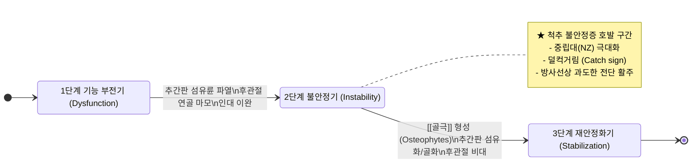
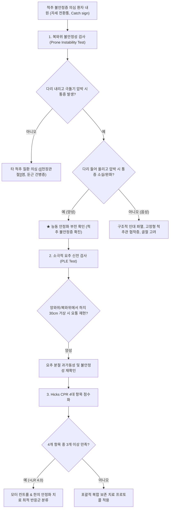
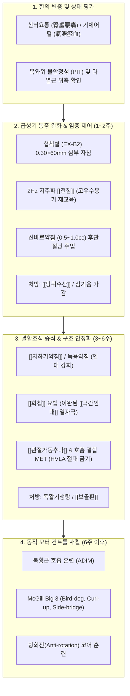
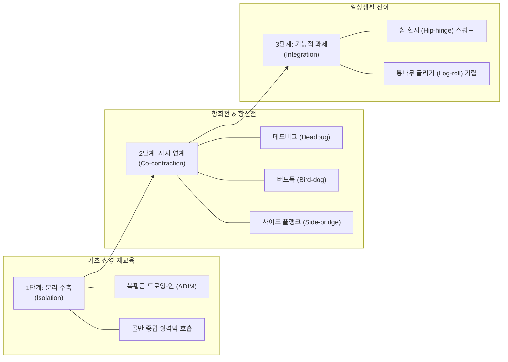

# 척추 불안정증 (Spinal Instability)

> **핵심 3줄 요약 (Key Summary)**:
> 🎯 척[[추체]]의 정상 생리적 하중 하에서 신경학적 결손이나 심각한 해부학적 변형 없이 분절 간 정렬을 유지하지 못하는 병태로, [[마노하르 판자비]](Manohar Panjabi) 박사의 '중립대(Neutral Zone)'가 병리적으로 확장되어 발생하는 척추 분절 제어 장애.
> 🚩 의자에서 일어서거나 침대에서 돌아누울 때 허리가 끊어질 듯 덜컥 어긋나는 걸림 통증(Instability Catch), 통증성 호(Painful Arc), 자가 지지 기립 징후([[고워 징후]]) 및 기침·재채기 시 복압 지지 상실로 인한 전격통이 임상적 특징.
> 🔍 심부 분절 안정화 근육인 [[복횡근]]과 [[다열근]]의 선제적 피드포워드(Feed-forward) 제어가 파탄되어 겉근육인 [[복직근]]과 [[척추기립근]]이 24시간 과수축하며 얕은 흉식 호흡을 유발하는 생체역학적 악순환을 형성하므로, 무분별한 척추 과신전 및 관절교정([[추나]] HVLA 스러스트)을 엄격히 배제하고 협척혈 심부 [[전침]], [[신바로약침]], [[독활기생탕]] 및 호흡 결합 모터 컨트롤 재활 훈련을 적용하는 것이 한의 통합 치료의 핵심.

---

## 1. 🩺 질환 개요 & 해부학적 병태생리

### 1.1 개념 정의 및 임상적 역학
[[척추 불안정증]](Spinal Instability), 특히 임상에서 가장 높은 빈도를 차지하는 [[요추 분절 불안정증]](Lumbar Segmental Instability, LSI)은 정상적인 생리적 하중과 체간 움직임 하에서 척추 분절 간의 과도한 비생리적 이상 가동성(Abnormal motion), 전단 활주(Shear translation), 비정상적 각형성(Angulation)이 발생하여 심각한 척추 구조 손상이나 신경학적 결손 없이도 국소적 요통 및 기능 장애를 초래하는 상태를 의미한다.

```
[척추 안정성(Spinal Stability)의 정의]
일상적인 하중 지탱 환경에서 척추의 신경근과 척수를 물리적 손상으로부터 보호하고,
초기 변형 없이 생체역학적 정렬을 유지하며, 통증이나 기능 부전 없이 움직임을 제어하는 능력
```

* **역학적 특성 및 유병률**:
  - **만성 비특이적 요통 내 비중**: 비특이적 만성 [[요통]] 환자의 약 30~45%가 잠재적인 척추 분절 불안정증을 동반하고 있는 것으로 보고된다.
  - **호발 연령 및 성별**: 20대 후반에서 40대 중반의 비교적 젊은 연령층에서 호발하며, 전신성 관절 이완증(Ligamentous laxity)을 가진 여성에서 빈발한다.
  - **수술 및 시술 후 증후군**: 추간판 탈출증으로 인한 부분 수핵 절제술(Discectomy)이나 척추 감압술(Laminectomy)을 시행받은 환자 중 15~25%에서 수술 부위의 구조적 지지대 상실로 분절 불안정증이 2차적으로 속발한다.
  - **운동 패턴 불균형군**: 헬스 웨이트 트레이닝 시 [[복직근]]과 대흉근 등 표재성 겉근육 위주로 발달시키고, 척추 심부 로컬 코어 근육([[복횡근]], [[다열근]], [[골반저근]])의 동적 협응을 훈련하지 않은 운동 동호인에서 고빈도로 관찰된다.

### 1.2 Panjabi 척추 안정화 3대 서브시스템 모델
1992년 예일 대학교의 생체역학자 [[마노하르 판자비]](Manohar M. Panjabi) 박사는 척추의 안정성이 단일 구조물의 강도가 아니라, 상호 유기적으로 결합된 **3대 서브시스템(Three Subsystems of Spinal Stability)**의 정밀한 협응에 의해 달성된다는 획기적인 모델을 제시하였다.

| 서브시스템 구분 | 주요 구성 해부 구조물 | 생체역학적 고유 역할 | 병리적 파탄 시 발현 양상 |
| :--- | :--- | :--- | :--- |
| **수동적 서브시스템<br>(Passive Subsystem)** | • 척[[추체]](Vertebral body)<br>• [[추간판]](섬유륜, 수핵)<br>• [[후관절낭]](Facet capsule)<br>• [[황색인대]](Ligamentum flavum)<br>• 극간·극상인대<br>• [[장골요추인대]] | • 관절 가동 범위(ROM)의 말단(End-range)에서 기계적 제동 제공<br>• 탄성 복원력을 통한 과도한 굴곡·신전·회전 억제<br>• 척추 정렬의 정적 골격 지지 | • 추간판 퇴행으로 인한 간격 협착<br>• 섬유륜 열상 및 후관절 이완<br>• 인대 탄성 상실로 인한 전방·후방 미세 활주 허용 |
| **능동적 서브시스템<br>(Active Subsystem)** | • 심부 로컬 근육([[다열근]], [[복횡근]], 회선근)<br>• 표재 글로벌 근육([[척추기립근]], [[요방형근]], [[복직근]], 내·외복사근) | • 관절 가동 범위 전반, 특히 **중립대(Neutral Zone)** 내부의 분절 안정성 제어<br>• 사지 움직임 전 복강내압(IAP) 형성 및 힘 폐쇄(Force closure) 달성 | • 심부 다열근의 지방 침윤 및 근위축<br>• 복횡근 선제적 활성화 지연<br>• 글로벌 겉근육의 보상적 24시간 경직 |
| **신경 제어 서브시스템<br>(Neural Control Subsystem)** | • 관절낭·인대 내 기계수용기(Ruffini, Pacini 소체)<br>• 근방추(Muscle spindle), 골지건기관(GTO)<br>• 척수 반사궁 및 중추신경계 운동 피질 | • 분절 간 하중, 위치, 변위 속도 감지<br>• 피드포워드(Feed-forward) 선제적 근수축 신호 하달<br>• 동적 반사 조절을 통한 돌발 부하 흡수 | • 고유수용성 감각 피드백 왜곡<br>• 근육 동원 타이밍 지연(Timing deficit)<br>• 중추신경계 운동 제어 지도(Motor map) 혼선 |

```
                       [Panjabi 척추 안정화 3대 서브시스템]
                                  ┌─────────────┐
                                  │ 신경 제어계 │ (센서 감지 & 타이밍 통제)
                                  └──────┬──────┘
                                         │ 피드백/피드포워드 신호
                        ┌────────────────┴────────────────┐
                        ▼                                 ▼
               ┌─────────────────┐               ┌─────────────────┐
               │  수동적 지지계  │ ◄───────────► │  능동적 지지계  │
               │ (척추골, 추간판, │   상호 보상   │ (심부 다열근,   │
               │   후관절, 인대) │   부하 전달   │   복횡근, 코어) │
               └─────────────────┘               └─────────────────┘
```

### 1.3 중립대(Neutral Zone) 가설과 탄성대(Elastic Zone)의 생체역학적 역동학
Panjabi 박사는 척추 운동 범위(Range of Motion, ROM)를 두 개의 핵심 영역으로 구분하였다:
1. **중립대(Neutral Zone, NZ)**: 척추 관절이 해부학적 중립 자세(Neutral posture) 근처에서 움직일 때, 관절낭이나 인대 등 수동적 구조물의 내부 저항과 마찰이 거의 발생하지 않는 자유로운 초기 가동 영역.
2. **탄성대(Elastic Zone, EZ)**: 중립대를 벗어나 가동 범위의 말단에 도달할 때, 인대와 관절낭의 결합조직이 팽팽하게 신장되면서 급격한 탄성 저항력을 형성하여 관절의 과도한 이탈을 방어하는 영역.

```
전체 가동 범위 (ROM) = 중립대 (Neutral Zone, NZ) + 탄성대 (Elastic Zone, EZ)
```

* **척추 불안정증의 생체역학적 본질**:
  - 임상적으로 척추 불안정증은 전체 ROM이 비정상적으로 커지는 것(과가동성, Hypermobility)만을 의미하지 않는다.
  - 불안정증의 진정한 병리적 본질은 **중립대(NZ)가 비정상적으로 확장(Pathological enlargement)되는 것**이다.
  - 중립대 내부에서는 수동적 인대가 저항을 걸어주지 못하므로, 오직 **신경 제어계의 지휘를 받는 심부 능동 근육([[다열근]], [[복횡근]])의 장력**만이 척추뼈의 위치를 제어할 수 있다.
  - 만약 심부 근육의 제어가 실패하여 넓어진 중립대 안에서 척추뼈가 무방비로 요동치면, 척추 분절 간의 '덜컥거림'과 미세 활주(Micro-slipping)가 격발되어 [[후관절낭]] 내 활액막과 섬유륜 외측에 분포하는 [[동척추신경]](Sinuvertebral nerve)의 자유 신경종말을 강타하여 극심한 불안정성 통증을 일으킨다.

### 1.4 Kirkaldy-Willis 척추 퇴행 3단계 모델
캐나다의 정형외과 의사 윌리엄 커칼디-윌리스(W. H. Kirkaldy-Willis) 박사는 요추 퇴행 과정이 시간에 따라 3단계의 생체역학적 경로를 밟는다는 이론을 확립하였다.



1. **1단계: 기능 부전기 (Dysfunction Phase, 20대~30대)**:
   - 반복적인 기계적 미세 손상으로 [[추간판]] 섬유륜의 방사상 균열(Radial tears)과 후관절 활액막염(Synovitis)이 시작된다.
   - 척추 분절의 유기적 구조는 유지되나, 가역적인 국소 근육 경련과 둔중한 요통이 간헐적으로 나타난다.
2. **2단계: 불안정기 (Instability Phase, 30대~50대)**:
   - **척추 불안정증이 집중적으로 발생하는 핵심 구간**.
   - 추간판 내부 수핵의 수분 탈락과 탈수, 섬유륜 파열로 인해 추간판의 완충 능력이 상실되고 분절 높이가 감소한다.
   - 추간판 높이가 낮아짐에 따라 후방의 후관절낭, [[황색인대]], [[극간인대]]가 상대적으로 느슨(Slacking)해진다.
   - 후관절 연골의 심각한 마모와 아탈구로 인해 척추 분절의 제어되지 않는 미세 이동, 전후방 전단 활주(Translation) 및 비정상적 비틀림 회전이 발생하여 환자는 체위 변경 시 극심한 통증성 걸림(Catch)을 경험한다.
3. **3단계: 재안정화기 (Stabilization Phase, 60대 이상)**:
   - 신체가 만성적인 불안정성을 극복하기 위한 보상 반응으로 척추체 변연부에 광범위한 [[골극]](Osteophytes)을 형성하고, 후관절 비대와 인대의 비후 및 석회화를 유도한다.
   - 분절 간의 과도한 움직임은 사라져 '안정화'되지만, 그 대가로 척추관(Spinal canal)과 추간공(Intervertebral foramen)이 물리적으로 좁아져 전형적인 [[척추관 협착증]](Spinal Stenosis)이나 고정된 강직성 변형으로 이행한다.

### 1.5 척추 분절 제어 단위의 해부학적 구성
요추 분절의 3차원 안정성은 모션 세그먼트(Motion segment: 2개의 인접 척추체와 그 사이의 추간판, 2개의 후관절 및 연결 인대)의 완전성에 의존한다.
* **추간판(Intervertebral Disc)**: 수핵의 유체정역학적 압력(Hydrostatic pressure)과 섬유륜의 교차 라멜라 구조(Crossed lamellar structure)가 압박 하중의 80%를 흡수하고 전단력에 저항한다.
* **후관절(Facet Joint)**: 시상면에서 약 45~60도의 경사를 이루어 요추의 과도한 회전(Axial rotation)과 전방 전위(Anterior translation)를 기계적으로 차단한다.
* **인대 복합체**:
  - **전종인대(ALL)**: 신전 동작 제한 및 척추체 전방 이탈 방지.
  - **후종인대(PLL)**: 굴곡 제한 및 수핵의 후방 탈출 방어.
  - **황색인대(Ligamentum Flavum)**: 탄성 섬유(Elastin)가 80%를 차지하여 중립대 복원을 보조.
  - **[[장골요추인대]](Iliolumbar Ligament)**: L5 횡돌기에서 장골능으로 이어져 L5-S1 분절의 회전 및 전방 전위를 제동하는 최후의 보루.

---

## 2. ⚡ 병태생리 메커니즘 & 생체역학적 악순환 네트워크

### 2.1 심부 이너 유닛(Inner Unit)의 피드포워드(Feed-forward) 선제적 제어 실패
호주 퀸즐랜드 대학교의 폴 호지스(Paul W. Hodges) 교수의 선구적 근전도 연구에 따르면, 정상적인 인체는 팔이나 다리를 움직이기 **30~110밀리초(ms) 전에** 심부 국소 안정화 근육군(Inner unit: [[다열근]], [[복횡근]], [[골반저근]], [[횡격막]])이 중추신경계의 무의식적 피드포워드(Feed-forward) 제어에 의해 선제적으로 수축한다.

```
[정상 피드포워드 기전]
사지 움직임 의도 발생 → 중추신경계 운동 프로그램 작동 
→ 사지 근육 수축 30~50ms 전 [복횡근 + 다열근 + [[횡격막]] + [[골반저근]]] 선제 수축 
→ 복강내압(IAP) 상승 & [[흉요근막]] 긴장 
→ 척추 분절의 사전 체결(Force Closure) 달성 → 안전한 사지 운동 발현
```

* **척추 불안정증 환자의 파탄 기전**:
  - 미세 손상, 통증 유발 물질(Substance P, CGRP), 관절염증 등으로 인해 척추 분절의 기계수용기에서 이상 신호가 유입되면, 척수 수준에서 심부 근육의 선제적 동원을 차단하는 **관절인성 근억제(Arthrogenic Muscle Inhibition, AMI)**가 발생한다.
  - 사지를 움직일 때 복횡근과 다열근의 수축 타이밍이 심각하게 지연되거나 완전히 침묵(Silent)한다.
  - 그 결과, 척추 분절이 사전에 잠기지 않은 무방비 상태에서 외부 하중과 사지 레버 암(Lever arm) 부하를 직접 받게 되어 척추뼈의 미세 탈구가 격발된다.

### 2.2 글로벌 모빌라이저의 과보상과 호흡 패턴 왜곡 네트워크
심부 로컬 안정화 근육이 제 기능을 잃어버리면, 신체는 척추가 무너지는 재앙을 막기 위해 차선책으로 표재성 글로벌 운동 근육(Outer unit)을 총동원하는 **보상적 과수축(Co-contraction)** 전략을 채택한다.

```
                   [글로벌 모빌라이저 과보상과 호흡 왜곡의 악순환]

                    심부 로컬 코어 ([[복횡근]], [[다열근]]) 기능 억제
                                      │
                                      ▼
                    척추 분절의 제어되지 않는 미세 활주 (Micro-motion)
                                      │
                                      ▼
                 겉근육 ([[복직근]], [[척추기립근]], [[요방형근]])의 24시간 과수축
                                      │
                     ┌────────────────┴────────────────┐
                     ▼                                 ▼
             흉요추 압박 하중 급증               복벽의 지속적 강직
           (추간판 퇴행 & 후관절 마모 가속)                │
                     │                                 ▼
                     │                     [[횡격막]]의 정상 수축·하강 차단
                     │                                 │
                     │                                 ▼
                     │                     얕고 빠른 흉식 호흡 (Apical Breathing)
                     │                                 │
                     │                                 ▼
                     │                     목·어깨 보조 호흡근 (사각근, 승모근) 과긴장
                     │                                 │
                     └────────────────►◄───────────────┘
                                        │
                                        ▼
                           만성 척추 불안정성 및 전신 근막통증화
```

1. **복직근과 기립근의 24시간 스플린팅(Splinting)**:
   - 신체는 헐렁해진 척추를 통나무처럼 굳히기 위해 **[[복직근]](Rectus abdominis)**과 **[[척추기립근]](Erector spinae)**을 강하게 쥐어짜는 브레이크 상태를 만든다.
   - 이로 인해 환자는 휴식 시나 침대에 누워있을 때조차 복부와 허리가 돌처럼 딱딱하게 굳어있게 된다.
2. **호흡 패턴 왜곡 (Shallow Apical Breathing)**:
   - 복벽 전체가 과도하게 수축되어 단단히 잠겨있으므로, 호흡 시 [[횡격막]](Diaphragm)이 복강 방향으로 원활하게 하강하지 못한다.
   - 환자는 횡격막 호흡 대신 갈비뼈를 위로 치켜들며 얕고 가쁜 **상부 흉식 호흡**을 하게 된다.
   - 보조 호흡근인 [[사각근]], 흉쇄유돌근, 상부 [[승모근]]이 과로하여 만성적인 경추통과 긴장성 두통이 동반된다.
3. **추간판의 축성 압박 부하 가속화**:
   - 글로벌 근육의 동시 수축(Co-contraction)은 척추 분절에 가해지는 축성 압축 하중(Axial compressive load)을 정상의 2~3배 이상으로 폭증시킨다.
   - 이는 퇴행성 추간판 질환([[요추 추간판 탈출증]])과 후관절 [[골관절염]]을 폭발적으로 악화시키는 결정적 동인이 된다.

### 2.3 [[흉요근막]](Thoracolumbar Fascia) 텐션 왜곡과 힘 폐쇄(Force Closure) 붕괴
네덜란드의 임상해부학자 안드리스 블리밍(Andry Vleeming) 교수는 관절의 안정성을 **형상 폐쇄(Form Closure)**와 **힘 폐쇄(Force Closure)**로 설명하였다.
* **형상 폐쇄**: [[천장관절]]이나 후관절의 뼈 자체의 기하학적 맞물림에 의한 수동적 결합력.
* **힘 폐쇄**: 관절을 가로지르는 인대, 근육, 근막의 동적 장력에 의해 압박력을 발생시켜 관절면을 밀착시키는 메커니즘.

[[척추 불안정증]]에서는 [[복횡근]]이 수축하여 [[흉요근막]](Thoracolumbar fascia)의 후엽과 중엽을 양옆으로 팽팽하게 당겨주는 '코르셋 효과(Corset effect)'가 소실된다. 흉요근막의 장력이 느슨해지면 다열근을 감싸는 근막 구획의 내압이 떨어져 척추 분절의 힘 폐쇄가 완전히 붕괴된다.

### 2.4 동척추신경(Sinuvertebral Nerve) 자극과 척추 후관절 활액낭염의 악순환
척추 분절의 미세 전단 활주는 후종인대와 섬유륜 외측, 후관절낭 전방에 분포하는 **[[동척추신경]](Sinuvertebral nerve, 루슈카 신경)**의 무수 C-섬유(C-fibers)를 지속적으로 기계적 압박·견인한다.
* 역치가 낮아진 신경 말단에서 P물질(Substance P), 칼시토닌 유전자 관련 펩타이드(CGRP)가 역행성 분비되어 후관절 내 혈관 투과성을 증가시키고 무균성 신경인성 염증(Neurogenic inflammation)을 유발한다.
* 이는 분절 척수 반사를 통해 다열근으로 가는 후지 내측지(Medial branch)의 전도를 방해하여 근위축을 더욱 가속화하는 파괴적인 악순환 고리를 완성한다.

---

## 3. 🔍 임상 증상 & 이학적 검사 알고리즘

### 3.1 특징적 자각 증상 및 통증 발현 패턴
척추 불안정증 환자가 호소하는 자각 증상은 지속적인 신경 압박 증상과는 현저히 다른 독특한 역동학적 패턴을 보인다.

* **불안정성 걸림 (Instability Catch / Sudden Catching Pain)**:
  - 척추 불안정증의 가장 병리 특이적인 증상.
  - 세수를 하기 위해 허리를 숙였다가 펴는 동작의 중간 각도(대개 30~45도 부근)에서, 허리가 특정 지점에서 덜컥하며 뼈마디가 어긋나 꼼짝달싹 못 하는 전격적인 걸림 통증이 발생한다.
* **통증성 호 (Painful Arc)**:
  - 완전 굴곡 상태나 완전 기립 상태에서는 통증이 없거나 경미하지만, 굴곡에서 신전으로 복귀하는 중간 궤적에서만 극심한 통증 호(Arc)가 나타난다.
* **불안 징후 (Apprehension Sign)**:
  - 의자에서 일어날 때, 침대에서 옆으로 돌아누울 때(Rolling over), 버스 손잡이를 잡고 흔들릴 때 허리가 부러질 것 같은 공포감을 느껴 몸을 웅크리거나 손으로 주변 물건이나 허리를 부여잡는다.
* **장시간 좌식 및 기립 유지 불능**:
  - 등받이가 없는 의자에 10~20분 이상 앉아있지 못하고 계속해서 자세를 비틀거나 손으로 턱을 괴거나 허벅지를 짚어 체중을 분산하려 한다.
* **복압 급증 시 척추 기저부 지지 상실**:
  - 기침, 재채기, 배변 시 복압을 버텨줄 이너 유닛의 힘 폐쇄가 풀려있어, 기침을 하는 순간 허리가 밑으로 쑥 빠지거나 주저앉을 듯한 극심한 충격을 호소한다.

### 3.2 신체 이상 운동 징후 (Aberrant Motion)
환자에게 기립 상태에서 허리를 앞으로 숙였다가 다시 완전히 펴보도록 지시했을 때, 정상적인 부드러운 시상면 호(Sagittal arc)를 그리지 못하고 다음과 같은 4대 이상 운동 패턴이 관찰된다.

1. **자가 지지 기립 징후 (Gower's Sign / Thigh Climbing Sign)**:
   - 허리를 펴는 도중 신전근의 분절 제어력이 고갈되어, 양손으로 자신의 허벅지나 무릎을 계단 오르듯 짚고 올라오면서 체간을 억지로 일으켜 세우는 현상.
2. **불안정성 걸림 (Instability Catch)**:
   - 일어나는 도중 특정 각도에서 순간적으로 멈칫하며 몸을 옆으로 비틀거나 휘청거리는 동작.
3. **통증성 호 (Painful Arc on Return)**:
   - 복귀 궤적의 중간에서 비명을 지르거나 통증으로 체간을 반대 방향으로 회피.
4. **척추 전단 떨림 (Instability Shake / Jittery Motion)**:
   - 척추가 신전되는 동안 분절 단위에서 제어가 불가능한 미세 경련과 떨림이 육안으로 관찰됨.

### 3.3 핵심 이학적 검사법



#### 1) 복와위 불안정성 검사 (Prone Instability Test, PIT)
척추 불안정증을 선별하는 전 세계 표준 이학적 검사법으로, 능동 근육 수축이 수동적 관절의 불안정성을 얼마나 보상할 수 있는지를 직접 증명한다.

* **1단계 (수동적 평가)**:
  - 환자는 검사대 가장자리에 복부를 대고 엎드리며, 두 발은 바닥을 디디고 몸통의 긴장을 완전히 푼다.
  - 검사자는 요추 각 분절의 극돌기(L1부터 L5까지)를 손바닥 수근부로 지면 방향(전방)으로 수직 압박한다.
  - 특정 분절에서 날카로운 요통이 격발되는 것을 확인한다.
* **2단계 (능동 근육 수축 평가)**:
  - 환자에게 양발을 바닥에서 살짝 들어 올려(약 10~15cm) 공중에 유지하도록 지시한다. (이 동작은 [[다열근]], [[척추기립근]], 둔근을 강력하게 동원시킨다).
  - 환자가 다리를 들고 있는 상태에서, 1단계에서 통증이 발생했던 동일한 극돌기를 동일한 강도로 다시 수직 압박한다.
* **양성 판정 기준**:
  - **다리를 들었을 때 1단계에서 나타났던 통증이 현저하게 소실되거나 50% 이상 격감하면 '양성(Positive)'으로 확진**한다.
  - 임상적 의미: 능동적 근육 서브시스템이 작동할 때 불안정한 관절이 견고하게 체결됨을 의미하며, 이는 코어 안정화 치료에 극도로 우수한 반응을 보일 환자임을 입증한다.

#### 2) 소극적 요추 신전 검사 (Passive Lumbar Extension Test, PLE)
* **검사 방법**: 환자가 복와위로 엎드린 상태에서, 검사자가 양하지의 발목을 잡고 무릎을 편 채로 침대 면에서 약 30cm 높이로 부드럽게 들어 올려 요추를 수동적으로 신전시킨다.
* **양성 반응**: 요추 신전 시 허리에 심한 묵직함, 찌르는 듯한 통증, 또는 하지가 떨어져 나갈 듯한 불안정감을 호소하다가, 다리를 다시 침대에 내려놓으면 즉시 통증이 사라지는 경우.
* **진단적 가치**: 민감도 84%, 특이도 90%로 방사선학적 불안정증과 높은 상관관계를 가진다.

#### 3) 골드스웨이트 검사 (Goldthwait's Test)
환자를 앙와위로 눕히고 검사자의 한 손을 환자의 요천추 이행부(L4-L5-S1) 극돌기 사이에 위치시킨 후 다른 손으로 [[하지직거상검사|하지직거상]](SLR)을 천천히 시행한다.
* 다리를 들어 올리는 초기 각도에서 극돌기 사이가 비정상적으로 덜컥거리며 벌어지거나 어긋나는 움직임이 손끝에 촉지되는 경우 분절 인대 이완 및 불안정증으로 판정한다.

### 3.4 Hicks 임상 예측 규칙 (Clinical Prediction Rule, CPR)
그레고리 힉스(Gregory E. Hicks) 박사는 척추 안정화 운동 프로그램에 탁월한 임상적 호전을 보일 환자를 선별하기 위해 4가지 핵심 인자로 구성된 임상 예측 규칙을 발표하였다.

| 번호 | 예측 인자 항목 (Predictor Variables) | 임상적 의의 및 판별 기준 |
| :---: | :--- | :--- |
| **1** | **나이 40세 미만 (Age < 40 years)** | 척추 퇴행 3단계(재안정화기)에 도달하지 않은 유연한 척추 상태 |
| **2** | **[[하지직거상검사]](SLR) 각도 91도 이상** | 전신적 인대 이완증 및 관절 과가동성(General laxity) 존재 |
| **3** | **신체 이상 운동 관찰 (Aberrant Motion (+))** | 굴곡-신전 시 Gower 징후, 통증성 호, 덜컥거림 중 1개 이상 발현 |
| **4** | **복와위 불안정성 검사 양성 (PIT (+))** | 능동 근수축 시 수동 극돌기 압박 통증이 즉각 소실됨 |

* **임상적 판정 가치**:
  - **4개 중 3개 이상 만족 시**: 양성 우도비(+LR)가 **4.0**으로 급상승하여 안정화 치료 시 증상 호전 성공률이 80% 이상으로 예측된다.
  - **4개 모두 음성인 경우**: 음성 우도비(-LR)가 0.18로, 척추 불안정증 가능성이 매우 희박하다.

### 3.5 방사선학적 진단 기준 (Dynamic Flexion-Extension Radiography)
척추 불안정증의 객관적 구조 평가는 단순 전후면/측면 X-ray가 아닌, **동적 굴곡-신전 측면 방사선 검사(Dynamic Lumbar Spine Series)**를 통해 이루어진다.

```
                   [동적 X-ray 시상면 전위 측정: Dupuis & White-Panjabi 기준]

         [최대 굴곡 측면상 (Flexion)]                  [최대 신전 측면상 (Extension)]
              ┌─────────┐                                   ┌─────────┐
              │ 척추체  │                                   │ 척추체  │
              └────┬────┘                                   └────┬────┘
                   │ ◄─── Δd (전위 차이) ───►                    │
              ┌────┴────┐                                   ┌────┴────┐
              │ 하위체  │                                   │ 하위체  │
              └─────────┘                                   └─────────┘
```

1. **시상면 전방/후방 전위 (Sagittal Translation)**:
   - 최대 굴곡 측면상과 최대 신전 측면상에서 하위 척추체 후상방 모서리를 기준으로 상위 척추체 후하방 모서리의 상대적 전위 차이($\Delta d$)를 측정.
   - **양성 기준**: **$\Delta d \ge 3.0 \sim 4.5\text{ mm}$** (또는 척추체 전후 직경의 8~10% 이상). L4-L5 분절에서 가장 빈번하게 관찰된다.
2. **시상면 각형성 변화 (Dynamic Sagittal Rotation / Angulation)**:
   - 굴곡 상태와 신전 상태에서 상하 척추체 종판(Endplate)이 이루는 콥스 각도(Cobb's angle)의 변화량을 측정.
   - **양성 기준**: L1-L2, L2-L3, L3-L4에서 **$15^\circ$ 이상**, L4-L5에서 **$20^\circ$ 이상**, L5-S1에서 **$25^\circ$ 이상**이거나, 인접 정상 분절보다 **$10^\circ$ 이상** 과도한 각도 변화를 보일 때.
3. **간접적 방사선 징후**:
   - **견인성 골극(Traction Spur)**: 척추체 변연부에서 수평 방향으로 튀어나온 뼈 돌기로, 분절 간 비정상적 전단력의 만성적 작용을 증명.
   - **진공 현상(Vacuum Phenomenon)**: 추간판 내부 수핵 소실 부위에 질소 가스가 음압에 의해 차오르는 현상.

---

## 4. 🔀 감별 진단 매트릭스

### 4.1 유사 척추 질환 종합 감별 매트릭스

| 감별 질환 | 호발 연령 및 기전 | 주 통증 양상 및 악화 요인 | 특징적 이학적 검사 소견 | 방사선 및 MRI 소견 |
| :--- | :--- | :--- | :--- | :--- |
| [[척추 불안정증]] | 20~40대, 인대 이완,<br>코어 약화, 수술 후 | • 체위 변경 시 덜컥거림(Catch)<br>• 허리 숙였다 펼 때 격통<br>• 기침 시 허리 빠짐 | • PIT 검사 양성 (발 들면 소실)<br>• Gower 징후 (+)<br>• 복직근 상시 긴장, 흉식 호흡 | • 동적 X-ray 전위 $\ge 3.5\text{mm}$<br>• 견인성 골극, 진공 징후<br>• MRI상 심부 다열근 지방 침윤 |
| **단순 요추 염좌** | 전 연령, 급격한 비틀림,<br>무거운 물건 리프팅 | • 특정 동작 시 지속적 근육통<br>• 체위 변경통 없음<br>• 휴식 시 완만 | • PIT 검사 음성<br>• 척추주위근 국소 압통<br>• SLR 정상, 이상 운동 없음 | • 단순 X-ray 정상 정렬<br>• 전위나 각형성 이상 없음<br>• 추간판 높이 정상 유지 |
| [[요추 추간판 탈출증]] | 30~50대, 굴곡-회전 부하,<br>수핵 후방 탈출 | • 하지 방사통(Dermatome)<br>• 전방 굴곡 시 방사통 악화<br>• 신전 시 중심화(Centralization) | • SLR 양성 ($< 60^\circ$ 방사통)<br>• 기침 시 하지 저림 전파<br>• 감각 저하, 건반사 감약 | • MRI T2 축상면 수핵 탈출 확인<br>• 신경근(Nerve root) 직접 압박<br>• 섬유륜 파열(HIZ) |
| [[척추관 협착증]] | 60대 이상, 황색인대 비후,<br>후관절 골극 비대 | • 신경인성 간헐적 파행(NIC)<br>• 보행 시 둔부·하지 저림<br>• 허리 굴곡 시 완화 (쇼핑카트) | • 보행 부하 검사 양성<br>• Kemp 검사 양성<br>• 척추 전반의 뻣뻣한 강직 | • 척추관 단면적 $< 100\text{mm}^2$<br>• 황색인대 비후, 골극 형성<br>• Kirkaldy 3단계 안정화 |
| [[척추전방전위증]] | 50대 여성(퇴행성) 또는<br>유년기 협부 결손(협부형) | • 기립 시 요추 전만 증가통<br>• 장시간 보행 시 요통·파행<br>• 척추 후굴 시 악화 | • 극돌기 계단 변형(Step-off)<br>• 슬괵근(Hamstrings) 심한 경직<br>• Phalen-Dickson 보행 | • 측면 X-ray Meyerding 분류<br>• 전방 슬립 25% 이상 확인<br>• 양측 협부(Pars) 골 결손 |
| [[후관절 증후군]] | 40~60대, 후관절 마모,<br>활액막 압박 | • 척추 신전 및 회전 시 요통<br>• 둔부·대퇴 후면 가성 방사통<br>• 아침 기상 시 뻣뻣함 | • Kemp 검사 양성 (신전-회전)<br>• 후관절낭 직상방 국소 압통<br>• 무릎 아래 방사통 없음 | • X-ray 후관절 비대, 관절강 협착<br>• SPECT/CT 국소 섭취 증가<br>• 동적 전위 미미함 |

### 4.2 과가동성(Hypermobility) vs 저가동성(Hypomobility) 연쇄 반응
인체 척추는 '가동성 분절'과 '안정성 분절'이 교대로 교차하는 교차 관절 메커니즘을 가진다.
* **보상적 과가동성(Compensatory Hypermobility)**:
  - 흉추(Thoracic spine)의 신전 가동성이 제한되어 뻣뻣하거나, [[고관절]](Hip joint)의 신전·회전 가동성이 굳어있으면, 신체는 걷거나 물건을 들 때 부족한 움직임을 메우기 위해 **요추(L4-L5, L5-S1)를 과도하게 비틀고 꺾는 보상적 과가동성**을 발휘하게 된다.
  - 따라서 요추 불안정증 환자를 진찰할 때는 반드시 상부 흉추와 하부 고관절의 저가동성을 함께 평가하여 교정해야 한다.

---

## 5. 🌿 한의 통합 치료 프로토콜



### 5.1 한의학적 변증 체계
* **신허요통 (腎虛腰痛)**:
  - 선천적 골격 기운이 허약하거나 노화, 다산(多産), 과로로 신정(腎精)이 고갈되어 척추골을 단단히 묶어주는 독맥(督脈)과 대맥(帶脈)의 결속력이 느슨해진 상태.
  - 무릎과 허리가 시리고 힘이 없으며(산연무력, 酸軟無力), 오래 서 있지 못하고 은은한 통증이 지속된다.
* **기체어혈 (氣滯瘀血)**:
  - 척추 분절 간의 반복적인 미세 탈구와 전단 마찰로 인해 협척 부위의 미세 혈관이 파열되고 어혈이 맺힌 상태.
  - 특정 부위가 찌르듯이 아프고(자통, 刺痛), 밤에 자려고 누울 때 체위를 바꾸면 통증이 극심해진다.
* **담음유주 (痰飮流注)**:
  - 복벽의 긴장과 횡격막 호흡 장애로 인해 중초의 기기(氣機)가 울체되어 담음이 경락과 근막 사이에 정체된 상태. 허리가 무겁고 날씨가 흐리면 악화된다.

### 5.2 침구 및 전침 치료 SOP
심부 로컬 안정화 근육인 [[다열근]](Multifidus)은 척추 극돌기와 횡돌기 사이 깊은 홈에 위치하므로, 일반적인 30~40mm 침으로는 도달할 수 없다.

* **심부 협척혈(EX-B2) 정밀 자침 프로토콜**:
  - **사용 호침 규격**: 0.30×60mm 또는 0.35×75mm 멸균 일회용 호침.
  - **자침 깊이 및 각도**: 극돌기 외측 0.5~1.0촌 부위에서 척추 중심선 방향으로 10~15도 내측 사자(Oblique insertion)하여, 깊이 40~55mm 자입 후 **척추 후궁판(Vertebral Lamina) 골면에 침 끝이 가볍게 닿는 감각(Bony touch)**을 확인한다.
  - 침 끝이 심부 다열근의 근복(Muscle belly)을 관통할 때 특유의 뻐근하고 묵직한 득기(得氣) 감각이 유발된다.
* **원위 및 복벽 배혈**:
  - 후방: 신수(BL23), 기해수(BL24), 대장수(BL25), 차료(BL32), 곤륜(BL60).
  - 전방(복벽 조절): 관원(CV4), 기해(CV6), 중완(CV12), 천추(ST25), 대횡(SP15) 자침으로 과긴장된 복직근을 이완하고 복횡근의 수축 활성도를 자극.
* **저주파 전침 통전 (Neuromuscular Electrical Stimulation)**:
  - 불안정 분절 상하의 협척혈 쌍에 전극을 연결.
  - **주파수 설정**: **2Hz 연속파(Continuous wave)**.
  - 생체역학적 근거: 2Hz의 저주파 자극은 근위축을 방지하고, 피로에 강한 지근 섬유(Type I slow-twitch fiber)를 선택적으로 재교육하며, 관절낭 내 억제된 고유수용성 감각 신경의 발화를 정상화한다. (통전 시간: 15~20분).

### 5.3 약침 및 [[화침]] 요법
* **[[신바로약침]](GCSB-5)**:
  - 방풍, 우슬, 오가피, 구척, 두충, 하수오 등 6대 생약 복합 추출물로 구성.
  - 작용 기전: 척추 분절의 미세 충돌로 발생하는 국소 염증성 사이토카인(TNF-$\alpha$, IL-$1\beta$)과 류코트리엔(Leukotriene) 생성을 강력 차단하고 연골 세포를 보호.
  - 주입 부위: 불안정 분절 후관절낭 직상방 및 극간인대 부위에 1.0~2.0cc 심부 주입.
* **자하거(인태반) 및 녹용 약침**:
  - 만성적인 인대 이완증 환자에게 적용하여 콜라겐 합성을 유도하고 인대-골 부착부(Enthesis)의 결합력을 증강시키는 한의학적 증식(Prolotherapy) 효과 발휘.
* **화침(溫鍼/火鍼) 요법**:
  - 느슨해진 극간인대(Interspinous ligament)와 장골요추인대 부위에 자침 후 침체에 열 자극을 가하여, 이완된 결합조직 섬유의 미세 열수축(Thermal shrinkage)과 섬유아세포 증식을 촉진.

### 5.4 추나요법 (Chuna Manual Therapy) 핵심 원칙
* ⚠️ **고속저진폭(HVLA) 스러스트 기법의 절대 금기 (Absolute Contraindication)**:
  - 척추를 비틀어 '두둑' 소리를 내는 강한 관절교정 추나는 이미 헐렁해진 후관절낭과 극간인대를 물리적으로 더욱 늘어나게(Over-stretching) 만든다.
  - 단기적으로는 후관절 기계수용기 자극으로 일시적 통증 완화를 느낄 수 있으나, 장기적으로는 인대 이완을 가속하여 척추 불안정증을 재앙적인 수준으로 악화시키므로 엄격히 금기한다.
* **적용 가능한 수기 기법**:
  1. **근에너지 기법 (Muscle Energy Technique, MET)**:
     - 환자의 호흡과 가벼운 등장성/등척성 수축(최대 근력의 20% 미만)을 결합하여 요방형근, [[장요근]], [[이상근]]의 비대칭적 단축을 부드럽게 이완.
  2. **[[관절가동추나]] (Mobilization)**:
     - Maitland Grade I~II 수준의 미세한 저진폭 율동적 견인 및 활주를 적용하여 관절강 내 활액 순환을 촉진하고 통증 역치를 정상화.
  3. **골반 정렬 추나**:
     - 천장관절의 아탈구와 장골의 전방/후방 회전 변위를 바로잡아 요천추 기저부의 안정된 받침대(Base)를 복원.

### 5.5 변증별 한약 처방
* **[[독활기생탕]](獨活寄生湯)**:
  - 간신부족(肝腎不足)과 풍한습사(風寒濕邪)가 겹쳐 허리가 시리고 덜컥거리며 다리가 저린 만성 척추 불안정증의 제1선 처방.
  - 독활, 방풍, 진교(거풍습 지통) + 두충, 우슬, 상기생(보간신 장근골) + 당귀, 작약, 숙지황, 천궁(보혈 활혈) + 인삼, 복령(보기 건비).
* **[[삼기음]](三奇飮)**:
  - 기혈이 극도로 허약하여 척추를 받쳐주는 힘이 완전히 빠진 노인성·산후 척추 불안정증에 황기, 당귀, 두충을 배합하여 척추 지지력을 보강.
* **신바로환 (GCSB-5 제제)**:
  - 척추 관절의 무균성 신경염증을 억제하고 신경 재생을 촉진하는 원내 고정 처방.
* **[[보골환]](補骨丸) 합 [[육미지황탕]](六味地黃湯)**:
  - 골다공증이 동반되거나 인대 결합력이 떨어진 갱년기 여성의 척추 지지 결합조직 강화.

---

## 6. 💊 양방 치료 & 병용·의뢰 기준

### 6.1 급성기 양방 보존 치료
* **경구 약물 치료**:
  - 급성 통증기: 비스테로이드성 소염진통제(NSAIDs: 세레콕시브, 멜록시캄 등)를 투여하여 후관절낭염을 억제.
  - 중추성 근이완제(에페리손 등): 글로벌 근육의 극심한 근경련 완화. 단, 과도한 이완은 능동적 안정성을 더욱 떨어뜨릴 수 있으므로 1~2주 이내 단기 사용.
  - 가바펜티노이드(프레가발린 등): 동척추신경 자극으로 인한 신경병증성 가성 방사통 완화.
* **척추 보조기(Lumbar Corset)의 양날의 검**:
  - 급성 걸림 통증 발생 시 1~2주간의 외장성 코르셋 착용은 물리적 안정성을 제공하여 일상생활을 가능하게 한다.
  - ⚠️ **착용 기간 엄격 제한**: **3주 이상 지속 착용 시** 환자의 [[복횡근]]과 [[다열근]]이 보조기에 의존하여 급격한 불용성 근위축(Disuse atrophy)이 진행되므로, 통증이 완화되는 즉시 보조기를 벗고 능동 코어 운동으로 전환해야 한다.

### 6.2 척추 중재술 (Interventional Procedures)
* **후관절 내측지 차단술 (Medial Branch Block, MBB)**:
  - 불안정한 분절의 후관절을 지배하는 척수신경 후지 내측지에 국소마취제와 스테로이드를 주입하여 통증 전달 차단.
  - 진단적 가치: MBB 후 통증이 80% 이상 소실되면 후관절성 불안정증 통증으로 확진.
* **고주파 열응고술 (Radiofrequency Ablation, RFA)**:
  - MBB에 일시적 반응만 보이는 난치성 환자에서 신경을 응고시켜 6~12개월간 제통 효과 유지.

### 6.3 수술적 치료 적응증 및 술식
* **수술 고려 기준**:
  - 3~6개월 이상의 철저한 보존적 치료(한의 치료 및 모터 컨트롤 운동)에도 불구하고 일상생활이 완전히 불가능한 극심한 요통이 지속되는 경우.
  - 동적 X-ray상 전방 전위가 $4.5\text{ mm}$ 이상으로 진행하며 [[마미 증후군]]이나 족하수(Foot drop) 등 신경학적 결손이 동반된 경우.
* **표준 수술 기법**:
  - **요추 유합술 (Lumbar Spinal Fusion)**: 불안정한 분절의 추간판을 제거하고 케이지(Cage)와 자가골을 삽입한 후 나사못(Pedicle screws)으로 고정하여 하나의 뼈로 유합(TLIF, PLIF, ALIF 등).
  - ⚠️ **유합술 후 문제점 (인접 분절 질환, ASD)**: 유합된 분절은 움직임이 사라지므로, 척추 가동 시 발생하는 기계적 부하가 바로 위나 아래 분절로 고스란히 전가되어 5~10년 내에 인접 분절의 불안정증 및 디스크 파열이 발생하는 치명적 한계가 존재한다.

### 6.4 즉각적 응급 의뢰 레드 플래그 (Red Flags)
다음 징후가 나타나면 지체 없이 상급병원 척추외과로 전원하여 응급 정밀 영상 및 수술을 의뢰해야 한다:
1. **[[마미 증후군]](Cauda Equina Syndrome)**: 안장 부위(회음부, 둔부 내측)의 감각 소실(Saddle anesthesia), 요실금 또는 급성 요폐(Urinary retention), 변실금 발생.
2. **진행성 운동 신경 마비**: 족배굴곡근(Tibialis anterior) 마비로 인한 [[족하수]](Foot drop) 발현 (보행 시 발가락이 끌림).
3. **불명열 및 체중 감소 동반**: 척추 골수염, 결핵성 척추염, 전이성 악성 종양 의심.

---

## 7. 🏃 재활 운동 & 생활습관 티칭 가이드



### 7.1 단계별 모터 컨트롤 재활 훈련 (Motor Control Training)

#### 1단계: 복횡근 드로잉-인 기법 (Abdominal Draw-In Maneuver, ADIM)
* **목표**: 과긴장된 겉근육([[복직근]])을 배제하고, 꺼져있는 심부 [[복횡근]]만을 선택적으로 켜는 신경근 재교육.
* **수행 방법**:
  1. 환자는 무릎을 90도로 세우고 편안히 눕는다(Hook-lying position). 요추 아래에 얇은 수건을 받쳐 골반 중립(Neutral pelvis)을 유지한다.
  2. 양 손가락을 골반 앞쪽 튀어나온 뼈(ASIS)에서 안쪽으로 2cm, 아래로 2cm 이동하여 복벽에 가볍게 올려놓는다.
  3. 코로 숨을 부드럽게 들이마셔 아랫배가 풍선처럼 부풀어 오르게 한 후, 입으로 가늘고 길게 숨을 내쉰다.
  4. 숨을 끝까지 내쉬는 마지막 순간, **"배꼽을 척추 쪽으로 20~30%의 아주 가벼운 힘으로 살짝 당겨 넣는다"**는 느낌으로 복벽을 조인다.
  5. 이때 손가락 밑에서 복벽이 단단해지는 장력이 느껴져야 하며, **배가 불룩 튀어나오거나(복직근 보상) 갈비뼈가 들리면 실패**이다. 10초 유지, 10회 반복.

#### 2단계: 4지 독립 연계 훈련 (Deadbug & Bird-dog)
척추 분절을 중립 상태로 고정(Bracing)한 채, 사지만을 독립적으로 움직여 척추에 가해지는 회전력과 신전력에 저항하는 훈련.
* **데드버그 (Deadbug)**:
  - 앙와위에서 양팔을 천장으로 뻗고 고관절과 무릎을 90도로 든 상태에서, 복횡근 수축을 유지하며 대각선 방향의 팔과 다리(오른팔과 왼다리)를 바닥을 향해 천천히 뻗었다가 돌아온다. 허리가 바닥에서 뜨지 않도록 철저히 잠근다.
* **버드독 (Bird-dog)**:
  - 네발기기 자세(Quadruped)에서 척추 중립을 유지하고, 대각선 팔다리를 지면과 수평이 되도록 뻗는다. 이때 골반이 좌우로 기울어지거나 허리가 아래로 꺾이지(과신전) 않도록 주의한다. 5초 유지, 교대 10회.

#### 3단계: McGill Big 3 코어 안정화 훈련
캐나다 워털루 대학교의 스튜어트 맥길(Stuart McGill) 교수가 입증한 요추 압박 하중을 최소화하면서 척추 안정성을 극대화하는 3대 운동.
1. **변형 컬업 (Modified Curl-Up)**: 한쪽 무릎은 세우고 한쪽 다리는 편 채, 양손을 요추 밑에 받쳐 중립을 유지하고 머리와 어깨만 바닥에서 2~3cm 살짝 들어 올려 복벽을 체결.
2. **사이드 브릿지 (Side Bridge / Side Plank)**: 측와위에서 팔꿈치로 바닥을 지지하고 골반을 들어 올려 [[요방형근]]과 외복사근의 측방 안정성을 강화.
3. **버드독 (Bird-Dog)**: 후방 사선 사슬([[다열근]]과 반대측 [[대둔근]])의 협응력 완성.

### 7.2 일상생활 동작(ADL) 티칭 가이드라인
* **통나무 굴리기 기립법 (Log-Rolling Technique)**:
  - 아침에 잠자리에서 일어날 때 상체만 먼저 비틀어 일으키면 분절 전단력이 극대화되어 허리가 덜컥거린다.
  - 반드시 베개를 벤 상태에서 어깨와 골반, 무릎을 한 덩어리의 통나무처럼 동시에 옆으로 돌려 눕고, 침대 밖으로 다리를 먼저 떨어뜨리면서 양팔로 매트리스를 밀며 상체를 일으켜 세운다.
* **힙 힌지 (Hip-Hinge) 동작 체득**:
  - 세수를 하거나 바닥의 물건을 집을 때 허리를 둥글게 구부리지(Spinal flexion) 말고, 고관절을 경첩(Hinge)처럼 접어 엉덩이를 뒤로 빼고 무릎을 살짝 굽혀 척추 중립을 유지한다.

### 7.3 절대 금기 운동 및 생활 습관
* ❌ **윗몸일으키기 (Sit-Up) 및 크런치 (Crunch)**: 요추에 3,300N 이상의 치명적 압박력과 반복 전단력을 가하여 추간판 파열 가속.
* ❌ **슈퍼맨 자세 (복와위 요추 과신전)**: 후관절끼리 심하게 충돌하여 후관절낭염과 척추 후궁 피로골절 유발.
* ❌ **폼롤러를 허리 뒤에 받치고 뒤로 꺾는 스트레칭**: 느슨해진 전종인대와 섬유륜을 강제로 늘려 불안정증을 폭발적으로 악화시킴.

---

## 8. 💡 사용자 진료실 핵심 필기 & 임상 노하우 (Melt-In)

### 8.1 복부 촉진과 호흡 패턴 진찰 비법 (진료실 시크릿)
* **환자의 배와 호흡을 가장 먼저 보라**:
  - 척추 불안정증 환자는 진찰대(베드)에 누워있을 때도 **배(복부)를 촉진해보면 복직근 부위가 돌처럼 딱딱하게 굳어있고, 숨을 쉴 때 배가 전혀 움직이지 않고 가슴만 헐떡이며 들썩인다**.
  - **환자 티칭 화법**:
    > "환자분, 지금 허리가 불안정해서 흔들리니까, 뇌가 허리를 보호하려고 앞쪽 복근([[복직근]])을 24시간 브레이크로 꽉 쥐고 있는 상태입니다. 브레이크를 밟은 채로 액셀을 밟으니 허리 관절이 다 닳고 숨도 얕게 쉬어지는 것입니다."
  - 진료실에서 베개로 무릎을 받쳐주고, 양손을 아랫배에 얹은 채 복부의 힘을 완전히 빼고 아랫배로 천천히 숨을 들이마시는 '복식 호흡'을 단 3분만 지도해도, 그 자리에서 허리를 짓누르던 묵직한 통증의 절반이 즉각 사라진다.

### 8.2 "허리가 덜컥 빠진다"는 환자 호소의 임상적 번역
* **호소 패턴의 특이성**:
  - 환자가 "세수하다가 허리가 덜컥했다", "침대에서 돌아눕는데 허리가 뚝 떨어지는 느낌이 들었다", "의자에서 일어날 때 허리를 손으로 받치지 않으면 부러질 것 같아 못 일어난다"고 호소할 때는, 디스크 탈출증이나 단순 염좌가 아니라 **1순위로 '요추 분절 불안정증'을 진단**하라.
  - 디스크 파열 환자는 주로 "다리가 찌릿하게 저려 내려간다"를 호소하지만, 불안정증 환자는 "허리가 지탱이 안 되고 끊어질 것 같다"는 구조적 공포감을 호소한다.

### 8.3 촉진 시 만져지는 '계단 변형(Step-off)'과 극돌기 간 유격 감별
* 환자를 복와위로 눕히고 흉추부터 천골까지 극돌기 정중선을 엄지손가락으로 훑어 내릴 때, 특정 분절(예: L4-L5 사이)에서 손가락이 턱 하고 아래로 푹 꺼지는 **계단 변형(Step-off sign)**이 만져진다면, [[척추분리증]]에 동반된 협부형 [[척추전방전위증]] 또는 심각한 인대 이완성 불안정증을 확진할 수 있다.

### 8.4 추나 치료 시 시술자의 손끝 감각 팁
* 척추 불안정증 환자가 오면 젊은 한의사들은 무의식적으로 분절을 맞춰주겠다며 앙와위 골반 교정이나 요추 회전 교정(HVLA)을 강하게 시도하려는 유혹에 빠진다.
* **절대 관절을 꺾지 마라**: 이미 관절을 싸고 있는 주머니가 다 늘어나서 덜렁거리는 상태이다. 손으로 관절을 꺾어 '뚝' 소리를 내는 순간, 환자는 며칠간 극심한 분절 덜컥거림으로 진료실 문을 박차고 들어올 것이다.
* 시술자는 손바닥으로 요천추부를 부드럽게 감싸고, 환자에게 복식 호흡을 시키며 호기 시 아주 미세한 장력(Grade I)으로 천골을 미골 방향으로 쓸어내리는 견인과 [[장요근]] MET만을 적용해야 한다.

---

## 9. 📚 출처 및 현대 학술 연구 요약

1. Panjabi MM. (1992). The stabilizing system of the spine. Part II. Neutral zone and instability hypothesis. *J Spinal Disord*, 5(4):390-396. PMID: 1490035.
   - [연구 요약]: 척추 안정화 기전에서 중립대(Neutral zone)의 개념을 최초로 제안하고, 척추 분절 손상 및 능동 근육 제어 실패 시 중립대가 비정상적으로 확장되어 임상적 불안정증과 후관절 통증이 격발된다는 가설을 생체역학적으로 입증함.
2. Hodges PW, Richardson CA. (1996). Inefficient muscular stabilization of the lumbar spine associated with low back pain. A motor control evaluation of transversus abdominis. *Spine (Phila Pa 1976)*, 21(22):2640-2650. PMID: 8961451.
   - [연구 요약]: 하지 움직임 전 복횡근(TrA)의 선제적 수축(Feed-forward) 기전을 근전도로 측정하여, 만성 요통 환자군에서 복횡근 활성화 타이밍이 유의미하게 지연되어 척추 분절 제어 실패가 초래됨을 세계 최초로 실증함.
3. Hicks GE, Fritz JM, Delitto A, McGill SM. (2005). Preliminary Development of a Clinical Prediction Rule for Determining which Patients with Low Back Pain will Respond to a Stabilization Exercise Program. *Arch Phys Med Rehabil*, 86(9):1753-1762. PMID: 16181938.
   - [연구 요약]: 요추 분절 불안정증 환자를 선별하고 안정화 운동 프로그램에 탁월한 호전을 보일 환자를 예측하는 4대 임상 예측 규칙(CPR: 나이 < 40, SLR > 91도, 이상 운동 관찰, PIT 검사 양성; 3개 이상 만족 시 +LR 4.0)을 확립함.
4. Kirkaldy-Willis WH, Farfan HF. (1982). Instability of the lumbar spine. *Clin Orthop Relat Res*, (165):110-123. PMID: 6210480.
   - [연구 요약]: 척추 퇴행의 3단계 모델(기능부전기, 불안정기, 재안정화기)을 정립하고, 2단계 불안정기에서 추간판 수핵 탈수, 섬유륜 파열 및 후관절 이완으로 인한 미세 전단 이동의 병리 기전을 규명함.
5. Fritz JM, Whitman JM, Childs JD. (2005). Lumbar spine segmental mobility assessment: an examination of validity for determining intervention strategies in patients with low back pain. *Arch Phys Med Rehabil*, 86(9):1745-1752. PMID: 16181937.
   - [연구 요약]: 도수 진찰을 통한 요추 분절 가동성 평가의 신뢰도와 타당도를 검증하고, 과가동성(불안정증) 분절 환자군에서 관절 조작술(HVLA)의 위험성과 안정화 운동의 임상적 우수성을 규명함.
6. MacDonald D, Moseley GL, Hodges PW. (2006). The lumbar multifidus: does the evidence support clinical beliefs? *Man Ther*, 11(4):254-263. PMID: 16716640.
   - [연구 요약]: 요추 심부 다열근의 천층 섬유와 심부 섬유의 차별적 역할을 분석하고, 요통 발생 후 심부 다열근의 선택적 근위축과 지방 침윤, 그리고 이를 회복하기 위한 특이적 분절 재훈련의 필요성을 체계적으로 고찰함.
