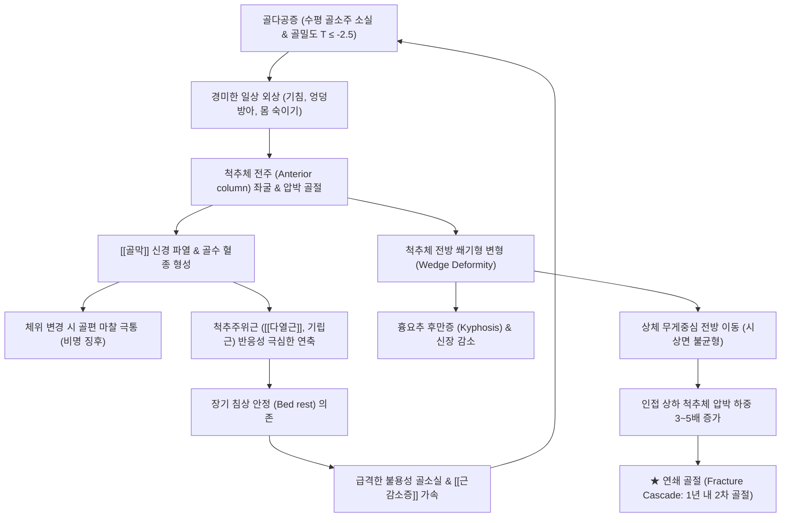
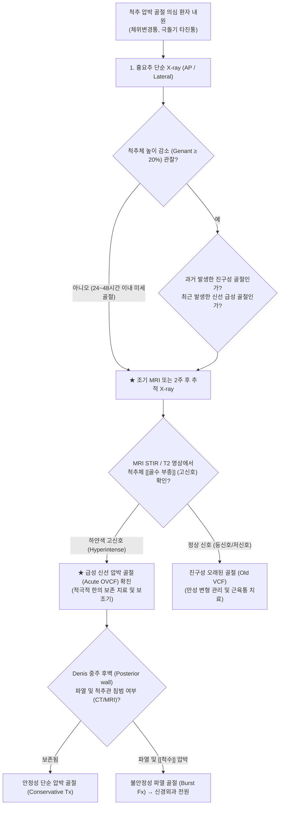
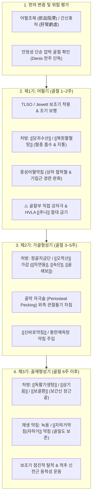
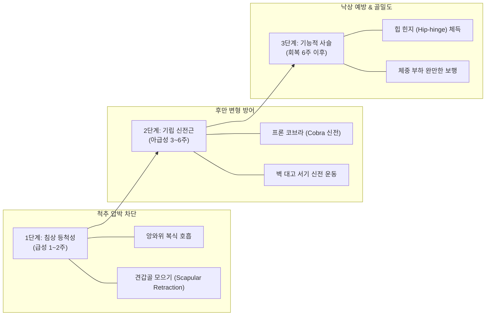

# 척추 압박 골절 (Vertebral Compression Fracture)

> **핵심 3줄 요약 (Key Summary)**:
> 🎯 [[골다공증]], 노화, 폐경 및 경미한 외상(낙상, 엉덩방아, 기침, 무거운 물건 들기)으로 인해 척추체 [[해면골]]의 미세 [[골소주]]가 하중을 버티지 못하고 붕괴되며, Denis 3-column 중 전주(Anterior column)가 주저앉아 쐐기형 변형(Wedge deformity)을 일으키는 골절성 질환.
> 🚩 가만히 누워있을 때는 둔통에 불과하나, 침대에서 옆으로 돌아눕거나(Rolling over) 누웠다 일어날 때 골절면이 미세하게 마찰되며 비명을 지를 듯 격발되는 극심한 체위 변환통과 척추 극돌기 직접 주먹 타진 시 날카로운 골성 압통([[타진 검사]])이 결정적 징후.
> 🔍 급성기 무리한 골절부 직접 강자극이나 관절교정([[추나]] HVLA 스러스트)은 골편 전위 및 [[척수]] 손상을 유발하므로 절대 금기이며, TLSO 보조기 착용 하에 1단계(어혈기: [[당귀수산]], 중성어혈약침) $\rightarrow$ 2단계(가골형성기: [[자연동]], [[속단]], [[골막]]자극술) $\rightarrow$ 3단계(골재형성기: [[독활기생탕]], [[삼기음]], [[신바로약침]])의 3단계 한의 통합 치료와 [[데노수맙]] 중단 후 반동 골절 예방 관리가 임상 성패를 좌우한다.

---

## 1. 🩺 질환 개요 & 해부학적 병태생리

### 1.1 정의 및 역학적 특성
[[척추 압박 골절]](Vertebral Compression Fracture, VCF), 특히 고령층에서 호발하는 [[골다공증성 척추 압박 골절]](Osteoporotic Vertebral Compression Fracture, OVCF)은 척추체를 구성하는 내부 [[해면골]](Cancellous bone)의 미세 [[골소주]](Trabeculae)가 광범위하게 소실되어 골강도가 저하된 상태에서, 수직 축성 압박력(Axial compressive force)과 전방 굴곡 모멘트(Flexion moment)를 견디지 못하고 척추체 높이가 주저앉으며 발생하는 병태이다.

```
[척추 압박 골절의 생체역학적 본질]
골다공증으로 수평 골소주 흡수 → 수직 골소주 기둥의 좌굴 (Buckling) 
→ 일상 하중 또는 경미한 굴곡 부하에서 척추체 전방 피질골 붕괴 
→ 쐐기형 높이 감소 (Wedge Deformity) 및 시상면 후만 변형 초래
```

* **역학 및 유병률**:
  - **전 세계적 다발 골다공증 골절**: 골다공증성 골절 중 가장 흔한 형태로, 고관절 골절이나 손목(Colles) 골절보다 2배 이상 빈번하게 발생한다.
  - **연령 및 성별 분포**: 65세 이상 인구에서 발생률이 급증하며, 폐경 후 여성은 남성 대비 약 3~4배 높은 유병률을 보인다. 80세 이상 여성의 약 40~50%가 최소 1개 분절 이상의 척추 압박 골절 병력을 보유하고 있다.
  - **무증상 잠재 골절(Silent Fracture)**: 전체 척추 압박 골절 환자의 약 60~70%는 급성 외상 병력 없이 서서히 척추체가 주저앉아, 초기에는 단순 노인성 요통이나 등 굽음으로 간과되다가 추후 방사선 검사에서 우연히 발견된다.

### 1.2 흉요추 이행부(Thoracolumbar Junction, T11~L2) 호발 기전의 생체역학
척추 압박 골절의 70~80% 이상은 **흉요추 이행부(Thoracolumbar junction: T11, T12, L1, L2)**에 압도적으로 집중 발생한다. 이는 해당 분절이 척추의 구조적·역학적 특성이 급변하는 '생체역학적 전환 구역(Biomechanical transition zone)'이기 때문이다.

| 해부 생체역학적 요인 | 흉추 (Thoracic Spine, T1~T10) | 흉요추 이행부 (T11~L2) | 요추 (Lumbar Spine, L3~L5) |
| :--- | :--- | :--- | :--- |
| **흉곽(Rib Cage) 지지** | • 늑골-흉골-흉추 결합으로 강력한 안정성<br>• 가동성이 매우 제한된 강체 구조 | • **부유늑(T11-T12)으로 흉곽 지지 소실**<br>• 안정성에서 유연성으로 급격한 전환점 | • 늑골 없음<br>• 큰 척추체와 강력한 근육군 지지 |
| **관절돌기(Facet) 배향** | • 전두면(Coronal plane) 배열<br>• 굴곡·신전 제한, 회전 허용 | • **전두면에서 시상면으로 축 급변**<br>• 전단 하중과 회전 부하가 한 점에 집중 | • 시상면(Sagittal plane) 배열<br>• 굴곡·신전 원활, 회전 제한 |
| **시상면 만곡(Curvature)** | • 흉추 후만(Thoracic Kyphosis)<br>• 하중선이 척추체 전방 통과 | • **후만(Kyphosis)에서 전만(Lordosis)으로 역전**<br>• 최대 굴곡 응력이 집중되는 전환점 | • 요추 전만(Lumbar Lordosis)<br>• 하중이 후방 관절돌기로 분산 |

* **모멘트 암(Moment Arm)의 집중**: 
  - 몸을 앞으로 숙이거나 기침을 할 때 발생하는 굴곡 모멘트는 단단한 흉곽의 긴 지렛대 팔(Lever arm)을 거쳐 흉요추 이행부 전방 척추체로 전달된다.
  - 이로 인해 T12와 L1 척추체 전방부에 단위 면적당 수천 뉴턴(N)의 압박력이 순간적으로 쏠려 골절이 유발된다.

### 1.3 Denis 3-Column 척추 지지 모델과 안정성 판별
프란시스 드니(Francis Denis) 박사는 1983년 척추 손상의 기전과 안정성을 명확히 평가하기 위해 척추를 3개의 해부학적 기둥(Three-column theory)으로 구분하였다.

```
                         [Denis 3-Column 척추 기둥 모델]

       [전주 (Anterior Column)]    [중주 (Middle Column)]    [후주 (Posterior Column)]
      ┌─────────────────────────┬─────────────────────────┬─────────────────────────┐
      │ • [[전종인대]] (ALL)        │ • [[후종인대]] (PLL)        │ • 척추경 (Pedicle)      │
      │ • 척추체 전방 2/3       │ • 척추체 후방 1/3       │ • 후관절 (Facet joint)  │
      │ • [[추간판]] 전방 섬유륜    │ • [[추간판]] 후방 섬유륜    │ • 후궁판, 극돌기        │
      │                         │                         │ • [[황색인대]], 극간·[[극상인대]]│
      └─────────────────────────┴─────────────────────────┴─────────────────────────┘
                   │                         │                         │
                   ▼                         ▼                         ▼
            [단순 압박 골절]          [방출성 파열 골절]         [굴곡-신전 신장 손상]
            (전주만 압축 붕괴,         (중주 파열 및 골편         (후방 인대 복합체 파열,
             중주·후주 완전 보존)       척추관 침범 위험)           극도로 불안정한 상태)
```

1. **전주 (Anterior Column)**: [[전종인대]](ALL), 척추체 전방 2/3 부위 및 [[추간판]] 섬유륜 전방부.
2. **중주 (Middle Column)**: [[후종인대]](PLL), 척추체 후방 1/3 부위 및 추간판 섬유륜 후방부. (척추 안정성의 핵심 방어벽).
3. **후주 (Posterior Column)**: 척추경(Pedicle), 후궁(Lamina), 후관절낭, [[황색인대]], [[극간인대]], [[극상인대]] 복합체.

* **압박 골절의 결정적 기준**:
  - 전형적인 단순 [[척추 압박 골절]]은 **전주(Anterior column)만이 단독으로 압축 붕괴**되며, **중주(Middle column)와 후주(Posterior column)의 해부학적 완전성이 완벽히 보존**되는 안정성 골절(Stable fracture)이다.
  - 만약 중주 후벽(Posterior cortex)의 피질골이 파열되거나 골편이 척추관(Spinal canal) 내로 밀려 들어간다면, 이는 단순 압박 골절이 아니라 신경 손상을 초래하는 불안정성 **척추 파열 골절(Burst fracture)**로 분류하여 즉시 외과적 감압을 고려해야 한다.

### 1.4 해면골의 미세구조 파탄과 골소주 좌굴(Buckling) 기전
정상 척추체 내부의 해면골은 수평 골소주(Horizontal trabeculae)와 수직 골소주(Vertical trabeculae)가 마치 건축물의 비계(Scaffolding)처럼 정교한 3차원 격자망을 형성하여 축성 압박 하중을 사방으로 분산한다.
* **골다공증 시의 미세구조 붕괴**:
  - 노화와 에스트로겐 고갈로 [[파골세포]](Osteoclast) 활성이 파골을 가속화하면, 두께가 얇은 수평 골소주가 먼저 천공(Perforation)되어 녹아 사라진다.
  - 수평 연결재가 소실되면, 수직 골소주 기둥은 양옆에서 지지해 주는 버팀목을 잃어 유효 지지 길이가 2배 이상 길어진다.
  - 오일러 좌굴 공식(Euler's buckling formula)에 따라 기둥의 임계 압축 강도는 지지 길이의 제곱에 반비례하여 급감하므로, 가벼운 재채기나 몸 숙이기만으로도 수직 기둥이 휘어지며 도미노처럼 주저앉는 **골소주 좌굴(Trabecular buckling)**이 발생한다.

### 1.5 연쇄 골절(Fracture Cascade) 악순환
척추 압박 골절은 결코 단일 분절의 사건으로 끝나지 않는다. 1개 분절이 붕괴하여 쐐기형 변형이 발생하면, 상체 체간의 무게중심(Center of gravity)이 전방으로 이동한다.
* 시상면 굴곡 모멘트 암이 길어짐에 따라, 골절된 분절의 바로 위와 아래 인접 척추체에 정상 하중의 **3~5배에 달하는 전방 압박력**이 추가로 집중된다.
* 그 결과, 첫 번째 압박 골절 발생 후 **1년 이내에 인접 분절에 2차 압박 골절이 연쇄적으로 발생할 위험이 5배 이상 급증**하는 '골절의 연쇄 폭포(Fracture cascade)' 현상이 초래된다.

---

## 2. ⚡ 병태생리 메커니즘 & 생체역학적 악순환 네트워크

### 2.1 Genant 반정량적 분류(Semi-Quantitative, SQ) 형태학적 붕괴 기전
해리 제난트(Harry K. Genant) 박사가 확립한 Genant 분류법은 단순 방사선 측면상에서 척추체의 전방 높이($Ha$), 중앙부 높이($Hm$), 후방 높이($Hp$)를 계측하여 척추체 붕괴 정도와 형태를 정밀하게 평가하는 국제 표준 기준이다.

```
                       [Genant 척추체 높이 계측 지점]

                                ┌─────────────┐  ▲
                                │  상위 척추  │  │
                                └──────┬──────┘  │
                           ┌───────────┴───────────┐
                           │ 척추체 종판 (Endplate)│
                           ├─────┬───────────┬─────┤
                           │     │           │     │
                 전방 높이 │ Ha  │    Hm     │ Hp  │ 후방 높이
                           │     │ 중앙 높이 │     │
                           ├─────┴───────────┴─────┤
                           │ 척추체 종판 (Endplate)│
                           └───────────┬───────────┘
                                ┌──────┴──────┐  │
                                │  하위 척추  │  │
                                └─────────────┘  ▼
```

#### 1) 변형 정도에 따른 중증도 등급 (Severity Grades)
* **Grade 0 (정상, Normal)**: 척추체 높이 감소율 $< 20\%$. 골소주 배열 정상.
* **Grade 1 (경도, Mild Fracture)**: 전방, 중앙, 후방 높이 중 어느 하나가 정상 예측치 대비 **$20 \sim 25\%$ 감소**, 또는 척추체 투영 면적이 10~20% 감소.
* **Grade 2 (중등도, Moderate Fracture)**: 척추체 높이가 **$25 \sim 40\%$ 감소**, 척추체 면적 20~40% 감소. 확연한 피질골 파열 동반.
* **Grade 3 (중증, Severe Fracture)**: 척추체 높이가 **$40\%$ 초과 감소**. 척추체가 거의 종이장처럼 납작해진 상태.

#### 2) 형태학적 3대 변형 패턴 (Morphological Types)
* **쐐기형 변형 (Wedge Deformity)**:
  - 척추체의 후방 높이($Hp$)는 거의 정상으로 유지되나, 전방 높이($Ha$)만이 $20\%$ 이상 감소하는 형태.
  - 상체를 앞으로 숙이는 굴곡 부하에서 호발하며, 흉추와 흉요추 이행부에서 가장 흔하게 관찰된다.
* **양오목형 변형 (Biconcave Deformity)**:
  - 척추체의 전방($Ha$)과 후방($Hp$) 높이는 상대적으로 보존되나, 수핵과 맞닿은 상하 연골 종판(Endplate)이 붕괴되어 중앙부 높이($Hm$)가 오목하게 함입되는 형태.
  - 추간판 수핵의 유체 압력이 약해진 해면골 중앙부를 뚫고 들어오면서 발생하며, 주로 요추(L2~L4)에서 호발한다.
* **압착형 변형 (Crush Deformity)**:
  - 척추체의 전방, 중앙, 후방 높이가 전체적으로 균일하게 주저앉는 팬케이크 형태의 붕괴.
  - 높은 곳에서 엉덩방아를 찧는 강한 수직 축성 하중이나 극단적인 중증 골다공증에서 관찰된다.

### 2.2 척추 척주 굴곡 모멘트 증가와 [[척추기립근]]·[[다열근]]의 피로 파괴
척추체 전방 붕괴로 인해 척추 후만증(Dowager's hump)이 영구화되면, 후방의 [[척추기립근]](최장근, 장늑근)**과 **[[다열근]]은 머리와 상체가 앞으로 쏟아지는 것을 막기 위해 24시간 동안 지속적인 편심성 수축(Eccentric contraction)을 강요받는다.
* 최근 근골격계 영상 연구(Jiang et al., 2026)에 따르면, 압박 골절 환자는 척추주위근 내부에 광범위한 **지방 침윤(Fatty infiltration)**과 근섬유 위축([[근감소증]], Sarcopenia)이 동반된다.
* 만성적인 근육 피로와 국소 허혈은 골절 부위 주변 근막에 통증 유발점(Trigger point)을 양산하여 골절 자체의 치유 후에도 지속적인 만성 요배통을 남긴다.

### 2.3 늑간신경(Intercostal Nerve) 견인과 전방 방사통 기전
흉추(T7~T12) 분절의 척추 압박 골절 시, 척추체의 높이가 갑작스럽게 찌그러지면서 늑골두 관절(Costovertebral joint)과 늑간 신경이 주행하는 추간공의 기하학적 형태가 뒤틀린다.
* 늑간 신경근이 기계적으로 압박·견인(Traction)되어, 환자는 등 정중앙의 통증뿐만 아니라 갈비뼈를 타고 옆구리와 명치, 하복부 쪽으로 둘러싸는 듯한 날카로운 **띠 모양의 [[늑간신경통]](Intercostal neuralgia)**을 호소한다.
* 이는 임상에서 늑막염, 담석증, 급성 췌장염, 또는 대상포진 초기 증상으로 흔히 오진되는 원인이 된다.

### 2.4 [[데노수맙]](프롤리아) 중단 후 반동성 골흡수(Rebound Hyper-resorption) 기전
2026-09-26 최신 대사노인질환 근거(Tsourdi et al., 2026)에 따르면, 골다공증 1차 표적 치료제로 광범위하게 쓰이는 단클론항체 [[데노수맙]](Denosumab, 프롤리아)은 [[파골세포]] 분화 인자인 RANKL을 억제하여 강력한 골밀도 증가를 유도한다.
* **중단 후 반동 파탄**: [[데노수맙]]은 뼈 기질에 축적되지 않으므로, 투여를 6개월 이상 중단하면 억제되었던 파골세포가 일시에 폭발적으로 분화 증식하는 **'반동성 골흡수 과다(Rebound Hyper-resorption)'** 현상이 격발된다.
* 혈청 [[골교체표지자]](CTX-1, P1NP)가 기준치의 200~300% 이상 폭증하며 단 6개월 만에 지난 수년간 축적한 골밀도가 전부 소실된다.
* **임상적 파국**: 중단 후 **6~12개월 사이의 위험창(Window of vulnerability)**에서 3개 이상의 다발성 척추 압박 골절(Multiple OVCF)이 동시다발적으로 발생할 위험이 극대화된다.

### 2.5 척추 압박 골절 생체역학적 악순환 네트워크



---

## 3. 🔍 임상 증상 & 이학적 검사 알고리즘

### 3.1 특징적 자각 증상 및 통증 발현 패턴
척추 압박 골절은 임상적으로 단순 요추 염좌나 디스크 질환과 확연히 구분되는 독특한 '체위 의존적 통증(Positional pain)' 특성을 보인다.

* **비명을 지르는 체위 변경통 (Rolling-over Pain / Positional Paroxysm)**:
  - **척추 압박 골절의 가장 결정적인 병리 특이 징후**.
  - 환자가 침대에 등을 대고 가만히 누워있을 때는 통증이 거의 없거나 은은한 둔통에 불과하다.
  - 그러나 **침대에서 옆으로 몸을 뒤척이거나(돌아눕기), 누웠다가 일어나 앉으려 할 때, 의자에서 일어설 때** 골절된 해면골의 거친 골편끼리 서로 미세하게 마찰되면서 허리가 칼로 베이거나 부러지는 듯한 극심한 비명 통증이 격발된다.
* **척추 정중선 극돌기 국소 골성 압통**:
  - 통증 부위가 허리 옆쪽 근육이 아니라, 등이나 허리의 **정중선 뼈마디(극돌기)** 한 지점에 정확히 국한된다.
* **기침 및 복압 상승 시 전격통**:
  - 기침, 재채기, 대변 시 힘주기를 할 때 복강 및 흉강 내압이 척추체로 전달되어 골절 부위에 순간적인 망치질 같은 격통이 유발된다.
* **외형적 체형 변형 및 신장 감소**:
  - 척추체가 주저앉음에 따라 환자의 키가 이전보다 **2~4cm 이상 현저히 감소**하며, 등이 활처럼 굽어지는 진행성 노인성 후만 변형(Dowager's hump)이 육안으로 확인된다.

### 3.2 척추 극돌기 주먹 타진 검사 (Spine Percussion Test) 2단계 수기법
단순 근육통과 척추체 골절을 진료실에서 단 10초 만에 감별하는 가장 핵심적인 이학적 검사이다.

```
                    [척추 극돌기 주먹 타진 검사 (Percussion Test)]

            검사자 수근부 (소지구) ──►  [   ] (톡톡 타진)
                                       │
                                       ▼
                       척추 극돌기 (Spinous process)
                                       │
                                       ▼
                       척추체 골절 부위로 진동 전달
                                       │
                    ┌──────────────────┴──────────────────┐
                    ▼                                     ▼
            [단순 근육통 / 정상]                   [급성 척추 압박 골절]
         "시원하다", "둔한 느낌"                 "악!" 비명과 함께 몸을 피함
            (음성: 안심 가능)                    (양성: 99% 골절 확진)
```

* **1단계: 자세 설정 및 예비 타진**:
  - 환자를 진찰대 위에 편안히 엎드리게 하거나(복와위), 엎드리기 힘든 고령자는 의자에 앉아 체간을 가볍게 앞으로 숙인 상태를 취하게 한다.
  - 검사자는 한 손의 주먹을 쥐고 소지구(Hypothenar eminence, 수근부 바깥쪽)를 이용하여 상부 흉추(T1)부터 요추(L5)까지 극돌기 정중선을 위에서 아래로 리드미컬하게 가볍게 톡톡 두드린다.
* **2단계: 골절 분절 정밀 국소화**:
  - 단순 근육통 환자는 두드릴 때 시원하다거나 둔탁한 감각을 호소하지만, **급성 압박 골절 환자는 특정 골절 분절 극돌기를 두드리는 순간 마치 전기에 감전된 듯 "악!" 소리와 함께 허리를 튕기며 몸을 앞으로 피한다**.
  - 진단적 가치: 극돌기 타진통 양성은 MRI상 급성 [[골수 부종]]과 90% 이상의 일치도를 보인다.

### 3.3 앙와위 체위 변환 검사 (Supine-to-Sit & Rolling Test)
환자를 진찰대에 똑바로 눕힌 후 두 가지 동작을 지시한다:
1. **롤링 검사(Rolling Test)**: 바로 누운 상태에서 양 무릎을 세우고 몸을 좌우로 돌아누워 보게 한다. 골절 환자는 몸통이 비틀리는 순간 골절부 전단 마찰로 인해 극심한 통증을 호소하며 돌아눕기를 거부한다.
2. **기립 검사(Sit-up Test)**: 누운 상태에서 혼자 힘으로 상체를 일으켜 앉아보게 한다. 환자는 체간 굴곡근을 전혀 쓰지 못하고 검사자의 손을 부여잡거나 심한 고통을 호소한다.

### 3.4 영상의학적 진단 (X-ray vs MRI STIR)



#### 1) 단순 방사선 검사 (X-ray AP/Lateral)의 역할과 명확한 한계
* **소견**: 척추체 전방 높이의 20% 이상 감소, 전방 피질골의 불연속성(Cortical step), 상하 연골 종판의 함입 관찰.
* ⚠️ **치명적 한계**:
  - 골절 직후 24~48시간 이내에는 골소주 미세골절만 존재하고 전체 높이 감소가 뚜렷하지 않아 단순 방사선상 '정상'으로 완벽히 위장될 수 있다.
  - 수년 전 발생하여 이미 굳어버린 **진구성 골절(Old fracture)**과 며칠 전 발생한 **급성 신선 골절(Acute fracture)**을 X-ray만으로는 결코 구별할 수 없다.

#### 2) 자기공명영상 (MRI) - 급성 골절 확진의 골든 스탠다드 (Golden Standard)
MRI는 손상된 해면골 내의 출혈과 수분 저류, 즉 **골수 부종(Bone Marrow Edema, BME)**을 직접 시각화함으로써 신구 골절을 100% 명확히 감별한다.
* **T1 강조영상 (T1WI)**: 급성 골절 부위가 정상 골수의 높은 지방 신호를 잃어버리고 **현저한 저신호(검은색, Hypointensity)**로 나타남.
* **T2 강조 및 지방억제 STIR 영상**: 골절된 척추체 전체가 골수 부종과 염증성 삼출물로 인해 **눈이 부실 정도의 고신호(하얀색, Hyperintensity)**로 빛남. (신선 골절 확진).
* **진구성 골절(Old Fracture)**: 척추체 높이는 찌그러져 있으나, T1 및 STIR 영상에서 골수 부종 신호가 완전히 소실되어 주변 정상 척추체와 동일한 신호 강도를 보임.

---

## 4. 🔀 감별 진단 매트릭스

### 4.1 유사 질환 6종 종합 감별 매트릭스

| 감별 질환명 | 호발 연령 및 주요 원인 | 임상 증상 및 통증 특성 | 이학적 검사 핵심 소견 | 결정적 영상의학적 소견 |
| :--- | :--- | :--- | :--- | :--- |
| **골다공증성 [[척추 압박 골절]]** | 65세 이상, 폐경 여성,<br>경미한 엉덩방아/기침 | • 체위 변경 시 비명 통증<br>• 안정 시 둔통, 기침 시 격통<br>• 신경학적 결손 드묾 | • **극돌기 주먹 타진통 (+)**<br>• Rolling test 양성<br>• 하지 마비 없음 | • 전주 단독 붕괴, 중주 후벽 보존<br>• **MRI STIR 고신호 골수 부종**<br>• 척추경(Pedicle) 완전 보존 |
| **척추 파열 골절 (Burst Fracture)** | 20~50대, 고에너지 추락,<br>교통사고 | • 극심한 전격통, 하지 감각 마비<br>• 대소변 조절 장애 ([[마미 증후군]]) | • 극돌기 타진통 심인성<br>• 하지 근력 저하 (Grade 0~3)<br>• 건반사 소실/항진 | • **중주 후벽 파열 및 골편 돌출**<br>• 척추관 침범률 $> 30\sim 50\%$<br>• 척수 압박 및 횡단 척수 손상 |
| **전이성 척추 종양 (Metastatic Bone Tumor)** | 50대 이상, 암 기왕력<br>(폐암, 유방암, 전립선암) | • 휴식 및 야간에도 지속되는 야간통<br>• 체중 감소, 피로, 불명열<br>• 체위 무관 지속통 | • 척추 타진 시 광범위 통증<br>• 전신 악액질 소견 | • **척추경(Pedicle) 골융해 파괴**<br>• 척추체 후방 융기 팽륭(Convex)<br>• 연부조직 종괴 동반 |
| **[[다발성 골수종]] (Multiple Myeloma)** | 60대 이상, 형질세포 신생물 | • 만성 뼈 통증, 빈혈, 신부전<br>• 경미한 외상 없는 다발 골절 | • 전신 뼈 압통<br>• 창백한 안색, 부종 | • 단순 X-ray 천공성 골결손(Punched-out)<br>• 혈청/소변 M-단백(Bence Jones) 양성<br>• 두개골 및 골반 골융해 병변 |
| **척추체 골수염 / 척추염 (Spondylodiscitis)** | 당뇨, 혈액투석, 면역저하,<br>침습적 척추 시술 기왕력 | • 지속적인 심부 척추통, 발열, 오한<br>• 밤낮을 가리지 않는 극통 | • 국소 극돌기 심한 압통<br>• 염증 수치(ESR, CRP) 폭증 | • **인접한 2개 척추체와 그 사이 추간판의 동시 파괴**<br>• 경막외 농양(Epidural abscess) 형성 |
| **급성 요추 염좌** | 전 연령, 무거운 짐 들기,<br>급격한 허리 비틀림 | • 동작 시 근육 뻐근함<br>• 체위 변경통 경미<br>• 휴식 시 완만 호전 | • **극돌기 타진통 음성**<br>• 척추주위근 국소 압통<br>• 기침 시 통증 없음 | • 단순 X-ray 정상 정렬 유지<br>• 척추체 높이 정상, 골수 부종 없음 |

### 4.2 양성 골다공증성 골절 vs 악성 병적 골절 감별의 3대 핵심 영상 법칙
진료실에서 고령 환자의 척추 압박 골절을 대할 때, 가장 치명적인 위험은 '암 전이로 인한 병적 골절'을 단순 골다공증성 골절로 오진하는 것이다.
1. **척추경(Pedicle)의 보존 여부 (The Pedicle Sign)**:
   - 양성 골다공증 골절은 척추경이 침범되지 않고 완벽히 보존된다.
   - 악성 종양성 골절은 암세포가 혈류를 타고 척추경으로 먼저 침투하므로, 방사선 전후면상에서 척추경의 '외눈박이 올빼미 징후(Winking owl sign)'나 골파괴가 관찰된다.
2. **척추체 후벽의 융기 형태 (Posterior Cortex Contour)**:
   - 골다공증 골절은 후벽이 꺾이더라도 각진 형태(Angular retropulsion)를 보인다.
   - 악성 골절은 종양 세포의 팽창 압력으로 인해 후벽이 둥글게 불룩 튀어나오는 팽륭(Convex bulging) 소견을 보인다.
3. **경막외 연부조직 종괴 (Epidural Soft Tissue Mass)**:
   - 척추체 주위에 종양성 연부조직 덩어리가 관찰되면 즉시 암 전이로 진단한다.

---

## 5. 🌿 한의 통합 치료 프로토콜



### 5.1 한의학적 변증 체계
* **어혈조체 (瘀血阻滯)**:
  - 외상이나 골소주 붕괴로 척추 골막과 해면골 내부의 미세 낙맥(絡脈)이 파열되어 어혈이 정체된 급성기 병태.
  - 체위를 바꿀 때 허리가 끊어질 듯 찌르는 격통(자통, 刺痛)이 격발되며, 거안(拒按, 손을 못 대게 함) 소견을 보인다.
* **신허골위 (腎虛骨痿) 및 간신휴허 (肝腎虧虛)**:
  - "신주골(腎主骨), 신생수(腎生髓)"라 하여, 신정(腎精)이 고갈되어 뼈를 채우는 골수가 마르고 해면골이 스펀지처럼 삭아버린 노인성 골다공증의 근본 병태.
  - 허리와 무릎이 시리고 힘이 없으며, 척추를 지탱하지 못하고 앞으로 등이 굽어진다.
* **기혈양허 (氣血兩虛)**:
  - 장기간의 침상 안정과 노쇠로 기혈이 쇠약해져 뼈의 가골 형성과 결합조직 재생이 지연되고 식욕 부진과 전신 무력감이 동반된 상태.

### 5.2 3단계 한약물 치료 프로토콜 (3-Stage Herbal Protocol)
골절의 골유합 생리(혈종기 $\rightarrow$ 연골성 가골기 $\rightarrow$ 경골성 가골기 $\rightarrow$ 골재형성기)에 맞추어 시기별로 약재를 정밀하게 전환한다.

| 치료 단계 | 병태생리 단계 | 치료 원칙 | 대표 처방 및 가감 구성 | 약리 작용 및 목표 |
| :--- | :--- | :--- | :--- | :--- |
| **제1기: 어혈기<br>(골절 1~2주)** | 골절부 혈종 형성,<br>극심한 반응성 근경련 | **활혈거어 (活血祛瘀)<br>소종지통 (消腫止痛)** | • **[[당귀수산]](當歸鬚散)**<br>• [[복원활혈탕]](復元活血湯)<br>+ [[현호색]], 몰약, 도인, 홍화 | 골막 미세혈관 내 혈전 융해, 혈종 흡수 촉진, 염증성 통증 전달 물질 억제 |
| **제2기: 가골형성기<br>(골절 3~5주)** | 섬유성 결합조직 형성,<br>조골세포 활성화 | **접골속근 (接骨續筋)<br>화어생신 (化瘀生新)** | • **정골자금단(正骨紫金丹)**<br>• [[오적산]](五積散) 가미방<br>+ **산골(자연동), 속단, [[골쇄보]]** | 가골(Callus) 형성 가속화, 골기질 단백질 합성 및 모세혈관 신생 촉진 |
| **제3기: 골재형성기<br>(골절 6주 이후)** | 층판골 전환, 골밀도 보존,<br>인접 분절 재골절 방지 | **보익간신 (補益肝腎)<br>장근골 (壯筋骨)** | • **[[독활기생탕]](獨活寄生湯)**<br>• **[[삼기음]](三奇飮)**<br>• [[보골환]](補骨丸) 합 [[육미지황탕]] | 간신을 보하여 전신 골밀도 회복, 골소주 미세구조 재형성, 인접 척추 연쇄 골절 방어 |

* **특효 생약의 과학적 약리**:
  - **자연동(自然銅, 산골 - Pyrite)**: 황화철($\text{FeS}_2$) 광물 생약으로, 전통적으로 골절 접골의 성약(聖藥)으로 전해짐. 초제(醋製) 후 복용 시 가골 형성을 촉진하고 [[골모세포]](Osteoblast)의 알칼리성 인산분해효소(ALP) 활성을 2배 이상 촉진.
  - **골쇄보(骨碎補, Drynariae Rhizoma)**: 플라보노이드 성분(Naringin)이 파골세포의 골흡수를 억제하고 에스트로겐 유사 효과를 통해 척추 해면골 밀도를 보존.
  - **속단(續斷) & [[두충]](杜仲)**: 콜라겐 합성을 증강시켜 골절 척추체의 결합조직 지지력을 회복.

### 5.3 침구 및 골막 자극술(Periosteal Pecking) SOP
* **급성기 척추주위근 감압 자침 (골절 1~2주)**:
  - ⚠️ **주의**: 골절된 척추 극돌기 직상방의 강자극 및 과도한 침 치료는 골막 신경을 자극하여 통증을 악화시킬 수 있으므로 금기한다.
  - 골절 분절의 **상하 1~2분절 [[화타협척혈]](Hua Tuo Jia Ji)**과 [[방광경]]의 [[신수]](BL23), 기해수(BL24), [[대장수]](BL25), 지실(BL52) 부위에 0.30×50mm 호침을 직자하여, 골절에 반응하여 극도로 뭉쳐있는 [[다열근]]과 [[척추기립근]]의 근경련(Splinting)을 풀어준다.
* **아급성기 골막 자극술 (Periosteal Pecking Technique, 골절 3주 이후)**:
  - 골절 치유를 위한 생체전기(Bioelectricity) 자극 수기법.
  - 골절된 분절의 외측 관절돌기(Articular process) 및 횡돌기 기저부 골막에 침 끝을 가볍게 접촉시킨 후, 침 끝으로 골막 표면을 톡톡 가볍게 2~3회 두드리는 '골막 펙킹(Pecking)'을 시행한다.
  - 압전 효과(Piezoelectric effect)에 의해 골막 주변에 미세 음전하가 유도되어 혈관 신생 인자(VEGF)와 골형성 단백질(BMP-2)의 발현이 폭증하여 골절 유합이 현저히 앞당겨진다.

### 5.4 약침 요법 (Pharmacopuncture Protocol)
* **급성기 중성어혈약침**:
  - 골절 1~2주 차에 골절 분절 양측 협척혈 및 [[척추기립근]] 압통점에 분절당 0.5~1.0cc씩 총 2.0cc를 심부 주입하여 미세 혈종을 신속히 분해하고 국소 부종을 소퇴시킴.
* **골유합기 [[신바로약침]](GCSB-5)**:
  - 척추 관절돌기 주위에 주입하여 신경인성 통증을 제어하고 연골 종판을 보호.
* **골재형성기 [[자하거약침|자하거]](인태반) 및 녹용 약침**:
  - 만성 골다공증 환자의 [[골모세포]] 증식을 촉진하고 간신(肝腎)의 허약 상태를 개선하기 위해 [[신수]]혈과 협척혈에 주 2회 주입.

### 5.5 추나요법 안전 수칙 (Chuna Safety Guidelines)
* ⛔ **고속저진폭(HVLA) 스러스트 기법의 절대 금기 (Absolute Contraindication)**:
  - 급성 척추 압박 골절 부위에 염전(Torsion)이나 굴곡-신전 스러스트를 가하는 행위는 **부서진 척추체 골편을 후방 척추관(Spinal canal) 내로 밀어 넣어 척수 파열 및 하반신 마비를 유발하는 치명적 의료사고**로 직결된다.
* **허용되는 안전 수기 요법**:
  - 골반대 및 하지 근막의 경직을 완만하게 이완시키는 복와위 족부 견인 요법.
  - 앙와위에서 천골과 골반을 지지하는 부드러운 천골 두개 요법(CST) 및 호흡 결합 근막 이완술(MFR)에 국한하여 적용한다.

---

## 6. 💊 양방 치료 & 병용·의뢰 기준

### 6.1 보존 요법 (Conservative Care)
1. **단기 침상 안정 (Bed Rest)의 엄격한 2~3일 제한**:
   - 과거에는 2~4주간의 절대 침상 안정을 권고했으나, 현대 의학에서는 **2~3일 이내로 제한**한다.
   - 고령 환자가 침상에 1주일 누워있으면 전신 골밀도가 1~2%씩 급격히 소실되며, 폐렴, 무기폐, 심부정맥혈전증(DVT), 욕창 등 치명적 합병증으로 사망률이 급증하기 때문이다.
   - 통증이 허용하는 한 조기에 척추 보조기를 착용하고 서서 걷도록 유도해야 한다.
2. **척추 보조기(TLSO / Jewett Brace) 착용**:
   - **착용 목적**: 상체의 전방 굴곡을 물리적으로 제한하여 척추체 전방부에 축성 압박 하중이 걸리지 않도록 3점 지지(Three-point pressure) 원리로 요추 신전을 강제.
   - **착용 기간**: **8~12주간 착용**. 침대에서 누워있을 때는 풀고, 일어서거나 보행할 때는 반드시 착용하도록 티칭.

### 6.2 약물 치료 프로토콜
* **급성 골성 진통제**: 아세트아미노펜, 트라마돌, 단기 NSAIDs.
* **칼시토닌 비강 분무제 (Salmon Calcitonin Nasal Spray)**:
  - 급성 척추 압박 골절 환자에서 중추 신경계의 $\beta$-엔도르핀 분비를 촉진하여 골성 격통을 억제하는 효과가 탁월하여 골절 초기 2~4주간 적극 사용.
* **골다공증 표적 치료제**:
  - **골형성 촉진제 (Teriparatide, 포스테오)**: 부갑상선호르몬(PTH) 유사체로, 조골세포 활성을 극대화하여 척추 골소주를 직접 만들어내므로 골절 치유를 유의미하게 단축.
  - **이중 작용제 (Romosozumab, 이베니티)**: 스클레로스틴(Sclerostin) 항체로 골형성을 촉진하고 골흡수를 동시에 억제.

### 6.3 척추 중재술 (Vertebral Augmentation)
보존적 치료에도 불구하고 극심한 통증으로 거동이 전혀 불가능한 환자를 대상으로 시행된다.

```
       [경피적 척추성형술 (PVP)]                 [풍선 척추후굴복원술 (PKP)]
     (골시멘트 PMMA를 척추체에 직접 주입)       (풍선을 먼저 부풀려 높이 복원 후 시멘트 주입)
          ┌────────────────┐                         ┌────────────────┐
          │  척추체 붕괴   │                         │  풍선으로 공간 │
          │  골시멘트 충전 │                         │  확보 후 주입  │
          └────────────────┘                         └────────────────┘
```

* **경피적 척추성형술 (Percutaneous Vertebroplasty, PVP)**:
  - 굵은 투관침을 척추경을 통해 골절된 척추체 내부로 진입시킨 후 액체 상태의 의료용 골시멘트(PMMA)를 고압 주입하여 척추체를 굳히는 시술.
  - 시술 즉시 80% 이상의 극적인 통증 완화 효과.
* **풍선 척추후굴복원술 (Percutaneous Kyphoplasty, PKP)**:
  - 시멘트 주입 전 척추체 내에 풍선 카테터를 넣어 팽창시킴으로써 주저앉은 척추체 높이를 일부 복원하고 내부 공간을 만든 뒤 시멘트를 저압 주입. 시멘트 누출 위험 감소.
* ⚠️ **중재술의 치명적 합병증**:
  - **골시멘트 혈관 누출 (Cement Extravasation)**: 척추체 정맥총을 타고 시멘트가 폐동맥으로 흘러가 폐색전증(Pulmonary embolism)을 일으킬 위험.
  - **인접 분절 재골절**: 골시멘트가 채워진 척추체는 돌처럼 단단해져 완충 능력이 0이 되므로, 인접한 위아래 약한 골다공증 척추체에 충격이 고스란히 전달되어 1년 내 인접 분절 재골절 발생률이 15~20%로 급증함.

### 6.4 즉각적 응급 의뢰 레드 플래그 (Red Flags)
1. **신경학적 마비 징후**: 하지 근력 위약, 발목을 위로 들지 못함([[족하수]]), 하지 감각 소실.
2. **[[마미 증후군]](Cauda Equina Syndrome)**: 소변이 마려운데 나오지 않는 급성 요폐(Urinary retention), 변실금, 회음부 안장 감각 마비.
3. **진행성 척추체 후벽 붕괴**: 방사선상 척추관을 50% 이상 침범하는 파열 골절 소견.

---

## 7. 🏃 재활 운동 & 생활습관 티칭 가이드



### 7.1 단계별 척추 신전근 강화 재활 운동
척추 압박 골절 환자의 재활 운동 대원칙은 **"굴곡은 독(Poison)이고, 신전은 약(Medicine)이다"**라는 명제에 기초한다.

#### 1단계: 침상 신전근 등척성 훈련 (급성기 1~2주)
* **견갑골 후인 및 가슴 펴기 (Scapular Retraction)**:
  - 바로 누운 상태에서 양 팔꿈치를 90도로 접어 매트리스를 지면 방향으로 지그시 누르며, 양측 견갑골을 척추 쪽으로 모아 가슴을 펴준다. (척추 굴곡 없이 상부 흉추 신전근 활성화). 5초 유지, 10회 반복.
* **앙와위 [[대둔근]] 등척성 조이기 (Gluteal Squeeze)**:
  - 무릎을 세우고 누워 엉덩이 근육에 힘을 꽉 주어 5초간 유지.

#### 2단계: 척추 신전근 점진적 강화 (아급성기 3~6주)
* **프론 흉추 신전 운동 (Modified Prone Cobra)**:
  - 엎드린 상태에서 배 아래에 베개를 받쳐 요추 과신전을 차단하고, 양팔을 W자로 만든 후 머리와 가슴을 침대 면에서 3~5cm 살짝 들어 올려 흉추 신전근([[척추기립근]], 하부 승모근)을 강화.
* **벽 서기 신전 자세 인지 훈련 (Wall Posture Exercise)**:
  - 벽에 뒤통수, 견갑골, 둔부, 발뒤꿈치를 밀착하고 서서 턱을 가볍게 당기며 시상면 중립 축을 뇌에 재교육.

### 7.2 일상생활 동작(ADL) 필수 티칭
* **통나무 굴리기 기립법 (Log-Roll Technique)**:
  - 잠자리에서 일어날 때 상체만 먼저 비틀어 일으키면 골절면에 치명적인 전단력이 발생한다.
  - 반드시 어깨-골반-무릎을 한 덩어리의 통나무처럼 동시에 옆으로 돌려 누운 후, 다리를 침대 밖으로 먼저 내리면서 양팔의 힘으로 매트리스를 밀며 천천히 일어나야 한다.
* **보조기 착탈의 프로토콜**:
  - TLSO 보조기는 **반드시 누운 상태에서 착용하고 누운 상태에서 벗어야 한다**. 앉거나 서서 보조기를 착용하면 이미 척추체에 축성 압박 하중이 가해진 상태이므로 보조기의 체중 분산 효과가 반감된다.

### 7.3 절대 금기 동작 (Absolute Prohibitions)
* ❌ **척추 굴곡 동작 (Spinal Flexion)**: 윗몸일으키기, 상체 앞으로 숙여 발끝 닿기, 무릎을 가슴으로 당기는 스트레칭.
* ❌ **무거운 물건 앞으로 숙여 들기**: 5kg 이상의 물건을 몸에서 멀리 떨어진 상태로 허리를 숙여 드는 행위는 척추체 전방부에 수천 뉴턴의 분쇄력을 가함.
* ❌ **골프 및 배드민턴 등 회전 스포츠**: 척추의 강한 비틀림(Torsion)은 골절된 쐐기형 척추체의 2차 전위 유발.

---

## 8. 💡 사용자 진료실 핵심 필기 & 임상 노하우 (Melt-In)

### 8.1 "돌아누울 때 비명이 나온다"는 병력의 100% 진단 가치
* **진료실 문진 제1원칙**:
  - 고령 환자가 허리가 아프다고 내원했을 때, 다른 복잡한 질문을 던질 필요가 없다. 단 한 가지만 물어보라:
    > **"어르신, 밤에 침대에서 옆으로 돌아누울 때 허리가 끊어질 듯이 아파서 비명이 나오십니까?"**
  - 이 질문에 환자나 보호자가 "맞아요, 누워있을 때는 괜찮은데 돌아눕거나 일어날 때 비명을 지르고 난리가 납니다"라고 답한다면, 단순 근육통이나 요추 염좌일 확률은 0%이며 **99% 급성 [[척추 압박 골절]]**이다. 즉시 골절 프로토콜로 진찰을 전환하라.

### 8.2 척추 극돌기 주먹 타진(Percussion)의 정확도와 실전 노하우
* 청진기 머리(다이어프램)나 진찰자의 주먹 소지구로 흉요추 극돌기 정중선을 위에서부터 아래로 톡톡 두드려 내려간다.
* 단순 근육통 환자는 허리 옆 근육을 누르면 아파하지만 뼈를 두드리면 오히려 시원하다고 한다.
* 반면 압박 골절 환자는 특정 척추뼈 한 군데에 주먹이 닿는 순간 비명과 함께 몸을 튀어 오른다. 그 뼈의 번호(예: T12)를 기록하고 해당 분절을 타깃으로 치료하라.

### 8.3 배변 시 과도한 힘주기 방지 (완하제 병용 비법)
* 급성 압박 골절 환자가 화장실에서 변비로 얼굴이 빨개지도록 아랫배에 힘을 주는 순간, 복강 내압이 척추체로 전달되어 주저앉던 척추체가 추가로 30% 더 주저앉는다.
* 따라서 진료실에서는 통증 치료와 더불어 **반드시 대변을 부드럽게 배출할 수 있도록 조치**해야 한다.
* 한의 진료실에서는 자마자인, 당귀, 대황이 배합된 [[마자인환]](麻子仁丸)이나 윤장탕(潤腸湯)을 급성기 처방에 반드시 병용 투여하여 배변 시 복압 상승을 원천 차단해야 한다.

### 8.4 데노수맙(프롤리아) 투여 및 중단 이력 문진 필수 수칙 (2026-09-26 최신 근거 연계)
* 65세 이상 골다공증 환자가 내원했을 때 반드시 확인해야 할 결정적 문진 항목:
  > **"어르신, 6개월에 한 번씩 맞는 골다공증 주사([[데노수맙]], 프롤리아)를 맞으신 적이 있습니까? 혹시 최근에 그 주사를 끊거나 맞을 시기를 놓치셨습니까?"**
* **임상적 중요성**:
  - 데노수맙을 2~3회 이상 투여하다가 특별한 후속 조치 없이 중단한 환자는, **중단 후 6~12개월 사이에 반동성 골흡수로 인해 외상 없이도 3~5개 척추체가 연쇄 압박 골절**되는 비극을 겪는다.
  - 만약 환자가 데노수맙을 맞다가 자의로 중단한 상태라면, 즉시 처방 병원에 연락하여 [[졸레드론산]](Zoledronic acid) 5mg 정주 등의 비스포스포네이트 순차 전환 요법을 받도록 의뢰해야만 추가적인 다발성 척추 골절 참사를 막을 수 있다.

---

## 9. 📚 출처 및 현대 학술 연구 요약

1. Denis F. (1983). The Three Column Spine and its Significance in the Classification of Acute Thoracolumbar Spinal Injuries. *Spine (Phila Pa 1976)*, 8(8):817-831. PMID: 6670016.
   - [연구 요약]: 척추 손상의 평가를 위해 전주, 중주, 후주의 3개 기둥(Three-column) 해부학적 개념을 최초로 확립함. 단순 압박 골절은 전주만 붕괴되고 중주와 후주가 보존되는 안정성 골절인 반면, 파열 골절(Burst fx)은 중주 후벽이 파열되어 척수 신경 손상을 초래함을 규명함.
2. Genant HK, Wu CY, van Kuijk C, Nevitt MC. (1993). Vertebral Fracture Assessment Using a Semiquantitative Technique. *J Bone Miner Res*, 8(9):1137-1148. PMID: 8237484.
   - [연구 요약]: 단순 척추 방사선 영상에서 척추체 높이 감소율에 기반한 반정량적(SQ) 척추 골절 평가 체계를 확립함. 척추체 전방, 중앙, 후방 높이 감소율에 따라 1단계(20-25%), 2단계(25-40%), 3단계(>40%) 및 쐐기형, 양오목형, 압착형 분류 기준을 표준화함.
3. Musmar B, Abdalrazeq H, Momin A et al. (2026). Vertebral Augmentation Procedures for Osteoporotic Vertebral Compression Fractures: A Network Meta-Analysis of Randomized Controlled Trials. *Neurosurg Rev*, 49(1):312-325. PMID: 42412248.
   - [연구 요약]: 골다공증성 척추 압박 골절 환자에서 보존적 치료 대비 경피적 척추성형술(PVP)과 풍선 척추후굴복원술(PKP)의 조기 통증 완화, 기능 회복, 골시멘트 누출 합병증 및 인접 분절 재골절 위험도를 비교 분석한 네트워크 메타분석.
4. He B, Tian W, Liu X et al. (2026). Risk Prediction Models for New Vertebral Fracture After Vertebral Augmentation in Elderly Patients with Osteoporotic Vertebral Compression Fractures: A Systematic Review. *Healthcare (Basel)*, 14(14):1890. PMID: 42512678.
   - [연구 요약]: 고령 압박 골절 환자의 골밀도(T-score), 척추 후만각, 척추주위근 질적 퇴행 및 척추성형술 후 인접 척추체 골절 발생 예측 모델을 체계적으로 고찰하고 조기 근력 강화와 보존 관리의 중요성을 규명함.
5. Jiang J, Wang H, He B et al. (2026). Clinical Value of Paraspinal Muscle Quality Changes in Risk Assessment of Osteoporotic Vertebral Compression Fracture. *Curr Med Imaging*, 22:e15734056345112. PMID: 42459076.
   - [연구 요약]: 척추기립근 및 다열근의 지방 침윤(Fatty infiltration)과 [[근감소증]](Sarcopenia)이 척추체 생체역학적 하중 분산 장애 및 압박 골절 발생에 미치는 임상적 기전을 규명하고 파라스파이널 머슬 퀄리티 평가의 필요성을 제시함.
6. Tsourdi E et al. (2026). Potent Bisphosphonate Therapy for Preventing Fractures After Denosumab Discontinuation in Osteoporosis: A GRADE-Assessed Systematic Review and Meta-Analysis. PMID: 42700089.
   - [연구 요약]: 골다공증 환자에서 데노수맙 중단 후 발생하는 반동성 다발성 척추 압박 골절을 예방하기 위한 비스포스포네이트([[졸레드론산]] 등) 순차 전환 요법의 골밀도 보존 및 골절 예방 효과를 GRADE 방법론으로 체계적으로 합성 분석함.
