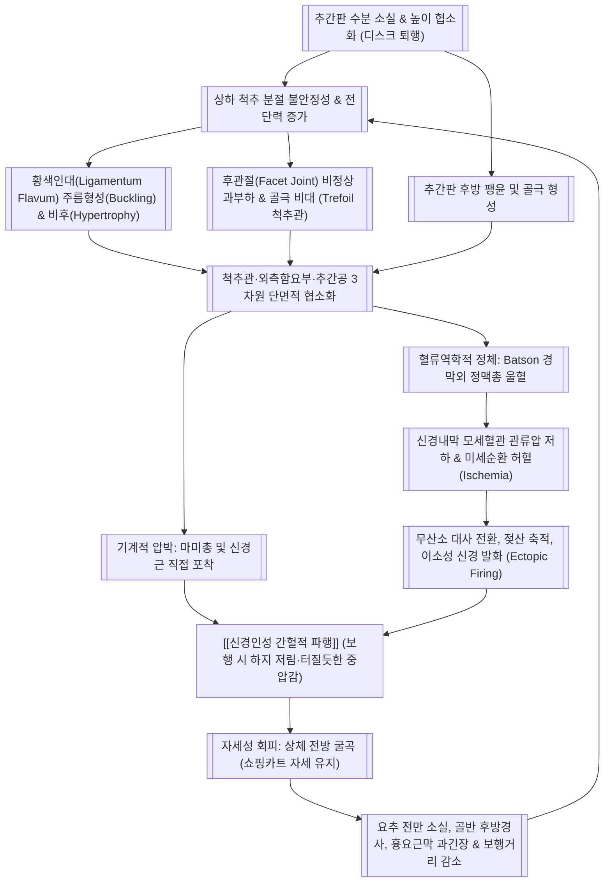
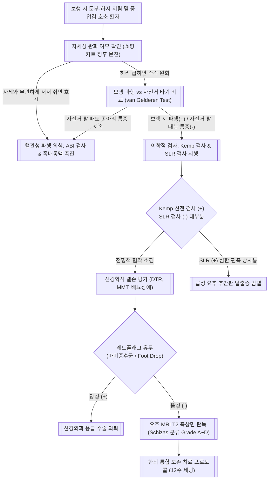
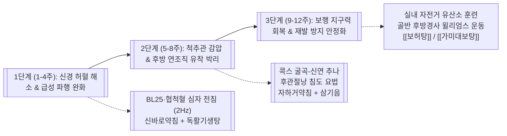
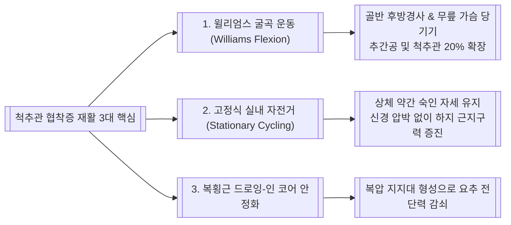

# 🩺 [[척추관 협착증]] (Lumbar Spinal Stenosis, LSS / 脊椎管 狹窄症, ICD-10 M48.06 / KCD M48.06)

> **핵심 3줄 요약 (Key Summary)**:
> - 📍 **병소 부위 & 해부·병태생리**: 요추 척추관(Spinal canal), 외측 함요부(Lateral recess), 또는 추간공(Intervertebral foramen)이 [[추간판]] 높이 감소, [[황색인대]](Ligamentum flavum)의 비후·함입, [[후관절]](Facet joint) 퇴행성 골극 형성에 의해 3차원적으로 협소화되어, 척추관 내부를 주행하는 [[마미총]](Cauda equina) 및 [[요천추 신경근]](Lumbosacral nerve roots)이 물리적으로 압박되고 경막외 정맥 울혈과 미세혈류 허혈이 초래되는 대표적인 퇴행성 척추 질환이다.
> - 🚩 **전형적 임상 양상 & 3대 징후**: ① 기립 및 일정 거리 보행 시 양측 둔부, 대퇴부, 하퇴부 전체가 터질 듯 무겁고 저려 보행을 멈추게 되는 [[신경인성 간헐적 파행]](Neurogenic Intermittent Claudication, NIC), ② 허리를 앞으로 숙이거나 쪼그려 앉을 때 척추관 면적이 확장되며 즉각 증상이 완화되는 **쇼핑카트 징후(Shopping Cart Sign)**, ③ 요추 신전(젖힘) 시 황색인대 주름으로 증상이 악화되는 **신전 악화-굴곡 완화(Extension-Aggravation, Flexion-Relief)** 동적 가변성.
> - 🛠️ **한·양방 통합 치료 및 의뢰 기준**: 판 겔데렌 [[자전거 검사]](Bicycle Test) 및 족배동맥 맥박 촉진으로 혈관성 파행과 감별하며, [[하지직거상 검사]](SLR) 음성 소견으로 급성 디스크와 구별한다. 한의 진료실에서는 L3~L5 [[화타협척혈]], [[대장수(BL25)]], [[신수(BL23)]] 50~70mm 심자 전침(Ann Intern Med 2024 RCT 프로토콜), [[신바로약침]]·[[자하거약침]], 콕스 굴곡-신연 [[추나]], [[독활기생탕]]·[[삼기음]]을 기본 축으로 12주 보존 치료를 시행하며, 양방의 리마프로스트(Limaprost) 및 경막외 차단술과 협진한다. 급성 대소변 실금([[마미증후군]]), 족하수(Drop foot) 등 진행성 운동마비 출현 시 즉시 신경외과적 응급 감압술을 의뢰한다.

---

## 📌 목차
1. [[질환 개요 & 해부학적 병태생리]](#1-질환-개요--해부학적-병태생리)
2. [[병태생리 메커니즘 & 생체역학적 악순환 네트워크]](#2-병태생리-메커니즘--생체역학적-악순환-네트워크)
3. [[임상 증상 & 이학적 검사 알고리즘]](#3-임상-증상--이학적-검사-알고리즘)
4. [[감별 진단 매트릭스]](#4-감별-진단-매트릭스)
5. [[한의 통합 치료 프로토콜]](#5-한의-통합-치료-프로토콜)
6. [[양방 치료 & 병용·의뢰 기준]](#6-양방-치료--병용의뢰-기준)
7. [[재활 운동 & 생활습관 티칭 가이드]](#7-재활-운동--생활습관-티칭-가이드)
8. [[💡 사용자 진료실 핵심 필기 & 임상 노하우 (Melt-In)]](#8--사용자-진료실-핵심-필기--임상-노하우-melt-in)
9. [[📚 출처 및 현대 학술 연구 요약]](#9-출처-및-현대-학술-연구-요약)

---

## 1. 🩺 질환 개요 & 해부학적 병태생리

### 1) 질환 정의 및 임상적 분류 체계
* **정의**: [[척추관 협착증]](Lumbar Spinal Stenosis, LSS)은 어떤 원인에 의해서든 중앙 척추관(Central canal), 외측 함요부(Lateral recess), 또는 추간공(Intervertebral foramen)이 좁아져, 경막낭(Dural sac) 내부의 [[마미총]](Cauda equina)이나 신경근초(Nerve root sleeve)를 압박하고, 국소 미세혈관의 정맥성 울혈과 동맥 관류 저하를 일으켜 하지 통증, 저림, 위약감, 보행 장애를 초래하는 임상 증후군이다.
* **해부학적 협착 부위별 3대 분류**:
  1. **중앙 척추관 협착 (Central Canal Stenosis)**:
     - **해부학적 위치**: 척[[추체]] 후면과 [[후종인대]], 양측 추궁판(Lamina)과 [[황색인대]]로 둘러싸인 주 척추관 내부.
     - **진단 수치 기준**: 
       - 요추 단순 방사선 및 CT상 전후경(AP diameter): 정상 > 15 mm, 상대적 협착(Relative stenosis) 10 ~ 13 mm, 절대적 협착(Absolute stenosis) < 10 mm.
       - MRI T2 축상면 경막낭 단면적(Dural Sac Cross-Sectional Area, DSCA): 정상 > 130 mm², 중등도 협착 100 ~ 130 mm², 중증 절대 협착 < 75 ~ 100 mm².
     - **임상 양상**: 양측 둔부 및 하지 전반으로 방사되는 양측성 [[신경인성 간헐적 파행]](NIC)이 주증상으로 나타남.
  2. **외측 함요부 협착 (Lateral Recess Stenosis / Lee's Entrance Zone)**:
     - **해부학적 위치**: 상관절돌기(Superior articular process) 전내측면과 척추체 후외측면 사이의 좁은 고랑. 신경근이 경막낭에서 갈라져 나와 추간공으로 진입하기 직전 통과하는 구역.
     - **진단 수치 기준**: 외측 함요부 높이(깊이) 정상 > 5 mm, 병적 협착 < 3 mm. 함요부 각도(Recess angle) < 30도.
     - **임상 양상**: 상관절돌기 전방 골극과 비후된 황색인대 외측 연장에 의해 해당 분절의 **하위 분절 신경근(Traversing nerve root)** 이 포착됨. 예를 들어 L4-L5 외측 함요부 협착 시 L5 신경근이 압박되어 하퇴 외측 및 족배부 방사통이 발생함.
  3. **추간공 협착 (Intervertebral Foramen / Exit Zone Stenosis)**:
     - **해부학적 위치**: 상위 척추경(Pedicle) 하절흔과 하위 척추경 상절흔, 추간판 후외측면, 후관절 전외측 관절낭으로 둘러싸인 신경근 출구.
     - **병태생리**: 추간판 간격의 심각한 협소화로 인한 상하 직경 감소, 상관절돌기 외측 골극 돌출, 추체 외측 골극 형성으로 인해 발생.
     - **임상 양상**: 해당 분절의 **탈출 신경근(Exiting nerve root)** 이 압박됨. 예를 들어 L4-L5 추간공 협착 시 L4 신경근과 [[후근신경절]](DRG)이 압박되어 대퇴 전내측 및 [[전경골근]] 부위의 극심한 신경근성 통증이 유발됨.

### 2) 역학 및 호발 분절
* **역학**: 60세 이상 성인 인구의 약 20~30% 이상에서 방사선학적 협착이 관찰되며, 유증상 협착증은 고령층 요추 수술의 가장 흔한 적응증이다. 남녀 모두 호발하나, 퇴행성 [[척추전방전위증]]을 동반한 협착증은 여성에서 3~5배 더 흔하다.
* **호발 분절 순위**:
  1. **L4-L5 분절 (최다 빈도, 약 60~70%)**: 요추 전만의 정점 부위로서 생체역학적 전단 하중과 가동성이 가장 집중되는 분절.
  2. **L3-L4 분절 (약 20~25%)**: L4-L5 협착에 동반된 다발성 연쇄 협착의 형태로 흔히 발생.
  3. **L5-S1 분절 (약 10%)**: 장골익(Iliac wing)과 [[장요인대]]에 의해 상대적으로 안정화되어 있어 중앙 척추관 협착보다는 추간공 외측 협착 형태로 관찰됨.
  4. **L1-L2, L2-L3 분절 (약 5%)**: 드물지만 상위 요추 협착 시 척수 원추부(Conus medullaris)에 근접하여 상위운동신경원 증상이 일부 혼재될 위험이 있음.

### 3) 척추관의 3차원 해부학적 구획과 경계
* **전방 경계**: 요추 추체 후면(Posterior vertebral body), [[추간판]](Intervertebral disc) 섬유륜 후방 섬유, 그리고 이를 보강하는 [[후종인대]](Posterior Longitudinal Ligament, PLL).
* **후방 경계**: 양측 척추 후궁판(Lamina), 극돌기 기저부, 그리고 척추관 내면을 덮는 [[황색인대]](Ligamentum flavum), [[후관절]](Facet joint) 관절낭의 내측 섬유.
* **측방 경계**: 척추경(Pedicle) 내측벽 및 추간공.
* **척추관 내부 내용물**:
  - **경막낭(Thecal Sac)**: 뇌척수액(CSF)으로 채워져 있으며, L1-L2 하단에서 척수원추가 끝난 후 아래로 뻗어 내려가는 [[마미총]](Cauda equina, 말총신경) 신경섬유다발을 감싸고 있음.
  - **신경근초(Nerve Root Sleeve)**: 경막낭에서 갈라져 나와 배근신경절(DRG)을 감싸며 추간공으로 향하는 초막.
  - **경막외 지방 조직(Epidural Fat)**: 신경근과 경막낭 사이에서 기계적 완충 작용을 수행하나, 중증 협착 시 완전히 소실됨.
  - **Batson 경막외 정맥총(Epidural Venous Plexus)**: 판막이 없는 무판막성 정맥 그물망으로, 척추관 내압 상승 시 즉각적인 울혈을 유발하는 핵심 해부 구조.

---

## 2. ⚡ 병태생리 메커니즘 & 생체역학적 악순환 네트워크

### 1) Kirkaldy-Willis 척추 퇴행 3단계 연쇄 반응
척추관 협착증의 병리적 진행은 Kirkaldy-Willis가 정립한 3단계 퇴행성 캐스케이드(Degenerative Cascade) 모델로 완벽히 설명된다:
1. **1단계: 기능 장애기 (Dysfunction Phase)**:
   - 추간판 [[수핵]](Nucleus pulposus)의 프로테오글리칸과 수분 함량이 감소하면서 충격 흡수 능력이 급격히 저하됨.
   - [[섬유륜]](Annulus fibrosus)에 미세 파열이 발생하고, 척추 분절의 유연성과 미세 가동성이 교란됨.
2. **2단계: 분절 불안정기 (Instability Phase)**:
   - 추간판 높이가 가라앉으면서 상하 척추체를 연결하는 인대들이 느슨해짐.
   - 특히 요추의 전후방 및 회전 전단력(Shear force)이 증가하여 인접 척추체가 전방 또는 후방으로 미끄러지는 퇴행성 [[척추전방전위증]] 및 분절 불안정성이 유발됨.
   - 이때 팽팽함을 잃은 [[황색인대]]가 척추관 내부로 불룩하게 접혀 들어가는 주름 현상(Buckling)이 발생하여 동적 협착의 시발점이 됨.
3. **3단계: 재안정화기 (Stabilization / Restabilization Phase)**:
   - 비정상적인 분절 불안정성을 인체 스스로 보상하기 위해, 후관절 주변과 추체 변연부에 광범위한 반응성 골극(Osteophytes)이 자라남.
   - 상관절돌기가 비대해지면서 척추관의 형태가 둥근 타원형에서 3개의 잎 모양인 **삼엽형(Trefoil Canal)** 으로 변형되어 외측 함요부를 극심하게 폐쇄함.
   - 이 단계에 도달하면 척추의 이상 가동성은 줄어들지만, 척추관 용적의 비가역적 협착이 고착화됨.

### 2) 황색인대 비후의 세포분자생물학적 기전
* 정상적인 황색인대는 약 80%의 **탄성 섬유(Elastin)** 와 20%의 [[콜라겐]]으로 구성되어 있어 신장 후 원래 길이로 복원되는 탄력성을 가짐(정상 두께 2~4 mm).
* 그러나 만성 역학적 불안정성과 반복적 미세 손상이 지속되면 섬유아세포에서 **변환성장인자-베타1(TGF-β1)** 과 결합조직성장인자(CTGF)가 과발현됨.
* 이로 인해 [[엘라스틴]] 섬유가 파괴 및 변성되고, 그 자리가 단단하고 뻣뻣한 **Type I 및 Type III 콜라겐 섬유성 반흔 조직**으로 치환됨.
* 결과적으로 인대의 탄력성이 소실되어 두께가 **5~8 mm 이상으로 비후**되며, 요추 신전 시 늘어나지 못하고 척추관 내부로 뭉툭하게 돌출하여 경막낭 후벽을 직격 압박함.

### 3) 혈류역학적 정체와 신경 허혈 (Ischemia & Venous Congestion)
* **신경 증상의 주원인은 단순 기계적 압박이 아닌 '허혈(Ischemia)'이다**:
  - 신경근과 마미총은 모세혈관망이 매우 풍부하여 대사 활동에 필요한 산소와 포도당을 공급받아야 함.
  - 척추관이 협착되면 가장 먼저 압력이 낮은 **Batson 경막외 무판막성 정맥총**이 눌려 정맥 환류가 차단되는 정맥 울혈(Venous pooling)이 발생함.
  - 정맥압이 상승하면 신경내막(Endoneurium) 모세혈관의 관류압이 역전되어 미세 순환이 급격히 중단됨.
* **보행 시의 대사적 미스매치 (Metabolic Mismatch)**:
  - 안정 시에는 신경 조직의 기초 혈류량으로도 통증이 없지만, 환자가 직립하여 보행을 시작하면 하지 근육과 신경근의 산소 및 영양소 요구량이 평소의 2~3배 이상 급증함.
  - 정상적인 상태에서는 자율신경 반사로 혈관이 확장되지만, 협착된 척추관 내부에서는 정맥 울혈과 기계적 압박으로 인해 동맥혈이 진입하지 못함.
  - 결국 신경 섬유는 급성 무산소 대사로 전환되고, 젖산(Lactate) 등 산성 대사 산물이 축적되며 이소성 활동전위(Ectopic pacemaker firing)를 난사하여, 다리가 터질 듯 무겁고 쥐가 나는 파행 증상이 폭발하게 됨.

### 4) 동적 가변성 (Dynamic Variability of Canal Volume)
* **신전(Extension) 시 척추관 용적 감소**:
  - 허리를 뒤로 젖히면 상관절돌기가 하강하며 후관절이 포개지고, 비후된 황색인대가 내부로 접혀 들어가며(Buckling), 추간판 후방 섬유륜이 뒤로 밀려남.
  - 이로 인해 척추관 단면적은 굴곡 상태에 비해 **10~16% 감소**하고, 추간공 단면적은 최대 **15~20% 감소**하여 신경 압박과 허혈이 극대화됨.
* **굴곡(Flexion) 시 척추관 용적 확장**:
  - 허리를 앞으로 숙이면 황색인대가 팽팽하게 펴지며 얇아지고, 후관절 사이가 벌어지며, 추간판이 전방으로 이동함.
  - 척추관 단면적이 즉시 **15~25% 확장**되고 경막외 정맥 울혈이 일시적으로 해소되어 신경 관류가 재개됨 (쇼핑카트 징후의 생체역학적 근거).

---

## 3. 🔍 임상 증상 & 이학적 검사 알고리즘

### 1) 3대 임상 주소증
1. [[신경인성 간헐적 파행]](Neurogenic Intermittent Claudication, NIC)**:
   - 척추관 협착증의 가장 특징적인 진단적 징후이다.
   - 평소 앉아 있거나 누워 있을 때는 전혀 증상이 없다가, 서서 50~200m 정도 걸어가면 양측 엉덩이, 허벅지 뒤쪽, 종아리, 발바닥 전체가 조이고, 터질 것 같고, 천근만근 무거워지며 쥐가 나 더 이상 걸을 수 없게 된다.
   - 멈추어 서서 쉰다고 해서 바로 좋아지지 않으며, 반드시 **허리를 구부리고 쪼그려 앉거나 의자에 앉아 척추관을 넓혀주어야 2~5분 내에 통증이 가라앉는다.**
2. **자세 의존성 완화 (쇼핑카트 징후, Shopping Cart Sign)**:
   - 환자는 평지를 걸을 때는 100m도 걷기 힘들어하지만, 마트에서 **쇼핑카트를 밀거나 유모차를 밀며 상체를 앞으로 숙인 채 걸으면** 1시간 이상도 통증 없이 보행할 수 있다.
   - 계단을 내려갈 때(요추가 신전되어 척추관이 좁아짐)는 다리가 저려 극심한 통증을 호소하지만, 계단을 올라갈 때(상체를 굽히므로 척추관이 넓어짐)는 훨씬 수월하게 올라간다.
3. **광범위한 양측성 이상감각 및 하지 무력감**:
   - 특정 단일 신경근 주행만을 따르는 디스크와 달리, L4, L5, S1 다발성 신경근과 마미총이 동시에 압박받으므로 양측성 대칭성(또는 비대칭성)으로 나타난다.
   - 환자들은 "발바닥에 남의 살이 붙어 있는 것 같다", "모래나 자갈밭을 밟는 것처럼 발바닥 감각이 멍하다", "다리에 피가 안 통하고 얼음장처럼 시리다", "걸어가다가 갑자기 무릎에 힘이 풀려 주저앉을 뻔했다(Giving way)"고 호소한다.

### 2) 핵심 이학적 유발 검사법
* [[자전거 검사]](Bicycle Test of van Gelderen)**:
  - **시행법**: 고정식 실내 자전거에 환자를 앉히고 페달을 밟게 한다. 먼저 허리를 곧게 펴고(신전) 타게 한 후, 통증이 유발되면 상체를 앞으로 푹 숙이고(굴곡) 타게 한다.
  - **판정**:
    - **신경인성 파행 (협착증)**: 허리를 곧게 펴면 파행이 오지만, 허리를 숙이면 척추관이 넓어져 통증 없이 장시간 페달을 밟을 수 있다.
    - **혈관성 파행 (말초동맥질환)**: 허리를 숙이든 펴든 하지 근육의 혈류 요구량이 동일하므로 자세와 무관하게 종아리 통증이 지속된다.
* **요추 신전 유발 검사 및 켐프 검사([[Kemp 검사]] / Lumbar Extension Test)**:
  - **시행법**: 환자를 기립시킨 상태에서 검사자가 환자의 요추를 뒤로 젖히게(신전) 하고, 통증이 있는 방향으로 측굴 및 회전을 가한 채 30~60초간 유지시킨다.
  - **양성 기준**: 30초 이내에 둔부 및 하지로 뻗치는 전형적인 저림이나 통증이 재현되면 양성이다 (신전 시 황색인대 함입 및 척추관 단면적 감소 유발).
* **하지직거상 검사 ([[하지직거상 검사]], Straight Leg Raising Test, SLR)**:
  - 급성 [[요추 추간판 탈출증]] 환자에서는 30~70도에서 심한 방사통(SLR 양성)이 나타나지만, 만성 척추관 협착증 환자에서는 신경근의 급성 신장 자극이 아니므로 **대부분 음성(Negative)** 으로 나타난다. 따라서 SLR 음성이면서 파행을 보이면 협착증을 강력히 시사한다.
* **말초 동맥 맥박 촉진 (Pulse Palpation)**:
  - 양측 [[족배동맥]](Dorsalis pedis artery)** 및 [[후경골동맥]](Posterior tibial artery)** 의 박동을 반드시 촉진한다. 박동이 정상적이고 발이 따뜻하면 혈관성 질환을 배제하고 협착증으로 진단할 수 있다.

### 3) Schizas MRI 형태학적 분류 기준
요추 축상면(Axial) T2 강조 MRI에서 경막낭 내 뇌척수액(CSF) 신호와 마미총 신경근의 공간적 분포 양상에 따라 협착도를 객관적으로 등급화한다:
* **Grade A (협착 없음 또는 경미)**: 뇌척수액 신호가 명확히 관찰되며, 마미총 신경근들이 경막낭 내부에 균일하게 떠 있거나 후방에 정상적으로 모여 있음.
* **Grade B (중등도 협착, Moderate)**: 마미총 신경근들이 경막낭 전체를 차지하고 있으나, 신경근들 사이에 여전히 뇌척수액의 회색 신호가 부분적으로 확인됨.
* **Grade C (중증 협착, Severe)**: 경막낭 내 뇌척수액 신호가 완전히 보이지 않으며, 마미총 신경근들이 하나의 덩어리로 뭉쳐져 있음. 경막외 후방 지방 조직이 소실됨.
* **Grade D (극중증 협착, Extreme)**: 마미총 신경근의 개별 식별이 전혀 불가능하고 경막낭 자체가 모래시계처럼 완전히 찌그러져 뼈와 인대 조직만 관찰됨 (절대적 수술 고려 대상).

---

## 4. 🔀 감별 진단 매트릭스

척추관 협착증은 고령자에서 흔한 혈관 질환, 디스크 질환, 척추 전위증, 말초신경병증과의 정밀한 감별이 필수적이다.

| 감별 질환 | 호발 연령 및 병인 | 통증 및 파행의 특성 | 자세 변화(굴곡/신전)에 따른 반응 | 이학적 검사 및 박동 소견 | 영상 및 확진 검사 |
| :--- | :--- | :--- | :--- | :--- | :--- |
| [[척추관 협착증]] (본 질환) | 60대 이상 고령층, 척추 퇴행성 인대 비후·골극 | **신경인성 파행**: 보행 시 양측 둔부·하지 터질듯한 저림, 주저앉음 | **굴곡(숙임) 시 즉각 완화**, **신전(젖힘) 시 급격 악화** | **SLR 정상(음성)**, **족배동맥 맥박 정상**, van Gelderen 자전거 완화(+) | 요추 MRI: Schizas C/D, DSCA <100mm², 황색인대 비후 |
| [[혈관성 파행]] ([[말초동맥질환]], PAD) | 50대 이상 흡연자, 당뇨, 고혈압, 동맥경화 | **혈관성 파행**: 보행 시 종아리 근육의 쥐남, 뻐근한 경련통 | **허리 자세와 전혀 무관**, **서서 가만히 쉬면 1~2분 내 완화** | **족배동맥/후경골동맥 맥박 소실**, 족부 냉감, 창백, 피부 위축 | 발목-상완 지수(ABI) < 0.9, 하지 혈관 CT 혈관조영술 |
| [[요추 추간판 탈출증]] (HIVD) | 20~50대 활동기 청장년층, 수핵 급성 탈출 | 편측성, 특정 피부분절을 따르는 예리한 전격통, 기침 시 악화 | **굴곡(숙임) 시 악화**, **신전(맥켄지) 시 완화** | **SLR 양성 (30~70도 방사통 재현)**, Bragard 양성, DTR 저하 | 요추 MRI: 수핵 탈출 및 신경근 직접 압박 확인 |
| [[척추전방전위증]] (Spondylolisthesis) | 50대 이상 여성(퇴행형) / 청소년(협부형) | 자세 변환 시 덜컹거리는 요통(Catching), 협착증 복합 동반 | 신전 시 전위 악화되어 요통 발생, 굴곡 시 안정 | **극돌기 계단상 변형 (Step-off sign)** 촉진, Stork test (+) | 요추 굴곡-신전 동적 단순 방사선(X-ray): 전위율 측정 |
| [[이상근증후군]] (Piriformis Syndrome) | 30~60대 여성, 장시간 좌식 생활자 | 둔부 심부 뻐근함 및 대퇴 후면 방사통, 보행 파행 드묾 | 보행 거리와 무관, 오래 앉아 있을 때 악화 | **이상근 부위 극심한 압통**, FAIR 검사(+), Freiberg 검사(+) | 골반 MRI: 이상근 비대, 요추 MRI 정상 |
| [[척수증]] (경추/흉추 척수병증) | 50대 이상, 척수 실질 압박 (UMN 병변) | 하지 경직성 마비, 술 취한 듯한 보행실조(Ataxic gait) | 요추 자세와 무관 | **Babinski (+)**, **건반사 항진**, 발목 클로누스, 감각 레벨 형성 | 경추/흉추 MRI: 척수 실질 내 T2 고신호 병변 |
| [[당뇨병성 말초신경병증]] (DPN) | 만성 당뇨병 기왕력 환자 | 양측 발끝에서 시작되는 대칭성 화끈거림, 스타킹 형태 감각 저하 | 보행 거리 및 자세와 무관, **야간 수면 시 악화** | 10g 모노필라멘트 검사 소실, 진동각 소실, 아킬레스건 반사 소실 | 신경전도검사(NCS): 다발성 감각-운동 신경병증 소견 |

---

## 5. 🌿 한의 통합 치료 프로토콜

한의 치료의 핵심 목표는 척추관 내부의 미세 정맥 울혈과 신경 허혈을 해소하고, 과도한 후방 관절 장력을 감압하며, 약화된 지지 인대와 근육을 강화하여 수술 없이 '무통 보행 거리'를 획기적으로 연장하는 데 있다.

### 1) 침구 및 전침 치료 프로토콜 (Ann Intern Med 2024 RCT 프로토콜 연계)
* **경항부·요배부 심부 협척혈 심자(Deep Needling) 술기**:
  - **주요 혈위**: L3, L4, L5 양측 [[화타협척혈]](EX-B2), [[대장수(BL25)]], [[관원수(BL26)]], [[신수(BL23)]], [[차료(BL32)]].
  - **침 규격 및 자침 깊이**: 0.35×75mm 또는 0.40×90mm 멸균 호침 사용.
  - **자침 기법**:
    - 환자를 복와위로 눕히고 복부 아래 베개를 받쳐 요추 전만을 완화시킴.
    - 극돌기 하연 외측 0.5촌 협척혈 및 외측 1.5촌 대장수에서 척추 후궁판(Lamina) 방향으로 약 10~15도 내측 경사지게 진침하여 **50~70mm 심자**한다.
    - 침첨이 후궁판 골면에 닿은 후 1~2mm 후퇴시켜 황색인대 외측 및 심부 다열근 층에 접근시킨다.
    - 이때 신경근 분절을 따라 둔부에서 하퇴부로 찌릿하게 뻗치는 **하지 방사 전격감(De-Qi / Radicular Sensation)** 을 유도하면 신경근 주변의 기혈 순환이 즉각 활성화된다.
* **원위 배혈 및 경락 소통**:
  - [[위중(BL40)]]: 방광경의 합혈이자 요배부 통증의 사총혈, 족양명경의 순환 촉진.
  - [[승산(BL57)]], [[곤륜(BL60)]]: 하퇴부 [[비복근]]·[[가자미근]]의 허혈성 경련 이완.
  - [[양릉천(GB34)]]: 근회(筋會)로서 척추 주변 건·인대 긴장 완화.
  - [[태계(KI3)]], [[현종(GB39)]]: 신수(腎水)를 보하고 수골(髓骨)을 자양.
* **전침(Electroacupuncture) 치료 파라미터**:
  - **통전 배합**: 양측 대장수(BL25)–L4 협척혈, L5 협척혈–차료(BL32) 연결.
  - **파라미터 세팅**:
    - **주파수**: 2Hz 연속 저주파 (중추성 엔도르핀 분비 및 미세 혈류 확장) 또는 2/100Hz 변조파(Dense-Disperse Wave).
    - **통전 시간**: 30분간 유지, 주 3회, 총 6~12주간 집중 시행.
    - **임상적 근거**: 2024년 최고 권위 내과학 학술지 *Annals of Internal Medicine*(PMID: 38950397)에 발표된 다기관 RCT에 따르면, 6주 18회의 심자 전침 치료는 대조군 대비 신경인성 파행 증상과 롤랜드-모리스 장애 지수(RMDQ)를 유의하게 개선하였으며, 치료 종료 후 24주까지 효과가 확고히 유지됨이 입증되었다.

### 2) 침도 요법 (Acupotomy, 미세침도 감압술)
* **적응증**: 3개월 이상 보존 치료에도 보행 거리가 늘어나지 않고 후관절낭 및 극간인대의 심한 비후와 섬유성 유착이 만성화된 환자.
* **시술 부위 및 술기**:
  - 환자를 복와위로 두고 병변 척추 분절(L4-L5)의 극간인대(Interspinous ligament), 상관절돌기 외측연, 그리고 황색인대 후외측 부착부를 초음파 가이드 또는 골성 지표 촉진 하에 표지.
  - 소침도(0.6×50mm)를 요추 극돌기 변연을 따라 수직 자입하여 뼈 표면에 도달한 후, 칼날의 방향을 척추 장축과 평행하게 두고 극간인대와 비후된 후관절낭의 섬유성 유착 밴드를 2~3회 미세 종절개·박리(Zheng-Pei Method)한다.
* **치료 기전**: 척추관 후방을 얽매고 있던 비후된 연조직의 장력을 물리적으로 풀어주어 경막외강의 미세 압력을 낮추고 신경 관류를 회복시킨다.

### 3) 약침 요법 (Pharmacopuncture Protocol)
* [[신바로약침]] (GCSB-5)**:
  - **주요 성분 및 기전**: 방풍, 우슬, 오가피, 구척, 두충, 하수오 추출물 복합체로, 염증성 사이토카인(TNF-α, IL-1β) 및 COX-2, iNOS 발현을 강력히 억제하며, 신경세포의 축삭 재생을 촉진함.
  - **시술법**: L3~L5 협척혈 심부 다열근 및 후관절 주위에 포인트당 0.5~1.0cc씩 총 2.0~4.0cc를 주입하여 척추관 주변 신경근의 화학적 염증과 부종을 흡수.
* [[자하거약침]](인태반 추출물)**:
  - **기전**: 대보원기(大補元氣), 보신익정(補腎益精)하여 노화로 인해 퇴행한 추간판, 황색인대 및 척추 관절 연골에 풍부한 아미노산, 성장인자, 펩타이드를 공급. 고령의 만성 협착증 환자의 보행 무력감에 필수 적용.
* [[봉약침]] (Sweet Bee Venom, SBV)**:
  - 멜리틴(Melittin) 성분이 국소 혈관을 확장시키고 신경통 전도를 차단하여 만성 파행성 저림을 완화 (알레르기 피부 반응 검사 필수 시행).

### 4) 추나요법 (Chuna Manual Therapy - 콕스 굴곡-신연 기법)
* **요추 굴곡-신연 기법 (Cox Flexion-Distraction Technique)**:
  - **환자 체위**: 콕스 전용 테이블에 복와위로 눕힌 후, 복부 패드를 약간 들어 올려 요추의 전만을 줄이고 편평하게 유지.
  - **술자 수기**: 술자는 한 손의 수근부(Pisiform)로 협착 분절의 상위 척추체 극돌기(예: L4)를 전하방으로 접촉하여 고정하고, 다른 손으로 테이블의 가동 레버를 잡아 하체를 부드럽게 **굴곡(Flexion) 및 축성 신연(Distraction)** 시킨다.
  - **파라미터**: 1회 굴곡 시 2~3초간 유지, 5~6회 반복을 1세트로 하여 3세트 시행.
  - **생체역학적 치료 기전**: 
    - 요추 후방 분절을 수동적으로 벌려줌으로써 **추간공 면적을 15~25% 확장**시킴.
    - 척추관 내부의 음압(Negative pressure)을 유도하여 팽윤된 디스크를 흡인하고, 비후된 황색인대를 축방향으로 당겨 펴줌으로써 경막낭 압박을 즉각 감압함.
* **골반 후방회전 가동 추나**:
  - 단축된 [[장요근]]과 [[대퇴직근]]을 근막 이완(MET) 기법으로 늘려주고, 장골의 후방 회전을 유도하여 과도한 [[골반 전방경사]](Pelvic anterior tilt)와 [[천골]] 경사각을 교정함.
* **⛔ 절대 금기 수기**: 척추관 협착증 환자에게 요추를 뒤로 젖히는 **신전 고속저진폭 도수치료(HVLA Extension Thrust)** 는 좁아진 척추관을 순간적으로 완전히 폐쇄하여 영구적 마미총 손상을 초래할 수 있으므로 **절대 금기**이다.

### 5) 한약 치료 (변증별 방제학)
* **간신휴허·기혈양허(肝腎虧虛 氣血兩虛) — 만성 보행 장애, 고령자 최다 빈도**:
  - [[독활기생탕]](獨活寄生湯)**: 독활, 상기생, 두충, 우슬, 세신, 진교, 복령, 육계, 방풍, 당귀, 백작약, 천궁, 숙지황, 인삼, 감초. 간신을 보하여 근골을 튼튼하게 하고 척추관 주변 신경 미세순환을 개선하며 황색인대의 섬유화를 억제하는 협착증 1차 표준 방제.
  - [[삼기음]](三痺飲)**: 독활기생탕에 황기, 속단 등을 가미하여 기혈 허손이 극심하고 다리에 힘이 전혀 없는 고령 환자의 하지 무력과 파행을 치료.
  - **보허탕(補虛湯) / 가미대보탕(加味大補湯)**: 만성 쇠약 환자의 근육 위축 방지 및 전신 원기 회복.
* **어혈조체(瘀血阻滯) — 야간 쥐남, 찌르는 듯한 하지 자통**:
  - [[신통축어탕]](身痛逐瘀湯)**: 도인, 홍화, 당귀, 천궁, 몰약, 오령지, 우슬 배합으로 Batson 경막외 정맥총의 정체된 어혈 울혈을 강력히 소퇴시킴.
* **풍한습비(風寒濕痺) — 날씨가 흐리거나 찬 곳에 가면 하지 냉증 및 파행 악화**:
  - [[오적산]](五積散) 가감**: 백지, 지각, 마황, 천궁, 당귀, 백작약, 복령, 반하, 계피, 세신, 건강 배합으로 체내 한습(寒濕)을 온산(溫散)시키고 말초 혈관을 확장.

---

## 6. 💊 양방 치료 & 병용·의뢰 기준

### 1) 양방 약물 요법 (Medication)
* **프로스타글란딘 E1 유도체 (PGE1 Derivative, 미세혈류 개선제)**:
  - **약제**: **리마프로스트(Limaprost alfadex, 오팔몬정 5μg tid)**.
  - **기전**: 혈관 평활근의 IP 수용체에 작용하여 cAMP를 증가시켜 강력한 혈관 확장 및 혈소판 응집 억제 작용을 발휘.
  - **임상 가치**: 좁아진 척추관 내의 정맥 울혈을 개선하고 마미총 신경근으로의 동맥혈 관류량을 증가시켜, 환자의 **무통 보행 거리를 유의하게 연장**시키는 협착증 특화 약물임.
  - **한의 병용**: 신바로약침 및 독활기생탕과 병용 시 미세순환 개선의 상승효과가 뛰어남.
* **신경병증성 통증 조절제 (Gabapentinoids)**:
  - **약제**: [[프레가발린]](Pregabalin, 리리카 75~150mg bid), [[가바펜틴]](Gabapentin 300~900mg tid).
  - **기전**: 전압의존성 칼슘 채널의 α2-δ 서브유닛을 차단하여 흥분성 신경전달물질 방출 억제.
  - **주의점**: 고령자 복용 시 어지럼증, 졸림, 운동실조로 인한 낙상 골절 위험이 높으므로 저용량부터 서서히 증량해야 함.
* **세로토닌-노르에피네프린 재흡수 억제제 (SNRI)**:
  - **약제**: [[둘록세틴]](Duloxetine 30~60mg qd). 하행성 통증 억제 경로를 강화하여 만성 척추통과 동반된 신경병성 통증 완화.
* **소염진통제 및 [[트라마돌]]:
  - NSAIDs([[세레콕시브]](Celecoxib) 200mg qd/bid) 및 [[아세트아미노펜]]/트라마돌 복합제(울트라셋).

### 2) 비수술적 중재 시술
* **경막외 스테로이드 주사 (Epidural Steroid Injection, ESI)**:
  - **접근법**: 추간공 접근법(Transforaminal), 층간 접근법(Interlaminar), 미추 접근법(Caudal block).
  - **목적**: 협착된 신경근 주변의 기계적 마찰로 인한 무균성 신경근염과 신경 부종을 강력하게 차단.
  - **한계**: 일시적인 통증 경감 효과(2~6주)는 우수하나, 물리적 협착 구조를 넓히지는 못하므로 반복적인 주사(연 3~4회 초과)는 당뇨 악화, [[골다공증]], 쿠싱 증후군 위험을 초래함.
* **경막외 신경성형술(Racz Catheter) 및 풍선확장술(ZiNeu Catheter)**:
  - 꼬리뼈 부위를 통해 카테터를 경막외강으로 진입시켜 유착된 반흔 조직을 박리하고, 풍선을 팽창시켜 척추관 및 추간공을 물리적으로 넓힌 뒤 약물을 주입하는 시술.

### 3) 수술적 치료 적응증 및 술식
* **절대적 응급 수술 적응증 (Red Flags)**:
  1. [[마미증후군]](Cauda Equina Syndrome)**: 급성 요정체(Urinary retention), 요실금, 변실금 등 방광 및 직장 괄약근 기능 장애 발생, 회음부 및 항문 주위의 감각 마비(안장 감각마비, Saddle anesthesia).
  2. **진행성 운동 마비**: 족하수(Drop foot, 전경골근 마비로 발목을 위로 젖히지 못함), 비복근 마비로 까치발 기립 불능(MMT Grade 3 이하의 급격한 근력 저하).
* **상대적 수술 적응증**:
  - 3~6개월 이상의 체계적인 비수술적 보존 치료(한의 복합 치료 및 양방 시술)에도 불구하고, 연속 보행 거리가 50~100m 미만으로 극도로 제한되어 일상생활이 전혀 불가능한 경우.
* **수술 기법**:
  - **감압술 단독 (Decompression alone)**: 후궁 절제술(Laminectomy) 및 황색인대 절제술(Flavectomy), 양측 미세현미경/내시경하 감압술(ULBD). 척추 불안정성이 없는 순수 협착증에 적용.
  - **감압술 + 척추 유합술 (Decompression with Fusion, TLIF/PLIF)**: 척추전방전위증, [[척추측만증]] 등 명확한 분절 불안정성이 동반된 경우 감압과 함께 척추경 나사못 고정 및 케이지 삽입술 시행 (SPORT 임상 연구 근거 참조).

---

## 7. 🏃 재활 운동 & 생활습관 티칭 가이드

협착증 환자의 재활 원칙은 디스크 환자와 정반대이다. 요추 전만을 강요하는 신전 운동을 철저히 배제하고, 척추관을 넓혀주는 **굴곡 운동(Flexion exercise)** 과 **골반 후방경사**를 체득시키는 것이 핵심이다.

### 1) 윌리엄스 굴곡 운동 (Williams Flexion Exercise)
1. **골반 후방경사 운동 (Pelvic Tilt)**:
   - 양 무릎을 세우고 바로 누운 자세(앙와위)에서 숨을 내쉬며 배꼽을 바닥 쪽으로 강하게 당긴다.
   - 허리 뒤쪽과 바닥 사이의 빈 공간을 완전히 없애며 바닥을 평평하게 누른다. 둔근과 복근을 수축한 채 10초간 유지, 10회 반복.
2. **무릎 가슴 당기기 (Single & Double Knee-to-Chest)**:
   - 바로 누운 상태에서 한쪽 무릎을 양손으로 감싸 가슴 쪽으로 천천히 당겨 15초간 유지한다.
   - 양쪽을 번갈아 시행한 후, 양 무릎을 동시에 가슴 쪽으로 끌어안아 요추 후방 관절과 황색인대를 부드럽게 신장시킨다.
3. **부분 윗몸 일으키기 (Partial Curl-Up)**:
   - 무릎을 세우고 누워 손을 무릎 쪽으로 뻗으며 날개뼈가 바닥에서 살짝 떨어질 정도까지만 상체를 말아 올려 복직근을 강화한다.

### 2) 고정식 실내 자전거 타기 (Stationary Cycling)
* **최고의 유산소 재활 운동**: 협착증 환자에게 걷기 운동을 무리하게 강요하면 척추관 허혈로 증상이 악화된다. 반면 실내 자전거는 상체를 자연스럽게 앞으로 숙인 굴곡 자세를 취하므로, 척추관이 최대로 열린 상태에서 신경 압박 없이 심폐 기능과 하지 근지구력을 단련할 수 있다.
* **티칭 요령**: 안장 높이를 조절하여 페달을 밟을 때 무릎이 완전히 펴지지 않게 하고, 핸들을 낮추어 상체가 15~30도 정도 전방으로 기울어지도록 세팅한다. 매일 20~30분씩 시행한다.

### 3) 절대 금기 동작 (Absolute Don'ts)
* ❌ **맥켄지(McKenzie) 신전 운동 및 요가 코브라 자세**: 허리를 뒤로 젖히는 동작은 좁아진 척추관 내부로 황색인대를 접어 넣어 신경을 짓누르는 행위이므로 절대 금지한다.
* ❌ **서서 허리 뒤로 젖히기 스트레칭**: 어르신들이 흔히 '허리 시원하다'며 뒤로 젖히는 동작은 급성 파행을 유발하므로 철저히 교육하여 중단시킨다.
* ❌ **무거운 물건 들기 및 요추 과신전 상태에서의 하중 지지**: 요추 후관절 압박을 폭증시킨다.

### 4) 보행 보조기 및 일상생활 인체공학
* **보행 보조기(실버카 / 유모차 / 지팡이) 활용**:
  - 장거리 외출 시 지팡이나 바퀴 달린 보행 보조기(실버카)를 적극적으로 사용하게 한다. 보행차 손잡이를 잡고 상체를 약간 앞으로 숙인 채 걸으면 척추관이 열려 보행 거리가 3~5배 이상 비약적으로 늘어난다.
* **수면 자세 티칭**:
  - 옆으로 누워 잘 때는 양 무릎 사이에 베개를 끼우고 허리를 약간 새우잠처럼 둥글게 구부리는 자세를 취한다.
  - 바로 누워 잘 때는 무릎 아래에 높은 베개나 쿠션을 받쳐 고관절과 슬관절을 굴곡시킴으로써 요추 전만을 줄이고 골반을 후방경사시킨다.

---

## 8. 💡 사용자 진료실 핵심 필기 & 임상 노하우 (Melt-In)

> [[!IMPORTANT]]
> 본 섹션에는 원장님의 다년간 진료실 실전 경험에서 축적된 **직관적 파행 진찰법, 협척혈 50~70mm 심자 손맛, 12주 약침 임상 프로토콜, 환자 티칭 스크립트, 차팅 방어 노하우**를 100% 융합(Melt-In)하여 수록하였다.

### 1) 진료실 실전 초진 3분 감별 문진 체크리스트
1. **연속 보행 거리 객관적 측정**:
   - "쉬지 않고 평지를 몇 미터나 걸어가실 수 있습니까?"
   - **50m 미만**: 중증 협착 (Schizas C~D 수준, 집중 침·약침 치료 및 호전 없을 시 수술 고려).
   - **100~200m**: 전형적 중등도 협착 (한의 복합 12주 보존 치료의 최적 적응증).
   - **300m 이상**: 경도 협착 (자세 교정 및 자전거 운동 티칭으로 관리).
2. **자전거 vs 보행 비교 질문 (결정적 스크리닝)**:
   - "어르신, 걷는 건 100m만 가도 다리가 터질 것 같은데, 혹시 실내 자전거 타는 건 30분 넘게도 안 아프고 잘 타시나요?"
   - 👉 **"네, 신기하게 자전거는 한참 타도 다리가 안 아파요!"** 라고 답변하면 **99.9% 척추관 협착증 확진**이다.
3. **자세 의존성 질문 (쇼핑카트 징후)**:
   - "마트에서 카트 밀고 다니실 때는 안 아프시죠? 걸어가다 다리 저릴 때 쪼그려 앉으면 금방 괜찮아지나요?"
   - 👉 양성 시 신경인성 파행이며, 서서 가만히 쉬어야 호전되는 혈관성 파행과 즉각 감별된다.
4. **마미증후군 배제 질문 (응급 감별)**:
   - "소변을 볼 때 시원하지 않고 힘을 줘야 나오거나 나도 모르게 지리지는 않으신가요? 엉덩이나 항문 주위가 남의 살 같지 않나요?"
   - 👉 하나라도 해당되면 즉시 외과적 의뢰를 염두에 둔다.
5. **허리 젖힘 습관 점검**:
   - "평소에 허리 아프다고 뒤로 젖히는 스트레칭 자주 하셨죠? 그 동작이 신경을 짓누르는 독약입니다. 오늘부터 절대 하시면 안 됩니다."

### 2) 침구 & 심자 전침 시술 손맛 노하우 (Needling Pearls)
* **BL25(대장수) 및 요추 협척혈 50~70mm 심자 노하우**:
  - 일반적인 40mm 침으로는 두터운 요배부 근막과 지방층을 뚫고 황색인대 주변 심부 다열근에 도달할 수 없다. **0.35×75mm 장침**을 준비한다.
  - 환자의 복부 밑에 베개를 단단히 괴어 요추 전만을 완전히 지운 후, L4-L5 극돌기 사이를 촉지한다.
  - 극돌기 외측 0.5촌 지점에서 바늘을 척추 중심선 쪽으로 약 10도 살짝 기울여 수직으로 서서히 진입시킨다.
  - 40~50mm 지점에서 심부 흉요근막을 뚫는 묵직한 저항감이 느껴지며, 50~65mm 깊이에서 단단한 후궁판(Lamina) 골면에 닿는다.
  - 골면에 가볍게 접촉한 후 침을 1~2mm 뒤로 빼서 유침한다. 이때 환자가 "발끝까지 전기가 찌릿하게 통했다!"고 반응하면 신경근 주변의 울혈을 뚫는 완벽한 득기(得氣)가 이루어진 것이다.
* **고령 골다공증 환자 자침 시 안전 수칙**:
  - 골다공증이 심한 70~80대 고령 환자는 극돌기 사이 공간으로 침이 척추관 내부로 깊숙이 침투할 위험이 있으므로, 바늘을 밖에서 안쪽으로 과도하게 눕히지 말고 **반드시 후궁판 골면을 먼저 확인하는 뼈 접촉 테크닉**을 구사해야 척수강 천자를 원천 차단할 수 있다.
* **전침 통전 팁**:
  - 협착증 환자의 파행은 허혈에 기인하므로, 전침 주파수는 강한 강축을 유발하는 고주파보다 **2Hz 저주파**를 사용하여 근육이 규칙적으로 쿵-쿵- 뛰게 만들어 정맥 펌프 작용(Venous muscle pump)을 극대화해야 시술 후 보행이 가벼워진다.

### 3) 약침 vs 통상 진료 실용적 RCT — 보존 치료 '12주 축'의 근거 (IMR 2026 연계)
* **임상 연구 설계 및 핵심 결과 ([[PMID: 42099446]](https://pubmed.ncbi.nlm.nih.gov/42099446/))**:
  - 요추관 협착증 환자를 대상으로 **약침 치료(주 2회 × 12주 = 총 24회)** 와 통상 진료(물리치료 TENS/ICT + 필요시 약물)를 비교한 다기관 실용적 RCT.
  - 13주 추적 시 약침군에서 통증 NRS가 대조군 대비 **2.7점 더 크게 감소**하였고, **최대 무통 보행 거리에서 통계적으로 압도적인 군간 차이(P < 0.001)** 를 나타냄.
  - 효과는 치료 종료 후 **53주(1년)까지 확고하게 유지**되었으며, 중대 이상반응은 0건으로 보고됨.
* **진료실 실전 12주 프로토콜 세팅**:
  - **1단계 (1~4주차, 신경 허혈기)**: 주 2~3회 내원. 요추 협척혈 및 BL25 심자 전침 + [[신바로약침]](1.0~2.0cc) 집중 투여. [[독활기생탕]] 1일 2~3회 복용. 무리한 보행 금지 및 실내 자전거 교육.
  - **2단계 (5~8주차, 연조직 감압기)**: 주 2회 내원. 후관절낭 침도 요법(주 1회) 병행. 콕스 굴곡-신연 추나요법 적용. [[자하거약침]] 병용으로 조직 재생 촉진. 윌리엄스 굴곡 운동 점진적 증량.
  - **3단계 (9~12주차, 보행 유지기)**: 주 1~2회 내원. 보행 거리 재평가(4·8·12주 주기). 무통 보행 500m 이상 달성 시 치료 종결 및 가미대보탕/삼기음으로 유지 관리.

### 4) 환자 티칭 스크립트 (진료실 소통 노하우)
* **녹슨 하수구 파이프 비유 멘트**:
  - "어르신, 사람의 척추관은 마치 아파트 하수구 파이프와 같습니다. 60년, 70년을 쓰다 보니 파이프 안쪽에 녹이 슬고 찌꺼기가 끼어(황색인대 비후와 뼈 돌출) 신경이 지나가는 통로가 좁아진 것입니다."
  - "길이 좁아지다 보니 피가 잘 통하지 않아서, 조금만 걸어가면 다리에 피가 안 통해 터질 것처럼 저리고 무거워 주저앉게 되는 것입니다. 허리를 숙이면 파이프가 일시적으로 넓어져서 피가 다시 통하니까 살 것 같은 거고요."
* **허리 젖히기 금기 설득 멘트**:
  - "많은 어르신들이 허리가 뻐근하다고 뒤로 젖히는 운동을 하시는데, 척추관 협착증 환자가 허리를 젖히는 것은 **좁아진 하수관을 빨래집게로 콱 집어버리는 것**과 같습니다. 신경이 완전히 짓눌려 다리가 마비될 수 있습니다. 허리는 절대 뒤로 젖히지 마시고, 아프실 때는 무조건 상체를 굽히거나 쪼그려 앉으셔야 합니다."
* **치료 목표 현실화 멘트**:
  - "이 병은 20대 청년의 깨끗한 척추관으로 되돌리는 병이 아닙니다. 녹슨 파이프 주변의 염증과 부종을 침과 신바로약침으로 싹 씻어내고 피를 잘 통하게 만들어, 지금 100m도 못 걷는 다리를 **시장 보고 손주 보러 500m, 1km는 편안하게 걸어가실 수 있게 만드는 것**이 저희 치료의 목표입니다."

### 5) 의무기록 차팅 및 법적 방어 노하우 (Medico-Legal Documentation)
* 초진 시 차트에 반드시 남겨야 하는 5대 필수 항목:
  1. **초진 시 최대 연속 보행 거리(m)와 파행 발생 시간(분)** 명기.
  2. **van Gelderen 자전거 검사 결과** (자전거 시 통증 소실 여부).
  3. **말초 족배동맥 맥박 상태** (Dorsalis pedis pulse: Intact / Palpable).
  4. **마미증후군 징후(배뇨장애, 안장 감각마비) 음성 확인 기록**.
  5. **족하수(Foot drop, EHL/TA MMT) 정상 여부 확인 기록**.
* **표준 차팅 문구 예시**:
  - *"주소증: 보행 100m 시 양측 둔부 및 하지 파행성 저림 호소. 상체 굴곡 시 증상 완화(Shopping cart sign +). 자전거 검사 완화(+), 족배동맥 맥박 양측 대칭 양호. SLR (-/-), Kemp test (+/+). 대소변 장애 및 회음부 감각마비 없음, 하지 MMT Gr.5 정상으로 마미증후군 배제함. L3-L5 협척혈 심자 전침 및 신바로약침, 콕스 굴곡추나, 독활기생탕 투약. 보행 제한 지속 및 근력 저하 진행 시 상급병원 정밀영상 및 신경외과 전원 가능성 충분히 티칭함."*

---

## 9. 📚 출처 및 현대 학술 연구 요약

1. **Katz JN, Harris MB (2008)**. *Clinical practice. Lumbar spinal stenosis*. **N Engl J Med**. PMID: 18287604
   - **연구 요약**: 척추관 협착증의 병태생리, 자연 경과, 신경인성 파행의 자세 의존성 특징 및 보존적·수술적 치료 지침을 집대성한 NEJM의 불후의 랜드마크 리뷰. 협착증 환자의 자연 경과상 급격한 마비로 진행하는 비율은 매우 낮으며 상당수가 안정 상태를 유지하므로, 체계적인 비수술적 보존 치료가 1차 표준 요법임을 명확히 확립함.
2. **Qin Z, et al. (2024)**. *Effect of Acupuncture on Neurogenic Claudication in Degenerative Lumbar Spinal Stenosis: A Randomized Clinical Trial*. **Ann Intern Med**. PMID: 38950397
   - **연구 요약**: 퇴행성 요추관 협착증 환자 240명을 대상으로 BL25(대장수) 등 심자(50~70mm) 자침을 포함한 6주 18회 침 치료의 유효성을 평가한 최고 권위 다기관 무작위 대조 임상시험. 침 치료군이 샴침 대조군 대비 수정 롤랜드-모리스 장애 설문지 점수 및 신경인성 파행 증상을 통계적으로 유의하게 개선하였으며, 치료 효과가 24주간 지속됨을 규명함.
3. **Kreiner DS, et al. (2013)**. *An evidence-based clinical guideline for the diagnosis and treatment of degenerative lumbar spinal stenosis (update)*. **Spine J**. PMID: 23830297
   - **연구 요약**: 북미척추학회(NASS)의 근거 중심 퇴행성 요추 척추관 협착증 공식 임상진료지침. 단순 방사선, CT, MRI를 통한 척추관 단면적 측정의 진단 정확도와 물리치료, 약물 요법, 경막외 주사 및 수술적 감압의 근거 수준과 치료 권고안을 체계적으로 제시함.
4. **Li J, et al. (2023)**. *Non-pharmaceutical Chinese medical therapies for degenerative lumbar spinal stenosis: A systematic review and meta-analysis of randomized controlled trials*. **Complement Ther Med**. PMID: 37062421
   - **연구 요약**: 퇴행성 요추관 협착증에 대한 침, 전침, 침도(Acupotomy), 추나 등 비약물 한의 복합 요법의 유효성을 분석한 체계적 문헌고찰 및 메타분석. 통상 양방 치료 대비 일본정형외과학회 요추 기능 점수(JOA), 시각아날로그통증척도(VAS) 및 무통 보행 거리를 유의하게 향상시킴을 입증함.
5. **Ha IH, et al. (2026)**. *Pharmacopuncture therapy versus usual care for lumbar spinal stenosis: A randomized controlled trial*. **Integr Med Res**. PMID: 42099446
   - **연구 요약**: 요추관 협착증 환자를 대상으로 한의 약침 복합 치료(주 2회 × 12주 = 총 24회)와 통상 양방 진료(물리치료 및 진통제)를 직접 비교한 다기관 실용적 RCT. 약침군이 통상 치료군 대비 NRS 통증 점수(-2.7점 차이)와 최대 무통 보행 거리(P < 0.001)에서 탁월한 우월성을 보였으며 53주간 장기 지속됨을 밝힘.
6. **Lurie JD, et al. (2015)**. *Long-term outcomes of lumbar spinal stenosis: eight-year results of the Spine Patient Outcomes Research Trial (SPORT)*. **Spine (Phila Pa 1976)**. PMID: 25569524
   - **연구 요약**: 척추 환자 치료 성적 연구(SPORT)의 요추관 협착증 환자 대상 8년 장기 추적 랜드마크 코호트 연구. 수술군과 비수술 보존 치료군의 8년 장기 예후를 분석하여, 수술적 치료가 초기 기능 회복에 유리하나 비수술 보존 치료군 역시 상당수가 장기적으로 안정된 기능 상태를 유지함을 입증하여 보존 치료의 타당성을 입증함.

---
## 📎 개념 학습 보충 (2026-10-26 논문 연계)
### 이 논문에서의 역할 — 재확인·심화
2026-10-26 회차 논문 1번(Ann Intern Med 2024, PMID 38950397)의 표적 질환이다. 2026-09-07 회차에서 같은 논문을 이미 다뤘으므로, 여기서는 그때 정리하지 않은 반응자 분석과 해석 경계만 보강한다.

### 새로 확인된 수치
- 반응자 분석: 30% 이상 개선 비율 차이 16.0%(95% CI 1.6~30.4)로 유의, 50% 이상 개선 차이 12.6%(95% CI −1.0~26.2)는 유의하지 않았다. 즉 '절반 이상 좋아진 사람'을 기준으로 세우면 이 시험은 음성이다.
- 군내 변화: 침군 수정 RMDQ 12.6→8.1(−4.5), 샴군 12.7→9.5(−3.2). 샴군도 3.2점이 줄어 MCID 하한(2점)을 넘었다 — 대조군 개선을 '무효'로 읽으면 안 된다.
- 유지: 효과가 24주까지 유지됐다. 다만 24주 이후 장기 데이터와 수술 전환율은 보고되지 않았다.

### 실무 포인트
- 평가 세트를 기능 중심으로 고정한다: 수정 RMDQ + 보행 가능 거리(트레드밀 또는 복도 보행 시간)를 기저·3주·6주·12주에 기록. 통증 NRS만 보면 이 중재의 이득을 과소평가한다.
- 반응자 전환 규칙: 6~8주(총 12~16회) 시점에 30% 이상 기능 개선이 없으면 침을 늘리지 말고 굴곡 기반 운동·도수·경막외 주사 협진으로 축을 바꾼다.
- 국내 외래 현실에서는 주 3회×6주(18회)를 그대로 쓰기 어렵다. 첫 2주만 주 3회, 이후 주 2회로 12~16회가 절충점이다.

### 임상 주의
- 샴 침이 2~3 mm 천자로도 구심성 입력을 만들어 저강도 자극군에 가깝다. "침을 맞으면 무조건 낫는다"는 설명 대신 기대효과를 MCID 수준(2~3점)으로 낮춰 상담한다.
- 대장수 50~70 mm 심자는 항응고제·항혈소판제 복용, 출혈 경향, 심한 척추 불안정, 최근 척추 수술력에서 금기 또는 초음파 유도로 대체한다.

### 관련 개념
[[신경인성 파행]] · [[RMDQ]] · [[MCID]] · [[샴 대조군]] · [[득기]] · [[대장수(BL25)]] · [[신수(BL23)]] · [[승산(BL57)]] · [[태계(KI3)]] · [[다열근]] · [[아데노신]] · [[요추 신경근병증]]
