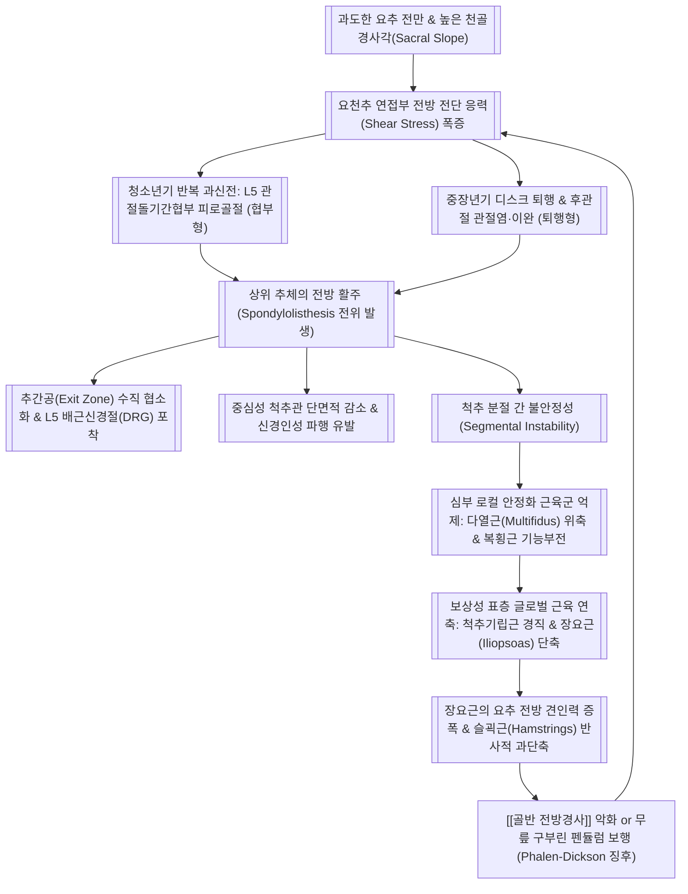
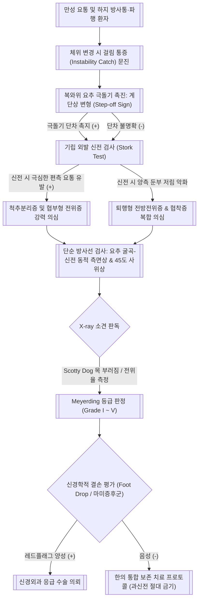
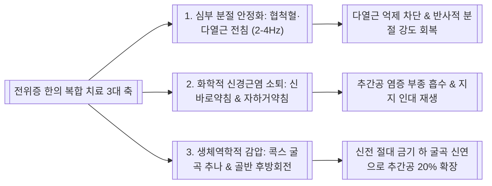
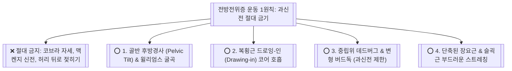

# 🩺 [[척추전방전위증]] (Spondylolisthesis / 脊椎前方轉位症, ICD-10 M43.1 / KCD M43.1)

> **핵심 3줄 요약 (Key Summary)**:
> - 📍 **병소 부위 & 해부·병태생리**: 인접한 하위 [[추체]](Lower vertebra)에 대해 상위 척추체가 정상적인 시상면 정렬 곡선을 벗어나 전방(배 쪽)으로 미끄러져 전위(Slipping)된 상태로, [[관절돌기]]간협부(Pars interarticularis)의 피로 골절 및 결손([[척추분리증]] 동반)에 의한 **협부형(Isthmic, L5-S1 호발)** 과, [[추간판]] 및 [[후관절]]의 만성 퇴행성 이완에 의한 **퇴행형(Degenerative, L4-L5 여성 호발)** 이 양대 축을 형성한다.
> - 🚩 **전형적 임상 양상 & 3대 징후**: ① 의자에서 일어나거나 허리를 굽혔다 펼 때 척추 분절이 어긋나는 듯한 **자세 변환통 및 불안정성 걸림 통증(Instability Catching Pain)**, ② 기립 및 보행 시 요추 신전으로 인한 척추관·추간공 압박 및 [[신경인성 간헐적 파행]], ③ 요추 극돌기를 위에서 아래로 촉진할 때 턱이 걸리는 **계단상 변형([[계단상 변형]], Step-off sign)** 과 외발 기립 신전 시 협부 통증이 폭발하는 **외발 신전 검사([[외발 신전 검사]], Stork test)** 양성.
> - 🛠️ **한·양방 통합 치료 및 운동 금기**: 요추를 뒤로 젖히는 과신전 운동(맥켄지 신전, 요가 코브라 자세) 및 신전 HVLA 추나는 전위를 가속하므로 **절대 금기**이다. 한의 진료실에서는 심부 [[다열근]] 및 [[화타협척혈]] 2~4Hz 전침, [[신바로약침]]·[[자하거약침]], 콕스 굴곡-신연 [[추나]], [[골반 후방경사]] 교정 및 [[복횡근]] 드로잉-인(Drawing-in) 분절 안정화 재활을 적용하며, Meyerding Grade III 이상 또는 진행성 마비 시 수술(감압술+골유합술)을 의뢰한다.

---

## 📌 목차
1. [[질환 개요 & 해부학적 병태생리]](#1-질환-개요--해부학적-병태생리)
2. [[병태생리 메커니즘 & 생체역학적 악순환 네트워크]](#2-병태생리-메커니즘--생체역학적-악순환-네트워크)
3. [[임상 증상 & 이학적 검사 알고리즘]](#3-임상-증상--이학적-검사-알고리즘)
4. [[감별 진단 매트릭스]](#4-감별-진단-매트릭스)
5. [[한의 통합 치료 프로토콜]](#5-한의-통합-치료-프로토콜)
6. [[양방 치료 & 병용·의뢰 기준]](#6-양방-치료--병용의뢰-기준)
7. [[재활 운동 & 생활습관 티칭 가이드]](#7-재활-운동--생활습관-티칭-가이드)
8. [[💡 사용자 진료실 핵심 필기 & 임상 노하우 (Melt-In)]](#8--사용자-진료실-핵심-필기--임상-노하우-melt-in)
9. [[📚 출처 및 현대 학술 연구 요약]](#9-출처-및-현대-학술-연구-요약)

---

## 1. 🩺 질환 개요 & 해부학적 병태생리

### 1) 질환 정의 및 Wiltse-Newman 5대 원인별 분류
* **정의**: [[척추전방전위증]](Spondylolisthesis)은 척추의 분절 간 결합 조직이나 골성 구조의 파탄으로 인해, 상위 척추체가 하위 척추체의 상관절면 및 상단면에 대해 정상적인 시상면(Sagittal plane) 정렬을 유지하지 못하고 전방(Ventral side)으로 미끄러져 이동한 병리적 상태이다.
* **Wiltse-Newman 5대 원인별 분류 체계 (1976)**:
  1. **이형성형 (Type I, Dysplastic / Congenital)**:
     - **발생 기전**: 선천적인 [[천골]] 상[[관절돌기]](Sacral superior facet)의 형성 부전 또는 L5 척추 후궁의 이분척추(Spina bifida occulta) 등 선천 기형으로 인해, 요천추 연접부의 전방 전단력을 버티지 못하고 L5가 천골 위에서 앞으로 미끄러짐.
     - **특징**: [[추궁판]]이 온전한 상태에서 미끄러지므로 [[마미총]]이 척추관 전벽과 후궁 사이에 집게처럼 끼어 조기에 심각한 신경학적 결손이나 [[마미증후군]]을 초래하기 쉬움. 소아·청소년기에 급격한 전위 진행 위험이 큼.
  2. **협부형 (Type II, Isthmic / Spondylolytic)**:
     - **발생 기전**: 상하 관절돌기 사이에 위치한 **관절돌기간협부(Pars interarticularis)** 에 피로 골절(Stress fracture)이 발생하여 골성 연속성이 끊어지는 [[척추분리증]](Spondylolysis)이 선행되고, 이후 [[척추경]]-추체 복합체가 후궁판으로부터 분리되어 전방으로 미끄러짐.
     - **관절돌기간협부의 미세 해부학**: 상관절돌기와 하관절돌기를 잇는 척추궁의 가장 좁은 골성 협부로서, 요추 신전 시 상위 척추의 하관절돌기와 하위 척추의 상관절돌기 사이에서 '호두까기 인형(Nutcracker mechanism)'처럼 으깨지는 전단 응력이 집중되는 역학적 취약 부위임.
     - **세부 아형**: 
       - II-A (용해형, Lytic): 반복적인 과신전 및 회전 하중에 의한 협부 피로 골절 (최다 빈도).
       - II-B (신장형, Elongated pars): 반복 미세 골절 후 가골(Callus) 치유가 반복되며 협부가 길쭉하게 늘어난 상태.
       - II-C (급성 골절형, Acute fracture): 심한 외상으로 협부가 일시에 골절된 상태.
     - **호발**: 10~20대 운동선수(체조, 축구, 역도, 야구 투수, 다이빙, 피겨스케이팅 등), **L5-S1 분절에 압도적 호발(전체의 약 85~90%)**.
     - **방사선 특징**: 요추 45도 사위상(Oblique X-ray)에서 상관절돌기(귀), 횡돌기(코), [[척추경]](눈), 관절돌기간협부(목), 하관절돌기(앞다리)로 이루어지는 '스카티 독(Scotty dog)' 음영 중 **목 부위가 부러진 칼라(Broken collar on Scotty dog)** 소견이 관찰됨.
  3. **퇴행형 (Type III, Degenerative / Pseudospondylolisthesis)**:
     - **발생 기전**: 협부의 골성 결손은 전혀 없으나, 노화에 따른 장기간의 [[추간판]] 수분 소실과 간격 협소화, [[후관절]] 연골 마모와 관절염, [[황색인대]] 및 관절낭의 만성적인 이완(Laxity)으로 인해 상관절돌기가 하관절돌기를 지지하지 못하고 전방 전위됨.
     - **호발**: **50~60대 이상 여성(여성이 남성의 4~6배)**, **L4-L5 분절에 압도적 호발(전체의 약 80% 이상)**.
     - **폐경 후 여성 호발 기전**: 폐경 후 에스트로겐 급감으로 인해 인대 및 관절낭의 콜라겐 합성 저하와 가교 결합 약화, [[골반 전방경사]] 증가, 요추 후관절 시상면 배열(Sagittal orientation)의 퇴행성 변화가 결합되어 발생.
     - **특징**: 척추경과 후궁이 추체와 함께 통째로 전방 이동하므로 중심성 [[척추관 협착증]]이 필연적으로 복합 발생함. 전위율은 대개 Grade I~II(25~30% 이내)에서 안정화되며 Grade III 이상으로 진행하는 경우는 드묾.
  4. **외상형 (Type IV, Traumatic)**:
     - **발생 기전**: 고에너지 교통사고, 추락 등 중증 외상으로 인해 관절돌기간협부 이외의 척추경, 후궁판, 후관절 등이 골절되어 급격히 전위된 상태.
  5. **병적형 (Type V, Pathologic)**:
     - **발생 기전**: 심각한 [[골다공증]], 척추 골수염, 파제트병(Paget's disease), 전이성 악성 종양 등으로 인해 척추경과 척추경 복합체의 골성 지지력이 구조적으로 파괴되어 발생.

### 2) Meyerding 5단계 방사선학적 전위 분류
하위 척추체 상단면의 전후 직경을 4등분(각 25%)하여 상위 척추체 후하방 모서리의 미끄러진 비율을 측정한다:
* **Grade I (0 ~ 25% 전위)**: 경도 전위. 대부분의 퇴행형 전위증이 해당하며, 한의 통합 보존 치료 및 분절 안정화 재활의 가장 이상적인 적응증이다.
* **Grade II (26 ~ 50% 전위)**: 중등도 전위. 협부형 전위증에서 흔하며, 척추 불안정성 요통과 하지 방사통이 빈발하여 적극적인 한의 복합 치료가 요구된다.
* **Grade III (51 ~ 75% 전위)**: 중증 전위. 척추의 구조적 변형이 뚜렷하고 추간공 왜곡에 의한 지속적 신경근 압박이 발생하며, 보존 치료 실패 시 수술을 고려한다.
* **Grade IV (76 ~ 100% 전위)**: 극중증 전위. 골반 시상면 불균형이 극심하고 마미총 압박 위험이 높아 수술적 정복 및 유합술이 권고된다.
* **Grade V (척추하수증, Spondyloptosis, > 100% 전위)**: 상위 척추체가 하위 척추체 앞쪽 및 아래쪽으로 완전히 탈락하여 천골 전방으로 굴러 떨어진 상태로, 즉각적인 수술적 재건이 필요하다.

### 3) 호발 분절 비교: 협부형 L5-S1 vs 퇴행형 L4-L5
* **L5-S1 협부형 (Isthmic)**: 천골 경사각이 급격하여 전방 전단력이 가장 크게 작용하는 부위이다. 협부 결손으로 인해 L5 신경궁(후궁판 및 극돌기)은 천골 위에 남고 L5 추체만 전방으로 이동하므로, 중심 척추관은 비교적 넓게 유지되어 마미총 압박은 적으나, **L5 추간공(Exit zone)이 위아래로 찌그러지며 L5 신경근이 심하게 포착**된다. 또한 결손부에 형성된 섬유연골성 가골(Pseudarthrosis callus)이 L5 신경근을 직접 압박한다.
* **L4-L5 퇴행형 (Degenerative)**: 요추 전만의 중심이자 가동성이 가장 큰 분절이다. L4 후궁판이 L4 추체와 함께 전방으로 통째로 전위되므로, 전방의 L4 추체 후면과 후방의 L5 상관절돌기/황색인대 사이의 공간이 좁아져 **중심성 척추관 협착증이 발생하며 하위로 주행하는 L5 신경근(Traversing root)이 협착 포착**된다.

---

## 2. ⚡ 병태생리 메커니즘 & 생체역학적 악순환 네트워크

### 1) 천골골반 지표(Spinopelvic Parameters)와 생체역학적 불균형
척추전방전위증의 발생과 진행은 골반과 척추의 시상면 정렬(Sagittal balance) 지표와 직결되어 있다:
* **골반입사각(Pelvic Incidence, PI)**: 골반의 해부학적 고유 형태를 결정하는 불변의 지표로, $PI = PT + SS$의 공식을 만족한다.
* **천골경사각(Sacral Slope, SS)**: 수평선과 [[천골]] 상단면이 이루는 각도.
* **골반경사각(Pelvic Tilt, PT)**: 대퇴골두 중심과 천골 상단면 중심을 잇는 선이 수직선과 이루는 각도.
* **생체역학적 기전**:
  - 높은 골반입사각(High PI)을 가진 사람은 보상적으로 높은 천골경사각(High SS)과 큰 [[요추 전만]](Lumbar lordosis)을 형성함.
  - 천골면이 전하방으로 가파르게 기울어질수록 중력 하중에 의해 L5 추체가 천골 위에서 앞으로 미끄러지려는 **전방 전단력(Anterior shear vector)** 이 기하급수적으로 증폭됨.
  - 전위가 발생하면 인체는 무너진 균형을 회복하기 위해 골반을 뒤로 기울이는 보상 작용(PT 증가)을 시도하지만, 이는 척추 주변 근육의 피로도를 극대화함.

### 2) 하부 교차 증후군(Lower Crossed Syndrome)과 근육 불균형
전방전위증 환자는 블라디미르 얀다(Vladimir Janda)가 제시한 하부 교차 증후군의 전형적인 악순환 모델을 나타낸다:
* **단축 및 과긴장 근육군 (Tonic/Hyperactive Muscles)**:
  - 전방: [[장요근]](Iliopsoas), [[대퇴직근]](Rectus femoris), [[대퇴근막장근]](TFL).
  - 후방: 흉요추 [[척추기립근]]([[최장근]], [[장늑근]]), [[요방형근]](Quadratus lumborum).
  - 골반 하부: [[슬괵근]](Hamstrings: 대퇴이두근, 반건양근, 반막양근).
* **약화 및 억제 근육군 (Phasic/Inhibited Muscles)**:
  - 전방: 심부 [[복횡근]](Transversus abdominis), 내복사근, 외복사근, [[복직근]].
  - 후방: [[대둔근]](Gluteus maximus), [[중둔근]](Gluteus medius), 심부 [[다열근]](Multifidus).
* **기전**: 단축된 장요근이 요추체를 앞쪽·아래쪽으로 끌어당기고, 약화된 복횡근과 대둔근이 이를 지지하지 못하면서 척추체의 전방 활주 전단력이 통제 불능 상태로 치닫는다.

### 3) 심부 로컬 코어 근육군의 병리와 위축 (다열근 & 복횡근)
* [[다열근]](Multifidus)의 분절 안정화 상실**:
  - 다열근은 상하 척추 극돌기와 횡돌기를 사선으로 잇는 가장 강력한 심부 분절 안정화 근육으로, 척추 분절 간의 비정상적인 미끄러짐과 전단력을 70% 이상 흡수함.
  - 전방전위증 환자에서는 통증과 관절낭 자극에 의한 **관절인대-근육 억제 반사(Arthrogenic Muscle Inhibition, AMI)** 로 인해 다열근으로 가는 신경 전달이 차단됨.
  - 이로 인해 병변 분절 다열근의 극심한 선택적 근위축(Type II 섬유 위축)과 섬유성 지방 침윤(Fatty degeneration)이 발생하여 전방 전위를 제어할 수 없는 무방비 상태에 놓이게 됨.
* [[복횡근]](Transversus Abdominis)의 수축 지연**:
  - 정상인은 사지 움직임 직전에 복횡근이 선행 수축하여 복강 내압을 높이고 흉요근막을 팽팽하게 당겨 척추를 고정하지만, 전위증 환자에서는 복횡근의 피드포워드(Feed-forward) 수축 메커니즘이 완전히 붕괴됨.

---

## 3. 🔍 임상 증상 & 이학적 검사 알고리즘

### 1) 3대 임상 주소증
1. **자세 변환통 및 분절 불안정성 걸림 통증 (Instability Catching Pain)**:
   - 전방전위증 환자의 가장 독보적인 증상이다. 가만히 앉아 있거나 누워 있을 때는 통증이 거의 없으나, **의자에서 일어날 때, 침대에서 일어날 때, 또는 허리를 숙여 세수를 하고 상체를 다시 일으켜 세울 때** 허리 한가운데가 덜컹 어긋나거나 끊어질 듯한 일시적 락킹(Catching) 통증이 발생하여 손으로 허리를 짚고 엉거주춤 펴게 된다.
2. **신전 시 악화되는 요통 및 신경인성 파행**:
   - 오래 서 있거나 평지를 걸을 때 요추가 신전되면 전위된 척추체가 전방으로 더 미끄러져 추간공과 척추관을 좁힌다. 이로 인해 양측 엉덩이와 허벅지 뒤쪽이 뻐근하게 조여오고 저려 주저앉게 된다 (퇴행형 전위증 동반 협착증).
3. **슬괵근 단축 및 보행 이상 ([[팔렌-딕슨 징후]], Phalen-Dickson Sign)**:
   - 골반의 불안정성을 보상하기 위해 슬괵근이 극도로 경직되면서 보폭이 좁아지고, 무릎과 고관절을 약간 구부린 상태에서 골반을 좌우로 흔들며 걷는 펜듈럼 보행(Waddling gait)을 보인다.

### 2) 핵심 이학적 유발 검사법
* **계단상 변형 촉진 검사 ([[계단상 변형]], Step-off Sign)**:
  - **시행법**: 환자를 침대에 복와위로 편안히 눕히고, 검사자가 양손 엄지손가락으로 요추 1번부터 천골까지 극돌기(Spinous process)의 정중앙선을 위에서 아래로 부드럽게 미끄러지듯 쓸어내린다.
  - **양성 기준**: 특정 분절에서 마치 계단 턱을 헛디디는 것처럼 손가락이 푹 꺼지는 명확한 골성 단차(Step-off)가 촉지되면 양성이다.
  - **협부형 vs 퇴행형 촉진 감별의 정밀 손맛**:
    - **협부형(Isthmic)**: 전위된 척추체의 극돌기는 결손된 후궁판과 함께 뒤에 남아있고, 그 바로 윗 레벨의 척추체가 앞으로 따라가지 못하므로, **전위된 척추체의 바로 윗 척추체 극돌기에서 단차(계단 턱)** 가 만져진다 (예: L5 협부 결손 전위 시 L4 극돌기 부위에서 푹 꺼짐).
    - **퇴행형(Degenerative)**: 후궁판이 온전한 상태에서 척추체 전체가 앞으로 미끄러지므로, **전위된 그 척추체의 극돌기 직상방에서 단차**가 만져진다 (예: L4 퇴행성 전위 시 L4 극돌기 자체가 앞으로 들어가며 단차 형성).
* **외발 기립 신전 검사 ([[외발 신전 검사]], Stork Test / One-Leg Standing Hyperextension Test)**:
  - **시행법**: 환자를 기립시킨 후 한쪽 다리를 들어 무릎을 90도 굴곡시킨 상태(학다리 자세)에서, 체간을 뒤로 젖히고(신전) 지지하고 있는 다리 쪽으로 회전시킨다. 반대쪽도 동일하게 시행한다.
  - **양성 기준**: 지지하는 쪽의 요천추 연접부에 찌르는 듯한 날카로운 국소 요통이 유발되면 양성이다.
  - **임상 가치**: 관절돌기간협부에 전단 응력을 집중시켜 단순 방사선상 잘 보이지 않는 초기 피로 골절이나 척추분리증을 조기에 감별하는 최고의 선별 검사이다.
* **수동적 요추 신전 검사 (Passive Lumbar Extension Test)**:
  - **시행법**: 복와위에서 검사자가 환자의 양 발목을 잡고 무릎을 편 채 침대 표면에서 약 30cm 들어 올려 요추를 수동적으로 신전시킨다.
  - **양성 기준**: 허리에 심한 뻐근함, 덜컹거림, 또는 하지 저림이 재현되고, 다리를 내리면 즉시 통증이 소실될 때 양성이다 (요추 분절 불안정성 진단 특이도 90% 이상).

### 3) 영상의학적 정밀 판독 기준
* **단순 방사선 검사 (X-ray)**:
  - **측면 굴곡-신전 동적 방사선(Dynamic Lateral Flexion-Extension View)**: 
    - 기립 상태에서 최대로 허리를 숙였을 때(굴곡)와 최대로 뒤로 젖혔을 때(신전)를 비교.
    - 인접 추체 간의 전방 전위 이동량의 차이가 **3~4 mm 이상**이거나, 분절 간 각도 변화가 **10~15도 이상** 회전하면 방사선학적 **'불안정성(Spinal Instability)'** 으로 확진함.
  - **요추 45도 사위상(Oblique View)**: 관절돌기간협부의 골절 결손선(Scotty dog의 목 부러짐)을 확인.
* **자기공명영상 (MRI)**:
  - T2 시상면 및 축상면에서 추간판 퇴행 정도, 외측 함요부 및 추간공의 협착 정도, 탈출 신경근의 압박 여부, 그리고 심부 [[다열근]]의 위축 및 지방 침윤율(Goutallier Grade)을 정밀 평가.

---

## 4. 🔀 감별 진단 매트릭스

척추전방전위증은 요통과 하지 증상을 공유하는 디스크 탈출증, 단순 협착증, 척추분리증 등과의 엄밀한 감별이 치료 방향을 결정한다.

| 감별 질환 | 호발 연령 및 병태 | 통증 유발 동작 및 특성 | 핵심 이학적 검사 소견 | 방사선 및 MRI 소견 |
| :--- | :--- | :--- | :--- | :--- |
| [[척추전방전위증]] (본 질환) | 10대(협부형) / 50대 이상 여성(퇴행형) | **의자에서 일어날 때 덜컹거림(Catching)**, 신전 및 보행 시 악화 | **극돌기 계단상 변형 (Step-off sign)** (+), **Stork test (+)** | 단순 X-ray: 추체 전방 미끄러짐(Meyerding Gr.I~IV), 협부 결손 |
| [[척추관 협착증]] (단순 협착) | 60대 이상 고령층 | 기립 및 보행 시 신경인성 파행, **자세 변환 걸림통 없음** | Step-off 음성, Kemp 신전 유발(+), van Gelderen 자전거 완화(+) | 전위 없음, 황색인대 비후, Trefoil 척추관, 경막낭 단면적 감소 |
| [[요추 추간판 탈출증]] (HIVD) | 20~40대 청장년층 | **허리를 숙일 때(굴곡) 방사통 악화**, 기침 시 복압 통증 | **SLR 양성 (30~70도)**, Bragard (+), 특정 신경근 마비 | 전위 없음, 수핵 탈출 및 신경근 직접 압박 소견 |
| [[척추분리증]] (단순 분리증) | 10~20대 운동선수 | 허리 뒤로 젖힐 때 국소 요통, **하지 방사통이나 전위 없음** | **Stork test 단독 양성**, **Step-off 음성(단차 없음)** | 사위상 X-ray: Scotty dog 목 골절선 관찰되나 추체 미끄러짐 0% |
| [[후관절 증후군]] | 40대 이상, 척추 과신전 직업 | 요추 신전 및 회전 시 요배부 둔통, 둔부 방사통(무릎 이하 없음) | 후관절 부위 심부 압통(+), Kemp 검사 시 국소 요통만 재현 | 전위 없음, 후관절 비대 및 관절염 소견, MBB 차단 시 즉각 호전 |
| [[천장관절 증후군]] | 임산부, 골반 외상 환자 | 편측 둔부 및 서혜부 통증, 앉아 있을 때 체중 부하 통증 | **Patrick(FABER) 검사 (+)**, Gaenslen 검사 (+), 골반 압박통 | 골반 X-ray/MRI: 천장관절염, 관절면 경화, 요추 정렬 정상 |
| [[척추 압박 골절]] | 70대 이상 중증 골다공증 환자 | 사소한 낙상/기침 후 급격한 극통, 체위 변경 시 극심한 요통 | 병변 극돌기 타진통(Percussion tenderness) 극심, Step-off 음성 | 단순 X-ray: 추체 전방 높이 감소(쐐기형 변형), MRI: T1 저신호 골부종 |

---

## 5. 🌿 한의 통합 치료 프로토콜

전방전위증 치료의 핵심은 **불안정하게 요동치는 척추 분절을 단단히 붙잡아주는 심부 코어 안정화**와, 전방으로 미끄러져 좁아진 추간공 부위의 신경근 무균성 염증을 제거하는 데 있다.

### 1) 침구 및 전침 치료 프로토콜
* **심부 다열근 및 협척혈 자침 술기**:
  - **주요 혈위**: 전위 분절 상하 양측 [[화타협척혈]](EX-B2), [[신수(BL23)]], [[대장수(BL25)]], [[관원수(BL26)]], [[소장수(BL27)]], [[방광수(BL28)]], [[요양관(GV3)]], [[명문(GV4)]], [[지실(BL52)]].
  - **자침 기법**:
    - 환자를 복와위로 두고 복부 아래 베개를 괴어 요추 전만을 줄인다.
    - 0.30×60mm 호침을 사용하여 극돌기 외측 0.5촌 협척혈에서 척추 후궁판을 향해 직자 또는 약간 내측으로 사자하여 40~50mm 심자한다.
    - 위축된 심부 [[다열근]]의 근복(Muscle belly)에 침첨을 도달시켜 뻐근한 득기감을 유도한다.
* **원위 원격 배혈**:
  - [[환도(GB30)]], [[풍시(GB31)]]: 둔부 심부 좌골신경 주행 부위 긴장 완화.
  - [[위중(BL40)]], [[승산(BL57)]]: 과긴장된 슬괵근과 종아리 근육 이완.
  - [[양릉천(GB34)]]: 근회(筋會)로서 척추 주변 인대 장력 회복.
  - [[태계(KI3)]], [[현종(GB39)]]: 신정(腎精) 보익 및 골조직 영양.
  - [[음릉천(SP9)]], [[삼음교(SP6)]]: 하지 부종 및 순환 개선.
* **전침(Electroacupuncture) 파라미터 세팅**:
  - **통전 배합**: 전위 분절 양측 협척혈–대장수 연결.
  - **주파수**: **2~4Hz 연속 저주파**.
  - **기전**: 저주파 전침 자극은 다열근에 걸려 있는 관절인대-근육 억제 반사(AMI)를 해제하고, 운동신경 축삭을 자극하여 위축된 다열근 근섬유의 수축 반응을 재교육한다. 주 3회, 회당 20~25분 통전.

### 2) 약침 요법 (Pharmacopuncture Protocol)
* [[신바로약침]] (GCSB-5)**:
  - 전위로 인해 찌그러진 추간공 주변 및 후관절낭 부위에 포인트당 0.5~1.0cc씩 총 2.0cc를 주입.
  - 신경근 압박 부위의 염증성 사이토카인(TNF-α, IL-1β)을 차단하여 둔부 및 하지 방사통을 신속히 가라앉힘.
* [[자하거약침]](인태반 추출물)**:
  - 노화와 과부하로 이완되고 닳아버린 후관절 관절낭과 [[극간인대]]에 주입하여 섬유아세포 증식 및 콜라겐 합성을 자극함으로써 느슨해진 인대의 인장 강도를 회복시킴.
* [[봉약침]] (Sweet Bee Venom)**:
  - 만성적인 요배부 근막염과 요천추 인대염에 10% 미만의 희석 농도로 시술하여 국소 혈류를 뚫어줌 (스킨테스트 필수).

### 3) 척추전방전위증 특화 추나요법 (Chuna Manual Therapy)
* **⛔ 절대 금기 수기 (Absolute Contraindication)**: 척추를 뒤로 강하게 젖히는 **신전(Extension) 고속저진폭 도수교정(HVLA Thrust)** 은 전위된 척추체를 앞으로 더 밀어내어 척추관을 치명적으로 압박하므로 **절대 금기**이다.
* **요추 굴곡-신연 기법 (Cox Flexion-Distraction Technique)**:
  - 콕스 테이블에서 하체를 아래로 부드럽게 굴곡(Flexion)시키면서 축성 신연력을 가한다.
  - **주의점**: 신전 방향으로는 절대 조작하지 않으며, 중립위에서 굴곡 방향으로만 10~15도 범위 내에서 리듬감 있게 5~6회 반복 가동한다. 전위 분절의 후방 관절 간격을 벌려주고 찌그러진 추간공을 물리적으로 넓혀준다.
* **골반 후방회전 가동화 추나**:
  - 환자의 단축된 [[장요근]]과 [[대퇴직근]]을 부드럽게 이완하고, 장골을 후방으로 회전시켜 과도한 천골 경사각(Sacral slope)을 줄여줌으로써 전방 전단력을 구조적으로 감쇠시킨다.

### 4) 한약 치료 (Herbal Medicine)
* **신양허쇠 및 근골실양(腎陽虛衰 筋骨失養) — 만성 척추 불안정 요통**:
  - [[독활기생탕]](獨活寄生湯)**: 독활, 상기생, 두충, 우슬, 천궁, 당귀, 백작약, 숙지황, 인삼, 복령 등. 척추 지지 연골과 인대를 영양하고 근육 위축을 방지하는 기본 방제.
  - [[삼기음]](三痺飲)**: 기혈 허손이 심하여 조금만 서 있어도 허리가 부러질 듯 아프고 다리가 저린 환자에게 독활기생탕보다 강력한 보익 작용 발휘.
  - [[가미대보탕]](加味大補湯) / [[보허탕]]: 노년기 골다공증성 취약성을 동반한 만성 퇴행성 척추통에 원기 보강.
* **어혈기체(瘀血氣滯) — 자세 바꿀 때 자통, 야간 요통**:
  - [[신통축어탕]](身痛逐瘀湯)**: 도인, 홍화, 당귀, 천궁, 몰약, 우슬 배합으로 척추 전위 부위의 미세 순환 장애와 어혈 정체를 풀어줌.
  - [[당귀수산]](當歸鬚散)**: 초기 외상성 미세 손상 및 급성 염증성 어혈 제거.

---

## 6. 💊 양방 치료 & 병용·의뢰 기준

### 1) 양방 약물 요법 및 비수술 시술
* **약물 치료**:
  - 소염진통제(NSAIDs: Aceclofenac 100mg bid, [[세레콕시브]] Celecoxib 200mg qd)로 국소 활액막염 제어.
  - 근이완제(Eperisone 50mg tid)로 보상성 척추기립근 경직 완화.
  - 방사통 동반 시 [[프레가발린]](Pregabalin 75mg bid) 투여.
* **중재적 주사 요법**:
  - **경막외 스테로이드 주사(ESI)**: 전위로 인한 급성 신경근염 완화.
  - **후관절 내측지 차단술(Medial Branch Block, MBB)**: 후관절 관절염에 의한 국소 요통에 진단 및 치료 목적으로 시행.

### 2) 수술적 치료 적응증 및 SLIP Trial (NEJM 2016 랜드마크)
* **절대적 응급 수술 적응증**:
  - 급성 [[마미증후군]](대소변 배뇨/배변 장애, 안장 감각마비).
  - 족하수(Foot drop) 등 진행성 운동신경 마비(MMT Grade 3 이하).
* **상대적 수술 적응증**:
  - Meyerding Grade III 이상의 중증 전위.
  - 3~6개월 이상의 체계적인 비수술적 한·양방 보존 치료에도 불구하고 극심한 불안정성 요통이나 보행 파행으로 일상생활이 불가능한 경우.
* **수술 술식: 감압술 단독 vs 감압술 + 골유합술 (NEJM 랜드마크 연구)**:
  - 2016년 *New England Journal of Medicine*(PMID: 27074067, SLIP Trial)에 발표된 다기관 무작위 대조 임상시험에 따르면, 퇴행성 척추전방전위증 환자에서 **감압술 단독 시행군보다 감압술과 척추 유합술(Laminectomy plus Fusion, TLIF/PLIF)을 병행한 환자군**이 2년 및 4년 추적 관찰 시 SF-36 신체 기능 점수 개선율과 재수술률 감소에서 통계적으로 유의하게 우수한 결과를 나타냄.
  - 따라서 명확한 척추 분절 불안정성을 동반한 전방전위증 환자가 수술로 이행할 때는 단순 감압만으로는 전위가 가속화될 위험이 크므로 척추 유합술이 표준 술식으로 적용됨.

---

## 7. 🏃 재활 운동 & 생활습관 티칭 가이드

전방전위증 환자의 재활 운동에서 가장 중요한 절대 원칙은 **"과신전의 철저한 배제"** 와 **"골반 후방경사 및 심부 코어 안정화"** 이다.

### 1) 절대 금지 운동 (Absolute Don'ts)
* ❌ **요가 코브라 자세 및 맥켄지(McKenzie) 신전 운동**: 허리를 뒤로 꺾어 젖히는 동작은 이미 앞으로 미끄러져 있는 척추체를 전방으로 더욱 밀어내어 척추관을 치명적으로 압박하므로 **절대 금기**이다.
* ❌ **서서 허리 뒤로 젖히기 스트레칭**: 기립 상태에서 허리를 뒤로 젖히면 전단력이 폭증하여 관절돌기간협부의 결손 부위에 극심한 골성 충돌을 일으킨다.
* ❌ **브릿지(Bridge) 운동 시 골반 과신전**: 엉덩이를 들어 올릴 때 갈비뼈가 들릴 정도로 허리를 꺾으면 전위 분절에 전단 하중이 가해지므로, 반드시 복압을 잡고 몸통과 허벅지가 일직선이 되는 중립위까지만 들어 올려야 한다.

### 2) 필수 권장 4대 분절 안정화 재활 운동
1. **복횡근 드로잉-인(Drawing-in) 호흡 훈련**:
   - 무릎을 세우고 바로 누운 자세에서 양손을 골반 앞쪽 뼈(ASIS) 안쪽 2cm 지점에 가볍게 얹는다.
   - 숨을 천천히 내쉬면서 아랫배를 등 쪽으로 납작하게 끌어당긴다 (소변을 참는 느낌으로 골반저근을 함께 수축).
   - 이때 겉의 복직근이 불룩 튀어나오지 않고 손가락 아래 심부 근육이 팽팽하게 굳어지는 것을 확인한다. 10초 유지, 10회 반복.
2. **골반 후방경사 운동 (Pelvic Tilt)**:
   - 누운 상태에서 숨을 내쉬며 배꼽을 바닥 쪽으로 꾹 눌러 허리 뒤쪽의 아치 공간을 없앤다.
   - 둔근을 가볍게 조이며 골반을 뒤로 굴려주는 감각을 익힌다 (윌리엄스 굴곡 운동의 기초).
3. **중립위 데드버그 (Deadbug Exercise)**:
   - 누워서 허리를 바닥에 밀착(골반 후방경사)시킨 상태에서 양팔을 천장으로 뻗고 양 무릎을 90도로 든다.
   - 허리가 바닥에서 뜨지 않는 한도 내에서 한쪽 팔과 반대쪽 다리를 천천히 뻗었다가 돌아온다. 척추의 움직임 없이 사지를 가동하는 코어 안정성을 확립한다.
4. **변형 버드독 (Bird-Dog - 수평 제한)**:
   - 네발기기 자세에서 복횡근을 수축하여 척추 중립을 유지한다.
   - 팔다리를 들어 올릴 때 절대 허리를 아래로 꺾지 말고, **다리가 척추와 수평이 되는 높이까지만** 들어 올린다. O'Sullivan 연구(1997, Spine)에서 입증된 다열근 강화의 핵심 운동이다.

### 3) 단계별 재활 운동 점진 프로토콜
* **1단계: 통증 완화 및 등척성 활성화 (1~4주차)**
  - 앙와위 복횡근 드로잉-인 호흡 훈련 (매일 아침·저녁 10분).
  - 골반 후방경사 운동 및 앙와위 무릎 가슴 당기기(Single Knee-to-Chest).
* **2단계: 동적 코어 안정화 및 가동역 회복 (5~8주차)**
  - 중립위 데드버그 운동 (10회씩 3세트).
  - 장요근 및 슬괵근 스트레칭 (골반 후방경사 유지 상태).
  - 콕스 테이블 굴곡 견인 치료 병행.
* **3단계: 기능적 근력 강화 및 일상 복귀 (9~12주차)**
  - 변형 버드독(다리 수평까지만 거상) 및 무릎 대고 하는 하프 플랭크.
  - 고정식 실내 자전거 타기 (상체 약간 굴곡된 자세로 20~30분).
  - 기립 시 및 앉았다 일어날 때 복횡근 선행 수축(Bracing) 습관화.

---

## 8. 💡 사용자 진료실 핵심 필기 & 임상 노하우 (Melt-In)

> [[!IMPORTANT]]
> 본 섹션에는 원장님의 다년간 진료실 실전 경험에서 정립된 **"허리 뒤 훑어내려 계단 턱(Step-off) 만지는 손맛", 자세 변환 걸림통 문진 직관, 코브라 자세 금기 설득 스크립트, 차팅 방어 노하우**를 100% 융합(Melt-In)하여 수록하였다.

### 1) 진료실 실전 감별 문진 노하우: "허리를 뒤로 젖히면 아프고, 구부리면 편하다"
* 환자가 진료실에 들어와 호소하는 전형적인 첫마디:
  - *"원장님, 평소에 걸어 다닐 때 허리를 꼿꼿이 펴면 엉덩이 쪽이 뻐근하게 조여오는데, 이상하게 장바구니 카트를 밀거나 허리를 앞으로 구부리면 살 것 같아요."*
* **감별 직관**: 이 문장이 나오는 순간 머릿속에서 2가지 질환([[척추관 협착증]] vs [[척추전방전위증]])을 즉각 띄워야 한다.
* **전위증을 확정 짓는 추가 질문 (체위 변경 시 걸림 통증, Instability Catch)**:
  - *"혹시 의자에서 일어날 때 바로 펴지 못하고 손으로 허리를 짚으면서 '아이고' 하고 엉거주춤 일어나시나요? 세수하려고 고개 숙였다가 일어날 때 허리가 덜컹 삐끗하는 느낌이 드나요?"*
  - 👉 **"맞아요! 앉았다 일어날 때 허리가 끊어질 것 같아서 한참 짚고 있어야 펴져요!"** 라고 답하면 척추 분절의 불안정성을 동반한 척추전방전위증을 95% 이상 확신할 수 있다.

### 2) 계단상 변형(Step-off sign) 촉진의 정밀 손맛 노하우
* **X-ray 촬영 전 진료실 촉진만으로 전위증을 확진하는 손맛**:
  - 환자를 복와위로 편안히 눕히고 바지춤을 살짝 내려 요천추 부위를 노출한다.
  - 양손 엄지손가락의 지문 부위로 요추 1번 극돌기부터 정중앙선을 타고 아래로 부드럽게 훑어내려간다.
  - L4-L5 또는 L5-S1 분절에 도달했을 때, 손가락 끝에서 **마치 방바닥에 깔아둔 문턱이나 계단 턱을 헛디디듯 '툭' 하고 푹 꺼지는 단차(Step-off)** 가 만져진다.
* **협부형 vs 퇴행형의 촉진 랜드마크 손맛 차이**:
  - **L4 퇴행형 전위증 (50~60대 여성 다빈도)**: L4 극돌기 전체가 앞으로 들어가 있으므로, **L3-L4 극돌기 사이에서 손가락이 푹 꺼지는 단차**가 만져진다.
  - **L5 협부형 전위증 (10~30대 젊은 층, 체조/운동선수)**: L5 후궁판이 뒤에 남아있고 추체만 미끄러지므로, L5 극돌기는 만져지는데 **그 바로 윗 레벨인 L4 극돌기 부위에서 푹 꺼지는 깊은 계단 턱**이 만져진다.
  - 이 계단 턱이 촉지되면 방사선 검사 없이도 전방전위증을 현장에서 바로 진단하고 환자에게 설명할 수 있다.

### 3) 운동 지도 시 절대 주의사항 (환자 티칭 설득 스크립트)
* **요가 코브라 자세 및 맥켄지 신전 금기 설득 멘트**:
  - *"환자분, 주변에서 '허리 아플 땐 허리를 뒤로 젖히는 맥켄지 운동이나 요가 코브라 자세가 최고다'라는 말 많이 들으셨죠? 그건 디스크가 튀어나온 젊은 사람들에게나 맞는 말입니다."*
  - *"환자분의 척추뼈는 지금 앞으로 미끄러져 낭떠러지 끝에 위태롭게 서 있는 상태입니다. 이 상태에서 허리를 뒤로 젖히는 스트레칭을 하는 것은, **앞으로 미끄러진 척추뼈의 뒤통수를 발로 차서 낭떠러지로 더 밀어붙이는 위험천만한 행동**입니다. 젖힐 때마다 척추 신경 구멍이 짓눌려 다리가 마비될 수 있습니다. 오늘부터 뒤로 젖히는 동작은 1초도 하지 마십시오."*
* **복횡근 드로잉-인 호흡 티칭 노하우**:
  - 진료실 베드에 눕혀놓고 환자의 골반 뼈 안쪽에 원장님의 손가락을 대어 촉지시킨다.
  - *"숨을 가늘고 길게 내쉬면서 배꼽을 등에 붙인다는 느낌으로 쏙 집어넣어 보세요. 바지 단추가 꽉 끼어서 배를 홀쭉하게 집어넣는 느낌입니다. 손가락 밑에서 단단하게 힘이 들어오는 게 느껴지시죠? 이 속근육 코르셋이 환자분의 덜컹거리는 척추뼈를 꽉 붙잡아주는 유일한 생명줄입니다."*

### 4) 침구 & 약침 시술 손맛 노하우
* **다열근 위축 부위 타겟팅 심자**:
  - 계단상 변형이 확인된 분절의 극돌기 바로 옆 0.5촌 협척혈 부위는 만져보면 다열근이 위축되어 스펀지처럼 푹 꺼져 있다.
  - 0.30×60mm 침으로 후궁판 골면을 확인하며 40~50mm 심자한 후, 2Hz 저주파 전침을 통전하면 위축되어 잠들어 있던 다열근이 펄떡거리며 뛰는 것을 눈으로 확인할 수 있다. 이 자극이 분절 안정성을 회복시키는 결정적 술기이다.
* **신바로약침 추간공 주입 팁**:
  - 척추체가 앞으로 밀려나 추간공이 찌그러지면 신경근이 눌려 방사통이 심해진다. 극돌기 외측 1.5촌 지점에서 상관절돌기 외측연을 향해 26G 50mm 니들로 접근하여 신바로약침 2.0cc를 심부 주입하면, 신경근 주변의 기계적 마찰로 인한 무균성 신경근염이 빠르게 가라앉아 방사통이 소퇴된다.

### 5) 의무기록 차팅 및 법적 방어 노하우 (Medico-Legal Documentation)
* 초진 시 차트에 반드시 남겨야 하는 5대 필수 항목:
  1. **계단상 변형(Step-off sign) 유무 및 발생 레벨** (예: L4-L5 Step-off +).
  2. **체위 변경 시 불안정성 걸림통(Instability catching pain) 유무**.
  3. **외발 신전 검사(Stork test) 좌/우 결과**.
  4. **신경학적 결손 유무**: 족하수(Foot drop, EHL/TA MMT), 대소변 장애 음성 기록.
  5. **요추 과신전 운동 금기 티칭 완료 기록**.
* **표준 차팅 문구 예시**:
  - *"주소증: 기립 및 보행 시 요통, 의자에서 일어날 때 허리 덜컹거리는 걸림통 호소. 복와위 촉진상 L4-L5 Step-off sign(+), Stork test 우측(+). 하지 SLR (-/-), EHL/TA MMT Gr.5 정상, 배뇨장애 없음으로 마미증후군 배제함. 단순 X-ray상 L4 전방전위(Meyerding Gr.I) 및 불안정성 확인. 협척혈 심부 다열근 2Hz 전침 및 신바로약침 시술, 콕스 굴곡추나 시행. 요가 코브라 및 맥켄지 신전 운동 절대 금기 티칭함. 전위 진행 및 마비 발생 시 수술적 유합술 고려 설명함."*

---

## 9. 📚 출처 및 현대 학술 연구 요약

1. **Wiltse LL, Newman PH, Macnab I (1976)**. *Classification of spondylolisis and spondylolisthesis*. **Clin Orthop Relat Res**. PMID: 1277669
   - **연구 요약**: 척추분리증 및 척추전방전위증의 병태해부학적 기전과 발생 원인을 체계적으로 정립한 불후의 랜드마크 논문. 이형성(Dysplastic), 협부(Isthmic), 퇴행(Degenerative), 외상(Traumatic), 병적(Pathologic) 5대 범주로 질환을 명쾌하게 분류하여 현대 척추외과학의 표준 분류 기준으로 자리매김함.
2. **O'Sullivan PB, Twomey L, Allison GT (1997)**. *Evaluation of specific stabilizing exercise in the treatment of chronic low back pain with radiologic diagnosis of spondylolysis or spondylolisthesis*. **Spine (Phila Pa 1976)**. PMID: 9431633
   - **연구 요약**: 방사선학적으로 척추분리증 및 전방전위증으로 확진된 만성 요통 환자를 대상으로 복횡근과 심부 다열근의 특정 분절 안정화 운동의 치료 효과를 검증한 무작위 대조군 연구. 통상적 치료군에 비해 심부 코어 안정화 운동군이 통증 감소 및 기능 장애 지수 개선에서 현저한 우월성을 보였으며 30개월 추적 시 재발률이 극적으로 감소함을 입증함.
3. **Kalichman L, Hunter DJ (2008)**. *Diagnosis and conservative management of degenerative lumbar spondylolisthesis*. **Eur Spine J**. PMID: 18026865
   - **연구 요약**: 퇴행성 요추 척추전방전위증의 유병률, 역학, 자연 경과, 이학적 진단 및 비수술적 보존 치료에 관한 포괄적 임상 고찰. 대다수의 퇴행성 전위증 환자에서 전위율이 Grade I~II 수준에서 멈추며 급격히 악화되지 않음을 밝히고, 굴곡 기반 물리치료와 심부 근육 강화 등 비수술 보존 치료가 1차 표준 요법임을 강조함.
4. **Ghogawala Z, et al. (2016)**. *Laminectomy plus Fusion versus Laminectomy Alone for Lumbar Spondylolisthesis*. **N Engl J Med**. PMID: 27074067
   - **연구 요약**: 퇴행성 요추 척추전방전위증 환자 66명을 대상으로 단순 후궁 절제 감압술과 감압술+골유합술(Laminectomy plus Fusion)을 비교한 최고 권위 다기관 무작위 대조 임상시험(SLIP Trial). 골유합술 병행군이 단순 감압술군 대비 2년 및 4년 추적 관찰 시 SF-36 신체 기능 점수 개선율과 재수술률 감소에서 유의하게 우수함을 규명하여 척추 불안정성이 동반된 전위증의 수술적 치료 기준을 확립함.
5. **Kim M, et al. (2018)**. *The effectiveness and safety of nonsurgical integrative interventions for symptomatic lumbar spinal spondylolisthesis: A randomized controlled multinational, multicenter trial protocol*. **Medicine (Baltimore)**. PMID: 29742708
   - **연구 요약**: 유증상 요추 척추전방전위증 환자를 대상으로 침, 굴곡-신연 추나요법, 신바로약침, 한약 등 한의 통합 보존 치료(Integrative Korean Medicine Interventions)의 유효성과 안전성을 평가하는 다국적·다기관 무작위 대조 임상시험 프로토콜. 비수술적 한의 통합 중재의 표준화된 치료 모델을 제시함.
