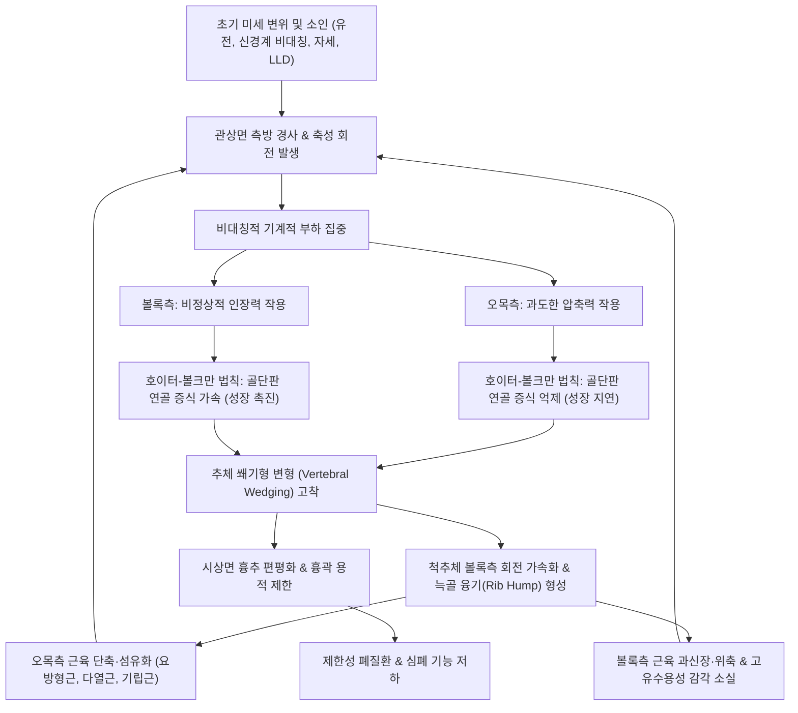
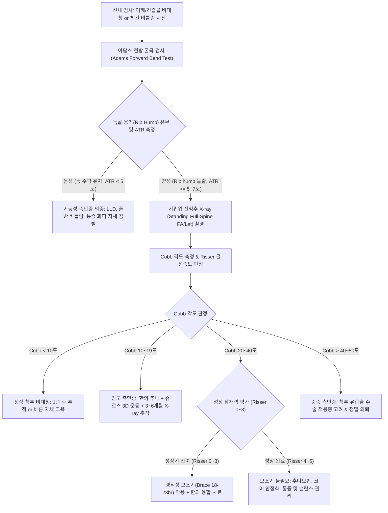
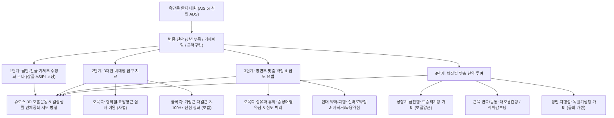

# 측만증 (Scoliosis)

> **핵심 3줄 요약 (Key Summary)**:
> - 🎯 척추가 관상면(Coronal plane) 상에서 10도 이상 외측으로 편위됨과 동시에 시상면 만곡 소실(흉추 과소후만/편평등) 및 수평면(Transverse plane) 추체 회전이 결합된 3차원적 척추 기형 질환
> - 🚩 비구조성(기능성) 측만증과 원인 미상의 청소년기 특발성 척추측만증(AIS), 노인성 성인 퇴행성 측만증(ADS)으로 대별되며, 양측 어깨 높이 비대칭, 견갑골 돌출, 골반 비틀림 및 [[아담스 전방 굴곡 검사]] 상 늑골 융기(Rib hump)가 특징적
> - 🔍 한의학적으로 구루(傴僂), 척추편사(脊柱偏斜)로 접근하며, 골반-척추 기저부 정렬 추나요법, 3차원 회전 각도 호흡(Schroth RAB), 오목측 단축근 침도·약침 요법과 볼록측 전침 근육 재활성화, [[보중익기탕]]·[[대호경간탕]]·[[독활기생탕]]을 투여하여 만곡 진행 억제 및 생체역학적 밸런스 회복
> - ⚠️ 급성장기 청소년의 콥 각도(Cobb angle) 진행 모니터링(Risser sign 0~2단계 집중 추적)이 필수적이며, Cobb 각도 25~40도 시 보조기(Brace), 45~50도 이상의 중증 진행성 구조성 측만증은 수술적 척추 유합술 적응증 감별 필요

---

## 📌 목차 (Table of Contents)
- [[#1. 🩺 질환 개요 & 해부학적 병태생리]]
  - [[#1.1 정의 및 임상적 의의]]
  - [[#1.2 역학 및 호발 인구]]
  - [[#1.3 척추의 3차원 해부학적 구조와 변형 특성]]
  - [[#1.4 원인론적 분류 체계]]
- [[#2. ⚡ 병태생리 메커니즘 & 생체역학적 악순환 네트워크]]
  - [[#2.1 호이터-볼크만 법칙(Heuter-Volkmann Law)과 추체 쐐기형 변형]]
  - [[#2.2 3차원 결합 변형 메커니즘과 늑골 융기(Rib Hump)]]
  - [[#2.3 근육 불균형과 신경근육성 비대칭 악순환]]
  - [[#2.4 시상면 불균형과 심폐 생체역학적 여파]]
  - [[#2.5 생체역학적 악순환 네트워크 다이어그램]]
- [[#3. 🔍 임상 증상 & 이학적 검사 알고리즘]]
  - [[#3.1 주요 외형적 징후 및 신체 비대칭 시진]]
  - [[#3.2 아담스 전방 굴곡 검사 및 스콜리오미터 회전각(ATR) 측정]]
  - [[#3.3 체간 균형 평가 (관상면 & 시상면 밸런스)]]
  - [[#3.4 영상의학적 표준 평가: 콥 각도(Cobb Angle) 및 회전도]]
  - [[#3.5 골성숙도 판정: 리서 징후(Risser Sign) 및 성장 평가]]
  - [[#3.6 렌케(Lenke) 분류 체계 개요]]
  - [[#3.7 진단 및 추적 관찰 임상 알고리즘]]
- [[#4. 🔀 감별 진단 매트릭스]]
  - [[#4.1 6대 척추 측만 및 기형 감별 비교표]]
  - [[#4.2 기능성(비구조성) 측만증의 원인별 세부 감별]]
  - [[#4.3 중대한 기저 질환 배제를 위한 적신호 징후(Red Flags)]]
- [[#5. 🌿 한의 통합 치료 프로토콜]]
  - [[#5.1 한의학적 병인병기 및 변증 체계]]
  - [[#5.2 추나요법(Chuna) 3차원 교정 프로토콜]]
  - [[#5.3 침구 및 비대칭 전침(Electroacupuncture) 치료]]
  - [[#5.4 약침 요법 (Pharmacopuncture)]]
  - [[#5.5 침도 요법 (Acupotomy)]]
  - [[#5.6 단계별 한약 치료 (Herbal Medicine)]]
  - [[#5.7 한의 통합 치료 흐름도]]
- [[#6. 💊 양방 치료 & 병용·의뢰 기준]]
  - [[#6.1 단계별 양방 치료 가이드라인 (SOSORT & SRS)]]
  - [[#6.2 보조기 치료 (Bracing Strategy)]]
  - [[#6.3 수술적 척추 유합술(Spinal Fusion) 적응증]]
  - [[#6.4 성인 퇴행성 측만증의 약물 요법]]
  - [[#6.5 한·양방 병용 치료 가이드라인]]
  - [[#6.6 정형외과·신경외과 전문의 긴급 의뢰 기준]]
- [[#7. 🏃 재활 운동 & 생활습관 티칭 가이드]]
  - [[#7.1 슈로스(Schroth) 3차원 호흡 운동 요법]]
  - [[#7.2 척추 안정화 및 비대칭 코어 운동]]
  - [[#7.3 일상생활 자세 지도 및 인체공학적 수칙]]
  - [[#7.4 하지길이부동(LLD) 교정을 위한 힐 리프트 처방 가이드]]
- [[#8. 💡 사용자 진료실 핵심 필기 & 임상 노하우 (Melt-In)]]
  - [[#8.1 원본 필기 1: 기립위 전척추 X-ray 표준 원칙]]
  - [[#8.2 원본 필기 2: 청소년기 급성장기(PHV) 3개월 추적 모니터링]]
  - [[#8.3 원본 필기 3: 하지길이부동(LLD) 골반 깔창(Heel Lift) 임상 요령]]
  - [[#8.4 스콜리오미터 진료실 선별 컷오프 요령]]
  - [[#8.5 추나 수기 시술 시 금기: 정점 추체 맹목적 강타 금지]]
  - [[#8.6 성인 퇴행성 측만(ADS) vs 청소년 특발성 측만(AIS) 촉진 감별]]
- [[#9. 📚 출처 및 현대 학술 연구 요약]]

---

## 1. 🩺 질환 개요 & 해부학적 병태생리

### 1.1 정의 및 임상적 의의
[[측만증]](Scoliosis) 또는 척추옆굽음증은 척추가 정면(관상면, Coronal plane) 상에서 외측으로 10도 이상 영구적으로 편위되는 단순한 평면적 변형이 아니다. 시상면(Sagittal plane) 상에서 정상적으로 존재해야 할 생리적 만곡(흉추 후만 및 요추 전만)이 소실되고 편평화(Flat back)되며, 수평면(Transverse/Axial plane) 상에서 척추체 자체가 비틀리는 축성 회전(Axial rotation)이 복합적으로 결합된 **3차원적 척추-흉곽 기형 질환(Three-dimensional spinal and thoracic deformity)**이다.

임상적으로 측만증은 원인 인자가 해소되면 만곡이 자연 소실되는 **비구조성(기능성) 측만증**과, 척추 분절의 구조적 변형과 고착된 척추체 회전이 동반되어 체위 변화나 자발적 노력으로 회복되지 않는 **구조성 측만증**으로 대별된다. 청소년기 환자에서는 성장에 따른 급격한 만곡 진행과 외형적 기형으로 인한 자존감 저하, 흉곽 기형에 따른 심폐 기능 장애가 주요 쟁점이 되며, 성인 환자에서는 추간판과 후관절의 비대칭적 퇴행성 파괴로 인한 만성 난치성 요통 및 신경근 압박성 신경병증성 파행이 주요 임상적 과제로 대두된다.

### 1.2 역학 및 호발 인구
- **전체 유병률**: 일반 인구의 약 2~3%에서 Cobb 각도 10도 이상의 척추측만이 관찰된다.
- **성별 분포와 만곡 진행 위험도**:
  - Cobb 각도 10~20도 사이의 경도 측만증에서는 남녀 발병 비율이 약 1:1에서 1:1.5로 큰 차이를 보이지 않는다.
  - 그러나 Cobb 각도 30도 이상으로 보조기 착용이나 수술적 교정이 요구되는 중등도 이상의 진행성 만곡에서는 여아 대 남아의 비율이 **5:1 내지 8:1**로 여아에서 압도적으로 높게 나타난다.
- **연령별 분류 (청소년기 특발성 척추측만증, AIS 기준)**:
  - 영아기(Infantile): 0~3세 (대부분 자연 호전되거나 일부 매우 악성으로 진행)
  - 연소기(Juvenile): 4~9세 (진행 가능성이 높아 면밀한 추적 필요)
  - 청소년기(Adolescent): 10~18세 (전체 특발성 측만의 80~85% 차지, 성장 분출기에 급속 진행)
- **성인 퇴행성 측만증(Adult Degenerative Scoliosis, ADS)**:
  - 60세 이상 고령 인구의 30~68%에서 관찰되는 흔한 후천적 척추 기형이다. 폐경 후 골다공증, 비대칭적 추간판 간격 협착, 후관절 아탈구 및 척추 회전 변위가 복합되어 발생한다.

### 1.3 척추의 3차원 해부학적 구조와 변형 특성
척추 측만의 해부학적 분석을 위해서는 척추주(Spinal column)의 특정 랜드마크 척추체를 정확히 정의해야 한다:
1. **정점 추체 (Apical Vertebra)**:
   - 만곡의 정점(Apex)에 위치하여 관상면 상에서 척추 중심 수직선(Central sacral vertical line, CSVL)으로부터 외측으로 가장 멀리 편위된 척추체이다.
   - 수평면 상에서 축성 회전(Axial rotation)이 가장 심하게 일어나며, 쐐기형 뼈 변형(Wedging deformity)이 가장 극대화된 분절이다.
2. **말단/변곡 추체 (End Vertebrae - Upper & Lower)**:
   - 만곡의 상단 및 하단 경계를 이루는 척추체로, 만곡의 오목한 중심축을 향해 가장 가파르게 기울어진(Most tilted) 분절이다. Cobb 각도 측정의 기준선이 된다.
3. **중립 추체 (Neutral Vertebra)**:
   - 회전 변형이 소실되어 좌우 척추경(Pedicle)의 대칭성이 유지되는 첫 번째 척추체이다.
4. **안정 추체 (Stable Vertebra)**:
   - 천골 중심 수직선(CSVL)에 의해 척추체 중심이 양분되는 척추체로, 척추 유합술 시 고정 범위를 결정하는 결정적 지표이다.

### 1.4 원인론적 분류 체계

| 분류 | 세부 유형 | 임상적 특징 및 병인 기전 |
| :--- | :--- | :--- |
| **비구조성 (기능성) 측만증** | 자세성, 동통 회피성, 하지부동(LLD), 골반 비틀림 | 척추체 회전 없음. 앙와위나 전방 굴곡 시 만곡 소실. 기저 원인 제거 시 완전 교정 |
| **특발성 측만증 (Idiopathic, 80~85%)** | 청소년기(AIS), 연소기(JIS), 영아기(IIS) | 유전적 소인, 멜라토닌 수용체 신호전달 이상, 뇌간 전정신경계 부전, 생체역학적 성장 불균형 |
| **선천성 측만증 (Congenital)** | 형성 부전(반척추 Hemivertebra), 분절 부전(융합 척추 Block) | 태생기 4~6주 척추 형성 결함. 유연성이 극히 낮고 비대칭 성장이 심해 조기 진행 위험 |
| **신경근육성 측만증 (Neuromuscular)** | 뇌성마비, 척수근위축증, 근이영양증, 척수 손상 | 체간 지지 근육의 마비, 근긴장도 항진, 감각 결손으로 C자형 긴 붕괴성 만곡 형성 |
| **증후군성 측만증 (Syndromic)** | 마르판 증후군(Marfan), 신경섬유종증(NF-1), 엘러스-단로스 | 결합조직 탄력 섬유 결함, 척추 이형성증 동반. 각도가 날카롭고 급격히 진행 |
| **성인 퇴행성 측만증 (ADS, De novo)** | 요추 분절 비대칭 디스크 퇴행, 골다공증성 압박골절 | 기저 특발성 측만 없이 50대 이후 발생. 요통, 척추관 협착증, 신경인성 파행 동반 |

---

## 2. ⚡ 병태생리 메커니즘 & 생체역학적 악순환 네트워크

### 2.1 호이터-볼크만 법칙(Heuter-Volkmann Law)과 추체 쐐기형 변형
척추 성장기 아동의 척추체 골단판(Epiphyseal growth plate)은 기계적 압박력에 매우 민감하게 반응한다. **호이터-볼크만 법칙(Heuter-Volkmann Law)**에 따르면:
$$\text{기계적 압박 하중 증가} \implies \text{골단판 연골세포 증식 억제} \implies \text{골 성장 지연}$$
$$\text{기계적 인장/부하 감소} \implies \text{골단판 연골세포 증식 촉진} \implies \text{골 성장 가속}$$

척추가 초기 미세 원인(자세, 유전, 신경근성 불균형)에 의해 한쪽으로 경사지면:
1. **만곡의 오목측(Concave side)**: 지속적인 체중 부하와 비정상적인 축성 압박 하중이 집중된다. 골단판의 연골세포 분열과 골화가 억제되어 척추체의 높이가 자라지 못한다.
2. **만곡의 볼록측(Convex side)**: 상대적으로 압박 하중이 감소하고 인장력이 작용하여 정상 혹은 과도한 뼈 성장이 일어난다.
3. **결과**: 직사각형이어야 할 척추체가 한쪽이 얇아지는 **쐐기형 추체(Vertebral wedging)**로 영구 변형되며, 이는 구조적 만곡을 더욱 고착화시키는 자가 영속적 악순환(Vicious cycle)을 형성한다.

### 2.2 3차원 결합 변형 메커니즘과 늑골 융기(Rib Hump)
척추 측만 변형의 핵심은 관상면의 휘어짐이 발생할 때 반드시 척추의 **축성 회전(Axial coupling rotation)**이 강제된다는 점이다:
- **회전의 방향성 규칙**:
  - **척추체(Vertebral body)**: 항상 만곡의 **볼록한 쪽(Convex side)**을 향해 전방으로 회전한다.
  - **극돌기(Spinous process)**: 상대적으로 만곡의 **오목한 쪽(Concave side)**을 향해 등 뒤쪽에서 편위된다. (따라서 체표에서 극돌기를 촉진하면 실제 척추체의 중심 편위보다 덜 휘어진 것처럼 착각하기 쉽다).
- **늑골 융기(Rib Hump)의 역학적 발생 기전**:
  - 흉추(Thoracic spine)에서는 척추체와 횡돌기에 갈비뼈(Rib)가 늑골척추관절(Costovertebral joint) 및 늑골횡돌관절(Costotransverse joint)로 견고히 결합되어 있다.
  - 흉추체가 볼록측으로 회전하면 해당 측의 갈비뼈를 뒤쪽(Posterior)으로 밀어 올리게 된다.
  - 이로 인해 환자가 상체를 앞으로 숙였을 때 등 뒤쪽으로 늑골이 불룩 솟아오르는 **늑골 융기(Rib hump)**가 형성된다.
  - 반대로 오목측의 갈비뼈는 전방으로 밀려나 흉곽 전면(유방 부위)이 튀어나오고 후면은 함몰되는 흉곽의 비틀림(Thoracic torsion)이 완성된다.

```
       [ 흉추 횡단면 회전과 늑골 융기 기전 ]
               
               전방 (Anterior)
        오목측 전방 돌출       정상 흉골
            \               /
             \  [추체 회전] /  (볼록측을 향해 회전)
               \   (O)    /
                \  / \   /
                 \/   \_/
                 /     \
               /         \
      오목측 흉곽 함몰     볼록측 늑골 융기 (Rib Hump)
                         [등 뒤로 돌출]
               후방 (Posterior)
```

### 2.3 근육 불균형과 신경근육성 비대칭 악순환
척추가 3차원적으로 편위되면 척추를 다열적으로 지지하는 심부 및 천부 근육 복합체에 비가역적인 구조적·기능적 변화가 초래된다:

1. **오목한 쪽 (Concave side - 단축 및 과긴장군)**:
   - 물리적 거리가 짧아지며 만성적 적응성 단축(Adaptive shortening)과 섬유화(Fibrotic contracture)가 일어난다.
   - **주요 침범 근육**: 편측 [[요방형근]](Quadratus lumborum), [[다열근]](Multifidus), [[척추기립근]](장늑근, 최장근), [[장요근]](Psoas major), [[능형근]](Rhomboids), 늑간근(Intercostal muscles).
   - 결합조직의 콜라겐 교차결합이 증가하고 근막 유착이 극심해져 척추 분절을 오목한 방향으로 영구적으로 당겨 잡는다.
2. **볼록한 쪽 (Convex side - 과신장 및 억제군)**:
   - 만곡의 팽출로 인해 근육이 지속적으로 신장(Eccentrically strained)된다.
   - 근방추(Muscle spindle)의 민감도 저하, 고유수용성 감각 피드백 결손, 지방 침윤(Fatty infiltration) 및 타입 I 근섬유 위축이 발생한다.
   - 척추를 역방향으로 지탱할 신전 지지력을 완전히 상실하여 만곡 붕괴를 방어하지 못한다.

### 2.4 시상면 불균형과 심폐 생체역학적 여파
- **흉추 편평등(Thoracic Hypokyphosis / Lordoscoliosis)**:
  - 특발성 측만증의 대다수는 시상면에서 흉추의 정상 후만(20~40도)이 사라지고 비정상적으로 편평해지거나 전만화되는 **편평등(Flat back)** 양상을 보인다.
  - 이는 척추의 전방 기둥(추체)이 후방 기둥(후궁판 및 극돌기)보다 상대적으로 더 빨리 자라는 전-후방 성장 불일치(Relative anterior spinal overgrowth)에 기인한다.
- **폐 기능 장애 (Restrictive Lung Impairment)**:
  - 흉곽 회전 변형과 용적 감소로 인해 폐포의 확장이 물리적으로 제한된다.
  - Cobb 각도 50~60도 초과 시 노력성 폐활량(FVC) 및 1초간 노력성 호기량(FEV1)이 현저히 저하된다.
  - Cobb 각도 80~100도 이상의 극단적 변형에서는 폐혈관 저항 증가, 폐성심(Cor pulmonale), 만성 저산소혈증 및 조기 사망 위험이 급증한다.

### 2.5 생체역학적 악순환 네트워크 다이어그램



---

## 3. 🔍 임상 증상 & 이학적 검사 알고리즘

### 3.1 주요 외형적 징후 및 신체 비대칭 시진
청소년기 특발성 척추측만증(AIS)은 초기에는 통증이 거의 없어 부모나 학교 신체검사에서 우연히 발견되는 경우가 90% 이상이다. 시진 시 확인해야 할 5대 외형적 비대칭 지표는 다음과 같다:
1. **양측 어깨 높이 불일치(Shoulder Height Asymmetry)**: 승모근 능선 및 견봉(Acromion)의 수평선 기울어짐 (상부 흉추 만곡의 볼록측 어깨가 거상됨).
2. **견갑골 돌출 비대칭(Scapular Prominence)**: 만곡 볼록측의 견갑골 하각(Inferior angle)이 등 뒤쪽으로 두드러지게 융기되고 외측으로 편위됨.
3. **체간 삼각(Waist / Flank Triangle) 비대칭**: 양팔을 편안히 늘어뜨렸을 때 몸통과 팔 사이의 공간(Flank crease)이 오목측에서는 깊게 파이고, 볼록측에서는 편평하게 펴짐.
4. **골반 경사 및 둔부 비대칭(Pelvic Obliquity)**: 양측 장골능(Iliac crest) 및 전상장골극(ASIS)의 수평선 불일치로 치마나 바지가 한쪽으로 자꾸 돌아감.
5. **두부 중심 편위(Head-to-Pelvis Alignment)**: 머리의 중심이 천골 정중선에서 벗어나 한쪽으로 치우침.

### 3.2 아담스 전방 굴곡 검사 및 스콜리오미터 회전각(ATR) 측정
측만증 진단 및 학교 선별 검사에서 가장 민감하고 결정적인 이학적 검사이다.

```
       [ 아담스 전방 굴곡 검사 (Adams Forward Bend Test) ]
       
          환자 자세: 무릎 신전, 양발 모음, 양손 모으고 90도 전방 굴곡
          검사자 시선: 후방 또는 전방에서 수평 시선으로 등 표면 관찰
          
             오목측 (함몰)            볼록측 (융기)
               \____                  ____/
                    \______    ______/
                           \  /
                        [Rib Hump]
                 스콜리오미터 수평계 측정 (ATR)
```

- **검사 절차**:
  1. 환자는 양발을 나란히 모으고 무릎을 완전히 편 상태를 유지한다.
  2. 양 손바닥을 맞대어 양팔을 바닥을 향해 자연스럽게 늘어뜨린다.
  3. 상체를 지면과 평행이 되도록 천천히 90도 앞으로 숙인다.
  4. 검사자는 환자의 뒤쪽(또는 앞쪽)에서 눈높이를 환자의 등 수평선에 맞추고 흉추부와 요추부의 좌우 등 높낮이를 관찰한다.
- **판정 및 감별**:
  - **기능성(비구조성) 측만증**: 바로 섰을 때 휘어져 보이던 척추가, 앞으로 숙이면 척추체의 회전이 없으므로 좌우 등의 높이가 대칭적으로 편평해진다.
  - **구조성 측만증**: 앞으로 숙였을 때 척추체 회전에 의한 **늑골 융기(Rib hump)** 또는 요추부의 **요추 융기(Lumbar hump)**가 뚜렷하게 도드라진다.
- **스콜리오미터(Scoliometer) 측정 (체간 회전각, Angle of Trunk Rotation, ATR)**:
  - 늑골 융기가 가장 높은 지점에 스콜리오미터 수평계를 올려놓고 기울기 각도를 측정한다.
  - **임상적 기준선**:
    - **ATR 5도 미만**: 정상 범위 또는 경미한 비대칭 (경과 관찰).
    - **ATR 5~7도**: 콥 각도 15~20도 이상의 측만증 가능성이 높음 $\rightarrow$ **전척추 방사선 촬영(X-ray) 절대 적응증**.
    - **ATR 10도 이상**: 콥 각도 25~30도 이상의 중등도 이상 측만증 시사.

### 3.3 체간 균형 평가 (관상면 & 시상면 밸런스)
1. **관상면 균형 (Coronal Balance - C7 Plumb Line)**:
   - 제7경추(C7) 극돌기에서 추(Plumb line)를 바닥으로 늘어뜨린다.
   - 정상: 추선이 둔열(Gluteal cleft) 정중앙에 정확히 일치한다.
   - 비보상성 측만: 추선이 천골 정중선에서 **2 cm 이상 외측으로 벗어남**(Coronal decompensation).
2. **시상면 균형 (Sagittal Vertical Axis, SVA)**:
   - 측면에서 C7 중심에서 내린 수직선이 제1천추(S1) 추체 상후방 모서리(Posterosuperior corner)와 이루는 수평 거리를 측정한다.
   - 정상: $\pm 2.5\text{ cm}$ 이내. SVA가 +5 cm 이상 전방 편위되면 척추 전방 붕괴 및 심각한 요통을 유발한다.

### 3.4 영상의학적 표준 평가: 콥 각도(Cobb Angle) 및 회전도
- **콥 각도(Cobb's Angle) 측정 표준**:
  - **기립위 전척추 방사선(Standing Full-Spine AP/PA)**에서 측정 (앙와위 측정 절대 금지).
  - 만곡의 가장 위쪽으로 기운 상단 변곡 추체(Upper end vertebra)의 상단 피질골에 평행선을 긋는다.
  - 만곡의 가장 아래쪽으로 기운 하단 변곡 추체(Lower end vertebra)의 하단 피질골에 평행선을 긋는다.
  - 두 선의 직각 수직선이 교차하여 이루는 각도를 측정한다.
  - **10도 이상일 때 공식적으로 척추측만증으로 진단**.
- **내쉬-모(Nash-Moe) 척추체 회전도 분류**:
  - AP 방사선 사진 상에서 정점 추체의 **척추경 음영(Pedicle shadow)**의 편위를 기준으로 0~4단계로 평가:
    - Grade 0: 양측 척추경이 대칭적 위치.
    - Grade 1: 볼록측 척추경이 추체 외측연에서 중앙 쪽으로 약간 이동, 오목측 척추경 관찰 가능.
    - Grade 2: 볼록측 척추경이 추체 중앙부 2/3 지점으로 이동, 오목측 척추경 소실 직전.
    - Grade 3: 볼록측 척추경이 추체 정중앙선에 도달, 오목측 척추경 완전 소실.
    - Grade 4: 볼록측 척추경이 정중선을 넘어 오목측 영역으로 완전히 넘어감 (극단적 회전).

### 3.5 골성숙도 판정: 리서 징후(Risser Sign) 및 성장 평가
성장 잠재력이 얼마나 남아있는가는 측만의 진행 위험도를 예측하는 가장 결정적인 지표이다.

```
          [ 리서 징후 (Risser Sign) 장골능 골화 단계 ]
          
              전상장골극 (ASIS)               후상장골극 (PSIS)
                 [ 1 ] ---- [ 2 ] ---- [ 3 ] ---- [ 4 ]
                   \______________________________/
                                  |
                              [ Risser 5 ]
                       (장골능 골단이 장골에 완전 유합)
```

- **Risser Sign 분류 (장골능 골화 진행)**:
  - **Stage 0**: 골화 중심이 전혀 나타나지 않음 (급성장기 직전 또는 진행기, **만곡 급진행 위험 최고**).
  - **Stage 1**: 장골능 외측 25%까지 골화 진행 (급성장 분출기 일치).
  - **Stage 2**: 장골능 외측 50%까지 골화 진행 (급성장기 지속).
  - **Stage 3**: 장골능 외측 75%까지 골화 진행 (성장 속도 둔화 시작).
  - **Stage 4**: 장골능 내측 100%까지 완전 골화 도달, 아직 장골 본체와 유합 전 (성장 마무리 단계).
  - **Stage 5**: 골화된 골단이 장골 본체와 완전히 유합(Fusion)됨 (골성숙 완료, 진행 위험 현저히 감소).
- **진행 위험도 판정 공식**:
  - Risser 0~1단계에서 Cobb 각도 20~29도: 만곡 진행률 **60~80%**.
  - Risser 2~4단계에서 Cobb 각도 20~29도: 만곡 진행률 **20~30%**.

### 3.6 렌케(Lenke) 분류 체계 개요
수술적 접근 및 정밀 분류를 위해 전 세계적으로 통용되는 6가지 만곡 유형:
- Type 1: 주 흉추 만곡 (Main Thoracic) - 가장 흔함
- Type 2: 이중 흉추 만곡 (Double Thoracic)
- Type 3: 이중 주만곡 (Double Major: 흉추 + 요추)
- Type 4: 삼중 만곡 (Triple Major)
- Type 5: 흉요추/요추 만곡 (Thoracolumbar / Lumbar)
- Type 6: 흉요추-흉추 만곡 (Thoracolumbar / Main Thoracic)

### 3.7 진단 및 추적 관찰 임상 알고리즘



---

## 4. 🔀 감별 진단 매트릭스

### 4.1 6대 척추 측만 및 기형 감별 비교표

| 감별 질환 | 호발 연령 및 기전 | 늑골 융기 (Rib Hump) | 앙와위/굴곡 시 가역성 | 방사선학적 특징 | 주 임상 양상 |
| :--- | :--- | :--- | :--- | :--- | :--- |
| **청소년 특발성 측만증 (AIS)** | 10~16세, 원인 미상 다인자성 | **뚜렷한 양성 (회전 변형 동반)** | **비가역적 (만곡 지속)** | 추체 쐐기형 변형, 척추경 비대칭 회전, Risser 0~5 | 대개 무통성, 외형적 체형 비대칭 호소 |
| **기능성(자세성) 측만증** | 전 연령, 자세/LLD/통증 | **음성 (숙이면 편평해짐)** | **완전 가역적 (누우면 소실)** | 척추체 회전 없음, 쐐기형 변형 없음, 하지길이차 | 원인 질환 통증(요통, 골반통), 피로감 |
| **성인 퇴행성 측만증 (ADS)** | 50세 이상, 디스크/후관절 퇴행 | 경도~중등도 비대칭 | 부분 가역적 (강직 동반) | 추간판 비대칭 협착, 거대 골극, 척추관 협착 소견 | 극심한 요통, 하지 방사통, 신경인성 파행 |
| **선천성 척추측만증** | 출생 시~유아기, 척추 발생 결함 | 조기 발현, 단단한 융기 | **완전 비가역적 (유연성 결여)** | 반척추(Hemivertebra), 분절 부전(Block vertebra) | 유아기부터 빠른 진행, 심폐/신장 기형 동반 가능 |
| **신경근육성 측만증** | 소아~청소년, 마비/근육병증 | 거대한 늑골 융기 | 붕괴성 (중력 제거 시 호전) | 긴 C자형 만곡, 심각한 골반 경사(Pelvic obliquity) | 보행 불가, 휠체어 좌위 유지 곤란, 호흡 부전 |
| **동통성/종양성 측만증** | 소아~성인, 유골골종/감염 | 국소 연축으로 인한 융기 | 통증 완화 시 일부 호전 | 국소 골 파괴, 척추경 경화, 감염성 디스크 파괴 | **극심한 야간통**, 아스피린 반응성 통증, 전신 증상 |

### 4.2 기능성(비구조성) 측만증의 원인별 세부 감별
1. **하지 길이 불일치 (Leg Length Discrepancy, LLD)**:
   - 해부학적 단하지(True LLD) 또는 기능적 골반 경사로 발생.
   - 단하지 쪽으로 골반이 떨어지며 요추는 단하지 쪽을 볼록하게 하는 보상성 C자 만곡 형성.
   - 골반 수평 블록(블록 테스트) 적용 시 즉각적으로 척추 정렬 회복.
2. **동통 회피 자세 (Antalgic Posture / Sciatic Scoliosis)**:
   - [[요추 추간판 탈출증]](HIVD) 환자가 신경근 압박을 피하기 위해 무의식적으로 취하는 자세.
   - 탈출 부위가 신경근 외측(Shoulder type)이면 병변 반대측으로 상체를 기울이고, 신경근 내측(Axillary type)이면 병변 동측으로 상체를 기울임.
3. **턱관절 장애(TMD) 및 경추 부정렬 연계성**:
   - 상부 경추(C1-C2) 아탈구 및 저작근 불균형이 전신 근막 장력선(Myofascial meridians)을 통해 하행성 보상 측만을 유도.

### 4.3 중대한 기저 질환 배제를 위한 적신호 징후(Red Flags)
다음 징후가 관찰되면 특발성 측만증으로 단순 간주하지 말고 **즉시 전척추 MRI 및 신경외과 정밀 검사**를 시행해야 한다:
- 🚩 **좌측 흉추 만곡 (Left Thoracic Curve)**: AIS의 90% 이상은 우측 흉추 만곡(Right thoracic curve)이다. 흉추 만곡이 좌측으로 휘어져 있다면 **척수공동증(Syringomyelia), 아놀드-키아리 기형(Arnold-Chiari Malformation), 척수종양**의 동반 가능성이 30~40%에 달하므로 전척추 MRI가 필수적이다.
- 🚩 **극심한 야간 통증 (Intense Nocturnal Pain)**: 일반 AIS는 통증이 없거나 경미하다. 밤에 잠을 깰 정도의 통증은 유골골종(Osteoid osteoma), 골아세포종, 척추 감염을 강력히 시사한다.
- 🚩 **급격한 각도 진행**: 급성장기가 아님에도 6개월에 10도 이상 또는 월 2도 이상 급진행하는 경우.
- 🚩 **신경학적 이상 징후**: 심부건반사 항진, 바빈스키 징후(Babinski sign) 양성, 족간대(Ankle clonus), 복벽반사(Abdominal reflex)의 비대칭적 소실.
- 🚩 **피부 표식자**: 요천추부의 털 뭉치(Hairy patch), 혈관종, 보조개(Sacral dimple), 다발성 밀크커피반점(Cafe-au-lait spot - 신경섬유종증 의심).

---

## 5. 🌿 한의 통합 치료 프로토콜

### 5.1 한의학적 병인병기 및 변증 체계
한의학에서 측만증은 《황제내경(黃帝內經)》의 **구루(傴僂)**, **척추편사(脊柱偏斜)**, **귀배(龜背)**의 범주에 속한다.
- **간신부족·선천품부부족(肝腎不足·先天稟賦不足)**:
  - 신(腎)은 골(骨)을 주관하고 수(髓)를 생성하며, 간(肝)은 근(筋)을 주관한다. 선천적으로 정혈이 허약하여 골단판의 발육이 비대칭적이고 척추 지지 인대가 무력해져 발생. (성장기 AIS의 근본 허증).
- **기체어혈·근맥구련(氣滯瘀血·筋脈拘攣)**:
  - 장기간의 나쁜 자세나 편측 과사용으로 기혈 순환이 장애되어 만곡 오목측의 근육과 근막이 경결·단축되고 어혈이 정체됨.
- **비위허약·근육실양(脾胃虛弱·肌肉失養)**:
  - 후천적 영양 흡수 부전으로 사지 근육과 척추 기립근이 영양을 받지 못해 척추를 바로 세우는 장력이 소실됨.

### 5.2 추나요법(Chuna) 3차원 교정 프로토콜
추나요법은 척추의 관상면 측방 변위뿐 아니라 시상면 저후만 및 수평면 축성 회전 변위를 입체적으로 정상화하는 핵심 수기치료이다.

1. **기저부 골반-천골 교정 (Pelvic Base Leveling)**:
   - 척추 측만의 주춧돌인 천골(Sacrum)과 장골(Ilium)의 수평성을 확보한다.
   - **장골 후하방(PI) 변위**: 복와위 장골 교정기법 적용.
   - **장골 전상방(AS) 변위**: 앙와위 장골 굴곡 가동기법 적용.
   - **천골 염전(Sacral Torsion)**: 천골 기저부(Sacral base) 가동화를 통해 척추 요추 기저부 수평화.
2. **흉요추 3차원 감압 회전 가동 추나 (Rotational Mobilization)**:
   - 환자를 측와위(Side-lying)로 눕히고, 만곡의 볼록측이 위를 향하게 배치하여 오목측 근막을 신장시킨다.
   - 정점 추체(Apex)의 회전된 횡돌기에 술자의 수근부(Pisiform)를 접촉하고, 전방 및 오목측 방향으로 부드러운 역회전(Derotation) 모멘트를 인가한다.
   - **주의**: 골 변형이 고착된 부위에 무리한 고속저진폭(HVLA) 스러스트를 가하지 않으며, 관절 가동(Mobilization)과 근에너지기법(MET) 위주로 안전하게 시행한다.
3. **근막 이완 추나 (Myofascial Release, MFR)**:
   - 오목측의 단축된 [[요방형근]], [[다열근]], [[척추기립근]], 흉요근막에 지속적 허혈성 압박과 스트레칭을 가하여 근막 유착을 분해한다.

### 5.3 침구 및 비대칭 전침(Electroacupuncture) 치료
척추 양측 근육군의 신경근 장력 비대칭을 교정하기 위해 철저한 **비대칭 취혈(Asymmetric Acupoint Selection)**을 시행한다:

```
          [ 비대칭 척추 침구 치료 모델 ]
          
      만곡 오목측 (Concave)            만곡 볼록측 (Convex)
   - 상태: 단축, 과긴장, 섬유화     - 상태: 과신장, 위축, 억제
   - 자침: 심자 (40~50mm), 사법     - 자침: 천자~중등자, 보법
   - 목적: 근막 유착 박리, 연축 이완 - 목적: 근섬유 동원, 고유수용기 재활
   - 전침: 무통전 or 미세전류       - 전침: 2 Hz / 100 Hz 혼합 통전
```

- **오목한 쪽 (Concave side - 이완 및 사법)**:
  - 단축된 심부 근육의 [[화타협척혈]](Jiaji), [[신수]](BL23), [[대장수]](BL25), [[요방형근]] 트리거포인트에 0.30×60 mm 호침으로 심자(40~50 mm)하여 연축된 근섬유의 연축 반응(Local twitch response)을 유도하고 근막 장력을 해소.
- **볼록한 쪽 (Convex side - 강화 및 보법)**:
  - 약화된 [[척추기립근]] 및 [[다열근]] 분절에 침을 자입하고 **전침(Electroacupuncture)을 연결**.
  - **전침 파형**: 2 Hz 저주파(엔도르핀 분비 및 근육 수축 재훈련)와 100 Hz 고주파를 교대 통전(Dense-disperse wave)하여 타입 I 자세 유지 근섬유의 동원율을 극대화.
- **원위 취혈 및 팔맥교회혈(Eight Confluent Points)**:
  - 독맥(督脈)을 통솔하는 **[[후계]](SI3)**와 양교맥(陽蹻脈)을 통솔하는 **[[신맥]](BL62)**을 배합하여 척추 중심축의 축성 신장력을 유도.
  - 근육의 회혈(筋會)인 **[[양릉천]](GB34)**, 골의 회혈(骨會)인 대저(BL11), 수혈(髓會)인 **[[현종]](GB39)**을 배합.

### 5.4 약침 요법 (Pharmacopuncture)
- **중성어혈약침 (中性瘀血藥鍼)**:
  - 오목측의 정점 추체 주변 섬유화된 심부 기립근건막 및 요방형근 부착부에 각 포인트당 0.2~0.5 cc 주입.
  - 미세 순환 장애 개선, 무균성 염증 물질 배출 및 근막 유착 완화.
- **신바로약침 (Shinbaro)**:
  - 소염진통, 신경 보호 및 인대 결합 조직 강화 작용을 지닌 천연물 복합체.
  - 성인 퇴행성 측만증 환자의 후관절염 및 요추 신경근 연관통 부위에 1.0~2.0 cc 시술.
- **자하거(紫河車) 및 녹용(鹿茸) 약침**:
  - 성장기 소아·청소년 측만증 환자의 척추 지지 인대 무력증 및 피로도 개선을 위해 신수(BL23), 관원수(BL26), 협척혈에 주 2회 분할 주입하여 척추골과 인대의 인장 강도 증진.

### 5.5 침도 요법 (Acupotomy)
- **적응증**: 만곡 각도가 크고 장기간 고착되어 흉요근막과 극간인대, 횡돌간인대의 중증 섬유화 유착이 발생한 성인 측만증 및 청소년기 후기 강직성 측만.
- **시술 부위**:
  - 오목측 요방형근의 장골능 부착부(Iliac crest attachment).
  - 정점 추체 오목측 늑골각(Rib angle) 및 횡돌기 외측연 근막 결절.
- **효과**: 메스를 대신하는 소침도로 미세 섬유화 유착 밴드를 절개·박리(Adhesiolysis)하여 척추 분절의 유연성을 즉각적으로 회복시킴으로써 추나요법 및 교정 운동의 효과를 극대화.

### 5.6 단계별 한약 치료 (Herbal Medicine)
측만증의 한약 치료는 단순 진통이 아니라 **척추골 성장 균형, 인대 결합조직 탄성 회복, 근육 불균형 해소**에 초점을 맞춘다.

1. **성장기 체질 허약 및 만곡 급진행 (간신부족·기혈양허)**:
   - **[[보중익기탕]](補中益氣湯)** 또는 **귀비탕(歸脾湯)** 가감:
     - 구성 가미: [[황기]](15g), [[인삼]](10g), [[백출]](10g), [[당귀]](10g), [[녹용]](4~6g), [[골쇄보]](10g), [[속단]](10g), [[두충]](10g).
     - 효능: 중기(中氣)를 끌어올려 체간을 직립 지지하는 항중력근의 피로를 극복하고, 골단판의 정상적 골화를 촉진.
2. **근육의 극심한 연축 및 편측 통증 (기체어혈·근맥구련)**:
   - **[[대호경간탕]](大護經肝湯)** 또는 **[[작약감초탕]](芍藥甘草湯)** 합 갈근탕:
     - 구성: [[백작약]](20~30g), [[감초]](10g), 갈근(15g), 강활(8g), 방풍(8g).
     - 효능: 백작약의 파에오니플로린(Paeoniflorin)과 감초의 글리시리진(Glycyrrhizin)이 신경근 접합부 연축을 억제하고 오목측 과긴장 근육을 신속히 이완.
3. **성인 퇴행성 측만증 및 만성 척추관절 퇴행 (간신휴손·풍한습비)**:
   - **[[독활기생탕]](獨活寄生湯)** 가감:
     - 구성: 독활(10g), 상기생(15g), 두충(10g), 우슬(10g), 세신(3g), 진범(8g), 복령(10g), 숙지황(15g), 당귀(10g).
     - 효능: 퇴행성으로 협착된 요추 분절의 혈류를 개선하고, 골관절 연골을 보호하며 퇴행성 요통과 하지 신경병증 완화.

### 5.7 한의 통합 치료 흐름도



---

## 6. 💊 양방 치료 & 병용·의뢰 기준

### 6.1 단계별 양방 치료 가이드라인 (SOSORT & SRS)
국제 척추측만증 정형 및 재활치료학회(SOSORT)와 척추측만증연구학회(SRS)의 임상 진료 지침:

| Cobb 각도 | 골성숙도 (Risser) | 표준 양방 치료 원칙 | 모니터링 주기 |
| :--- | :--- | :--- | :--- |
| **< 20도** | 전 단계 | **정기적 경과 관찰 & 특이적 운동치료(PSSE)**. 보조기 착용 불필요 | 4~6개월 간격 저선량 X-ray |
| **20~24도** | Risser 0~2 (성장기) | **진행성(6개월 내 > 5도 악화) 확인 시 보조기 착용 고려** | 3~4개월 간격 X-ray |
| **25~40도** | Risser 0~3 (성장 잠재력 有) | **경직성 보조기(Rigid Brace) 절대 적응증** (18~23시간/일 착용) | 3~4개월 간격 X-ray |
| **40~45도** | Risser 0~3 (성장기) | 보조기 지속 착용, 수술 가능성 환자/보호자 사전 상담 | 2~3개월 간격 정밀 관찰 |
| **> 45~50도** | 전 단계 | **수술적 교정 및 척추 유합술(Spinal Fusion) 고려** | 척추 정밀 검사 (CT/MRI) |

### 6.2 보조기 치료 (Bracing Strategy)
보조기는 이미 휘어진 척추를 완전히 펴서 정상화하는 기구가 아니라, **성장이 완료될 때까지 만곡이 수술적 단계(45~50도 이상)로 악화되는 것을 기계적으로 저지하는 것**이 주된 목적이다.
- **주요 보조기 유형**:
  - **보스턴 보조기(Boston Brace, TLSO)**: 가장 표준적인 흉요천추 보조기로, 요추 및 흉요추 만곡(정점 T8 이하)에 널리 사용. 대칭적 외형 내부에 패드를 덧대어 3점압 원리로 압박.
  - **첸오 보조기(Chêneau Brace)**: 3차원적 역회전(Derotation) 공간과 팽창 챔버(Expansion chamber)를 설계한 비대칭 보조기. 호흡 시 척추 회전을 역교정하도록 유도.
  - **밀워키 보조기(Milwaukee Brace, CTLSO)**: 경추-흉추-요천추 보조기. 정점 T7 이상의 고위 흉추 만곡이나 경흉추 만곡에 사용 (외관상 돌출로 순응도 낮음).
  - **찰스턴 / 프로비던스 야간 보조기(Nighttime Bending Brace)**: 수면 중에만 착용(8~10시간)하며 척추를 과교정(Overcorrection) 상태로 꺾어주는 보조기. 단일 요추 만곡에서 순응도가 우수.
- **착용 시간과 순응도(Compliance)**:
  - SRS 기준: 하루 **18~23시간** 착용 권고.
  - 착용 시간이 하루 16시간 이상일 때 치료 성공률(수술 방지율)은 80% 이상이나, 12시간 미만일 경우 실패율이 급격히 증가한다.

### 6.3 수술적 척추 유합술(Spinal Fusion) 적응증
- **절대적 및 상대적 적응증**:
  1. 성장이 남아있는 청소년에서 Cobb 각도가 **45~50도 이상**으로 진행하는 경우.
  2. 골성숙이 완료된 성인에서도 Cobb 각도가 **50도 이상**이며, 매년 1~2도씩 비가역적으로 악화되는 경우 (성인에서도 50도 초과 시 중력에 의해 평생 지속 진행).
  3. 흉곽 기형으로 인한 심폐 기능 부전(폐활량 저하)이 동반된 경우.
  4. 성인 퇴행성 측만증에서 난치성 신경 압박으로 척추관 협착증 및 심각한 보행 장애가 지속되는 경우.
- **수술 방식 (후방 척추 유합술, PSF)**:
  - 척추경 나사못(Pedicle screws)을 척추 분절마다 삽입하고 두 개의 금속 봉(Rods)을 연결하여 3차원적으로 만곡과 회전을 교정한 후 자가골 및 동종골을 이식하여 영구 유합.

### 6.4 성인 퇴행성 측만증의 약물 요법
성인 측만증 환자의 주소증인 요통 및 신경근성 방사통에 대한 보존적 약물 치료:
- **소염진통제 (NSAIDs)**: 셀레콕시브(Celecoxib 200mg qd), 멜록시캄(Meloxicam 7.5~15mg qd)으로 후관절 및 디스크 퇴행성 염증 제어.
- **근이완제**: 에페리손(Eperisone 50mg tid)을 투여하여 편측 척추기립근의 통증성 연축 차단.
- **신경병증성 통증 약물**: 프레가발린(Pregabalin 75~150mg bid), 가바펜틴(Gabapentin), 둘록세틴(Duloxetine 30~60mg qd)으로 신경근 압박에 의한 하지 저림 및 방사통 조절.

### 6.5 한·양방 병용 치료 가이드라인
- **보조기 착용기 한의 치료 병용**:
  - 보조기를 장시간 착용하면 체간 심부 근육의 위축(Atrophy), 흉곽 강직, 피부 궤양이 흔히 발생한다.
  - 주 2~3회 추나요법, 침 치료, 전침 치료를 병행하여 **보조기로 인한 척추 관절 강직을 방지하고 체간 지지 근육의 위축을 예방**하면 보조기 단독군 대비 최종 콥 각도 유지율이 유의하게 향상된다.
- **수술 후 재활 병용**:
  - 수술 후 금속 고정 분절 이외의 인접 상하 분절에 과부하가 걸리므로, 부드러운 근막 추나와 한약(독활기생탕, 보중익기탕) 투여로 인접 분절 퇴행을 예방.

### 6.6 정형외과·신경외과 전문의 긴급 의뢰 기준
- 🚨 **좌측 흉추 만곡(Left thoracic curve)** 환자: 척수 공동증 및 중추신경계 기형 감별을 위해 전척추 MRI 긴급 의뢰.
- 🚨 **진행성 신경 결손**: 하지 족하수(Foot drop), 대소변 실금, 안장 감각 마비(Saddle anesthesia) 동반 시.
- 🚨 **급격한 호흡 곤란**: 기형 진행에 따른 폐활량 급감 및 저산소혈증 징후 발현 시.

---

## 7. 🏃 재활 운동 & 생활습관 티칭 가이드

### 7.1 슈로스(Schroth) 3차원 호흡 운동 요법
독일의 카타리나 슈로스(Katharina Schroth)가 창시한 척추측만증 특이적 운동(PSSE)의 세계적 표준:
1. **회전 각도 호흡법 (Rotational Angular Breathing, RAB)**:
   - 환자는 흉곽의 비틀림으로 인해 함몰된 **오목측 폐포 부위**로 의식적으로 공기를 집중 흡입한다.
   - 내부 공기압을 팽창시켜 늑골을 안에서 밖으로 밀어냄으로써 흉추의 회전을 능동적으로 역교정(Derotation)하는 기법.
2. **축성 신장 (Auto-Elongation)**:
   - 벽바(Wall bar)나 바닥에서 정수리를 천장 방향으로 밀어 올리며 중력에 저항하여 척추 축을 수직으로 늘린다.
3. **디플렉션 및 탈회전 (Deflection & Derotation)**:
   - 쌀주머니(Rice bag)나 패드를 오목측 및 볼록측 융기부에 받치고 등척성 수축을 통해 척추를 역방향으로 위치시키는 3차원 재정렬 운동.

```
       [ 슈로스 회전 각도 호흡법 (RAB) 메커니즘 ]
       
            함몰된 오목측 흉곽            돌출된 볼록측 흉곽
                 \____                         ____/
                      \         흡기          /
                       \====== [공기 유입] ==/
                        ====== [늑골 팽창] ==
                         (내부에서 외측으로 팽창 밀어내기)
```

### 7.2 척추 안정화 및 비대칭 코어 운동
- **비대칭 사이드 플랭크 (Asymmetric Side Plank)**:
  - 요추 만곡이 있는 경우, **만곡의 볼록측이 바닥을 향하도록** 사이드 플랭크를 수행하여 볼록측의 약화된 [[요방형근]]과 복사근을 집중 등척성 강화.
- **버드독 변형 운동 (Modified Bird-Dog)**:
  - 네발기기 자세에서 척추 중립을 유지한 채 비대칭 근력 패턴에 맞춰 반대측 팔다리를 교대 교차 신전.
- **벽바 매달리기 (Wall Bar Hanging)**:
  - 척추 분절에 작용하는 체중 부하를 무중력화하여 척추 사이 공간을 일시적으로 감압.

### 7.3 일상생활 자세 지도 및 인체공학적 수칙
- **책가방 하중 수칙**:
  - 반드시 **양쪽 어깨끈을 모두 메는 백팩(Backpack)**을 착용한다.
  - 한쪽 어깨로만 메는 숄더백이나 크로스백은 편측 척추 기립근의 과도한 보상 연축을 초래하므로 엄격히 금지.
  - 가방의 총 무게는 **학생 체중의 10% 이하**로 제한한다.
- **착석 및 좌식 자세**:
  - 양반다리, 짝다리 짚기, 다리 꼬고 앉기, 턱 괴기, W-자세(무릎 꿇고 앉기)는 골반 경사를 유발하여 상부 척추 측만을 악화시키므로 절대 금기.
  - 의자에 앉을 때는 엉덩이를 등받이 깊숙이 밀착시키고 요추 지지대(Lumbar roll)를 받쳐 시상면 전만을 유지.
- **수면 자세**:
  - 지나치게 푹신한 매트리스는 피하고 적절한 지지력을 가진 매트리스 사용. 옆으로 잘 때는 양 무릎 사이에 베개를 끼워 골반의 회전을 방지.

### 7.4 하지길이부동(LLD) 교정을 위한 힐 리프트 처방 가이드
- **기능성 측만 교정의 핵심 열쇠**:
  - 골반 수평 검사에서 해부학적 하지 길이 차이가 **1 cm 이상** 확인될 경우 적용.
  - 초기에는 차이의 50~70% 수준인 **5~7 mm 높이의 힐 리프트(Heel Lift)**를 짧은 쪽 신발 안창에 삽입.
  - 급격한 전체 교정은 골반과 척주에 역학적 통증을 유발할 수 있으므로 2주 간격으로 신체 적응도를 관찰하며 미세 조절.

---

## 8. 💡 사용자 진료실 핵심 필기 & 임상 노하우 (Melt-In)

### 8.1 원본 필기 1: 기립위 전척추 X-ray 표준 원칙
> **진료실 제1원칙**: "서서 찍은 사진(Standing Full-Spine)만이 진짜 각도다."

- 일반 정형외과나 병원에서 침대에 편안히 누워서 찍은 앙와위(Supine) X-ray를 가져와 콥 각도를 재면, 체중 부하와 중력(Axial gravity)이 제거되어 실제 각도보다 **5도에서 심하게는 10도 이상 적게 측정되는 위음성(False negative)**이 발생한다.
- 누워서 18도로 보여 "아직 보조기 찰 단계가 아니네요"라고 안심했다가, 6개월 뒤 서서 찍었더니 30도로 급진행되어 치료 골든타임을 놓치는 비극이 빈발한다.
- 반드시 **선 자세에서 두개골부터 골반까지 한 화면에 나오는 전척추 기립 방사선(Standing Full-Spine PA/Lateral)**을 기준으로 콥 각도를 측정해야만 정확한 병기 판정이 가능하다. (방사선 피폭 감소를 위해 AP보다는 PA 촬영이 유선 조직 보호에 유리하다).

### 8.2 원본 필기 2: 청소년기 급성장기(PHV) 3개월 추적 모니터링
> **진료실 제2원칙**: "키가 1년에 6~8 cm씩 쑥쑥 자랄 때(급성장기)가 가장 위험한 골든타임이다."

- 척추측만증 만곡의 급격한 악화는 키 성장 속도가 가장 가파른 **최대 성장 속도기(Peak Height Velocity, PHV)**와 정확히 일치한다.
- 여아의 경우 **초경(Menarche) 전후 1~2년** 및 Risser sign 0~1단계 시기에는 측만 각도가 **1달에 2~3도씩 폭발적으로 진행**할 수 있다.
- 통상적인 6개월~1년 단위 추적 관찰은 이 급성장기에는 너무 안일하다. 키가 급격히 크는 청소년 환자는 **반드시 3개월 단위로 내원**시켜 신장 변화를 체크하고, 필요 시 방사선 사진을 추적해야 보조기 착용 시기를 놓치지 않는다.

### 8.3 원본 필기 3: 하지길이부동(LLD) 골반 깔창(Heel Lift) 임상 요령
> **진료실 제3원칙**: "진짜 구조성인지 다리 길이 차이로 인한 가짜 측만인지 3초 만에 감별하라."

- 하지 길이 차이(LLD)가 1 cm 이상 확인되는 기능성 측만 환자에서, 진료실에서 짧은 쪽 발뒤꿈치 밑에 5~7 mm 두께의 평가용 책이나 나무 패드를 괴어놓고 서게 한 뒤 등을 시진하거나 아담스 검사를 해본다.
- 그 자리에서 상부 요추 측만과 어깨 높이 비대칭이 즉각 50% 이상 마법처럼 펴지는 현상을 관찰할 수 있다.
- 이러한 환자에게 비싼 척추 교정기를 권할 것이 아니라, 신발 안창에 5,000원짜리 실리콘 힐 리프트(Heel lift)를 넣어주는 것이 가장 경제적이고 확실한 근본 치료가 된다.

### 8.4 스콜리오미터 진료실 선별 컷오프 요령
- 학교 검진이나 한의원 초진 시 손가락 촉진만으로 측만 여부를 단정 짓지 말라.
- 아담스 전방 굴곡 검사 중 **스콜리오미터 회전각(ATR)이 5~7도 이상** 나오면 망설이지 말고 방사선 사진을 의뢰하라. 임상 통계상 ATR 7도는 Cobb 각도 20도에 거의 1:1로 대응하므로 X-ray를 찍을 충분한 의학적 근거가 된다.

### 8.5 추나 수기 시술 시 금기: 정점 추체 맹목적 강타 금지
- 측만증 환자의 튀어나온 늑골 융기나 회전된 극돌기를 보고, 뼈를 원래 자리로 밀어 넣겠다고 앙와위나 복와위에서 정점 추체(Apex)에 강한 충격력(HVLA Thrust)을 가하는 시술자가 있다.
- 이는 쐐기형으로 이미 골 변형이 일어난 척추뼈의 골단판을 손상시키거나 늑연골 관절을 손상시켜 극심한 늑간신경통을 유발할 뿐 절대 측만이 펴지지 않는다.
- 정점 추체는 부드러운 가동화(Mobilization)와 근막 이완으로 다스리고, 실제 고속 교정은 척추 상하단의 전이 분절(Transitional zone) 및 경추 1-2번, 천장관절의 기능 부전을 해결하는 데 집중해야 한다.

### 8.6 성인 퇴행성 측만(ADS) vs 청소년 특발성 측만(AIS) 촉진 감별
- **AIS**: 척추의 가동성이 매우 유연하며, 척추 주위 근육을 촉진했을 때 압통(Tenderness)이 거의 없고 주로 외형적 미용 스트레스만 호소한다.
- **ADS**: 척추가 퇴행성 골극과 황색인대 비후로 뻣뻣하게 굳어 있으며, 정점 추체 오목측 및 후관절 부위를 압박하면 환자가 비명을 지를 정도의 극심한 국소 압통과 둔부 연관통이 유발된다. ADS 치료의 최우선 목표는 각도 감소가 아니라 **신경관 감압과 요통 제어**이다.

---

## 9. 📚 출처 및 현대 학술 연구 요약

1. Wang P, Xi Y, Wang X. (2026). Comparative efficacy of different scoliosis-specific exercise protocols on cobb angle in adolescent idiopathic scoliosis: a network meta-analysis. *Front Sports Act Living*, 8:1847841. [PMID: 42427910](https://pubmed.ncbi.nlm.nih.gov/42427910/)
   - [연구 요약]: 청소년기 특발성 척추측만증(AIS) 환자 1,240명을 대상으로 다양한 척추 특이적 운동(Schroth, SEAS, Dobomed 등)의 콥 각도(Cobb angle) 교정 효과를 비교 분석한 네트워크 메타분석. 슈로스(Schroth) 3차원 운동 프로토콜이 콥 각도 감소(평균 -3.42도 개선) 및 체간 회전각(ATR) 호전, 환자 삶의 질(SRS-22) 평가에서 가장 우수한 1순위 치료 효과를 입증함.
2. Lee DY, Kim N. (2026). Ground reaction force loading asymmetry and spinal alignment in adolescents with idiopathic scoliosis: A retrospective observational study. *J Back Musculoskelet Rehabil*, 10538127261488146. [PMID: 42725988](https://pubmed.ncbi.nlm.nih.gov/42725988/)
   - [연구 요약]: 특발성 측만 환자 186명의 보행 시 지면반발력과 동적 족저 압력 분포를 분석한 후향적 관찰 연구. 만곡 볼록측 족부의 과회내 및 지면반발력 부하의 좌우 비대칭성이 골반 회전 변위 및 흉요추 콥 각도 진행 속도와 유의한 양의 상관관계(r=0.68)를 가짐을 규명하여, 족부-골반 기저부 교정의 필수성을 입증함.
3. Chen G, Xiong H, Li Z et al. (2026). AI-based mid-term effectiveness prediction of bracing treatments for adolescent idiopathic scoliosis. *Artif Intell Med*, 168:103195. [PMID: 42715650](https://pubmed.ncbi.nlm.nih.gov/42715650/)
   - [연구 요약]: 보조기(Brace) 치료를 시작한 AIS 환자 2,150명의 척추 유연성 지수, 초기 Cobb 각도, Risser sign, 착용 순응도 데이터를 기반으로 딥러닝 AI 모델을 구축하여 중기 치료 성공률을 예측한 연구. 하루 18시간 이상 착용과 Risser 1단계 이전 조기 개입이 수술 방지율을 84.2%까지 끌어올리는 핵심 결정 요인임을 입증함.
4. Yildirim S et al. (2026). Comparative Effects of Schroth and Core Stabilization Exercises in Adolescent Idiopathic Scoliosis: A Randomized Controlled Trial. *Am J Phys Med Rehabil*. [PMID: 42844659](https://pubmed.ncbi.nlm.nih.gov/42844659/)
   - [연구 요약]: 경중등도 AIS 청소년 환자 68명을 무작위 배정한 무작위 대조군 임상시험(RCT). 12주간의 슈로스(Schroth) 3차원 호흡 운동군이 일반 코어 안정화 운동군에 비해 Cobb 각도 감소(평균 -4.1도 vs -1.2도) 및 폐활량(FVC), 체간 회전각(ATR)에서 통계적으로 유의하게 우월한 호전을 나타냄.
5. Yang K et al. (2026). Schroth exercises added to bracing for adolescent idiopathic scoliosis: a systematic review and meta-analysis. *Front Sports Act Living*, 8:1919698. [PMID: 42845953](https://pubmed.ncbi.nlm.nih.gov/42845953/)
   - [연구 요약]: 보조기 치료 단독군과 보조기 착용에 슈로스 운동을 병행한 복합 치료군을 비교한 체계적 문헌고찰 및 메타분석. 슈로스 운동을 병행했을 때 보조기 단독 착용군 대비 Cobb 각도 악화율이 62% 감소하였고, 보조기 장기 착용으로 인한 체간 근력 약화 및 흉곽 강직 부작용을 유의하게 예방함을 입증함.
