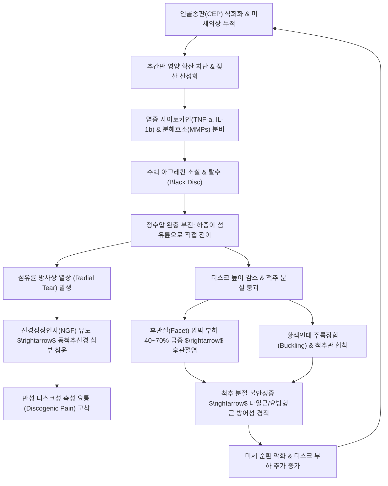
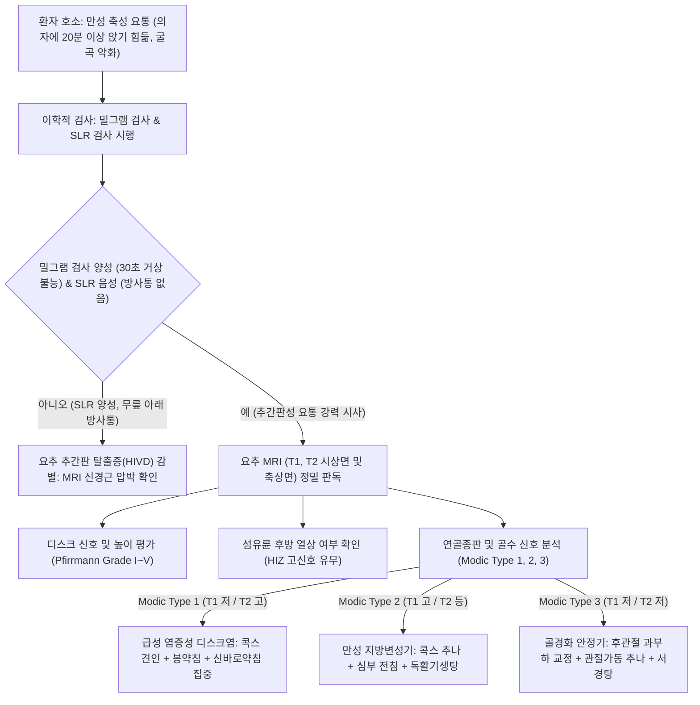
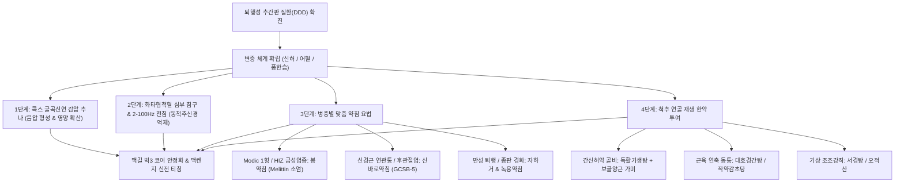

# 퇴행성 추간판 질환 (Degenerative Disc Disease)

> **핵심 3줄 요약 (Key Summary)**:
> - 🎯 노화, 만성 미세 손상, 연골종판(CEP) 경화 및 유전적 소인으로 인해 추간판 수핵(NP)의 친수성 아그레칸과 수분이 소실되어 정수압성 완충 능력을 상실하고, 섬유륜(AF) 파열 및 인접 척추체 골극이 형성되는 척추의 진행성 퇴행 질환
> - 🚩 20~30분 이상 의자에 앉아 있거나 상체를 앞으로 숙일 때 디스크 내압 상승으로 악화되는 축성 요통(Axial LBP), 섬유륜 파열부 내 동척추신경(Sinuvertebral nerve) 침윤에 따른 둔부·대퇴부 무릎 상부 연관통, MRI T2 강조영상 상 '검은 디스크(Black disc)', HIZ 및 모딕 변성(Modic changes)이 특징적
> - 🔍 한의학적으로 신허요통(腎虛腰痛), 골비(骨痺), 비증(痺證)으로 변증하며, 추간판 내 음압을 유도하는 콕스(Cox) 굴곡신연 감압 추나요법, 화타협척혈 심부 전침, 손상된 섬유륜 염증을 제어하는 [[신바로약침]]·[[봉약침]], 수핵 기질 재생 및 보골을 위한 [[독활기생탕]]·[[대호경간탕]]·[[서경탕]]을 투여하여 척추 안정성 회복
> - ⚠️ 하지 방사통을 동반하는 급성 수핵 탈출증([[요추 추간판 탈출증]]), 보행 파행을 유발하는 [[척추관 협착증]], 신전 시 악화되는 [[후관절 증후군]]과의 단계별 감별이 필수적이며, 맥길 빅3 코어 안정화와 맥켄지 신전 운동 지도 병행

---

## 📌 목차 (Table of Contents)
- [[#1. 🩺 질환 개요 & 해부학적 병태생리]]
  - [[#1.1 정의 및 임상적 개념]]
  - [[#1.2 역학 및 호발 분절]]
  - [[#1.3 추간판의 미세해부학 및 무혈관성 대사 특성]]
  - [[#1.4 삼관절 복합체(Three-Joint Complex)의 퇴행성 연쇄]]
- [[#2. ⚡ 병태생리 메커니즘 & 생체역학적 악순환 네트워크]]
  - [[#2.1 커칼디-윌리스(Kirkaldy-Willis) 3단계 퇴행 연쇄]]
  - [[#2.2 수핵의 생화학적 붕괴와 충격 흡수 부전 (Black Disc)]]
  - [[#2.3 섬유륜 열상(Annular Fissure)의 3대 형태]]
  - [[#2.4 추간판성 요통의 신경해부학: 동척추신경의 병적 침윤]]
  - [[#2.5 후관절(Facet Joint) 과부하 전이 및 인대 비후]]
  - [[#2.6 연골종판 파열과 쉬모를 결절(Schmorl's Node)]]
  - [[#2.7 퇴행성 척추 악순환 네트워크 다이어그램]]
- [[#3. 🔍 임상 증상 & 이학적 검사 알고리즘]]
  - [[#3.1 추간판성 요통(Discogenic Low Back Pain)의 임상 양상]]
  - [[#3.2 동척추신경성 연관통 vs 신경근성 방사통 감별]]
  - [[#3.3 특수 이학적 유발 검사]]
  - [[#3.4 영상의학적 분류 체계: 피르만 병기(Pfirrmann Grade)]]
  - [[#3.5 모딕 변성(Modic Changes) 및 고신호 구역(HIZ)]]
  - [[#3.6 유발 추간판 조영술(Provocative Discography)]]
  - [[#3.7 진단 및 감별 평가 임상 알고리즘]]
- [[#4. 🔀 감별 진단 매트릭스]]
  - [[#4.1 6대 요추 통증 질환 감별 매트릭스]]
  - [[#4.2 디스크성 통증 vs 후관절성 통증 촉진 감별]]
  - [[#4.3 중증 척추 질환 배제를 위한 적신호 징후(Red Flags)]]
- [[#5. 🌿 한의 통합 치료 프로토콜]]
  - [[#5.1 한의학적 병인병기 및 4대 변증 체계]]
  - [[#5.2 콕스 굴곡신연 추나요법 (Cox Flexion-Distraction Chuna)]]
  - [[#5.3 심부 화타협척혈 침구 및 전침(Electroacupuncture) 치료]]
  - [[#5.4 약침 요법 (Pharmacopuncture)]]
  - [[#5.5 침도 요법 (Acupotomy)]]
  - [[#5.6 단계별 한약 치료 (Herbal Medicine)]]
  - [[#5.7 한의 통합 치료 흐름도]]
- [[#6. 💊 양방 치료 & 병용·의뢰 기준]]
  - [[#6.1 단계별 보존적 약물 요법]]
  - [[#6.2 비수술적 중재 시술 (주사 및 고주파)]]
  - [[#6.3 수술적 적응증: 요추 유합술 vs 인공 디스크 치환술]]
  - [[#6.4 한·양방 병용 치료 가이드라인]]
  - [[#6.5 응급 전문과 의뢰 기준]]
- [[#7. 🏃 재활 운동 & 생활습관 티칭 가이드]]
  - [[#7.1 스튜어트 맥길(Stuart McGill)의 코어 빅 3 운동]]
  - [[#7.2 맥켄지(McKenzie) 신전 운동 프로토콜]]
  - [[#7.3 척추 손상을 유발하는 절대 금기 운동]]
  - [[#7.4 일상생활 인체공학적 티칭 수칙]]
- [[#8. 💡 사용자 진료실 핵심 필기 & 임상 노하우 (Melt-In)]]
  - [[#8.1 원본 필기 1: '앉으면 아프고 서면 편하다' 감별 제1법칙]]
  - [[#8.2 원본 필기 2: 발가락 저림 없는 둔부 통증 (연관통의 해부학)]]
  - [[#8.3 원본 필기 3: 허리 굽히는 스트레칭(상체 숙이기) 엄격 금기]]
  - [[#8.4 모딕 1형(Modic Type 1) 급성 악화기 추나 및 약침 요령]]
  - [[#8.5 아침 기상 시 세수 불능 환자에 대한 신전 티칭]]
  - [[#8.6 후관절 통증 병발 시 콕스 테크닉 가동 범위 조절]]
- [[#9. 📚 출처 및 현대 학술 연구 요약]]

---

## 1. 🩺 질환 개요 & 해부학적 병태생리

### 1.1 정의 및 임상적 개념
[[퇴행성 추간판 질환]](Degenerative Disc Disease, DDD)은 인접한 척추체(Vertebral body) 사이에서 체중 부하를 흡수하고 분산시키는 완충 장치인 추간판(Intervertebral disc)이 노화, 미세 외상의 누적, 영양 공급 차단, 유전적 민감성으로 인해 점진적인 생화학적 분해와 구조적 파탄을 겪는 질환이다.

정상적인 추간판은 중앙의 젤리 같은 **수핵(Nucleus pulposus, NP)**, 이를 동심원상으로 감싸는 강인한 **섬유륜(Annulus fibrosus, AF)**, 그리고 척추체 골수와 맞닿은 상·하단의 **초자연골 종판(Cartilaginous endplate, CEP)**의 삼위일체 복합 구조로 이루어져 있다. 정상 수핵은 다량의 친수성 프로테오글리칸(Proteoglycan) 복합체를 함유하여 수분 함량이 80~85%에 달하지만, 퇴행이 시작되면 세포외기질(ECM)이 파괴되어 수분이 급격히 감소하고 섬유성 연골로 변성된다. 충격 흡수 능력을 상실한 디스크는 점차 붕괴(Collapse)되어 높이가 낮아지며, 이는 상하 척추체 및 후방 척추 관절에 비정상적인 전단력과 하중 집중을 초래하여 척추 전체의 퇴행성 연쇄 붕괴를 촉발한다.

### 1.2 역학 및 호발 분절
- **연령별 유병률과 무증상성 퇴행**:
  - 방사선학적 디스크 퇴행 소견은 성인 인구에서 매우 보편적이다.
  - 20~30대 젊은 성인의 약 30~35%에서도 무증상성 디스크 수분 소실이나 팽륜(Bulging)이 관찰된다.
  - 50대 이상에서는 **80~90% 이상**에서 최소 한 분절 이상의 뚜렷한 추간판 퇴행 및 높이 감소가 나타난다.
  - 따라서 영상의학적 퇴행 소견 자체가 곧바로 임상적 통증 질환을 의미하는 것은 아니며, 병적인 신경 침윤과 염증이 결합되어 실질적 요통을 일으키는 경우에 한하여 '퇴행성 추간판 질환(DDD)'으로 진단한다.
- **호발 분절**:
  - 인체 척추 중 축성 체중 부하가 가장 극심하고 시상면 굴곡-신전 모멘트가 집중되는 **요추 L4-L5 분절**과 **L5-S1 분절**에서 전체 퇴행의 85% 이상이 집중 발생한다.
  - 경추에서는 척추 운동성이 가장 큰 **경추 C5-C6 및 C6-C7 분절**에서 호발한다.

### 1.3 추간판의 미세해부학 및 무혈관성 대사 특성
인체에서 추간판은 혈관이 직접 침투하지 않는 **가장 거대한 무혈관성 조직(Avascular tissue)** 중 하나이다:
1. **수핵 (Nucleus Pulposus, NP)**:
   - II형 콜라겐(Type II collagen) 망상 구조 내에 아그레칸(Aggrecan)이라 불리는 거대 프로테오글리칸 복합체가 고밀도로 응집되어 있다.
   - 아그레칸의 황산화 글리코사미노글리칸(GAGs) 사슬은 음전하를 띠어 나트륨 이온과 다량의 수분을 끌어당김으로써 팽창압(Swelling pressure)과 정수압성 하중 분산 능력을 형성한다.
2. **섬유륜 (Annulus Fibrosus, AF)**:
   - 15~25겹의 동심원상 층판(Lamellae) 구조로, I형 콜라겐(Type I collagen)이 척추 축에 대해 약 60도 각도로 교대 주행하여 척추의 회전력과 인장력에 강력히 저항한다.
   - **신경 분포의 경계**: 정상 섬유륜의 외측 1/3층에만 척추신경에서 분지한 [[동척추신경]](Sinuvertebral nerve)과 교감신경 차단 섬유가 분포하며, 내측 2/3 및 수핵은 정상 상태에서 완전한 무혈관·무신경 구역이다.
3. **연골 종판 (Cartilaginous Endplate, CEP)**:
   - 약 0.5~1 mm 두께의 초자연골 층으로, 척추체 해면골 모세혈관망으로부터 포도당, 아미노산, 산소를 수핵 내부로 수동 확산(Passive diffusion)시키는 유일한 생명선이다.
   - 노화와 반복적 압박으로 종판이 석회화되고 연골하 골경화(Subchondral sclerosis)가 진행되면 영양 확산 통로가 차단되어 수핵 세포의 기아(Starvation)와 산성화(Acidosis, 젖산 축적)가 발생하며 퇴행이 가속화된다.

### 1.4 삼관절 복합체(Three-Joint Complex)의 퇴행성 연쇄
하나의 척추 운동 분절(Motion segment)은 전방의 **추간판 1개**와 후방의 **양측 후관절(Facet joints) 2개**가 삼각형의 역학적 지지축을 이루는 **삼관절 복합체**를 형성한다.
- 정상 척추에서 전방 추간판이 기계적 축성 하중의 약 80%를 지탱하고, 후방 양측 후관절이 나머지 20%를 분담하며 회전과 전단력을 제어한다.
- 디스크의 수핵 탈수와 섬유륜 파열로 디스크 높이가 단 1~2 mm만 감소해도, 삼각 지지축이 무너지며 **후관절에 가해지는 압박 하중이 40~70% 이상으로 급격히 폭증**한다.
- 이는 척추 후관절염([[후관절 증후군]]), 골극 형성, 황색인대의 주름잡힘(Buckling)과 비후를 유발하여 척추관 및 추간공 협착증([[척추관 협착증]])으로 이어지는 도미노성 퇴행을 촉발한다.

---

## 2. ⚡ 병태생리 메커니즘 & 생체역학적 악순환 네트워크

### 2.1 커칼디-윌리스(Kirkaldy-Willis) 3단계 퇴행 연쇄
윌리엄 커칼디-윌리스(Kirkaldy-Willis)가 확립한 척추 퇴행의 3대 자연 경과 단계:

```
[ 커칼디-윌리스 3단계 척추 퇴행성 연쇄 (Degenerative Cascade) ]

  1단계: 기능부전기 (Dysfunction)
  - 섬유륜 미세 균열, 수핵 수분 감소, 후관절 활액막염
  - 증상: 간헐적 급성 요통, 국소 가동 제한, 가역적 상태
          |
          v
  2단계: 불안정기 (Instability)
  - 완전 방사상 열상, 디스크 높이 심각한 감소, 후관절 아탈구 및 관절낭 이완
  - 척추 분절의 비정상적 과가동성(Hypermobility), 전단력 폭증
  - 증상: 가장 극심한 지속적 추간판성 요통, 허리가 빠질 듯한 불안정감
          |
          v
  3단계: 재안정기 (Restabilization)
  - 거대 골극(Osteophytes) 형성, 연골 종판 광범위 경화, 후관절 섬유성 강직
  - 척추 분절의 자발적 골성 유합 및 가동성 소실
  - 증상: 디스크성 요통은 다소 안정화되나, 비후된 뼈와 인대로 인한 협착증 호발
```

1. **1단계: 기능부전기 (Phase of Dysfunction, 20~40대)**:
   - 섬유륜 외층의 미세 파열과 후관절낭의 초기 활액막염이 발생한다. 분절 운동의 조화가 깨지며 척추 주변 근육의 방어성 연축이 나타난다. 적절한 한의 보존 치료로 정상 회복이 가능한 단계이다.
2. **2단계: 불안정기 (Phase of Instability, 30~50대)**:
   - 섬유륜의 방사상 열상이 전 층으로 확장되고 수핵이 붕괴된다. 후관절 연골이 마모되고 관절낭이 늘어나 척추 분절이 전후·좌우로 흔들리는 불안정증([[척추전방전위증]])이 병발한다. **임상적으로 통증이 가장 극심하고 일상생활 장애가 심한 단계**이다.
3. **3단계: 재안정기 (Phase of Restabilization, 60대 이상)**:
   - 불안정한 척추 분절을 고정하기 위해 척추체 가장자리를 따라 뼈가 자라나는 **골극(Osteophyte)**이 형성되어 상하 척추를 이어 붙인다. 분절 운동성이 영구히 소실되어 역설적으로 디스크성 요통은 감소하지만, 비후된 뼈와 황색인대로 인해 척추관이 좁아지는 [[척추관 협착증]]이 발생한다.

### 2.2 수핵의 생화학적 붕괴와 충격 흡수 부전 (Black Disc)
- **아그레칸 분해 효소의 폭주**:
  - 만성 염증 환경에서 분비되는 **TNF-$\alpha$**와 **IL-1$\beta$**는 기질금속단백분해효소(MMPs: MMP-1, MMP-3, MMP-13)와 아다말리신(ADAMTS-4, ADAMTS-5)의 발현을 유도한다.
  - 이 효소들이 아그레칸의 핵심 단백질을 절단하여 글리코사미노글리칸(GAGs) 복합체를 산산조각 낸다.
- **삼투압 저하와 탈수**:
  - 음전하를 띤 GAGs의 유실 $\rightarrow$ 디스크 삼투압 급감 $\rightarrow$ 수핵 내부의 결합수(Bound water) 배출 $\rightarrow$ 정수압 상실.
  - 디스크가 탄성 고무공에서 딱딱하게 마른 스펀지 형태로 변질되며, 상부에서 가해지는 축성 하중을 외측 섬유륜으로 분산시키지 못하고 척추체 종판에 직접적인 기계적 충격이 전달된다.
- **MRI Black Disc 소견**:
  - T2 강조영상에서 수분 함량이 높은 정상 수핵은 밝은 하얀색 고신호(High signal)를 띠지만, 탈수된 퇴행성 수핵은 수분 신호가 완전히 소실되어 짙은 검은색 저신호(Low signal)로 나타나며, 이를 **'블랙 디스크(Black disc)'**라 부른다.

### 2.3 섬유륜 열상(Annular Fissure)의 3대 형태
수핵의 완충 작용이 상실되면 모든 체중 부하가 섬유륜 벽에 집중되며 다음과 같은 세 가지 유형의 균열이 발생한다:
1. **동심원성 열상 (Concentric Tear)**:
   - 섬유륜의 각 층판(Lamellae) 사이가 전단력에 의해 뜯겨 분리되는 박리 손상.
2. **방사상 열상 (Radial Tear)**:
   - 수핵 중심부에서부터 섬유륜 외곽 신경 분포 층까지 수직으로 찢어지는 관통성 균열.
   - 퇴행성 추간판 질환에서 **디스크성 요통을 유발하는 가장 치명적인 병소**이다. 수핵 내부의 산성 괴사 물질과 염증성 사이토카인이 이 균열을 타고 외측 동척추신경 말단으로 흘러나와 극심한 화학적 신경염을 촉발한다.
3. **변연부/테두리 열상 (Rim Lesion)**:
   - 섬유륜의 샤피 섬유(Sharpey's fibers)가 척추체 골막 가장자리 부착부에서 뜯겨 나가는 손상. 상하 척추체의 견인성 골극(Traction osteophyte) 형성을 유도한다.

### 2.4 추간판성 요통의 신경해부학: 동척추신경의 병적 침윤
정상적인 디스크는 내부 2/3에 신경이 존재하지 않으므로 통증을 직접 느끼지 못한다. 그러나 퇴행성 추간판 질환에서는 극적인 신경 가소성 변화가 일어난다:

```
[ 섬유륜 방사상 파열과 병적 통각 신경망 침윤 기전 ]

       [정상 디스크]                         [퇴행성 디스크 (DDD)]
   외측 1/3층: 신경 분포              방사상 파열 (Radial Tear) 발생
   내측 2/3층: 완전 무신경                      |
                                                v
                              수핵 염증성 사이토카인 유출 (TNF-α, IL-1β)
                                                |
                                                v
                              신생 혈관 및 신경성장인자(NGF) 분비
                                                |
                                                v
                              무신경 지대인 수핵 심부까지 신생 신경 침윤!
                              (C-fiber: Substance P, CGRP 발현)
                                                |
                                                v
                              의자에 앉을 때마다 디스크 압박 
                              --> 심부 침윤 신경 기계적·화학적 자극
                              --> 극심한 만성 심부 축성 요통 (Discogenic Pain)
```

- **신생 신경 침윤 (Nociceptive Neoinnervation)**:
  - 섬유륜 파열부를 따라 대식세포와 육아조직이 침투하며 **신경성장인자(Nerve Growth Factor, NGF)**와 혈관내피성장인자(VEGF)를 대량 분비한다.
  - 외곽에만 머물던 [[동척추신경]](Sinuvertebral nerve)의 무수 C-신경섬유(C-fibers)가 파열된 틈을 타고 **디스크의 깊은 속(수핵 중심부)까지 1~2 cm 이상 병적으로 자라 들어간다**.
- **통각 수용체의 과민화**:
  - 침윤된 신생 신경 말단은 통증 유발 신경전달물질인 **Substance P**와 **CGRP(Calcitonin Gene-Related Peptide)**를 풍부하게 발현한다.
  - 환자가 의자에 앉아 체중이 디스크에 가해지는 순간, 디스크 내압 상승이 심부 신경을 직접 쥐어짜듯 압박하여 **허리 깊은 곳이 묵직하고 끊어질 듯한 만성 축성 통증**을 유발한다.

### 2.5 후관절(Facet Joint) 과부하 전이 및 인대 비후
- 디스크 높이가 무너지면 상하 추체가 가까워지며 후방 척추경이 주저앉아 후관절의 상·하 관절돌기(Articular processes)가 비정상적으로 맞물린다.
- 후관절 연골의 마모, 골관절염, 관절낭의 만성 활액막염이 연쇄 병발한다.
- 또한 척추관 후벽을 이루는 **황색인대(Ligamentum flavum)**가 긴장도를 잃고 헐거워지며 전방으로 접혀 들어가는 **주름잡힘 현상(Buckling)**이 일어나 척추 신경관을 후방에서 압박한다.

### 2.6 연골종판 파열과 쉬모를 결절(Schmorl's Node)
- **쉬모를 결절(Schmorl's node)**은 약해진 초자연골 종판의 국소적 파열을 통해 수핵 조직이 척추체 해면골(Cancellous bone) 내부로 수직 방향으로 파고 들어간 헤르니아(Vertical herniation)이다.
- 골수 내부로 유입된 이물질인 수핵은 골수 내 면역 반응을 촉발하여 무균성 골수염, 골수 부종, 미세 골절 및 극심한 척추체 심부 통증을 야기한다. (모딕 1형 변성과 직결).

### 2.7 퇴행성 척추 악순환 네트워크 다이어그램



---

## 3. 🔍 임상 증상 & 이학적 검사 알고리즘

### 3.1 추간판성 요통(Discogenic Low Back Pain)의 임상 양상
퇴행성 추간판 질환의 핵심 증상은 신경근 탈출증과 구별되는 독특한 **자세 의존성 축성 요통**이다:
1. **의자에 오래 앉아 있을 때의 극심한 통증 (Sitting Intolerance)**:
   - 환자의 95% 이상이 **"의자에 20~30분 이상 앉아 있으면 허리 한가운데가 끊어질 듯 묵직하고 뻐근하게 아파서 자꾸 일어서야 한다"**고 호소한다.
   - 서 있거나 천천히 걸으면 디스크 내압이 분산되어 오히려 통증이 완화되는 경향을 보인다.
2. **상체 전방 굴곡(Forward Flexion) 시 악화**:
   - 아침에 일어나 세수를 하려고 허리를 앞으로 숙이거나, 양말이나 신발을 신을 때, 바닥의 물건을 주울 때 극심한 통증이 발생한다.
   - 굴곡 시 디스크 전방이 압박되고 후방 섬유륜 열상 부위가 팽창하면서 침윤된 동척추신경을 강하게 자극하기 때문이다.
3. **기상 시 극심한 척추 조조강직 (Morning Stiffness)**:
   - 밤새 누워 자는 동안 수핵이 수분을 재흡수하여 팽창했다가, 아침에 일어나 체중이 실리는 순간 부어오른 디스크가 섬유륜 열상부를 강하게 밀어내어 허리가 굳어 바로 펴지 못하고 엉거주춤한 자세를 취하게 된다.

### 3.2 동척추신경성 연관통 vs 신경근성 방사통 감별
임상에서 가장 오진하기 쉬운 포인트는 디스크 환자가 엉덩이와 허벅지 통증을 호소할 때 이것이 신경근 탈출증인지 단순 퇴행성 디스크의 연관통인지 구별하는 것이다:

| 구분 지표 | 동척추신경성 연관통 (Referred Pain - DDD) | 신경근성 진성 방사통 (Radicular Pain - HIVD) |
| :--- | :--- | :--- |
| **통증의 원인 병소** | 손상된 섬유륜 외측 및 종판의 동척추신경 자극 | 수핵 탈출편에 의한 L4, L5, S1 신경근의 물리적 압박 |
| **통증 방사 범위** | **요추 중앙 $\rightarrow$ 둔부 $\rightarrow$ 대퇴부 후외측 (무릎 위에서 종료)** | **요추 $\rightarrow$ 둔부 $\rightarrow$ 허벅지 $\rightarrow$ 종아리 $\rightarrow$ 발목·발가락** |
| **통증의 성상** | 깊고 둔하며 뻐근하게 쑤시는 심부 둔통(Dull ache) | 전기가 통하듯 찌릿하고 타는 듯 날카로운 작열통(Shooting) |
| **신경학적 결손** | **전혀 없음** (근력 정상, 건반사 정상, 감각 정상) | **동반됨** (족하수, 무지신전력 약화, 감각 둔마, 반사 소실) |
| **하지직거상 검사** | **음성 (70도 이상 거상 가능, 요통만 약간 유발)** | **양성 (30~60도에서 발끝까지 찌릿한 방사통 재현)** |

### 3.3 특수 이학적 유발 검사
1. **[[밀그램 검사]](Milgram's Test - 디스크성 요통 선별 제1검사)**:
   - 환자가 침대에 바로 누운 앙와위에서 양 무릎을 완전히 편 채 양 발뒤꿈치를 바닥에서 **약 5~10 cm(지면 한 뼘 높이)** 들어 올리고 30초간 버티도록 한다.
   - **기전**: 양다리를 공중에 띄우는 순간 장요근과 복근의 강력한 등척성 수축으로 인해 복압과 요추 디스크 내압이 급상승한다.
   - **판정**: 30초를 버티지 못하고 극심한 허리 중앙 통증으로 10~15초 만에 다리를 툭 떨어뜨리면 **밀그램 양성 $\rightarrow$ 추간판성 요통(DDD) 강력 시사**.
2. **하지직거상 검사 (Straight Leg Raising Test, SLR)**:
   - 단순 퇴행성 추간판 질환에서는 70~80도 이상 거상해도 하지 방사통이 나타나지 않음(음성)을 확인하여 신경근 탈출증을 배제한다.
3. **요추 능동 굴곡-신전 저항 검사**:
   - 상체를 앞으로 숙일 때(굴곡) 통증이 심해지면 디스크성 요통, 상체를 뒤로 젖힐 때(신전) 요추 외측에 찌르는 통증이 발생하면 [[후관절 증후군]]을 시사.
4. **발살바 검사 (Valsalva Test)**:
   - 대변을 보듯 아랫배에 힘을 주어 복압을 올릴 때 요추 심부 통증이 유발되는지 확인.

### 3.4 영상의학적 분류 체계: 피르만 병기(Pfirrmann Grade)
MRI T2 강조 시상면 영상에서 요추 추간판의 퇴행 정도를 객관적으로 평가하는 국제 표준:

```
[ 피르만 병기 (Pfirrmann Grading System) 5단계 ]

Grade I    Grade II   Grade III   Grade IV (Black Disc)  Grade V
 [ O ]      [ o ]       [ . ]             [   ]            [-]
(하얀 고신호) (불균일 고신호) (회색 중간신호)   (검은 저신호, 경계소실)  (완전 붕괴 협착)
```

- **Grade I**: 균일한 밝은 하얀색 고신호. 수핵과 섬유륜의 경계가 명확함. 디스크 높이 정상.
- **Grade II**: 불균일하지만 명확한 고신호. 수핵-섬유륜 경계 유지. 디스크 높이 정상.
- **Grade III**: 신호 강도가 떨어져 회색(중간 신호)을 띰. 수핵과 섬유륜의 경계가 불명확해짐. 높이 정상 또는 경도 감소.
- **Grade IV**: **불균일한 짙은 검은색 저신호 (Black Disc)**. 수핵과 섬유륜의 구분이 완전히 소실됨. 디스크 높이가 중등도로 감소.
- **Grade V**: **디스크 공간 전체가 완전한 무신호(검은색)로 붕괴됨**. 디스크 간격이 거의 뼈끼리 맞닿을 정도로 극단적 협착.

### 3.5 모딕 변성(Modic Changes) 및 고신호 구역(HIZ)
1. **모딕 변성 (Modic Changes - 척추체 골수 및 종판 신호 변화)**:
   - 마이클 모딕(Michael Modic)이 제창한 추간판 인접 척추체 해면골수의 병태생리학적 반응:

| 모딕 유형 | T1 강조영상 | T2 강조영상 | 조직학적 병태생리 | 임상적 의의 |
| :--- | :--- | :--- | :--- | :--- |
| **Modic Type 1** | **저신호 (Dark)** | **고신호 (Bright)** | **골수 부종, 혈관신생, 급성 염증성 육아조직** | **임상적으로 요통이 가장 극심한 급성 악화기**. 자발통, 야간통 빈발 |
| **Modic Type 2** | **고신호 (Bright)** | **등신호/고신호** | **골수 지방 변성 (Fatty replacement)** | 염증이 가라앉은 만성 안정화 단계. 둔한 만성 요통 |
| **Modic Type 3** | **저신호 (Dark)** | **저신호 (Dark)** | **광범위한 연골하 골경화 (Bony Sclerosis)** | 최종 단계의 골성 안정화. 가동성 소실, 통증 다소 감소 |

2. **고신호강도 구역 (High-Intensity Zone, HIZ)**:
   - MRI T2 시상면에서 섬유륜 후방 외측 부위에 좁쌀처럼 하얗게 찍히는 점(Bright white spot).
   - **병태학적 실체**: 섬유륜의 전 층 방사상 열상(Full-thickness radial tear) 부위로 신생 모세혈관망과 육아조직, 통각 신경 섬유가 자라 들어간 **추간판성 요통의 확실한 발통점(Pain generator)**을 시각화한 소견이다.

### 3.6 유발 추간판 조영술(Provocative Discography)
- X-ray 투시 하에 퇴행이 의심되는 디스크 내부에 바늘을 찔러 조영제를 주입하며 디스크 내압을 상승시키는 침습적 검사.
- **양성 판정 기준**: 낮은 주입 압력(< 50 psi)에서 환자가 평소 느끼던 것과 100% 동일한 요통이 유발(Concordant pain reproduction)되고, 인접한 정상 대조군 디스크에서는 통증이 유발되지 않아야 함. (수술 전 최종 통증 유발 분절 확진 목적).

### 3.7 진단 및 감별 평가 임상 알고리즘



---

## 4. 🔀 감별 진단 매트릭스

### 4.1 6대 요추 통증 질환 감별 매트릭스

| 질환명 | 주 통증 부위 | 통증 악화 자세/동작 | 통증 완화 자세 | 주요 이학적 검사 | 핵심 영상 소견 |
| :--- | :--- | :--- | :--- | :--- | :--- |
| **[[퇴행성 추간판 질환]] (DDD)** | 요추 중앙 심부, 둔부 무릎 상부 연관통 | **앉아 있을 때**, 상체 숙일 때(굴곡), 기침 | 서 있거나 걸을 때, 누울 때 | **밀그램 양성**, SLR 음성, 굴곡 통증 | MRI Black disc, HIZ, Modic Type 1/2 |
| **[[요추 추간판 탈출증]] (HIVD)** | 요통 + **무릎 아래 발가락 찌릿한 방사통** | 상체 숙일 때, 앉을 때, 기침 시 방사통 | 서서 걷거나 무릎 구부리고 누움 | **SLR 양성(30~60도)**, 건반사 저하 | 수핵 돌출(Extrusion), 신경근 압박 |
| **[[후관절 증후군]] (Facet)** | 요추 외측 척추주위, 서혜부/대퇴부 연관통 | **허리를 뒤로 젖힐 때(신전)**, 회전 | 상체를 앞으로 숙일 때, 앉을 때 | **캠프 검사(Kemp) 양성**, 후관절 압통 | 후관절 비후, 관절낭 협착, 골극 |
| **[[척추관 협착증]] (LSS)** | 둔부 및 양측 하지 전반의 뻐근함, 터질 듯함 | **서서 걸을 때 (100~200m 보행 시 파행)** | **허리를 구부리고 앉을 때 (쇼핑카트 징후)** | 신경인성 간헐적 파행, 후굴 악화 | 척추관 단면적 협착, 황색인대 비후 |
| **천장관절 증후군 (SIJD)** | 천골 외측, 둔부, 서혜부, 허벅지 후외측 | 계단 오르기, 한 발로 서기, 자세 변경 | 평지 걷기, 천골 압박 시 | **패트릭 검사(Patrick/FABER) 양성** | 천장관절염 소견, 골극, 불규칙 관절면 |
| **[[근막통증증후군]] (MPS)** | [[요방형근]], [[다열근]], [[둔근]] 국소 통증 | 특정 근육 신장 및 장시간 고정 자세 | 가벼운 스트레칭, 온찜질, 마사지 | **발통점(TrP) 압통, 국소 연축 반응** | X-ray 및 MRI 상 정상 (근막 질환) |

### 4.2 디스크성 통증 vs 후관절성 통증 촉진 감별
진료실에서 환자를 엎드리게(Prone) 한 상태에서 10초 만에 감별하는 촉진 요령:
1. **극간인대 및 중앙 촉진 (추간판성 통증)**:
   - 척추 극돌기 사이(Interspinous space)를 엄지손가락으로 깊숙이 수직 압박하거나 위아래로 흔들었을 때, 허리 뼈 속 깊은 곳에서 묵직한 통증이 재현되면 디스크 병변을 시사.
2. **후관절 외측 촉진 (후관절성 통증)**:
   - 극돌기 중심선에서 **외측으로 1.5~2 cm 떨어진 후관절 라인**을 비스듬히 압박했을 때 깜짝 놀랄 정도의 날카로운 압통이 나타나며, 환자에게 상체를 뒤로 젖히게 유도했을 때 통증이 극대화되면 100% 후관절 증후군 병발.

### 4.3 중증 척추 질환 배제를 위한 적신호 징후(Red Flags)
다음 소견이 관찰되면 단순 퇴행성 디스크로 취급하지 말고 **즉시 상급 병원 응급 의뢰**를 시행해야 한다:
- 🚩 **마미 증후군 (Cauda Equina Syndrome)**: 안장 감각 마비(Saddle anesthesia), 급성 대소변 실금 또는 배뇨 곤란, 양측 하지의 급격한 진행성 마비.
- 🚩 **척추 감염증 (Spondylodiscitis / Epidural Abscess)**: 원인 모를 고열, 최근 요로감염이나 침/주사 시술 병력, 혈액검사 상 ESR/CRP 급상승, 야간에 악화되는 지속적 통증.
- 🚩 **척추 전이암 (Spinal Malignancy)**: 암 병력(유방암, 폐암, 전립선암 등), 원인 불명의 체중 감소, 쉬어도 전혀 줄어들지 않고 밤에 잠을 깨우는 심각한 안정 시 통증.
- 🚩 **골다공증성 압박 골절**: 고령 환자가 엉덩방아를 찧거나 기침을 한 후 발생한 급성 척추 타진통(Percussion tenderness).

---

## 5. 🌿 한의 통합 치료 프로토콜

### 5.1 한의학적 병인병기 및 4대 변증 체계
한의학에서 퇴행성 추간판 질환은 《동의보감(東醫寶鑑)》 요통편의 **신허요통(腎虛腰痛)**을 근간으로 하여 **골비(骨痺)**, **비증(痺證)**으로 분류한다:
1. **신음허/신양허 (腎陰虛/腎陽虛 - 노화 및 정혈 고갈)**:
   - 신(腎)은 뼈를 주관하고 골수를 저장한다. 노화로 신정(腎精)이 고갈되면 추간판의 진액(수분)이 마르고 골단판이 영양을 받지 못해 척추가 주저앉음. 은은하고 묵직한 만성 요통, 무릎 시림, 조조강직 동반.
2. **기체어혈 (氣滯瘀血 - 미세 외상 누적 및 섬유륜 파열)**:
   - 반복적인 무거운 물건 들기나 좌식 부하로 척추 주변 경락에 어혈이 맺힘. 바늘로 찌르는 듯한 통증, 야간통, 기침 시 통증 악화.
3. **풍한습비 (風寒濕痺 - 온습도 변화 및 순환 장애)**:
   - 비가 오거나 날씨가 차가워지면 척추 주위 혈관이 수축하여 디스크 내압이 오르고 근육이 굳어 통증이 극심해짐. 무겁고 시린 통증.
4. **간신부족·근골위약 (肝腎不足·筋骨萎弱 - 만성 불안정증)**:
   - 간은 근육을 주관하고 신은 뼈를 주관하므로, 척추를 둘러싼 [[다열근]]과 인대가 위축되어 허리가 빠질 듯 흔들리는 불안정감 호소.

### 5.2 콕스 굴곡신연 추나요법 (Cox Flexion-Distraction Chuna)
제임스 콕스(James M. Cox) 박사의 생체역학적 원리와 한국 한의학 추나 수기를 결합한 퇴행성 디스크 치료의 정수:

```
[ 콕스 굴곡신연 추나 (Cox Flexion-Distraction) 원리 ]

      척추경 접촉 손 (술자)
           |   (L4-L5 극돌기를 전방으로 고정)
           v
    [ === L4 === ]   <--- 축성 견인 (Axial Traction)
      [ 디스크 ]     <--- 추간판 내 -100 mmHg 음압(Negative Pressure) 형성
    [ === L5 === ]        --> 수핵 수분·영양 삼투 흡수 (Imbibition)
           ^              --> 후방 섬유륜 열상 부위 감압
           |
     굴곡신연 테이블 하강 (미세 굴곡 인가)
```

- **생체역학적 치료 기전**:
  1. **추간판 내압의 극적인 음압화**:
     - 정상 기립 시 100~150 mmHg에 달하는 디스크 내압을 **-100 mmHg 이하의 강력한 음압(Negative intradiscal pressure)**으로 떨어뜨린다.
     - 음압의 흡인력(Suction force)에 의해 척추체 연골종판 모세혈관으로부터 포도당, 수분, 영양 물질이 마른 디스크 내부로 삼투 흡수(Imbibition)된다.
  2. **추간공(Intervertebral foramen) 면적 확장**:
     - 굴곡 견인 시 추간공의 단면적이 최대 28%까지 넓어져 유착된 신경근과 동척추신경의 기계적 포착을 즉각 해제한다.
  3. **후관절 감압**: 과부하가 걸린 상하 후관절면을 분리하여 활액 분비를 촉진하고 관절염 통증을 완화.
- **표준 시술 프로토콜**:
  - 환자를 복와위로 눕히고 발목을 고정 스트랩으로 결속.
  - 술자의 한 손 수근부(Thenar)로 병변 부위(예: L4-L5)의 직상방 극돌기를 전하방으로 지지 고정.
  - 전용 굴곡신연 테이블의 하단부를 부드럽게 아래로 하강시켜 1회당 20초간 지속 견인, 5초 휴식을 1세트로 하여 3~5세트 반복.

### 5.3 심부 화타협척혈 침구 및 전침(Electroacupuncture) 치료
- **심부 화타협척혈(Jiaji) 심자 요법**:
  - 병변 분절(L3-L4, L4-L5, L5-S1)의 극돌기 하연 외측 0.5촌 지점에 위치한 [[화타협척혈]]에 **0.30×60 mm 멸균 호침을 사용하여 40~50 mm 깊이로 직자 또는 약간 내측으로 사자**.
  - **해부학적 목표**: 척추 신경후지 내측지(Medial branch)와 다열근 심부 섬유, 척추 후궁판(Lamina) 부근까지 도달시켜 동척추신경의 과흥분을 억제하고 위축된 다열근의 근방추를 직접 자극.
- **배혈 혈위**:
  - 족태양방광경의 [[신수]](BL23), [[대장수]](BL25), [[관원수]](BL26), [[지실]](BL52), [[위중]](BL40), [[곤륜]](BL60).
  - 담경의 [[환도]](GB30), [[양릉천]](GB34).
- **전침(Electroacupuncture) 파형 및 매개변수**:
  - 협척혈과 방광경 혈위에 전침을 연결.
  - **혼합파(Dense-Disperse Wave, 2 Hz / 100 Hz)**를 20~25분간 통전.
  - 2 Hz 저주파는 뇌척수액 내 엔도르핀(Endorphin) 및 엔케팔린(Enkephalin) 분비를 유도하여 장기적 진통 효과를 발휘하고, 100 Hz 고주파는 척수 후각에서 다이노르핀(Dynorphin)을 분비시켜 급성 신경성 통증을 차단함과 동시에 수핵 세포의 염증성 사이토카인(IL-1$\beta$, TNF-$\alpha$) 발현을 유의하게 억제함.

### 5.4 약침 요법 (Pharmacopuncture)
1. **신바로약침 (Shinbaro - GCSB-5)**:
   - 구척, 방풍, 우슬, 제비쑥 등 전통 한약재에서 추출한 천연물 신약 복합체.
   - COX-2 및 PGE2 생성을 억제하고 염증성 케모카인을 차단하여 손상된 섬유륜 주변의 화학적 신경염을 강력히 제어.
   - 퇴행 분절 양측 협척혈 및 후관절 주위 심부 조직에 분절당 0.5~1.0 cc씩 총 2.0 cc 주입.
2. **봉약침 요법 (Bee Venom, BV)**:
   - 정제된 봉독의 주성분인 멜리틴(Melittin)과 아파민(Apamin)이 phospholipase A2(PLA2) 및 NF-$\kappa$B 염증 경로를 강력히 차단.
   - **적응증**: **Modic Type 1 골수 부종** 또는 **HIZ 소견**을 동반한 급성 염증성 디스크 통증 환자.
   - 농도: 0.05~0.1 mg/ml로 희석하여 피내 및 피하에 0.1 cc씩 분할 주입 (시술 전 스킨 테스트 필수).
3. **자하거(紫河車) 및 녹용(鹿茸) 약침**:
   - 연골종판 경화 및 Modic Type 2 환자에게 투여하여 TGF-$\beta$, IGF-1 등 세포 성장인자를 공급함으로써 추간판 세포외기질의 대사 균형과 재생을 촉진.

### 5.5 침도 요법 (Acupotomy)
- **적응증**: 척추 불안정기와 재안정기 사이에 극간인대(Interspinous lig.)와 흉요근막에 비후된 섬유화 흉터 조직이 형성되어 만성 요통을 일으키는 경우.
- **시술**: 0.5×50 mm 소침도로 극돌기 사이의 유착된 극간인대 및 척추기립근건막을 박리(Adhesiolysis)하여 척추 운동성 회복 및 내압 분산 유도.

### 5.6 단계별 한약 치료 (Herbal Medicine)
1. **만성 디스크 퇴행 및 골비 (신허·간신부족)**:
   - **[[독활기생탕]](獨活寄生湯)** 가감:
     - 구성: 독활(10g), 상기생(15g), [[두충]](10g), [[우슬]](10g), 세신(3g), 진범(8g), 복령(10g), 숙지황(15g), [[당귀]](10g), [[백작약]](10g), 천궁(8g), 육계(4g), [[인삼]](8g), [[감초]](6g).
     - 가미: 디스크 세포외기질 재생 강화를 위해 [[골쇄보]](10g), [[속단]](10g), [[구척]](10g), [[녹용]](4g) 가미.
     - 효능: 간신을 보하고 근골을 튼튼히 하며, 연골 기질 분해 효소를 억제하여 디스크 수분 함량을 보존.
2. **요추 심부 근육의 극심한 연축 및 굴곡 통증 (기체어혈·근맥구련)**:
   - **[[대호경간탕]](大護經肝湯)** 또는 **[[작약감초탕]](芍藥甘草湯)**:
     - 구성: 백작약(20~30g), 감초(10g).
     - 효능: 척추 주변 다열근과 요방형근의 과긴장성 연축을 신속히 이완시켜 디스크에 가해지는 정적 압박력을 즉각 완화.
3. **조조강직 및 한습성 요통 (풍한습비)**:
   - **[[서경탕]](舒經湯)** 또는 **[[오적산]](五積散)** 가미방:
     - 구성: 강활, 방풍, 당귀, 천궁, 창출, 진피, 백지, 계지 등.
     - 효능: 요배부의 냉기와 어혈을 제거하고 미세 모세혈관 순환을 촉진하여 기상 시 척추 뻣뻣함 해소.

### 5.7 한의 통합 치료 흐름도



---

## 6. 💊 양방 치료 & 병용·의뢰 기준

### 6.1 단계별 보존적 약물 요법
- **1차 진통소염제 (NSAIDs & Acetaminophen)**:
  - 아세트아미노펜(Acetaminophen 650mg tid~qid) 또는 선택적 COX-2 억제제인 셀레콕시브(Celecoxib 200mg qd~bid), 멜록시캄(Meloxicam 7.5~15mg qd).
  - 섬유륜 파열부 주변의 화학적 염증을 완화하나, 장기 복용 시 위장관 출혈 및 심혈관계 위험 고려.
- **근이완제 (Muscle Relaxants)**:
  - 에페리손(Eperisone 50mg tid), 티자니딘(Tizanidine 1~2mg bid). 급성 통증기 척추주위근 연축 차단.
- **만성 신경병증성/중추감작 통증 약물**:
  - 단순 소염진통제에 반응하지 않는 만성 디스크성 요통에는 세로토닌-노르에피네프린 재흡수 억제제인 **둘록세틴(Duloxetine 30~60mg qd)**이 중추신경계 하행 통증 억제 경로를 강화하여 우수한 진통 효과를 입증함.
  - 하지 방사통 동반 시 프레가발린(Pregabalin 75~150mg bid), 가바펜틴 투여.

### 6.2 비수술적 중재 시술 (주사 및 고주파)
1. **요추 경막외 신경차단술 (Epidural Steroid Injection, ESI)**:
   - 추간공(Transforaminal) 또는 층간(Interlaminar) 접근법으로 덱사메타손 등 스테로이드와 국소마취제를 주입하여 Modic Type 1 염증 및 후방 섬유륜 화학성 신경염을 단기적으로 진정. (1년 3~4회 이하로 제한).
2. **후관절 내측지 차단술 (Medial Branch Block, MBB)**:
   - 디스크 높이 감소로 인해 병발한 이차성 후관절 증후군에 대해 후관절을 지배하는 내측지 신경에 국소마취제를 주입하여 통증 차단.
3. **고주파 수핵감압술(L-DISQ) 및 추간판내 열치료술(IDET)**:
   - 국소마취 하에 디스크 내부로 특수 전극 바늘을 삽입하여 65~90도의 고주파 열을 가함으로써, 섬유륜 파열부 내로 자라 들어간 병적 동척추신경을 열응고(Thermocoagulation)시키고 콜라겐 섬유를 수축시켜 열상을 봉합하는 시술.

### 6.3 수술적 적응증: 요추 유합술 vs 인공 디스크 치환술
보존적 치료(한의 및 양방)를 **최소 6개월~1년 이상 적극적으로 시행했음에도 불구하고**, 참을 수 없는 극심한 축성 요통으로 직장 및 일상생활이 불가능한 경우(Oswestry Disability Index ODI > 40~50%)에 한하여 신중히 고려한다:
- **요추 추체간 유합술 (Lumbar Interbody Fusion - ALIF, TLIF, PLIF)**:
  - 병든 디스크 조직을 완전히 긁어내어 제거하고, 빈 공간에 케이지(Cage)와 골이식재를 채운 후 척추경 나사못으로 상하 척추체를 영구 유합.
  - 분절 운동성을 없애 통증을 제거하지만, 유합된 분절의 위아래 분절에 스트레스가 집중되어 수년 후 **인접 분절 질환(Adjacent Segment Disease, ASD)**이 호발하는 단점.
- **인공 디스크 치환술 (Total Disc Replacement, TDR)**:
  - 전방 복부 접근법(Retroperitoneal ALIF approach)으로 들어가 손상된 디스크를 제거하고 인공 관절 보철물을 삽입.
  - 척추의 가동성을 보존하여 인접 분절 퇴행을 줄일 수 있으나, 후관절염이 없어야 하고 골다공증이 없는 40~50대 이하의 단일 분절 환자에게만 매우 엄격히 적용됨.

### 6.4 한·양방 병용 치료 가이드라인
- **소염진통제 감량기 한의 치료 연계**:
  - 장기간 NSAIDs를 복용하던 환자가 약물을 끊을 때 반동성 염증(Rebound pain)이 흔히 발생한다.
  - NSAID 용량을 절반으로 줄이는 시점에 [[신바로약침]] 및 [[독활기생탕]]을 투여하면 약물 중단에 따른 통증 악화 없이 안전하게 디프레스크라이빙(Deprescribing)을 달성할 수 있다.
- **신경차단술 후 한의 융합 관리**:
  - 스테로이드 주사 치료는 2~4주 후 약효가 떨어지며 통증이 재발하기 쉽다.
  - 주사 시술 3~5일 후부터 부드러운 콕스 굴곡신연 추나와 심부 화타협척혈 전침을 병행하면 차단술의 유효 기간을 대폭 연장하고 구조적 재발을 방지한다.

### 6.5 응급 전문과 의뢰 기준
- 🚨 **급성 신경마비 및 족하수(Foot drop)**: 발목이나 엄지발가락을 들어 올리는 근력이 급격히 Grade 3 이하로 떨어지는 경우.
- 🚨 **마미 증후군(Cauda Equina Syndrome)**: 배뇨 곤란, 대변 실금, 회음부 안장 감각 상실 발생 시 골든타임(48시간 이내 긴급 감압술) 내 응급실 전원.

---

## 7. 🏃 재활 운동 & 생활습관 티칭 가이드

### 7.1 스튜어트 맥길(Stuart McGill)의 코어 빅 3 운동
세계적 척추 생체역학 권위자인 스튜어트 맥길 교수가 고안한, **디스크 내압과 척추 전단력을 최소화하면서 척추 지지 코어 근육을 강화하는 표준 3대 운동**:

```
[ 맥길 교수의 코어 빅 3 (McGill Big 3) 운동 ]

1. 수정된 컬업 (Modified Curl-Up)
   - 자세: 한쪽 무릎을 세우고, 양손을 허리 뒤 밑에 받쳐 생리적 요추 전만 유지.
   - 동작: 목만 꺾지 않고 견갑골이 바닥에서 2~3 cm만 떨어지도록 상체 살짝 거상 (7~8초 유지).
   - 효과: 디스크 굴곡 부하 없이 복직근과 복횡근 강화.

2. 사이드 브릿지 / 플랭크 (Side Bridge)
   - 자세: 옆으로 누워 팔꿈치와 무릎(또는 발)으로 체간 지지.
   - 동작: 골반을 들어 올려 몸 전체가 일직선이 되도록 유지.
   - 효과: 척추에 수직 압박을 가하지 않고 요방형근(QL) 및 복사근 집중 강화.

3. 버드독 (Bird-Dog)
   - 자세: 네발기기 자세에서 척추 중립 유지.
   - 동작: 한쪽 팔과 반대쪽 다리를 수평으로 천천히 뻗음.
   - 효과: 디스크 전단력 0 상태에서 다열근(Multifidus)과 기립근의 신경근 협응력 재활.
```

### 7.2 맥켄지(McKenzie) 신전 운동 프로토콜
- **수핵 중심화 현상 (Centralization Phenomenon)**:
  - 상체를 뒤로 젖히는 신전(Extension) 동작을 통해 후방으로 밀려난 수핵 조직을 전방으로 이동시키고, 후방 섬유륜에 가해지는 인장력을 해소하는 운동.
- **단계별 수행법**:
  1. 1단계: 엎드려 누운 자세(Prone lying)로 심호흡하며 허리 힘을 완전히 빼기 (2~3분).
  2. 2단계: 팔꿈치로 상체 받치기(Prone on elbows, 스핑크스 자세).
  3. 3단계: 양 손바닥을 짚고 팔꿈치를 천천히 펴며 상체를 들어 올리는 복와위 신전(Prone press-up). (골반은 바닥에 붙어 있어야 함).
- **주의사항**: 신전 시 허리 중앙에 가벼운 뻐근함은 정상이지만, 만약 엉덩이나 다리로 통증이 뻗치는 말초화(Peripheralization)가 일어나면 즉시 중단한다.

### 7.3 척추 손상을 유발하는 절대 금기 운동
- ❌ **상체 숙여 발끝 닿기 (Toe-Touch Hamstring Stretch)**: 햄스트링을 늘리겠다고 허리를 둥글게 말아 바닥으로 숙이는 동작은 디스크 내압을 200 mmHg 이상으로 폭증시켜 섬유륜 열상을 파열시킨다.
- ❌ **윗몸일으키기 (Sit-Up) 및 고강도 크런치**: 요추의 반복적 강한 굴곡은 디스크 탈출을 기계적으로 유발하는 최악의 운동이다.
- ❌ **허리 비틀기 기구 (Torso Rotation Machine)**: 축성 회전력(Twisting)과 압박력이 결합될 때 섬유륜 섬유가 가장 쉽게 찢어진다.

### 7.4 일상생활 인체공학적 티칭 수칙
- **스탠딩 데스크(Standing Desk) 활용**: 30분 좌식 후 30분 기립 근무를 번갈아 수행하여 디스크 내압 축적을 원천 차단.
- **물건 들 때 힙 힌지(Hip Hinge) 원칙**: 허리를 굽히지 말고 고관절을 접고 무릎을 굽혀 물건을 몸에 최대한 밀착시킨 상태에서 대퇴사두근과 둔근의 힘으로 기립.
- **철저한 금연 지도**: 담배의 니코틴은 척추 종판의 미세 혈관을 수축시켜 무혈관 조직인 디스크의 영양 공급을 완전히 차단하므로, 금연 없이는 디스크 재생이 불가능함을 환자에게 강력히 경고.

---

## 8. 💡 사용자 진료실 핵심 필기 & 임상 노하우 (Melt-In)

### 8.1 원본 필기 1: '앉으면 아프고 서면 편하다' 감별 제1법칙
> **진료실 제1원칙**: "환자가 '의자에 20분만 앉아 있으면 허리가 빠질 듯이 아파서 자꾸 일어선다'고 하면 십중팔구 디스크(DDD)다."

- 척추관 협착증이나 후관절 증후군 환자는 서 있거나 걸을 때 척추 신경관이 좁아지고 후관절이 부딪혀 통증이 심해지며, 의자에 앉으면 허리가 굴곡되어 신경관이 넓어지므로 "앉으면 살 것 같다"고 말한다.
- 반대로 퇴행성 추간판 질환 환자는 정반대이다. 서 있을 때 척추 디스크 내압이 약 100 kg이라면, 의자에 등을 기대지 않고 앉는 순간 내압은 **140~185 kg으로 1.5배 이상 치솟는다**.
- 따라서 "앉아 있는 것이 서 있는 것보다 훨씬 괴롭다"는 호소는 그 자체로 강력한 디스크 병변의 병력 청취 지표이다.

### 8.2 원본 필기 2: 발가락 저림 없는 둔부 통증 (연관통의 해부학)
> **진료실 제2원칙**: "디스크 질환이라고 해서 다 다리로 전기가 통하지는 않는다. 무릎 위에서 끝나는 엉치 통증을 방사통으로 착각하지 말라."

- 많은 초심 한의사가 엉덩이나 허벅지 통증을 호소하면 무조건 좌골신경통이나 신경근 탈출증으로 진단하고 SLR 검사에 매달린다.
- 그러나 섬유륜 열상에서 비롯된 동척추신경의 흥분은 L1-L2 교감신경 줄기를 타고 둔부, 대전자, 허벅지 외측과 후면까지만 뻐근하게 방사되는 **체성 연관통(Somatic referred pain)**을 형성한다.
- 이 통증은 **결코 무릎 아래 종아리나 발가락으로 내려가지 않으며**, 감각 저하나 근력 약화가 전혀 동반되지 않는다. 이것을 감별해야 불필요한 공포를 환자에게 심어주지 않고 정확한 추간판 치료를 진행할 수 있다.

### 8.3 원본 필기 3: 허리 굽히는 스트레칭(상체 숙이기) 엄격 금기
> **진료실 제3원칙**: "허리가 뻣뻣하다고 앞으로 상체 숙여 발끝 닿는 스트레칭을 하는 환자는 그 자리에서 뜯어말려라."

- 디스크 환자들은 아침에 허리가 굳어 있으니 햄스트링과 허리를 유연하게 만든다며 앞으로 상체를 숙이는 스트레칭이나 요가 동작을 열심히 하다가 디스크가 완전히 터져서 실려 오는 경우가 다반사이다.
- 퇴행으로 섬유륜이 얇아진 상태에서 상체를 앞으로 숙이면, 디스크 후방 섬유륜 틈새가 기계적으로 벌어지며 내압이 200 mmHg 이상 치솟아 남아있던 섬유륜 벽마저 파열된다.
- 햄스트링 스트레칭이 필요하다면 반드시 등을 바닥에 대고 누운 상태에서 수건을 발바닥에 걸어 무릎만 펴는 방식으로 척추를 완전히 고정한 채 지도해야 한다.

### 8.4 모딕 1형(Modic Type 1) 급성 악화기 추나 및 약침 요령
- MRI 판독지에서 **Modic Type 1 (T1 저신호 / T2 고신호)** 소견이 확인된 환자는 척추체 골수에 급성 염증과 미세 골절, 혈관 신생이 동반된 상태이다.
- 이 시기에는 환자가 살짝만 건드려도 비명을 지를 정도로 통증이 심하다.
- **임상 팁**: 이 단계에서는 관절을 꺾는 스러스트(HVLA) 추나를 절대 금기해야 한다. 오직 **무중력 상태의 부드러운 콕스 견인(Flexion-Distraction)**만을 적용하고, 환부 극돌기 주변에 **고농도 봉약침(BV) 또는 신바로약침**을 집중 시술하여 골수 염증을 가라앉히는 것이 최우선이다.

### 8.5 아침 기상 시 세수 불능 환자에 대한 신전 티칭
- 디스크 환자가 가장 고통스러워하는 순간이 아침에 일어나 세면대에서 세수할 때이다.
- 환자에게 잠자리에서 눈을 뜨자마자 벌떡 일어나지 말고, **엎드린 상태에서 심호흡을 1분간 한 뒤 팔꿈치로 상체를 받치는 맥켄지 1~2단계 자세를 3분간 유지**하고 일어나도록 교육하라.
- 밤새 부풀었던 수핵이 제자리를 찾은 상태에서 체중을 싣게 되므로, 아침 세수 시 허리가 끊어질 듯한 통증을 극적으로 예방할 수 있다.

### 8.6 후관절 통증 병발 시 콕스 테크닉 가동 범위 조절
- 퇴행성 추간판 질환이 오래되어 후관절염이 심하게 병발된 환자는 콕스 추나 시 테이블을 과도하게 아래로 굴곡시키면 후관절낭이 당겨지며 통증을 호소할 수 있다.
- 이때는 굴곡(Flexion) 각도를 5~10도 이내로 최소화하고, 순수한 **축성 견인(Axial distraction)** 위주로 장력을 인가하여 디스크 내 음압만 안전하게 형성해야 한다.

---

## 9. 📚 출처 및 현대 학술 연구 요약

1. Zhou Q, Cai J, Zhu W et al. (2026). The High-Intensity Zone: A Dynamic Inflammatory Hub in Lumbar Disc Degeneration. *Orthop Surg*, 18(9):1782-1793. [PMID: 42500814](https://pubmed.ncbi.nlm.nih.gov/42500814/)
   - [연구 요약]: 요추 디스크 퇴행 환자 480명을 대상으로 한 전향적 코호트 연구. 자기공명영상 상의 고신호강도 구역이 섬유륜 전층 파열부의 대식세포 침윤과 혈관신생 및 동척추신경 신생을 나타내는 염증성 디스크성 요통의 핵심 발통점임을 규명함.
2. Patel S, Mendonca A, Nischal SA et al. (2026). Total disc replacement versus lumbar interbody fusion for degenerative disc disease: a meta-analysis of randomized controlled trials. *Neurosurg Focus*, 61(1):E11. [PMID: 42385251](https://pubmed.ncbi.nlm.nih.gov/42385251/)
   - [연구 요약]: 보존적 치료에 반응하지 않는 만성 요추 추간판 퇴행 환자 1,840명을 분석한 무작위 대조 임상시험 메타분석. 인공 디스크 치환술이 요추 추체간 유합술 대비 장기 추적 관찰에서 분절 운동성을 보존하고 인접 분절 퇴행성 질환 발생률을 유의하게 낮춤을 입증함.
3. Zheng K, Zhang P, Wang S et al. (2026). The estrogen-ferroptosis axis in postmenopausal osteoporosis, osteoarthritis, and intervertebral disc degeneration: shared mechanisms and emerging evidence. *Front Immunol*, 17:1951300. [PMID: 42719629](https://pubmed.ncbi.nlm.nih.gov/42719629/)
   - [연구 요약]: 폐경 후 여성 호르몬 결핍이 수핵 세포의 철사멸을 유도하고 세포외기질 콜라겐과 프로테오글리칸 분해를 가속화하는 분자생물학적 기전을 규명하여, 한의학적 보신보골 치법의 과학적 근거를 제시함.
4. Yang Y et al. (2026). Rotation-traction manipulation versus cervical traction for axial neck pain caused by cervical degenerative disc disease: a multicenter randomized controlled trial. *Libyan J Med*, 21:2697380. [PMID: 42464813](https://pubmed.ncbi.nlm.nih.gov/42464813/)
   - [연구 요약]: 퇴행성 추간판 질환으로 인한 만성 축성 통증 환자 240명을 대상으로 추나 회전 견인 수기요법과 단순 기계 견인요법의 치료 효과를 비교한 다기관 무작위 대조 임상시험. 추나 수기요법군이 통증 척도 및 장애 지수, 디스크 높이 회복률에서 통계적으로 유의하게 우수한 호전을 나타냄.
5. Faiella E et al. (2026). A new perspective on modic type 1 changes in degenerative disc disease: a systematic evidence-based educational review. *Eur J Radiol*, 205:113252. [PMID: 42777337](https://pubmed.ncbi.nlm.nih.gov/42777337/)
   - [연구 요약]: 요추 디스크 퇴행에서 모딕 1형 골수 변성의 진단 및 임상 경과를 체계적으로 고찰한 문헌연구. 모딕 1형의 혈관 부종 및 염증 반응이 극심한 통증과 직결됨을 밝히고 침습적 수술보다 보존적 항염 치료 및 생체역학적 감압 요법의 우선 적용 필요성을 입증함.
