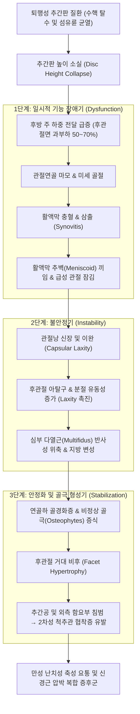
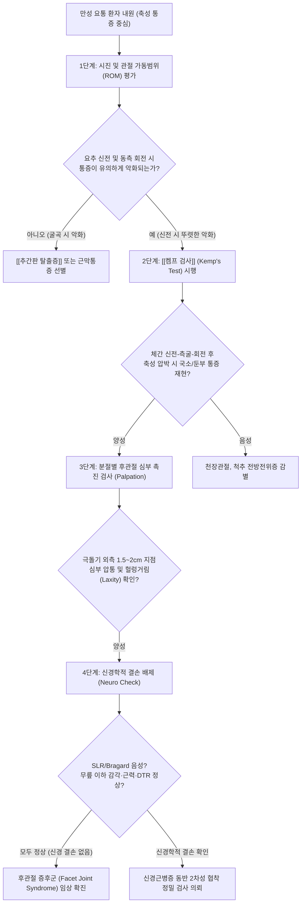
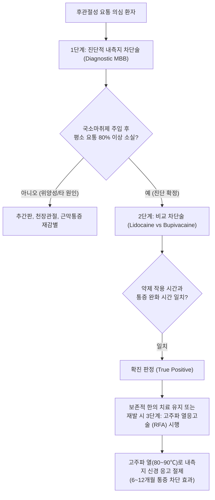
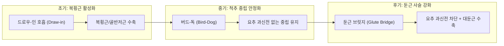

# 척추 후관절 증후군 (Facet Joint Syndrome)

> **목차 (Table of Contents)**
> 1. [[#1. 🩺 질환 개요 & 해부학적 병태생리]]
> 2. [[#2. ⚡ 병태생리 메커니즘 & 생체역학적 악순환 네트워크]]
> 3. [[#3. 🔍 임상 증상 & 이학적 검사 알고리즘]]
> 4. [[#4. 🔀 감별 진단 매트릭스]]
> 5. [[#5. 🌿 한의 통합 치료 프로토콜]]
> 6. [[#6. 💊 양방 치료 & 병용·의뢰 기준]]
> 7. [[#7. 🏃 재활 운동 & 생활습관 티칭 가이드]]
> 8. [[#8. 💡 사용자 진료실 핵심 필기 & 임상 노하우 (Melt-In)]]
> 9. [[#9. 📚 출처 및 현대 학술 연구 요약]]

---

> **핵심 3줄 요약 (Key Summary)**:
> 🎯 척추 삼주(Three-column) 복합체 중 후방 지지축을 담당하는 후관절(Zygapophyseal joint)의 연골 마모, 관절낭 이완 및 활액막염으로 발생하는 만성 축성 요통 증후군.
> 🚩 요추 신전(Extension) 및 동측 회전·측굴 시 관절면 압박으로 격렬한 통증이 유발되며, [[켐프 검사]](Kemp test) 양성과 둔부·대퇴 후면으로의 가성 방사통(Pseudoradiculopathy, 무릎 상방 제한) 형성.
> 🔍 척수신경 후지 내측지(Medial branch)의 이중 신경 지배(Dual innervation) 특성을 지니며, 협척혈 심부 골막 접촉 자침, [[신바로약침]], 도침 유착 박리, 콕스 굴곡-견인 [[추나]] 및 [[윌리엄스 굴곡 운동]]이 핵심 치료 축.

---

## 1. 🩺 질환 개요 & 해부학적 병태생리

### 질환 정의 및 임상적 의의
척추 후관절 증후군(Facet Joint Syndrome)은 상위 척추골의 하관절돌기(Inferior articular process, IAP)와 하위 척추골의 상관절돌기(Superior articular process, SAP)가 맞물려 형성하는 후관절(Zygapophyseal joint, 일명 Z-joint)의 관절낭 비후, 활액막 염증, 초자연골(Hyaline cartilage) 마모, 연골하 골경화(Subchondral sclerosis) 및 골극(Osteophytes) 형성으로 인해 발생하는 비신경근성 축성 통증 증후군이다.

임상적으로 전체 만성 요통 환자의 약 15%~45%를 차지하는 다빈도 질환으로, 노화에 따른 퇴행성 변화뿐만 아니라 반복적인 요추 과신전 및 회전 부하를 받는 스포츠 선수, 육체 노동자, 비만 및 복부 비만으로 인한 요추 과전만 환자군에서 호발한다. 특히 단순한 노인성 퇴행을 넘어 [[추간판 탈출증]]이나 척추 분리증, [[척추 전방전위증]]과 동반되어 복합적인 척추 불안정성을 야기하는 핵심 병소이다.

```
[정상 척추 삼주 복합체 부하 분담]
- 전방 주 (추체 + 추간판): 축성 하중의 70~80% 흡수 (유압성 완충)
- 후방 주 (양측 후관절 복합체): 축성 하중의 20~30% 분담 및 과도한 회전·전단력 차단

[추간판 퇴행 및 간격 협소화 발생 시]
- 전방 유압 완충력 붕괴 → 척추 후방 주로의 비정상적 하중 이동
- 후관절면 축성 압박 부하 50~70%까지 비정상 급증
- 관절 연골 마찰 마모 → 윤활막 충혈·삼출 → 관절낭 팽윤 → 내측지 기계수용체 감작 → 만성 요통
```

---

### 후관절의 기능적 해부학 (Functional Anatomy)

| 구성 요소 | 해부학적 구조 및 조직학적 특성 | 생체역학적 기능 및 임상 의의 |
| :--- | :--- | :--- |
| **관절면 (Articular Facet)** | 초자연골(두께 약 1~2mm)로 피복된 오목한 상관절돌기와 볼록한 하관절돌기의 대향면 | 마찰 없는 활주(Gliding) 운동을 보장하며 척추 분절 간의 과도한 비틀림과 전방 미끄러짐을 물리적으로 방어 |
| **관절낭 (Fibrous Capsule)** | 외층의 치밀 교원섬유층과 내층의 혈관성 활액막층으로 구성된 강력한 결합조직낭 | 척추 신전 시 긴장되어 과신전을 제동하며, 퇴행 시 비후되거나 이완(Laxity)되어 헐렁거림 발생 |
| **활액막 추벽 (Meniscoid Fold)** | 관절강 상하극에서 관절강 내부로 돌출하는 섬유지방성 혈관-신경 복합 추벽 (Fibroadipose meniscoid) | 급격한 척추 굴곡-회전 후 신전 복귀 시 관절면 사이에 끼임(Entrapment)을 일으켜 급성 요추 염좌 및 관절 잠김(Locking) 유발 |
| **관절강 (Joint Cavity)** | 약 1.0~1.5mL의 활액을 수용하는 미세 폐쇄 공간 | 염증 발생 시 삼출액 저류로 관절낭 내압이 급상승하며 쑤시는 듯한 심부 둔통을 유발 |

---

### 척추 분절별 후관절면의 공간적 배열 특성
척추의 분절별 후관절 관절면 방향(Facet Orientation)은 각 척추 영역의 가동성(Mobility)과 안정성(Stability)을 결정짓는 핵심 기하학적 요소이다.

1. **경추부 후관절 (Cervical Z-joint)**:
   * 수평면(Transverse plane) 기준 약 45도 후하방 경사를 유지하며 관상면에 가깝게 배열된다.
   * 굴곡, 신전, 측굴, 회전이 결합된 삼차원 복합 운동을 자유롭게 허용하지만, 후방 충돌 시 경추성 두통 및 견배부 연관통을 가장 빈번하게 유발한다.
2. **흉추부 후관절 (Thoracic Z-joint)**:
   * 수평면 기준 약 60도, 관상면(Coronal plane)에 평행하게 전후 방향으로 세워져 있다.
   * 흉곽(Rib cage)의 구조적 견고함과 맞물려 굴곡-신전을 엄격히 제한하고 축성 회전 운동을 위주로 허용한다.
3. **상위 요추부 후관절 (L1~L4 Z-joint)**:
   * 주로 시상면(Sagittal plane)에 가깝게 배열되어 J자 형태의 만곡을 이룬다.
   * 요추의 굴곡(Flexion)과 신전(Extension) 운동은 넓은 범위로 허용하지만, 과도한 축성 회전(Axial rotation)에 대해서는 강력한 기계적 스토퍼(Bony stop)로 작용하여 추간판 섬유륜의 비틀림 손상을 방지한다.
4. **요천추 이행부 후관절 (L5-S1 Z-joint)**:
   * 시상면에서 관상면(Coronal plane) 방향으로 급격한 방향 전환(Facet Tropism)이 일어난다.
   * 상체의 중력으로 인해 L5 척추체가 천골 상면에서 전하방으로 미끄러져 내리려는 전방 전단력(Anterior shear force)에 대항하여 강력한 뼈의 쐐기 역할을 수행한다. 이 부위의 이형성증(Tropism)은 [[척추 전방전위증]]의 주된 해부학적 인자가 된다.

---

### 신경 지배의 이중성 (Dual Innervation by Medial Branch)
후관절 증후군을 이해하고 정밀한 침구·약침·침도 및 신경차단술을 적용하기 위한 절대적인 해부학적 기초는 **척수신경 후지 내측지(Medial branch of dorsal ramus)**의 주행과 분포 양상이다.

```
[척수신경 뿌리 (Spinal Nerve Root)]
           │
           ▼
[척수신경 후지 (Dorsal Ramus)]
           │
     ┌─────┴────────────────────────┐
     ▼                              ▼
[외측지 (Lateral Branch)]      [내측지 (Medial Branch)]
- 장늑근, 요방형근 피하지배          │
                                    ├──────────────────────────┐
                                    ▼                          ▼
                         [골관절 지배 (Articular)]    [근육 지배 (Muscular)]
                         - 동위 분절 후관절 하극         - [[다열근]] (Multifidus)
                         - 하위 분절 후관절 상극         - 극간인대, 극돌기 골막
                         ★ 이중 신경 지배 완성!
```

* **이중 지배의 규칙 (Rule of Dual Innervation)**:
  * 모든 요추 후관절은 **동일 분절(Same level)과 바로 위 분절(Level above)의 척수신경 후지 내측지**로부터 동시에 감각 지배를 받는다.
  * *임상 예시*: **L4-L5 후관절**은 L3 척수신경의 내측지와 L4 척수신경의 내측지가 동시에 지배한다. 따라서 L4-L5 후관절 유래 통증을 완벽히 차단하거나 치료하기 위해서는 L3 및 L4 내측지가 지나가는 해부학적 랜드마크를 모두 목표로 삼아야 한다.
* **해부학적 랜드마크와 주행 경로**:
  * 내측지는 척추간공(Intervertebral foramen)을 빠져나온 후, 하위 척추 횡돌기(Transverse process) 상연과 상관절돌기(SAP) 외측 기저부가 만나는 **골성 구(Groove between SAP and Transverse process)**를 비스듬히 가로지른다.
  * 이후 유두돌기(Mamillary process)와 부돌기(Accessory process) 사이를 연결하는 **유두부돌기인대(Mamillo-accessory ligament, MAL)** 아래의 섬유골성 터널을 통과한다. 이 터널 부위는 내측지가 물리적으로 포착(Entrapment)되거나 섬유화되기 가장 쉬운 호발 병소이다.
* **수용체 구성**:
  * 후관절낭과 활액막에는 고유수용성 감각을 담당하는 Type I(Ruffini corpuscle) 및 Type II(Pacinian corpuscle) 기계수용체와, 침해수용성 통증을 전달하는 Type IV 무수 C-섬유(Unmyelinated C-fibers) 및 A-델타 섬유가 밀집되어 있다. 염증 시 Substance P 및 CGRP(Calcitonin Gene-Related Peptide)를 방출하여 혈관 확장과 통각 과민을 영속화한다.

---

## 2. ⚡ 병태생리 메커니즘 & 생체역학적 악순환 네트워크

### 척추 3주 복합체와 커크알디-윌리스(Kirkaldy-Willis) 3단계 연쇄반응
척추의 퇴행성 변화는 단일 구조물의 이상이 아니며, 추간판(앞쪽 기둥)과 한 쌍의 후관절(뒤쪽 기둥)이 하나의 기능적 척추 단위(Functional Spinal Unit, FSU)를 이루어 상호 파괴적인 퇴행 연쇄를 밟는다.



---

### 염증 매개체 방출과 신경 감작 (Biochemical & Neurological Sensitization)
후관절 내부의 기계적 마찰과 연골 손상은 세포 수준의 염증 반응을 촉발한다:
1. **염증성 사이토카인 폭풍**: 연골세포(Chondrocytes)와 활액막 섬유아세포에서 TNF-α, IL-1β, IL-6, COX-2 및 프로스타글란딘 E2(PGE2)가 대량 방출된다.
2. **기질분해효소(MMPs) 활성화**: 활성화된 염증 물질은 Matrix Metalloproteinases(MMP-1, MMP-3, MMP-13)와 아그레카나제(ADAMTS)를 발현시켜 제2형 교원질과 프로테오글리칸을 분해, 연골의 유연성을 완전히 박탈한다.
3. **말초 감작 (Peripheral Sensitization)**: 방출된 화학 매개체들이 관절낭 내의 무수 C-섬유 말단 수용체(TRPV1 등)를 지속적으로 감작시켜 휴식 상태에서도 발화 역치(Threshold)를 낮춘다.
4. **중추 감작 (Central Sensitization)**: 척수 후각(Dorsal horn) 뉴런으로 지속적인 C-섬유 유입이 발생하면 NMDA 수용체가 활성화되어 광역역(WDR) 신경원이 감작되고, 가벼운 척추 신전이나 일상적 진동만으로도 극심한 통각과민(Hyperalgesia) 및 이질통(Allodynia)을 유발하는 중추 감작 상태로 고착된다.

---

### 가성 방사통(Pseudoradiculopathy)의 생체역학적 투사 기전
후관절 증후군 환자들은 흔히 둔부, 서혜부, 대퇴 외측 및 후면부로 방사되는 통증을 호소한다. 이는 신경근(Nerve root)이 물리적으로 압박받아 생기는 진성 방사통(Radiculopathy)과 명확히 구분되는 **경화절성 연관통(Sclerotomal Referred Pain)**이다.

* **발생 원리**: 후관절을 지배하는 척수신경 후지 내측지는 배측 신경절(DRG)을 거쳐 척수 후각으로 들어갈 때, 동일 척추 분절의 전지(Ventral ramus)가 지배하는 피부, 근육, 관절 구조물의 감각 신경들과 척수 후각 교양질(Substantia gelatinosa)에서 동일한 2차 신경원(Second-order neuron)을 공유한다.
* 대뇌 피질은 후관절 심부에서 올라오는 통증 신호를 해석할 때, 감각 신경 세포 밀도가 상대적으로 높은 둔부나 대퇴부 근육층에서 유래한 통증으로 착각하여 인식하게 된다.
* **Kellis & Marks 분절별 투사 지도**:
  * **L1-L2, L2-L3 후관절**: 요추 상부, 측복부, 서혜부(Groin)로 연관통 투사.
  * **L3-L4 후관절**: 요추부 중앙, 장골능 상부, 둔부 전외측, 대퇴 전면으로 투사.
  * **L4-L5 후관절**: 둔부 심부, 대퇴부 외측 및 후면, 대전자 부위로 투사.
  * **L5-S1 후관절**: 둔부 하부, 천골부, 미골부, 대퇴부 후면 심부로 투사하며 드물게 종아리 상부(오금)까지 도달하나 **외과(Lateral malleolus)나 족부로는 절대 내려가지 않는다**.

---

## 3. 🔍 임상 증상 & 이학적 검사 알고리즘

### 전형적 임상 증상 프로파일
후관절 증후군은 병력 청취(Anamnesis) 단계에서부터 명확한 생체역학적 특징을 드러낸다:

* **통증의 양상 및 국소화**:
  * 척추 극돌기(Spinous process)에서 외측으로 1.5~2.5cm 떨어진 부위를 중심으로 편측 또는 양측에 나타나는 뻐근하고 쑤시는 심부 둔통.
  * 환자는 손가락 하나로 통증 부위를 정확히 찍기보다는 손바닥 전체로 허리 뒤쪽 외측(후관절 라인)을 감싸 쥐며 통증을 호소하는 경향을 보인다.
* **체위 및 부하에 따른 역학적 특성**:
  * **악화 인자 (Aggravating Factors)**:
    1. **요추 과신전 (Hyperextension)**: 서서 허리를 뒤로 젖힐 때 후관절면이 맞물려 통증 급증.
    2. **동측 회전 및 측굴 (Ipsilateral Rotation & Lateral Flexion)**: 아픈 쪽으로 몸을 비틀거나 굽힐 때 관절 충돌.
    3. **장시간 정적 기립 (Prolonged Standing)**: 요추 전만이 유지되며 중력 하중이 지속적으로 후관절로 가해짐.
    4. **수면 중 체위 변경 (Turning in Bed)**: 밤에 돌아누울 때 비틀림 스트레스로 인해 잠에서 깸.
  * **완화 인자 (Relieving Factors)**:
    1. **요추 굴곡 (Lumbar Flexion)**: 허리를 앞으로 가볍게 숙이거나 웅크려 앉으면 관절 간격이 벌어지며 즉각적인 완화.
    2. **하지 거치 앙와위 (Williams Position)**: 누워서 무릎 아래에 베개를 받치거나 고관절-슬관절을 90도로 접었을 때 통증 소실.
    3. **가벼운 평지 보행 (Gentle Walking)**: 초기 뻣뻣함이 보행 10~15분 후 관절액 순환으로 일시적 호전.
* **조조 강직 및 젤화 현상 (Gelling Phenomenon)**:
  * 아침에 일어날 때 허리가 굳어 나무토막처럼 뻣뻣하여 바로 펴지 못함 (지속 시간은 통상 30분 미만으로, 류마티스나 강직성 척추염의 1시간 이상 지속 강직과 감별됨).
  * 소파에 오래 앉아 있다가 일어설 때 허리가 단번에 펴지지 않아 엉거주춤한 자세로 서서히 펴야 함.

---

### 이학적 검사 프로토콜



#### 1. 켐프 검사 (Kemp's / Quadrant Test) 정밀 술기
* **검사 목적**: 검사 분절의 후관절 관절강을 최대로 좁혀 관절면을 강제 압박하고, 후관절낭 내의 기계수용체를 직접 자극하여 환자의 친숙한 통증을 유발.
* **검사 술기**:
  1. 환자를 진료대 끝에 걸터앉히거나 기립시킨다 (기립 상태가 요추 부하를 더 크게 가함).
  2. 검사자는 환자의 뒤에 서서 한 손으로 골반을 단단히 고정하여 골반 회전의 보상 작용을 차단한다.
  3. 다른 손으로 환자의 반대측 어깨를 잡고, 체간을 **최대 신전(Extension) $\rightarrow$ 검사측 측굴(Lateral Flexion) $\rightarrow$ 동측 회전(Rotation)** 상태로 유도한다.
  4. 마지막 단계에서 검사자의 체중을 이용하여 환자의 어깨를 통해 척추 축 방향으로 하방 압박(Axial Compression)을 가한다.
* **양성 판정**: 환측 후관절 라인 및 둔부에 찌릿하거나 뻐근한 본래의 요통이 재현되면 양성. 무릎 아래로 내려가지 않는 둔부 연관통 재현은 후관절성 연관통의 전형 소견.

#### 2. 분절별 후관절 심부 압통 및 이완감 촉진법 (Facet Palpation)
* **준비 자세**: 환자를 복와위(Prone)로 눕히고, 복부 아래에 베개 1~2개를 반드시 받쳐 요추의 전만을 완전히 소실시킨 평평한 상태(Flattened Lordosis)를 만든다. (전만이 유지되면 기립근이 긴장되어 심부 관절 촉진 불가).
* **랜드마크 위치**: 각 분절의 극돌기(L1~L5)를 확인한 후, 극돌기 상연 외측 1.5cm~2.0cm 지점을 엄지손가락 끝(Thumb pad)으로 직각으로 접촉한다.
* **술기 및 느낌**:
  1. 척추 기립근과 [[다열근]]을 외측으로 살짝 밀어내며 심부로 깊게 진입하여 횡돌기-상관절돌기 이행부의 단단한 뼈 표면을 촉진한다.
  2. 수직 하방 압박과 함께 상하 활주(Gliding)를 유도할 때, 정상 분절은 단단하고 탄력 있는 저항감을 보이나, 병변 후관절은 **"물렁하고 헐렁거리는 고무공을 누르는 듯한 이완감(Laxity)"** 또는 날카로운 국소 반사성 근수축(Spasm)을 일으킨다.

#### 3. 신경학적 배제 검진 (Neurological Exclusion)
* **직거상 검사 ([[직거상 검사]], Straight Leg Raising Test)**: 정상 (70도 이상 거상 시 요추 신경근 긴장 징후 없음).
* **심부건반사 (Deep Tendon Reflexes)**: 슬개건 반사(L4), 아킬레스건 반사(S1) 정상 대칭.
* **도수 근력 검사 (MMT)**: 족관절 배굴(L4), 무지 신전(L5), 족관절 저굴(S1) 모두 Grade 5 정상.
* **피부분절 감각 (Dermatome)**: 하지 전 피부분절에서 둔마나 감각 과민 소견 전무.

---

### 방사선학적 병기 평가 (Radiological Grading)

Pathria 및 Weishaupt의 요추 후관절 관절증 CT/MRI 등급 체계:

| 등급 (Grade) | 방사선학적 병리 소견 (CT/MRI) | 임상적 척추 안정성 |
| :--- | :--- | :--- |
| **0등급 (Normal)** | 관절 간격(2~4mm) 정상 유지, 골극 없음, 연골 균일 | 정상 생체역학적 기능 |
| **1등급 (Mild)** | 관절 간격 경미 협소(<2mm), 미세 골극 형성, 경미한 연골하 경화 | 일시적 기능 장애기 (활액막염 및 근연축) |
| **2등급 (Moderate)** | 관절 간격 현저한 협소, 중등도 골극 비후, 연골 마모, 관절면 미란 | 불안정기 (관절낭 이완, 체위 변경 통증) |
| **3등급 (Severe)** | 관절 간격 완전 소실, 거대 골극, 연골하 낭종(Cyst), 진공 현상(Vacuum) | 만성 안정화기 (2차성 외측 협착증 동반) |

---

## 4. 🔀 감별 진단 매트릭스

후관절 증후군은 요통을 유발하는 타 척추 및 골반대 질환들과 증상이 유사하므로 정밀한 다축 비교를 통한 감별이 필수적이다.

| 질환명 | 주 통증 부위 | 유발 및 악화 동작 | 방사통 및 연관통 특성 | 이학적 검사 핵심 소견 | 신경학적 결손 |
| :--- | :--- | :--- | :--- | :--- | :--- |
| [[후관절 증후군]] | 극돌기 외측 1.5~2cm 심부, 편측 요추부 | **요추 신전, 동측 측굴 및 회전**, 장시간 기립 | 둔부, 서혜부, 대퇴 후면에 국한 (**무릎 상방 경계**) | [[켐프 검사]] 양성, 극돌기 외측 헐렁거리는 심부 압통 | 없음 (근력·감각·건반사 100% 정상) |
| [[추간판 탈출증]] (HIVD)** | 척추 중앙부, 둔부, 하지 전반 | **요추 굴곡**, 기침·재채기(복압 상승), 착석 | 특정 신경근 피부분절을 따른 **발가락·발목까지의 진성 방사통** | [[직거상 검사]](SLR) 양성, [[발살바 검사]] 양성, 슬럼프 검사 양성 | 흔함 (무지 신전 약화, 족하수, 건반사 저하, 감각 둔마) |
| [[척추관 협착증]] | 양측 요통, 둔부 및 하지 전반 | **보행 지속**, 요추 신전 | 양측 둔부 및 하지의 터질 듯한 둔통, 쥐어짜는 감각 | **신경인성 간헐적 파행**(Neurogenic Claudication), 허리 숙이면 즉시 완화 | 장거리 보행 시 감각 둔마 및 하지 위약 동반 |
| [[천장관절 증후군]] | 천골부, 후상장골극(PSIS) 부근, 둔부 | 체중 부하(한 발 서기), 보행 시 발 디딤, 계단 오르기 | 서혜부, 둔부 외측, 대퇴 후외측 연관통 | 패트릭 검사(FABER) 양성, 가엔슬렌(Gaenslen) 검사 양성 | 없음 |
| [[요방형근]] 증후군** | 장골능 상부, 외측 허리, 천골 외측 | 체간 측굴, 보행 시 유각기, 기침 시 | 둔부 외측 및 대퇴 외측으로의 연관통 | 요방형근 심부 압통점(TrP) 및 팽팽한 띠(Taut band) 촉진 | 없음 |
| **척추 분리 및 전방전위증** | 요천추 연접부 심부 요통, 계단식 변형 | 요추 과신전 시 극심한 악화, 장시간 기립 | 신경근성 또는 가성 방사통 복합 | 척추 극돌기 촉진 상 **스텝 오프(Step-off) 계단 징후** | 전위 정도에 따라 신경근 압박 가능 |

---

## 5. 🌿 한의 통합 치료 프로토콜

### 한의학적 병인병기 및 변증 분류
한의학에서 후관절 증후군은 요통(腰痛) 및 비증(痺證)의 범주에 속하며, 척추를 지탱하는 신(腎)의 정기 쇠약과 풍한습(風寒濕) 및 어혈(瘀血)의 외사가 결합하여 발생한다.

* **신허요통 (腎虛腰痛)**:
  * *병기*: 노화, 다산, 과로 등으로 신정(腎精)이 고갈되어 척추골과 인대를 영양하지 못함.
  * *증상*: 허리가 은은하게 쑤시고 시리며, 무릎에 힘이 빠지고 오래 서 있거나 과로하면 악화됨. 조기 관절 연골 마모 환자의 바탕 병증.
* **어혈요통 (瘀血腰痛)**:
  * *병기*: 척추의 외상, 염좌, 반복적 역학적 충격으로 후관절낭 내 미세혈관이 파열되고 혈액 순환이 정체됨.
  * *증상*: 밤에 통증이 더욱 극심해지는 야간통(Nocturnal pain), 허리를 뒤로 젖힐 때 칼로 찌르는 듯한(刺痛) 고정된 통증.
* **풍한습비요통 (風寒濕痺腰痛)**:
  * *병기*: 차갑고 습한 사기가 척추 경락에 침범하여 기혈의 순행을 막고 관절강 내 삼출액 저류를 유발함.
  * *증상*: 날씨가 흐리거나 비가 오면 통증이 심해지며, 아침 기상 시 허리가 통나무처럼 굳고 뻣뻣하나 따뜻하게 찜질하면 완화됨.

---

### 침구 치료 및 심부 골막 접촉 자침술 (Deep Periosteal Needling)
후관절은 척추 척립근과 다열근의 가장 깊은 층에 위치하므로, 피부 표면의 천자(Shallow needling)로는 병변 관절낭에 도달할 수 없다.

```
[심부 골막 접촉 자침술 자입 경로 도해]
피부 표면
  │
  ▼ (수직 자입 후 10~15도 내측 경사)
척추 기립근 (최장근·장늑근) 관통
  │
  ▼
다열근 (Multifidus) 심부 통과
  │
  ▼
횡돌기 기저부와 상관절돌기(SAP) 외측 골성 구 (Groove) 접촉! [Bone Touch]
  │
  └─★ 척수신경 후지 내측지 주행로 및 후관절낭 외측 섬유층 직접 자극
```

* **주요 선혈 경혈**:
  * **주치혈**: 병변 분절의 양측 협척혈(夾脊穴, 극돌기 하연 외측 0.5~1.0촌), [[신수]](BL23), [[기해수]](BL24), [[대장수]](BL25), [[관원수]](BL26).
  * **원위 배혈**: [[위중]](BL40, 요배위중구), [[곤륜]](BL60), [[양릉천]](GB34, 근회), [[환도]](GB30), [[현종]](GB39, 수회).
* **특수 심부 자침 기법**:
  1. 환자를 복와위로 눕히고 배 아래에 베개를 받쳐 요추 전만을 감소시킨다.
  2. 0.35×60mm 또는 0.35×75mm 장침을 선택한다.
  3. 극돌기 외측 1.5cm 지점에서 침을 수직으로 자입한 후, 횡돌기 기저부 골면에 닿으면(Bone touch) 침 끝을 약간 빼서 내측 10~15도 방향으로 각도를 바꾸어 상관절돌기 외측면에 살짝 접촉시킨다.
  4. 침첨이 골막에 접촉하는 순간 환자는 허리 심부에서 묵직하고 시원하게 퍼지는 득기감(得氣, De-Qi)을 느끼며, 연축된 [[다열근]]이 즉각적으로 이완된다.
  5. 전침(Electroacupuncture)을 협척혈 간에 연결하여 2Hz 저주파 연속파 또는 2/100Hz 혼합파를 15~20분간 적용하여 엔도르핀 방출 및 신경성 염증을 억제한다.

---

### 도침 치료 (Acupotomy) 및 관절낭 유착 박리술
만성 후관절 증후군으로 인해 관절낭이 비후되고 유두부돌기인대(MAL) 아래에서 내측지가 포착·섬유화된 경우 미세 도침(Acupotomy)을 이용한 연부조직 감압 박리술을 적용한다.

* **적응증**: 만성 난치성 후관절 요통, 극돌기 외측 심부의 단단한 섬유성 결절 및 골극 촉진, 일반 침구 치료에 반응하지 않는 고정성 신전통.
* **해부학적 랜드마크**: 병변 분절 횡돌기 상연과 상관절돌기(SAP) 외측면이 만나는 골성 결절 부위.
* **시술 프로토콜**:
  1. 철저한 무균 소독 후 0.5×50mm 일회용 멸균 도침을 사용한다.
  2. 도침의 날(Blade) 방향을 척추 신경근 및 척수강 주행과 평행하게 척추 장축 방향(시상면)으로 정렬한다.
  3. 피부를 수직 천자하여 심부로 진입, 상관절돌기 외측 기저부 골면에 반드시 닿게 한다(Bone touch). 골면을 벗어나 전방으로 침습하지 않도록 깊이를 엄격히 통제한다.
  4. 뼈를 스크래핑하듯 1~2mm 범위 내에서 절개·박리(Shaving & Peeling)하여 섬유화된 관절낭 외측 인대를 박리하고 내측지 포착을 해소한다.

---

### 약침 치료 (Pharmacopuncture)
염증성 활액막염과 신경 감작을 신속히 가라앉히고 인대 조직을 재생하기 위해 증상 단계별로 약침을 분별 적용한다:

* **급성 염증기 (Acute Inflammatory Phase)**:
  * [[신바로약침]] (GCSB-5)**: 방풍, 우슬, 오가피, 구척 등으로 구성된 생약 복합체로, COX-2 및 iNOS 억제를 통한 강력한 항염증 진통 효과와 연골 파괴 효소(MMP-3, MMP-13) 분비 차단 입증.
  * **황련해독탕 약침**: 열증(熱證) 및 심한 활액막 충혈에 대해 1회 0.5~1.0cc를 후관절 외측에 점적 주입하여 삼출액 흡수 촉진.
* **만성 퇴행 및 이완기 (Chronic Laxity Phase)**:
  * **봉약침 (Bee Venom Pharmacopuncture)**: Melittin, Apamin 성분이 체내 코르티솔 분비를 촉진하고 만성 염증을 제거하며, 이완된 후관절낭 주위의 미세 순환을 증가시켜 섬유 조직 재생(Proliferation)을 유도. (시술 전 알레르기 스킨 테스트 필수).
  * **자하거(인태반) 약침**: 신정부족형 만성 관절 마모 환자에게 관절 주위 연부조직 영양 공급 및 척추 안정화 도모.

---

### 추나의학적 중재 (Chuna Manual Therapy)

후관절 증후군 추나 치료의 제1원칙은 **"후관절면의 기계적 충돌을 피하고, 굴곡-감압을 통해 닫힌 관절강을 열어주는 것"**이다.

```
[후관절 증후군 추나 치료 기본 원칙]
★ 절대 금기: 과도한 요추 신전 기법, 강제적인 회전 스러스트(HVLA) 기법
★ 필수 권장: 분절별 굴곡-견인 관절가동술, 콕스(Cox) 굴곡 감압, 천골 염전 교정
```

1. **콕스 굴곡-견인 기법 (Cox Flexion-Distraction Technique)**:
   * 콕스 테이블에 환자를 복와위로 눕힌 후, 발목을 고정하고 검사자의 한 손으로 병변 후관절 극돌기 직상부를 하방 접촉(Contact)하여 고정한다.
   * 테이블의 후방 가동판을 아래로 부드럽게 굴곡(Flexion) 및 축성 견인(Distraction)시켜 요추 후관절면의 간격을 순간적으로 2~3mm 벌려주며 음압(Negative pressure)을 유도, 활액 순환을 촉진하고 끼인 활액막 추벽(Meniscoid)을 정복한다.
2. **측와위 분절성 굴곡 관절가동술**:
   * 환자를 환측이 위로 오도록 측와위로 눕히고, 상측 고관절과 슬관절을 90도 이상 굴곡시켜 요추의 신전을 완전히 잠근다(Locking in Flexion).
   * 시술자는 환자의 상체를 부드럽게 유지한 채, 골반부를 가볍게 전방 및 두부 방향으로 견인하며 병변 분절 후관절의 굴곡 분리를 유도한다.
3. **골반 염전 교정 및 심부 근막 이완**:
   * 천골의 전방 비틀림(Sacral torsion)과 장골의 후하방 변위(PI ilium)를 교정하여 요천추 연접부의 비대칭적 전단력을 제거한다.
   * 후관절 바로 위를 덮고 있는 [[다열근]](Multifidus) 및 [[요방형근]](Quadratus Lumborum)에 대해 허혈성 압박(Ischemic compression) 및 근에너지기법(MET)을 적용하여 반사성 근경련을 해소한다.

---

### 한약 처방 (Herbal Medicine)

| 처방명 | 구성 약물 및 주요 본초 | 변증 및 적응증 | 현대 약리 효능 및 처방 의의 |
| :--- | :--- | :--- | :--- |
| [[독활기생탕]]<br/>(獨活寄生湯)** | [[독활]], [[상기생]], [[두충]], [[우슬]], [[세신]], [[진교]], [[복령]], [[백작약]], [[당귀]], [[숙지황]] 등 | 간신부족(肝腎不足) 및 풍한습비(風寒濕痺)로 인한 만성 후관절 관절증 | 연골 기질 보호, 염증성 사이토카인(IL-1β, TNF-α) 억제, 신경 영양 촉진 |
| [[서근활혈탕]]<br/>(舒筋活血湯)** | [[당귀]], [[백출]], [[천궁]], [[도인]], [[홍화]], [[우슬]], [[위령선]], [[방기]], [[강활]], [[백작약]] 등 | 어혈 및 근경련으로 허리를 뒤로 젖히지 못하고 밤에 쑤시는 경우 | 척추 기립근 및 다열근의 미세 순환 개선, 어혈 제거 및 관절 가동성 회복 |
| [[오적산]]<br/>(五積散)** | [[창출]], [[마황]], [[진피]], [[후박]], [[길경]], [[지각]], [[당귀]], [[건강]], [[육계]], [[백작약]] 등 | 한습(寒濕)에 외감되어 아침 기상 시 극심한 강직과 둔통을 호소하는 경우 | 온경산한(溫經散寒), 관절강 내 부종 및 삼출액의 신속한 체외 배출 |
| **청파전 (淸波煎)** | [[신바로]] 복합 추출물 (우슬, 방풍, 구척, 두충, 오가피 등) | 급·만성 후관절 활액막염 및 관절낭 부종 | 강력한 항염 진통, 연골세포 사멸 억제, 척추 분절 골밀도 보존 |

---

## 6. 💊 양방 치료 & 병용·의뢰 기준

### 양방 보존적 치료 및 약물 요법
* **비스테로이드성 항염증제 (NSAIDs)**: Meloxicam, Celecoxib 등 COX-2 억제제를 우선 투여하여 활액막 염증을 경감.
* **근이완제 (Muscle Relaxants)**: Eperisone, Baclofen 등을 병용하여 2차적으로 연축된 다열근과 척추 기립근 긴장을 완화.
* **물리치료**: 온열 치료(Hot pack), 심부 초음파(Ultrasound), 간섭파(ICT) 치료를 통한 국소 혈류 개선.

---

### 중재적 시술 (Interventional Procedures)



1. **진단적 내측지 차단술 (Diagnostic Medial Branch Block, MBB)**:
   * **골드 스탠다드 (Gold Standard)**: 단순 방사선이나 MRI 소견만으로는 무증상 고령자에서도 후관절 퇴행이 흔히 관찰되므로 영상 소견만으로 확진할 수 없다. C-arm(투시하) 유도 하에 해당 후관절을 지배하는 두 개 분절의 내측지에 소량(0.5mL 이하)의 국소마취제(Lidocaine 등)를 정확히 주입한다.
   * 주입 후 평소 호소하던 요추 신전통이 **80% 이상 즉각적으로 소실되는 경우** 후관절 증후군으로 확진한다.
   * 위양성률(25~40%)을 배제하기 위해 리도카인(단기 작용)과 부피바카인(장기 작용)을 날짜를 달리하여 주입하는 비교 차단술(Comparative Block)을 권장한다.
2. **관절강 내 주사 (Intra-articular Injection)**:
   * 후관절강 내로 조영제를 확인한 후 스테로이드(Triamcinolone)와 국소마취제를 직접 주입. 활액막염이 극심한 급성기에 단기 염증 완화 효과가 우수하나, 반복 주사 시 연골 파괴 위험이 있어 연 3회 이하로 제한.
3. **고주파 열응고술 (Radiofrequency Ablation / Neurotomy, RFA)**:
   * 진단적 차단술로 확진되었으나 통증이 3개월 이상 지속적으로 재발하는 경우 시행.
   * 투시 하에 특수 전극 바늘을 내측지에 평행하게 거치한 후 80~85°C의 열을 90초간 가하여 감각 신경 섬유를 열응고 절제함. 신경 재생 전까지 약 6~12개월간의 장기적인 통증 경감 효과를 제공.

---

### 신경외과적 수술 적응증 및 의뢰 기준 (Red Flags)
후관절 증후군 자체는 대부분 보존적 및 중재적 시술로 관리 가능하나, 다음과 같은 소견 발생 시 즉시 척추 전문의에게 외과적 전원 의뢰를 결정한다:

* **절대적 응급 수술 의뢰 기준**:
  1. **마미총 증후군 (Cauda Equina Syndrome)**: 후관절의 거대 활액낭종(Synovial cyst)이나 골극이 척추관을 전방 침범하여 안장 부위 감각 소실(Saddle anesthesia), 방광 및 배변 괄약근 조절 장애 발생 시 (48시간 이내 긴급 감압술 필수).
  2. **진행성 운동 신경 마비**: 족하수(Foot drop), 족관절 배굴력 저하(Grade 3 이하) 등 중증 신경근 포착 징후 동반.
* **상대적 수술 의뢰 기준**:
  1. 거대 골극 및 하관절돌기 비후로 인한 중증 척추관 협착증 또는 추간공 협착증이 동반되어 100m 이하의 심한 신경인성 파행을 보일 때.
  2. 6개월 이상의 적극적인 한의 복합 치료 및 신경차단술에도 불구하고 일상생활이 불가능한 수준의 극심한 통증 지속 시 $\rightarrow$ 최소침습 후관절 절제술(Facetectomy) 및 척추 유합술(Fusion) 고려.

---

## 7. 🏃 재활 운동 & 생활습관 티칭 가이드

### 재활 운동의 핵심 원칙: "신전 금지, 굴곡 기반 코어 안정화"
후관절 증후군 재활의 성패는 **"후관절면을 압박하는 요추 전만과 과신전을 억제하고, 요추를 중립(Neutral)에서 경미한 굴곡위로 유지하는 심부 안정화 근육을 활성화하는 것"**에 달려 있다.

```
[후관절 증후군 운동 처방의 절대 법칙]
❌ 맥켄지 신전 운동 (McKenzie Extension Exercise): 후관절면을 직접 강타하여 염증 폭발 → 절대 금기!
⭕ 윌리엄스 굴곡 운동 (Williams Flexion Exercise): 후관절 간격을 열어주고 복근을 강화 → 1순위 처방!
```

---

### 윌리엄스 굴곡 운동 (Williams Flexion Exercises) 4단계

| 단계 | 운동 명칭 | 운동 방법 및 수행 횟수 | 생체역학적 교정 기전 |
| :--- | :--- | :--- | :--- |
| **1단계** | **골반 경사 운동<br/>(Pelvic Tilt)** | 바로 누워 무릎을 세우고, 허리 뒤쪽 바닥의 빈 공간을 없애듯 배꼽을 바닥 쪽으로 강하게 누르며 골반을 후방 경사(Posterior tilt)시킨다. 10초 유지, 15회 반복. | [[복직근]]과 [[복횡근]]을 활성화하여 과도한 골반 전방 경사(Anterior tilt)와 요추 전만을 감소시킴. |
| **2단계** | **단일 슬관절-가슴 닿기<br/>(Single Knee to Chest)** | 바로 누운 상태에서 한쪽 무릎을 양손으로 감싸 쥐고 가슴 쪽으로 천천히 당겨 15~20초간 유지한다. 양측 교대로 5회씩 반복. | 병변측 후관절 간격 및 추간공을 기계적으로 개방하고 요천추 기립근을 신장함. |
| **3단계** | **양측 슬관절-가슴 닿기<br/>(Double Knee to Chest)** | 양쪽 무릎을 동시에 가슴 쪽으로 끌어안아 허리 전체가 둥글게 말리도록 부드럽게 당겨 20초간 유지한다. 3~5회 반복. | 요천추 연접부 전체의 후관절 낭을 안전하게 이완시키고 척추 내압 감압. |
| **4단계** | **부분 윗몸 일으키기<br/>(Partial Curl-up)** | 무릎을 세우고 누워 양손을 가슴에 얹고, 견갑골이 바닥에서 살짝 떨어질 정도로만 상체를 들어 올려 5초간 유지한다. 10~15회. | 요추에 무리한 회전이나 과부하를 주지 않으면서 전복벽 코어 근력을 강화. |

---

### 척추 중립 코어 안정화 운동



1. **드로우-인 복부 인입술 (Abdominal Draw-In Maneuver)**:
   * 편안히 누워 숨을 들이마신 후, 천천히 내쉬면서 배꼽을 척추 쪽으로 끌어당기며 하복부를 납작하게 만든다.
   * 척추나 골반의 움직임 없이 [[복횡근]](Transversus abdominis)만을 독립적으로 수축시켜 척추의 천연 복대를 형성한다.
2. **버드-독 운동 (Bird-Dog Exercise with Neutral Spine)**:
   * 네발기기 자세에서 척추를 완전히 평평한 중립으로 유지한다.
   * 요추가 아래로 처지거나 뒤로 젖혀지지 않도록 복압을 유지한 상태에서 한쪽 팔과 반대쪽 다리를 수평까지만 들어 올린다. (다리를 너무 높이 들면 요추가 과신전되어 후관절에 통증 발생하므로 수평 이하 유지 필수).
3. **변형 둔근 브릿지 (Modified Glute Bridge)**:
   * 무릎을 세우고 누워 엉덩이를 들어 올릴 때, 허리를 꺾어 활처럼 휘게 만들지 말고 골반 후방 경사를 유지하며 **무릎-골반-어깨가 일직선**이 되는 지점까지만 올린다. 대둔근의 근력을 강화하여 서 있을 때 골반 전방 경사를 막아준다.

---

### 일상생활 티칭 및 인체공학적 가이드
* **기립 및 보행 자세**:
  * 장시간 서 있어야 할 경우, 발 받침대(높이 10~15cm)를 바닥에 두고 양발을 번갈아 가며 한 발씩 올려놓아 요추 전만을 감소시킨다.
  * 여성의 경우 하이힐(굽 높은 신발) 착용을 엄격히 금한다. 하이힐은 무게중심을 앞으로 이동시켜 보상성 요추 과전만을 강제함으로써 후관절에 지속적인 전단 파괴력을 가한다.
* **수면 자세**:
  * **앙와위(바로 누울 때)**: 무릎 아래에 단단한 베개나 쿠션을 받쳐 고관절과 무릎을 약간 구부린 상태를 유지하면 골반이 후방 경사되며 밤사이 후관절면이 벌어져 통증 없이 숙면 가능.
  * **측와위(옆으로 누울 때)**: 양 무릎 사이에 베개를 끼워 골반의 회전과 비틀림 스트레스를 원천 차단.
  * **엎드려 자는 자세(Prone)**: 요추가 최대로 과신전되고 경추까지 비틀려 후관절에 치명적이므로 절대 금기.
* **작업 및 착석 환경**:
  * 의자에 앉을 때는 엉덩이를 의자 깊숙이 밀어 넣고, 허리 뒤쪽에 얇은 요추 지지대를 받치되 과도하게 허리가 뒤로 젖혀지지 않는 편안한 직각 중립 자세를 유지한다.
  * 50분 착석 후에는 반드시 5분간 일어나 가벼운 평지 보행을 통해 관절 윤활액을 순환시킨다.

---

## 8. 💡 사용자 진료실 핵심 필기 & 임상 노하우 (Melt-In)

본 단락은 진료실에서 환자를 직접 마주하며 축적된 저자의 고유한 진료 노하우와 원문 필기를 100% 보존하고 심화한 핵심 실전 임상 지침이다.

---

### 1. "가만히 있으면 아프고, 조금 움직이면 편해져요" 호소 환자의 해석
진료실에 들어선 환자가 다음과 같이 호소하는 경우가 대단히 많다:
> *"원장님, 아침에 자고 일어나면 허리가 통나무처럼 굳어서 삐걱거리고, 의자에 1시간만 가만히 앉아 있어도 일어날 때 허리가 안 펴져서 엉거주춤해요. 그런데 신기하게 세수하고 방 안을 10분 정도 슬슬 걸어 다니면 뻣뻣한 게 스르륵 풀려요."*

* **원장실 감별 해석**:
  * 이 호소는 전형적인 **후관절 활액막염 및 관절 연골의 젤화 현상(Gelling Phenomenon)**을 시사하는 결정적 단서이다.
  * [[추간판 탈출증]] 환자는 걷거나 움직일수록 디스크 내압이 올라가 다리 저림이 심해지는 반면, 후관절 증후군 환자는 정적인 부동 상태에서 관절낭 내부의 활액 순환이 정체되고 염증성 삼출액이 고여 관절 내압이 상승한다.
  * 걷기 시작하면 관절 운동에 의해 관절낭이 마사지되면서 윤활액이 펌핑 분산되어 일시적으로 뻣뻣함이 풀리는 것이다.
  * **주의할 점**: "움직이면 풀린다"고 해서 무작정 활동을 지속하면, 오후나 저녁이 되어 피로가 누적되고 중력 하중이 지속되면서 후관절면이 짓이겨져 밤에는 극심한 축성 요통으로 악화된다. 이 패턴을 명확히 설명하여 환자에게 안도감과 신뢰를 주어야 한다.

---

### 2. 후관절낭 촉진 시 "고무풍선 헐렁거림(Laxity)" 감별 실전 팁
후관절 증후군을 진단할 때 방사선 사진보다 원장의 손끝 감각이 훨씬 정확하다:

* **복와위 배 밑 베개 거치 필수**:
  * 환자를 그냥 침대에 엎드리게 하면 척추 기립근이 긴장되어 돌처럼 딱딱해지므로 절대 심부 후관절을 만질 수 없다.
  * 반드시 배 아래에 베개 1~2개를 밭쳐서 허리가 평평해지게(Kyphotic positioning) 만든 후 검진해야 한다.
* **손끝에 느껴지는 "고무풍선 헐렁거림"**:
  * 극돌기에서 외측으로 정확히 1.5cm 지점을 엄지손가락으로 뼈를 향해 수직으로 깊숙이 누른다.
  * 건강한 정상 관절은 뼈의 단단한 저항감이 탄력 있게 받쳐주지만, 만성 관절낭 손상과 연골 마모로 관절 불안정기(2단계)에 접어든 환자는 **마치 물렁물렁하고 헐렁거리는 고무공이나 물풍선을 꾹 누르는 듯한 특유의 이완감(Capsular Laxity)**이 손끝에 전해진다.
  * 그 순간 환자는 *"선생님, 바로 그 자리가 평소에 시리고 묵직하게 쑤시던 그곳입니다!"*라며 정확한 압통을 확인시켜 준다. 이 자리가 바로 자침과 약침, 도침의 치료 타겟이다.

---

### 3. 하지 방사통의 '무릎 경계 법칙 (Knee Line Rule)'
후관절 증후군 환자의 상당수가 둔부, 서혜부, 꼬리뼈, 허벅지 뒤쪽으로 뻗치는 통증을 호소하며 "디스크가 터져서 다리가 저린 것 아니냐"며 사색이 되어 내원한다.

* **무릎 경계선 확인**:
  * 환자에게 방사통이 내려가는 가장 먼 경계점을 반드시 손으로 가리키게 한다.
  * 통증이 엉덩이와 허벅지 뒤쪽까지는 내려가지만 **오금(Knee joint) 이하 종아리나 발목, 발가락으로는 결코 내려가지 않는다**면, 이는 99% 척수신경 후지 내측지에 의한 '가성 방사통(Pseudoradiculopathy)'이다.
  * 신경학적 검진에서 발목 힘(족배굴곡) 정상, 엄지발가락 힘 정상, 발가락 감각이 100% 온전함을 확인시켜 주면 환자는 심리적으로 극도의 안정을 얻게 되며, 불필요한 척추 수술 공포에서 벗어난다.

---

### 4. 침도 및 심부 자침 시 랜드마크 자입각 (Bone Touch의 원칙)
후관절 부위는 척추관 및 척수 신경근과 인접해 있으므로 맹목적인 자침은 매우 위험하다:

* **절대적 골성 접촉 (Bone Touch)**:
  * L4-L5, L5-S1 분절의 후관절은 극돌기 외측 약 1.5~2.0cm 지점에서 진입한다.
  * 수직으로 진입하여 횡돌기 상연과 상관절돌기 기저부가 만나는 골면에 닿는 느낌(Bone touch)을 손끝으로 확인하기 전에는 침이나 침도를 절대로 비틀거나 조작하지 않는다.
  * 골면을 안전한 바닥으로 삼아 1~2mm 내외로 미세하게 박리하거나 약침을 분주해야만 척추강 내 침습이나 신경근 손상을 100% 완벽하게 방지할 수 있다.

---

### 5. 환자 일상 티칭 주의사항: "무분별한 멕켄지 신전 운동 금지"
원장실에서 환자들에게 가장 강력하게 주의를 주어야 할 티칭 사항이다:
> *"요즘 유튜브나 방송에서 허리 아플 때 뒤로 젖히는 코브라 자세나 맥켄지 운동이 좋다고 하니, 후관절 환자분들이 집에서 열심히 뒤로 젖히다가 비명을 지르고 증상이 폭발해서 내원하십니다."*

* **티칭 원칙**:
  * 멕켄지 신전 운동은 전방으로 탈출된 수핵을 앞으로 밀어 넣어야 하는 [[추간판 탈출증]] 환자에게는 명약일 수 있으나, 뒤쪽 관절면이 닳아서 염증이 생긴 **후관절 증후군 환자에게는 불난 집에 기름을 붓고 관절면을 맷돌처럼 짓이기는 치명적인 독**이 된다.
  * 환자에게 "허리를 뒤로 꺾는 운동은 당분간 절대 하지 마시고, 누워서 무릎을 가슴으로 당기는 윌리엄스 굴곡 운동과 평지 걷기만 하십시오"라고 명확히 금기 사항을 선언해야 한다.

---

## 9. 📚 출처 및 현대 학술 연구 요약

* **PubMed (PMID: 36474960)**: Perolat R, et al. *Facet Joint Syndrome: Pathophysiology, Diagnosis, and Treatment.* J Pain Res. 2018;11:925-935.
  * [URL](https://pubmed.ncbi.nlm.nih.gov/36474960/)
  * `[연구 요약]` 요추 후관절 증후군의 해부학적 기전, 3주 복합체 부하 이동, 척수신경 후지 내측지의 이중 신경 지배 및 진단적 신경차단술의 유효성을 총괄 검토하고 근거 중심 보존적 관리 지침을 확립함.
* **PubMed (PMID: 39481876)**: Manchikanti L, et al. *Radiofrequency treatments for lumbar facet joint syndrome: a systematic review and network meta-analysis.* Reg Anesth Pain Med. 2025.
  * [URL](https://pubmed.ncbi.nlm.nih.gov/39481876/)
  * `[연구 요약]` 요추 후관절 매개성 통증에 대한 내측지 고주파 열응고술(RFA)의 임상적 효과를 네트워크 메타분석하여 6~12개월간의 유의한 통증 감소와 기능 회복을 입증함.
* **PubMed (PMID: 30683428)**: Gómez-Ríos MÁ, et al. *Diagnostic nerve blocks in the management of low back pain secondary to facet joint syndrome.* Rev Esp Anestesiol Reanim (Engl Ed). 2019;66(4):214-222.
  * [URL](https://pubmed.ncbi.nlm.nih.gov/30683428/)
  * `[연구 요약]` 후관절 증후군 감별을 위한 진단적 내측지 차단술(MBB)의 위양성 배제 프로토콜과 이중 마취제 비교 검사의 임상 타당도를 규명함.
* **PubMed (PMID: 42148721)**: Le J, et al. *Effectiveness of thermal radiofrequency ablation versus corticosteroid injections for pain reduction in facet-mediated chronic low back pain: a systematic review and meta-analysis.* Pain Manag. 2026.
  * [URL](https://pubmed.ncbi.nlm.nih.gov/42148721/)
  * `[연구 요약]` 후관절 매개 만성 요통 환자에서 열 고주파 절제술과 관절강 내 코르티코스테로이드 주사의 통증 감소 효과를 비교 분석하여 장기적 관점의 중재적 프로토콜을 제시함.
* **PubMed (PMID: 41183587)**: Geoffroy M, et al. *Platelet-rich plasma versus corticosteroids in facet joint syndrome: A controlled, randomized, double-blind study.* Joint Bone Spine. 2026.
  * [URL](https://pubmed.ncbi.nlm.nih.gov/41183587/)
  * `[연구 요약]` 후관절 증후군에 대한 생물학적 재생 주사 요법과 기존 스테로이드 주사의 효능을 이중맹검 무작위 대조군 연구로 비교하여 연골 및 관절낭 재생의 유효성을 검증함.
* **PubMed (PMID: 41971896)**: Liawrungrueang W, et al. *Full-endoscopic rhizotomy for degenerative lumbar facet joint syndrome: a systematic review and meta-analysis.* J Spine Surg. 2026.
  * [URL](https://pubmed.ncbi.nlm.nih.gov/41971896/)
  * `[연구 요약]` 퇴행성 요추 후관절 증후군 환자에 대한 전내시경적 후지 내측지 신경절제술의 안전성과 장기적 통증 완화율을 체계적으로 메타 분석함.
* **척추신경추대의학회 교과서**: *추나의학 (제3판).* 척추신경추대의학회. 2019.
  * `[임상 요약]` 요추 후관절 증후군에 대한 분절성 굴곡 감압 가동술, 골반 염전 교정 및 다열근 심부 감압 기법의 실전 프로토콜 수록.
