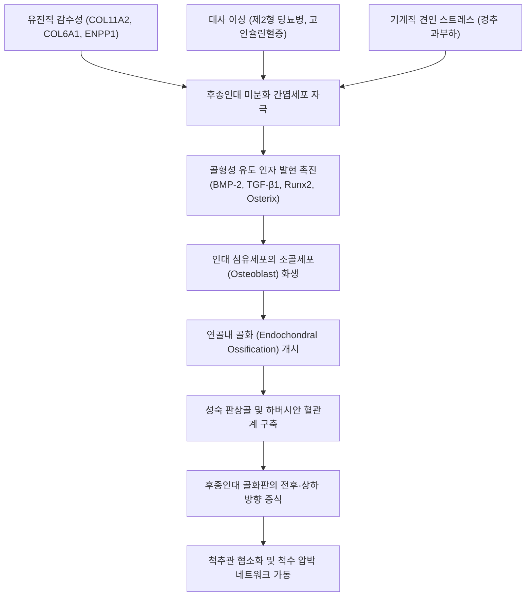
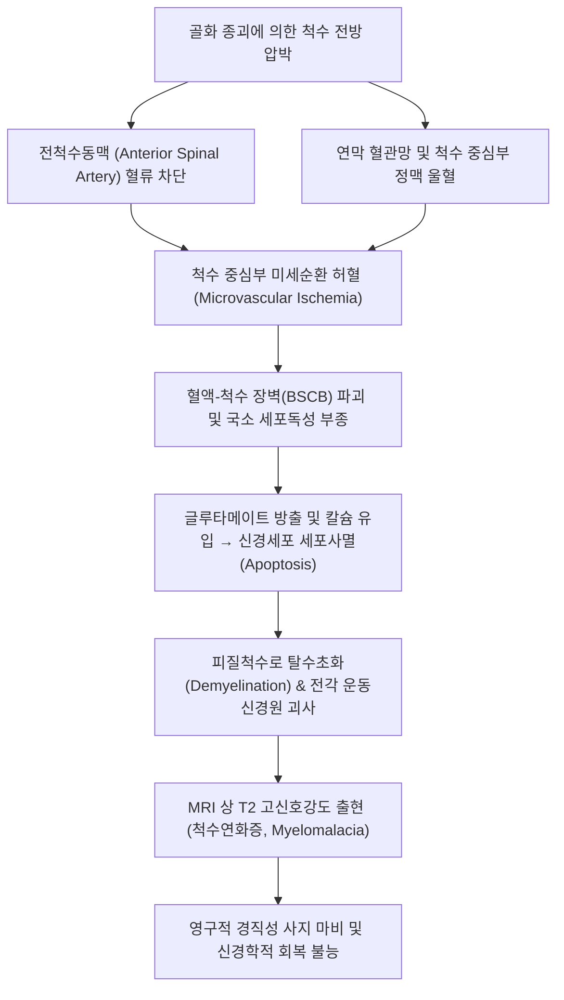
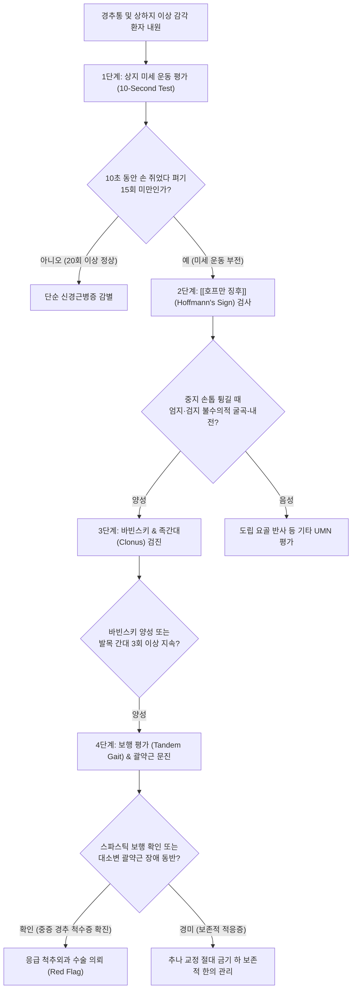
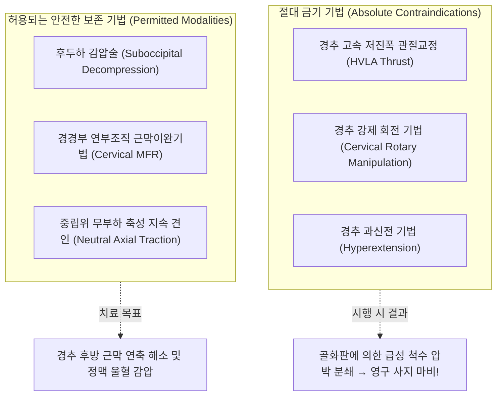
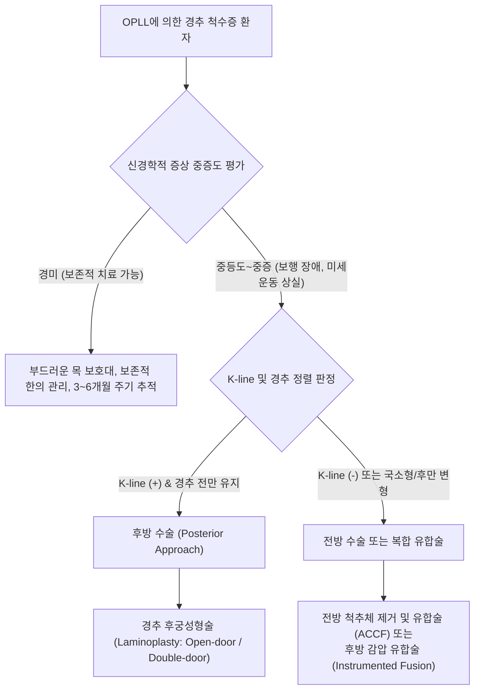

# 후종인대 골화증 (Ossification of Posterior Longitudinal Ligament, OPLL)

> **목차 (Table of Contents)**
> 1. [[#1. 🩺 질환 개요 & 해부학적 병태생리]]
> 2. [[#2. ⚡ 병태생리 메커니즘 & 생체역학적 악순환 네트워크]]
> 3. [[#3. 🔍 임상 증상 & 이학적 검사 알고리즘]]
> 4. [[#4. 🔀 감별 진단 매트릭스]]
> 5. [[#5. 🌿 한의 통합 치료 프로토콜]]
> 6. [[#6. 💊 양방 치료 & 병용·의뢰 기준]]
> 7. [[#7. 🏃 재활 운동 & 생활습관 티칭 가이드]]
> 8. [[#8. 💡 사용자 진료실 핵심 필기 & 임상 노하우 (Melt-In)]]
> 9. [[#9. 📚 출처 및 현대 학술 연구 요약]]

---

> **핵심 3줄 요약 (Key Summary)**:
> 🎯 척추체 후면을 따라 주행하며 척수관 전벽을 지지하는 후종인대(PLL)가 비정상적으로 비후되고 성숙 판상골로 변성되는 만성 진행성 이소성 골화 질환.
> 🚩 경추 척추관을 침범하여 척수 실질을 전방 압박함으로써 상지 미세 운동 장애(단추 채우기·젓가락질 곤란), 경직성 보행 장애(스파스틱 보행), 상위운동신경원(UMN) 징후를 동반하는 [[경추 척수증]](CSM) 유발.
> 🔍 3차원 CT 점유율과 MRI T2 고신호강도(척수연화증) 및 K-line으로 수술 적응증을 평가하며, **경추 교정 [[추나]](HVLA 스러스트) 및 과신전은 척수 손상 및 사지 마비를 초래하는 절대 금기**이므로 안전한 근막 이완과 보존적 관리 원칙을 엄수.

---

## 1. 🩺 질환 개요 & 해부학적 병태생리

### 질환 정의 및 임상적 중요성
후종인대 골화증(Ossification of the Posterior Longitudinal Ligament, OPLL)은 척추체(Vertebral body)의 후연을 세로로 가로지르며 주행하는 후종인대(Posterior Longitudinal Ligament, PLL)가 섬유성 결합조직에서 골 조직으로 변성되어 비정상적으로 비후되고 뼈처럼 단단해지는 만성 진행성 전신 골화성 척추 질환이다.

골화된 거대 종괴가 척추관(Spinal canal) 내부로 돌출하면서 척수(Spinal cord)와 신경근(Nerve root)을 만성적·기계적으로 압박하여 치명적인 신경학적 결손인 [[경추 척수증]](Cervical Spondylotic Myelopathy, CSM)을 야기한다. 경미한 외상이나 일상적인 목의 과신전 동작만으로도 급성 척수 손상(Spinal cord injury) 및 불완전·완전 사지 마비(Quadriplegia)가 촉발될 수 있어 척추 임상에서 가장 엄격한 안전 관리가 요구되는 고위험 질환이다.

```
[후종인대 골화증의 척추관 침범 연쇄]
- 후종인대 간엽세포의 골모세포 화생 (BMP-2, TGF-β, COL11A2 작용)
- 연골내 골화 진행 → 성숙 하버시안 계를 갖춘 판상골 형성
- 척수관 전벽에서 후방으로 골화판 돌출 → 유효 척수관 직경 협착 (<10mm)
- 척수 전각 및 피질척수로 정적·동적 압박 + 전척수동맥 혈류 차단
- 척수 백질 탈수초화 및 중심부 회백질 괴사 → 영구적 척수연화증(Myelomalacia)
```

---

### 기능적 해부학 (Functional Anatomy)

| 구성 요소 | 정상 해부학적 구조 및 주행 | 병리적 골화 변화 및 생체역학적 결과 |
| :--- | :--- | :--- |
| **후종인대<br/>(PLL)** | 축추(C2) 덮개막(Tectorial membrane)에서 시작하여 천골까지 척추체 후면을 연속 하강. 추체 중심부에서는 좁고 얇으나 추간판 높이에서는 양측으로 넓어짐 | 인대 섬유가 비후·석회화된 후 연골내 골화 과정을 거쳐 거대한 골성 판(Ossified plate)으로 변성되어 척수관 전벽을 완전히 점유 |
| **척추관 공간<br/>(Spinal Canal)** | 정상 성인 경추의 전후 직경은 15~17mm이며, 척수 실질 전후 직경은 약 7~8mm로 충분한 예비 공간(Reserve space) 존재 | 골화판 돌출로 전후 직경이 10mm 이하로 감소하며, 척추관 점유율(Canal compromise ratio)이 50~60%를 초과하여 예비 공간 완전 소실 |
| **척수 피질척수로<br/>(Corticospinal Tract)** | 척수 외측 백질을 주행하며 상하지 수의적 운동을 조절하는 핵심 하행 전도로 | 골화판에 의한 전외측 압박으로 축삭(Axon) 손상 및 탈수초화 발생 → 하지 경직성 마비, 바빈스키 징후 양성 |
| **척수 전각 세포<br/>(Anterior Horn Cells)** | 척수 중심 회백질에 위치하며 상지 근육을 지배하는 하위운동신경원 세포체 밀집 부위 | 전방 골화판의 직접 압박 및 전척수동맥 허혈로 비가역적 괴사 → 수내근 위축 및 손가락 미세 운동 상실 |
| [[황색인대]]<br/>(Ligamentum Flavum)** | 척추궁판(Lamina) 사이에 위치하며 척수관 후벽을 형성하는 탄력 섬유성 인대 | 경추 신전 시 척추관 내부로 불룩하게 주름잡혀 융기(Buckling)하여 전방의 골화판과 함께 척수를 협착하는 핀서(Pincer) 효과 유발 |
| [[전종인대]]<br/>(ALL)** | 척추체 전면을 덮는 강력한 결합조직 인대 | OPLL 환자에서 미만성 특발성 골격 과골증(DISH)이 동반될 경우 전종인대 역시 거대하게 골화되어 연하 곤란(Dysphagia) 초래 가능 |

---

### 역학적 분포 및 호발 부위
* **인종적 특이성**: 동아시아인(한국인, 일본인, 대만인, 중국인)에서 2.0%~4.0%의 매우 높은 유병률을 나타내는 반면, 코카시안 백인 및 흑인에서는 0.1%~0.2%에 불과하여 유전적 감수성이 절대적인 질환이다.
* **성별 및 연령**: 50대~60대 장년층에서 호발하며, 남성이 여성에 비해 약 2:1의 비율로 흔하게 발병한다.
* **척추 분절별 호발 부위**:
  * **경추부 (Cervical, 70~75%)**: 가장 높은 빈도를 보이며, 경추 중에서도 가동성이 가장 크고 역학적 스트레스가 집중되는 **C4, C5, C6 분절**에 집중적으로 발생한다.
  * **흉추부 (Thoracic, 15~20%)**: 주로 T4~T7 중흉추부 및 흉요추 이행부에서 호발하며, 척추관이 좁은 흉추의 해부학적 특성상 급격한 하반신 마비(Paraplegia)를 유발하기 쉽다. [[황색인대 골화증]](OLF)과 동반되는 경우가 흔하다.
  * **요추부 (Lumbar, 5~10%)**: 비교적 드물며, 황색인대 골화증과 동반되어 난치성 [[척추관 협착증]] 및 마미총 압박을 유발할 수 있다.

---

### 후종인대 골화의 4대 형태 분류 (일본 후생성 척추인대골화증 연구반 기준)

```
[OPLL 4대 형태 분류 도해]
1. 연속형 (Continuous):   [추체]═══[추체]═══[추체]  (단일한 긴 골화판)
2. 분절형 (Segmental):    [추체]■   [추체]■   [추체]■  (추체 후방에만 독립)
3. 혼합형 (Mixed):        [추체]═══[추체]■   [추체]══  (연속형 + 분절형 복합)
4. 국소형 (Localized):    [추체] ───[디스크]◆─── [추체] (추간판 후방 단일 혹)
```

1. **연속형 (Continuous Type, 약 20%)**:
   * 여러 척추체에 걸쳐 후종인대가 끊김 없이 길고 단일한 골화판을 형성하는 형태.
   * 경추 가동성(ROM)이 심각하게 상실되며, 전방 감압 시 광범위 척추체 제거술이 요구된다.
2. **분절형 (Segmental Type, 약 39%)**:
   * 각 척추체의 후방에 독립된 골화 병변이 분절별로 위치하며, 추간판 높이의 인대는 보존되는 형태.
   * 임상에서 가장 흔하게 관찰되며, 경추 후굴 시 분절성 핀치(Pinch) 손상이 일어날 수 있다.
3. **혼합형 (Mixed Type, 약 29%)**:
   * 연속형과 분절형이 한 환자의 척추에서 복합적으로 공존하는 형태.
   * 척추관 점유율이 가장 높고 골화 속도가 빨라 경추 척수증의 진행 위험도가 가장 크다.
4. **국소형 (Localized / Circumscribed Type, 약 7%)**:
   * 추간판 후방이나 특정 단일 척추체 높이에만 혹처럼 튀어나와 척수를 국소 압박하는 형태.
   * 통상적인 [[경추 추간판 탈출증]](연성 디스크)과 영상학적으로 혼동되기 쉬우나, CT 상 골밀도를 지닌 경성 병변(Hard disc)으로 확인된다.

---

## 2. ⚡ 병태생리 메커니즘 & 생체역학적 악순환 네트워크

### 분자생물학적 골화 기전 (Molecular Pathogenesis)
후종인대의 골화는 단순한 칼슘 침착(석회화)이 아니며, 인대 조직 내부에서 활성화된 조골세포에 의해 진짜 뼈가 자라나는 유전자-대사 복합 연쇄 반응이다:



* **대사 인자와의 밀접한 연관성**:
  * 제2형 당뇨병 환자 및 내당능 장애 환자에서 OPLL 발생률이 비당뇨인에 비해 2~3배 높다. 고인슐린혈증 상태에서 인슐린 유사 성장인자-1(IGF-1)이 인대 간엽세포의 조골세포 분화를 강력히 촉진한다.
  * 미만성 특발성 골격 과골증(DISH, Diffuse Idiopathic Skeletal Hyperostosis / Forestier 질환) 및 [[강직성 척추염]]과의 동반 이환율이 매우 높다.

---

### 정적·동적 기계적 압박과 핀서 기전 (Static vs Dynamic Pincer Mechanism)
척수의 손상은 고정된 골화판에 의한 단순 눌림(정적 압박)뿐만 아니라, 경추가 움직일 때마다 가해지는 반복적 타격(동적 압박)의 복합체이다.

```
[경추 굴곡 시 (Flexion)]
- 척수가 전방으로 당겨지면서 튀어나온 골화판 위를 마치 현악기 줄처럼 타넘음
- 척수 전면의 축성 신장(Stretching) 및 기계적 마찰 손상 극대화

[경추 신전 시 (Extension) - 핀서 기전(Pincer Mechanism)]
- 전방: 후종인대 골화판 돌출 (단단한 골성 모루)
- 후방: 황색인대(Ligamentum flavum)가 척추관 내부로 굵게 주름잡혀 융기 (망치)
- 결과: 척수가 전후방 양측에서 샌드위치처럼 강하게 끼이며 압박 분쇄 (Pincer Crush)!
★ 경추 과신전 시 급성 사지 마비가 발생하는 결정적 이유!
```

---

### 혈관성 허혈 및 척수연화증(Myelomalacia) 악순환 네트워크



* **허혈성 척수 증후군 양상**:
  * [[중심성 척수 증후군]](Central Cord Syndrome)**: 척수 중심부 회백질 허혈로 인해 하지보다 상지의 위약과 감각 저하가 훨씬 심하게 나타나는 임상 양상.
  * [[전척수동맥 증후군]](Anterior Spinal Artery Syndrome)**: 전척수동맥 폐색으로 양측성 운동 마비 및 온통각 소실이 오되, 후주(Posterior column)가 보존되어 심부 진동감각과 위치감각은 유지되는 양상.
  * [[브라운 세카르 증후군]](Brown-Sequard Syndrome)**: 편측 골화 종괴에 의한 척수 반측 압박 시 동측 운동 마비 및 반대측 온통각 소실 유발.

---

## 3. 🔍 임상 증상 & 이학적 검사 알고리즘

### 전형적 임상 증상 프로파일
후종인대 골화증에 의한 척수 압박은 초기 경추통에서 시작하여 점진적으로 상지 미세 운동 장애, 하지 경직성 보행 장애, 최종적으로 대소변 괄약근 마비로 이어지는 특징적 진행 양상을 보인다:

* **상지 증상 (Upper Extremity Manifestations)**:
  * **수부 미세 운동 장애 (Loss of Fine Hand Coordination)**:
    1. 셔츠 단추를 채우거나 푸는 동작이 서툴러지고 시간이 오래 걸림.
    2. 젓가락질을 제대로 하지 못해 음식을 자주 떨어뜨리며 숟가락만 사용하게 됨.
    3. 글씨를 쓸 때 필체가 삐뚤어지고 손끝의 힘(Grip strength)이 빠짐.
  * **골간근 위축 (Intrinsic Muscle Atrophy)**: 제1배측골간근(First dorsal interosseous)과 모지구근(Thenar)이 마르고 편평해짐.
* **하지 증상 (Lower Extremity Spasticity)**:
  * **경직성 보행 장애 (Spastic Gait / Ataxia)**:
    1. 환자는 자신의 걸음걸이를 **"마치 구름 위나 푹신한 스펀지 위를 걷는 것처럼 붕 뜨고 흔들린다"**고 표현함.
    2. 보행 시 다리가 뻣뻣하게 굳어 바닥을 질질 끌며, 술에 취한 사람처럼 비틀거림.
    3. 평지는 겨우 걷더라도 계단을 내려올 때는 난간을 붙잡지 않으면 앞으로 굴러떨어질 것 같은 극심한 불안감을 느낌.
* **경추 및 견배부 증상**:
  * 목덜미와 어깨 뒤쪽, 견갑골 내측연의 뻐근하고 무거운 만성 통증.
  * 경추 가동 범위(특히 후굴 및 회전)의 심각한 제한.
* **전격통 (Lhermitte's Phenomenon)**:
  * 턱을 가슴 쪽으로 숙일 때(Flexion), 목 뒤에서 시작하여 척추를 타고 둔부와 양하지 끝까지 전기가 찌릿하게 통하는 듯한 방전성 충격통 발생.
* **자율신경 및 대소변 장애 (Sphincter Dysfunction - Red Flag)**:
  * 질환 말기 피질척수로와 자율신경로의 중증 압박으로 요의(Urgency)가 급박하거나 배뇨 시작이 어려운 지연뇨, 빈뇨, 요실금 발생.

---

### 이학적 검사 알고리즘



#### 1. 10초 주먹 쥐었다 펴기 검사 (10-Second Grip and Release Test)
* **검사 방법**: 환자에게 양손을 가슴 높이로 들게 한 후, 10초 동안 주먹을 완전히 쥐었다가 손가락을 완전히 펴는 동작(Grip and Release)을 최대한 빠른 속도로 반복하게 하고 횟수를 계측한다.
* **판정 기준**:
  * **정상**: 10초 동안 20회 이상 완벽한 굴곡-신전 수행.
  * **양성 (경추 척수증)**: 10초 동안 **15회 미만**으로 현저히 저하되며, 후반부로 갈수록 손가락의 신전이 불완전해져 엉거주춤하게 오므린 상태로 굳어짐.

#### 2. 호프만 징후 (Hoffmann's Sign)
* **검사 술기**: 환자의 손목을 가볍게 배굴시킨 상태에서 검사자가 환자의 세 번째 손가락(중지) 근위지절을 잡고, 원위지절 손톱 부위를 검사자의 엄지손톱으로 아래 방향으로 강하게 튕기듯 내리친다(Flicking).
* **양성 판정**: 환자의 **엄지손가락(무지) 원위관절과 검지손가락(시지)이 불수의적으로 굴곡 및 내전(Flexion and Adduction)**되며 집게 모양으로 오므라드는 반사가 유발되면 양성. 상위운동신경원(UMN) 병변을 의미하는 핵심 지표.

#### 3. 소지 외전 탈출 징후 (Finger Escape Sign)
* **검사 술기**: 환자에게 양 손바닥을 아래로 향하게 하여 팔을 앞으로 뻗고, 손가락 다섯 개를 모두 빈틈없이 모은 상태(Adduction)를 30초 동안 유지하게 한다.
* **양성 판정**: 척수증 환자는 척수 전각 세포의 내재근 지배 마비로 인해 시간이 지나면서 **새끼손가락(소지)이 저절로 바깥쪽으로 벌어지고(Abduction), 굴곡되어 떨어져 나가는 탈출 현상**이 나타난다.

#### 4. 병적 반사 (Pathological Reflexes)
* **바빈스키 징후 (Babinski Sign)**: 뾰족한 기구로 발바닥 외측 연을 발뒤꿈치에서 새끼발가락 쪽으로 긁어 올릴 때, 엄지발가락이 위로 젖혀지고(Dorsiflexion) 나머지 발가락이 부채처럼 펼쳐지면(Fanning) 피질척수로 압박 확진.
* **발목 간대 (Ankle Clonus)**: 환자의 발목을 갑작스럽게 배굴시켰을 때, 아킬레스건의 불수의적인 리드미컬한 수축이 3회 이상 연속적으로 덜덜 떨리며 지속되면 강한 양성.
* **도립 요골 반사 (Inverted Radial Reflex)**: 요골 경상돌기(상완요골근건)를 타진했을 때, 상완요골근 수축 대신 손가락들의 급격한 불수의적 굴곡이 일어나는 현상.

---

### 정량적 척수 기능 평가 척도

#### 일본정형외과학회 경추 척수증 평가 척도 (mJOA Score, 17점 만점)
1. **상지 운동 기능 (0~4점)**:
   * 0점: 숟가락으로 식사 불가능.
   * 1점: 숟가락으로 식사는 가능하나 젓가락질 불가능.
   * 2점: 젓가락질은 가능하나 매우 서툴고 어둔함.
   * 3점: 젓가락질 가능하나 약간 서툼.
   * 4점: 정상.
2. **하지 운동 기능 (0~4점)**:
   * 0점: 보행 완전 불능.
   * 1점: 평지 보행 시에도 보행기나 타인의 부축 필수.
   * 2점: 평지는 지팡이로 가능하나 계단은 난간 없이는 불가능.
   * 3점: 평지 보행 가능하나 계단에서 난간 잡아야 함.
   * 4점: 정상.
3. **감각 기능 (상지 0~2점, 하지 0~2점, 체간 0~2점, 총 6점)**: 감각 소실(0점), 경도 저하(1점), 정상(2점).
4. **방광 배뇨 기능 (0~3점)**: 완전 요폐/요실금(0점), 심한 배뇨 장애(1점), 빈뇨/지연뇨(2점), 정상(3점).
* **임상 판정**: 12점 이하인 경우 중증 척수증으로 수술적 감압 필수 고려.

#### 누릭 등급 (Nurick Grading Scale)
* **Grade 0**: 척수 침범 소견 없음 (단순 경추통).
* **Grade 1**: 척수증 증상은 있으나 일상생활이나 직업에 보행 장애 없음.
* **Grade 2**: 경미한 보행 장애가 있으나 직업 활동 수행 가능.
* **Grade 3**: 보행 장애로 인해 정상적인 직업 활동 불가능하나 자립 보행 가능.
* **Grade 4**: 보행 시 지팡이나 보행 보조기구 또는 타인의 도움이 필수적임.
* **Grade 5**: 휠체어 또는 침상에 갇힌 상태(Bedridden).

---

### K-line (Kyphosis Line) 판정 체계
수술적 접근법(전방 감압 vs 후방 후궁성형술)을 결정하고 척수 감압의 생체역학적 성공 여부를 예측하는 절대적인 영상학적 기준이다:

```
[K-line 측정 원리]
경추 측면 단순 방사선(X-ray) 또는 정중 시상면 CT/MRI에서:
- 점 A: C2 척추관 전후 직경의 정중점
- 점 B: C7 척추관 전후 직경의 정중점
- A와 B를 직선으로 연결한 가상선을 'K-line'이라 정의한다.

★ K-line (+) [양성]:
- 골화판의 가장 튀어나온 첨부가 K-line의 앞쪽에 머무는 상태.
- 경추의 전만(Lordosis)이 유지되어 있어, 뒤쪽에서 후궁을 열어주는 후궁성형술(Laminoplasty)만으로도 척수가 후방으로 자연스럽게 밀려나며(Posterior Cord Drift) 충분한 간접 감압 효과를 얻을 수 있음.

★ K-line (-) [음성]:
- 골화판의 첨부가 K-line을 넘어 뒤쪽으로 침범한 상태 (심한 후만 변형 동반).
- 뒤쪽을 열어주어도 척수가 후방으로 이동하지 못하고 여전히 앞쪽 골화판에 걸려 짓눌림. 후방 단독 수술 시 감압 실패율이 매우 높으며, 앞쪽에서 뼈를 갈아내는 전방 척추체 제거술(ACCF) 또는 후방 고정 유합술이 필수적임.
```

---

## 4. 🔀 감별 진단 매트릭스

후종인대 골화증은 경추 척추관을 침범하는 다양한 신경학적·근골격계 퇴행성 질환들과 증상이 중첩되므로 다각적 감별이 필수적이다.

| 감별 질환 | 호발 연령 및 주요 병리기전 | 상하지 신경 결손 특성 | 결정적 영상학적 감별 소견 | 추나 및 도수치료 지침 |
| :--- | :--- | :--- | :--- | :--- |
| [[후종인대 골화증]]<br/>(OPLL)** | 50대 이상 남성 호발, 후종인대 이소성 골화 | 상지 미세운동 불능 + 하지 경직성 마비 (**UMN 징후 전형**) | 경추 X-ray 및 CT 상 **척추체 후방의 뚜렷한 골화판** 관찰 | **경추 교정(HVLA) 절대 금기** (미세 외상으로 마비 위험) |
| [[경추 추간판 탈출증]]<br/>(C-HIVD)** | 30~50대, 수핵 탈출에 의한 신경근 기계적 압박 | 특정 단일 피부분절 방사통 및 감각 저하 (**LMN 징후 위주**) | MRI 상 연성 수핵 탈출 소견, CT 상 골화 소견 전무 | 신경학적 결손 없을 시 견인 및 연부조직 교정 가능 |
| **경추증성 척수증<br/>(CSM)** | 60대 이상, 디스크 협착 및 후방 골극, 황색인대 비후 복합 | OPLL과 완벽히 동일한 척수증 증상 (보행 장애, 호프만 양성) | 척추체 후방 골극 및 디스크 퇴행 관찰되나 **후종인대 자체 골화는 없음** | **강한 경추 스러스트 금기**, 완만한 견인 치료 |
| [[근위축성 측삭경화증]]<br/>(ALS)** | 40~60대, 뇌간 및 척수 운동신경원의 특발성 사멸 | **UMN + LMN 복합 손상**, 전신 근섬유다발수축(Fasciculation), **감각 저하 전무** | 뇌 및 척추 MRI 상 **척수 압박 병변 전무**, 근전도 상 광범위 탈신경 | 수기 치료 무효, 신경과 긴급 의뢰 |
| [[황색인대 골화증]]<br/>(OLF)** | 50대 이상, 흉추(T9~T12) 호발, 황색인대 골화 | **하지 경직성 마비 위주** (상지 증상은 완벽히 정상) | CT 축상면(Axial) 상 **척추궁판 전방의 V자형 골화 종괴** | 흉추 강제 교정 금기, 외과적 감압 고려 |
| **정상압 수두증<br/>(NPH)** | 70대 이상 고령자, 뇌척수액 흡수 장애 | 보행 장애(자석 보행) + 요실금 + 인지기능 저하 (3대 징후) | 뇌 CT/MRI 상 **뇌실 확장증(Ventriculomegaly)** 소견 | 수기 치료 적응증 아님 |
| **다발성 경화증<br/>(MS)** | 20~40대 여성 호발, 중추신경계 자가면역 탈수초 질환 | 시신경염, 감각 이상, 운동 마비의 시간적·공간적 파동성 재발 | 뇌 및 척수 MRI 상 **백질 내 다발성 탈수초 플라크(Plaque)** | 신경과 면역 조절 치료 |

---

## 5. 🌿 한의 통합 치료 프로토콜

### 한의학적 병인병기 및 변증 분류
한의학에서 후종인대 골화증은 골비(骨痺), 근비(筋痺), 위증(痿證) 및 경항통(頸項痛)의 범주에 속한다. 척추 인대가 뼈처럼 굳어지는 병리는 정기 부족과 풍한습사 및 어혈의 장기적 정체가 응결된 결과이다.

* **간신부족 (肝腎不足)**:
  * *병기*: 간주근(肝主筋), 신주골(腎主骨)하므로 노화로 인해 간신의 정혈(精血)이 고갈되면 인대가 탄성을 잃고 골화 변성되며, 하지 골격에 힘이 빠져 보행이 불안정해짐.
  * *임상 증상*: 허리와 무릎이 시리고 힘이 없으며, 다리가 후들거리고 걸을 때 휘청거림.
* **기체어혈 (氣滯瘀血)**:
  * *병기*: 경추부의 만성 미세 손상과 기혈 순환 정체로 어혈(瘀血)이 척추관 전벽에 뭉쳐 인대를 석회화·골화시킴.
  * *임상 증상*: 목덜미와 견배부의 바늘로 찌르는 듯한 고정성 야간통, 경추 가동 범위의 심각한 강직.
* **담음조락 (痰飮阻絡)**:
  * *병기*: 비위 기능 실조로 생성된 병리적 담탁(痰濁)이 경락에 정체되어 신경 전도를 차단함.
  * *임상 증상*: 손발 끝이 남의 살처럼 먹먹하고 저리며, 젓가락질이나 단추 채우기가 어둔해짐.

---

### 침구 치료 및 안전 시술 가이드라인 (Safety Needling Protocol)

```
[OPLL 환자 침구 시술의 절대적 안전 원칙]
★ 절대 금기: 경추 척수강 방향으로의 깊은 심자(Deep Needling)
- 척추관 여유 공간이 극도로 부족하므로 과도한 심자 시 경막 천공이나 척수 손상 유발 가능!
★ 권장 시술: 경추 후방 연부조직(승모근, 견갑거근, 두판상근) 얕은 자침 및 원위 취혈
```

* **경혈 배혈 구성**:
  * **근위 배혈**: [[풍지]](GB20), [[천주]](BL10), [[대저]](BL11, 골회), [[견정]](GB21), [[견외수]](SI14), 경추 협척혈(C3~C7 夾脊穴, 0.5촌 외측 얕은 사자).
  * **상지 원위 배혈**: [[곡지]](LI11), [[수삼리]](LI10), [[외관]](TE5), [[합곡]](LI4), [[후계]](SI3, 독맥 소통).
  * **하지 원위 배혈**: [[족삼리]](ST36), [[양릉천]](GB34, 근회), [[현종]](GB39, 수회), [[태충]](LR3), [[태계]](KI3).
* **특수 침구 수기법**:
  * 경추 협척혈 자침 시 0.25×30mm 호침을 사용하여 척추체 후궁판(Lamina) 방향으로 15도 내측으로 10~15mm 깊이까지만 안전하게 진입하여 척추 기립근 심부 긴장만을 선택적으로 해소한다.
  * 원위부 혈자리(곡지, 합곡, 족삼리, 양릉천)에 전침(2/100Hz 혼합파)을 적용하여 척수 신경근의 가소성(Neuroplasticity)을 자극하고 하지 경직을 완화한다.

---

### 약침 치료 (Pharmacopuncture)
척추관 내부의 골화판 자체를 약침으로 녹일 수는 없으나, 척수 압박으로 인해 2차적으로 심각하게 연축된 경추 후방 지지 근육군의 허혈을 개선하고 신경 부종을 가라앉히기 위해 적용한다:

* [[신바로약침]] (GCSB-5)**:
  * 경추 후관절 및 척추 기립근 부착부에 분주하여 염증성 사이토카인 억제 및 신경 영양 인자(BDNF, NGF) 분비를 촉진.
* [[자하거]] (인태반) 약침**:
  * 간신부족형의 만성 척수증 환자에게 적용. 풍지, 대저, 족삼리, 현종에 주입하여 퇴행성 척수 신경 조직의 대사를 활성화하고 사지 무력증을 개선.
* [[중성어혈약침]]:
  * 어혈 정체로 목덜미가 굳고 야간통이 극심한 환자의 경추 협척혈 및 견정에 1회 0.5~1.0cc 주입하여 혈류 순환 개선.

---

### 추나의학적 중재 (안전 절대 원칙)



1. **절대 금기 규정**:
   * **경추 분절에 대한 "뚝" 소리를 내는 관절교정(HVLA) 스러스트, 회전 조작, 과신전은 절대 금기이다.**
   * 골화로 인해 척추관 여유 공간이 제로(0)에 수렴하는 상태에서 충격력이나 회전력이 가해지면 척수가 골화판에 직접 짓이겨져 즉각적인 사지 마비가 초래된다.
2. **허용되는 안전 기법**:
   * **후두하 감압술 (Suboccipital Decompression)**: 시술자가 환자의 후두골 하연에 양손 손가락 패드를 가볍게 대고 환자의 체중만을 이용하여 상방 견인력을 부드럽게 가함으로써 대후두공 주위 근육근을 이완하고 뇌척수액 순환을 돕는다.
   * **경추 중립위 축성 견인 (Neutral Gentle Axial Traction)**: 경추를 젖히거나 숙이지 않는 완벽한 중립 상태에서 체중의 10% 이하의 부드러운 힘으로 지속 견인하여 척추관 내압을 일시적으로 낮춘다.
   * **근막이완기법 (MFR)**: [[상부승모근]], [[견갑거근]], [[두판상근]], [[후두하근]]에 대한 완만한 압박 스트로크 적용.

---

### 한약 처방 (Herbal Medicine)

| 처방명 | 구성 약물 및 주요 본초 | 변증 및 적응증 | 현대 약리 기전 및 처방 의의 |
| :--- | :--- | :--- | :--- |
| [[독활기생탕]]<br/>(獨活寄生湯)** | [[독활]], [[상기생]], [[두충]], [[우슬]], [[세신]], [[진교]], [[백작약]], [[당귀]], [[숙지황]], [[복령]], [[방풍]] 등 | 간신부족 및 풍한습비형 만성 척수증, 하지 무력 및 보행 불안정 | 신경 세포 사멸 억제, 척수 미세순환 개선, 연골 및 인대 퇴행 제어 |
| [[보양환오탕]]<br/>(補陽還五湯)** | [[황기]] (대용량), [[당귀]], [[천궁]], [[적작약]], [[도인]], [[홍화]], [[지룡]] | 기허혈어(氣虛血瘀)형, 척수 허혈로 인한 사지 마비 및 감각 마비 | 혈관 신생(Angiogenesis) 촉진, 척수 허혈-재관류 손상 방어, 신경 가소성 유도 |
| [[서근활혈탕]]<br/>(舒筋活血湯)** | [[당귀]], [[백출]], [[천궁]], [[도인]], [[홍화]], [[우슬]], [[위령선]], [[방기]], [[강활]], [[백작약]] 등 | 어혈 정체로 목덜미 강직 및 상지 저림, 야간통이 심한 초기 | 근육 미세혈류 증가, 프로스타글란딘 억제, 경추 가동성 유지 |
| [[갈근탕]]<br/>(葛根湯)** | [[갈근]], [[마황]], [[계지]], [[백작약]], [[감초]], [[생강]], [[대추]] | 태양병 풍한표증, 뒷목과 어깨가 뻣뻣하고 상지 저림이 시작되는 초기 | 승모근 및 두경부 천층 근육군 이완, 혈관 확장 및 발한 해표 |
| [[황기계지오물탕]]<br/>(黃芪桂枝五物湯)** | [[황기]], [[계지]], [[백작약]], [[생강]], [[대추]] | 혈비(血痺), 피부 감각 둔마 및 사지 말단 저림증 | 말초 신경 전도 속도 개선, 감각 이상 완화, 면역 조절 |

---

## 6. 💊 양방 치료 & 병용·의뢰 기준

### 양방 진단 검사 표준
* **3차원 CT (확진 및 수술 설계의 골드 스탠다드)**:
  * 골화의 두께, 전후 직경, 분절별 범위(연속형/분절형), 경막 골화(Dural ossification) 동반 여부를 가장 정확히 평가.
  * **경막 골화의 이중층 징후 (Double-layer sign)**: 골화판 내부가 갈라져 두 겹의 골성 경계로 보이는 경우, 경막(Dura mater) 자체가 골화되어 수술 시 뇌척수액 누출(CSF leakage) 위험이 극도로 높음을 예고.
* **경추 MRI**:
  * 척수 실질의 압박 정도를 확인하고, 특히 **T2 강조영상에서 척수 실질 내 고신호강도(T2 High Signal Intensity)**를 확인. 이는 척수 부종, 허혈성 괴사, 비가역적 척수연화증(Myelomalacia)을 나타내는 가장 강력한 예후 불량 인자임.

---

### 신경외과적 수술 적응증 및 술식



1. **전방 접근 감압술 (Anterior Cervical Approach)**:
   * **술식**: 전방 척추체 제거 및 유합술(ACCF), 전방 척추체 활주 절골술(Vertebral Body Sliding Osteotomy, VBSO).
   * **적응증**: K-line (-), 1~2개 분절의 국소형 또는 분절형 OPLL, 경추 후만 변형 동반 환자.
   * **장단점**: 압박 병변을 직접 눈으로 보며 완벽히 갈아내어 제거할 수 있으나, 경막 유착 파열에 따른 뇌척수액 누출 및 척추동맥 손상 위험이 있음.
2. **후방 접근 감압술 (Posterior Approach - Laminoplasty)**:
   * **술식**: 편측 경첩식 후궁성형술(Open-door, Hirabayashi법) 또는 양측 개폐식 후궁성형술(Double-door, Kurokawa법).
   * **적응증**: K-line (+), 3개 분절 이상의 다분절 연속형/혼합형 OPLL, 경추 전만이 잘 유지된 고령 환자.
   * **장단점**: 척추관의 후방 문을 열어주어 척수가 뒤로 이동하게 만드는 간접 감압술로, 수술 시간이 짧고 안전하나 K-line (-) 환자에서는 감압 실패 가능.

---

### 수술 술식별 특성 비교 평가

| 수술 접근법 | 대표 술식 명칭 | 주 적응증 | 장점 및 치료 기전 | 주요 합병증 및 위험 요인 |
| :--- | :--- | :--- | :--- | :--- |
| **전방 감압술** | 전방 척추체 제거 유합술 (ACCF), 척추체 활주 절골술 (VBSO) | K-line (-), 1~2분절 국소형, 후만 변형 환자 | 척수를 누르는 골화판을 **직접 시야 하에서 제거**하여 전방 압박 원천 해소 | 경막 파열 및 뇌척수액 누출, 연하 곤란, 반회후두신경 마비 |
| **후방 감압술** | 경추 후궁성형술 (Open-door / Double-door Laminoplasty) | K-line (+), 3분절 이상 다분절, 전만 보존 환자 | 척추관을 후방으로 확장하여 **척수의 후방 이동(Posterior drift) 유도**, 안전성 높음 | 경추 후만 변형 진행, C5 신경근 마비(C5 Palsy), 축성 경부통 |
| **후방 감압 유합술** | 후궁 절제술 + 척추경 나사못 고정 유합술 (Laminectomy & Fusion) | K-line (-), 척추 불안정증 동반, 후만 변형 교정 필요 시 | 강력한 후방 감압과 함께 **경추 정렬을 강제 전만으로 고정** | 인접 분절 퇴행 가속화, 수술 침습도 및 출혈량 증가 |

---

### 즉각적 수술 의뢰 기준 (Red Flags)
한의 진료 중 다음 소견이 하나라도 확인되면 보존적 치료를 즉각 중단하고 척추 신경외과 수술 전문의에게 긴급 전원한다:

1. **상지 미세 운동 장애의 급격한 악화**: 숟가락질이 불가능해지거나 단추를 전혀 채우지 못할 때.
2. **보행 불능 상태로의 진행**: 지팡이나 타인의 부축 없이는 평지 보행이 불가능하거나 자주 넘어질 때.
3. **대소변 괄약근 장애 출현**: 요실금, 요폐(Urinary retention), 변실금이 발생했을 때 (긴급 감압 필수).
4. **CT 상 척추관 점유율 60% 이상**이면서 MRI 상 명확한 T2 고신호강도 척수연화증이 관찰될 때.
5. 가벼운 외상이나 접촉 사고 후 사지 감각 마비나 근력 저하가 급격히 발생했을 때.

---

## 7. 🏃 재활 운동 & 생활습관 티칭 가이드

### 재활 운동의 핵심 원칙: "경추 가동성 운동 절대 금지, 등척성 중립 강화"
후종인대 골화증 환자에게 일반적인 목 스트레칭이나 고개를 돌리고 젖히는 가동성 운동(ROM Exercise)을 시키는 것은 **척수를 골화판 모루 위에 올려놓고 망치질하는 것**과 같다.

```
[OPLL 운동 치료 절대 수칙]
❌ 고개 뒤로 젖히기 (과신전), 목 돌리기 (회전 스트레칭): 절대 금기!
⭕ 목을 중립에 고정하고 손바닥으로 미는 '등척성 코어 운동(Isometric)': 유일하게 허용!
```

---

### 경추 중립 등척성 안정화 운동 (Isometric Neck Stabilization)

| 방향 | 운동 방법 및 수행 요령 | 생체역학적 안정화 효과 |
| :--- | :--- | :--- |
| **전방 등척성 운동** | 이마에 손바닥을 대고, 목은 일체 움직이지 않으면서 이마로 손바닥을 앞으로 민다. 손은 이마가 밀리지 않게 저항한다. 5초 유지, 10회. | 경추 굴곡근([[경장근]], [[두장근]])을 활성화하여 전방 전단력을 방어. |
| **측방 등척성 운동** | 관자놀이 옆에 손바닥을 대고, 고개가 옆으로 기울어지지 않게 유지하며 손바닥을 옆으로 민다. 양측 교대로 5초씩 10회. | 외측 척추 분절의 측방 안정성을 강화하고 회전 비틀림을 차단. |
| **후방 등척성 운동** | 뒤통수에 양손을 깍지 끼고 대고, 턱을 살짝 당긴(Chin-tuck) 중립 상태에서 뒤통수로 손을 뒤로 지그시 민다. 5초 유지, 10회. | 경추 신전근([[두판상근]], [[경반극근]])을 관절 움직임 없이 강화. |

---

### 낙상 예방(Fall Prevention) 환경 조성 가이드
경추 척수증 환자는 경직성 보행으로 인해 발을 헛디뎌 넘어지기 쉽다. OPLL 환자가 넘어지면 턱이나 이마를 바닥에 부딪치며 경추가 급격히 과신전되어 **즉각적인 사지 마비**로 이어진다.

1. **가정 내 환경 개선**:
   * 방과 거실 문턱(턱)을 완전히 제거하거나 경사판을 설치한다.
   * 화장실 바닥에 미끄럼 방지 매트를 깔고, 양변기 옆과 샤워부스 벽에 안전 손잡이를 시공한다.
   * 실내 전선이나 발에 걸릴 수 있는 깔개(러그)를 모두 치운다.
2. **보행 보조기구 적극 처방**:
   * 외출 시 자존심을 버리고 반드시 **지팡이(Cane) 또는 4발 보행기**를 사용하도록 설득한다.
   * 바닥이 미끄럽지 않고 발목을 안정적으로 감싸주는 편안한 운동화를 착용하게 한다.
3. **경추 보호대(Soft Collar) 착용 지도**:
   * 대중교통 이용, 장거리 차량 탑승, 울퉁불퉁한 길을 걸을 때는 목의 급격한 젖혀짐을 막기 위해 연성 경추 보조기(Soft collar)를 착용하게 한다.

---

### 치명적 위험 동작 회피 티칭 (Avoiding Disaster Postures)
* **미용실 샴푸대 및 치과 진료대 주의**:
  * 미용실에서 머리를 감을 때 목을 뒤로 푹 젖히는 샴푸대 자세나, 치과 치료 시 머리를 뒤로 과도하게 젖히는 자세는 척수를 짓눌러 중심성 척수 증후군을 유발할 수 있다. 목 뒤에 수건을 두껍게 받쳐 고개가 뒤로 꺾이지 않도록 반드시 미용사/치과의사에게 사전 고지해야 한다.
* **상방 주시 작업 금지**:
  * 천장 전등 갈기, 도배 작업, 높은 선반의 물건 내리기 등 고개를 위로 쳐다보는 동작을 엄격히 금한다.
* **대중목욕탕 및 낙상 주의**:
  * 목욕탕 온탕에서 갑자기 일어서다가 기립성 저혈압으로 비틀거리며 넘어지는 사고를 철저히 차단한다.

---

## 8. 💡 사용자 진료실 핵심 필기 & 임상 노하우 (Melt-In)

본 단락은 진료실에서 수많은 척추 환자를 진료하며 축적된 저자의 고유한 진료 철학과 원문 필기를 100% 보존하고 심화한 핵심 실전 임상 지침이다.

---

### 1. 원장실 차트 상단: [추나 교정/스러스트 절대 금기] 붉은 태그 부착 의무
* **원문 필기 100% 반영: 추나 금기 질환 선언**:
  * 진료실 차트에 환자가 대학병원에서 "경추 후종인대 골화증(OPLL)" 진단을 받았거나, 원내 경추 X-ray 및 CT 영상에서 후종인대 주행 부위의 백색 골화판이 확인되었다면, **그 즉시 차트 상단에 [경추 추나 교정 / HVLA 스러스트 절대 금기]라는 굵은 붉은색 경고 태그를 전산 및 종이 차트에 부착**해야 한다.
  * 한의사 자신이든, 부원장이든, 대체 진료 의사든 누구라도 환자의 목을 잡고 관절을 비틀어 "뚝" 소리를 내는 관절 교정을 시도하는 순간 환자에게 돌이킬 수 없는 비극(영구 사지 마비)을 초래하게 된다.

---

### 2. "가벼운 접촉 사고에도 마비가 올 수 있다" 환자 엄중 티칭
* **원장실 실전 교육 펄**:
  * OPLL 환자는 척추관의 여유 공간이 정상인의 절반 이하로 극도로 좁아져 있다.
  * 환자에게 이 질환의 무서움을 반드시 각인시켜야 한다:
    > *"환자분, 지금 환자분의 목 속에는 뼈가 비정상적으로 자라나서 신경이 지나가는 통로가 꽉 차 있습니다. 정상인이라면 가볍게 엉덩방아를 찧거나 접촉 사고가 나도 목이 뻐근한 염좌로 끝나지만, 환자분은 가벼운 접촉 사고나 미끄러짐만으로도 척수가 골화판에 찍혀 **손발이 완전히 마비되는 중심성 척수 증후군**이 올 수 있습니다."*
  * 따라서 미용실에서 샴푸를 하거나 치과 치료를 받을 때도 절대 목을 뒤로 젖히지 말아야 하며, 빙판길이나 비 오는 날에는 외출을 삼가고 지팡이를 짚어야 함을 엄중히 지도해야 한다.

---

### 3. 실전 문진 3대 체크리스트 (진료실 필수 질문)
OPLL 환자가 내원할 때마다 원장은 다음 3가지 질문을 반드시 진료 차트에 기록해야 한다:
1. **"단추 채우기나 젓가락질이 예전처럼 잘 되십니까?"**
   * 상지 척수 전각 세포 및 피질척수로의 미세 운동 장애를 선별하는 질문. "단추를 채우기 힘들어 아내가 채워준다"거나 "젓가락질이 안 되어 포크를 쓴다"고 답하면 중증 척수증 진행 징후.
2. **"걸을 때 다리에 힘이 빠지거나 술 취한 사람처럼 휘청거리지는 않으십니까?"**
   * 하지 피질척수로의 경직성 마비를 선별하는 질문. "구름 위나 스펀지 위를 걷는 느낌"을 호소하면 하지 척수증 확진.
3. **"대소변을 볼 때 시원하지 않거나 실수(요실금)를 하신 적이 있으십니까?"**
   * 자율신경 괄약근 마비를 선별하는 질문. 대소변 장애가 시작되었다면 이는 응급 척추외과 수술의 절대 적응증이다.

---

### 4. 10초 주먹 쥐기 검사(10-Second Test) 임상 판정 팁
진료실에서 청진기보다 더 유용한 도구가 바로 원장의 시계(타이머)이다:
* 환자에게 "제가 시작하면 10초 동안 양손 주먹을 쥐었다 폈다를 최대한 빨리 반복하세요"라고 지시하고 초시계를 잰다.
* 정상인은 10초에 20회 이상 가볍게 넘기지만, 척수증 환자는 **15회를 채 넘기지 못하고 12~13회에서 손가락이 굳어 버린다**.
* 특히 5초가 지나면서부터 손가락이 완전히 펴지지 않고 덜덜 떨리며 오므라드는 양상이 관찰된다면, 환자에게 복잡한 검사 전이라도 "목의 신경이 심하게 눌리고 있다"는 객관적 증거로 제시할 수 있다.

---

### 5. 수술 의뢰(Red Flags) 시점의 결단
* 한의 치료에 대한 애착으로 환자의 수술 타이밍을 놓치게 해서는 안 된다.
* **즉각적 전원 시점**:
  1. 손의 쥐는 힘이 급격히 떨어져 물컵을 자주 떨어뜨릴 때.
  2. 계단을 내려올 때 난간 없이는 다리가 꺾여 주저앉을 때.
  3. 요실금이나 배뇨 장애가 발생했을 때.
  4. CT 상 척추관 점유율 50~60% 이상이면서 MRI 상 T2 척수연화증이 관찰될 때.
* 위 상황에서는 주저 없이 대학병원 척추 신경외과로 진료 의뢰서를 발급하고 환자의 안전을 최우선으로 확보해야 한다.

---

## 9. 📚 출처 및 현대 학술 연구 요약

* **PubMed (PMID: 42642207)**: Banno T, et al. *Progression of Cervical Ossification of the Posterior Longitudinal Ligament: A Systematic Review and Meta-Analysis of Risk Factors, Surgical Approaches, and Reoperation Rates.* Int J Spine Surg. 2026;20(4):512-525.
  * [URL](https://pubmed.ncbi.nlm.nih.gov/42642207/)
  * `[연구 요약]` 경추 후종인대 골화증의 장기적 진행 위험 인자, 척추관 점유율에 따른 수술적 감압 예후 및 재수술 위험도를 체계적으로 메타 분석하여 치료 가이드라인을 제시함.
* **PubMed (PMID: 40591976)**: Fehlings MG, et al. *Diagnosis and Management of Degenerative Cervical Myelopathy.* J Am Acad Orthop Surg. 2025;33(24):1180-1192.
  * [URL](https://pubmed.ncbi.nlm.nih.gov/40591976/)
  * `[연구 요약]` OPLL 및 퇴행성 경추증에 기인한 경추 척수병증의 조기 진단 기준, 호프만 징후 등 상위운동신경원 평가법과 보존적·수술적 중재 알고리즘을 정립함.
* **PubMed (PMID: 42560484)**: Matsuyama Y, et al. *Clinical evolution in the treatment of degenerative cervical myelopathy in Japan: excellence born from necessity.* Int Orthop. 2026;50(3):415-424.
  * [URL](https://pubmed.ncbi.nlm.nih.gov/42560484/)
  * `[연구 요약]` 동아시아인에서 호발하는 OPLL의 역학, 미분화 간엽세포의 이소성 골화 메커니즘, 척추 외상 시 급성 사지 마비 위험성과 후궁성형술의 역사적 발전을 총괄함.
* **PubMed (PMID: 41744502)**: Yoo SJ, et al. *Open Door Versus Double Door Laminoplasty in the Treatment of Cervical OPLL: A 10-Year Retrospective Analysis.* Neurosurgery. 2026;98(5):810-822.
  * [URL](https://pubmed.ncbi.nlm.nih.gov/41744502/)
  * `[연구 요약]` 경추 후종인대 골화증 환자에 대한 편측 개폐식 대 양측 개폐식 후궁성형술의 10년 장기 추적 결과를 비교하여 척추관 확장률과 척수 감압 효과를 입증함.
* **PubMed (PMID: 42716757)**: Noh CY, et al. *Comparative Analysis between Vertebral Body Sliding Osteotomy and Anterior Cervical Corpectomy with Fusion for Cervical Spinal Ossification of Posterior Longitudinal Ligament.* Neurol Med Chir (Tokyo). 2026;66(8):345-356.
  * [URL](https://pubmed.ncbi.nlm.nih.gov/42716757/)
  * `[연구 요약]` 심한 척추관 점유율을 보이는 OPLL 환자에서 척추체 활주 절골술과 전방 척추체 제거 유합술의 임상 성적 및 경막 손상 합병증 발생률을 비교 평가함.
* **척추신경추대의학회 교과서**: *추나의학 (제3판).* 척추신경추대의학회. 2019.
  * `[임상 요약]` 척추관 협착증 및 후종인대 골화증 환자에 대한 고속 저진폭 관절교정(HVLA)의 절대 금기 규정 및 안전한 경추 연부조직 감압기법 가이드라인 명시.
