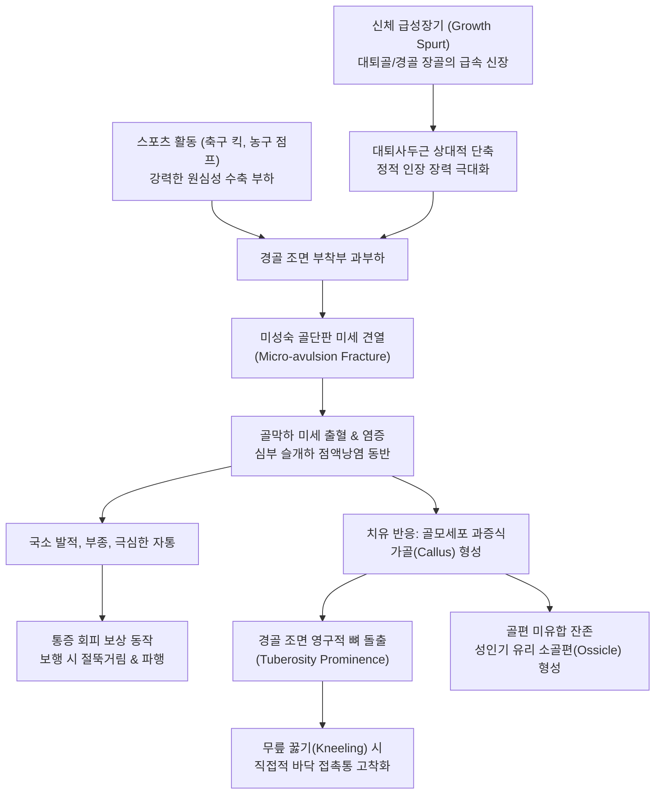

# 🫁 [[Osgood Schlatter 병]] (Osgood-Schlatter Disease / 경골 조면 골단염)

> **핵심 3줄 요약 (Key Summary)**:
> 🎯 **병태생리 본질**: 신체 급성장기(남아 12~15세, 여아 10~13세) 청소년에서 골격의 폭발적인 신장 속도와 연부조직([[대퇴사두근]]·[[대퇴직근]]·슬개건 복합체) 신장 적응 속도의 불일치로 인해, 미성숙한 경골 조면(Tibial tuberosity) 골단판(Apophysis) 부착부에 가해지는 반복적 견인 스트레스(Traction force)로 유발되는 견열 골단염(Traction apophysitis)이자 미세 견열 골절(Micro-avulsion fracture).
> 🚩 **임상 양상 및 경과**: 슬개골 하방 2~3cm 지점 경골 결절의 국소적 뼈 돌출(골융기), 심한 압통, 연부조직 부종, 무릎 꿇기(Kneeling) 및 점프·달리기·발차기 동작 시 악화가 전형적이며, 성장판 폐쇄(16~18세)와 함께 90% 이상 자가한구성(Self-limiting)으로 치유되나 약 5~10%에서 성인기 분리 소골편(Unfused ossicle) 마찰통 잔존.
> 🛠️ **한의 통합 치료 및 감별 전략**: [[슬개골하건염]](Jumper's knee, 슬개골 하극), [[신딩-라센-요한슨 병]](SLJ, 슬개골 하단 골단염), 경골 조면 급성 견열 골절 및 [[골육종]]과의 명확한 감별 하에 활동량 조절(Relative rest), 대퇴사두근·대퇴직근 편심성 스트레칭, 양릉천([[양릉천]])·독비([[독비]])·내슬안([[내슬안]])·족삼리([[족삼리]])·양구([[양구]])·혈해([[혈해]]) 심부 자침, 골막 감압 화침(火鍼) 및 뜸(구법), [[신바로약침]] 및 중성어혈약침 주입, [[독활기생탕]](獨活寄生湯)·[[오적산]](五積散) 처방으로 골단판 안정성 극대화.
> ⚠️ **응급 의뢰 레드플래그**: 점프 착지 직후 팝(Pop) 소리와 함께 급격한 무릎 완전 신전 불능(Extensor mechanism failure, 경골 결절 전위 견열 골절 의심), 휴식과 무관한 극심한 야간통(Night pain) 및 급격한 골팽창(소아 악성 골종양 Osteosarcoma 배제 필수).

---

## 📌 목차
1. [질환 개요 & 해부학적 병태생리](#1--질환-개요---해부학적-병태생리)
2. [병태생리 메커니즘 & 생체역학적 악순환 네트워크](#2--병태생리-메커니즘---생체역학적-악순환-네트워크)
3. [임상 증상 & 이학적 검사 알고리즘](#3--임상-증상---이학적-검사-알고리즘)
4. [감별 진단 매트릭스](#4--감별-진단-매트릭스)
5. [한의 통합 치료 프로토콜](#5--한의-통합-치료-프로토콜)
6. [양방 치료 & 병용·의뢰 기준](#6--양방-치료---병용의뢰-기준)
7. [재활 운동 & 생활습관 티칭 가이드](#7--재활-운동---생활습관-티칭-가이드)
8. [💡 사용자 진료실 핵심 필기 & 임상 노하우 (Melt-In)](#8---사용자-진료실-핵심-필기---임상-노하우-melt-in)
9. [출처 및 현대 학술 연구 요약](#9--출처-및-현대-학술-연구-요약)

---

## 1. 🩺 질환 개요 & 해부학적 병태생리

### 1.1 소아청소년 경골 조면 골화 중심의 4단계 발달 과정
경골 조면(Tibial tuberosity)은 출생 시부터 단단한 골조직으로 존재하는 것이 아니라, 연골 상태에서 점진적으로 골화되는 전형적인 견인 골단판(Traction apophysis)입니다. 대퇴사두근-슬개골-슬개건으로 이어지는 강력한 신전기전(Extensor mechanism)이 경골 조면에 최종 정지(Insertion)하므로, 골화 과정에서 극심한 생체역학적 인장력을 지속적으로 받습니다. 경골 조면의 골화는 에렌보르그(Ehrenborg) 분류에 따라 4단계를 거칩니다:

```
[경골 조면 골화 중심의 4단계 발달 단계]
1단계 (연골기, Cartilaginous stage) : 0 ~ 11세
  → 경골 조면 전체가 초자연골(Hyaline cartilage)로 구성, 유연하나 인장 강도 취약
2단계 (골단기, Apophyseal stage)     : 11 ~ 14세 (★ 발병 정점)
  → 경골 조면에 2차 골화 중심(Ossification center) 출현, 연골-골 경계면의 인장 파탄 호발
3단계 (골단판기, Epiphyseal stage)   : 14 ~ 18세
  → 조면의 골화 중심이 근위 경골 골단(Proximal tibial epiphysis)과 융합 진행
4단계 (골융합기, Bony stage)        : 18세 이후
  → 경골 체부와 완전히 골유합(Bony fusion) 완료, 성장판 폐쇄 및 기계적 안정화
```

- **골단기(Apophyseal stage)의 조직학적 취약성**:
  - 오스굿-슐라터병이 집중 호발하는 11~14세는 바로 2단계인 '골단기'입니다.
  - 이 시기 골화 중심 내부에서는 비후 연골 세포층(Zone of hypertrophic cartilage)이 형성되어 기질 석회화가 진행되는데, 이 층은 세포외 기질 내 제2형 콜라겐이 제1형 콜라겐 및 골조직으로 전환되는 이행 지대입니다.
  - 전단력 및 인장력에 대한 저항 강도가 성인 건 부착부의 30~40% 수준에 불과하여, [[대퇴사두근]]의 폭발적인 수축력이 가해지면 건 자체가 찢어지는 대신 가장 취약한 **미성숙 골단판의 연골-골 이행부(Chondro-osseous junction)가 뜯겨 나가는 미세 견열(Micro-avulsion)**이 발생합니다.
- **타 부위 견열 골단염과의 비교**:
  - 발뒤꿈치 종골 결절에 아킬레스건의 견인력으로 발생하는 세버병([[종골 골단염]], Sever's disease), 제5중족골 기저부에 단비골근건 견인력으로 발생하는 이셀린병(Iselin's disease), 슬개골 하극에 발생하는 [[신딩-라센-요한슨 병]](SLJ)과 병태생리적으로 동일한 범주의 '소아청소년 과사용 견열 골단염'입니다.

### 1.2 골 성장 속도와 근건 연부조직 신장 속도의 불일치
청소년 급성장기(Adolescent growth spurt)에는 신체 분절 간 성장 속도의 심각한 시간차(Mismatch)가 발생합니다:

1. **골격계의 급속 신장**: 대퇴골 및 경골의 장골 골간단(Metaphysis) 성장판에서 뼈의 길이 성장이 1년에 8~12cm 이상 급격히 진행됩니다.
2. **근건 복합체의 상대적 지연**: 골격의 폭발적인 길이 신장에 비해, [[대퇴사두근]] 근육 복부와 건 섬유의 신장 적응 속도는 수개월 이상 뒤처집니다.
3. **만성적 정적 장력(Resting Tension) 형성**:
   - 뼈는 길어졌으나 근육이 이를 따라가지 못해 [[대퇴직근]]과 슬개건 복합체가 팽팽한 고무줄처럼 만성적으로 과긴장된 상태(Tightness)에 놓이게 됩니다.
   - 이로 인해 관절이 정지해 있는 안정 상태에서도 경골 조면에는 정상치의 2~3배에 달하는 정적 견인 장력이 지속적으로 가해집니다.

### 1.3 신전 기전(Extensor Mechanism)의 해부학과 지레 작용
- **대퇴사두근 복합체**: [[대퇴직근]](Rectus femoris), 외측광근(Vastus lateralis), [[내측광근]](Vastus medialis), 중간광근(Vastus intermedius)의 4개 근육이 슬개골 상극에 모여 대퇴사두건을 형성합니다.
- **슬개골과 슬개건**: 슬개골은 대퇴 활차구를 활주하는 종자골(Sesamoid bone)로 작용하여 신전 지레의 모멘트 암을 확장하며, 슬개골 하극에서 시작된 슬개건(Patellar tendon)은 약 5~6cm 주행하여 경골 조면에 견고히 부착됩니다.
- **힘의 집중(Stress Concentration)**:
  - 무릎 신전 시 대퇴사두근 전체에서 발생한 거대한 수축력이 최종적으로 폭 1.5~2.0cm에 불과한 좁은 경골 조면 부착부에 고밀도로 집중됩니다.
  - 특히 축구 킥 동작에서 디딤발(Stance leg)의 급감속 원심성 수축이나 킥하는 발(Kicking leg)의 순간적 신전 가속 시 경골 조면에 가해지는 견인력은 **체중의 5~7배**에 육박합니다.

### 1.4 역학 및 호발 인자
- **호발 연령 및 성별**:
  - 남아는 **12~15세**, 여아는 성장 급증기가 빠른 **10~13세**에서 가장 빈발합니다.
  - 과거에는 남아에서 3~4배 이상 호발했으나, 최근 여학생의 축구, 농구, 태권도 등 스포츠 참여가 급증하면서 성별 유병률 격차가 1.5:1 수준으로 좁혀졌습니다.
- **스포츠 특이성**:
  - 축구(전력 질주 후 인스텝 킥), 농구(리바운드 점프 및 착지), 배구(스파이크 점프), 달리기, 체조 등 대퇴사두근의 반복적인 편심성(Eccentric) 부하가 가해지는 종목에서 유병률이 10~20%에 달합니다.
- **양측성 발생 (Bilateral Occurrence)**:
  - 전체 환자의 약 **20~30%**에서 양쪽 무릎에 동시에 또는 수개월의 시차를 두고 순차적으로 발병합니다.

---

## 2. ⚡ 병태생리 메커니즘 & 생체역학적 악순환 네트워크

### 2.1 반복 견인 스트레스와 미세 견열(Micro-Avulsion)의 발생 기전
오스굿-슐라터병은 단순한 화학적 관절염이 아니라, **생체역학적 과부하에 의한 미세 외상(Repetitive micro-trauma)**이 주도하는 골연골 질환입니다:

```
[오스굿-슐라터병 발병 캐스케이드]
  급성장기 골격 신장 ───> 대퇴사두근 만성 단축 및 유연성 저하
                               │
                               ▼
  스포츠 과사용 (점프/킥) ───> 경골 조면 골화 중심에 한계 초과 견인력 부하
                               │
                               ▼
  연골-골 이행부의 미세 견열 골절 (Micro-avulsion) 및 섬유연골 박리
                               │
                               ▼
  국소 허혈 및 염증 반응 ───> Substance P 방출, 심부 슬개하 점액낭염 동반
                               │
                               ▼
  치유 복구 반응 활성화 ───> 신생혈관 증식, 골모세포 과잉 증식 및 가골(Callus) 형성
                               │
                               ▼
  영구적 뼈 돌출 (Hyperostosis) 및 만성 접촉성 기계적 통증 고착화
```

1. **미세 견열 (Micro-avulsion)**:
   - 전력 질주나 점프 후 착지 시 대퇴사두근이 급격히 신장되면서 원심성 수축(Eccentric contraction)할 때, 경골 조면 골단판의 미성숙 연골 세포층(Zone of hypertrophy)이 인장력을 견디지 못하고 미세하게 찢어지며 틈새(Cleft)가 발생합니다.
2. **혈종 형성 및 염증 유발**:
   - 미세 열상 부위의 모세혈관이 파열되면서 골막하 혈종(Subperiosteal hematoma)이 형성되고, 프로스타글란딘, TNF-α, IL-6 등 염증성 매개 물질이 분비되어 경골 조면 주변 조직의 급성 종창과 극심한 박동통을 유발합니다.
   - 이 염증 과정이 인접한 심부 슬개하 점액낭(Deep infrapatellar bursa)으로 파급되어 이차성 점액낭염을 합병합니다.

### 2.2 가골(Callus) 형성과 영구적 뼈 돌출(Hyperostosis)의 형성 과정
- **손상과 치유의 반복적 악순환**:
  - 청소년 환자가 통증을 참고 운동을 지속하면 미세 견열이 발생한 자리가 치유될 시간을 갖지 못하고 파열-출혈-불완전 치유가 끊임없이 반복됩니다.
- **반응성 골 형성 (Reactive Bone Formation)**:
  - 손상된 골막과 섬유연골 부착부를 보강하기 위해 골모세포(Osteoblasts)가 과도하게 증식하면서 섬유성 가골(Fibrocartilaginous callus)이 형성되고 점차 미성숙 골조직으로 석회화됩니다.
  - 가골이 층층이 쌓이면서 경골 조면 부위가 육안으로도 확연히 튀어나오는 **영구적 골융기(Tibial tuberosity prominence / Hyperostosis)**가 형성됩니다. 한번 돌출된 뼈는 성인이 되어 통증이 사라진 후에도 영구적으로 남아 무릎을 꿇을 때 평생 접촉통을 유발하는 원인이 됩니다.

### 2.3 성인기 잔존 소골편(Free Ossicle)의 병태생리
- 골화 중심의 일부가 경골 체부의 주 골화판으로 완전히 융합되지 못하고 슬개건 원위부 섬유 내부에서 독립된 뼈 조각으로 분리되어 남는 현상입니다.
- 환자의 약 **5~10%**에서 성인이 된 이후에도 0.5~1.5cm 크기의 **분리된 소골편(Unfused ossicle / Free ossicle)**이 잔존합니다.
- 이 소골편은 슬개건 심층 및 경골 전방 피질골 사이에서 지속적으로 마찰을 일으키며 만성 슬개하 점액낭염, 슬개건 후면 건병증, 그리고 바닥에 무릎을 꿇을 때 찌릿한 불응성 접촉통을 유발합니다.

### 2.4 생체역학적 악순환 네트워크 다이어그램
오스굿-슐라터병의 진행 및 만성화 메커니즘을 나타낸 정밀 다이어그램입니다:



---

## 3. 🔍 임상 증상 & 이학적 검사 알고리즘

### 3.1 3대 핵심 임상 징후
1. **경골 조면의 국소적 뼈 돌출 및 극심한 압통 (Point Tenderness)**:
   - 슬개골 바로 아래 2~3cm 지점의 경골 조면 융기부를 손가락 끝으로 가볍게 압박하기만 해도 펄쩍 뛸 정도의 날카로운 자통을 호소합니다.
   - 종창(Swelling)과 국소 열감이 동반되며, 주변 연부조직이 단단하게 부어오릅니다.
2. **신전기전 부하 시 통증 악화 (Extensor Load Pain)**:
   - 달리기, 전력 질주 후 급정지, 점프 후 착지, 계단 오르내리기, 쪼그려 앉기 등 대퇴사두근이 수축할 때 무릎 아래가 쪼개지는 듯한 통증이 발생합니다.
3. **직접적인 바닥 접촉통 (Kneeling Pain)**:
   - 방바닥에 무릎을 꿇거나 무릎을 꿇고 엎드리는 자세를 취할 때 돌출된 경골 결절이 바닥에 직접 닿으며 찌릿한 격통을 호소합니다.

### 3.2 단계별 임상 병기 분류

| 병기 (Staging) | 병태생리 단계 | 임상 증상 및 통증 양상 | 일상 및 운동 기능 상태 |
| :--- | :--- | :--- | :--- |
| **1기 (초기 / 경도)** | 미세 견열 및 초기 활막 자극 | 운동 중에는 아프지 않거나 가벼운 둔통, 운동 종료 후 2~3시간 동안 욱신거림 | 일상 보행 정상, 스포츠 활동 가능 |
| **2기 (진행기 / 중등도)** | 반복 파열 및 가골 증식기 | 운동 시작 시 통증, 몸이 풀리면 일시 완화되나 운동 지속 시 격통 발생 | 달리기/점프 시 통증으로 경기력 저하, 보행 시 미세 파행 |
| **3기 (만성기 / 중증)** | 광범위 골편 분절화 및 영구 융기 | 일상적인 평지 보행, 계단 보행, 의자에서 일어날 때도 지속적 통증 | 스포츠 활동 전면 불가능, 안정 시 둔통 및 심한 골융기 |

### 3.3 핵심 이학적 검사 알고리즘

```
              [오스굿-슐라터병 진단 이학적 검사 흐름도]
                                │
          ┌─────────────────────┴─────────────────────┐
          ▼                                           ▼
[경골 조면 직접 압통 검사]                    [저항성 무릎 신전 검사]
  손가락 끝으로 경골 결절 압박                  무릎 90°에서 능동 신전 저항
  → 국소 뼈 돌출부의 날카로운 압통 (+)          → 경골 조면에 찌릿한 견인통 (+)
          │                                           │
          └─────────────────────┬─────────────────────┘
                                │
                                ▼
                    [대퇴직근 구축 평가 검사]
          ┌─────────────────────┴─────────────────────┐
          ▼                                           ▼
  [엘리스 검사 (Ely's Test)]                  [토마스 검사 (Thomas Test)]
  복와위에서 수동 무릎 굴곡 시                  앙와위에서 대측 고관절 굴곡 시
  → 동측 둔부가 들썩 솟아오름 (+)               → 환측 무릎이 신전되며 허벅지 들림 (+)
```

1. **경골 조면 직접 압통 검사 (Direct Palpation of Tibial Tuberosity)**:
   - 검사자가 엄지손가락 끝으로 슬개건 주행을 따라 내려오면서 경골 조면 융기부를 뼈 쪽으로 직접 가압합니다.
   - [[슬개골하건염]](슬개골 하극 압통)이나 [[슬개하 지방패드]]염과 달리, **정확히 경골 조면 뼈 위에서만 국소 압통이 정점**에 달합니다. (민감도 98%, 특이도 95%).
2. **저항성 무릎 신전 검사 (Resisted Knee Extension Test)**:
   - 환자를 침대 끝에 걸터앉히고 무릎을 90° 굴곡한 상태에서, 검사자가 발목 전방을 막아 저항을 가하면서 환자에게 다리를 펴도록 지시합니다.
   - 대퇴사두근이 강력하게 등척성 수축하면서 슬개건을 통해 경골 조면을 강하게 잡아당겨 익숙한 자통이 즉각 유발됩니다.
3. **엘리스 검사 ([[엘리스 검사]] / Ely's Test - 대퇴직근 구축 평가)**:
   - 환자를 엎드린 자세(복와위)로 눕히고 검사자가 환자의 발목을 잡고 무릎을 엉덩이 쪽으로 천천히 수동 굴곡시킵니다.
   - 대퇴직근이 정상 유연성을 가지면 발뒤꿈치가 둔부에 닿을 때까지 골반이 안정적으로 유지됩니다.
   - **양성 소견**: 대퇴직근이 심하게 단축 구축된 오스굿-슐라터병 환자는 무릎이 90~110° 이상 굴곡되는 순간 골반 전방 경사가 일어나며 동측 엉덩이가 침대에서 번쩍 들려 올라옵니다 (Pelvic rise).
4. **토마스 검사 ([[토마스 검사]] / Thomas Test)**:
   - 환자를 앙와위로 눕히고 건측 무릎을 가슴까지 완전히 끌어안도록 하여 요추 전만을 소실시킵니다.
   - 이때 환측 다리의 허벅지가 침대에서 뜨거나([[장요근]] 단축), 무릎이 90° 이하로 펴지면서 들리면([[대퇴직근]] 단축) 양성입니다.
5. **오버 검사 ([[오버 검사]] / Ober's Test) 및 슬와각(Popliteal Angle) 측정**:
   - 대퇴근막장근(TFL)과 장경인대([[장경인대 증후군]])의 구축 여부 및 [[햄스트링]]의 유연성 저하를 평가하여 하지 전반의 생체역학적 불균형을 확인합니다.

### 3.4 영상 의학적 진단 (X-ray & 초음파)
- **슬관절 측면 단순 방사선 검사 (Lateral Knee X-ray - 필수)**:
  - 하지를 약 30° 굴곡하고 가벼운 내회전 상태로 촬영하여 경골 조면 프로파일을 투시합니다.
  - **초기 소견**: 경골 조면 전방의 연부조직 종창 및 골화 중심의 불규칙한 음영.
  - **진행기 소견**: 경골 조면 골단판의 열개(Widening), 분절화(Fragmentation), 전방으로 돌출된 가골 음영.
  - **만성/성인기 소견**: 경골 조면 상방 슬개건 내부에 독립된 난원형의 유리 소골편(Free ossicle) 관찰.
- **근골격계 초음파 (Musculoskeletal Ultrasound)**:
  - 슬개건 원위 부착부의 비후, 저에코성 연골 박리편, 골막 혈류 신호 증가(Power Doppler) 및 심부 슬개하 점액낭 삼출액 확인.

---

## 4. 🔀 감별 진단 매트릭스

### 4.1 슬개골 하단 및 경골 조면 통증 질환의 감별 비교

| 감별 질환 | [[Osgood Schlatter 병]] | [[슬개골하건염]] (Jumper's knee) | [[신딩-라센-요한슨 병]] | 경골 조면 급성 견열 골절 | [[슬개대퇴 증후군]] (PFPS) |
| :--- | :--- | :--- | :--- | :--- | :--- |
| **호발 연령** | **10~15세 급성장기 청소년** | 18~35세 성인 운동선수 | 10~14세 활동적 아동 | 12~17세 운동 중 급성 외상 | 15~35세 여성/운동선수 |
| **정확한 병소 위치** | **경골 조면 (슬개골 하방 2~3cm)** | 슬개골 하극 (건 기시부) | 슬개골 하단 성장판 | 경골 조면 (골편 전위) | 슬개골 후면 관절 연골 |
| **병태생리 본질** | 경골 조면 견열 골단염 | 슬개건 퇴행성 건병증 | 슬개골 하극 견열 골단염 | 전층 골편 박리 급성 골절 | 슬개대퇴 관절 연골 마모 |
| **특이 압통점** | 경골 결절 뼈 돌출부 극심 | 슬개골 바로 아래 건 실질 | 슬개골 하극 뼈 접경부 | 경골 조면 부위 거대 혈종 | 슬개골 내외측 면 압박통 |
| **뼈 돌출 (골융기)** | **뚜렷한 영구적 골융기** | 뼈 돌출 없음 (건 비후) | 미약하거나 없음 | 비정상적 가동성 골편 | 뼈 돌출 전혀 없음 |
| **신전 기능 상태** | 능동 신전 가능 (통증 수반) | 능동 신전 가능 (통증) | 능동 신전 가능 | **능동 신전 완전 불능 (0°)** | 신전 제한 없음 |
| **X-ray 특징 소견** | 경골 조면 분절화 및 가골 | 건 실질 비후, 뼈 정상 | 슬개골 하극 골편 분리 | 조면 대형 골편 상방 전위 | Merchant 뷰상 활차 경사 |
| **치료 핵심 원칙** | 활동 조절, 화침, 대퇴직근 이완 | 점진적 건부하 운동, 침도 | 활동 조절, 대퇴사두근 스트레칭 | **응급 관혈적 정복 고정술** | VMO 강화, Q-각도 교정 |

### 4.2 소아청소년 무릎 통증에서 고관절 질환의 방사통 감별 (진료실 필수 함정)
- **[[대퇴골두 골단분리증]] (Slipped Capital Femoral Epiphysis, SCFE)**:
  - 비만 체형의 10~14세 남아에서 호발.
  - 대퇴신경(Femoral nerve)과 폐쇄신경(Obturator nerve)의 신경 지배 공유로 인해, 실제 병변은 고관절에 있음에도 환아는 **"무릎이 아프다"**며 슬관절 통증만을 호소하여 내원하는 경우가 흔합니다.
  - **감별 포인트**: 무릎에는 압통이나 부종이 전혀 없고, 고관절 내회전(Internal rotation) 및 외전이 심하게 제한되며 하지를 굴곡시킬 때 다리가 저절로 바깥으로 벌어지는 외회전 징후(Drehmann sign)가 나타납니다. 즉시 고관절 X-ray(Frog-leg view) 촬영 필수.
- **레그-칼베-페르테스병 (Legg-Calvé-Perthes Disease, LCPD)**:
  - 4~8세 소아의 대퇴골두 무혈성 괴사. 절뚝거리는 무통성 파행 후 무릎 통증 호소.

### 4.3 악성 골종양([[골육종]] / Osteosarcoma)의 배제 진단 (Red Flag)
- 골육종은 근위 경골과 원위 대퇴골 골간단에서 가장 호발하며, 10대 성장기 청소년에 집중 발생하므로 오스굿-슐라터병으로 오진되기 가장 쉬운 치명적 질환입니다.
- **레드플래그 체크리스트**:
  1. 운동 여부와 무관하게 **수면 중 잠을 깰 정도로 극심한 야간통(Night pain)**이 존재하는가?
  2. 통증 부위의 종괴가 수주 사이에 급격히 커지며 정맥 확장이 관찰되는가?
  3. X-ray상 골 파괴, 골막 반응(Codman 삼각형, 햇살 모양 Sunburst 소견)이 관찰되는가?
  4. 상기 소견 중 하나라도 해당 시 침 시술을 즉시 중단하고 3차 대학병원 소아정형외과/종양내과로 당일 전원.

---

## 5. 🌿 한의 통합 치료 프로토콜

### 5.1 한의학적 변증 분형 (TKM Syndrome Differentiation)

| 변증 유형 | 주증 및 임상 특징 | 설진 및 맥진 | 대표 처방 | 치법 및 혈위 배합 |
| :--- | :--- | :--- | :--- | :--- |
| **신허근박 (腎虛筋薄)** | 급성장기 신정(腎精) 부족으로 뼈 성장 대비 근건이 연약, 피로 시 악화, 하지 무력 | 설담태백 (舌淡苔白)<br>맥세약 (脈細弱) | [[독활기생탕]]<br>육미지황탕 가감 | 익신장골, 건비양근<br>족삼리, 태계, 신수 |
| **기체혈어 (氣滯血瘀)** | 반복 견인 손상으로 어혈 정체, 경골 조면이 불룩 튀어나오고 찌르는 듯한 극심한 압통, 거안(拒按) | 설자암 어점 (舌紫暗)<br>맥현삽 (脈弦澁) | 당귀수산<br>활혈지통탕 | 활혈거어, 소종지통<br>양릉천, 혈해, 아시혈 사자 |
| **풍한습비 (風寒濕痺)** | 흐리거나 추운 날씨에 무릎 아래가 시리고 굳어 굴신 곤란, 따뜻한 찜질 시 완화 | 설담태백니 (舌淡苔白膩)<br>맥침완 (脈沈緩) | [[오적산]]<br>가미서경탕 | 온경산한, 거습통락<br>독비, 내슬안, 온침 요법 |

### 5.2 침구 치료 및 심부 자침 기법
대퇴사두근의 과긴장을 해소하여 경골 조면으로 전달되는 견인 장력을 낮추고, 국소 골막 주위의 미세 순환을 정상화합니다:

1. **주요 혈위 및 자침 수기**:
   - **양릉천([[양릉천]], GB34)**: 비골두 전하방. 근회(筋會) 혈위로 슬개건 및 대퇴사두근의 기계적 긴장을 전신적으로 이완. 직자 1.0~1.5촌.
   - **독비([[독비]], ST35) & 내슬안([[내슬안]], EX-LE4)**: 슬개건 양측 함요처. 슬개골 후면 및 심부 슬개하 점액낭 방향으로 45° 사자 1.0~1.5촌. 동반된 점액낭염과 활액막 자극 완화.
   - **족삼리([[족삼리]], ST36)**: 독비 하 3촌. 경골 조면 외측 하방에 인접하여 국소 혈류 개선 및 하지 기혈 보충. 직자 1.5촌.
   - **양구([[양구]], ST34) & 혈해([[혈해]], SP10)**: 슬개골 외상연 상 2촌(양구), 내상연 상 2촌(혈해). 대퇴사두근의 외측광근과 내측광근 통증유발점을 사자하여 상방 견인 장력 차단.
   - **비관(ST31), 복토(ST32), 음시(ST33)**: 대퇴직근 주행선 상의 핵심 경혈로, 고관절 굴곡근 및 [[대퇴직근]] 복부의 단축된 근막을 심부 자침(직자 1.5~2.0촌)하여 팽팽한 장력을 근원적으로 이완.
   - **음릉천([[음릉천]], SP9)**: 경골 내측과 하연 함요처. 관절강 및 경골 주변부의 습열 부종을 내리고 수분 대사를 조절. 직자 1.0~1.5촌.
   - **위중([[위중]], BL40)**: 슬와 횡문 중앙. 방광경의 합혈로 길항근인 [[햄스트링]]과 비복근의 과긴장을 해소하여 슬관절 전후 굴신 밸런스를 회복. 직자 1.0~1.5촌.
   - **태계([[태계]], KI3) & 현종([[현종]], GB39)**: 신주골(腎主骨), 수회(髓會) 혈위로 성장기 골단판의 골화 지연과 신정 부족을 보익. 직자 0.5~1.0촌.
   - **삼음교([[삼음교]], SP6)**: 비경, 간경, 신경의 교회혈로 하지 전반의 근막 유연성을 향상시키고 혈류 촉진. 직자 1.0촌.
   - **아시혈 (阿是穴 - 경골 조면 골막 주위)**:
     - ⚠️ **주의**: 미성숙 성장판을 관통하지 않도록 골화 중심을 직접 수직 직자하지 않습니다.
     - 융기된 뼈의 기저부 골막을 향해 15~30° 각도로 **경골 조면 둘레 4방향에서 골막 표층을 따라 비스듬히 눕혀 찌르는 사자(斜刺) 0.3~0.5촌**을 시행하여 골막 장력을 감압합니다.
2. **저주파 전침 (Electroacupuncture)**:
   - 양구-혈해(대퇴사두근 복부), 양릉천-족삼리에 연결.
   - 2Hz 저주파 연속파 15분 적용 → 근육 연축을 유도하여 팽팽하게 단축된 근섬유의 이완을 촉진하고 관절 접촉 압력을 경감.

### 5.3 화침 요법 (Fire Needling / 火鍼) 및 구법 (Moxibustion)
오스굿-슐라터병의 뼈 융기와 만성 통증에 있어 한의학 최고의 특효 요법입니다:

- **골막 감압 화침술 (火鍼點刺法)**:
  - 기전: 고열로 달군 침을 돌출된 경골 결절 골막 부위에 순간적으로 점자함으로써, 만성적으로 울체된 골막하 미세 삼출액과 염증성 세포외 기질을 배출하고 골막 장력을 급격히 감압시킵니다.
  - 시술법: 중등도 굵기(0.35~0.40mm)의 특수 화침을 알코올 램프에 붉게 가열한 후, 돌출된 뼈 표면 3~5개 지점에 1~2mm 깊이로 전광석화처럼 찔렀다 즉시 발침(點刺)합니다.
  - 효과: 융기된 뼈의 추가적인 과증식을 억제하고 손상된 골막 조직의 골유합 안정화 반응을 강력하게 유도합니다.
- **간접구(間接灸) 및 온침 요법**:
  - 융기된 조면 주변부에 격강구 또는 쑥뜸을 3~5장 시구하여 냉기를 몰아내고 혈관 신생을 촉진하여 섬유연골성 유합을 가속화합니다.

### 5.4 약침 의학 (Pharmacopuncture Protocol)
약침은 침의 경혈 자극과 한약재 유효 성분의 생화학적 항염증 효과를 결합한 정밀 주입 치료입니다:

- **[[신바로약침]] (Shinbaro)**:
  - 성분: 구척, 방풍, 우슬, 제비쑥, 백출, 두충 등 천연 생약 복합 추출물(GCSB-5).
  - 작용 기전: 염증성 사이토카인(TNF-α, IL-1β) 및 COX-2, PGE2의 유전자 발현을 억제하고 연골 보호(MMP-3, MMP-13 억제) 및 신경 재생 촉진.
  - 임상 적용: 30G 1/2인치 인슐린 주사기를 사용하여 경골 조면 주변부 골막하 및 심부 슬개하 점액낭에 0.5~1.0cc를 4방향으로 부채꼴(Fan-technique) 분할 주입.
- **중성어혈약침 (中性瘀血藥鍼)**:
  - 성분: 치자, 현호색, 유향, 몰약, 도인, 적작약, 단삼, 천궁.
  - 미세 골편 박리로 인한 골막하 미세 출혈과 어혈 반점이 뚜렷한 급성 진행기에 조면 주변 혈위([[족삼리]], [[양릉천]] 부근)에 0.5cc 주입하여 국소 어혈 흡수 촉진.
- **황련해독탕 약침**:
  - 급성기 열감과 발적, 국소 부종이 심한 경우 조면 주변 피내/피하에 0.3~0.5cc 점자 주입하여 염증성 열감을 신속 차단.
- **녹용약침 / 자하거약침**:
  - 만성적으로 지연된 골단판 유합을 촉진하고 성장기 인대와 연골 기질의 재생력을 강화하기 위해 주 1~2회 족삼리와 태계에 0.5cc씩 분할 주입.

### 5.5 추나요법 및 근막 이완 (Chuna & IASTM)
인대와 골단판에 가해지는 역학적 인장력을 원천 차단하는 3대 정밀 수기 기법:

```
[오스굿-슐라터병 추나 치료 3단계 시퀀스]
1단계: 근막 가동술 (대퇴직근 Pin-and-Stretch & IASTM)
       → 고관절 굴곡근 및 대퇴직근 복부의 과긴장 해소
2단계: 관절 감압술 (슬개골 상방 활주 & 장축 가동 추나)
       → 슬개건의 정적 인장 장력 완화 및 슬개하 점액낭 감압
3단계: 하지 축 정렬 (거골하관절 교정 & 경비관절 정복)
       → 족부 과회내로 인한 경골 내회전 비틀림 차단
```

- **대퇴사두근·대퇴직근 근막 이완 추나 (Myofascial Release, MFR)**:
  - 환자를 복와위로 눕히고 시술자가 주두부(Elbow) 또는 수근부를 이용하여 단축된 대퇴직근 복부와 [[장요근]]을 근섬유 주행 방향으로 천천히 밀어주며 근막 유착 박리.
  - Pin-and-Stretch 기법: 대퇴직근 경결 부위를 수근부로 압박 고정한 상태에서 무릎을 수동적으로 굴곡시켜 근섬유의 신장성 이완 극대화.
- **슬개골 상방 가동 추나 (Patellar Superior Mobilization)**:
  - 슬개골을 상방으로 부드럽게 글라이딩하여 슬개건의 정적 인장력을 일시적으로 느슨하게 만들어 경골 조면 부착부의 기계적 휴식을 유도.
- **족부 회내 교정 추나 (Subtalar Joint Mobilization)**:
  - 평발(과회내)이 동반된 환아의 경우 거골하관절 교정 추나를 시행하여 경골의 과도한 내회전 비틀림(Torsional force)을 차단.

### 5.6 한약 처방 (Herbal Medicine)
- **[[독활기생탕]] (獨活寄生湯)**:
  - 신정 부족으로 뼈와 근육의 발달이 불균형한 성장기 환아에서 근골을 강화(補肝腎 强筋骨)하고 만성 통증을 치료하는 기본 방제.
  - 독활 6g, 상기생 6g, 두충 6g, 우슬 6g, 세신 2g, 진범 4g, 복령 4g, 계심 4g, 방풍 4g, 당귀 4g, 작약 4g, 숙지황 6g, 천궁 4g, 인삼 4g, 감초 2g.
- **활혈지통탕 (活血止痛湯) 가미방**:
  - 당귀 8g, 천궁 6g, 적작약 6g, 도인 6g, 홍화 4g, 몰약 4g, 유향 4g, 우슬 6g, 속단 8g, 골쇄보 8g.
  - 외상성 견열 골절 치유를 촉진하고 뼈의 가골 형성을 안정화시키는 골절 전문 방제.
- **[[오적산]] (五積散)**:
  - 찬 기운에 노출되어 기혈 순환이 정체되고 무릎이 굳어 아픈 풍한습비형 환아에게 온경산한(溫經散寒) 효과 제공.
  - 창출 8g, 마황 4g, 진피 6g, 후박 4g, 지각 4g, 길경 4g, 백지 4g, 천궁 4g, 당귀 4g, 작약 4g, 복령 4g, 반하 4g, 계피 4g, 건강 4g, 감초 2g.
- **육미지황탕 합 사물탕 (六味地黃湯 合 四物湯)**:
  - 급성장기 신음(腎陰) 부족으로 인한 야간 성장통 및 근육 피로를 동반한 환아에게 체질적 근본 치료 제공. 숙지황 12g, 산약 8g, 산수유 8g, 백복령 6g, 목단피 6g, 택사 6g, 당귀 6g, 천궁 4g, 백작약 6g.

---

## 6. 💊 양방 치료 & 병용·의뢰 기준

### 6.1 양방 보존적 치료 및 관리
- **활동 수준 조절 (Relative Rest - 치료의 절대 원칙)**:
  - 침상 안정이나 완전 깁스 고정은 대퇴사두근의 급격한 위축을 유발하므로 권장되지 않습니다.
  - 증상을 유발하는 점프, 축구 킥, 전력 질주만을 2~6주간 중단하고, 통증이 없는 범위 내에서의 가벼운 조깅이나 수영, 고정식 자전거로 전환합니다.
- **냉찜질 (Cryotherapy)**:
  - 스포츠 활동 직후나 통증 발작 시 15~20분간 얼음찜질을 적용하여 모세혈관 수축 및 골막 부종을 억제합니다.
- **경구 진통 소염제**:
  - 통증이 극심한 급성기에 한해 아세트아미노펜(소아 체중당 10~15mg/kg q4-6h) 또는 이부프로펜(Ibuprofen 5~10mg/kg q6-8h)을 1~2주 단기 투여. 만성적 장기 복용은 골단판 자연 치유를 저해할 수 있으므로 지양.

### 6.2 절대 금기: 국소 스테로이드 주사 (Absolute Contraindication)
- ⚠️ **경고**: 경골 조면이나 슬개건 주위에 **트리암시놀론 등 코르티코스테로이드 주사는 절대 금기**입니다.
- 성장기 골단판에 스테로이드가 주입될 경우 골단 연골의 조기 괴사, 성장판 영구 손상, 피하 지방 위축, 그리고 슬개건의 무혈성 괴사로 인한 **슬개건 완전 파열(Tendon rupture)**이라는 파국적 합병증을 초래합니다.

### 6.3 수술적 치료 적응증 (드문 경우)
오스굿-슐라터병 환자의 90% 이상은 보존적 치료로 완치되나, 다음의 극소수 경우에 한해 수술을 고려합니다:

1. **성인기 잔존 소골편 제거술 (Ossicle Excision)**:
   - 18세 이후 골격 성장이 완전히 끝났음에도 분리된 골편이 남아 무릎을 꿇을 때마다 극심한 통증을 유발하는 경우.
   - 관절경 보조하 또는 최소 절개 오픈 술식으로 슬개건 심층의 유리 소골편을 적출하고 조면의 돌출된 뼈를 편평하게 절삭(Tuberosity shaving)함.
2. **급성 경골 조면 견열 골절 (Avulsion Fracture)**:
   - 점프 후 착지 시 슬개건이 경골 조면의 커다란 뼈 조각을 완전히 물고 떨어져 나간 경우(Ogden 분류 Type I~III).
   - 관혈적 정복 및 나사못 내고정술(ORIF)을 응급으로 시행해야 함.

### 6.4 한의 병용 판단 및 전문과 의뢰 기준
- **병용 요법**: 양방 소염진통제를 복용 중인 소아 환자도 한의 침·약침·스트레칭 병용이 전적으로 가능하며, 침 치료 2~3회 시행 후 약물 복용을 중단할 수 있을 정도로 통증이 신속히 경감됨.
- **정형외과 긴급 의뢰 기준 (Red Flags)**:
  - 수상 직후 무릎을 자력으로 전혀 펼 수 없는 경우 (신전 기전 파열).
  - 경골 조면 부위에 계단식 골 결손(Step-off)이나 심한 혈종이 촉진되는 경우.
  - 야간에 자다가 깰 정도의 지속적인 뼈 통증 (골종양 배제).

---

## 7. 🏃 재활 운동 & 생활습관 티칭 가이드

### 7.1 단계별 재활 운동 프로토콜

```
[오스굿-슐라터병 재활 3단계 프로토콜]
1단계 (급성기 통증 조절) : 대퇴사두근 등척성 세팅 (Quad sets) & 햄스트링 스트레칭
2단계 (아급성기 유연성) : 대퇴직근 폼롤러 근막 이완 & 정적 신장 스트레칭
3단계 (회복기 편심성)   : 원심성 대퇴사두근 제어 (Eccentric squat) & 착지 훈련
```

1. **1단계: 등척성 대퇴사두근 세팅 (Quad Sets)**:
   - 방법: 바닥에 다리를 뻗고 앉아 오금 밑에 수건을 깔고, 무릎을 펴면서 수건을 바닥으로 5초간 지그시 누름. 15회씩 3세트.
   - 의의: 경골 조면에 견인 전단력을 가하지 않으면서 대퇴사두근의 근위축을 방지.
2. **2단계: 대퇴직근 폼롤러 근막 이완 및 런지 스트레칭**:
   - 방법: 엎드려 허벅지 앞쪽에 폼롤러를 대고 체중을 실어 위아래로 천천히 롤링(3분). 이어 반런지 자세에서 골반을 전하방으로 밀어 대퇴직근을 부드럽게 30초간 신장(3회).
   - 주의: 통증이 유발되는 과도한 반동 스트레칭은 금물.
3. **3단계: 점진적 편심성 스쿼트 (Eccentric Squats)**:
   - 슬개건과 경골 조면의 인장 내구력을 복원하기 위해 벽에 등을 대고 천천히 3~5초에 걸쳐 내려가는 슬로우 하프 스쿼트 적용.

### 7.2 슬개건 스트랩 (Cho-pat Strap) 및 키네시오 테이핑 가이드
- **슬개건 스트랩 (Cho-pat Strap) 착용 원리**:
  - 슬개골 바로 아래, 슬개건 중간부를 횡방향으로 지그시 압박하는 슬개건 밴드를 착용합니다.
  - 이는 슬개건의 작용 각도를 변경하고 대퇴사두근의 견인력이 경골 조면에 직접 도달하기 전에 중간에서 힘을 흡수 분산시켜 조면 부착부 부하를 **30~40% 감소**시킵니다.
  - 착용 요령: 스포츠 활동이나 체육 시간 중에만 착용하며, 혈류 장애를 방지하기 위해 휴식 시에는 반드시 풀어줍니다.
- **키네시오 테이핑 (Kinesio Taping) 임상 프로토콜**:
  1. **슬개골 감압 Y자 테이프**: 슬개골 상극에서 시작하여 슬개골 외측과 내측을 감싸며 경골 조면 상방에서 교차 부착 (장력 25~30%).
  2. **조면 기계적 감압 I자 테이프**: 경골 조면 바로 위 슬개건 부위에 5cm 폭의 I자 테이프 중앙을 70~80% 강한 장력으로 신장시켜 횡방향으로 밀착 부착하고 양 끝은 무장력으로 고정. 건의 상방 거상 벡터를 억제하여 조면 견인 장력을 즉시 감압.

### 7.3 생활습관 관리 티칭
- **무릎 꿇기 금지 (No Kneeling)**: 바닥 생활 시 방석을 접어 무릎 대신 정강이 하부나 발목으로 지탱하도록 지도.
- **점진적 스포츠 복귀 기준 (Return-to-Play Criteria)**:
  1. 보행 및 가벼운 조깅 시 통증이 전혀 없을 것 (VAS 0~1).
  2. 경골 조면 직접 압통이 현저히 감소할 것.
  3. 한 발 홉핑(Single-leg hop) 테스트 시 건측 대비 85% 이상의 비거리를 통증 없이 발휘할 것.
  4. 훈련 후 24시간 동안 조면 종창이나 야간통이 발생하지 않을 것.

---

## 8. 💡 사용자 진료실 핵심 필기 & 임상 노하우 (Melt-In)

### 8.1 성장기 환아 및 보호자 진료실 소통 노하우
> 📌 **사용자 진료실 핵심 필기 & 임상 노하우**:
> - 오스굿-슐라터병은 부모님의 불안감이 매우 큰 질환입니다. "우리 아이 뼈가 왜 이렇게 튀어나오나요? 뼈에 혹이 난 건가요? 평생 장애가 남나요?"라는 질문을 가장 많이 받습니다.
> - **진료실 안심 티칭 공식**:
>   - "어머님, 이것은 뼈에 종양이 생긴 것이 아니라, 아이의 키가 너무 빨리 자라는 과정에서 뼈 성장 속도를 근육이 따라가지 못해 허벅지 근육이 무릎 아래 뼈를 강하게 잡아당겨 뼈가 놀라서 가골(보호막)을 만든 것입니다."
>   - "성장판이 닫히는 16~18세가 되면 90% 이상 통증이 완전히 사라지는 **자가한구성(Self-limiting)** 질환입니다. 다만 지금 무리하게 축구를 계속하면 뼈가 더 크게 튀어나와 굳어버리므로, 한의원에서 뜸과 침으로 뼈의 흥분을 가라앉히고 허벅지 근육을 늘려주는 치료를 하면서 운동량을 절반으로 줄여야 합니다."

### 8.2 대퇴직근 구축의 정밀 촉진 및 반대측 비교 팁
- 진료실에서 오스굿-슐라터병 환아를 검진할 때 경골 조면만 보지 말고, 반드시 **반대측 정상 다리와 대퇴직근의 긴장도를 양손으로 동시에 비교 촉진**해야 합니다.
- 환측 대퇴직근 복부는 마치 팽팽하게 당겨진 활시위처럼 단단한 띠(Taut band)가 만져지며, 엘리스 검사 시 건측에 비해 무릎 굴곡 각도가 20~30° 이상 덜 나오는 경우가 100%입니다.
- **임상 펄**: 무릎의 뼈를 치료하려 하지 말고, **허벅지 위쪽의 대퇴직근 근복(비관, 복토)을 집중적으로 자침하고 근막 추나로 풀어주면, 경골 조면을 건드리지 않고도 즉석에서 조면 압통이 50% 이상 소실**됩니다.

### 8.3 화침과 뜸 시술 시 성장판 손상 없는 안전 자침 노하우
- 소아청소년 성장판 부위 자침 시 가장 주의할 점은 **'골단판 관통 손상'**을 방지하는 것입니다.
- 경골 조면의 돌출된 정점을 향해 수직으로 깊게 침을 찌르면 미성숙 성장판 연골에 기계적 손상을 줄 수 있습니다.
- **안전 자침 기법**:
  - 융기된 뼈의 **가장자리 둘레(Border)를 따라 침을 15~20°로 눕혀서 골막 표층을 스치듯이 점자(Superficial periosteal tapping)**해야 합니다.
  - 화침 시술 시에도 1~2mm 이상 깊이 들어가지 않도록 검지손가락으로 침체를 단단히 파지하여 깊이를 엄격히 제한합니다.
  - 뜸 치료는 직접구보다 온열이 부드럽게 퍼지는 간접구(스티커 뜸 또는 온통구)를 경골 조면 하단에 시구하여 혈류 순환을 극대화합니다.

### 8.4 성인 환자에서 "어릴 때 오스굿 슐라터 앓았어요" 증례의 임상 접근법
- 성인(20~40대) 환자가 무릎 전방 통증으로 내원하여 경골 조면이 튀어나와 있는 경우, 현재 통증이 과거의 오스굿 슐라터병 때문인지 즉각 판별해야 합니다:
  1. **단순 골융기 잔존 + 슬개골하건염 동반**: 뼈는 튀어나와 있으나 실제 압통은 슬개골 하극 건 기시부에 있는 경우 → 성인 슬개건병증으로 치료.
  2. **잔존 소골편(Free Ossicle)에 의한 심부 슬개하 점액낭염**: 튀어나온 뼈 바로 윗부분, 건과 뼈 사이를 깊숙이 누를 때 날카로운 통증이 발생하고 무릎을 꿇을 때만 아픈 경우 → 슬개하 점액낭 내 [[신바로약침]] 주입 및 소침도 박리술 적용.

### 8.5 족부 과회내(평발) 동반 시 경골 내회전 비틀림 차단 노하우
- 오스굿-슐라터병 환아 중 치료 반응이 더딘 30%는 **유연성 평발(Flexible flatfoot / Subtalar overpronation)**을 동반하고 있습니다.
- 거골하관절이 과회내되면 경골이 기능적으로 내회전되면서 슬개골-경골 조면 사이의 신전 궤적이 비틀려 경골 조면에 가해지는 회전 전단력이 **25~30% 증가**합니다.
- 따라서 진료실에서 기립 시 후족부 종골 외반(Calcaneal valgus) 각도를 확인하고, 족궁 지지형 인솔(Orthotics)을 처방하거나 비복근-가자미근 스트레칭을 병행하면 난치성 조면 통증이 극적으로 개선됩니다.

### 8.6 학교 체육 시간 소견서 및 활동 조절 지도 팁
- 성장기 남학생들은 축구 경기에 빠지는 것을 극도로 싫어하므로, 무조건적인 "운동 금지" 처방은 환아의 순응도(Compliance)를 떨어뜨려 몰래 축구를 하다가 증상을 악화시키는 원인이 됩니다.
- **진료 소견서 발급 펄**:
  - "상기 환아는 경골 조면 골단염 상태로 전력 질주, 축구 인스텝 킥, 농구 점프 동작 시 골단판 파열 위험이 있으므로 4주간 달리기 및 구기 종목 실기 평가를 면제해 주시기 바랍니다. 단, 상체 근력 운동, 걷기 및 대퇴사두근 스트레칭에는 정상 참여 가능합니다."
  - 이처럼 '할 수 있는 운동'과 '피해야 할 동작'을 명확히 구분해 주어야 환아와 보호자 모두 적극적으로 치료에 동참합니다.

---

## 9. 📚 출처 및 현대 학술 연구 요약

* Takei S, Taketomi S, Torii S. Characteristics of the Kicking Motion in Adolescent Male Soccer Players Who Develop Osgood-Schlatter Disease: A Prospective Study. *Orthop J Sports Med*. 2022;10(3):23259671221084704. PMID: 35309237
  - [연구 요약] 청소년 축구 선수를 대상으로 킥 동작의 3차원 동작 분석을 전향적으로 시행하여, 오스굿-슐라터병이 발병한 선수들에서 디딤발 착지 시 대퇴사두근의 과도한 원심성 부하와 킥하는 발의 골반 전방 경사 및 대퇴직근 과신장이 질환 발생의 핵심 생체역학적 원인임을 입증함.

* Kim S, DeJong Lempke AF, Whitney KE. Lower limb strength, flexibility, and running biomechanics in adolescents with and without Osgood-Schlatter disease: comparisons by sex. *Phys Ther Sport*. 2026;70:105-112. PMID: 42735614
  - [연구 요약] 오스굿-슐라터병 청소년 코호트와 정상 대조군 사이의 하지 근력, 관절 유연성 및 달리기 기구학을 성별에 따라 정밀 비교 분석하여, 환자군에서 대퇴직근과 햄스트링 유연성의 현저한 감소 및 무릎 신전 모멘트의 비정상적 증가를 규명함.

* Haines M, Pirlo L, Bowles KA. Describing Frequencies of Lower-Limb Apophyseal Injuries in Children and Adolescents: A Systematic Review. *Clin J Sport Med*. 2022;32(4):422-428. PMID: 34009802
  - [연구 요약] 소아청소년 하지 골단염의 빈도와 유병 특성을 체계적으로 검토한 메타분석 연구로, 전체 골단 손상 중 경골 조면에 발생하는 오스굿-슐라터병이 가장 높은 빈도(48.2%)를 차지하며 성장 급증기와 높은 훈련 부하가 독립적 위험 인자임을 밝힘.

* Behnke RA, Retzer NK, Wilebski BJ. Arthroscopic-Assisted Open Excision of an Infrapatellar Tendon Osgood-Schlatter's Bony Ossicle. *Arthrosc Tech*. 2025;14(12):103194. PMID: 41541364
  - [연구 요약] 성인기까지 잔존하여 만성 무릎 꿇기 통증과 신전 건 마찰을 유발하는 난치성 오스굿-슐라터병 환자의 슬개건 내부 유리 소골편에 대해, 관절경 보조하 최소 절개 절제술의 기법과 우수한 장기 임상 회복 경과를 보고함.

* Breda SJ, Oei EHG, Zwerver J. Effectiveness of progressive tendon-loading exercise therapy in patients with patellar tendinopathy: a randomised clinical trial. *Br J Sports Med*. 2021;55(9):501-509. PMID: 33219115
  - [연구 요약] 무릎 신전기전 과부하 및 건병증 환자를 대상으로 등척성 운동에서 시작하여 점진적 편심성·에너지 저장 운동으로 이어지는 단계별 건 부하 프로토콜의 임상적 우수성과 조직학적 안정성을 입증한 무작위 대조군 연구.

---

## 📎 관련 질환 및 연계 노트
- 하지 및 슬관절 질환: [[슬개골하건염]], [[슬개대퇴 증후군]], [[슬개골 연골연화증]], [[_슬관절]], [[퇴행성 슬관절염]], [[대퇴골두 골단분리증]], [[골육종]], [[신딩-라센-요한슨 병]]
- 해부 및 근육: [[대퇴사두근]], [[대퇴직근]], [[내측광근]], [[햄스트링]], [[장요근]], [[슬개하 지방패드]], [[Q-각도]]
- 진단 및 이학적 검사: [[엘리스 검사]], [[토마스 검사]], [[오버 검사]], [[라크만 검사]]
- 한의 치료 및 본초: [[신바로약침]], [[독활기생탕]], [[오적산]], [[양릉천]], [[독비]], [[내슬안]], [[족삼리]], [[혈해]], [[양구]]
