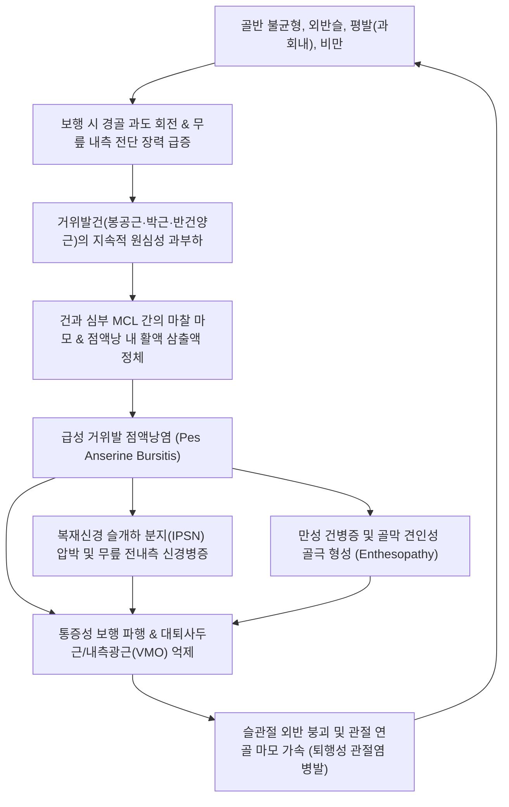
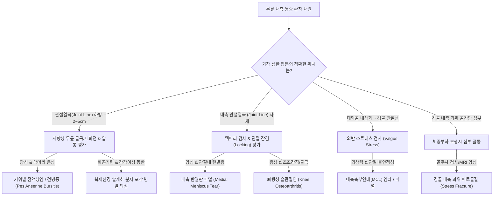

# 🦆 [[거위발 점액낭염]] (Pes Anserine Bursitis / 거위발건염)

> **핵심 요약 (Key Summary)**:
> 🎯 **질환 정의**: 경골(Tibia) 근위 내측 골간단에 부착하는 3개 근육([[봉공근]], [[박근]], [[반건양근]])의 공통 건인 거위발건(Pes Anserinus tendon)과 심부의 경골 내측측부인대([[내측측부인대 손상|MCL]]) 사이에 개재된 점액낭에 발생하는 무균성 염증성 질환. 만성화 시 건-골 부착부 건병증(Enthesopathy / Tendinopathy)이 동반됨.
> 🧬 **3개 근육의 3대 신경 지배 이질성**: 대퇴 전방의 [[봉공근]](Sartorius, [[대퇴신경]] L2-L3 지배), 내측의 [[박근]](Gracilis, [[폐쇄신경]] L2-L3 지배), 후방의 [[반건양근]](Semitendinosus, [[좌골신경]] L5-S2 지배)이 결합됨. 서로 다른 척추 신경근 분절의 병변이 각각의 건에 비대칭적 장력을 유발함.
> ⚙️ **생체역학적 핵심 요인**: [[외반슬]](Genu valgum / X자 다리), 족부 과회내([[평발]], Overpronation), 대퇴전념각 증가, Q-각(Q-angle) 증가 및 비만으로 인해 무릎 내측에 가해지는 견인 전단응력(Tensile & Shear stress) 집중.
> 🔍 **진단 핵심 징후**: 무릎 관절열극(Joint line) 하방 2~5cm 부위 경골 내측의 뚜렷한 표재성 압통(Localized tenderness), 계단 보행(특히 하강 시) 및 의자 기립 시 통증, 야간에 옆으로 누워 잘 때 양 무릎이 맞닿으면 극심한 통증을 유발하는 **야간 접촉통(Kissing Knee Sign)**.
> 🔀 **필수 감별 질환**: 관절열극 자체의 압통과 맥머리 검사 양성인 [[내측 반월판 파열]], 외반 스트레스 검사 양성인 [[내측측부인대 손상]], 복재신경 슬개하 분지 포착 증후군, [[퇴행성 슬관절염]]과의 감별 필수 (슬관절염 환자의 20~40%에서 병발).

---

## 📌 목차
1. [🩺 질환 개요 & 해부학적 병태생리](#1--질환-개요--해부학적-병태생리)
2. [⚡ 병태생리 메커니즘 & 생체역학적 악순환 네트워크](#2--병태생리-메커니즘--생체역학적-악순환-네트워크)
3. [🔍 임상 증상 & 이학적 검사 알고리즘](#3--임상-증상--이학적-검사-알고리즘)
4. [🔀 감별 진단 매트릭스](#4--감별-진단-매트릭스)
5. [🌿 한의 통합 치료 프로토콜](#5--한의-통합-치료-프로토콜)
6. [💊 양방 치료 & 병용·의뢰 기준](#6--양방-치료--병용의뢰-기준)
7. [🏃 재활 운동 & 생활습관 티칭 가이드](#7--재활-운동--생활습관-티칭-가이드)
8. [💡 사용자 진료실 핵심 필기 & 임상 노하우 (Melt-In)](#8--사용자-진료실-핵심-필기--임상-노하우-melt-in)
9. [📚 출처 및 현대 학술 연구 요약](#9--출처-및-현대-학술-연구-요약)

---

## 1. 🩺 질환 개요 & 해부학적 병태생리

거위발(Pes Anserinus, 鵝足)은 하지의 발생학적 3대 구획(전방, 내측, 후방)에서 출발한 3개 주요 근육의 건(Tendon)이 경골 근위 내측면에 모여 정착하는 해부학적 형태가 '거위의 물갈퀴발(Goose foot)'과 유사하여 명명된 구조물이다.

```
[하지 3대 구획]                  [근육]                [기시부]            [지배 신경]
1. 전방 구획 (Anterior)   ─── [[봉공근]](Sartorius)   ── ASIS          ── [[대퇴신경]] (L2-L3)
2. 내측 구획 (Medial)     ─── [[박근]](Gracilis)      ── 치골하지      ── [[폐쇄신경]] (L2-L3)
3. 후방 구획 (Posterior)  ─── [[반건양근]](Semitend.) ── 좌골결절      ── [[좌골신경]] (L5-S2)
                                   │
                                   ▼
        [경골 근위 내측면 (관절선 하방 2~5cm) 거위발 복합체 형성 부착]
                                   │
                ┌──────────────────┴──────────────────┐
                ▼                                     ▼
      [표층: 거위발건 복합체]               [심부: 내측측부인대 (MCL)]
                │                                     │
                └───────────────┬─────────────────────┘
                                ▼
                  ★ [거위발 점액낭 (Pes Anserine Bursa)]
                  (건 활주 시 마찰을 흡수하는 윤활 주머니)
```

### (1) 거위발(Pes Anserinus) 복합체의 해부학적 구성과 형태계측학
1. **[[봉공근]](Sartorius / 縫工筋)**:
   * **기시 및 주행**: 상전장골극(ASIS)에서 기시하여 대퇴 전면을 대각선으로 가로질러 주행하는 인체 최장의 리본형 근육.
   * **신경 지배**: [[대퇴신경]](Femoral nerve, L2-L3).
   * **작용**: 고관절 굴곡·외전·외회전 및 슬관절 굴곡·내회전 (전형적인 양반다리/재봉사 자세 유도).
   * **부착 양상**: 거위발 복합체 중 가장 표층(Superficial) 및 전상방에 위치하여 건막(Aponeurosis) 형태로 박근과 반건양근의 건을 덮으며 정착.
2. **[[박근]](Gracilis / 薄筋)**:
   * **기시 및 주행**: 치골결합 하연 및 치골하지(Inferior pubic ramus)에서 기시하여 대퇴 내측면을 수직 하강.
   * **신경 지배**: [[폐쇄신경]](Obturator nerve, L2-L3).
   * **작용**: 고관절 내전 및 슬관절 굴곡·내회전.
   * **부착 양상**: 봉공근 건막의 직하부 및 후방, 반건양근의 상방에 위치하는 원형 건 다발.
3. **[[반건양근]](Semitendinosus / 半腱樣筋)**:
   * **기시 및 주행**: 좌골결절(Ischial tuberosity)에서 기시하는 햄스트링(Hamstrings) 근육군.
   * **신경 지배**: [[좌골신경]](Sciatic nerve - tibial division, L5-S2).
   * **작용**: 고관절 신전 및 슬관절 굴곡·내회전.
   * **부착 양상**: 거위발 복합체 중 가장 원위부 및 후방에 위치하며, 3개 건 중 횡단면적(Cross-sectional area)이 가장 크고 강력한 인장력을 행사함.
4. **정밀 형태계측학(Morphometry)과 사체 해부학적 지표**:
   * 거위발 정착 중심부는 경골 고평부 관절선(Tibial plateau joint line) 하방 평균 **19.5 ± 3.2mm**, 경골 조면(Tibial tuberosity) 중심선 내측 평균 **22.4 ± 4.1mm**에 위치함.
   * 최신 사체 연구(Możdżeń et al., 2026)에 따르면, 3개 건은 단순한 융합에 그치지 않고 약 60~70%에서 하퇴 근막(Crural fascia), 비복근 내측두(Medial gastrocnemius), 또는 MCL 천층 섬유로 부속 건 다발(Accessory bands)을 뻗치는 해부학적 변이를 보임. 이러한 변이가 존재하는 경우 국소 회전 토크가 집중되어 점액낭염 발생 위험이 통계적으로 유의미하게 증가함.

### (2) 3개 근육 신경 지배의 이질성(Heterogeneity of Innervation)과 임상적 의미
인체에서 단일 정착부(Enthesis)를 공유하는 복합체 중, 서로 다른 3대 주요 말초신경([[대퇴신경]], [[폐쇄신경]], [[좌골신경]])의 지배를 받는 구조는 거위발건이 유일하다.
* **신경 분절적 불균형**:
  * 요추 상부(L2-L3) 병변(디스크 팽륜, 후관절 증후군) 시 대퇴신경과 폐쇄신경이 자극되어 봉공근과 박근의 긴장도가 증가함.
  * 요추 하부(L5-S1) 병변(추간판 탈출증, 척추전방전위증) 시 좌골신경성 긴장으로 반건양근의 과긴장이 초래됨.
* **임상적 시사점**:
  * 환자가 호소하는 거위발 부착부 통증은 단순한 국소 과사용뿐만 아니라, **요추 신경근병증이나 천장관절 변위, 골반 비틀림으로 인해 특정 신경이 자극되어 3개 근육 간의 장력 균형이 깨질 때** 발생한다는 것을 의미함.

### (3) 거위발 점액낭(Pes Anserine Bursa)과 인접 신경의 3차원 위치 관계
1. **점액낭의 3차원 해부 및 조직학**:
   * 표층의 거위발건 복합체와 심부의 경골 내측측부인대(Superficial MCL) 및 경골 골피질 사이에 개재된 활액 주머니(Synovial sac).
   * 점액낭 벽은 얇은 활액막 세포(Synoviocytes) 1~3개 층으로 구성되어 있으며, 히알루론산과 루브리신(Lubricin)이 풍부한 점성 활액을 분비하여 무릎 굴곡-신전 시 건이 단단한 MCL과 경골 골피질 위를 마찰 없이 매끄럽게 활주(Gliding)하도록 보장함.
   * 부착부 골막(Periosteum)은 섬유연골성 골부착부(Fibrocartilaginous enthesis) 구조를 지녀 반복적 견인력을 흡수하나, 만성 염증 시 연골화 및 골극(Osteophyte) 형성으로 이행됨.
2. **복재신경 슬개하 분지(Infrapatellar Branch of Saphenous Nerve, IPSN)의 주행 관계**:
   * 대퇴신경의 종말 감각지인 복재신경(Saphenous nerve)은 내전근관(Hunter's canal)을 빠져나와 봉공근 후연을 따라 하강함.
   * 그 중 슬개하 분지(IPSN)는 거위발건의 상부 및 전방을 가로질러 슬관절 전내측 및 경골 조면 주변 피부 감각을 담당함.
   * **임상적 위험성**: 거위발 점액낭염으로 국소 부종이 심해지거나, 부착부에 침도/주사 시술을 시행할 때 IPSN이 포착 또는 직접 손상되어 무릎 안쪽의 화끈거림, 무감각, 신경병성 통증(Neuropathic pain)을 유발할 수 있음.

---

## 2. ⚡ 병태생리 메커니즘 & 생체역학적 악순환 네트워크

거위발 점액낭염은 단순한 염증성 질환(Bursitis)에 그치지 않고, 반복적 인장력에 의한 건-골 부착부 건병증(Enthesopathy / Tendinopathy)과 주변 피하 결합조직의 부종을 포괄하는 **거위발 증후군(Anserine Syndrome)**의 개념으로 이해해야 한다.

```
       [보행 시 착지 및 체중 지지기 (Stance Phase)]
                           │
      ┌────────────────────┴────────────────────┐
      ▼                                         ▼
[하지 정렬 이상 (외반슬/평발)]               [비만 & 근력 불균형]
- Q-각 증가 (골반 넓은 여성)              - 대퇴사두근/VMO 약화
- 족부 과회내 (Overpronation)              - 햄스트링/내전근 구축
      │                                         │
      └────────────────────┬────────────────────┘
                           ▼
  ★ [경골의 과도한 보상성 내회전 & 무릎 내측 견인 장력(Tension) 급증]
                           │
                           ▼
  [거위발건 복합체가 심부 MCL 및 경골 피질을 강하게 압박 활주]
                           │
                           ▼
  [점액낭 내 마찰 미세 손상 → 활액 삼출액 증가 & 활액막 비후 (Bursitis)]
                           │
                           ▼
  [만성화: 콜라겐 변성, 골막 미세 파열, 석회화 건병증 (Tendinopathy)]
```

### (1) 생체역학적 과부하 4대 요인
1. **외반슬([[외반슬]], Genu Valgum / X자 다리)**:
   * 대퇴골과 경골이 이루는 외반 각도가 커지면 체중 부하선(Weight-bearing axis)이 슬관절 외측으로 이동함.
   * 이에 대항하여 슬관절 내측 구조물(MCL 및 거위발건)은 관절이 안쪽으로 벌어지는 것을 막기 위해 지속적이고 강력한 **원심성 인장력(Tensile stress)**을 감당해야 함.
2. **골반 너비 및 Q-각(Q-Angle) 증가**:
   * 여성은 남성에 비해 골반이 넓어 ASIS에서 슬개골 중심을 이은 선과 슬개골 중심에서 경골조면을 이은 선 사이의 각도(Q-각)가 정상(10~15°)보다 크게 증가(>20°)함.
   * Q-각이 커지면 대퇴사두근의 외측 견인 벡터가 증가하고, 상대적으로 경골 내측에 부착하는 거위발건의 주행 각도가 급격히 꺾이면서 점액낭 부위에 가해지는 지렛대 전단 마찰력이 극대화됨.
3. **족부 과회내 ([[평발]], Overpronation / Hyperpronation)**:
   * 보행 시 발바닥 내측 아치가 무너지면서 거골하관절(Subtalar joint)이 과도하게 회내되면, 경골은 보상적으로 **과도한 내회전(Internal rotation)** 운동을 강요받음.
   * 거위발 근육군은 경골의 과도한 내회전을 제동하고 안정화하기 위해 지속적인 신장성 수축(Eccentric contraction)을 수행하게 되며, 이는 건 부착부의 만성 미세 파열로 직결됨.
4. **비만(Obesity)과 기계적 부하 증폭**:
   * 체중 증가는 보행 시 발생하는 슬관절 내전 모멘트(Knee adduction moment)를 기하급수적으로 증가시켜 거위발건의 마찰 빈도와 압박력을 가중함.

### (2) 퇴행성 슬관절염([[퇴행성 슬관절염]])과의 필연적 병발 메커니즘
* **역학적 상관관계**:
  * 통계적으로 무릎 퇴행성 골관절염(Knee Osteoarthritis) 환자의 **20%~40%에서 거위발 점액낭염이 동반**됨.
* **임상적 병태생리**:
  1. 내측 관절연골 마모로 관절 간격이 좁아지며 내반 변형(Genu varum / O자 다리)이 발생.
  2. 내반 변형 시 관절 불안정성을 보상하기 위해 거위발 근육군(특히 반건양근과 박근)이 무릎 내측을 지지하고자 지속적으로 과긴장함.
  3. 관절염으로 인한 보행 파행(Antalgic gait)이 거위발건의 비정상적 활주 마찰을 촉발.
* **오진의 함정**:
  * 많은 환자가 무릎 안쪽 통증을 단순 연골 마모에 의한 관절 내부 통증으로 오인하고 인공관절 수술이나 관절강내 주사를 맞으나, **실제 보행 시 찌르는 듯한 통증의 원인은 표재성 점액낭의 염증인 경우가 다수**임.

### (3) 거위발 증후군 생체역학적 악순환 네트워크



---

## 3. 🔍 임상 증상 & 이학적 검사 알고리즘

### (1) 주요 임상 증상
1. **관절열극 하방 2~5cm 부위 국소 통증**:
   * 무릎 관절 틈(Joint line) 자체가 아니라, 그보다 **손가락 두세 마디 아래쪽 정강이뼈 안쪽 표면**이 욱신거리고 화끈거림.
2. **계단 하강 시(Downstairs) 통증 극대화**:
   * 계단을 올라갈 때보다 **내려갈 때** 대퇴사두근과 햄스트링이 체중을 지탱하며 편심성 수축을 하므로, 거위발건에 최대 장력이 걸려 비명을 지를 정도의 통증 호소.
3. **의자 기립통 및 장시간 좌식 후 첫 발 통증**:
   * 쪼그려 앉았다가 일어설 때, 또는 장시간 운전이나 좌식 후 무릎을 펴면서 체중을 실을 때 찌르는 듯한 통증.
4. **야간 접촉통 (Kissing Knee Sign / 夜間 接觸痛)**:
   * 환자가 옆으로 누워 잘 때 **양쪽 무릎 안쪽이 서로 맞닿으면 점액낭이 직접 압박**되어 통증으로 잠을 깸. 환자들은 스스로 다리 사이에 베개를 끼우고 자는 회피 동작을 학습함.

### (2) 특이적 이학적 검사 상세 프로토콜
1. **국소 압통점 확인 (Localized Tenderness Test - 가장 결정적)**:
   * **수기**: 무릎을 90° 굴곡시킨 상태에서 경골 내측 관절열극을 촉진한 뒤, 그로부터 하방 2~5cm, 경골 조면(Tibial tuberosity) 내측 약 2cm 지점을 검사자의 엄지손가락으로 깊게 압박.
   * **판정**: 명확한 국소 압통과 함께 때로는 피하 조직의 젤리 같은 부종(Swelling) 또는 열감이 촉지되면 양성.
2. **저항성 무릎 굴곡 및 내회전 검사 (Resisted Knee Flexion and Internal Rotation)**:
   * **수기**: 환자 앙와위 또는 복와위에서 무릎을 30~60° 굴곡하고 하퇴를 안쪽으로 회전(Internal rotation)시킨 상태에서, 검사자가 무릎을 펴고 외회전시키는 방향으로 저항을 가함.
   * **판정**: 거위발 3대 근육이 등척성 수축을 하면서 경골 부착부에 강한 장력이 발생하여 즉각적인 통증 유발 시 양성.
3. **수동적 무릎 신전 및 외회전 신장 검사 (Passive Extension & External Rotation)**:
   * **수기**: 검사자가 환자의 무릎을 완전히 신전시키고 하퇴를 바깥쪽으로 수동 회전시켜 거위발건을 최대로 늘림.
   * **판정**: 부착부의 견인통이 유발되면 양성.
4. **초음파 영상의학적 검사 소견**:
   * 고해상도 근골격계 초음파(MSK US) 탐촉자를 경골 내측에 세로(Long axis) 및 가로(Short axis)로 거치하여 평가.
   * **점액낭염 소견**: 거위발건과 MCL 표층 사이에 **두께 > 2.0mm의 저에코성(Hypoechoic) 또는 무에코성(Anechoic) 활액 저류** 관찰, 파워 도플러(Power Doppler)상 활액막 비후 및 혈류 신호 증가.
   * **건병증 소견**: 건 내부의 정상적인 섬유상 패턴(Fibrillar pattern) 소실, 건의 비후, 국소 저에코성 미세 파열 또는 부착부 골극 관찰.
5. **배제 검사 (MCL 및 반월판 음성 확인)**:
   * **외반 스트레스 검사(Valgus Stress Test)** 음성: 관절선 자체의 벌어짐이나 불안정성이 없어야 함.
   * **맥머리 검사(McMurray Test)** 음성: 관절 내부의 딸깍거림(Clicking)이나 관절열극 압통이 없어야 함.

### (3) 진단 및 감별 결정 알고리즘



---

## 4. 🔀 감별 진단 매트릭스

무릎 내측은 좁은 면적 내에 관절낭, 반월판, 인대, 점액낭, 신경이 밀집되어 있어 정확한 해부학적 경계 인식이 필수적이다.

| 질환명 | 주 압통 위치 | 통증 특성 및 악화 동작 | 이학적 검사 소견 | 초음파 / MRI 영상의학 소견 | 감별 핵심 포인트 |
| :--- | :--- | :--- | :--- | :--- | :--- |
| **[[거위발 점액낭염]] (Pes Anserine Bursitis)** | **관절열극 하방 2~5cm** 경골 내측면 | 계단 하강 시, 야간 접촉통(Kissing knee), 기립 시 찌릿함 | **국소 압통 명확**, 저항성 무릎 굴곡/내회전통 양성, 맥머리 음성 | 초음파상 거위발건과 MCL 사이 저에코성 낭종성 삼출액 및 건 비후 | **관절강 내가 아닌 표재성 뼈 표면 통증**. 관절열극 압통 없음, 무릎 관절 자체 가동성은 정상. |
| **[[내측 반월판 파열]] (Medial Meniscus Tear)** | **내측 관절열극 (Joint line)** 정확한 틈새 | 쪼그려 앉을 때, 방향 전환 시, 무릎 잠김(Locking), 힘 빠짐 | **맥머리(McMurray) 양성**, 테살리(Thessaly) 양성, Apley 양성 | MRI T2 강조영상상 반월판 내부의 고신호 강도 파열선 관찰 | 관절 내에서 '뚝' 소리와 함께 무릎이 펴지지도 굽혀지지도 않는 기계적 잠김 현상 동반. |
| **[[내측측부인대 손상]] (MCL Sprain)** | 대퇴골 내상과 ~ 경골 내측선 전체 | 외측에서 무릎을 가격당한 외상력(Valgus force), 발 비틀림 | **외반 스트레스 검사(Valgus stress) 양성**, 인대 주행로 압통 | 초음파/MRI상 MCL 섬유의 연속성 소실, 인대 비후 및 주위 혈종 | 명확한 급성 외상력 선행. 무릎을 외반시켰을 때 내측이 벌어지는 이완성(Laxity) 관찰. |
| **[[퇴행성 슬관절염]] (Knee Osteoarthritis)** | 관절열극 전반, 슬개골 주변 | 아침 기상 시 뻣뻣함(조조강직 <30분), 오래 걸으면 악화 | 마찰음(Crepitus), 관절 가동역 제한, 내반 변형(O자 다리) | X-ray상 내측 관절 간격 협소화, 연골하 골경화, 골극 형성 | 만성적인 경과. 관절 내부의 둔통과 함께 X-선상 뚜렷한 골성 변형 동반 (거위발염과 흔히 병발). |
| **복재신경 슬개하 분지 포착** | 경골 조면 내측 및 슬관절 전내측 | 찌르는 듯한 작열통(Burning), 스치기만 해도 아픈 이질통 | **Tinel sign 양성** (신경 주행로 가볍게 두드릴 때 방사통) | 초음파상 신경 주행로 비후 또는 압박 소견 | 기계적 부하보다 **신경병성 통증(감각 저하, 저림, 화끈거림)**이 우세하며 피부 표면 감각 이상 동반. |
| **경골 내측 피로골절 (Stress Fracture)** | 경골 근위 골간단 심부 (거위발 하방) | 달리기 선수, 군인, 골다공증 노인, 체중 부하시 극심 | 골 피질 직접 타진 시 극심한 골성 압통, 튜닝포크 검사 양성 | 초기 X-ray 정상, **MRI상 광범위한 골수 부종(Bone marrow edema)** | 안정 시에도 욱신거리는 골통. 단순 연조직 염증 치료에 반응하지 않고 체중 부하 자체가 불가능. |

---

## 5. 🌿 한의 통합 치료 프로토콜

### (1) 한의학적 변증 체계
1. **습열하주(濕熱下注)**: 무릎을 과도하게 사용하거나 비만, 관절염 급성 악화로 인해 관절 주변에 습열(濕熱)이 침범한 상태. 무릎 내측이 **벌겋게 붓고 만지면 화끈거리며(紅腫熱痛)** 찌르는 듯한 통증 호소. 설홍태황니(舌紅苔黃膩), 맥활삭(脈滑數).
2. **근맥어체(筋脈瘀滯) / 어혈조락(瘀血阻絡)**: 외반슬이나 평발 등 만성 생체역학적 과부하로 경골 내측 경근에 미세 손상이 누적되어 어혈이 정체된 학슬풍(鶴膝風) 및 근비(筋痺). 통증 부위가 고정적이고 **야간에 악화되며(夜間痛甚)** 뻣뻣함. 설암(舌暗), 어반(瘀斑), 맥현삽(脈弦澁).
3. **간신부족(肝腎不足)**: 노화 및 폐경 후 골밀도 저하, 퇴행성 관절염을 동반한 고령 환자. 간주근, 신주골 기능이 쇠약하여 건-골 부착부(Enthesis)의 자가 복원력이 고갈됨. 무릎에 힘이 없고 시큰거리며 무력함(膝軟無力). 설담소태(舌淡少苔), 맥침세무력(脈沈細無力).

### (2) 심부 표적 자침 및 3대 원인근 경근 치료

```
             [거위발 국소 표적 혈위망]
                         │
     ┌───────────────────┼───────────────────┐
     ▼                   ▼                   ▼
[[음릉천]](SP9)       [[곡천]](LR8)       [[혈해]](SP10)
·거위발건 부착부 직상방  ·반건양근 정착부 인접  ·내측광근(VMO) 활성화
·국소 수습(水濕) 배출  ·간주근(肝主筋) 이완  ·활혈화어 & 슬개골 정렬
                         │
     ┌───────────────────┴───────────────────┐
     ▼                                       ▼
[[봉공근]] 원위부 (ASIS 하방)         [[박근]]/[[반건양근]] 원위부
·대퇴신경 긴장 해제                  ·폐쇄/좌골신경 분절 긴장 감압
```

1. **국소 핵심 혈위**:
   * **[[음릉천]](SP9)**: 비경(脾經)의 합수혈(合水穴)로, 경골 내측과 하연 오목한 곳에 위치하여 거위발 점액낭 바로 직상방에 해당함. 점액낭 내 삼출액 저류를 말리고(利水化濕) 국소 무균성 염증을 가라앉히는 최우선 혈위. 직자 1~1.5치 (30~40mm).
   * **[[곡천]](LR8)**: 간경(肝經)의 합수혈로, 무릎을 굽혔을 때 오금 주름 내측 끝 반건양근·반막양근 건 전방 오목한 곳. 거위발 3대 근육의 심부 건 긴장을 직접적으로 이완. 직자 1~1.5치.
   * **[[혈해]](SP10)**: 슬개골 내상연 상방 2촌. 내측광근(VMO) 근복에 위치하여 내측광근의 위축을 막고 슬개골의 정상 궤도를 회복시키며 어혈을 제거(活血化瘀).
   * **보조혈**: 근회(筋會)인 [[양릉천]](GB34), 위경의 [[족삼리]](ST36), 신경의 [[음곡]](KI10).
2. **전침(Electroacupuncture) 치료 프로토콜**:
   * 음릉천(SP9)과 곡천(LR8) 또는 압통점에 전침을 연결.
   * 급성기 극심한 통증: **고주파 100Hz 연속파(Continuous wave)**를 15분간 적용하여 관문조절설(Gate control theory)을 통한 즉각적인 척수 수준 통증 신호 차단 유도.
   * 만성기 건병증 및 근위축: **저주파 2Hz 또는 혼합파(Dense-disperse 2/100Hz)**를 20분간 적용하여 내인성 엔도르핀(Endorphin) 및 다이노르핀(Dynorphin) 분비 촉진과 주변 미세 혈류 순환 개선.
3. **3대 원인근 원위부(Extradistal) 경근 자침 (근본 긴장 해소)**:
   * **[[봉공근]](Sartorius)**: 상전장골극(ASIS) 직하부 및 대퇴 전내측 근복을 따라 2~3개 자침점을 잡아 사자하여 대퇴신경 분지의 과흥분 억제.
   * **[[박근]](Gracilis)**: 치골하지 직하부 내전근 결절 부근 및 대퇴 내측 근복에 자침하여 폐쇄신경성 긴장 완화.
   * **[[반건양근]](Semitendinosus)**: 좌골결절 외측 및 대퇴 후면 햄스트링 근복에 3치 장침으로 직자하여 좌골신경성 견인력 해제.

### (3) 미세 침도 요법 (Acupotomy Protocol)
* **적응증**: 3개월 이상 보존적 치료에 반응하지 않는 만성 거위발건병증, 건-골 부착부 골막 비후 및 섬유성 유착 환자.
* **시술 방법**:
  1. 환자를 앙와위로 눕히고 슬관절을 60° 굴곡, 외회전시켜 경골 내측면을 노출.
  2. 관절선 하방 2~5cm 부위의 가장 단단한 골막 압통점을 마킹하고 철저히 소독.
  3. 0.5×50mm 소침도를 건의 주행 방향과 **평행하게(Longitudinal orientation)** 자입.
  4. 골막에 도달한 후 미세 절개 및 박리(Stripping)를 2~3회 시행하여 유착된 섬유 다발을 풀고 골막 장력을 감압.
  5. **주의사항**: 복재신경 슬개하 분지 손상을 방지하기 위해 횡절개(Transverse cutting)를 절대 금하고 침도를 회전시키지 않음.

### (4) 특화 약침 치료 (Pharmacopuncture Protocol)
* **신바로약침(Shinbaro)**:
  * GCSB-5 성분의 강력한 항염증 및 연골/건 보호 효과.
  * 점액낭 심부(MCL 표면) 및 건 부착부에 1.0~1.5cc 주입하여 만성 건병증 조직의 재생 촉진.
* **봉약침(Sweet Bee Venom)**:
  * 멜리틴(Melittin) 99% 정제 봉약침을 음릉천 및 점액낭 부착부에 0.1~0.3cc 피내/피하 분할 주입.
  * 만성적인 점액낭 삼출액 흡수를 촉진하고, 비정상적 신생혈관 증식 억제.
* **중성어혈약침**:
  * 초기 급성 염증 및 부종이 심할 때 음릉천 주변에 1.0cc 주입하여 국소 어혈과 미세순환 정체 해소.

### (5) 생체역학 교정 추나요법
1. **거골하관절(Subtalar Joint) 회내 교정 기법**:
   * 환자 복와위에서 시술자가 종골(Calcaneus)을 파지하고 외번(Eversion)된 종골을 내번(Inversion) 방향으로 순간 교정하여 족부 과회내를 바로잡음.
2. **슬괵근 및 내전근 근에너지기법(MET)**:
   * 단축된 반건양근과 박근을 신장 위치에 놓고, 환자가 20%의 힘으로 7초간 등척성 저항 수축 후 호흡과 함께 수동적 이완 신장을 3~5회 반복.

### (6) 한약 처방 배오와 상세 용량 처방례
* **급성기 삼출 및 염증**: [[오령산]](五苓散) 합 [[서경탕]](舒經湯), [[당귀수산]](當歸鬚散).
  * **처방 구성례 (1첩 기준, g)**:
    * 택사(澤瀉) 8g, 복령(茯苓) 6g, 저령(猪苓) 6g, 백출(白朮) 6g, 계지(桂枝) 4g (오령산 골격: 국소 수종 및 점액낭 삼출액 배출 촉진)
    * 당귀(當歸) 6g, 천궁(川芎) 4g, 백작약(白芍藥) 6g, 강활(羌活) 4g, 방풍(防風) 4g, 진피(陳皮) 4g, 감초(甘草) 2g (서경탕 골격: 경락 소통 및 소염 진통)
* **만성 퇴행 및 골관절염 병발**: [[독활기생탕]](獨活寄生湯), [[대강활탕]](大羌活湯), [[방기황기탕]](防己黃芪湯).
  * **처방 구성례 (1첩 기준, g)**:
    * 독활(獨活) 6g, 상기생(桑寄生) 8g, 두충(杜仲) 6g, 우슬(牛膝) 6g, 진범(秦艽) 4g, 세신(細辛) 2g, 백작약(白芍藥) 6g, 숙지황(熟地黃) 6g, 당귀(當歸) 6g, 천궁(川芎) 4g, 인삼(人蔘) 4g, 복령(茯苓) 4g, 감초(甘草) 2g (간신을 보하고 퇴행성 무릎 연골과 건 부착부를 보강함).
    * 비만 환자에서 무릎 부종과 무력감이 심할 때는 방기(防己) 8g, 황기(黃芪) 12g, 백출(白朮) 6g을 가미하여 기혈 순환과 수액 대사를 정상화함.

---

## 6. 💊 양방 치료 & 병용·의뢰 기준

### (1) 현대의학적 보존적 치료 및 약물 요법
* **경구 약물 치료**:
  * NSAIDs([[세레콕시브]], [[록소프로펜]], [[나프록센]]) 1~2주 단기 투여로 활액낭 염증 완화.
  * 국소 NSAIDs 겔 또는 플라스타 패치 적용.
* **초음파 유도하 국소 주사 요법**:
  * **삼출액 흡인 및 스테로이드 주입**: 점액낭 삼출액이 낭종 형태로 고여 있을 때 주사기로 흡인(Aspiration) 후, 트리암시놀론(Triamcinolone 20~40mg)과 국소마취제(1% 리도카인) 혼합액을 정확히 점액낭 내로 주입.
  * ⚠️ **주의사항**: 스테로이드를 **건 실질(Tendon substance) 내에 직접 주사하면 건 괴사 및 파열(Tendon rupture)**이 발생할 수 있으며, 피하에 누출될 경우 **피하 지방 위축(Fat atrophy) 및 피부 탈색(Hypopigmentation)**을 초래하므로 반드시 초음파 유도하에 점액낭 내에만 한정 주입해야 함.
* **체외충격파 치료 (ESWT - Extracorporeal Shock Wave Therapy)**:
  * 방사형(Radial) 및 집중형(Focused) 충격파를 경골 부착부에 2,000~3,000타 적용하여 신생혈관 형성을 자극하고 만성 섬유화 조직의 리모델링 유도.

### (2) 수술적 치료 적응증
* 수술적 치료는 극히 드물게 시행됨 (99% 이상 보존적 치료로 호전).
* **적응증**: 최소 6개월 이상의 적극적 보존적 치료(약물, 주사, 물리치료, 한의 복합치료)에도 호전이 없고 일상 보행이 불가능한 불응성 점액낭염, 만성 거대 낭종 형성, 또는 감염성 점액낭염의 배농 실패.
* **술식**: 개방성 또는 관절경하 점액낭 절제술(Bursectomy) 및 건 유리술.

### (3) 한양방 병용 시 주의사항 및 상호작용
* 양방 정형외과에서 국소 스테로이드 주사를 맞은 환자는 면역 억제 반응으로 인해 감염에 취약하므로, **시술 후 최소 1~2주간 주사 부위에 침도, 봉약침, 습식 부항 등의 침습적 한의 시술을 전면 금지**함.
* 경구 NSAIDs 복용 환자에게 어혈 한약을 투여할 때는 위점막 손상을 예방하기 위해 식후 복용을 지도하고 건비위 한약재를 배오함.

### (4) 전문과 응급 의뢰 레드 플래그 (Red Flags)

```
🚨 [거위발 부위 응급 의뢰 3대 징후 (Red Flags)]
1. 화농성 점액낭염 (Septic Pes Anserine Bursitis):
   - 국소 부위의 극심한 발적(Erythema), 열감, 맥박성 박동통, 전신 발열(>38°C), 피부 궤양/누공
   → 응급 관절 천자, 세균 배양 및 정맥 항생제 투여를 위해 즉시 정형외과/감염내과 의뢰!
2. 경골 피로골절 (Tibial Stress Fracture):
   - 골다공증 노인 또는 격렬한 운동 후 발생, 체중 부하 시 비명을 지르는 골성 통증, 타진통
   → 즉시 체중부하 금지(목발) 및 정밀 MRI 평가 의뢰!
3. 심부정맥혈전증 (Deep Vein Thrombosis, DVT):
   - 종아리와 오금 부위의 비대칭적 급격한 종창, 호만 징후(Homan's sign) 양성
   → 즉시 혈관초음파 및 응급 혈전용해 치료 의뢰!
```

---

## 7. 🏃 재활 운동 & 생활습관 티칭 가이드

### (1) 단계별 기능 회복 운동 프로그램

```
[1단계: 급성기 안정 & 가벼운 신장] ─── 무릎 사이 베개 거치, 햄스트링/내전근 정적 스트레칭
                 │
                 ▼
[2단계: 아급성기 광근 & 둔근 활성화] ── VMO 강화 (수건 짓누르기), 조개 운동 (Clam shell)
                 │
                 ▼
[3단계: 기능적 닫힌사슬 & 족부 강화] ── 숏풋 운동 (Short foot), 미니 스쿼트, 보행 패턴 교정
```

1. **1단계: 3대 근육 점진적 스트레칭 (Hamstring & Adductor Stretching)**:
   * **햄스트링 스트레칭**: 의자에 앉아 한쪽 다리를 뻗고 발끝을 몸 쪽으로 당긴 상태에서 등을 곧게 펴고 상체를 앞으로 기울여 허벅지 뒤쪽이 부드럽게 당겨지도록 30초 유지 (반건양근 이완, 3회 반복).
   * **나비 자세 내전근 스트레칭**: 바닥에 앉아 양 발바닥을 마주 대고 무릎을 바닥 쪽으로 부드럽게 눌러 허벅지 안쪽을 이완 (박근 이완, 30초 유지, 3회).
   * **선 자세 봉공근 신장**: 환측 다리를 뒤로 뻗어 고관절 신전 및 내전을 유도하며 체간을 반대측으로 회전 (봉공근 긴장 해소).
2. **2단계: 내측광근(VMO) 및 중둔근 강화**:
   * **수건 짓누르기(Quad Sets with Towel Roll)**: 무릎 밑에 둥글게 만 수건을 받치고 오금으로 수건을 바닥 쪽으로 강하게 5초간 짓누르며 허벅지 안쪽(내측광근)에 힘을 줌 (20회 3세트).
   * **측와위 클램쉘(Clam Shell)**: 중둔근을 강화하여 보행 시 무릎이 안쪽으로 무너지는 외반슬 붕괴(Valgus collapse)를 차단.
3. **3단계: 족부 아치 강화 (Short Foot Exercise)**:
   * 맨발로 바닥을 딛고 발가락을 굽히지 않은 채 중족골두를 종골 쪽으로 끌어당겨 발바닥 내측 아치를 스스로 세우는 훈련 (10초 유지, 15회). 평발에 의한 경골 과회내 방지.

### (2) 진료실 생활습관 티칭 수칙
* **수면 시 무릎 사이 베개 착용 (가장 중요)**: 옆으로 누워 잘 때 **양 무릎 사이에 푹신한 쿠션이나 베개를 반드시 끼우고 자도록** 지도하여 야간 무릎 접촉 마찰(Kissing knee)을 완벽히 차단.
* **계단 보행 수칙 교육**:
  * **올라갈 때는 건강한 다리 먼저** (건측 대퇴사두근으로 체중 견인).
  * **내려갈 때는 아픈 다리 먼저** (환측 거위발건에 걸리는 원심성 부하 경감).
* **좌식 습관 교정**: 양반다리(가부좌) 및 쪼그려 앉기(Squatting)를 절대 금지하고 입식 생활로 전환.
* **신발 및 인솔 선택**: 신발 안쪽 바닥이 쉽게 닳거나 평발 경향이 있는 환자는 아치 지지대(Arch support insole)가 장착된 안정화를 착용하도록 지도.

---

## 8. 💡 사용자 진료실 핵심 필기 & 임상 노하우 (Melt-In)

본 단락은 원장님의 실제 진료실 관찰과 축적된 임상 노하우를 100% 보존하고, 현대 생체역학적 원리로 완벽히 승화시킨 임상 지침이다.

### [노하우 1] 퇴행성 슬관절염 환자의 무릎 안쪽 통증 오인 교정법
* **진료실 현상**:
  * "원장님, 양방 정형외과에서 연골이 다 닳았다고 해서 연골주사도 맞고 물리치료도 받았는데, 여전히 계단 내려갈 때 무릎 안쪽이 찢어지듯이 아파요."라고 호소하는 60~70대 여성 환자가 대단히 많음.
* **임상 판별 비결**:
  * 의사가 직접 손가락으로 **관절 틈(관절열극)을 누르면 통증이 별로 없는데, 그곳에서 손가락 두 마디 아래 경골 안쪽 뼈 표면을 살짝만 눌러도 환자가 비명을 지름**.
  * 이것은 관절강 내부 연골의 문제가 아니라 **거위발 점액낭의 표재성 염증이 진정한 통증 유발점(Pain generator)**임을 증명하는 것임.
  * 환자에게 "어머님 무릎 연골도 닳았지만, 지금 당장 계단 내려갈 때 찌르는 통증은 연골이 아니라 무릎 안쪽 힘줄 주머니에 불이 난 것입니다"라고 명확히 티칭하고 점액낭에 봉약침과 음릉천 자침을 시행하면 2~3회 치료만으로도 보행 통증의 70%가 즉각 소실됨.

### [노하우 2] 3개 근육의 3대 신경 지배(대퇴/폐쇄/좌골) 역추적 요추 치료법
* **임상 메커니즘**:
  * 거위발건을 이루는 봉공근([[대퇴신경]] L2-L3), 박근([[폐쇄신경]] L2-L3), 반건양근([[좌골신경]] L5-S2)은 척추 분절이 완전히 다름.
  * 만약 거위발 부착부 국소 치료만으로 통증이 계속 재발한다면, 반드시 **요추 신경근 분절을 역추적**해야 함:
    * **L2-L3 요추 분절 장애 및 장요근 긴장**: 봉공근과 박근의 지속적 과긴장 유발 → 요추 2-3번 협척혈 및 비관, 충문 자침 병행.
    * **L5-S1 요추 추간판 탈출 및 골반 변위**: 반건양근(햄스트링)의 지속적 단축 유발 → 환도, 요양관, 천장관절 교정 병행.
  * 국소 점액낭만 치료하는 것은 하류의 흙탕물만 걷어내는 것이며, 척추 신경근과 근복을 함께 치료해야 상류의 오염원이 차단됨.

### [노하우 3] 복재신경 슬개하 분지(IPSN) 손상 방지 자침 노하우
* **임상 주의점**:
  * 거위발 부착부는 복재신경 슬개하 분지가 가로질러 지나가는 감각 취약 구역임.
  * 점액낭 부종이 심하다고 하여 굵은 호침이나 침도를 직각으로 강하게 찌르고 휘젓거나 사혈을 무리하게 시행하면, 슬개하 분지가 손상되어 환자가 "무릎 안쪽 살이 남의 살 같아요", "스치기만 해도 전기가 오듯 화끈거려요"라며 의료 분쟁으로 이어질 수 있음.
* **안전 자침 수칙**:
  * 침 치료 시에는 반드시 무릎을 굽힌 상태에서 건의 긴장을 풀고, 뼈 표면을 향해 수직 직자하기보다는 **음릉천 혈위를 향해 완만하게 사자(Oblique insertion)**할 것.
  * 침도 시술 시에는 반드시 **건의 섬유 방향과 평행하게 종축으로만 미세 박리**하고 횡절개나 과도한 제삽을 엄금할 것.

---

## 9. 📚 출처 및 현대 학술 연구 요약

* Uson J, et al. Pes anserinus tendino-bursitis: what are we talking about? *Scand J Rheumatol*. 2000;29(3):184-186.
  * [PMID: 10898072](https://pubmed.ncbi.nlm.nih.gov/10898072/)
  * [연구 요약] 거위발 통증을 호소하는 환자들을 대상으로 정밀 초음파를 시행하여, 실제 병리 소견이 단순 점액낭염(Bursitis)에 국한되지 않고 건염(Tendinitis) 및 피하 조직 부종이 복합된 건-점액낭염(Tendino-bursitis)임을 실증하고 임상적 진단 기준을 제시한 고전 연구.
* Helfenstein M Jr, Kuromoto J. Anserine syndrome. *Rev Bras Reumatol*. 2010 May-Jun;50(3):313-327.
  * [PMID: 21125167](https://pubmed.ncbi.nlm.nih.gov/21125167/)
  * [연구 요약] 거위발 증후군(Anserine Syndrome)의 역학, 해부학, 임상 증상 및 감별 진단을 체계적으로 집대성한 리뷰. 특히 비만, 외반슬, 슬관절 골관절염을 동반한 중년 여성에서의 높은 호발률과 포괄적 보존 치료 알고리즘 분석.
* Mohseni M, Mabrouk A, Li D. Pes Anserine Bursitis. [Updated 2024 Jan]. In: *StatPearls* [Internet]. Treasure Island (FL): StatPearls Publishing; 2024 Jan-.
  * [PMID: 30422536](https://pubmed.ncbi.nlm.nih.gov/30422536/)
  * [연구 요약] 거위발 점액낭염의 발병 원인, 이학적 유발 검사(관절선 하방 2~5cm 압통), 초음파 유도하 흡인 및 스테로이드 주사 지침, 물리 재활 운동의 최신 의학적 근거를 정리한 임상 가이드.
* Możdżeń K, Fibiger G, Malczak M. Morphometry and functional topography of the pes anserinus complex: A standardized cadaveric study. *Ann Anat*. 2026 Jun;266:152432.
  * [PMID: 42066866](https://pubmed.ncbi.nlm.nih.gov/42066866/)
  * [연구 요약] 표준화된 사체 해부를 통해 거위발 복합체를 구성하는 봉공근, 박근, 반건양근의 경골 부착 형태와 형태학적 치수, 심부 MCL과의 해부학적 간격을 정밀 계측하여 건 손상 방지 및 정밀 중재술의 지형학적 기준을 규명.
* Możdżeń K, Fibiger G, Malczak M. Anatomical variability of the pes anserinus tendons: prevalence and patterns of accessory bands of the semitendinosus, gracilis, and sartorius tendons and a new classification. *Folia Morphol (Warsz)*. 2026.
  * [PMID: 42755278](https://pubmed.ncbi.nlm.nih.gov/42755278/)
  * [연구 요약] 거위발 3대 건의 해부학적 변이와 부속 건 다발(Accessory bands)의 유병률을 조사하고 새로운 해부학적 분류 체계를 수립함으로써, 불응성 내측 무릎 통증의 역학적 원인 규명에 기여.
