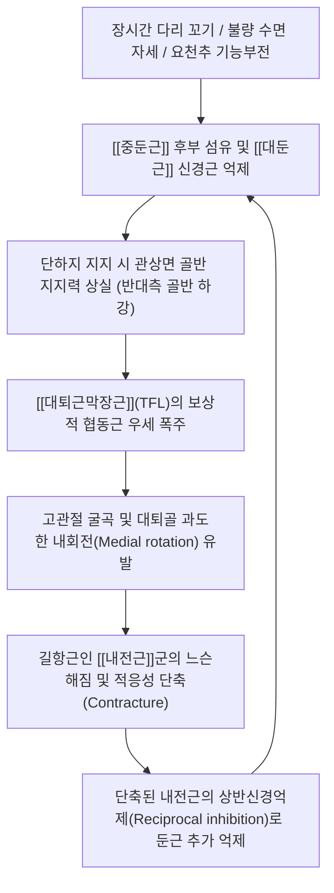
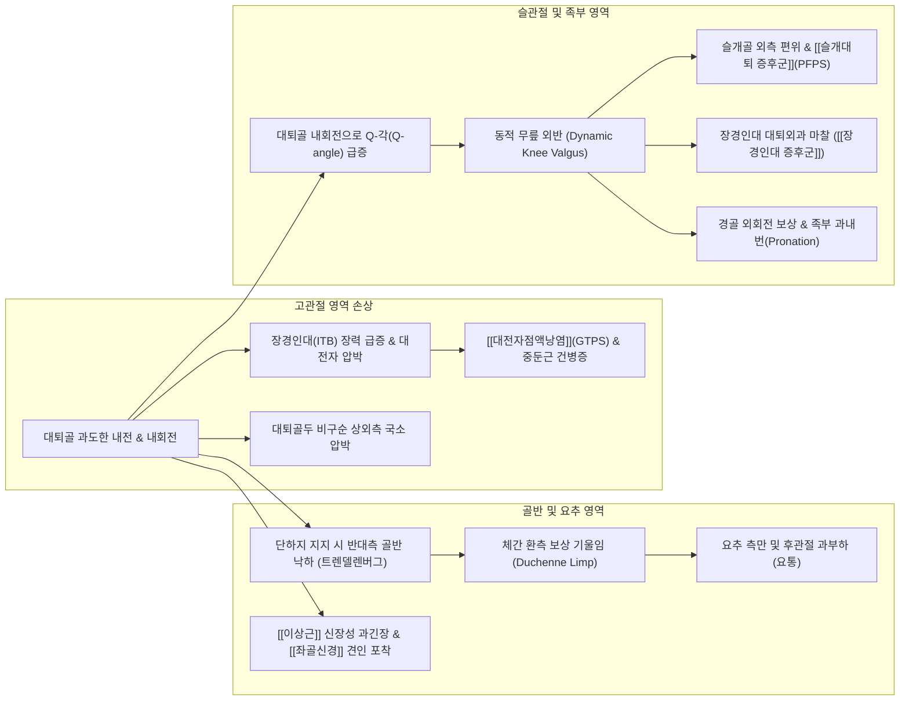
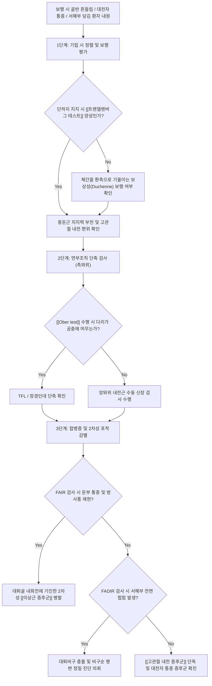

# 🩺 [[고관절 내전 증후군]] (Hip Adduction Syndrome / 股關節 內轉 症候群)

> **핵심 3줄 요약 (Key Summary)**:
> - 📍 병소 부위 & 해부·병태생리: 보행·착석 및 편측 체중 지지 시 고관절이 과도한 내전(Adduction) 및 대퇴골 내회전(Medial rotation) 위치로 편위되는 운동계 손상 증후군(MSI)으로, [[내전근]]군 및 [[대퇴근막장근]](TFL)의 단축·과긴장과 [[중둔근]](특히 후부 섬유) 및 [[대둔근]]의 신장성 약화 불균형이 핵심 병태생리.
> - 🚩 전형적 임상 양상 & 3대 징후: 단하지 지지 시 반대측 골반 낙하([[트렌델렌버그 테스트]]) 또는 환측 체간 측굴 보상(Duchenne sign), 대전자 외측 통증([[대전자점액낭염]], GTPS), 2차적 장경인대 마찰([[장경인대 증후군]])·[[슬개대퇴 증후군]](PFPS) 및 대퇴골 내회전 연쇄에 의한 [[이상근 증후군]](좌골신경 견인통) 동반.
> - 🛠️ 핵심 감별 검사 & 한·양방 다각적 치료 전략: 단하지 기립 트렌델렌버그 검사, 오버 검사([[Ober test]]), FAIR 검사, 단하지 스쿼트 정렬 평가; 단축된 내전근·TFL 침도/약침 이완, 약화된 중둔근·대둔근 전침 강화 자극, 골반 및 고관절 외전-외회전 교정 추나, 클램쉘/외전 재활 운동.
> - ⚠️ 응급 의뢰 레드플래그 & 악화 요인: 편측 지지 시 서혜부 심부 통증 및 비구순 파열(Labral tear), 대퇴골두 무혈성 괴사(AVN) 감별 필요; 옆으로 누워 잘 때 환측 고관절이 내전·내회전되도록 방치하는 수면 습관 및 다리 꼬기(Crossed legs) 절대 금기.

---

## 📌 목차
1. [질환 개요 & 해부학적 병태생리](#1-질환-개요--해부학적-병태생리)
2. [병태생리 메커니즘 & 생체역학적 악순환 네트워크](#2-병태생리-메커니즘--생체역학적-악순환-네트워크)
3. [임상 증상 & 이학적 검사(Physical Exam) 알고리즘](#3-임상-증상--이학적-검사physical-exam-알고리즘)
4. [감별 진단 매트릭스 (Differential Diagnosis)](#4-감별-진단-매트릭스-differential-diagnosis)
5. [한의 통합 치료 프로토콜 (침·약침·추나·한약)](#5-한의-통합-치료-프로토콜-침약침추나한약)
6. [양방 치료 & 병용·의뢰 기준 (Conventional Treatment & Referral)](#6-양방-치료--병용의뢰-기준-conventional-treatment--referral)
7. [재활 운동 & 생활습관 티칭 가이드](#7-재활-운동--생활습관-티칭-가이드)
8. [💡 사용자 진료실 핵심 필기 & 임상 노하우 (Melt-In 잔여 심화 집약)](#8--사용자-진료실-핵심-필기--임상-노하우-melt-in-잔여-심화-집약)
9. [출처 및 현대 학술 연구 요약 (References)](#9-출처-및-현대-학술-연구-요약-references)

---

## 1. 🩺 질환 개요 & 해부학적 병태생리

### 1) 개념 정의 및 Shirley Sahrmann의 운동계 손상(MSI) 모델
[[고관절 내전 증후군]](Hip Adduction Syndrome)은 셜리 사하만(Shirley Sahrmann) 교수가 정립한 운동계 손상 증후군(Movement System Impairment, MSI) 체계에서 고관절 기능 장애를 대표하는 핵심 증후군입니다. 이 증후군은 단하지 지지(Single leg stance), 보행의 입각기(Stance phase), 계단 승강, 달리기 및 착석 동작 시 고관절이 해부학적 중립 위치(Neutral alignment)를 벗어나 시상면 및 관상면 상에서 과도한 내전(Adduction)과 수평면 상의 대퇴골 내회전(Medial/Internal rotation) 위치로 비정상적 편위(Deviation)를 반복하는 생체역학적 기능 장애입니다.

인체 보행 주기에서 단하지 지지 시에는 반대측 유각기(Swing phase) 하지의 무게와 상체의 중력 중심(Center of gravity)으로 인해 환측 골반이 아래로 떨어지려는 강력한 내전 토크(Adduction moment)가 발생합니다. 정상적인 고관절에서는 [[중둔근]](Gluteus medius)의 후부 섬유와 [[소둔근]](Gluteus minimus), 그리고 [[대둔근]](Gluteus maximus) 상부 섬유가 강력한 외전 토크를 형성하여 골반의 수평을 유지합니다. 그러나 둔근 복합체의 신경근 억제(Neuromuscular inhibition)와 신장성 약화(Eccentric weakness)가 발생하면, 대퇴골두(Femoral head)에 대한 비구(Acetabulum)의 상대적 내전각이 급증하고 대퇴골이 중심선을 향해 기울어지게 됩니다.

이 과정에서 신체는 골반의 외측 지지력을 만회하기 위해 천층의 보조 외전근인 [[대퇴근막장근]](Tensor fasciae latae, TFL)을 과도하게 끌어다 쓰게 되며, 길항근인 [[내전근]]군은 느슨해진 위치에서 적응성 단축(Adaptive shortening)을 겪게 됩니다. 그 결과 관절 운동의 회전 중심(Instantaneous axis of rotation)이 어긋나며 대전자 외측, 서혜부, 무릎 및 요추부로 비정상적인 전단 응력이 파급됩니다.

### 2) 관련 해부학적 구조물 및 기능적 근육 분류

#### (1) 관절 및 골격 복합체
- **골반 관골구(비구, Acetabulum) & 대퇴골두(Femoral head)**: 체중을 지지하는 전형적인 다축성 구관절(Enarthrodial joint). 비정상적인 고관절 내전 시 대퇴골두의 상외측면과 비구순(Acetabular labrum) 상연 사이의 접촉 면적이 감소하면서 국소 접촉 압력(Contact stress)이 기하급수적으로 증가합니다.
- **대전자(Greater trochanter)**: [[중둔근]]과 [[소둔근]] 건이 부착하는 외측 지렛대 구조물로, 장경인대(Iliotibial band, ITB)가 바로 위를 통과합니다. 고관절이 내전되면 대전자와 장경인대 사이의 마찰력과 압박력이 급격히 상승합니다.
- **천장관절(Sacroiliac joint, SIJ) & 치골결합(Pubic symphysis)**: 편측 골반 낙하 및 내전근의 치골 부착부 견인력으로 인해 비대칭적 회전 전단력이 집중되는 골반 환(Pelvic ring) 구조물입니다.

#### (2) 단축 및 과활성 근육군 (Hyperactive / Shortened Muscle Groups)
- **고관절 내전근군(Adductor group)**:
  - [[장내전근]](Adductor longus): 치골 결절 하방에서 기시하여 대퇴골 조선(Linea aspera) 중부에 정지. 고관절 굴곡과 내전을 동시에 유발하며 구축 시 가장 두드러지게 팽팽한 띠(Taut band)를 형성합니다.
  - [[단내전근]](Adductor brevis): 치골 하강에서 기시하여 대퇴골 조선 상부에 정지.
  - [[대내전근]](Adductor magnus): 치골지 및 좌골결절에서 기시하여 대퇴골 조선 전장 및 내전근 결절(Adductor tubercle)에 정지. 전부 섬유는 내전 및 굴곡, 후부 섬유는 신전을 보조합니다.
  - [[치골근]](Pectineus): 치골즐에서 대퇴골 치골근선에 부착하며 고관절의 급격한 굴곡-내전 토크를 제공합니다.
  - [[박근]](Gracilis): 치골 결합부에서 경골 내측 거위발건(Pes anserinus)으로 이어지는 2관절 근육으로, 슬관절 내측 안정성에도 관여합니다.
- **보상적 굴곡·외전·내회전근**:
  - [[대퇴근막장근]](Tensor fasciae latae, TFL): ASIS 외측에서 기시하여 [[장경인대]](ITB)를 통해 경골 외측 과의 Gerdy 결절에 정지합니다. 외전력이 약화된 중둔근을 대신해 활성화되지만, 강력한 고관절 굴곡 및 내회전 작용을 동반하여 대퇴골의 내회전 변위를 가속화합니다.

#### (3) 억제 및 신장성 약화 근육군 (Inhibited / Lengthened Muscle Groups)
- **일차 외전근 및 외측 안정화 복합체**:
  - [[중둔근]](Gluteus medius): 장골익 외측면에서 기시하여 대전자 후외측면에 정지합니다. 특히 **후부 섬유(Posterior fibers)**는 시상면 신전, 관상면 외전, 수평면 외회전을 복합 제어하여 보행 시 대퇴골의 내회전과 내전을 억제하는 핵심 관절 안정자(Dynamic joint stabilizer) 역할을 수행합니다.
  - [[소둔근]](Gluteus minimus): 장골익 하부에서 대전자 전면에 정지하여 고관절낭 전상부를 지지하며 대퇴골두를 비구 내로 압박 고정합니다.
- **고관절 신전 및 외회전 복합체**:
  - [[대둔근]](Gluteus maximus): 장골익 후면 및 천골에서 대퇴골 둔근조면과 ITB로 연결되며, 고관절 신전 및 강력한 외회전 모멘트를 발생시킵니다.
  - **심부 외회전근군(Deep lateral rotators)**: [[이상근]](Piriformis), 상쌍자근, 내폐쇄근, 하쌍자근, 외폐쇄근, 대퇴방형근. 대퇴골이 내회전 상태로 고정되면 이들 근육은 장기간 신장성 긴장(Eccentric overload)을 받으며 허혈성 근막통을 유발합니다.

#### (4) 신경 및 혈관 포착 취약 부위
- [[상둔신경]](Superior gluteal nerve, L4-S1)**: 이상근 상공(Suprapiriform foramen)을 빠져나와 중둔근, 소둔근, TFL 사이를 주행하며, 둔근의 만성 긴장과 골반 회전 변위 시 압박 및 견인 스트레스를 받습니다.
- [[좌골신경]](Sciatic nerve, L4-S3)**: 이상근 하공을 관통하여 하지로 주행합니다. 대퇴골의 과도한 내회전으로 이상근이 팽팽하게 신장될 때 이상근 하연과 천결절인대 사이에서 기계적 견인 및 포착(Entrapment)이 초래됩니다.
- [[상둔피신경]](Superior cluneal nerve, L1-L3 후지)**: 요추 기립근을 뚫고 장골능을 넘어가며, 골반 비틀림 및 요천추 연합부 과부하 시 장골능 골막 접촉부에서 포착되어 둔부 상부의 저림과 작열감을 유발합니다.
- [[폐쇄신경]](Obturator nerve, L2-L4)**: 폐쇄공을 지나 내전근 다발 사이(장내전근과 단내전근 사이의 전지, 단내전근과 대내전근 사이의 후지)를 통과하므로, 내전근의 구축 시 서혜부 심부 및 대퇴 내측의 감각 이상을 일으킵니다.

### 3) 역학적 특성 및 유발 소인
- **여성의 해부학적 취약성**: 여성은 남성에 비해 관골의 폭이 넓고 골반 입구가 횡타원형을 이루어 고관절 간격이 넓습니다. 이로 인해 대퇴골의 관상면 경사각이 커지며 대퇴사두근 각도(Q-각, Q-angle)가 평균 15° 이상으로 증가합니다. 이는 보행 시 대퇴골에 더 큰 내전 토크를 유발하여 중둔근의 생체역학적 요구량을 가중시킵니다.
- **좌식 생활 및 직업적 자세**: 의자에 앉을 때 한쪽 다리를 반대측 무릎 위에 꼬고 앉는 자세(Crossed-leg sitting)는 상측 고관절을 극도의 굴곡-내전-내회전 상태로 유지시켜 TFL과 내전근의 기계적 단축을 고착화합니다.
- **수면 시 불량 자세**: 측와위(옆으로 눕는 자세)로 수면 시 위쪽 다리를 침대 바닥으로 떨어뜨려 무릎이 매트리스에 닿도록 웅크려 자는 습관은 수면 시간(6~8시간) 내내 고관절 외전근을 최대로 늘리고 내전근을 단축시키는 치명적인 악화 인자입니다.

---

## 2. ⚡ 병태생리 메커니즘 & 생체역학적 악순환 네트워크

### 1) 중둔근 후부 섬유 부전과 TFL의 보상적 협동근 우세 (Synergistic Dominance)
인체의 정상적인 단하지 체중 지지 메커니즘에서는 [[중둔근]]의 전부·중부·후부 섬유 중에서도 특히 **후부 섬유(Posterior gluteus medius)**가 결정적인 역할을 담당합니다. 후부 섬유는 대퇴골두의 회전 중심보다 후방에 위치하여 고관절 외전뿐만 아니라 신전 및 외회전 벡터를 제공함으로써, 보행 입각기 동안 골반을 수평으로 유지하고 대퇴골두가 비구 전방으로 미끄러지는 것을 차단합니다.

그러나 좌식 생활, 운동 부족, 요천추 신경근 병증 등으로 인해 중둔근 후부 섬유의 신경근 점화(Neuromuscular firing rate)가 지연되거나 억제되면, 뇌 신경계는 관상면 골반 수평을 유지하기 위해 대체 근육을 동원합니다. 이때 동원되는 주된 협력근이 바로 [[대퇴근막장근]](TFL)입니다. 이를 **협동근 우세(Synergistic Dominance)** 현상이라고 부릅니다.

문제는 TFL의 고유한 해부학적 방향성에 있습니다. TFL은 ASIS 외측에서 기시하여 장골 대퇴 관절의 회전 중심 전방을 지나므로, 외전 토크를 발휘할 때 반드시 **강력한 고관절 굴곡(Flexion) 및 내회전(Internal rotation)** 모멘트를 동시에 발생시킵니다. 따라서 TFL이 외전 보조를 위해 수축할 때마다 대퇴골은 필연적으로 안쪽으로 회전하며 무릎은 내측으로 붕괴(Dynamic knee valgus)됩니다.



### 2) 상반신경지배와 내전근의 적응성 단축이 만드는 영구 악순환
대퇴골이 안쪽으로 모이고 비틀리는 자세가 반복되면, 고관절 내측에 위치한 [[장내전근]], [[대내전근]], 치골근은 길이가 단축된 상태에서 지속적으로 수축 압박을 받게 됩니다. 근육은 짧아진 상태로 방치되면 근절(Sarcomere) 수가 영구적으로 감소하고 결합조직(Collagenous endomysium)의 증식이 일어나는 **적응성 단축(Adaptive shortening)** 단계로 이행합니다.

단축된 내전근의 근방추(Muscle spindle)는 과민화되어 지속적인 구심성 감각 신호를 척수로 보내며, 이는 셔링턴의 법칙(Sherrington's law)에 따른 **상반신경억제(Reciprocal inhibition)** 기전을 통해 길항근인 [[중둔근]]과 [[대둔근]]의 알파 운동신경원(Alpha motor neuron) 활동을 더욱 억제합니다. 즉, 내전근이 굳을수록 엉덩이 근육은 신경학적으로 더욱 작동하지 못하게 되는 자가 증폭형 병리 네트워크가 구축됩니다.

### 3) 하지 키네틱 체인(Kinetic Chain) 연쇄 파급 경로
고관절의 내전 및 내회전 변위는 단일 관절의 문제에 그치지 않고, 상부의 요추-골반 복합체와 하부의 무릎 및 발목 관절로 파괴적인 생체역학적 스트레스를 연쇄 전달합니다.



#### (1) 대전자 통증 증후군 (Greater Trochanteric Pain Syndrome, GTPS)
고관절이 내전되면 대퇴골 대전자가 상대적으로 외측으로 돌출하며, 팽팽해진 [[장경인대]](ITB)가 대전자 골막과 대전자 점액낭(Trochanteric bursa)을 강하게 압박합니다. 동시에 신장성 약화에 빠진 [[중둔근]] 및 [[소둔근]] 건 부착부에는 원심성 장력이 가중되어 미세 파열과 만성 퇴행성 건병증(Gluteal tendinopathy)이 발생합니다.

#### (2) 2차성 이상근 증후군 (Secondary Piriformis Syndrome)
대퇴골이 안쪽으로 비틀릴 때(내회전), 대전자는 전방으로 이동합니다. 천골 외측면에서 시작하여 대전자 상연으로 주행하는 [[이상근]](Piriformis)은 기시부와 정지부 사이의 거리가 강제로 멀어지면서 팽팽하게 잡아당겨지는 **신장성 과긴장(Eccentric overload/Tension)** 상태에 빠집니다. 이상근 아래를 통과하는 [[좌골신경]](Sciatic nerve)은 팽팽해진 이상근에 의해 눌리거나 당겨져 엉치 뒤쪽의 심부 둔통과 허벅지 후외측의 방사성 저림을 호소하게 됩니다.

#### (3) 무릎 슬개대퇴 증후군(PFPS) 및 장경인대 마찰 증후군(ITBFS)
대퇴골 내전은 무릎 관절에서 대퇴골이 경골에 대해 내측으로 꺾이는 **동적 무릎 외반(Dynamic knee valgus)**을 형성합니다. 이는 Q-각을 급격히 증가시켜 대퇴사두근 수축 시 슬개골을 외측으로 잡아당기는 외측 전단력을 발생시키며, 대퇴 활차구(Trochlear groove) 외측 관절연골의 마모와 [[슬개대퇴 증후군]]을 초래합니다. 또한 무릎 외측에서는 팽팽해진 ITB가 대퇴골 외측상과(Lateral femoral epicondyle)를 반복적으로 스치며 [[장경인대 증후군]]을 유발합니다.

---

## 3. 🔍 임상 증상 & 이학적 검사 알고리즘

### 1) 임상 증상 및 주소증 프로파일
- **전형적인 환자 군**: Q-각이 넓은 젊은 여성, 장시간 의자에 앉아 근무하며 다리를 꼬는 사무직, 임신 및 출산 후 골반 안정성이 저하된 산모, 중둔근 강화 없이 마라톤이나 크로스핏 등 고강도 운동을 시작한 동호인.
- **주요 통증 부위 및 양상**:
  - **대전자 외측 통증**: 바지 재봉선 부위인 대전자 주변이 욱신거리고 뻐근하며, 환측으로 누워 잘 때 체중 압박으로 통증이 극심해져 수면 장애를 유발함.
  - **둔부 심부 뻐근함 및 좌골신경 방사통**: 엉덩이 깊은 곳이 묵직하게 당기며, 오래 걷거나 서 있을 때 허벅지 뒤쪽이나 종아리 외측으로 은근한 저림이 파급됨.
  - **서혜부 및 허벅지 안쪽 당김**: 걸을 때 허벅지 안쪽 내전근 부착부가 뻣뻣하게 당기고, 양반다리를 하거나 고관절을 벌릴 때 서혜부 심부의 찝힘 또는 팽팽한 저항감이 발생함.
  - **보행 시 파행 및 피로감**: 10~20분 이상 보행 시 골반이 좌우로 흔들리며 허리와 엉덩이가 쉽게 지치고, 계단을 오를 때 환측 무릎이 안쪽으로 꺾이며 힘이 빠지는 불안정감을 호소함.

### 2) 필수 이학적 검사 (Physical Examination Protocols)

| 검사명 | 검사 방법 및 절차 | 양성 반응 기준 | 생체역학적 임상 의의 |
| :--- | :--- | :--- | :--- |
| [[트렌델렌버그 테스트]] (Trendelenburg Test)** | 환자에게 환측 다리로만 체중을 지탱하고 건측 다리를 바닥에서 30° 굴곡하여 30초간 외다리로 서 있도록 지시. | **비보상성**: 지지하지 않는 건측 골반이 수평선 아래로 처짐.<br>**보상성(Duchenne sign)**: 골반 하강을 막기 위해 상체를 환측으로 과도하게 기울임. | 환측 [[중둔근]] 및 [[소둔근]]의 지지력 부전 확진. 고관절 내전 모멘트 제어 실패. |
| **오버 검사 ([[Ober test]])** | 환자를 건측으로 눕히고 검사자가 환측 골반을 단단히 고정. 무릎을 90° 굴곡한 상태에서 고관절을 약간 신전·외전시킨 후 침대 바닥 방향으로 서서히 떨어뜨림. | 환측 다리가 침대 수평면 아래로 자연스럽게 하강하지 못하고 공중에 떠 있거나 저항이 발생함. | [[대퇴근막장근]](TFL) 및 [[장경인대]](ITB)의 유의미한 구축 및 단축 확인. |
| **변형 오버 검사 (Modified Ober test)** | 오버 검사와 동일하되 무릎을 완전히 편 상태(0° 신전)에서 고관절을 신전·외전 후 하강시킴. | 대퇴골이 수평면보다 최소 10° 이상 아래로 떨어지지 않음. | 대퇴직근의 개입을 배제하고 순수한 TFL-ITB 복합체의 단축을 정밀 계측. |
| **단하지 스쿼트 검사 (Single Leg Squat Test)** | 환자에게 한 발로 선 상태에서 무릎을 약 45~60° 천천히 굽히며 스쿼트를 수행하도록 지시. | 슬개골이 발가락 중심선보다 안쪽으로 심하게 회전되며 무릎 외반(Knee valgus) 및 골반 비틀림 발생. | 동적 보행 및 착지 상황에서의 둔근 조절 실패와 내전-내회전 붕괴 패턴 직접 확인. |
| **중둔근 분리 도수근력검사 (Isolated Gluteus Medius MMT)** | 환자를 건측 측와위로 눕힌 후, 환측 고관절을 **약간 신전(Extension) 및 외회전(External rotation)**시킨 상태에서 외전 저항을 측정. | 다리를 외전할 때 저항을 버티지 못하고 굴곡 및 내회전으로 빠지며 힘이 현저히 약함. | TFL의 보상 개입을 차단한 상태에서 중둔근 후부 섬유의 순수한 신경근 약화 감별. |
| **내전근 수동 신장 및 압통 검사 (Adductor Stretch & Palpation)** | 앙와위에서 환측 고관절을 외전시키며 내전근 근복부 및 치골 결합 기시부를 촉진. | 고관절 외전 가동범위 제한(정상 40~45° 미만) 및 장내전근/치골근의 날카로운 압통. | 고관절 내전근군의 구축 및 상반신경억제 발생원 확인. |
| **FAIR 검사 (Flexion, Adduction, Internal Rotation)** | 앙와위에서 환측 고관절을 60° 굴곡, 완전 내전 및 내회전 방향으로 수동 강제 유도. | 둔부 심부에서 날카로운 압통 재현 및 하지로 방사되는 좌골신경 주행로 저림 발현. | 대퇴골 내전-내회전에 기인한 2차성 [[이상근 증후군]] 및 좌골신경 포착 확인. |
| **FADIR 검사 (Flexion, Adduction, Internal Rotation 90°)** | 고관절을 90° 굴곡시킨 상태에서 내전 및 내회전을 가함. | 서혜부 앞쪽 깊은 부위의 찝히는 듯한 통증(C-sign) 발현. | 대퇴비구 충돌증후군([[고관절 충돌증후군]], FAI) 및 비구순 손상 감별. |

### 3) 단계별 이학적 진단 알고리즘


---

## 4. 🔀 감별 진단 매트릭스 (Differential Diagnosis)

| 감별 질환 | 호발 병소 및 병태생리 | 주소증 및 임상 양상 | 특이적 이학적 검사 | 영상학적 진단 소견 | 한의 감별 포인트 |
| :--- | :--- | :--- | :--- | :--- | :--- |
| [[고관절 내전 증후군]] (본 질환)** | [[중둔근]] 후부 약화, [[대퇴근막장근]](TFL) 및 [[내전근]] 단축 구축 | 단하지 지지 시 골반 낙하, 대전자 외측 및 서혜부 당김, 보행 피로 | [[트렌델렌버그 테스트]] (+), [[Ober test]] (+), 중둔근 분리 MMT 저하 | 골반 단순 방사선 상 골성 이상 없으나 기능적 골반 경사 확인 | 순수한 기능적 운동계 손상. 내전근 이완 시 외전력 즉각 호전. |
| [[대전자점액낭염]] (대전자 통증 증후군, GTPS)** | 대전자 외측 점액낭의 기계적 마찰 및 중둔근 건의 만성 건병증 | 대전자 뼈 바로 위를 손끝으로 누를 때 극심한 국소 압통, 야간 측와위 통증 | 대전자 골막 직접 압통 (+), 패트릭 음성, 트렌델렌버그 보행은 가변적 | 초음파 및 MRI 상 대전자 점액낭 삼출액 및 중둔근 건 비후/파열 | 대전자 국소 염증이 우세하나, 기저에는 고관절 내전 편위가 원인으로 상존. |
| [[고관절 충돌증후군]] (FAI)** | 대퇴골두 경부(Cam) 또는 비구 전상연(Pincer)의 골성 비후 충돌 | 고관절을 깊게 굽히거나 차를 타고 내릴 때 서혜부 전면 찝힘 통증(C-sign) | FADIR 검사 (굴곡-내전-내회전) 극심한 통증 (+), FABER 검사 제한 | 골반 X-ray 상 Alpha angle > 55°, Cross-over sign, 비구순 파열 MRI | 수동적 고관절 굴곡 각도 자체가 90° 부근에서 골성 블록으로 제한됨. |
| [[천장관절 증후군]] (SIJ Syndrome)** | 천장관절 인대 이완증, 골반 비틀림, 천결절인대 과긴장 | PSIS 바로 아래(Fortin's area) 편측 압통, 서혜부 및 둔부 방사통 | 질렛 검사(Gillet test) (+), 패트릭 검사([[Patrick test]]) (+), Gaenslen (+) | 단순 방사선 상 골경화 또는 관절강 협소, 골주사 검사 상 섭취 증가 | 통증 중심점이 대전자가 아닌 PSIS 후내측이며 하지 방사통이 무릎 위에서 종결. |
| **원발성 [[이상근 증후군]] | 이상근의 해부학적 변이, 비후, 외상성 반흔 구축에 의한 좌골신경 압박 | 둔부 심부 통증 위주, 오래 앉아있을 때 좌골 부위 압박감, 하지 방사통 | FAIR 검사 (+), 비트 검사(Beatty test) (+), 트렌델렌버그 (-) | 골반 MRI 상 이상근의 비대 또는 신경 주행로 이상 소견 | 보행 시 골반 낙하나 TFL 단축보다는 착석 시 이상근 압통점이 압도적. |
| **요추 추간판 탈출증 (L4-L5 [[요추 디스크]])** | L4-L5 수핵 탈출에 의한 L5 신경근(Root) 압박 및 신경근염 | 요통 동반, 둔부에서 시작하여 하퇴 외측 및 족배부/엄지발가락으로 방사통 | 하지직거상 검사([[SLR test]]) (+), 엄지발가락 신전 근력(EHL) 저하 | 요추 MRI 상 수핵 탈출 및 신경근 압박 소견 명확 | 기침/재채기 시 방사통 악화, 피부 분절(Dermatome) 감각 저하 명확. |

---

## 5. 🌿 한의 통합 치료 프로토콜

### 1) 침구 치료 (근육 불균형 재설정 및 신경근 촉통)
고관절 내전 증후군의 침구 치료는 단순 통증 완화가 아닌 **단축된 근육의 신경근 억제(Inhibition)**와 **약화된 근육의 신경근 촉통(Facilitation)**을 동시에 달성하는 '상반신경 밸런싱 자침'을 목표로 합니다.

#### (1) 단축·과활성 근육군 억제 및 이완 자침
- [[내전근]]군 (장내전근, 대내전근, 치골근)**:
  - **선혈 혈위**: 음포(LR9), 족오리(LR10), 음릉천(SP9), 곡천(LR8).
  - **자침 수기**: 0.30×60mm 멸균 호침을 사용하여 내전근 복부 및 치골 결절 부착부 경결점에 직자(1.0~1.5촌)합니다. 단단한 근막 띠(Taut band)를 관통하여 국소 연축 반응(Local twitch response)을 유도함으로써 근방추의 과도한 구심성 발화를 억제합니다.
- [[대퇴근막장근]](TFL) & [[장경인대]](ITB)**:
  - **선혈 혈위**: 거료(GB29), 풍시(GB31), 중독(GB32).
  - **자침 수기**: ASIS 외하방 1.5촌 부근의 TFL 근복부에 0.30×40mm 호침으로 사자하고, 대퇴 외측 장경인대 긴장선 상의 풍시혈에 직자하여 TFL의 보상적 굴곡-내회전 긴장도를 즉각 해소합니다.

#### (2) 억제·약화 근육군 촉통 및 전침 강화 자침
- [[중둔근]](후부 섬유) & [[소둔근]]:
  - **선혈 혈위**: 환도(GB30) 외상방 1촌, 포황(BL53) 상방, 대전자 상연 함요처.
  - **자침 수기**: 0.35×75mm 장침을 사용하여 장골익 외측면 골막 방향으로 2.0~2.5촌 심부 직자합니다. 중둔근 후부 섬유의 운동점(Motor point)을 정확히 자극하여 침감이 엉덩이 전체로 묵직하게 퍼지도록 합니다.
- [[대둔근]]:
  - **선혈 혈위**: 질변(BL54), 승부(BL36).
- [[전침]] 자극 프로토콜**:
  - 억제된 중둔근 후부와 대둔근에 전침 전극을 연결하고, **2Hz 저주파 연속파(Continuous wave)**를 20분간 인가합니다. 저주파 전침은 지근 섬유(Type I slow-twitch)와 운동단위(Motor units)의 점진적 동원을 유도하여 신경근 연접부의 가소성(Neuroplasticity)을 회복시킵니다.

### 2) 약침 치료 (Pharmacopuncture)
- **대전자 외측 중둔근 건 부착부**:
  - **약침 종류**: [[자하거약침]](Hominis Placenta) 또는 [[신바로약침]].
  - **용량 및 깊이**: 1.0~1.5cc, 대전자 상외측 골막 접촉부 5~8포인트 분할 주입 (깊이 2.5~3.5cm).
  - **작용 기전**: 만성 견인 손상으로 퇴행성 변화 및 미세 파열이 발생한 중둔근 건 부착부에 성장인자(EGF, FGF) 및 항염증 성분을 전달하여 콜라겐 합성을 촉진하고 건-골 부착부(Enthesis)를 강화합니다.
- **치골 결절 내전근 기시부 및 천장관절 후면 인대**:
  - **약침 종류**: [[황련해독탕]] 약침 또는 [[중성어혈약침]].
  - **용량 및 깊이**: 0.5~1.0cc, 치골 결절 외측 및 상둔피신경 포착 지점에 피하 및 심부 근막층 주입.
  - **작용 기전**: 단축된 내전근 건의 견인성 골막염과 천장관절 후면 인대의 무균성 염증을 신속히 소퇴시킵니다.
- **좌골신경 포착 부위 (이상근 하연)**:
  - 0.35×75mm 침을 이용해 환도혈 심부 이상근 하공으로 진입 후 신바로 약침 1.0cc를 수기 주입하여 신경 주위 유착을 박리(Hydrodissection)합니다.

### 3) 추나 치료 (Chuna Manipulation Protocols)
- **고관절 외전-외회전 관절가동추나 (Articular Mobilization)**:
  - **환자 자세**: 앙와위(Supine).
  - **시술 절차**: 한 손으로 환자의 발목을 잡고 다른 손으로 무릎 관절을 지지한 후, 고관절을 약 15° 축성 견인(Axial distraction)합니다. 견인을 유지한 상태에서 대퇴골두를 외측으로 벌리고(외전 30~40°), 천천히 외회전(External rotation 30°)을 가하여 관절낭 내측 및 전방 관절낭의 구축을 신연합니다.
- **내전근 및 TFL 근에너지기법 (MET / PIR Technique)**:
  - **환자 자세**: 앙와위 또는 건측 측와위.
  - **시술 절차**: 고관절을 저항 장벽(Barrier)까지 외전시킨 상태에서, 환자에게 검사자의 손에 대항하여 약 20%의 가벼운 힘으로 다리를 안쪽으로 모으도록(내전) 7~10초간 등척성 수축을 유도합니다. 이후 환자가 완전히 호흡을 내쉬며 이완할 때 새로운 장벽까지 고관절을 추가 외전시킵니다 (3~5회 반복).
- **골반 비틀림 및 장골 회전 변위 교정추나**:
  - 편측 내전근 단축으로 장골이 전하방 회전(Anterior-inferior rotation)되어 다리 길이 차이가 발생한 경우, 드롭 테이블(Drop table)을 활용한 장골 후상방 회전 교정 또는 앙와위 하지 견인 골반 교정 기법을 적용하여 골반 환의 역학적 수평을 복원합니다.

### 4) 한약 치료 (변증별 맞춤 처방)

| 변증 분류 | 주 임상 양상 | 대표 처방 | 주요 구성 약재 및 군신좌사 방의 |
| :--- | :--- | :--- | :--- |
| **간신휴허 (肝腎虧虛)** | 만성적인 둔근 쇠약, 보행 시 골반 불안정, 피로 시 통증 악화, 설담태백 맥침세 | [[독활기생탕]] (獨活寄生湯) | 독활 6g, 상기생 8g, 두충 6g, 우슬 6g, 당귀 6g, 백작약 6g, 숙지황 8g, 인삼 4g, 복령 4g.<br>간신을 보하여 근골을 튼튼히 하고 만성 퇴행성 건병증 및 인대 이완을 회복. |
| **어혈조체 (瘀血阻滯)** | 대전자 외측 및 치골부 야간통, 찌르는 듯한 고정성 통증, 설자암 어반 맥삽 | 당귀수산 (當歸鬚散) 합 서경탕 (舒經湯) | 당귀 8g, 적작약 6g, 오약 4g, 향부자 4g, 도인 4g, 홍화 3g, 강황 6g, 해동피 6g.<br>미세 순환 장애로 인한 건초염 및 근막 유착을 해소하고 관절 가동성 개선. |
| **습열하주 (濕熱下注)** | 대전자 주변 열감, 부종, 누르면 화끈거림, 소변 황적, 설홍태황니 맥활삭 | 대황목단피탕 (大黃牡丹皮湯) 가미방 | 대황 4g, 목단피 6g, 도인 6g, 동규자 8g, 망초 2g, 의이인 15g, 황백 6g.<br>급성 점액낭 삼출 및 국소 화농성/무균성 염증 반응을 강력히 청열해독 소종. |
| **기혈양허 (氣血兩虛)** | 산후 또는 노인성 체형 붕괴, 조금만 걸어도 다리가 풀림, 안색 창백, 맥세약 | 삼기음 (三痺飮) 가감 | 황기 12g, 당귀 8g, 백출 8g, 속단 6g, 구척 6g, 파극천 6g.<br>전신적 근막 장력을 끌어올리고 골반 지지 인대의 이완을 단단히 수렴. |

---

## 6. 💊 양방 치료 & 병용·의뢰 기준 (Conventional Treatment & Referral)

### 1) 양방 약물 치료 체계
- **경구 소염진통제 (NSAIDs)**:
  - 1차 선택제: Aceclofenac 100mg bid, Meloxicam 7.5~15mg qd, 또는 위장관 보호를 위해 선택적 COX-2 억제제인 Celecoxib 200mg qd/bid.
  - 투여 목적: 대전자 점액낭 및 중둔근 건 부착부의 급성 기계적 활액막염과 염증성 부종을 조절하기 위해 2~4주간 단기 투약.
- **골격근이완제 (Muscle Relaxants)**:
  - Eperisone hydrochloride 50mg tid 또는 Afloqualone 20mg tid.
  - 투여 목적: 단축된 [[내전근]] 및 TFL의 척수 반사성 연축을 완화하기 위해 병용.
- **신경병증성 진통 보조제**:
  - 2차성 이상근 증후군으로 인한 좌골신경 견인통이 동반된 경우 Pregabalin 75mg qd/bid 또는 Gabapentin 100~300mg tid 고려.

### 2) 비약물 침습적 시술
- **체외충격파 치료 (ESWT)**:
  - 대전자 통증 증후군 및 중둔근 건병증에 방사형(Radial)과 초점형(Focused)을 병용.
  - 치료 파라미터: 에너지 밀도 0.15~0.25 mJ/mm², 주파수 8~10Hz, 2,000~3,000회 타격, 주 1회 간격 4~6회 시행. 신생 혈관 생성 촉진 및 만성 건 유착 박리 유도.
- **초음파 유도하 대전자 점액낭 주사 (US-guided Subgluteal Injection)**:
  - Triamcinolone acetonide 20~40mg + 1% Lidocaine 3~5cc 혼합 주입.
  - 적응증: 극심한 야간통으로 수면이 불가능하고 보존적 치료에 반응하지 않는 급성 점액낭염.
  - 주의사항: 연간 2~3회 이상 반복 주입 시 중둔근 건의 콜라겐 괴사 및 건 파열 위험이 급증하므로 엄격히 제한.
- **고농도 포도당 증식치료(Prolotherapy) 및 PRP(자가 혈소판 풍부 혈장) 주사**:
  - 만성 퇴행성 중둔근 건증 환자에서 건-골 접합부의 구조적 복원을 위해 선택적 시행.

### 3) 수술적 치료 적응증
- **절대적 적응증**:
  - 낙상 등의 외상으로 인한 [[중둔근]] 또는 [[소둔근]] 건의 급성 전층 파열(Full-thickness tear) 및 근육 퇴축.
  - 진행성 근위축 및 신경 마비(상둔신경 완전 압박으로 인한 족하수 또는 극심한 파행).
- **상대적 적응증**:
  - 한의 및 양방의 적극적 복합 보존 치료를 6개월 이상 성실히 수행했음에도 불구하고 일상생활이 불가능한 통증과 보행 파행이 지속되는 경우.
  - 내시경하 대전자 점액낭 절제술 및 장경인대 Z-성형술(ITB release / Z-plasty), 관절경하 중둔근 건 재부착술(Gluteus medius repair).

### 4) 한의 병용 판단 및 상호작용
- **NSAIDs 병용 시 가이드라인**:
  - 양방 진통제를 복용 중인 환자에게 [[독활기생탕]]이나 당귀수산 등을 처방할 때, 소화기 장애(속쓰림, 소화불량) 발생 빈도를 모니터링해야 합니다. 한약 처방 시 감초, 백작약, 대추, 건강 등을 적절히 배합하여 위점막 자극을 보호하고, 환자의 증상이 호전됨에 따라 NSAIDs를 서서히 테이퍼링(감량)하도록 유도합니다.
- **스테로이드 주사 치료 후의 한의 처치 주의사항**:
  - 대전자 부위에 스테로이드 국소 주사를 맞은 환자는 주사 직후 약 2주간 국소 건 섬유의 인장 강도가 일시적으로 급격히 감소합니다. 따라서 **주사 후 2주 동안은 대전자 건 부착부에 대한 강한 침도 시술이나 과도한 고관절 외전 도수 추나를 금지**하며, 부드러운 내전근 이완과 관절 가동 기법 위주로 진행해야 합니다.

### 5) 양방·전문과 응급 의뢰 기준 (Red Flags)
- **대퇴골두 무혈성 괴사 (Avascular Necrosis, AVN)** 의심 징후:
  - 스테로이드 장기 복용력, 과도한 음주력 환자가 서혜부 및 대전자 부위에 체중 부하가 불가능할 정도의 심한 통증을 호소하며 내회전 가동범위가 0°에 가깝게 소실된 경우 즉시 정형외과 MRI 의뢰.
- **고관절 화농성 관절염 (Septic Arthritis) 또는 감염성 활액막염**:
  - 국소 열감, 38°C 이상의 고열, 야간 발한, 관절 천자 시 농성 관절액이 의심되는 경우 감염내과 및 정형외과 즉각 응급 전원.
- **비구순 전층 파열 및 유리체 잠김 (Loose body locking)**:
  - 보행 중 고관절이 완전히 끼여서 움직이지 않는 기계적 잠김 현상(True joint locking)이 반복되는 경우 관절경 수술을 위한 3차 병원 의뢰.

---

## 7. 🏃 재활 운동 & 생활습관 티칭 가이드

### 1) 억제 및 이완 단계 (Inhibition & Lengthening Protocols)
모든 강화 운동에 앞서, 비정상적으로 과긴장된 [[내전근]]과 [[대퇴근막장근]](TFL)의 장력을 정상화해야 합니다.

```
[재활 운동 단계적 흐름도]
1단계: 폼롤러 SMR & 스트레칭 (TFL/ITB & 내전근 이완)
       ↓
2단계: 분리 활성화 (클램쉘 & 측와위 신전-외전으로 중둔근 후부 활성화)
       ↓
3단계: 기능적 체중 지지 강화 (몬스터 워크 & 사이드 플랭크)
       ↓
4단계: 통합 보행 및 힌지 패턴 재교육 (거울 바이오피드백 단하지 서기)
```

- **폼롤러 TFL & ITB 자가근막이완술 (Self-Myofascial Release, SMR)**:
  - **자세**: 폼롤러 위에 허벅지 바깥쪽(대전자 바로 아래에서 무릎 위 5cm 사이)을 대고 옆으로 눕습니다. 위쪽 다리는 몸 앞으로 넘겨 발바닥으로 바닥을 지지합니다.
  - **방법**: 천천히 롤링하다가 가장 뻐근하고 압통이 심한 민감점(Trigger point)을 찾으면 롤링을 멈추고 심호흡을 하며 30~60초간 체중으로 지속 압박합니다 (좌우 각 3세트).
- **개구리 자세 내전근 스트레칭 (Frog Stretch)**:
  - **자세**: 바닥에 엎드려 양 무릎을 어깨너비의 1.5배 이상 최대로 벌리고 발목을 바깥쪽으로 꺾습니다.
  - **방법**: 숨을 내쉬며 골반을 뒤꿈치 방향으로 천천히 밀어내어 허벅지 안쪽 내전근이 시원하게 늘어나도록 합니다. 허리가 꺾이지 않도록 복압을 유지하며 30초 유지, 3회 반복합니다.

### 2) 분리 활성화 단계 (Isolated Gluteal Activation)
- **클램쉘 운동 (Clamshell Exercise - 중둔근 후부 분리 강화)**:
  - **자세**: 벽을 등지고 측와위로 눕습니다. 엉덩이와 등을 벽에 밀착시키고, 고관절은 45°, 무릎은 90° 굽힙니다. 양 뒤꿈치는 서로 맞댑니다.
  - **동작**: 골반이 뒤로 롤링되지 않도록 상측 손으로 골반 ASIS를 단단히 잡고, 위쪽 무릎을 조개껍질이 열리듯 천천히 들어 올립니다.
  - **핵심 팁**: 무릎을 들어 올릴 때 TFL이 개입하지 않도록 뒤꿈치를 가볍게 누르며, 엉덩이 뒤쪽 깊은 곳(환도혈 부위)이 쥐가 날 정도로 조여지는 느낌에 집중하여 3초간 정적 수축 후 천천히 내립니다 (15회씩 3세트).
- **측와위 고관절 외전 운동 (Side-lying Hip Abduction with Extension & External Rotation)**:
  - **자세**: 옆으로 곧게 누워 아래쪽 다리는 살짝 굽혀 안정성을 확보합니다.
  - **동작**: 위쪽 다리를 들어 올리기 전에 **고관절을 뒤로 약 10° 신전(Extension)시키고 발끝을 천장 방향으로 살짝 외회전**시킵니다. 이 상태에서 다리를 대각선 후상방으로 약 30° 들어 올립니다.
  - **주의사항**: 다리를 몸 앞으로 들어 올리면 TFL만 발달하므로, 반드시 몸통보다 뒤쪽으로 다리를 보내야 중둔근 후부 섬유가 선택적으로 타격됩니다.

### 3) 기능적 강화 및 통합 단계 (Functional Integration)
- **몬스터 워크 (Monster Walk / Lateral Band Walk)**:
  - **자세**: 무릎 상단(초급자) 또는 발목(상급자)에 탄력 루프 밴드를 착용하고, 발을 골반 너비로 벌린 뒤 하프 스쿼트 자세(골반 힌지)를 취합니다.
  - **동작**: 무릎이 안쪽으로 모이지 않도록(No Valgus) 무릎을 바깥쪽으로 단단히 벌린 상태를 유지하며 꽃게처럼 옆으로 한 발씩 전진합니다. 10걸음 왕복 3세트.
- **사이드 플랭크 클램쉘 (Side Plank with Clamshell)**:
  - 아래쪽 팔꿈치와 무릎을 바닥에 대고 사이드 플랭크를 수행하여 바닥 쪽 중둔근의 등척성 지지력을 훈련하는 동시에, 위쪽 다리로 클램쉘 동작을 수행하여 동적 수축력을 극대화합니다.

### 4) 일상생활 인체공학 (Ergonomics & Patient Education)
- **수면 시 무릎 사이 베개 거치 (절대 필수 지도)**:
  - 옆으로 누워 잘 때 위쪽 다리가 아래쪽으로 뚝 떨어지면 밤새 고관절이 내전·내회전되므로, 반드시 단단하고 두툼한 베개나 바디필로우를 **무릎과 발목 사이에 동시에 끼워** 대퇴골이 골반과 완전한 수평을 이루도록 해야 합니다.
- **의자 착석 습관 교정**:
  - 다리 꼬기, 한쪽 다리를 엉덩이 밑에 깔고 앉는 자세, 양반다리는 절대 금기입니다. 엉덩이를 의자 깊숙이 넣고 양 무릎을 주먹 1~2개 너비로 벌린 채 발바닥 전체가 바닥에 닿도록 앉습니다.
- **지팡이(Cane) 보행 역학 티칭**:
  - 중둔근 약화가 심해 트렌델렌버그 보행을 보이는 환자는 **반드시 건측(안 아픈 쪽) 손에 지팡이를 쥐도록 지도**합니다. 건측 지팡이를 짚으면 체중 부하를 건측으로 분산시키고 지레대를 연장시켜, 환측 중둔근이 감당해야 하는 외전 부하를 50% 이상 즉각적으로 덜어줍니다.

---

## 8. 💡 사용자 진료실 핵심 필기 & 임상 노하우 (Melt-In 잔여 심화 집약)

> [!IMPORTANT]
> **🛡️ 원장님 실전 감별 직관 팁 (진료실 핵심 체크)**
> - 서 있는 환자를 뒤에서 관찰했을 때 한쪽 엉덩이가 아래로 푹 처지거나, 걸어 들어올 때 상체가 좌우로 뒤뚱거린다면(오리걸음 / Duchenne limp / 트렌델렌버그 보행) 십중팔구 고관절 내전 증후군이 기저에 깔려 있습니다.
> - 특히 대퇴골이 내회전되면서 엉덩이 뒤쪽에서는 [[이상근]]이 팽팽하게 당겨지고, 무릎에서는 [[슬개대퇴 증후군]]이, 골반에서는 [[천장관절 증후군]]이 '세트 메뉴'처럼 동반되므로, 무릎이나 허리만 보지 말고 반드시 고관절 외전-내전 밸런스를 먼저 잡아야 완치됩니다.

### 1) 실전 문진 체크리스트 (Clinical History Pearls)
1. *"의자에 앉으실 때 무의식적으로 항상 같은 쪽 다리를 위로 꼬고 앉으시나요?"*
   - 상측으로 꼬인 다리의 고관절은 극도의 내전·내회전 상태로 굳어지며 TFL과 내전근 구축의 1등 공신입니다.
2. *"옆으로 누워 주무실 때 위쪽 다리가 침대 바닥으로 뚝 떨어져서 무릎이 바닥에 닿은 채로 주무시나요?"*
   - 밤새 6~8시간 동안 중둔근을 신장성 손상으로 몰아넣는 결정적 악화 습관입니다.
3. *"오래 걷거나 서 있으면 바지 옆 봉제선 뼈 부위(대전자)나 엉덩이 깊은 곳이 뻐근하게 당기나요?"*
   - 대전자 점액낭 및 이상근 신장성 과긴장의 전형적인 증상 표현입니다.
4. *"계단을 올라갈 때 무릎이 안쪽으로 꺾이거나 골반이 덜컹거리는 느낌이 드시나요?"*
   - 중둔근 후부의 동적 외전 제어력 상실을 의미합니다.

### 2) 치료 손맛 노하우 (자침 순서 및 근육 밸런싱)
- **치료 순서의 불변 원칙: 단축근 선(先)이완, 약화근 후(後)강화**:
  - 반드시 **단축된 [[내전근]](음포, 족오리)과 [[대퇴근막장근]](거료, 풍시)을 침과 약침으로 완벽히 풀어준 뒤**에 중둔근·대둔근 강화 운동 및 교정 추나를 들어가야 합니다.
  - 내전근이 단단하게 구축되어 있는 상태에서 환자에게 클램쉘이나 둔근 강화 운동을 시키면, 환자는 엉덩이가 아니라 요추 기립근과 요방형근을 꺾어 쓰는 엉뚱한 보상 패턴에 빠져 오히려 허리 디스크 통증이 발생합니다.
- **천장관절 상둔피신경 압통 확인 및 침도 수기**:
  - 환자의 엉치 통증이 단순 근육통인지, 천장관절 후면 인대 부위에서 상둔피신경(Superior cluneal nerve)이 포착된 것인지 장골능 외측을 엄지로 튕기듯 촉진(Tinel sign)하십시오.
  - 찌릿한 방사통이 둔부로 뻗치는 압통점에 0.5×50mm 침도 또는 신바로 약침 1.0cc를 주입하여 장골능 상연의 팽팽한 섬유대(Fibrous band)를 박리하면 오랜 엉치 둔통이 그 자리에서 80% 이상 해소됩니다.
- **중둔근 후부 자침 포인트 정밀 포착**:
  - 환도를 찌를 때 단순히 이상근 방향으로만 찌르지 말고, 대전자 후상연에서 장골익 방향으로 약간 상방으로 비스듬히 자입하여 중둔근 후부 섬유의 건-골 접합부를 골막 자극하십시오. 침끝이 뼈에 닿았을 때 환자가 "엉덩이 속 깊은 곳이 묵직하게 조여든다"고 느낄 때 2Hz 전침을 걸어야 둔근이 제대로 깨어납니다.

### 3) 환자 설명 티칭 스크립트 (진료실 소통 노하우)
> *"환자분, 지금 골반과 엉덩이가 아프고 무릎까지 시큰거리는 이유는 엉덩이 바깥쪽에서 골반을 받쳐주는 '기둥 근육([[중둔근]])'이 힘을 잃고 잠들어버렸기 때문입니다.*
> *다리를 꼬거나 옆으로 웅크려 자면서 허벅지 안쪽 근육([[내전근]])만 팽팽한 고무줄처럼 질겨졌고, 걸을 때마다 엉덩이가 힘을 못 쓰니 허벅지 안쪽과 바깥쪽 띠([[대퇴근막장근]])가 억지로 버티다가 찢어질 듯 비명을 지르고 있는 것입니다.*
> *오늘 제가 안쪽 굳은 근육을 약침과 침으로 부드럽게 녹여드렸으니, 오늘 밤부터는 주무실 때 반드시 베개를 무릎 사이에 끼고 주무셔야 합니다. 베개를 안 끼고 주무시면 밤새 엉덩이 근육이 다시 늘어나서 오늘 치료받으신 효과가 도로 묵이 됩니다. 명심하세요, 잘 때 베개 끼기와 다리 꼬지 않기가 치료의 절반입니다."*

---

## 9. 📚 출처 및 현대 학술 연구 요약 (References)

1. Harris-Hayes M, Sahrmann SA, Van Dillen LR. (2018). Reduced Hip Adduction Is Associated With Improved Function After Movement-Pattern Training in Young People With Chronic Hip Joint Pain. *J Orthop Sports Phys Ther*. 48(4):302-311. PMID: 29548270.
   - [PubMed: PMID 29548270](https://pubmed.ncbi.nlm.nih.gov/29548270/) | DOI: 10.2519/jospt.2018.7810
   - **[연구 설계]**: 만성 고관절 통증을 겪는 젊은 성인 환자를 대상으로 셜리 사하만(Sahrmann)의 운동계 손상(MSI) 분류에 기반한 운동 패턴 교정 훈련(Movement-pattern training)을 적용한 전향적 임상 중재 연구.
   - **[핵심 결과]**: 보행 및 기능적 활동 중 과도한 고관절 내전 각도(Hip adduction angle)를 의식적으로 감소시키고 중둔근 후부 섬유 활성화를 유도한 결과, 고관절 통증 및 HOS(Hip Outcome Score) 기능 점수가 유의미하게 개선(p < 0.01)되었으며 비정상적 운동역학적 부하가 즉각적으로 교정됨을 실증함.

2. Powers CM. (2010). The Influence of Abnormal Hip Mechanics on Knee Injury: A Biomechanical Perspective. *J Orthop Sports Phys Ther*. 40(2):42-51. PMID: 20118526.
   - [PubMed: PMID 20118526](https://pubmed.ncbi.nlm.nih.gov/20118526/) | DOI: 10.2519/jospt.2010.3337
   - **[연구 설계]**: 고관절의 비정상적 운동역학이 슬관절 손상 및 질환 발생에 미치는 생체역학적 인과관계를 체계적으로 분석한 랜드마크 리뷰 연구.
   - **[핵심 결과]**: 고관절 외전근 및 외회전근의 약화로 인해 보행 및 착지 시 발생하는 과도한 대퇴골 내전 및 내회전이 동적 무릎 외반(Dynamic knee valgus)을 초래하여, 슬개대퇴 통증 증후군(PFPS), 장경인대 마찰 증후군(ITBFS), 전방십자인대(ACL) 파열의 직접적 위험 인자로 작용함을 키네틱 체인 관점에서 규명함.

3. Harris-Hayes M, et al. (2014). Persons with Chronic Hip Joint Pain Exhibit Reduced Hip Muscle Strength. *J Orthop Sports Phys Ther*. 44(11):890-898. PMID: 25299750.
   - [PubMed: PMID 25299750](https://pubmed.ncbi.nlm.nih.gov/25299750/) | DOI: 10.2519/jospt.2014.5268
   - **[연구 설계]**: 비관절염성 만성 고관절 통증 환자군과 정상 대조군을 비교하여 고관절 외전, 신전, 내전, 굴곡, 회전 근력을 정량적으로 계측한 단면 대조 연구.
   - **[핵심 결과]**: 만성 고관절 통증 환자군은 대조군에 비해 고관절 외전근(중둔근) 근력이 평균 24% 유의미하게 감소되어 있었으며, 외전근과 내전근의 근력 불균형(Adductor/Abductor imbalance)이 고관절 관절낭 및 비구순에 가해지는 유해 전단력을 증폭시키는 핵심 원인임을 보고함.

4. Brennan KL, et al. (2017). Dry Needling Versus Cortisone Injection in the Treatment of Greater Trochanteric Pain Syndrome: A Noninferiority Randomized Clinical Trial. *J Orthop Sports Phys Ther*. 47(4):232-239. PMID: 28257614.
   - [PubMed: PMID 28257614](https://pubmed.ncbi.nlm.nih.gov/28257614/) | DOI: 10.2519/jospt.2017.6994
   - **[연구 설계]**: 대전자 통증 증후군(GTPS, 중둔근 건병증 및 점액낭염) 환자를 대상으로 침 치료(건침/침도 요법)와 코르티코스테로이드 국소 주사 요법의 임상적 유효성을 비교한 비열등성 무작위 대조 시험(RCT).
   - **[핵심 결과]**: 중둔근, 소둔근 및 TFL의 통증유발점에 대한 침 치료는 통증(VAS) 감소 및 기능 장애 개선(VISA-G)에 있어 코르티코스테로이드 주사에 통계적으로 비열등한 치료 효과를 보였으며, 장기 추적 관찰 시 스테로이드로 인한 조직 괴사 및 재발 부작용 없이 우수한 안전성을 입증함.
