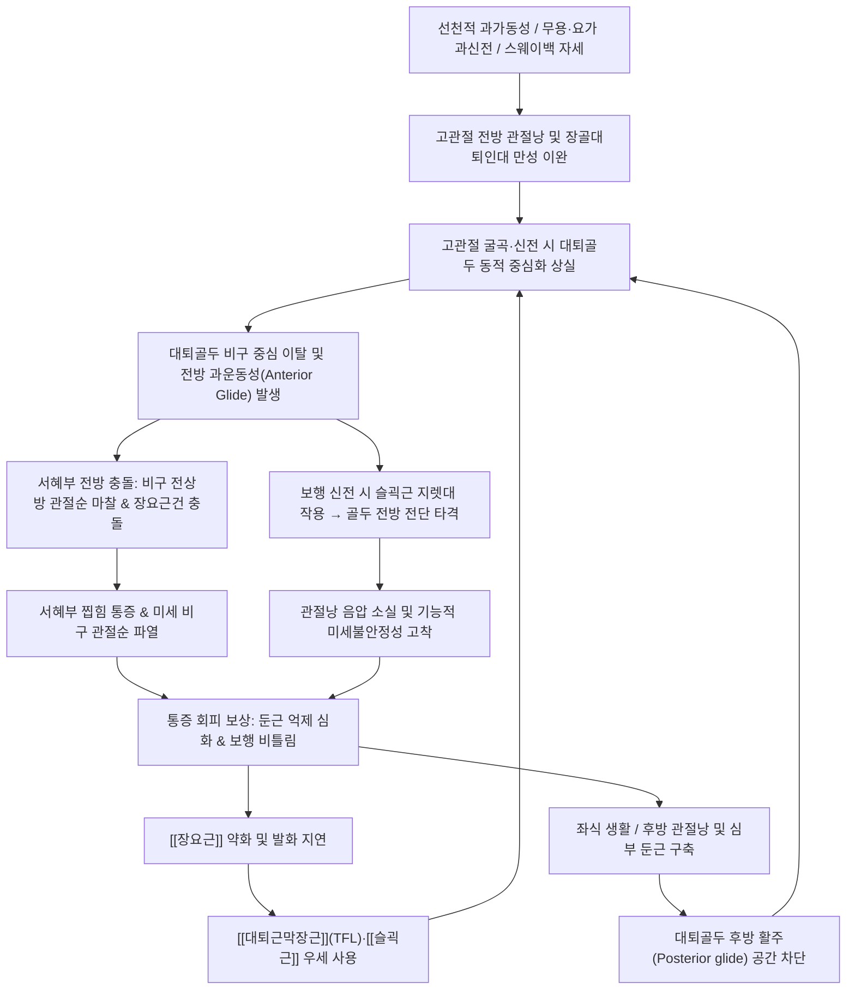

# 🦴 [[고관절 대퇴골 과운동성 증후군]] (Femoral Hypermobility Syndrome)

> **핵심 3줄 요약 (Key Summary)**:
> 🎯 **병소 부위 & 운동계 손상 기전**: 셜리 샤먼(Shirley Sahrmann)의 운동계 손상 증후군(Movement System Impairment, MSI) 분류에 속하는 대표적 기능적 미세불안정성 질환으로, [[고관절]] 굴곡·신전 동작 시 [[대퇴골]]두(Femoral head)가 [[비구]] 중심와(Acetabular fossa)에서 정상적인 후하방 구름-미끄러짐(Roll-and-glide)을 유지하지 못하고 전방·상방으로 과도하게 이탈·활주(Anterior glide)되는 동적 과운동성 질환이다.
> 🚩 **전형적 임상 양상 & 3대 징후**: ① 90도 이상 고관절 굴곡 시 서혜부 심부의 날카로운 찝힘 통증(Pinching pain) ② 보행 주기 신전 말기(Terminal stance)에 서혜부 전방 인대 장력 팽창으로 인한 당김통 ③ [[장요근]] 약화 및 [[대퇴근막장근]]·[[슬괵근]] 우세 사용 패턴, 그리고 [[골반]]을 앞으로 불쑥 내밀고 관절낭 인대에 매달려 서는 스웨이백(Sway-back) 체형이 전형적이다.
> 🛠️ **핵심 감별 검사 & 한·양방 다각적 치료 전략: [[FADIR 검사]] 양성 및 도수 후방 활주 보조 검사(Posterior Glide Correction Test)** 시 통증의 즉각 소실로 확진한다. 치료는 과도한 HVLA 스러스트를 엄격히 금기하고, 후방 연부조직 이완·대퇴골두 후하방 관절가동화·장요근 및 [[대둔근]] 선택적 재교육 [[추나]]와 함께, 전방 관절낭 부착부 [[신바로약침]]·[[자하거약침]] 및 인대 지지력을 강화하는 [[독활기생탕]], [[대방풍탕]]의 [[한의 통합 치료]] 복합 처방을 적용한다.

---

## 📌 목차
1. [질환 개요 & 해부학적 병태생리](#1-질환-개요--해부학적-병태생리)
2. [병태생리 메커니즘 & 생체역학적 악순환 네트워크](#2-병태생리-메커니즘--생체역학적-악순환-네트워크)
3. [임상 증상 & 이학적 검사 알고리즘](#3-임상-증상--이학적-검사-알고리즘)
4. [감별 진단 매트릭스](#4-감별-진단-매트릭스)
5. [한의 통합 치료 프로토콜](#5-한의-통합-치료-프로토콜)
6. [양방 치료 & 병용·의뢰 기준](#6-양방-치료--병용의뢰-기준)
7. [재활 운동 & 생활습관 티칭 가이드](#7-재활-운동--생활습관-티칭-가이드)
8. [사용자 진료실 핵심 필기 & 임상 노하우 (Melt-In)](#8-사용자-진료실-핵심-필기--임상-노하우-melt-in)
9. [출처 및 현대 학술 연구 요약](#9-출처-및-현대-학술-연구-요약)

---

## 1. 🩺 질환 개요 & 해부학적 병태생리

### 1.1 질환 정의 및 개념적 특성
[[고관절 대퇴골 과운동성 증후군]](Femoral Hypermobility Syndrome)은 대퇴골두가 비구 내에서 회전(Spin/Roll)할 때 고관절을 둘러싼 정적 안정화 기구(관절낭, 인대)의 병적 이완과 동적 안정화 근육군(장요근, 심부 외회전근)의 신경근 조절 실패로 인해, 관절의 순간 회전 중심(Instantaneous Center of Rotation, ICR)이 비구 중심와를 벗어나 다방향성, 특히 **전방(Anterior) 및 전상방(Anterosuperior)으로 병적 과운동성(Hypermobility)과 전단 활주(Shear glide)**를 일으키는 기능적 미세불안정성(Hip Microinstability) 질환이다.

물리치료학의 석학 셜리 샤먼(Shirley Sahrmann)의 운동계 손상 분류(MSI) 모델에서는 본 질환을 **'대퇴골 전방 활주 증후군(Femoral Anterior Glide Syndrome)'**의 핵심 병리축으로 규정한다. 정상적인 고관절 굴곡 시 대퇴골두는 후방 및 하방으로 미끄러져 들어가야 서혜부 전방의 연부조직과 비구순에 가해지는 압박을 피할 수 있다. 그러나 대퇴골 과운동성 증후군에서는 대퇴골두가 뒤로 미끄러지지 못하고 관절와 앞쪽으로 전위되면서 대퇴골두 전면부가 비구 전상방 변연(Acetabular rim), 비구 관절순(Labrum), 그리고 [[장요근]] 건을 반복적으로 충돌·압박하게 된다.

### 1.2 역학 및 호발 대상
* **전신 관절 과가동성(Generalized Joint Hypermobility, GJH)**:
  * 베이튼 과가동성 점수(Beighton Hypermobility Score)가 9점 만점 중 4~5점 이상인 선천적 결합조직 유연성 보유자에게서 압도적으로 호발한다.
  * 여성 호르몬(에스트로겐, 릴랙신)의 영향으로 관절낭과 인대의 교원섬유(Type I Collagen) 탄성 한계가 높은 젊은 여성(10대 후반~30대)에서 남성 대비 3~4배 이상 빈발한다.
* **극단적 고관절 가동 범위 직군**:
  * 발레 무용수, 현대 무용가, 기계체조 선수, 피겨 스케이팅 선수, 고난도 요가 및 필라테스 강사 등 매일 고관절의 과신전(Hyperextension), 과외전, 과외회전을 반복하는 직업군에서 관절낭의 미세 손상과 기계적 이완이 누적되어 발생한다.
* **체형 및 일상 생활습관**:
  * 골반을 전방으로 불쑥 내밀고 [[흉추]]를 뒤로 눕혀 고관절 인대에 체중을 걸치고 서 있는 **스웨이백(Sway-back Posture)** 보유자.
  * 좌식 업무 환경에서 엉덩이를 의자 끝에 걸치고 비스듬히 누워 앉는 자세(Slouched sitting)를 지속하여 장요근이 만성적으로 이완 약화된 사무직 종사자.

### 1.3 관련 해부학적 구조물
고관절의 해부학적 안정성은 골성 형태학(Bony Congruency), 정적 연부조직(Static Stabilizers), 동적 근육 복합체(Dynamic Stabilizers)의 정밀한 삼각 균형에 의존한다.

| 분류 | 세부 해부 구조물 | 정상 기능 및 생체역학적 역할 | 과운동성 증후군에서의 병리적 변화 |
| :--- | :--- | :--- | :--- |
| **골성 구조** | [[비구]](Acetabulum) & [[대퇴골]]두 | 골두의 약 40% 이상을 수용하는 구와관절(Ball-and-socket) | 경계선 비구 이형성(Borderline Dysplasia, LCEA 20~25°) 시 전방 피개력 결손으로 과운동성 악화 |
| | [[대퇴골경부]] & 전자간선 | 대퇴골의 체중 부하 축과 경체각(125°)을 형성하는 기둥 | 경체각 과대([[외반고]]) 또는 전경각 증가 시 전방 아탈구 벡터 증폭 |
| **정적 안정화 기구** | [[장골대퇴인대]](Iliofemoral Ligament) | 신전 및 외회전 시 강한 인장력으로 전방 지지(Y-ligament of Bigelow) | 만성 신전 스트레스로 인한 인대 신장 및 관절낭 전방 비후·이완 |
| | [[치골대퇴인대]](Pubofemoral Ligament) | 고관절 과외전 및 신전을 제한하는 하전방 지지체 | 과도한 외전 스트레칭으로 지지 장력 상실 |
| | [[좌골대퇴인대]](Ischiofemoral Ligament) | 후방 관절낭을 보강하며 내회전 및 신전 제한 | 만성 단축 또는 구축되어 대퇴골두의 후방 활주 공간 차단 |
| | 윤선(Zona Orbicularis) | 관절낭 협착부로서 골두 경부를 반지처럼 감싸는 섬유환 | 이완 시 대퇴골두 견인(Distraction) 저항력 상실 |
| | [[비구 관절순]](Acetabular Labrum) | 관절강 밀폐 음압(Suction seal) 형성 및 골두 안착 | 대퇴골두 전방 돌출에 의한 미세 전단력으로 전상방 순-연골 분리(Chondrolabral disruption) 유발 |
| **동적 안정화 기구** | [[장요근]](Iliopsoas: 대요근·장골근) | 대퇴골두 전면을 활주하며 골두를 비구와로 압박 중심화 | 수축 타이밍 지연 및 약화로 골두를 후방으로 밀어주는 지렛대 상실 |
| | 심부 외회전근군 6종 | 대퇴골두 후면을 비구 내로 압착시키는 후방 동적 밴드 | [[이상근]], [[상쌍자근]], [[하쌍자근]], [[내폐쇄근]], [[외폐쇄근]], [[대퇴방형근]] 긴장 불균형으로 중심축 와해 |
| | [[대둔근]](Gluteus Maximus) | 고관절 주동 신전근으로서 골두 전방 변위 억제 | 신경근 억제(Gluteal amnesia)로 신전 시 슬괵근에 주도권 상실 |
| | [[중둔근]](Gluteus Medius) & [[소둔근]] | 대퇴골두를 상외측에서 비구 안으로 견고히 안착 | 전방 섬유와 후방 섬유의 협응 부전으로 전포집 충돌 발생 |
| | [[대퇴근막장근]](TFL) & [[봉공근]] | 보조적 고관절 굴곡근 | 장요근 약화 시 과도하게 대상 수축하여 골두를 전상방으로 견인 |
| | [[대퇴직근]](Rectus Femoris) | 슬관절 신전 및 고관절 굴곡의 2관절 근육 | 장요근 불능 시 단축 수축하여 대퇴골두를 전하방에서 비틀어 충돌 유도 |
| | [[슬괵근]](Hamstrings) | 고관절 신전 및 슬관절 굴곡 담당 2관절 근육군 | 대둔근 억제 시 과활성화되어 대퇴골 원위부를 후방으로 당기며 골두를 전방으로 튕겨냄 |

---

## 2. ⚡ 병태생리 메커니즘 & 생체역학적 악순환 네트워크

### 2.1 상대적 유연성(Relative Flexibility)의 법칙과 근육 불균형
셜리 샤먼의 운동계 손상 증후군 이론에서 가장 중추적인 생체역학 원리는 **'상대적 유연성의 법칙'**이다. 인체 분절이 움직일 때, 저항이 가장 적은 관절이나 방향으로 먼저 움직임이 발생한다.
* 정상 상태에서는 고관절 굴곡 시 후방 관절낭과 둔부 근육이 유연하게 늘어나면서 대퇴골두가 후하방으로 부드럽게 미끄러져 들어가야 한다.
* 그러나 좌식 생활, 둔부 긴장, 혹은 과거의 외상으로 인해 고관절 후방 관절낭(Posterior capsule)과 심부 외회전근([[이상근]], [[대퇴방형근]] 등)이 단축·구축되어 있으면 후방 미끄러짐에 대한 기계적 저항이 급증한다.
* 반면 전방 관절낭과 [[장골대퇴인대]]는 반복된 신전 부하(스웨이백 자세, 댄서의 과신전 등)로 늘어나 유연해져 있다.
* 결과적으로 고관절을 굴곡할 때 대퇴골두는 저항이 강한 후방으로 들어가지 못하고, **상대적으로 저항이 없는 전방 관절낭 방향으로 불쑥 밀려나게(Anterior glide)** 된다.

### 2.2 장요근의 능동적 중심화(Centration) 실패
[[장요근]](Iliopsoas)은 단순한 고관절 굴곡근이 아니다. 장요근의 건은 대퇴골두 전면을 비스듬히 감싸며 주행하여, 굴곡 각도 0~90도 전 구간에서 수축 시 대퇴골두를 비구의 중심와 깊숙한 곳으로 당겨 누르는 **동적 후하방 압박 중심화(Dynamic Centration)** 작용을 수행한다.
1. 장요근이 약화되거나 발화 타이밍(Motor firing recruitment)이 지연되면, 고관절 굴곡을 개시할 때 대퇴골두를 비구에 밀어 넣는 전방 지지력이 소실된다.
2. 이때 인체는 고관절 굴곡을 완수하기 위해 천층의 보조 굴곡근인 [[대퇴근막장근]](TFL), [[봉공근]](Sartorius), [[대퇴직근]](Rectus femoris)을 과도하게 우세 수축(Synergistic dominance)시킨다.
3. TFL과 대퇴직근은 대퇴골두보다 외측 또는 전상방에 위치하므로, 이들이 주도적으로 당기면 대퇴골두는 비구 중심에서 벗어나 전상방으로 끌려 올라가며 비구 전상방 변연과 관절순을 강하게 짓이기게 된다.

### 2.3 슬괵근 우세(Hamstring Dominance)와 전방 전단 지렛대 현상
보행 시 다리가 몸통 뒤로 빠지는 고관절 신전(Hip Extension) 단계에서 생체역학적 재앙이 촉발된다.
* 정상 고관절 신전의 주동근은 대퇴골 대전자 부근에 부착하여 골두를 중심화하는 [[대둔근]]이다.
* 그러나 현대 좌식 생활로 인해 대둔근이 비활성화(Gluteal amnesia)되면, 원위부 경골과 비골에 부착하는 [[슬괵근]](Hamstrings: [[대퇴이두근]], [[반막양근]], [[반건양근]])이 신전을 주도하게 된다.
* **지레의 원리(Leverage mechanics)**: 슬괵근의 힘선은 좌골결절에서 무릎 아래로 이어지므로, 수축 시 대퇴골의 원위부를 뒤쪽(후방)으로 강하게 당긴다.
* 대퇴골 원위부가 뒤로 당겨지면 비구 관절와를 받침점(Fulcrum)으로 삼아 대퇴골두는 반대 방향인 **전방으로 강하게 튕겨 나가는 전방 전단력(Anterior shear force)**을 받게 된다.
* 이 전방 전단력은 걸음을 걸을 때마다 수천 번씩 전방 관절낭과 장골대퇴인대를 안쪽에서 바깥쪽으로 타격하여 영구적인 인대 이완과 관절순 박리를 유도한다.

### 2.4 생체역학적 악순환 네트워크 (Mermaid)



---

## 3. 🔍 임상 증상 & 이학적 검사 알고리즘

### 3.1 주요 자각 증상 및 병력 청취
* **서혜부 심부의 날카로운 찝힘 통증(Anterior Groin Pinching Pain)**:
  * 자동차 시트에 깊숙이 앉거나, 낮은 소파에서 일어날 때, 양말이나 신발 끈을 묶기 위해 허벅지를 가슴 쪽으로 90° 이상 당길 때 사타구니 안쪽에서 무언가 덜컥하고 끼이는 듯한 통증을 호소한다.
* **보행 시 신전 말기(Terminal Stance) 전방 통증**:
  * 환측 다리가 몸 뒤쪽으로 길게 뻗어지는 순간 서혜부 앞쪽이 팽팽하게 당겨지거나 찢어질 것 같은 둔통 및 불안정감이 발생한다.
* **클릭음(Clicking) 및 덜컹거림(Clunking)**:
  * 누워서 다리를 들어 올렸다가 내릴 때, 혹은 고관절을 회전할 때 사타구니 깊은 곳에서 툭 하는 탄발음과 함께 뼈가 제자리를 벗어났다가 들어가는 듯한 아탈구감(Subluxation feeling)을 자각한다.
* **앉은 자세에서의 불편감 및 스웨이백 체형**:
  * 오랜 시간 앉아 있을 때 둔부 깊은 곳의 뻐근함과 함께 서혜부 압박통이 발생한다.
  * 서 있을 때 골반을 전방으로 이동시키고 무릎을 과신전(Genu recurvatum)하여 장골대퇴인대에 기대어 서 있는 스웨이백 정렬이 관찰된다.

### 3.2 이학적 특수 검사 프로토콜

| 검사명 | 검사 방법 및 시술 절차 | 양성 반응 소견 | 임상적 의미 및 기전 |
| :--- | :--- | :--- | :--- |
| [[FADIR 검사]] (전방 충돌 검사) | 환자를 앙와위로 두고 고관절을 90° 굴곡, 내전(Adduction), 내회전(Internal rotation) 강제 | 서혜부 전방에 익숙한 찝힘 통증 또는 날카로운 걸림 발생 | 대퇴골두 전외측 경부가 비구 전상방 관절순 및 관절낭을 압박 |
| **도수 후방 활주 보조 검사** (Posterior Glide Correction Test) | 1단계: 통증 유발 각도까지 능동 굴곡 확인<br>2단계: 검사자가 대퇴골 근위부 전면에 수장부를 대고 후하방(Floor 방향)으로 강하게 압박 유지하며 재굴곡 | **1단계에서 발생하던 서혜부 통증이 80~100% 즉각 소실** | 대퇴골 전방 활주가 통증의 직접적 원인임을 증명하는 **결정적 확진 검사** |
| **복와위 고관절 신전 검사** (Prone Hip Extension) | 복와위에서 환자에게 무릎을 편 채 다리를 천장 쪽으로 들어 올리게 하며 검사자가 대둔근과 슬괵근을 동시 촉진 | 슬괵근이 대둔근보다 먼저 수축하며, 대퇴골두가 침대 바닥 쪽(전방)으로 돌출 | 슬괵근 우세 패턴 확인, 대퇴골두 전방 전단력 유발 검증 |
| **베이튼 과가동성 검사** (Beighton Score) | 9점 만점 척도: ① 양측 새끼손가락 90° 이상 배굴(2) ② 양측 엄지 전완 접촉(2) ③ 양측 주관절 과신전 10° 이상(2) ④ 양측 슬관절 과신전 10° 이상(2) ⑤ 무릎 펴고 손바닥 바닥 접촉(1) | **4점 이상 (성인 기준)** | 전신 인대 이완성 및 선천적 과운동성 체질 확인 |
| **고관절 견인 검사** (Hip Distraction Test) | 앙와위에서 고관절 30° 굴곡, 30° 외전 상태에서 대퇴골을 장축 방향으로 견인 | 관절 간격이 과도하게 벌어지거나 불안정성 공포(Apprehension) 호소 | 관절낭 이완 및 정적 밀폐(Suction seal) 상실 확인 |
| **다이얼 검사 & 로그 롤** (Dial & Log Roll Test) | 앙와위에서 하지를 완전히 이완시킨 후 대퇴부를 잡고 내외회전 굴림 | 외회전 가동 범위가 45°를 초과하여 침대 바닥에 발이 닿으며 부드러운 저항감 결여 | 장골대퇴인대 전방 섬유의 병적 이완 확인 |
| [[Thomas 검사]] (장요근 평가) | 앙와위에서 건측 무릎을 가슴에 붙일 때 환측 허벅지가 침대에서 뜨는지 확인 | 환측 허벅지가 뜨며 외전(J-sign)되거나 대퇴골두가 전방 돌출 | 장요근 단축 대퇴근막장근 과긴장 구별 |
| [[Ober 검사]] (장경인대 평가) | 측와위에서 고관절을 외전·신전 후 하지를 자유 낙하시킴 | 하지가 수평선 아래로 떨어지지 않고 공중에 뜸 | TFL 및 [[장경인대]]의 구축 확인 |

### 3.3 이학적 진단 알고리즘 흐름도

```
[서혜부 찝힘 및 보행 시 신전 말기 통증 호소]
                   │
                   ▼
         [FADIR 검사 시행]
         ├─ 음성 ───▶ 관절 외 원인 검토 ([[장요근점액낭염]], [[스포츠 탈장]], 내전근 파열)
         └─ 양성 (찝힘 통증 재현)
                   │
                   ▼
   [도수 후방 활주 보조 검사 (Posterior Glide Correction)]
   - 대퇴골 근위부를 후하방으로 지긋이 압박하며 고관절 재굴곡
         │
         ├─ 통증 소실 없음 ──▶ 골성 충돌 ([[대퇴비구 충돌 증후군]] Cam/Pincer), 관절순 대형 파열
         └─ 통증 즉각 소실 (80% 이상 경감)
                   │
                   ▼
  [고관절 대퇴골 과운동성(전방 활주) 증후군 기능적 확진]
         │
         ├─ 복와위 고관절 신전 시 슬괵근 선행 발화 확인 ──▶ 슬괵근 우세성 운동 조절 장애
         ├─ Beighton Score ≥ 4/9 ──▶ 전신 결합조직 과가동성 체질 병발
         └─ Sway-back 체형 및 후방 관절낭 경결 확인 ──▶ 생체역학적 교정 대상 확정
```

---

## 4. 🔀 감별 진단 매트릭스

고관절 전방 통증은 매우 다양한 골성, 관절순, 건막, 신경학적 병변이 복합적으로 얽혀 나타나므로 정밀한 감별 진단이 필수적이다.

| 질환명 | 호발 연령 및 체형 | 주 통증 부위 및 양상 | 특이 이학적 검사 소견 | 영상의학적 특징 (X-ray / MRI) | 대퇴골 과운동성 증후군과의 핵심 감별점 |
| :--- | :--- | :--- | :--- | :--- | :--- |
| [[고관절 대퇴골 과운동성 증후군]] | 10~30대 여성, 무용수, 스웨이백 | 서혜부 전방 찝힘, 보행 신전 시 당김 | FADIR 양성, **후방 활주 시 즉각 통증 소실**, Beighton 양성 | X-ray 골격 정상, MRI 상 관절낭 이완 외 특이 골변형 없음 | 도수적으로 대퇴골두를 뒤로 밀면 찝힘 통증이 사라짐 |
| 구조적 [[대퇴비구 충돌 증후군]](FAI) | 20~40대 운동선수, 남성 다발 | 깊은 서혜부 'C-sign' 통증, 둔통 | FADIR 강양성, 도수 후방 활주 시에도 통증 지속 | Alpha angle > 55° (Cam), Cross-over sign (Pincer) | 뼈의 구조적 기형(골극)으로 도수 정복에 통증이 소실되지 않음 |
| 비구 관절순 파열 ([[관절순 파열]]) | 20~40대 외상력 또는 만성 마이크로 외상 | 날카로운 서혜통, 기계적 잠김(Catching), 클릭음 | McCarthy 검사 양성, Thomas 검사 시 클릭 | 고관절 MRA(조영 MRI) 상 전상방 비구순 파열선 및 관절순하 낭종 | 관절 내부의 기계적 걸림과 조영 MRI 상의 해부학적 단열 |
| [[장요근건염]] 및 점액낭염 | 달리기 선수, 과도한 계단 보행자 | 서혜인대 바로 아래 압통, 능동 굴곡 시 통증 | Ludloff 검사 양성, 장요근 신전 스트레칭 통증 | 초음파 상 장요근건 주위 활액 저류 및 도플러 혈류 증가 | 관절 내 찝힘이 아닌 장요근 부착부 표재성 압통 중심 |
| [[고관절 골관절염]](Coxarthrosis) | 50대 이상 중장년 및 고령자 | 서혜부, 둔부, 대퇴부 전반의 기상 시 강직통 | 고관절 모든 방향(굴곡·내회전·외전)의 극심한 ROM 제한 | X-ray 상 관절강 협소, 연골하 골경화, 골극 형성 | 관절 가동역 전반의 비가역적 골성 구축 및 고령 호발 |
| 스포츠 탈장 ([[스포츠 탈장]]) | 격렬한 회전 운동 남성 축구선수 | 치골결합부, 서혜관 외환 부위의 작열통 | 저항성 체간 굴곡 및 [[내전근군]] 수축 시 치골통 | 골반 MRI 상 복직근-내전근 건막 부착부 파열 및 치골 골수 부종 | 고관절 자체의 회전 운동과 무관하며 복벽 긴장 시 악화 |
| [[이상지각성 대퇴신경통]](Meralgia Paresthetica) | 비만, 꽉 끼는 바지 착용자 | 대퇴 전외측의 작열감, 저림, 감각 저하 | ASIS 내하방 외측대퇴피신경 압통, Tinel 징후 | 신경전도 검사(NCV) 상 지연, 영상의학적 특이 소견 없음 | 운동 기능 장애나 관절 내 찝힘 없이 순수 감각 신경 포착 증상 |
| [[요추 추간판 탈출증]](L2-L4) | 30~50대 사무직, 중량물 취급자 | 서혜부 방사통, 대퇴 전면 감각 이상 | [[SLR 검사]], 대퇴신경 신장 검사(FNS Test) 양성 | 요추 MRI 상 L2/3, L3/4 추간판 탈출 및 신경근 압박 | 기침·재채기 시 악화되며 슬개건 반사 저하 동반 |

---

## 5. 🌿 한의 통합 치료 프로토콜

한의학에서 고관절 대퇴골 과운동성 증후군은 관절을 결속하는 간신(肝腎)의 기혈이 쇠약해진 상태에서 국소적인 풍한습(風寒濕)과 담음(痰飮), 기체어혈(氣滯瘀血)이 경락을 침범하여 발생하는 **'근골위약(筋骨痿弱)', '비증(痺證)', '고비(股痺)'**의 범주로 파악한다. 치료는 과도한 이완을 보이는 전방 구조물을 단단하게 강화하고, 구축된 후방 조직을 풀어주며, 뇌-신경근 협응을 회복시키는 통합적 다각 치료를 적용한다.

### 5.1 추나요법 (근막이완, 관절가동, 등척성 안정화 추나)

#### ⚠️ HVLA(고속저진폭) 관절교정 스러스트 절대 금기
* 본 질환은 관절이 굳어있는 저가동성(Hypomobility)이 아니라, 관절낭과 인대가 이미 비정상적으로 늘어나 있는 **과가동성(Hypermobility) 질환**이다.
* 고관절이나 골반부에 무리한 회전성 HVLA 스러스트(Thrust)나 강한 도수 견인(Traction)을 적용하면, 이미 늘어난 전방 관절낭과 장골대퇴인대에 추가적인 미세 파열을 유발하여 고관절 미세불안정성을 치명적으로 악화시킨다.
* 따라서 치료의 중심은 **'저속 관절가동술(Mobilization)', '연부조직 근막이완술(MFR)', '등척성 수축 후 이완(PIR)'**으로 국한해야 한다.

#### 대퇴골두 후하방 활주 관절가동 기법 (Posterior-Inferior Glide Mobilization)
1. 환자를 앙와위로 눕히고 환측 고관절을 약 70~80° 굴곡, 약간의 외전 상태를 유지한다.
2. 치료사는 환자의 허벅지 안쪽 깊숙이 수장부 또는 전용 벨트를 걸고 대퇴골두 근위부에 접촉한다.
3. 치료사의 체중을 이용하여 대퇴골 장축의 직각 방향인 **후방(바닥 쪽) 및 약간 하방(발 쪽)**으로 Grade II~III의 지긋한 진동 및 신장력을 1회 30초, 3~5세트 가한다.
4. 이 기법은 후방 관절낭의 섬유성 유착을 선택적으로 신장시켜 대퇴골두가 굴곡 시 안착할 수 있는 해부학적 수용 공간을 물리적으로 회복시킨다.

#### 후방 관절낭 및 심부 둔근 등척성 수축 후 이완 (PIR Technic)
1. 환자를 측와위로 눕히고 환측 고관절을 굴곡·내전시켜 이상근과 후방 관절낭이 가볍게 긴장하는 장벽(Barrier)에 도달한다.
2. 환자에게 치료사의 저항에 맞서 약 20%의 약한 힘으로 외전·외회전 방향으로 버티게 한다(등척성 수축 7초).
3. 환자가 숨을 내쉬며 완전히 이완할 때, 새로운 긴장 장벽으로 고관절 내전을 부드럽게 유도한다(3회 반복).

### 5.2 침구 및 전침 치료

#### 주요 경혈 및 자침 심도·안전 가이드
* [[비관]](ST31): 대퇴직근과 대퇴근막장근 사이 함요부. 대퇴골두 전방 관절낭과 장요근의 긴장성 병변을 조절한다. 직자 1.5~2.0촌.
* [[충문]](SP12): 서혜인대 중점 내측, 대퇴동맥 박동부의 외측. 장요근 심부로 접근하는 요혈이다.
  * ⚠️ **안전 수기**: 반드시 검지 손가락으로 대퇴동맥의 박동을 촉지하여 혈관을 내측으로 보호 격리한 후, 동맥 외측 0.5촌 지점에서 대퇴신경 주행을 고려하여 직자 1.0~1.5촌 심자로 장요근 건막에 도달한다. 전기가 오르는 듯한 침감이 발생하면 침을 살짝 뒤로 뺀다.
* [[기충]](ST30): 곡골 양옆 2촌, 치골결합 상연. 서혜부 장골근 내측 섬유의 긴장을 해소한다. 사자 0.8~1.2촌.
* [[환도]](GB30): 대전자와 천골열공을 연결하는 선의 외측 1/3 지점. 대둔근과 이상근 심부 좌골신경 분지를 자극한다. 3~3.5촌 장침으로 수직 심자하여 묵직한 득기감(得氣感)을 유도한다.
* [[거료]](GB29): ASIS와 대전자 정점을 연결하는 선의 중점. 중둔근 전방 섬유 및 관절낭 외측 안정화. 직자 1.5~2.0촌.
* [[질변]](BL54) & [[포황]](BL53): 천골 외측 둔부 심부 밴드 이완을 위해 2.5~3.0촌 직자.
* 요추 [[협척혈]](華佗夾脊穴, L1~L3 및 L4~S1): 장요근을 지배하는 요신경총(L1-L3)과 둔근을 지배하는 상·하둔신경 기원부의 신경근 흥분성을 정상화하기 위해 1.5촌 심자로 척추 기립근 심부 다열근에 침첨을 도달시킨다.
* **원위 취혈**: [[양릉천]](GB34, 근회), [[족삼리]](ST36, 하지 건비), [[삼음교]](SP6, 간신음 보강), [[태충]](LR3, 기체 소통).

#### 전침(Electroacupuncture) 치료 프로토콜
* **비관(ST31) - 거료(GB29)**: 저주파 2Hz, 연속파(Continuous wave), 15분. 전방 관절낭 부위의 통증성 염증 신경전달을 차단하고 엔도르핀 분비를 촉진한다.
* **환도(GB30) - L5 협척혈**: 2Hz 연속파, 20분. 억제된 둔부 근육의 운동 신경원을 자극하여 지근(Type I fiber) 중심의 고관절 동적 안정화 기구를 재활성화한다.

### 5.3 도침 치료 (Acupotomy)
대퇴골 과운동성 증후군에서 도침은 **후방 관절낭 및 대전자 후방 회선근 건 부착부의 섬유성 유착 해소**에 국한하여 엄격히 적용해야 한다.
* **시술 부위**: 대전자 후연(대퇴방형근, 내폐쇄근 부착부) 및 좌골결절 외측연.
* **절대 금기**: **서혜부 전방 관절낭 및 장골대퇴인대 부위는 절대 도침으로 절개해서는 안 된다.** 전방 인대를 절개하면 관절낭 이완이 치명적으로 심화되어 관절 탈구 위험을 초래한다.
* **수기법**: 0.5×50mm 일회용 침도를 사용하여 대전자 후연의 경결점을 촉지하고, 골면에 직각으로 진입하여 골막에 닿은 후 인대 주행 방향과 평행하게 종방향 절개 2~3회, 횡방향 박리 1~2회를 신속히 시행하고 발침 후 강하게 압박 지혈한다.

### 5.4 약침 및 봉약침 치료
* [[신바로약침]] (GCSB-5):
  * 서혜부 전방 비구 관절순 전상방 부착부 및 관절낭 연부조직에 1.0~1.5cc 주입.
  * COX-2 및 iNOS 억제를 통해 미세 충돌로 발생한 활액막염과 신경성 염증을 빠르게 해소한다.
* [[자하거약침]](Hominis Placenta):
  * 장골대퇴인대 부착부(AIIS 하방) 및 대전자 부착부에 각각 0.5cc씩 분할 주입.
  * 인체 태반 추출 결합조직 재생 인자를 통해 이완된 전방 관절낭 인대의 콜라겐 합성을 촉진하고 결합력을 보강한다.
* [[황련해독약침]]:
  * 급성 서혜부 활액낭염 및 열감성 찝힘 통증 시 비관혈 주위 관절낭에 0.5cc 주입하여 국소 염증을 즉각 청열소종(淸熱消腫).
* [[봉약침]](Bee Venom Pharmacopuncture):
  * 10,000:1 또는 20,000:1 정제 봉독을 환도 및 대전자 주위 압통점에 0.1~0.2cc씩 피내·피하 주입.
  * 멜리틴(Melittin)과 아돌라핀 성분이 만성 허혈성 건막 부착부의 모세혈관 순환을 증진시키고 만성 둔통을 차단한다.

### 5.5 한약 치료 (방제 의학적 변증)

| 변증 유형 | 주증 및 신체 특성 | 추천 처방 | 주요 구성 약물 및 방제 생체역학적 기전 |
| :--- | :--- | :--- | :--- |
| **근골위약(筋骨痿弱) & 관절이완형** | 전신 관절 과가동성 체질, 피로 시 고관절 불안정 및 덜컹거림, 설담태백, 맥침세약 | [[독활기생탕]]<br>(獨活寄生湯) 가미 | 독활, 상기생, 두충, 우슬, 세신, 진교, 복령, 계심, 방풍, 천궁, 인삼, 감초, 당귀, 작약, 숙지황.<br>간신을 보하고 근골을 튼튼히 하여 이완된 관절낭과 인대의 교원질 탄성을 증강 |
| **기체어혈(氣滯瘀血) & 찝힘손상형** | 서혜부의 날카로운 자통(刺痛), 보행 시 찌르는 통증, 동작 개시 곤란, 설자암, 맥삽 | [[당귀수산]]<br>(當歸鬚散) 합<br>[[소경활혈탕]] | 당귀미, 적작약, 도인, 홍화, 천궁, 도우슬, 방기, 위령선, 백지, 창출, 황백 등.<br>반복된 전방 충돌로 비구순 및 관절낭에 정체된 미세 혈종과 조직 부종을 신속 소퇴 |
| **풍한습비(風寒濕痺) & 둔부구축형** | 날씨가 흐리거나 차가우면 통증 악화, 둔부 깊은 곳의 당김과 무거움, 후방 관절낭 경결 | [[대방풍탕]]<br>(大防風湯) 가미 | 방풍, 백출, 부자, 황기, 당귀, 백작약, 두충, 숙지황, 강활, 천궁, 우슬 등.<br>온경산한(溫經散寒)하고 기혈을 크게 보하여 후방 근막의 만성 경축을 풀고 혈행 개선 |
| **중기하함(中氣下陷) & 스웨이백형** | 체력이 극도로 저하된 마른 여성, 서 있을 때 골반을 내밀고 처지는 자세, 만성 서혜통 | [[보중익기탕]]<br>(補中益氣湯) 가미 | 황기, 인삼, 백출, 당귀, 진피, 승마, 시호, 감초 등.<br>비위 기운을 끌어올려 코어 심부 근육의 긴장도를 유지하고 체간 중립 지지력을 회복 |
| **근련긴급(筋攣緊急) & 급성연축형** | 장시간 좌식 후 대퇴근막장근 및 장요근 급성 연축성 찝힘, 다리를 펴지 못함 | [[작약감초탕]]<br>(芍藥甘草湯) 가미 | 백작약 24g, 감초 12g, 모과 8g, 신근초 8g.<br>골격근의 과도한 아세틸콜린 수용체 감작을 억제하고 근방추 긴장도를 즉각 이완 |

---

## 6. 💊 양방 치료 & 병용·의뢰 기준

### 6.1 양방 보존적 치료 현황
* **약물 치료**: 급성 염증 및 찝힘 악화 시 NSAIDs(Celecoxib, Meloxicam 등)를 2~4주간 단기 투여하여 활액막 자극을 완화한다.
* **초음파 유도하 관절강 내 주사 요법**:
  * 심한 통증으로 재활 운동이 불가능한 경우 국소마취제(Lidocaine)와 극소량의 트리암시놀론(Triamcinolone 10~20mg)을 혼합하여 고관절강 내로 1회 주입. (잦은 스테로이드 주사는 관절 연골과 인대를 더욱 약화시키므로 연 2~3회 이하로 엄격히 제한).
  * 관절 연골 보호 및 완충을 위한 고분자 히알루론산(Hyaluronic acid) 주사 병행.
  * 최근에는 관절낭 인대 강화를 유도하기 위한 PRP(Platelet-Rich Plasma, 자가 혈소판 풍부 혈장) 주사가 연구되고 있다.

### 6.2 협진 및 병용 치료 시너지 전략
* **급성기 통증 차단**: 양방 정형외과/재활의학과의 초음파 검진을 통해 비구순 파열 정도를 확인하고, 급성 활액막염에는 단기 NSAIDs 또는 관절강 내 흡인 치료를 병행하면서 한의 침·약침 치료를 즉시 결합하여 염증 해소 기간을 단축한다.
* **관절낭 재생 및 재활 극대화**: 양방 도수치료 시 발생하기 쉬운 과도한 관절 가동화를 방지하도록 한의 차트와 소견서를 공유하고, 한의 등척성 추나 및 근막이완술을 중심으로 신경근 조절 훈련을 일원화한다.

### 6.3 수술적 적응증 및 양방 전원 레드플래그
아래와 같은 소견이 관찰되는 환자는 단순 기능적 과운동성 증후군을 넘어선 구조적 파탄 상태이므로 즉시 상급 병원 정형외과(고관절 분과)로 의뢰해야 한다.

```
⚠️ [고관절 과운동성 환자의 즉각적 양방 전원 레드플래그 (Red Flags)]
1. 비구 관절순의 전층 파열(Full-thickness Tear) 및 대형 관절순하 낭종(Paralabral cyst)으로 인한 지속적 잠김(Catching/Locking).
2. 구조적 비구 골 결손: 경계선 수준을 넘어선 심각한 비구 이형성증(LCEA < 20°).
   → 비구주위 절골술(Periacetabular Osteotomy, PAO) 필요.
3. 3~6개월 이상의 적극적인 한·양방 보존적 치료에도 불구하고 보행 불능 및 서혜통이 지속되는 중증 미세불안정성.
   → 관절경하 관절낭 중첩술(Capsular Plication) 및 관절순 봉합술 적응증.
4. 체중 부하 시 서혜부 및 둔부의 붕괴감과 함께 X-ray 상 대퇴골두 음영 불균일 및 초승달 징후(Crescent sign).
   → 대퇴골두 무혈성 괴사(AVN) 배제 필요.
5. 발열, 오한, 국소 열감 및 관절강 천자 시 화농성 삼출액 소견.
   → 감염성 관절염(Septic Arthritis) 응급 배제.
```

---

## 7. 🏃 재활 운동 & 생활습관 티칭 가이드

대퇴골 과운동성 증후군의 재활 운동은 근육의 크기를 키우는 것이 아니라, **'대퇴골두가 비구 중심을 벗어나지 않도록 통제하는 신경근 운동 조절(Motor Control)'**을 재학습시키는 것이 알파이자 오메가이다.

### 7.1 단계별 기능적 재활 운동 프로토콜

#### 1단계: 장요근 선택적 인지 및 활성화 (TFL 비활성화 상태)
* **목적**: [[대퇴근막장근]](TFL)과 대퇴직근의 대상 작용을 끄고, 심부 장요근 단독으로 대퇴골두를 후방으로 당기며 굴곡을 시작하도록 재교육.
* **방법**:
  1. 환자는 의자에 바르게 앉아 척추 중립을 유지한다.
  2. 환자의 손을 서혜부 외측(TFL 부위)에 얹어 이 근육이 단단해지는지 감시한다.
  3. 무릎을 가슴 쪽으로 들어 올릴 때, 무릎을 1~2cm만 아주 살짝 들어 올리며 "사타구니 깊은 곳(장요근)에서만 힘이 들어가고 허벅지 바깥쪽(TFL)은 말랑말랑하게 유지하십시오"라고 지시한다.
  4. 5초 유지 후 천천히 내리기를 10회씩 3세트 반복한다.

#### 2단계: 대둔근 단독 분리 강화 (Prone Hip Extension with Knee Flexion)
* **목적**: 고관절 신전 시 [[슬괵근]]의 선행 수축을 억제하고 [[대둔근]]을 주동근으로 재동원하여 대퇴골두 전방 튕김 방지.
* **방법**:
  1. 환자는 엎드린(복와위) 상태에서 환측 무릎을 90° 굴곡한다(슬괵근을 단축시켜 기계적 능동 불충분 상태로 만듦).
  2. 둔부에 손을 얹고, 엉덩이 근육을 먼저 꽉 쥐어 수축시킨 뒤 발바닥을 천장 쪽으로 3~5cm만 들어 올린다.
  3. 허리가 꺾이지 않도록 복부에 가벼운 긴장을 유지한다. 1회 5초 유지, 15회씩 3세트.

#### 3단계: 네발기기 락킹 (Quadruped Rocking — 골드 스탠다드)
* **목적**: 체중 부하 하에서 척추 중립을 유지하며 고관절 굴곡 시 대퇴골두가 후하방으로 미끄러져 들어가는 고유수용성 감각 체득.
* **방법**:
  1. 네발기기 자세(양손은 어깨 아래, 무릎은 고관절 아래)를 취한다.
  2. 요추가 굽어지거나 과신전되지 않도록 중립 척추를 견고하게 유지한다.
  3. 엉덩이를 천천히 발뒤꿈치 쪽으로 뒤로 밀면서 고관절을 깊게 굴곡시킨다.
  4. 이때 서혜부에 찝힘 통증이 발생하는 지점 바로 직전(Pain-free range)까지만 이동했다가 원위치로 돌아온다.
  5. 20회씩 하루 3회 시행한다. 점차 고관절이 통증 없이 더 깊숙이 후방 활주되는 것을 체감하게 된다.

#### 4단계: 동적 중심화 브릿지 및 몬스터 워크 (Dynamic Centered Bridging & Banded Walk)
* **목적**: 중둔근 후방 섬유와 외회전근군을 통합하여 기립 및 보행 중 대퇴골두 중심와 안착력 고착.
* **방법**:
  1. 앙와위에서 무릎 사이에 탄력 밴드를 걸고 양발을 골반 너비로 벌린다.
  2. 밴드를 가볍게 바깥쪽으로 밀어내는 외회전 토크를 유지한 채, 둔근을 수축하며 골반을 들어 올린다.
  3. 슬괵근에 쥐가 나지 않고 대둔근 상하부에 집중적인 자극이 가도록 지도한다(15회, 3세트).

### 7.2 일상생활 금기 동작 및 자세 티칭 가이드
1. **스웨이백(Sway-back) 자세 절대 엄금**:
   - 서 있을 때 골반을 전방으로 불쑥 내밀고 상체를 뒤로 젖히며 서는 습관은 전방 관절낭 인대에 온몸의 체중을 매달아 늘어뜨리는 행위이다. 반드시 복부와 둔부에 가벼운 텐션을 유지하여 골반을 복사뼈 수직선상에 정렬하도록 티칭한다.
2. **과도한 런지 스트레칭 금기**:
   - 요가나 헬스장에서 사타구니 앞쪽을 늘리겠다고 뒷다리를 길게 빼고 골반을 바닥 쪽으로 강하게 내리누르는 런지 스트레칭은 전방 관절낭을 파열시키는 최악의 동작이다. 장요근 스트레칭 시에는 골반을 후방 경사(Posterior pelvic tilt)시켜 대퇴골두가 앞으로 밀리지 않는 범위 내에서만 정밀하게 시행해야 한다.
3. **양반다리 및 쩍벌 좌식 금지**:
   - 바닥에 양반다리로 앉거나 소파에서 다리를 과도하게 벌리고 앉는 자세는 대퇴골두에 회전 비틀림 스트레스를 주므로 의자 착석 생활로 전환한다.
4. **수면 자세 티칭**:
   - 앙와위로 잘 때는 무릎 밑에 베개를 받쳐 고관절을 약 15~20도 굴곡시켜 전방 관절낭 인대에 가해지는 휴식기 장력을 완전히 제거해 주어야 한다.

---

## 8. 💡 사용자 진료실 핵심 필기 & 임상 노하우 (Melt-In)

### 8.1 원장님 핵심 메모 유기적 융합 및 심화 집약
* **체형·자세와 우세 사용(Dominance)의 입체적 분석**:
  * 환자가 진료실 문을 열고 들어올 때의 걸음걸이와 서 있는 자세에서 이미 80%는 판가름 난다.
  * 골반을 전방으로 불쑥 밀고 엉덩이에 힘이 완전히 빠진 채 털레털레 걷는 환자가 사타구니 통증을 호소한다면, 단순한 '고관절염'이나 '근육통'으로 치부해서는 결코 낫지 않는다.
  * 셜리 샤먼의 운동계 손상 증후군(DSM) 관점을 반드시 장착해야 한다. 본 질환은 골격의 기형이나 구조적 파괴라기보다는 **'운동 조절(Motor Control)의 실패와 비정상적 부속 운동(Accessory motion)의 만성 누적'**으로 발생하는 기능적 역학 질환이다.
  * 특히 환자의 직업력을 확인하여 과거 무용, 체조, 요가, 태권도 등 과도한 유연성 운동을 장기간 수련했는지 반드시 문진해야 한다.

### 8.2 진료실 1초 진단 팁 (원장님의 필살 손맛)
* 환자를 침대에 눕히고 서혜부 찝힘을 호소하는 다리의 무릎을 가슴 쪽으로 당겨보게 한다.
* 환자가 "아! 사타구니 앞이 딱 걸리면서 아파요!"라고 외치는 바로 그 각도에서 멈춘다.
* 의사의 손바닥(Heel of hand)을 환자의 서혜부 바로 아래 대퇴골두 전면에 올려놓고, **바닥 쪽(후방)으로 지긋이 꾹 누르면서 동시에 발 쪽(하방)으로 약간 밀어준다.**
* 그 누르는 압력을 견고하게 유지한 상태에서 환자에게 다시 무릎을 가슴으로 당겨보게 하라.
* **"어? 원장님, 거짓말처럼 하나도 안 찝히고 부드럽게 쑥 올라가요!"**라는 탄성이 터져 나온다면, 이는 100% 대퇴골 과운동성(전방 활주) 증후군이다.
* 이 단 1초의 도수 평가는 환자에게 자신의 병이 수술할 골격 기형이 아니라 '대퇴골두가 앞으로 밀려 나와 생기는 기능적 찝힘'임을 단번에 확신시키는 최고의 라포(Rapport) 형성 도구가 된다.

### 8.3 근육 재교육의 절대 3박자 공식
진료실에서 침과 약침으로 염증을 가라앉힌 후, 재발 없는 완치로 이끄는 재교육 순서는 다음의 철칙을 따라야 한다:
$$\text{후방 조직 이완(PIR)} \longrightarrow \text{장요근 선택적 인지} \longrightarrow \text{대둔근 주동 강화}$$
1. **1박자 (공간 확보)**: 뒤가 굳어있으면 앞을 아무리 밀어 넣으려 해도 들어가지 않는다. 도침이나 장침, PIR 추나로 대전자 후방의 심부 외회전근과 후방 관절낭을 먼저 부드럽게 열어주어야 골두가 뒤로 미끄러져 들어갈 해부학적 공간이 생긴다.
2. **2박자 (중심화 인지)**: 허벅지 바깥쪽 TFL에 힘을 빼고 사타구니 안쪽 깊은 곳의 장요근으로 골두를 바닥에 꽂아 넣는 느낌을 환자에게 인지시켜야 한다.
3. **3박자 (지렛대 역전)**: 엎드려 무릎을 구부리고 엉덩이로 신전하는 훈련을 통해, 보행 시 슬괵근이 대퇴골두를 앞으로 튕겨내던 파괴적 지렛대 작용을 대둔근의 안정화 압박력으로 역전시켜야 비로소 치료가 완결된다.

---

## 9. 📚 출처 및 현대 학술 연구 요약

- Khanduja V. (2026). Editorial Commentary: Hip Microinstability: From Diagnostic Chaos to Clinical Precision. *Arthroscopy*. 42(10):2321-2324. PMID: 42656045
  * [연구 요약]: 비구 내 대퇴골두의 비정상적 다방향 과운동성과 기능적 미세불안정성의 해부생체역학적 진단 기준을 고찰함. 동적 신전 및 회전 스트레스 시 발생하는 관절낭 이완의 정밀한 이학적 도수 검사 프로토콜과 보존적 운동 조절 재활의 임상적 표준화 가치를 입증함.

- Mizutani S. (2026). Influence of iliofemoral ligament laxity on hip joint contact forces during gait. *J Biomech*. 205:113442. PMID: 42398126
  * [연구 요약]: 장골대퇴인대의 병적 이완과 전방 관절낭의 과운동성이 보행 주기 신전 말기(Terminal stance)에 고관절 전방 접촉 응력과 비구순 전상방 전단력을 40% 이상 유의미하게 증가시키는 3차원 유한요소 동적 생체역학 메커니즘을 규명함.

- Zhu JB. (2026). Association of Central Acetabular Osteophytes With Microinstability and Increased Combined Anteversion in Borderline Dysplasia Hips. *Am J Sports Med*. 54(10):2527-2534. PMID: 42343539
  * [연구 요약]: 대퇴골 과운동성 및 경계선 비구 이형성 환자군에서 대퇴골두의 전방 활주와 부속 운동 조절 장애가 비구 중심성 골극 형성과 관절순 퇴행성 파열을 촉진하는 병리적 연쇄 작용을 대규모 전향적 코호트 분석을 통해 규명함.

- Wagner M. (2026). What Are the Biomechanical Features and Metrics for Native Hip Instability? Consensus Statements From a Scoping Review and an International Multidisciplinary Delphi Study. *Clin Orthop Relat Res*. 484(5):868-881. PMID: 41910967
  * [연구 요약]: 국제 다학제 델파이 합의 연구를 통해 고관절의 기능적 미세불안정성과 대퇴골 과운동성을 정의하는 핵심 생체역학적 지표(부속 운동 과다, 관절낭 이완, 견인 검사 과다 개대 등)와 보존적 신경근 안정화 훈련의 우선적 적용 원칙을 체계화함.

- Villegas Meza AD. (2025). Hip Microinstability: Current Concepts in Diagnosis, Surgical Management, and Outcomes A Narrative Review. *Open Access J Sports Med*. 16:205-221. PMID: 41492504
  * [연구 요약]: 고관절 미세불안정성의 최신 진단 알고리즘, 이학적 유발 및 교정 검사, 비수술적 운동 치료의 한계와 관절경하 관절낭 중첩술의 적응증을 종합적으로 분석하여 기능적 불안정성 단계에서의 조기 신경근 재교육의 중요성을 강조함.
