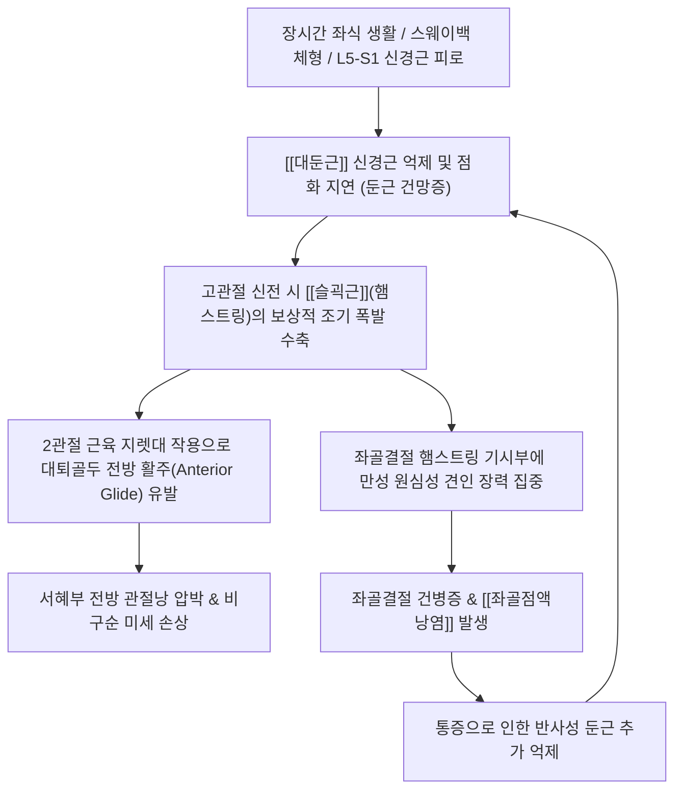
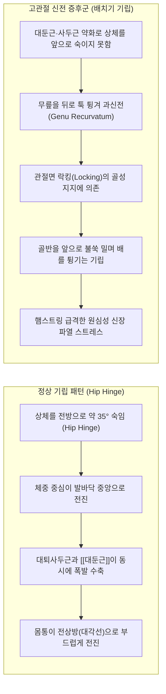
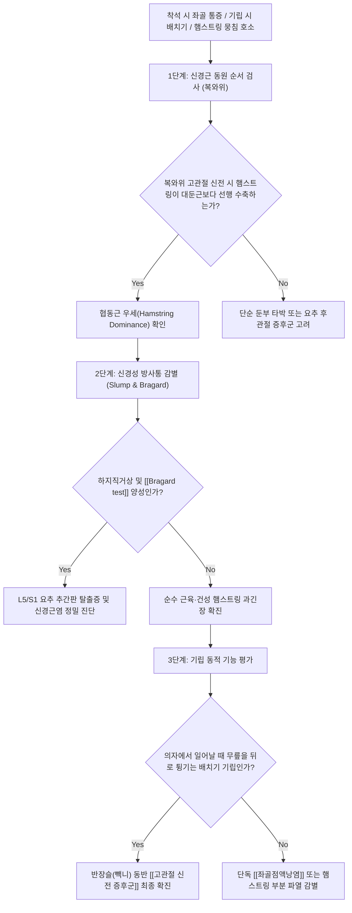

# 🩺 [[고관절 신전 증후군]] (Hip Extension Syndrome with Knee Extension)

> **핵심 3줄 요약 (Key Summary)**:
> - 📍 병소 부위 & 해부·병태생리: 보행·기립 및 계단 승강 시 일차 주동근인 [[대둔근]](Gluteus maximus)의 활성화가 신경근적으로 억제·지연되고, 협력근인 [[슬괵근]](햄스트링, Hamstrings)과 [[대퇴근막장근]](TFL)이 과도하게 우세하게 동원되는 협동근 우세(Hamstring dominance / Synergistic dominance) 및 둔근 건망증(Gluteal amnesia) 질환.
> - 🚩 전형적 임상 양상 & 3대 징후: 의자에서 일어날 때 상체를 숙이지 못하고 슬개골을 뒤로 튕기며 일어나는 '배치기 기립 자세', 좌골결절 부착부 만성 통증([[좌골점액낭염]] 및 햄스트링 건병증), 슬관절 과신전(Genu recurvatum, 빽니) 및 스웨이백(Sway-back) 체형.
> - 🛠️ 핵심 감별 검사 & 한·양방 다각적 치료 전략: 복와위 고관절 신전 검사(대둔근 지연 및 햄스트링 선행 수축 촉진), 슬괵근 저항 검사, 슬럼프 검사([[Slump test]]), 브라가드 검사([[Bragard test]]) 감별; 좌골결절 햄스트링 기시부 침도/신바로[[약침]], 슬관절 90° 굴곡 복와위 대둔근 선택적 분리 수축 재활 및 힙 힌지(Hip hinge) 기립 패턴 재교육.
> - ⚠️ 응급 의뢰 레드플래그 & 악화 요인: 좌골결절 부위 햄스트링 건의 급성 전층 파열 및 견열 골절(Avulsion fracture) 감별 필요; 햄스트링 단축에 대한 무분별한 과도한 다리 찢기식 스트레칭 및 의자에서 무릎을 뒤로 튕기는 락킹(Locking) 동작 절대 금기.

---

## 📌 목차
1. [질환 개요 & 해부학적 병태생리](#1-질환-개요--해부학적-병태생리)
2. [병태생리 메커니즘 & 생체역학적 악순환 네트워크](#2-병태생리-메커니즘--생체역학적-악순환-네트워크)
3. [임상 증상 & 이학적 검사(Physical Exam) 알고리즘](#3-임상-증상--이학적-검사physical-exam-알고리즘)
4. [감별 진단 매트릭스 (Differential Diagnosis)](#4-감별-진단-매트릭스-differential-diagnosis)
5. [한의 통합 치료 프로토콜 (침·[[약침]]·[[추나]]·한약)](#5-한의-통합-치료-프로토콜-침[[약침]][[추나]]한약)
6. [양방 치료 & 병용·의뢰 기준 (Conventional Treatment & Referral)](#6-양방-치료--병용의뢰-기준-conventional-treatment--referral)
7. [재활 운동 & 생활습관 티칭 가이드](#7-재활-운동--생활습관-티칭-가이드)
8. [💡 사용자 진료실 핵심 필기 & 임상 노하우 (Melt-In 잔여 심화 집약)](#8--사용자-진료실-핵심-필기--임상-노하우-melt-in-잔여-심화-집약)
9. [출처 및 현대 학술 연구 요약 (References)](#9-출처-및-현대-학술-연구-요약-references)

---

## 1. 🩺 질환 개요 & 해부학적 병태생리

### 1) 개념 정의 및 Shirley Sahrmann의 운동계 손상(MSI) 모델
[[고관절 신전 증후군]](Hip Extension Syndrome, 통상 슬관절 신전 동반)은 셜리 사하만(Shirley Sahrmann)의 운동계 손상(Movement System Impairment, MSI) 체계에서 고관절 시상면(Sagittal plane) 운동 조절 부전을 대표하는 질환입니다. 이 증후군은 보행 주기에서 입각기 후기(Terminal stance), 계단 오르기, 의자에서 기립하기, 달리기 및 점프 착지 시 일차적 고관절 신전근인 [[대둔근]](Gluteus maximus)이 제 타이밍에 동원되지 못하고, 2관절 협력근인 [[슬괵근]](햄스트링, Hamstrings)이 과도하게 선행·과활성화(Hamstring dominance)됨으로써 관절 운동의 정밀 축(Center of rotation)을 무너뜨리는 기능적 생체역학 질환입니다.

정상적인 고관절 신전 메커니즘에서 대둔근은 단일 관절 근육(Mono-articular muscle)으로서 대퇴골두(Femoral head)를 관골구(비구, Acetabulum)의 중심에 단단히 안착시키는 '후방 안정자(Posterior stabilizer)' 역할을 수행합니다. 그러나 장시간 좌식 생활, 요천추 신경근 병증, 골반 부정렬 등으로 인해 대둔근의 신경근 점화가 억제되는 이른바 '둔근 건망증(Gluteal amnesia)'이 발생하면, 인체는 고관절 신전력을 얻기 위해 대퇴 후면의 [[슬괵근]]과 [[대퇴근막장근]](TFL)을 주동근으로 끌어다 쓰는 보상적 협동근 우세(Synergistic dominance) 패턴을 구축합니다.

이로 인해 대퇴골두는 후방으로 안정화되지 못하고 비구 전방 관절낭을 향해 전방 전단력(Anterior shear force)을 받게 되며, 슬관절에서는 무릎을 뒤로 튕겨 관절을 잠그는 반장슬(Genu recurvatum, 빽니)과 골반 후방경사가 결합된 체형 붕괴로 이어집니다.

### 2) 관련 해부학적 구조물 및 기능적 근육 분류

#### (1) 관절 및 골격 복합체
- **고관절(Hip Joint)**: 대퇴골두와 관골구의 구관절로, 신전 시 전방 관절낭(Iliofemoral ligament, Y-ligament)의 장력과 대둔근의 후방 벡터가 완벽한 동적 평형을 이루어야 합니다. 대둔근 부전 시 대퇴골두의 전방 활주(Anterior glide)가 발생하여 전방 관절순(Labrum)에 충돌을 유발합니다.
- **좌골결절(Ischial tuberosity)**: 골반의 최하단 골성 지표이자 햄스트링 3두근(대퇴이두근 장두, 반건양근, 반막양근)의 공통 기시부입니다. 지속적인 원심성 장력이 집중되어 만성 골막염 및 [[좌골점액낭염]](Ischial bursitis)이 호발합니다.
- **슬관절(Knee Joint)**: 대퇴경골관절 및 슬개대퇴관절. 햄스트링 우세 시 경골 후방 견인력과 대퇴사두근 약화로 인한 슬개골의 기계적 락킹(Locking)이 발생합니다.

#### (2) 과활성 및 협동근 우세 근육군 (Hyperactive / Dominant Muscle Groups)
- [[슬괵근]] 복합체 (Hamstring Complex)**:
  - [[대퇴이두근]](Biceps femoris): 좌골결절에서 기시하는 장두(Long head)와 대퇴골 조선에서 기시하는 단두(Short head)로 구성되어 비골두(Fibula head)에 정지합니다. 고관절 신전 및 슬관절 외회전/굴곡을 유발합니다.
  - [[반건양근]](Semitendinosus): 좌골결절에서 기시하여 경골 내측 거위발건(Pes anserinus)으로 정지하며, 슬관절 내회전 및 고관절 신전을 보조합니다.
  - [[반막양근]](Semimembranosus): 좌골결절에서 기시하여 경골 내측과 후면 및 사슬와인대(Oblique popliteal ligament)로 이어지는 강력한 막성 근육입니다.
  - *병태생리적 특징*: 2관절 근육(Bi-articular)이므로 고관절 신전과 슬관절 굴곡을 동시에 제어해야 하나, 보행 및 기립 시 과도한 신전 토크를 홀로 감당하면서 원심성 과부하(Eccentric overload)와 만성 미세 파열이 축적됩니다.
- **보조 협동근**:
  - [[대퇴근막장근]](Tensor fasciae latae, TFL): 신전 시 외전 보상을 위해 과동원됨.
  - [[대내전근]](Adductor magnus) 후부(좌골과 섬유): 좌골결절에서 내전근 결절로 이어져 햄스트링과 유사하게 고관절 신전을 보상합니다.

#### (3) 억제 및 약화 근육군 (Inhibited / Weakened Muscle Groups)
- **일차 고관절 신전 주동근**:
  - [[대둔근]](Gluteus maximus): 인체에서 가장 부피가 크고 강력한 단일 관절 근육으로, 장골익 후면·천골·미골에서 기시하여 대퇴골 둔근조면(Gluteal tuberosity)과 [[장경인대]](ITB)에 정지합니다. 대퇴골두를 비구 중심축에 고정시키면서 고관절을 신전 및 외회전시키는 핵심 근육이나, 장시간 착석 생활로 인해 감각 운동 신경 전달이 억제(Gluteal amnesia)되어 있습니다.
- **슬관절 신전 및 전방 추진 근육군**:
  - [[대퇴사두근]](Quadriceps femoris): 특히 [[내측광근]](Vastus medialis oblique, VMO)과 [[대퇴직근]](Rectus femoris)의 약화로 인해 기립 시 대퇴골을 전상방으로 끌어올리지 못하고 무릎을 뒤로 꺾어 뼈의 잠김(Bone locking)에 의존하게 됩니다.
- **체간 코어 복합체**:
  - [[복횡근]](Transversus abdominis) 및 복사근 약화로 골반의 중립 전만-후만 조절 실패.

#### (4) 신경 및 혈관 포착 구조
- [[하둔신경]](Inferior gluteal nerve, L5-S2)**: 이상근 하공을 통해 대둔근 심부로 진입하며, 대둔근의 만성 허혈 및 위축과 밀접한 연관이 있습니다.
- [[좌골신경]](Sciatic nerve, L4-S3)**: 좌골결절 바로 외측을 지나 햄스트링 심부를 주행합니다. 좌골결절 건 부착부의 만성 건염, 석회화, [[좌골점액낭염]]의 종창 및 반흔 유착이 좌골신경을 물리적으로 압박하거나 견인하여 좌골신경통(Sciatica)을 병발시킵니다.
- [[후대퇴피신경]](Posterior femoral cutaneous nerve, S1-S3)**: 이상근 하공에서 나와 둔부 하부 및 대퇴 후면 중앙부의 감각을 지배하며, 햄스트링 기시부 유착 시 허벅지 뒤쪽의 타는 듯한 감각 이상을 유발합니다.

### 3) 역학적 특성 및 체형 소인 (스웨이백 체형과 빽니)
- **스웨이백 체형 (Sway-back Posture)**:
  - 전형적인 고관절 신전 증후군 환자는 골반이 발목 중심선보다 앞으로 쑥 밀려나 있는 골반 전방 전이(Pelvic anterior translation)와 골반 후방경사(Posterior pelvic tilt)를 나타냅니다.
  - 상체는 뒤로 젖혀져 흉추 후만(Thoracic kyphosis)이 심해지고, 체중을 대퇴골두 전방 관절낭 인대(Y-ligament)에 기계적으로 걸쳐놓은 채 서 있는 불량 자세를 취합니다.
- **반장슬 (Genu Recurvatum, 빽니)**:
  - 대퇴사두근과 대둔근의 활성화를 배제한 채 서 있기 위해 슬관절을 0° 이상 과신전(Hyperextension)시켜 대퇴골과 경골의 관절면을 락킹(Locking)합니다. 이로 인해 무릎 후방 관절낭과 햄스트링 건에 지속적인 만성 인장 스트레스가 부과됩니다.

---

## 2. ⚡ 병태생리 메커니즘 & 생체역학적 악순환 네트워크

### 1) 햄스트링 우세(Hamstring Dominance)와 고관절 전방 활주(Anterior Glide)
고관절 신전 시 이상적인 근육 동원 순서는 신경생리학적으로 **대둔근 $\rightarrow$ 동측/반대측 [[척추기립근]] $\rightarrow$ 동측 햄스트링** 순서이거나, 대둔근과 햄스트링이 고관절 신전 초기부터 조화롭게 동시 수축하는 것입니다.

그러나 좌식 생활로 인해 대둔근이 이완성 마비(신경근 억제) 상태에 빠지면, 뇌는 고관절 신전 명령을 전달할 때 대둔근 대신 가장 강력한 협력근인 [[슬괵근]](햄스트링)을 먼저 점화시킵니다. 이를 정밀 근전도(EMG)로 측정해보면 고관절 신전 시 햄스트링이 대둔근보다 수십~수백 밀리초(ms) 먼저 폭발적으로 수축하는 전도성 역전 현상이 관찰됩니다.

이 협동근 우세가 초래하는 가장 치명적인 생체역학적 파극은 **대퇴골두의 전방 활주(Anterior glide)**입니다:
1. 대둔근은 대퇴골 간부의 근위부(대퇴골 상부 둔근조면)에 부착하여 대퇴골두를 뒤쪽에서 단단히 감싸 쥐고 후방으로 당깁니다(Posterior glide).
2. 반면, 햄스트링은 대퇴골을 건너뛰어 무릎 아래 경골/비골에 부착하는 원위부 2관절 근육입니다.
3. 햄스트링이 단독으로 수축하여 하지 전체를 뒤로 당기면, 대퇴골 원위부는 뒤로 끌려가지만 지렛대 원리(Class 1 Lever)에 의해 **대퇴골두는 오히려 지레받침(비구 전연)을 밀어내며 앞쪽으로 튕겨져 나가는 전방 전단력**을 받게 됩니다.
4. 그 결과, 환자는 엉덩이 뒤쪽 햄스트링의 만성 통증뿐만 아니라, 전방 관절낭과 비구순이 눌리는 **서혜부 앞쪽 찝힘 통증([[대퇴 전방 활주 증후군]])**을 복합적으로 호소하게 됩니다.

### 2) '배치기 기립'과 슬관절 후방 밀림(Knee Locking)의 역학적 분석
의자에서 일어나는 기립(Sit-to-stand) 동작은 일상생활에서 고관절 신전근의 능력을 가장 정밀하게 시험하는 기능적 단위입니다.

#### (1) 정상 패턴: 힙 힌지(Hip Hinge) 기반 전상방 기립
- 정상인은 앉은 상태에서 먼저 고관절을 접어 상체를 앞으로 숙입니다(Hip hinge). 이를 통해 인체의 무게중심(Center of mass)을 지지 기반인 발바닥 위로 이동시킵니다.
- 이후 대퇴사두근이 무릎을 펴고, 대둔근이 골반을 뒤에서 앞으로 밀어 올리며 몸통이 대각선 전상방으로 부드럽게 상승합니다.

#### (2) 고관절 신전 증후군 환자의 보상: 배치기 기립(Thrusting-belly rise)
- 대둔근과 대퇴사두근의 근력이 턱없이 부족한 환자는 상체를 앞으로 숙이면 일어날 힘이 없으므로 상체를 세운 채 일어서려고 시도합니다.
- 상체가 뒤에 머문 상태에서 일어나기 위해 환자는 **무릎을 뒤로 강하게 차면서 슬개골을 뒤로 튕깁니다**.
- 슬관절이 과신전(Hyperextension) 한계에 도달하여 대퇴골과 경골이 뼈끼리 딱 맞물리는 '기계적 락킹(Bony locking)' 상태를 만들어 관절의 수동적 저항력으로 상체를 지탱합니다.
- 그 반동으로 골반을 앞으로 불쑥 내밀며 배를 튕기는 '배치기 자세'로 기립을 완성합니다.
- 이 과정에서 햄스트링은 무릎이 뒤로 꺾이는 순간 폭발적인 원심성 수축(Eccentric contraction)을 강요받으며, 좌골결절 부착부가 찢어질 듯한 견인력을 받아 만성 건병증과 점액낭염으로 직행합니다.

### 3) 계단 보행 시의 슬개골 후방 편위 메커니즘
- 계단을 오를 때 정상적인 다리는 체중을 디디며 슬개골과 경골이 전방으로 자연스럽게 회전(Anterior translation)하며 상체를 다음 계단으로 끌어올립니다.
- 그러나 고관절 신전 증후군 환자는 슬개골을 앞으로 밀어 올릴 대퇴사두근-대둔근 협응력이 없기 때문에, 계단에 발을 딛는 순간 무릎을 뒤로 펴서 잠그고 햄스트링의 당기는 힘으로만 몸통을 끌어당깁니다.
- 이로 인해 계단을 오를 때마다 무릎 뒤쪽 오금의 뻐근함과 허벅지 뒤쪽의 날카로운 당김이 매 승강 동작마다 반복됩니다.

---

## 3. 🔍 임상 증상 & 이학적 검사 알고리즘

### 1) 임상 증상 및 주소증 프로파일
- **호발 체형 및 대상**: 스웨이백 체형을 가진 젊은 여성 및 중년 남성, 하루 8시간 이상 의자에 앉아 모니터를 보며 엉덩이를 앞으로 빼고 앉는 사무직, 무릎 과신전(빽니)이 있는 댄서 및 요가 수련자, 마라톤 러너.
- **주요 통증 부위 및 양상**:
  - **좌골결절(Ischial tuberosity) 뼈 부위 통증**: 엉덩이 맨 아래 의자에 닿는 뼈 부위가 묵직하고 결리며, 딱딱한 나무 의자나 벤치에 10분 이상 앉아있지 못하고 엉덩이를 들썩거림.
  - **대퇴 후면 햄스트링의 만성 당김**: 허벅지 뒤쪽 근육이 항상 뭉쳐있고 쥐가 날 것 같은 뻣뻣함을 호소하며, 스트레칭을 해도 그때뿐이고 다시 단단하게 굳어짐.
  - **의자 기립 및 계단 승강 시 통증**: 의자에서 일어날 때 무릎이 뒤로 덜컹거리며 엉덩이 밑이 찢어지는 듯한 통증, 계단을 오를 때 추진력이 부족하여 난간을 붙잡아야 함.
  - **고관절 서혜부 앞쪽 찝힘 동반**: 대퇴골두 전방 활주로 인해 고관절을 깊게 굽힐 때 앞쪽 사타구니가 뻐근하게 찝히는 느낌 병발.

### 2) 필수 이학적 검사 (Physical Examination Protocols)

| 검사명 | 검사 방법 및 절차 | 양성 반응 기준 | 생체역학적 임상 의의 |
| :--- | :--- | :--- | :--- |
| **복와위 고관절 신전 검사 (Prone Hip Extension Test - 0° vs 90°)** | 환자를 복와위로 눕히고 검사자가 한 손은 대둔근에, 다른 손은 햄스트링에 접촉. 환자에게 다리를 천장으로 들어 올리도록 지시. 1차: 무릎을 편 상태(0°) 2차: 무릎을 90° 굽힌 상태 | 1차 검사 시 햄스트링이 대둔근보다 먼저 딱딱하게 수축함. 2차 검사 시 햄스트링 능동 결손으로 다리를 거의 들어 올리지 못함. | [[대둔근]] 신경근 억제 및 [[슬괵근]]의 협동근 우세 확진. |
| **슬괵근 도수 저항 검사 (Hamstring Resisted Test)** | 복와위에서 무릎을 90° 굴곡시킨 상태에서 검사자가 무릎을 펴는 방향으로 저항을 가하고 환자에게 버티도록 지시. | 좌골결절 부착부 또는 허벅지 뒤쪽 근복부에 날카로운 국소 통증 재현. | 햄스트링 건염, 근위부 건병증, 근섬유 좌상 감별. |
| **슬럼프 검사 ([[Slump test]])** | 환자를 진찰대 모서리에 걸터앉히고 흉요추 굴곡 $\rightarrow$ 경추 굴곡 $\rightarrow$ 슬관절 신전 $\rightarrow$ 발목 족배굴곡을 단계적으로 적용. | 족배굴곡 시 다리 뒤쪽으로 찌릿한 방사통 발생, 경추 신전 시 통증이 즉각 소실되면 신경근 병변 양성. 경추 신전 시에도 통증 변화 없으면 순수 햄스트링 문제. | 요추 신경근 압박([[좌골신경통]])과 순수한 햄스트링 근막 긴장의 감별. |
| **브라가드 검사 ([[Bragard test]])** | 앙와위 하지직거상 검사([[SLR test]]) 중 통증 발생 각도에서 다리를 5° 살짝 내린 후 발목을 수동 족배굴곡(Dorsiflexion)시킴. | 족배굴곡 시 통증이 재현되면 요추 신경근염(+). 족배굴곡 시 통증이 없으면 **신경 이상이 아닌 순수 햄스트링 단축**(-). | 요천추 디스크 질환 배제 및 햄스트링 건막 구축 확진. |
| **대퇴골두 전방 활주 검사 (Prone Femoral Anterior Glide Test)** | 복와위에서 환자의 무릎을 90° 굽힌 채 고관절을 수동 신전시키며 대퇴골두 전면을 촉진. | 고관절 신전 시 대퇴골두가 전방으로 돌출하며 서혜부 앞쪽 통증 유발. | 대둔근 부전에 따른 고관절 전방 관절낭 전단력 및 충돌 확인. |
| **기립 자세 반장슬 평가 (Genu Recurvatum Assessment)** | 환자를 기립시킨 후 측면에서 슬관절의 시상면 정렬을 관찰. | 슬관절 신전 각도가 0°를 넘어 뒤로 5° 이상 과신전(빽니)되어 있음. | 무릎 기계적 락킹 의존성 및 스웨이백 체형 확인. |

### 3) 단계별 이학적 진단 알고리즘

---

## 4. 🔀 감별 진단 매트릭스 (Differential Diagnosis)

| 감별 질환 | 호발 병소 및 병태생리 | 주소증 및 임상 양상 | 특이적 이학적 검사 | 영상학적 진단 소견 | 한의 감별 포인트 |
| :--- | :--- | :--- | :--- | :--- | :--- |
| [[고관절 신전 증후군]] (본 질환)** | [[대둔근]] 신경근 억제, [[슬괵근]] 과우세 동원, 대퇴골두 전방 활주 | 기립 시 배치기, 보행 시 빽니, 좌골결절 만성 뻐근함, 서혜부 찝힘 동반 | 복와위 신전 시 햄스트링 선행 수축, [[Bragard test]] (-), 반장슬 관찰 | 단순 X-ray 상 골성 이상 없으나 시상면 상 스웨이백 및 빽니 정렬 | 기립 동작 교정 시 통증 즉각 경감. 무릎 90° 굴곡 신전력 현저 저하. |
| [[좌골점액낭염]] (Ischial Bursitis)** | 좌골결절과 대둔근/햄스트링 사이 점액낭의 기계적 마찰 염증 | 딱딱한 의자에 앉을 때 좌골 바로 위가 못에 찔리듯 아픔, 야간통 | 좌골결절 골막 직접 압통 (+), 햄스트링 수축 저항 검사는 음성이거나 경미 | 초음파 및 MRI 상 좌골점액낭 내 삼출액 저류 및 활액막 비후 | 보행 시에는 비교적 통증이 없으나 '착석 시 국소 접촉 압박'이 주소증. |
| **근위부 햄스트링 건병증 / 파열** | 좌골결절 햄스트링 기시 건의 퇴행성 건증 또는 급성 원심성 파열 | 달리기나 킥 동작 시 날카로운 통증, 심하면 피하 반상출혈(멍) 및 함몰 | 햄스트링 저항 검사 극심한 통증 (+), Puranen-Orava 검사 (+) | MRI 상 근위 건의 고신호강도, 미세 파열 또는 골 부착부 결손 | 급성 파열은 '뚝' 하는 파열음 동반. 만성 건병증은 아침 첫 발 시 좌골 결림. |
| **L5-S1 추간판 탈출증 ([[요추 디스크]] / [[좌골신경통]])** | L5-S1 수핵 탈출에 의한 S1 신경근 압박 및 화학적 신경근염 | 둔부에서 시작하여 허벅지 뒤, 종아리 뒤꿈치, 새끼발가락으로 방사통 | [[SLR test]] (+) 30~60°, [[Bragard test]] (+), 아킬레스건 반사 저하 | 요추 MRI 상 L5-S1 수핵 탈출 및 S1 신경근 물리적 압박 명확 | 족배굴곡 시 통증이 무릎 아래로 강하게 방사되며 기침 시 [[요통]] 악화. |
| [[대퇴 전방 활주 증후군]] | 대둔근 부전 및 [[장요근]] 약화로 고관절 신전 시 대퇴골두 전방 아탈구 | 고관절 과신전 시 서혜부 앞쪽 깊은 찝힘 통증, 사타구니 통증 위주 | 복와위 고관절 신전 시 서혜부 전면 돌출 및 통증 (+), 후방 활주 시 완화 | 고관절 MRI 상 전방 비구순 손상 또는 [[장요근]] 건 점액낭염 | 햄스트링 통증보다 고관절 앞쪽 사타구니 통증이 주 증상으로 호소됨. |
| [[이상근 증후군]] | 이상근의 비후 및 연축에 의한 좌골신경 압박 | 엉덩이 중앙부 심부 통증, 다리 꼬고 앉을 때 악화, 둔부 압통 | FAIR 검사 (+), Freiberg 검사 (+), 복와위 신전 시 둔근 동원은 정상일 수 있음 | 골반 MRI 상 이상근 부종 및 좌골신경 신호 변화 | 압통점이 좌골결절이 아니라 엉덩이 중심부 환도혈 부위에 국한됨. |

---

## 5. 🌿 한의 통합 치료 프로토콜

### 1) 침구 치료 (신경근 재교육 및 협동근 억제)
고관절 신전 증후군의 침구 치료 목표는 **과활성화된 햄스트링의 근방추 과흥분을 억제(Inhibition)**하고, **잠들어 있는 대둔근의 운동신경원을 재점화(Facilitation)**하여 정상적인 신전 키네틱 체인을 복원하는 것입니다.

#### (1) 과활성·단축 햄스트링 억제 및 이완 자침
- [[좌골결절]] 기시부 & 근위 건-골 접합부**:
  - **선혈 혈위**: 승부(BL36), 은문(BL37).
  - **자침 수기**: 0.35×75mm 호침을 사용하여 좌골결절 골막 접촉면을 향해 2.0~2.5촌 심부 직자합니다. 만성적으로 단축된 대퇴이두근 장두 및 반건양근 기시부의 단단한 섬유대를 자극하여 국소 연축 반응(Local twitch response)을 유도하고 건 부착부의 긴장을 즉각 완화합니다.
- **햄스트링 근복부 및 원위 건 부착부**:
  - **선혈 혈위**: 위중(BL40), 위양(BL39), 부극(BL38).
  - **자침 수기**: 대퇴 후면 중앙 및 외측/내측 건 경결점에 0.30×60mm 침으로 직자하여 과긴장된 햄스트링 근절을 이완시킵니다.

#### (2) 억제·약화 대둔근 및 사두근 촉통 자침
- [[대둔근]] 일차 운동점 (Motor Point)**:
  - **선혈 혈위**: 질변(BL54), 포황(BL53), 환도(GB30).
  - **자침 수기**: 장골익 후면 및 천골 외연에서 대퇴골 둔근조면 방향으로 0.40×75mm 장침을 2.5~3.0촌 깊이로 직자하여 대둔근 상부 및 하부 섬유의 신경근 연접부에 침첨을 도달시킵니다.
- [[대퇴사두근]] [[내측광근]] (VMO)**:
  - **선혈 혈위**: 혈해(SP10), 양구(ST34).
  - 슬개골 상내측 VMO 부위에 직자하여 기립 시 무릎 락킹을 방지할 수 있는 전방 추진력을 촉진합니다.
- [[전침]] 자극 프로토콜**:
  - 억제된 대둔근(질변-포황)에 [[전침]]을 연결하고, **2Hz 저주파 연속파**를 20분간 적용합니다. 2Hz의 저주파 자극은 대둔근의 알파 운동신경원을 지속 탈분극시켜 둔근의 신경근 반응 속도를 회복시킵니다. 반면 햄스트링(승부-은문)에는 100Hz 고주파를 적용하여 근방추 긴장도를 빠르게 하향 조절(Down-regulation)합니다.

### 2) [[약침]] 치료 (Pharmacopuncture)
- **좌골결절 햄스트링 기시부 건병증 및 점액낭염**:
  - [[약침]] 종류**: [[신바로약침]] 또는 [[중성어혈약침]].
  - **용량 및 깊이**: 1.5~2.0cc, 좌골결절 외하단 골막 접촉부 4~6개 포인트에 분할 주입 (깊이 3.0~4.0cm).
  - **작용 기전**: 만성적인 원심성 견인으로 손상된 햄스트링 기시 건의 미세 파열 유착을 박리하고, 좌골점액낭 내의 활액막 삼출 염증을 강력히 소퇴시킵니다.
- **대퇴골 둔근조면 대둔근 건 부착부**:
  - [[약침]] 종류**: [[자하거약침]](Hominis Placenta).
  - **용량 및 깊이**: 1.0cc, 대전자 후하방 둔근조면 골막 부위 심부 주입.
  - **작용 기전**: 약화되고 퇴행된 대둔근 부착부의 콜라겐 리모델링을 촉진하여 힘줄의 탄성과 부착 강도를 보강합니다.
- **서혜부 전방 관절낭 충돌 부위**:
  - 대퇴골두 전방 활주로 인해 서혜부 통증이 동반된 경우, 충문(SP11) 외측 고관절낭 전면에 황련해독 [[약침]] 1.0cc를 주입하여 전방 활액막염을 진정시킵니다.

### 3) [[추나]] 치료 (Chuna Manipulation Protocols)
- **슬관절 과신전(빽니) 교정[[추나]] (Tibial Anterior Mobilization)**:
  - **환자 자세**: 앙와위, 무릎을 약 20~30° 미세 굴곡.
  - **시술 절차**: 시술자가 대퇴골 원위부 전면을 하방으로 고정하고, 다른 손으로 경골 근위부 후면을 감싸 쥔 채 순간적인 전상방 충격 또는 점진적 관절 가동(Grade III-IV)을 적용하여 뒤로 밀려난 경골을 전방으로 복원합니다.
- **햄스트링 근막이완술 (JS Myofascial Release Technique)**:
  - **환자 자세**: 복와위.
  - **시술 절차**: 시술자의 수근부(손바닥 뒤꿈치) 또는 전완으로 좌골결절에서 오금 방향으로 주행하는 햄스트링 근복부를 체중으로 깊게 압박(Sustained compression)한 상태에서, 보조자가 환자의 무릎을 수동적으로 천천히 신전시켜 근막과 근섬유의 유착을 전단 박리합니다.
- **골반 후방경사 교정 및 장골 전방 회전 기법 (Anterior Pelvic Tilt Correction)**:
  - 햄스트링 단축으로 고정된 장골 후방 회전을 바로잡기 위해, 측와위에서 환측 하지의 고관절을 신전시킨 상태에서 ASIS를 전하방으로 밀어주는 장골 전방 회전 교정 기법을 시행합니다.

### 4) 한약 치료 (변증별 맞춤 처방)

| 변증 분류 | 주 임상 양상 | 대표 처방 | 주요 구성 약재 및 군신좌사 방의 |
| :--- | :--- | :--- | :--- |
| **건골연축 (筋骨攣縮)** | 허벅지 뒤쪽이 항상 쥐가 나고 당김, 기립 시 좌골 결절 결림, 설홍태박 맥현완 | [[작약감초탕]] (芍藥甘草湯) 가미방 | 백작약 24g, 감초 12g, 우슬 8g, 목과 6g, 신근초 6g. 백작약을 대량 사용하여 근방추 과흥분을 즉각 억제하고 햄스트링 연축을 완해(緩急止痛). |
| **간신휴허 (肝腎虧虛)** | 만성 좌골결절 건병증, 엉덩이 힘 빠짐, 퇴행성 척추 변화 동반, 설담 맥침세 | [[독활기생탕]] (獨活寄生湯) | 독활 6g, 상기생 8g, 두충 6g, 우슬 6g, 숙지황 8g, 당귀 6g, 천궁 4g, 인삼 4g. 간신을 보하고 근골을 강건하게 하여 만성 건초염 및 대둔근 위축 상태 회복. |
| **기체혈어 (氣滯血瘀)** | 착석 시 좌골결절이 바늘로 찌르듯 쑤심, 야간통, 손상 부위 압통 극심, 설자 맥삽 | [[당귀수산]] (當歸鬚散) 합 [[서경탕]] (舒經湯) | 당귀 8g, 적작약 6g, 도인 6g, 홍화 4g, 강황 6g, 해동피 6g, 천궁 4g, 감초 4g. 좌골점액낭 내의 만성 어혈성 울혈과 미세 파열 유착을 강력히 행기활혈 소종. |
| **비신양허 (脾腎陽虛)** | 스웨이백 체형, 하지 무력증, 추위를 타고 소화 불량, 빽니 보행, 맥침약 | [[보중익기탕]] (補中益氣湯) 합 [[오적산]] | 황기 12g, 인삼 6g, 백출 8g, 창출 6g, 마황 2g, 육계 4g, 당귀 6g, 진피 4g. 중기(中氣)를 끌어올려 전신 근육의 탄력을 회복하고 하지 허혈성 냉감을 개선. |

---

## 6. 💊 양방 치료 & 병용·의뢰 기준 (Conventional Treatment & Referral)

### 1) 양방 약물 치료 체계
- **경구 소염진통제 (NSAIDs)**:
  - 1차 선택: Aceclofenac 100mg bid, Loxoprofen 60mg tid, 또는 Celecoxib 200mg qd.
  - 목적: 좌골결절 건 부착부의 견인성 골막염 및 좌골점액낭의 급성 염증 조절 (2~4주 단기 처방).
- **골격근이완제 (Muscle Relaxants)**:
  - Eperisone HCl 50mg tid, Chlorphenesin carbamate 250mg bid.
  - 목적: 햄스트링의 반사성 근경직 및 연축 완화.
- **말초신경병증 약물**:
  - 좌골결절 부종으로 인한 좌골신경 압박 증상(방사통)이 관찰될 경우 Pregabalin 75mg qd 병용.

### 2) 비약물 침습적 시술
- [[체외충격파]] 치료 (ESWT)**:
  - 적응증: 좌골결절 근위부 햄스트링 건병증(Proximal hamstring tendinopathy).
  - 프로토콜: 초점형(Focused) 충격파를 좌골결절 골막 접합부에 집중 타격(에너지 0.12~0.22 mJ/mm², 2,000타, 주 1회, 총 4~6회). 만성 퇴행성 콜라겐 기질의 혈류 증대 및 조직 재생 유도.
- **초음파 유도하 좌골점액낭 주사 (US-guided Ischial Bursa Injection)**:
  - Triamcinolone 20~40mg + 1% Lidocaine 2~3cc.
  - 적응증: 앉아있지 못할 정도의 극심한 좌골점액낭염 급성기.
  - 주의사항: 좌골신경이 점액낭 바로 외측(수 mm 거리)에 주행하므로 반드시 초음파 실시간 가이드 하에 신경 손상을 피하며 주입해야 함.

### 3) 수술적 치료 적응증
- **절대적 적응증**:
  - 근위부 햄스트링 건의 급성 완전 파열: 3개 건(대퇴이두근, 반건양근, 반막양근)이 모두 찢어지고 결손 부위가 2cm 이상 후퇴(Retraction)한 경우 조기 건 봉합술(Surgical repair) 필수.
  - 청소년 및 운동선수의 좌골결절 견열 골절(Avulsion fracture)에서 골편 전위가 1.5cm 이상인 경우.
- **상대적 적응증**:
  - 6개월 이상의 복합 보존 치료에도 불응하는 난치성 좌골결절 건병증 및 심한 반흔 조직으로 좌골신경 포착이 명확한 경우 좌골신경 감압술 및 건 절제술.

### 4) 한의 병용 판단 및 상호작용
- **소염진통제 복용 환자 한약 투여 시 주의**:
  - 만성 환자가 NSAIDs를 장기 복용하여 위염 및 소화성 궤양이 동반된 경우가 흔하므로, [[작약감초탕]]이나 [[독활기생탕]] 처방 시 백출, 복령, 대추를 증량하여 위장관 안전성을 확보하고, 증상 호전에 따라 양약을 단계적으로 중단하도록 유도합니다.
- **스테로이드 주사 후 처치 제한**:
  - 좌골결절 부위에 스테로이드 주사를 맞은 환자는 주사 후 2주 동안 국소 건 부착부의 인장 강도가 극도로 저하되어 있으므로, **주사 후 2~3주간은 햄스트링에 대한 침도 요법 및 과도한 도수 신전 치료를 금기**합니다.

### 5) 전문과 응급 의뢰 기준 (Red Flags)
- **급성 햄스트링 전층 파열 (Acute Complete Tendon Rupture)**:
  - 달리기나 스쿼트 중 '뚝' 하는 파열음과 함께 주저앉았으며, 좌골결절 하방에 커다란 함몰(Defect)이 만져지고 심한 피하 출혈이 관찰되는 경우 즉시 정형외과 응급 의뢰(골든타임 2~3주 이내 수술 요함).
- **진행성 좌골신경 마비 (Sciatic Nerve Palsy)**:
  - 족관절 족배굴곡 근력 저하(족하수, Foot drop) 또는 회음부 감각 소실(Saddle anesthesia)이 나타나는 경우 신경외과 응급 전원.
- **골종양 (Osteosarcoma / Chondrosarcoma)**:
  - 야간에 극심해지는 안정 시 통증, 체중 감소, 좌골결절 부위의 단단한 무통성 골성 종괴가 만져질 경우 3차 병원 의뢰.

---

## 7. 🏃 재활 운동 & 생활습관 티칭 가이드

### 1) 억제 및 이완 단계 (Hamstring Inhibition Protocols)
과도하게 긴장된 햄스트링의 톤을 낮추지 않고는 대둔근의 활성화를 결코 이끌어낼 수 없습니다.

> ⚠️ **주의**: 햄스트링이 뭉쳤다고 해서 서서 허리를 숙여 손끝을 발에 대는 식의 **과도한 햄스트링 스트레칭(다리 찢기)은 절대 금기**입니다! 이는 이미 원심성 과부하로 미세 파열된 좌골결절 건을 더욱 찢어놓는 행위입니다. 스트레칭이 아니라 '압박 이완'을 해야 합니다.

- **폼롤러 햄스트링 자가근막이완술 (SMR)**:
  - **자세**: 바닥에 앉아 한쪽 허벅지 뒤쪽에 폼롤러를 받치고 양손으로 바닥을 지지하여 엉덩이를 띄웁니다.
  - **방법**: 좌골결절 바로 아래부터 오금 위 5cm 사이를 천천히 롤링하며, 가장 단단하게 굳은 경결점을 찾아 체중을 실어 30초간 가만히 지그시 누릅니다 (좌우 각 3세트).
- **테니스공/라크로스볼 좌골결절 허혈성 압박**:
  - 딱딱한 의자에 앉아 좌골결절 바로 앞쪽(허벅지 뒤쪽 시작점)에 마사지 볼을 놓고 체중을 실어 1~2분간 부드럽게 압박하여 국소 반흔을 이완합니다.

### 2) 분리 활성화 단계 (대둔근 선택적 분리 훈련)
2026년 최신 생체역학 연구(Song HS, Jeon IC)에 따르면, 무릎을 90° 굽힌 상태에서는 햄스트링이 '능동 결손(Active insufficiency)' 상태에 빠져 수축력을 발휘하지 못하므로 오직 대둔근만 선택적으로 동원됩니다.

- **복와위 무릎 90° 굴곡 대둔근 분리 신전 운동 (Prone Bent-Knee Hip Extension)**:
  - **자세**: 엎드린 복와위 자세에서 복부 아래에 얇은 베개를 받쳐 요추 전만을 방지합니다.
  - **방법**: 환측 무릎을 정확히 90° 구부립니다. 발바닥이 천장을 향하도록 유지한 채, 무릎을 바닥에서 단 5~10cm만 수직으로 살짝 들어 올립니다.
  - **핵심 팁**: 다리를 너무 높이 들면 허리 기립근이 꺾이므로, 오직 **엉덩이(대둔근) 근육만 단단하게 조여지는 느낌**이 드는 높이까지만 들어 올려 5초간 정적 수축을 유지한 후 천천히 내립니다 (15회씩 3세트).
- **글루트 브릿지 변형 (Glute Bridge with Hamstring Offloading)**:
  - **자세**: 앙와위로 누워 양 무릎을 굽히되, **발뒤꿈치를 엉덩이에 최대한 가깝게 바짝 당겨 놓습니다**. 발끝을 바닥에서 들어 올려 뒤꿈치로만 바닥을 지지합니다.
  - **방법**: 뒤꿈치로 바닥을 강하게 누르며 엉덩이를 들어 올립니다. 허벅지 뒤쪽에 쥐가 나는 느낌이 든다면 발이 너무 멀리 있는 것이므로 발을 엉덩이 쪽으로 더 당겨야 합니다. 정점에서 3초간 엉덩이를 쥐어짜듯 수축합니다.
- **당나귀 킥 변형 (Donkey Kick with 90° Knee)**:
  - 네발기기 자세에서 코어를 조이고, 무릎 각도 90°를 고정한 상태에서 한쪽 다리를 천장 방향으로 발바닥으로 천장을 밀어 올리듯 들어 올립니다.

### 3) 기능적 통합 및 힌지 패턴 재교육
- **벽 터치 힙 힌지 훈련 (Wall-touch Hip Hinge)**:
  - 벽을 등지고 한 뼘(약 15~20cm) 앞에 바르게 섭니다.
  - 무릎을 뒤로 펴지 말고 살짝 1~2도 굽힌 상태(Soft knee)로 고정한 채, 상체를 고관절에서 접으며 엉덩이를 뒤로 밀어 엉덩이로 벽을 톡 터치하고 돌아옵니다.
  - 이 동작을 통해 무릎을 락킹하지 않고 고관절 신전근으로 몸을 제어하는 고유수용감각을 뇌에 프로그래밍합니다.
- **의자 기립 패턴 재교육 (Sit-to-Stand Re-education)**:
  - 진료실 의자에서 일어날 때, *"가슴을 먼저 앞으로 30° 숙이세요. 발바닥 뒤꿈치에 힘을 주며 엉덩이 힘으로 몸을 대각선 앞으로 밀어 올리세요. 무릎을 뒤로 튕기면 안 됩니다!"* 큐잉을 반복 훈련합니다.

### 4) 생활습관 교정 (Ergonomics & Patient Education)
- **무릎 과신전 락킹(Locking) 절대 금기 - 소프트 니(Soft Knee) 생활화**:
  - 지하철을 기다리거나 서서 일할 때 무릎을 뒤로 꽉 펴서 뼈로 버티는 버릇(빽니)을 즉시 버리고, 무릎에 힘을 살짝 빼고 1~2도 미세 굴곡을 유지하는 '소프트 니' 자세를 하루 종일 의식해야 합니다.
- **착석 자세 교정**:
  - 의자 끝에 엉덩이를 걸치고 등을 뒤로 기대어 눕듯이 앉는 자세는 대둔근을 마비시키는 최악의 자세입니다. 엉덩이를 의자 등받이 깊숙이 밀착하고 허리 뒤에 요추 쿠션을 받쳐 골반 중립을 유지합니다.
- **계단 보행 티칭**:
  - 계단을 오를 때 발 앞꿈치만 디디면 무릎이 뒤로 밀리므로, 발바닥 전체를 다음 계단에 안정적으로 올려놓고 몸통을 앞으로 기울이며 뒤꿈치로 계단을 밀어 올라가도록 지도합니다.

---

## 8. 💡 사용자 진료실 핵심 필기 & 임상 노하우 (Melt-In 잔여 심화 집약)

> [!IMPORTANT]
> **🛡️ 원장님 실전 관찰 팁 (기립 동작 하나로 간파하기)**
> - 환자에게 진료실 의자에서 손을 쓰지 말고 편안하게 일어나 보라고 하십시오. 일어나는 순간 무릎이 뒤로 툭 튕겨지며 배를 앞으로 불쑥 내미는 '배치기 기립'을 한다면 100% 고관절 신전 증후군 환자입니다.
> - 이런 환자들은 햄스트링이 항상 뭉쳐있다고 호소하며 햄스트링 스트레칭(다리 찢기)을 과도하게 하다가 좌골결절 부착부가 찢어져서 내원합니다. **햄스트링은 늘려서 푸는 것이 아니라 대둔근을 깨워서 쉬게 해 주어야 낫습니다.**

### 1) 실전 문진 체크리스트 (Clinical History Pearls)
1. *"의자에서 일어나실 때 무릎이 뒤로 탁 꺾이면서 배를 앞으로 내밀며 일어나시나요?"*
   - 대퇴사두근과 대둔근의 신전 부전 및 무릎 락킹 의존성 기립의 결정적 증거입니다.
2. *"서 계실 때 무릎이 뒤로 활처럼 휘어지는 빽니(Genu recurvatum)가 있거나, 골반을 앞으로 쑥 내밀고 서 있는 게 편하신가요?"*
   - 스웨이백 체형과 햄스트링 만성 원심성 긴장의 전형적 패턴입니다.
3. *"엉덩이 맨 아래 뼈(좌골결절) 부위가 뻐근하고, 딱딱한 의자에 앉으면 엉덩이가 배겨서 오래 못 앉아 계시나요?"*
   - 만성 좌골점액낭염 및 근위부 햄스트링 건병증의 주소증입니다.
4. *"허벅지 뒤쪽이 항상 당겨서 스트레칭을 열심히 하시는데도 당김이 전혀 안 없어지나요?"*
   - 햄스트링이 짧아서 당기는 것이 아니라, 혼자 과로하여 팽팽해진 '신장성 과긴장' 상태임을 시사합니다.

### 2) 치료 손맛 노하우 (좌골결절 [[약침]] & 대둔근 [[전침]])
- **좌골결절 [[약침]] 주입점 정밀 촉진 및 골막 반응**:
  - 환자를 복와위 또는 환측이 위로 오도록 측와위로 눕히고, 고관절을 약 60° 굴곡시키면 좌골결절이 피부 표면으로 뚜렷하게 돌출됩니다.
  - 좌골결절 외하단 햄스트링 건 부착부를 엄지로 지그시 누르면 환자가 눈을 찔끔 감을 정도로 날카로운 압통을 호소합니다. 이 지점에 0.35×50mm 침을 직자하여 골막에 가볍게 접촉(골막 자극)한 후, 신바로 [[약침]] 1.5cc를 부채꼴 모양으로 3~4군데 분할 주입하십시오. 주입 직후 만성적인 착석 시 좌골 통증이 드라마틱하게 70% 이상 경감됩니다.
- **복와위 촉진으로 햄스트링 선행 수축 확인 후 대둔근 [[전침]]:
  - 환자에게 엎드린 상태에서 다리를 들어보라고 지시하면서, 시술자의 한 손은 환자의 대둔근(환도/질변)에, 다른 손은 햄스트링(은문)에 동시에 올려놓으십시오.
  - 햄스트링이 먼저 불끈 솟아오르고 대둔근이 물렁물렁하게 늦게 수축한다면, 지체 없이 대둔근 모터포인트(질변, 포황)에 장침을 3촌 깊이로 찔러 넣고 2Hz 강자극 [[전침]]을 20분간 인가하십시오. 대둔근이 강하게 덜컹거리며 수축하는 자극을 맛보아야 뇌에서 둔근의 신경근 회로가 다시 연결됩니다.
- **무릎 뒤 [[슬와근]](Popliteus)과 [[비복근]] 두부 이완**:
  - 반장슬(빽니)이 심한 환자는 오금 뒤쪽의 [[슬와근]]과 [[비복근]] 기시부가 단단한 돌덩이처럼 굳어 있습니다. 위중(BL40), 음곡(KI10), 위양(BL39)을 자침하여 슬관절 후방 관절낭의 긴장을 함께 풀어주어야 무릎이 부드러운 소프트 니로 돌아옵니다.

### 3) 환자 설명 티칭 스크립트 (진료실 소통 노하우)
> *"환자분, 지금 허벅지 뒤쪽([[슬괵근]])이 찢어질 듯이 뭉치고 엉덩이 뼈([[좌골결절]])가 아픈 이유는 햄스트링이 나빠서가 아닙니다.*
> *우리 몸에서 엉덩이를 펴주는 '큰 형님 근육([[대둔근]])'이 오랫동안 앉아 계시면서 잠들어버렸기 때문에, 불쌍한 허벅지 뒤쪽 동생 근육([[슬괵근]])이 형님 몫까지 혼자 일하느라 과로해서 비명을 지르고 있는 것입니다.*
> *이 상태에서 햄스트링이 뭉쳤다고 다리를 찢으며 과도하게 스트레칭을 하시면, 이미 과로해서 찢어질 것 같은 근육 힘줄을 강제로 뜯어내는 꼴이 되어 엉덩이 뼈가 더 심하게 망가집니다.*
> *의자에서 일어나실 때 무릎을 뒤로 튕기면서 일어나시는 버릇부터 고치셔야 합니다. 오늘 치료로 엉덩이 근육의 시동을 다시 걸어드렸으니, 허벅지 스트레칭은 오늘부터 절대 하지 마시고 제가 알려드린 무릎 굽혀 엉덩이 들기 운동만 매일 아침저녁으로 15개씩 딱 3세트만 하십시오."*

---

## 9. 📚 출처 및 현대 학술 연구 요약 (References)

1. Song HS, Jeon IC. (2026). Comparison of Gluteus Maximus, Hamstring, and Multifidus Muscle Activation During Prone Hip Extension with Reciprocal Inhibition at Different Knee Flexion Angles: An Experimental Study. *J Back Musculoskelet Rehabil*. PMID: 42249789.
   - [PubMed: PMID 42249789](https://pubmed.ncbi.nlm.nih.gov/42249789/) | DOI: 10.1177/10538127261457488
   - **[연구 설계]**: 건강한 성인을 대상으로 복와위 고관절 신전(PHE) 운동 시 무릎 굴곡 각도(0°, 45°, 90°)의 변화와 상반신경억제 기전이 대둔근, 햄스트링, 다열근(Multifidus)의 근활성도 및 근육 동원 순서에 미치는 영향을 정밀 표면 근전도(sEMG)로 비교 분석한 최신 실험 연구.
   - **[핵심 결과]**: 무릎을 90° 굴곡한 상태에서 고관절 신전을 수행했을 때, 햄스트링의 근활성도는 통계적으로 유의미하게 급감(Active insufficiency 유도)한 반면 대둔근의 선택적 근활성도 및 대둔근/햄스트링 근활성 비(GM/HAM ratio)는 90° 굴곡 시 최고점에 도달함을 입증하여, 고관절 신전 증후군 환자의 둔근 재교육을 위한 최적의 생체역학적 운동 프로토콜로 공인됨.

2. Lewis CL, Sahrmann SA, Moran DW. (2007). Anterior Hip Joint Force Increases with Hip Extension, Decreased Gluteal Force, or Decreased Iliopsoas Force. *J Biomech*. 40(12):2725-2731. PMID: 17707385.
   - [PubMed: PMID 17707385](https://pubmed.ncbi.nlm.nih.gov/17707385/) | DOI: 10.1016/j.jbiomech.2007.01.011
   - **[연구 설계]**: 3차원 근골격계 생체역학 모델을 활용하여 고관절 신전 각도 및 신전 주동근(대둔근 vs 햄스트링)의 수축력 기여도 변화가 고관절 전방 관절 접촉력(Anterior hip joint force)에 미치는 영향을 시뮬레이션한 랜드마크 연구.
   - **[핵심 결과]**: 고관절 신전 시 대둔근의 근력이 감소하고 햄스트링이 우세하게 작용할 때, 대퇴골두를 비구 앞쪽으로 밀어내는 전방 전단력이 유의미하게 급증함을 수학적 모델링으로 증명함. 이는 햄스트링 우세가 고관절 전방 관절낭 신장, 비구순 파열, 고관절 전방 통증 증후군의 직접적인 역학적 원인임을 규명한 결정적 논문임.

3. Lewis CL, Sahrmann SA. (2009). Muscle Activation and Movement Patterns During Prone Hip Extension Exercise in Women. *J Athl Train*. 44(3):238-248. PMID: 19478835.
   - [PubMed: PMID 19478835](https://pubmed.ncbi.nlm.nih.gov/19478835/) | DOI: 10.4085/1062-6050-44.3.238
   - **[연구 설계]**: 여성 참가자들을 대상으로 복와위 고관절 신전 운동 시 햄스트링, 대둔근, 요추 기립근의 근활성화 시작 시점(Onset timing)과 골반-대퇴 운동학적 궤적을 3차원 모션 캡처 및 근전도로 분석한 임상 생체역학 연구.
   - **[핵심 결과]**: 고관절 통증 및 기능 장애를 가진 여성군에서 햄스트링의 수축 개시 시점이 대둔근에 비해 유의미하게 조기에 발생(Premature hamstring firing)함을 확인하였으며, 대둔근 지연 시 골반의 과도한 전방 경사 및 요추 과신전 보상이 동반됨을 실증함.

4. Bowman KF Jr, Cohen SB, Bradley JP. (2019). Proximal Hamstring Injuries: Management of Tendinopathy and Avulsion Injuries. *Curr Rev Musculoskelet Med*. 12(3):285-295. PMID: 30806898.
   - [PubMed: PMID 30806898](https://pubmed.ncbi.nlm.nih.gov/30806898/) | DOI: 10.1007/s12178-019-09559-9
   - **[연구 설계]**: 근위부 햄스트링 건 손상(만성 건병증, 부분 파열, 완전 견열 골절)의 병태생리, 이학적 진단, 보존적 재활 치료 및 수술적 고정술의 가이드라인을 집대성한 종합 리뷰 연구.
   - **[핵심 결과]**: 만성 근위부 햄스트링 건병증은 단순 염증이 아닌 콜라겐 변성 및 혈관 증식의 퇴행성 병변이며, 무분별한 스트레칭은 증상을 악화시키므로 점진적인 원심성 부하 운동(Eccentric loading)과 대둔근 협응 재교육이 보존적 치료의 핵심임을 제시하고, 2cm 이상의 건 퇴축 파열 시 조기 외과적 수술의 적응증을 명확히 제시함.
