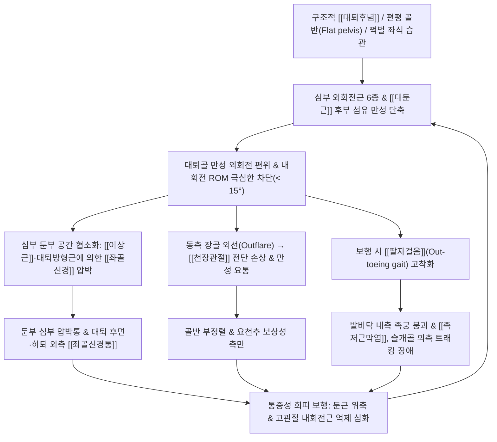

# 🦴 [[고관절 외회전 증후군]] (Hip External Rotation Syndrome)

> **핵심 3줄 요약 (Key Summary)**:
> 🎯 **병소 부위 & 운동계 손상 기전**: 셜리 샤먼(Shirley Sahrmann)의 운동계 손상 증후군(Movement System Impairment, MSI) 분류에 속하는 회전 정렬 부전 질환으로, 정적 기립·좌식 및 동적 보행 시 [[고관절]]이 해부학적 중립선을 벗어나 병적으로 과도한 바깥쪽 돌림(외회전) 상태로 편위되어 심부 외회전근군의 만성 구축과 내회전 가동성 상실을 초래하는 생체역학 증후군이다.
> 🚩 **전형적 임상 양상 & 3대 징후**: ① 앙와위 및 복와위 이완 시 발끝이 60~70° 이상 바깥으로 쓰러지는 정렬 불량 ② "[[이상근]], [[대퇴방형근]], [[슬괵근]], [[외측광근]], [[봉공근]]"의 핵심 5대 근육 단축 및 고관절 내회전 가동역의 심각한 제한(< 15~20°) ③ 보행 시 전형적인 [[팔자걸음]](Out-toeing gait)과 함께 심부 둔부 공간(Deep gluteal space)에서 [[좌골신경]]이 기계적으로 포착되는 [[이상근 증후군]] 및 [[좌골신경통]]의 빈발이다.
> 🛠️ **핵심 감별 검사 & 한·양방 다각적 치료 전략**: 고관절 회전 ROM 계측, [[FABER 검사]], [[FAIR 검사]], [[Craig's Test]](대퇴후념 확인)로 확진한다. 치료는 단축된 심부 외회전근의 PIR 등척성 이완 [[추나]], [[환도]], [[질변]], [[포황]] 장침 심자 자침 및 [[신바로약침]]·[[중성어혈약침]]을 투여하고, 근육 경련을 완화하는 [[작약감초탕]]과 풍한습비를 흩어내는 [[소경활혈탕]], [[독활기생탕]]의 [[한의 통합 치료]]를 적용한다.

---

## 📌 목차
1. [질환 개요 & 해부학적 병태생리](#1-질환-개요--해부학적-병태생리)
2. [병태생리 메커니즘 & 생체역학적 악순환 네트워크](#2-병태생리-메커니즘--생체역학적-악순환-네트워크)
3. [임상 증상 & 이학적 검사 알고리즘](#3-임상-증상--이학적-검사-알고리즘)
4. [감별 진단 매트릭스](#4-감별-진단-매트릭스)
5. [한의 통합 치료 프로토콜](#5-한의-통합-치료-프로토콜)
6. [양방 치료 & 병용·의뢰 기준](#6-양방-치료--병용의뢰-기준)
7. [재활 운동 & 생활습관 티칭 가이드](#7-재활-운동--생활습관-티칭-가이드)
8. [사용자 진료실 핵심 필기 & 임상 노하우 (Melt-In)](#8-사용자-진료실-핵심-필기--임상-노하우-melt-in)
9. [출처 및 현대 학술 연구 요약](#9-출처-및-현대-학술-연구-요약)

---

## 1. 🩺 질환 개요 & 해부학적 병태생리

### 1.1 질환 정의 및 개념적 특성
[[고관절 외회전 증후군]](Hip External Rotation Syndrome)은 대퇴골이 관절와(Acetabular fossa) 내에서 시상면 굴곡·신전을 수행할 때 해부학적 중립 축을 유지하지 못하고, 횡단면(Transverse plane) 상에서 바깥쪽으로 지속 편위(External rotation bias)되어 굳어지는 기능적 운동 손상 증후군이다.

정상 보행과 기립 시 인체의 고관절은 발끝이 약 5~10° 정도 가볍게 외측을 향하는 경미한 외회전 상태를 유지하는 것이 생리적이다. 그러나 고관절 외회전 증후군 환자는 기립 시 슬개골(Patella)과 발가락이 20~30° 이상 바깥쪽을 향하며, 보행 시 대퇴골의 비정상적 외선 상태로 인해 지면을 밀어내는 전방 추진 축이 완전히 무너진다. 이로 인해 대퇴골 근위부 후면에 밀집된 심부 둔부 외회전근 복합체가 만성적으로 단축·섬유화되고, 그 결과 대퇴골두의 정상적인 전방 롤링과 내회전 가동성이 극도로 제한된다.

### 1.2 역학 및 체형적 호발 특성
* 구조적 [[대퇴후념]](Femoral Retroversion) 보유자:
  * 정상 성인의 대퇴골 경체 염전각(Femoral version angle)은 약 12~15°의 전경(Anteversion)을 이룬다.
  * 그러나 유전적 혹은 성장기 골 변형으로 전경각이 8~10° 이하로 감소하거나 역회전된 대퇴후념(Femoral retroversion) 환자는 해부학적 뼈의 구조 자체가 외회전을 강제한다.
* **골반 입사각(Pelvic Incidence, PI) 감소 및 편평 골반(Flat Pelvis) 체형**:
  * 골반 입사각(PI)이 40° 이하로 작고, [[요추]] 전만이 소실된 일자허리-편평골반(Flat-back / Flat-pelvis) 체형에서 유병률이 매우 높다.
  * 골반이 후방 경사되면 고관절 전방 관절낭의 장력이 증가하고 대퇴골두를 외회전 위치로 잠그는(Screw-home mechanism of the hip) 구조적 고착이 발생한다.
* **자세 습관 및 직업적 편향**:
  * 의자에 앉을 때 무릎을 바깥으로 넓게 벌리고 앉는 '쩍벌 자세'를 즐기는 남성.
  * 한쪽 다리를 반대쪽 무릎 위에 얹고 앉는 4자 다리 꼬기(Figure-4 sitting) 습관.
  * 장시간 운전 시 가속 페달과 브레이크를 조작하기 위해 우측 다리를 항상 과도하게 외회전해 두는 운전기사 및 장거리 출퇴근자.
  * 양반다리(좌식 생활)를 수십 년간 지속하여 둔부 후방 관절낭이 완전히 굳어버린 중장년층.

### 1.3 심부 둔부 공간(Deep Gluteal Space)의 정밀 해부학
고관절 외회전 증후군은 심부 둔부 공간(Deep Gluteal Space)에 위치한 근육과 신경혈관 다발의 해부학적 밀집도가 핵심 병소 부위이다.
* **심부 둔부 공간의 해부학적 경계**:
  * 상계(Superior): 대좌골절흔 및 이상근 상연.
  * 하계(Inferior): 좌골결절(Ischial tuberosity) 및 대퇴방형근 하연.
  * 내측계(Medial): 천결절인대(Sacrotuberous ligament) 및 천골 외측연.
  * 외측계(Lateral): 대퇴골 대전자 후연 및 전자간능(Intertrochanteric crest).
  * 전계(Anterior): 비구 후벽, 고관절 후방 관절낭 및 좌골체.
  * 후계(Posterior): [[대둔근]](Gluteus maximus) 전면 근막.
* **좌골신경과 이상근의 해부학적 주행 변이(Beaton & Anson 분류)**:
  * Type A (정상, 약 80~85%): 좌골신경 단일 줄기가 이상근 하공(Infrapiriform foramen)을 통해 온전하게 빠져나옴.
  * Type B (약 10~12%): 좌골신경이 비골신경과 경골신경으로 조기 분지되어, 총비골신경은 이상근 복판을 관통하고 경골신경은 이상근 하공으로 주행.
  * Type C (약 2~3%): 총비골신경은 이상근 상공으로, 경골신경은 이상근 하공으로 주행.
  * Type B/C와 같은 해부학적 변이를 가진 환자가 외회전 증후군에 노출되면 이상근 수축 시 좌골신경에 가해지는 기계적 포착 손상이 기하급수적으로 증폭된다.

| 해부학적 분류 | 세부 구조물 | 정상 기능 및 주행 | 외회전 증후군에서의 병리적 변화 |
| :--- | :--- | :--- | :--- |
| **심부 외회전근군 6종** | [[이상근]](Piriformis) | 천골 전면(S2~S4)에서 기시하여 대전자 정점에 정지 | 만성 경축 및 비후(Hypertrophy)로 대좌골공을 압박, [[좌골신경]] 포착 |
| | [[상쌍자근]](Superior Gemellus) | 좌골극(Ischial spine) 기시, 대전자 내측 정지 | 내폐쇄근 건을 보조하며 건-골 부착부 섬유화 경결 |
| | [[내폐쇄근]](Obturator Internus) | 골반강 내 폐쇄막 내면 기시, 소좌골절흔 통과 | 소좌골공 마진과의 마찰로 건막염 및 좌골신경 전단력 유발 |
| | [[하쌍자근]](Inferior Gemellus) | 좌골결절 상부 기시, 대전자 내측 정지 | 심부 둔부 밴드를 형성하여 후방 관절낭을 영구 단축 |
| | [[외폐쇄근]](Obturator Externus) | 폐쇄막 외면 기시, 전자와(Trochanteric fossa) 정지 | 고관절 굴곡 시에도 외회전 토크를 지속 발생시켜 내회전 차단 |
| | [[대퇴방형근]](Quadratus Femoris) | 좌골결절 외측연 기시, 전자간능(Intertrochanteric crest) 정지 | 굵은 사각형 근육으로 만성 단축 시 전자간 공간을 협소화 |
| **천층 및 보조 외회전근** | [[대둔근]](Gluteus Maximus) | 천골·장골 후면 기시, 장경인대 및 둔근조면 정지 | 후하방 섬유가 만성 단축되어 대퇴골을 후외측으로 강력히 견인 |
| | [[봉공근]](Sartorius) | ASIS 기시, 경골 내측 거위발건 정지 | 고관절 굴곡·외전·외회전을 삼중으로 촉진하여 편위 조장 |
| | [[대퇴이두근]](Biceps Femoris) | 좌골결절(장두) 및 대퇴골 조선(단두) 기시, 비골두 정지 | 하지 외측 햄스트링으로서 하퇴의 외회전과 대퇴 외회전을 동반 지지 |
| | [[외측광근]](Vastus Lateralis) | 대퇴골 대전자 하부 및 조선 외측순 기시 | 대퇴 외측 근막 장력을 극대화하여 슬개골 외측 쏠림 및 외선 고착 |
| **신경 및 혈관 구조물** | [[좌골신경]](Sciatic Nerve) | L4~S3 신경근 기원, 이상근 하공을 통해 하지 주행 | 단축된 이상근과 대퇴방형근 사이에서 기계적 압박 및 신경 포착 유발 |
| | 음부신경(Pudendal Nerve) | 천골총 기원, 좌골극과 천결절인대 주위 주행 | 심부 외회전근 긴장 시 포착되어 회음부 및 골반저 통증 유발 |
| **골성 및 관절 구조** | [[대퇴골]] 및 대전자 | 고관절 회전의 외측 지렛대 축 | 외회전 편위 시 대전자가 비정상적으로 후방 이동 |
| | [[천장관절]](Sacroiliac Joint) | 체중을 하지로 전달하는 관절 | 편측 대퇴골 외회전 시 동측 장골 외선(Outflare) 및 전단 손상 |

---

## 2. ⚡ 병태생리 메커니즘 & 생체역학적 악순환 네트워크

### 2.1 근육 불균형과 상대적 뻣뻣함(Relative Stiffness)
고관절 회전 복합체는 시계추와 같다. 한쪽 방향의 근육이 비정상적으로 단축되어 뻣뻣해지면(Relative stiffness), 반대쪽 길항근은 만성적으로 신장되어 약화(Stretch weakness)된다.
* **단축 및 과긴장 근육군 (Short & Hypertonic)**:
  * 핵심 5대 근육: [[이상근]], [[대퇴방형근]], [[슬괵근]](특히 [[대퇴이두근]]), [[외측광근]], [[봉공근]]**.
  * 이들 근육은 대퇴골을 바깥쪽으로 비틀어 잠그는 강력한 외회전 모멘트 암(Moment arm)을 형성한다.
* **신장 및 약화 근육군 (Lengthened & Inhibited)**:
  * 고관절 내회전 주동근: [[소둔근]](Gluteus minimus) 전방 섬유, [[중둔근]](Gluteus medius) 전방 섬유, [[대퇴근막장근]](TFL) 전방부.
  * 고관절 내전근군: [[장내전근]], [[치골근]].
  * 내회전근들이 억제되면 환자는 보행 시 유각기(Swing phase)에서 하지를 내회전하여 중심선을 맞추지 못하고 다리를 바깥으로 호를 그리며 던지는 외회전 보행(Circumduction / Out-toeing gait)을 지속하게 된다.

### 2.2 심부 둔부 공간 증후군(Deep Gluteal Space Syndrome)과 좌골신경 압박
외회전 증후군의 가장 파괴적인 합병증은 좌골신경의 기계적 포착이다.
1. 해부학적으로 좌골신경은 천골 전면에서 나와 대좌골공(Greater sciatic foramen)의 **이상근 하공(Infrapiriform foramen)**을 통과하여 둔부로 진입한다.
2. 대퇴골이 만성적으로 외회전되면 대전자가 후방으로 이동하면서 이상근의 정지부와 기시부 사이의 거리가 단축된다.
3. 근육이 만성 단축되면 근형질 내 결합조직이 증식하여 근복이 두꺼워지고 뻣뻣한 밧줄처럼 변성(Contracture)된다.
4. 환자가 앉거나 고관절을 약간 굴곡할 때, 단축된 이상근과 그 하부의 내폐쇄근-쌍자근 복합체, 대퇴방형근이 좌골신경을 좌골절흔(Sciatic notch) 골벽에 강하게 짓누르는 **동적 포착(Dynamic entrapment)**이 발생한다.
5. 이로 인해 [[이상근 증후군]] 및 [[좌골신경통]]이 유발되어 둔부 깊은 곳의 쥐어짜는 통증과 대퇴 후면, 하퇴 외측으로의 방사통이 고착화된다.

### 2.3 하지 운동 사슬의 연쇄 붕괴 (Kinetic Chain Collapse)
대퇴골 외회전은 고관절에만 머무르지 않고, 골반-척추 상행성 사슬과 무릎-발목 하행성 사슬을 동시에 파괴한다.
* **상행성 사슬 (Pelvis & Spine)**:
  * 편측 대퇴골이 외회전되면 동측 장골익(Iliac wing)은 바깥쪽으로 벌어지는 **장골 외선(Iliac Outflare)** 변위를 일으킨다.
  * 이는 [[천장관절]]의 후방 인대들을 강하게 신장시켜 만성 천장관절 증후군과 엉치 뻐근함을 유발하며, [[요추]]의 대상성 회전 편위를 촉발하여 편측성 요통을 일으킨다.
* **하행성 사슬 (Knee & Foot)**:
  * 보행 시 발끝이 15~20° 이상 바깥을 향하는 [[팔자걸음]](Out-toeing gait)이 발생한다.
  * 발이 바깥쪽을 향한 상태에서 인체가 앞으로 전진하려면, 체중심이 엄지발가락 쪽으로 넘어가는 유각기 말기에 발바닥 내측 족궁(Medial longitudinal arch)을 강하게 짓이기며 무너뜨리게 된다.
  * 결과적으로 족저근막에 과도한 신장 스트레스가 가해져 [[족저근막염]] 및 후경골근 기능부전([[평발]])이 동반된다.
  * 슬관절에서는 대퇴골의 외회전에 대항하여 경골이 비틀리며 슬개골이 외측 지대로 당겨져 [[슬개대퇴통증증후군]](PFPS)이 호발한다.

### 2.4 생체역학적 악순환 네트워크 (Mermaid)



---

## 3. 🔍 임상 증상 & 이학적 검사 알고리즘

### 3.1 주요 자각 증상 및 체형 관찰
* **발끝의 과도한 외측 편위 (Prone & Supine Foot Drop)**:
  * 환자를 편안히 눕혔을 때(앙와위), 환측 다리가 바깥쪽으로 심하게 쓰러져 발 외측면이 침대 매트리스에 닿을 정도로 벌어진다.
  * 엎드려 누웠을 때(복와위) 발끝이 60~70° 이상 바깥쪽을 향해 벌어진다.
* **둔부 심부의 쥐어짜는 통증 및 방사통**:
  * 엉덩이 깊은 곳([[환도혈]] 부위)에 주먹으로 꾹 누르고 싶은 뻐근함과 쥐어짜는 듯한 둔통.
  * 의자에 30분 이상 앉아 있을 때 둔부 통증이 극심해지며, 서서 엉덩이를 털면 일시적으로 호전되는 양상.
  * 단축된 이상근이 좌골신경을 압박할 경우 햄스트링 뒤쪽을 타고 종아리 바깥쪽 및 발등으로 저림, 찌릿함, 당김 증상이 동반된다.
* **보행 이상**:
  * 모델처럼 11자로 걷지 못하고 발끝을 바깥으로 넓게 벌리고 걷는 전형적인 팔자걸음.
  * 빠르게 걸을 때 무릎이 바깥쪽을 향해 회전하는 비효율적 보행.

### 3.2 이학적 특수 검사 프로토콜

| 검사명 | 검사 방법 및 시술 절차 | 양성 반응 소견 | 임상적 의미 및 기전 |
| :--- | :--- | :--- | :--- |
| **고관절 회전 가동범위 계측** (Hip Rotation ROM) | 복와위 또는 좌위에서 무릎을 90° 굴곡하고 하퇴를 내외측으로 유도하여 각도 측정 | **외회전 > 60~70° (과다)**<br>**내회전 < 15~20° (극심한 제한)** | 외회전근 단축 및 후방 관절낭 섬유화에 의한 내회전 결손 확진 |
| [[FABER 검사]] (패트릭 검사) | 환측 하지를 숫자 4 모양(굴곡·외전·외회전)으로 만들어 반대측 무릎 위에 거치 | 무릎이 침대 바닥 쪽으로 너무 쉽게 떨어지거나 천장관절 뻐근함 호소 | 외회전근이 이미 단축되어 외회전 저항이 소실되었음을 확인 |
| [[FAIR 검사]] (Flexion-Adduction-Internal Rotation) | 고관절을 90° 굴곡, 내전, 강한 내회전을 강제하여 이상근을 최대로 신장 | 둔부 깊은 곳의 통증 재현 및 하지로 방사되는 찌릿한 신경통 | 단축된 이상근에 의한 좌골신경 포착([[이상근 증후군]]) 증명 |
| [[Craig's Test]] (대퇴골 전염각 계측) | 복와위에서 무릎 90° 굴곡 후 대퇴부를 회전시키며 대전자가 가장 외측으로 돌출하는 각도 측정 | **측정 각도 < 8~10° (대퇴후념)** | 구조적 뼈의 형태학적 변이(Retroversion) 여부 감별 |
| **Pace 검사** (Pace Test) | 좌위에서 고관절 90° 굴곡 상태로 환자에게 양 무릎을 외전시키게 하고 검사자가 저항 | 둔부 심부 통증 및 이상근 수축통 유발 | 고관절 굴곡 상태에서 외회전근 수축 시 좌골신경 압박 평가 |
| **Freiberg 검사** (Freiberg Test) | 앙와위에서 하지를 완전히 편 상태(신전위)에서 강제로 고관절 내회전 | 둔부 통증 및 좌골신경 방사통 재현 | 신전 상태에서 이상근의 신장 스트레스 유발 |
| **능동 고관절 굴곡 궤적 평가** | 앙와위에서 환자에게 무릎을 펴거나 굽혀 다리를 천장으로 능동 거상시킴 | 고관절이 중립으로 올라가지 못하고 바깥쪽으로 호(Arc)를 그리며 외회전 상승 | 고관절 굴곡근군의 외회전 대치(Dominance) 확인 |
| **Beatty 검사** | 환측을 위로 하여 측와위로 눕고 무릎을 굽힌 채 침대에서 무릎을 들어 올림 | 둔부 깊은 통증 유발 | 심부 외회전근의 능동적 수축 시 좌골신경 압박 평가 |
| **Seated Slump 검사 (외회전 편위 대조)** | 좌위에서 척추 후만 및 경추 굴곡, 슬관절 신전 시 방사통 유발 확인 후 고관절 외회전/내회전 시 증상 변화 관찰 | 내회전 시 방사통 악화, 외회전 시 방사통 경감 | 좌골신경의 기계적 주행 장력과 이상근 긴장도의 연관성 검증 |

### 3.3 진단 알고리즘 흐름도

```
[팔자걸음 / 둔부 심부 뻐근함 / 하지 방사통 호소]
                   │
                   ▼
     [고관절 회전 가동범위(ROM) 측정]
     ├─ 내회전 정상(≥ 35°) ──▶ 요추 질환 ([[요추 추간판 탈출증]]) 단독 검토
     └─ 내회전 심각한 제한(< 20°) & 외회전 과다(> 60°)
                   │
                   ▼
         [FAIR 검사 및 FABER 검사]
         ├─ FAIR 음성 ──▶ 단순 관절성/근막성 외회전 구축
         └─ FAIR 양성 (둔부 통증 및 하지 방사통 재현)
                   │
                   ▼
     [심부 둔부 공간 증후군 ([[이상근 증후군]]) 확진]
                   │
                   ▼
           [Craig's Test 시행]
         ├─ 대퇴 염전각 < 8° ──▶ 구조적 [[대퇴후념]] 기형 동반 (영구적 교정 한계 인지)
         └─ 대퇴 염전각 정상(10~15°) ──▶ 순수 연부조직 단축성 외회전 증후군 (100% 가역적)
```

---

## 4. 🔀 감별 진단 매트릭스

고관절 외회전 편위와 둔부 통증, 하지 방사통은 요추 신경근병증부터 천장관절염까지 매우 넓은 스펙트럼의 질환과 중복된다.

| 질환명 | 호발 연령 및 체형 | 주 통증 부위 및 양상 | 특이 이학적 검사 소견 | 영상의학적 특징 (X-ray / MRI) | 외회전 증후군과의 핵심 감별점 |
| :--- | :--- | :--- | :--- | :--- | :--- |
| [[고관절 외회전 증후군]] | 30~60대 좌식 남성, 운전자, 편평골반 | 둔부 심부 압박통, 팔자걸음, 대퇴 외측통 | **내회전 극심한 제한(< 15°)**, FAIR 양성, Patrick 무저항 | X-ray 골격 정상 또는 대퇴후념, MRI 상 이상근 비후 | 내회전 가동역이 단단하게 잠겨 있으며 엎드렸을 때 발이 바깥으로 쓰러짐 |
| [[이상근 증후군]](단독) | 20~50대, 여성 다발, 장시간 착석자 | 둔부 환도혈 부위 압통, 대퇴 후면 방사통 | FAIR 양성, Freiberg 양성, Beatty 양성 | 골반 MRI 신경조영술 상 좌골신경 고신호 및 이상근 비후 | 외회전 증후군의 결과로 나타나는 경우가 많으나 회전 ROM 제한이 덜할 수 있음 |
| [[요추 추간판 탈출증]](L5-S1) | 20~50대 사무직, 육체노동자 | 요통 동반, 종아리 후외측·발바닥 방사통 | [[SLR 검사]](하지직거상) 양성**, 발가락 근력 약화 | 요추 MRI 상 추간판 탈출 및 경막낭/신경근 압박 소견 | 기침·복압 시 악화되며 고관절 내회전 ROM은 정상을 유지함 |
| [[고관절 내회전 증후군]] | 10~20대 여성, W자 착석 습관 | 서혜부 찝힘통, 무릎 전면통, [[안짱걸음]] | 내회전 과다(> 50°), 외회전 제한, Craig 전경 증가 | X-ray 상 대퇴전념각(Anteversion) 증가 소견 | 완전히 반대의 회전 편위: 대퇴골이 안쪽으로 돌아가 슬개골이 마주봄 |
| [[천장관절 증후군]](SI Joint) | 임산부, 골반 외상력, 비대칭 보행자 | 천골 외측구(PSIS 하방)의 국소적 자통 | Gaenslen 검사 양성, Patrick 시 후방 천장관절통 | 골반 X-ray 상 관절면 경화, 골반 비틀림 정렬 불량 | 통증의 진원지가 둔근 심부가 아닌 PSIS 직하방 천결절인대에 국한 |
| 대퇴골 전자간 점액낭염 ([[대전자점액낭염]]) | 중년 여성, 러너, 측와위 수면자 | 대전자 외측 돌출부의 표재성 압통 | 대전자 직접 압박 시 극심한 압통, Ober 양성 | 초음파 상 대전자 점액낭 부종 및 활액 저류 | 둔부 깊은 곳이 아니라 바깥쪽 뼈 돌출부를 누를 때 가장 아픔 |
| **경골 외염 (External Tibial Torsion)** | 소아청소년기 및 청년기 | 보행 시 발끝은 외회전되나 무릎은 전방 | 슬개골은 정면을 향하는데 발목 복사뼈 축만 바깥으로 비틀림 | 하퇴 하지 전장 방사선 상 경골 염전각 증가 | 고관절 자체의 내외회전 ROM은 지극히 정상이며 정강이뼈만 비틀림 |
| 좌골대퇴 충돌 증후군 ([[좌골대퇴충돌증후군]]) | 중년 여성, 보폭이 넓은 보행자 | 좌골결절과 소전자 사이의 서혜-둔부 깊은 통증 | 고관절 신전·내전·외회전 시 둔부 통증 유발 | 골반 MRI 상 좌골대퇴 간격 협소(< 15mm) 및 대퇴방형근 부종 | 대퇴방형근 복판의 기계적 찝힘으로 소전자와 좌골 사이 간격 협소가 확인됨 |

---

## 5. 🌿 한의 통합 치료 프로토콜

한의학에서 고관절 외회전 증후군은 둔부와 하지의 경락, 특히 족소양담경(足少陽膽經)과 족태양방광경(足太陽膀胱經)의 기혈이 옹체(壅滯)되어 근맥이 굳어지는 **'근련(筋攣)', '각기(脚氣)', '좌골풍(坐骨風)', '비증(痺證)'**의 범주로 다룬다. 만성적으로 오그라든 심부 외회전근을 물리적으로 늘려주고, 신경 포착을 풀어주며, 억제된 내회전근을 활성화하는 종합 한의 치료를 시행한다.

### 5.1 추나요법 (근막이완, PIR, 관절가동화)

#### 심부 외회전근군 압박-신장 근막이완술 (Ischemic Compression & MFR)
1. 환자를 측와위로 눕히고 환측 고관절을 약 60° 굴곡, 가볍게 내전시켜 이상근과 대퇴방형근을 표면으로 노출시킨다.
2. 치료사는 주두(Elbow) 또는 수근부를 환자의 대전자와 좌골결절 사이 환도혈 및 심부 경결점에 정확히 접촉한다.
3. 수직 압박을 가한 상태에서 하퇴를 부드럽게 내회전 방향으로 움직이게 하여 단축된 근섬유를 횡방향으로 박리 신장(Cross-friction MFR)한다. 1회 1~2분, 3세트.

#### 등척성 수축 후 이완 기법 (PIR Technic)
1. 환자를 복와위로 눕히고 양 무릎을 90° 굴곡한다.
2. 치료사는 양 발목을 바깥쪽(고관절 내회전 방향)으로 벌려 단축된 외회전근이 팽팽해지는 저항 장벽(End-barrier)에 도달한다.
3. 환자에게 "발목을 안쪽으로 모으는 힘(외회전 방향)으로 제 손을 20% 힘으로 밀어보세요"라고 지시하며 7초간 등척성 버티기를 유도한다.
4. 환자가 호흡을 내쉬며 힘을 뺄 때, 치료사는 하퇴를 바깥쪽으로 지긋이 더 벌려 새로운 내회전 가동 범위를 확보한다(3~5회 반복).

#### 고관절 내회전 관절 가동 추나 (Internal Rotation Mobilization)
* 복와위에서 대퇴골 근위부 후면을 하방(침대 쪽)으로 고정한 상태에서 하퇴를 외측으로 부드럽게 유도하여 후방 관절낭의 섬유성 구축을 단계적으로 가동화한다.

#### 골반 외선(Outflare) 교정 추나
* 외측으로 벌어진 장골익을 내측으로 회전 유도시켜 천장관절 전단력을 해소하는 천골-장골 교정 기법을 병행한다.

### 5.2 침구 및 전침 치료

#### 핵심 취혈 및 자침 심도·득기(得氣) 가이드
* [[환도]](GB30): 족소양담경의 교회혈. 대전자와 천골열공을 연결하는 외측 1/3 지점.
  * ⚠️ **임상 핵심**: 단축된 이상근 복판을 관통하여 좌골신경 외막 근처까지 도달해야 한다. 3~3.5촌(75~90mm) 장침을 사용하여 수직 심자한다. 침첨이 이상근 근막을 뚫고 지나갈 때 묵직한 저항감이 느껴지며, 좌골신경 주변에 도달하면 환자의 종아리나 발가락 쪽으로 찌릿한 전기적 **득기감(得氣感)**이 전달된다. 이 감각이 확인되어야 신경막 주변의 미세 유착이 박리된다.
* [[질변]](BL54): 제4천골공 높이에서 외측 3촌. 좌골신경이 대좌골절흔을 빠져나오는 바로 그 부위이다. 3촌 장침으로 약간 외하방을 향해 2.5~3.0촌 심자하여 대퇴방형근과 좌골신경을 동시 자극한다.
* [[포황]](BL53): 제2천골공 외측 3촌. 이상근 기시부의 만성 건막염과 장골-천골 인대 긴장을 해소한다. 직자 2.0~2.5촌.
* [[승부]](BL36) & [[은문]](BL37): 좌골결절 하방 둔구 중심 및 대퇴 후면 정중선. 대퇴이두근과 반막양근 사이를 주행하는 좌골신경 본간을 자극하여 대퇴 후면 방사통을 완화한다. 직자 2.0~2.5촌.
* [[위중]](BL40): 오금 주름 정중앙. 족태양방광경의 합혈로서 요배구령(腰背九令)의 총혈. 좌골신경의 경골신경 분지를 조절한다. 직자 1.0~1.5촌.
* [[풍시]](GB31) & [[슬양관]](GB33): 단축된 [[외측광근]] 및 [[장경인대]]의 장력을 풀어주기 위해 직자 1.5~2.0촌.
* **원위 취혈**: [[양릉천]](GB34, 근회혈이자 비골신경 자극), [[현종]](GB39, 수회혈), [[구허]](GB40), [[곤륜]](BL60), [[족삼리]](ST36).

#### 전침(Electroacupuncture) 프로토콜
* **환도(GB30) - 질변(BL54)**: 2~4Hz 저주파 연속파, 20분. 과긴장된 심부 외회전근에 지속적인 수축-이완 펌핑 작용을 유도하여 허혈 상태에 빠진 근육 내 모세혈관 순환을 극대화하고 근긴장을 해제한다.
* **위중(BL40) - 양릉천(GB34)**: 저주파 2Hz, 15분. 좌골신경 주행 경로의 신경병증성 전도를 억제하고 하지 방사통을 차단한다.

### 5.3 도침 치료 (Acupotomy)
고관절 외회전 증후군이 만성화되면 대전자 후연 및 좌골결절 주위의 건 부착부에 두꺼운 섬유성 흉터 조직(Scar tissue)이 형성되어 도수치료나 일반 침으로는 풀리지 않는 불응성 구축이 발생한다.
* **시술 부위**:
  1. **대전자 후연(Greater trochanter posterior rim)**: 이상근, 상하쌍자근, 내폐쇄근의 집합 정지부.
  2. **전자간능(Intertrochanteric crest)**: 대퇴방형근 정지부.
* **수기 절차**:
  1. 환자를 측와위로 두고 해부학적 랜드마크를 정밀 촉진하여 대전자 후연의 골막 부착점을 마킹한다.
  2. 철저한 소독 후 0.6×50mm 멸균 침도를 골면에 직각으로 진입시킨다.
  3. 골막에 침첨이 닿으면 골면을 따라 대퇴골 장축과 평행하게 절개(Cutting) 2~3회, 부착부를 가볍게 긁어내는 박리(Stripping) 수기를 시행한다.
  4. 시술 후 침공 부위를 3분간 강하게 압박 지혈하여 혈종 형성을 방지한다.

### 5.4 약침 및 봉약침 치료
* [[신바로약침]] (GCSB-5):
  * 환도혈 및 질변혈 심부 이상근-좌골신경 포착 계면에 1.5~2.0cc 주입.
  * 신경막 주변의 미세 염증과 부종을 가라앉히고 신경 압박성 허혈 통증을 신속 소퇴시킨다.
* [[중성어혈약침]](中性瘀血藥針):
  * 대퇴방형근 및 대전자 후연 부착부에 1.0cc 주입.
  * 만성 단축으로 인해 근막 내에 응결된 어혈(瘀血)과 허혈성 대사 부산물을 배출시키고 조직 유연성을 회복시킨다.
* [[봉약침]](Bee Venom):
  * 이상근 건-골 부착부 및 대퇴이두근 좌골결절 부착부에 0.1~0.2cc 분할 주입.
  * 국소 면역 반응을 유도하여 만성 퇴행성 건병증의 결합조직 리모델링을 촉진한다.
* [[자하거약침]]:
  * 장기간의 신경 압박으로 위축된 둔근 및 이상근 기시부에 1.0cc 주입하여 신경 영양 인자 공급 및 근막 탄력 회복.

### 5.5 한약 치료 (방제 의학적 변증)

| 변증 유형 | 주증 및 신체 특성 | 추천 처방 | 주요 구성 약물 및 방제 생체역학적 기전 |
| :--- | :--- | :--- | :--- |
| **근련긴급(筋攣緊急) & 급성경축형** | 둔부 심부의 쥐어짜는 급성 경련통, 다리를 안쪽으로 돌릴 수 없음, 맥현 | [[작약감초탕]]<br>(芍藥甘草湯) 가미 | 백작약 24g, 감초 12g, 모과 8g, 우슬 8g.<br>백작약의 파에오니플로린(Paeoniflorin)과 감초의 글리시리진(Glycyrrhizin)이 신경근 접합부의 과잉 흥분을 즉각 억제하고 세포 내 칼슘 유입을 조절 |
| **기체어혈(氣滯瘀血) & 신경포착형** | 밤에 더 심해지는 둔부 자통, 대퇴 후면 저림 및 칼로 베는 듯한 방사통, 설자암 | [[소경활혈탕]]<br>(疎經活血湯) 가미 | 당귀, 천궁, 백작약, 숙지황, 도인, 홍화, 도우슬, 방기, 위령선, 강활, 방풍, 백지, 창출, 황백 등.<br>하지 경락의 어혈을 몰아내고 심부 둔부 공간의 미세 혈액순환을 회복 |
| **풍한습비(風寒濕痺) & 만성단축형** | 차가운 곳에 앉으면 둔부 통증 극심, 날씨 궂으면 다리가 당기고 무거움, 설태백니 | [[오적산]]<br>(五積散) 가미 | 마황, 창출, 진피, 후박, 당귀, 백작약, 천궁, 백지, 반하, 복령, 계지, 건강, 지각, 길경, 감초 등.<br>한습(寒濕)을 온산(溫散)시켜 굳어버린 둔부 근막과 관절낭의 유연성을 근본 회복 |
| **간신휴손(肝腎虧損) & 퇴행성연계형** | 수년간 지속된 팔자걸음, 노인성 고관절 퇴행 및 척추관 협착증 동반, 무릎 시림 | [[독활기생탕]]<br>(獨活寄生湯) 가미 | 독활, 상기생, 두충, 우슬, 세신, 진교, 복령, 계심, 방풍, 천궁, 인삼, 당귀, 작약, 숙지황, 감초.<br>간신을 보익하고 근골을 튼튼히 하여 골반-고관절 결합조직의 구조적 퇴행을 지연 |
| **기혈양허(氣血兩虛) & 만성위축형** | 오랜 좌골신경 포착으로 하지 감각 둔마, 하퇴부 근위축, 피로 시 보행 실조 | [[보중익기탕]]<br>(補中益氣湯) 합<br>사물탕 가미 | 황기, 당삼, 백출, 당귀, 숙지황, 백작약, 천궁, 우슬, 속단 등.<br>기혈을 대보하여 만성 허혈성 신경 손상을 재생하고 말초 신경 전도 속도 정상화 |
| **어혈조락(瘀血阻絡) & 급성손상형** | 엉덩방아 등 둔부 외상 후 외회전 편위 고착, 좌골신경 주행로 압통 및 종창 | [[당귀수산]]<br>(當歸鬚散) 가미 | 당귀미, 적작약, 오약, 향부자, 소목, 홍화, 도인, 계지, 감초.<br>외상성 혈종과 근막 박리성 어혈을 신속히 배출하고 통증 전달 물질 억제 |

---

## 6. 💊 양방 치료 & 병용·의뢰 기준

### 6.1 양방 보존적 치료 현황
* **약물 치료**: 근육 이완제(Aflqualone, Eperisone 등)와 NSAIDs, 신경병증성 통증 완화제(Pregabalin, Gabapentin)를 복합 처방하여 이상근 경련과 좌골신경 방사통을 조절한다.
* **초음파 유도하 이상근 차단술(Piriformis Muscle Injection)**:
  * 외래에서 고해상도 초음파로 이상근과 좌골신경을 실시간 확인하며, 국소마취제와 트리암시놀론을 이상근 복판에 주입하여 즉각적인 근이완과 통증 차단을 유도한다.
* **보툴리눔 독소 주사(Botox Injection)**:
  * 난치성 이상근 경축 환자에게 보툴리눔 톡신 A형(50~100 Unit)을 초음파 유도하에 주입하여 3~6개월간 화학적 탈신경(Chemical denervation)을 유도, 근육을 이완시킨 후 재활을 진행한다.

### 6.2 협진 및 병용 치료 시너지 전략
* **영상 정밀 진단 협진**: 요추 디스크 탈출증과 심부 둔부 포착을 완벽히 감별하기 위해 양방 정형외과/영상의학과의 요추 및 골반 MRI, 좌골신경 신경조영술(MR Neurography)을 적극 활용한다.
* **복합 치료 시너지**: 양방의 초음파 유도하 신경 차단술로 급성 신경성 방사통을 먼저 50% 이상 차단한 상태에서, 한의 도침 및 PIR 추나를 적용하면 환자의 통증 저항 없이 심부 근막을 훨씬 깊고 안전하게 이완시킬 수 있다.

### 6.3 수술적 적응증 및 양방 전원 레드플래그

```
⚠️ [고관절 외회전 및 심부 둔부 증후군의 양방 즉각 전원 레드플래그]
1. 마미 증후군(Cauda Equina Syndrome): 대소변 장애(실금/정체), 안장 부위(Saddle area) 감각 상실.
2. 진행성 운동 신경 결손: 족하수(Foot drop, 발목을 위로 젖히지 못함), 하퇴부 근위축이 급격히 진행되는 경우.
3. 골반강 내 종양 및 점유성 병변: 골반 MRI 상 좌골신경 주변의 신경초종(Schwannoma) 또는 골반 종양.
4. 6개월 이상의 한·양방 보존 치료 및 주사 치료에도 불구하고 보행이 불가능한 불응성 이상근 건 섬유화.
   → 관절경하 또는 개방성 좌골신경 감압술(Sciatic nerve neurolysis) 및 이상근 절제술(Piriformis tenotomy) 의뢰.
```

---

## 7. 🏃 재활 운동 & 생활습관 티칭 가이드

고관절 외회전 증후군 환자의 재활 운동은 **"단축된 외회전근을 끝까지 늘리고(Lengthening), 잠들어 있는 내회전근을 깨우는 것(Activation)"**이 핵심 축이다.

### 7.1 단계별 기능적 재활 운동 프로토콜

#### 1단계: 앙와위 숫자 4 이상근 스트레칭 (Figure-4 Stretch)
* **목적**: 과긴장된 이상근과 대퇴방형근의 수동적 신장.
* **방법**:
  1. 환자는 바닥에 등을 대고 눕는다.
  2. 환측 발목을 반대쪽 무릎 위에 올려 숫자 4 모양을 만든다.
  3. 양손으로 반대쪽 허벅지 뒤를 잡고 가슴 쪽으로 지긋이 당겨 올린다.
  4. 둔부 깊은 곳이 뻐근하게 늘어나는 지점에서 30초간 호흡을 유지하며 3회 반복한다.

#### 2단계: 폼롤러 심부 둔부 근막 이완 (Foam Rolling SMR)
* **목적**: 천층 대둔근 및 심부 외회전근의 유착을 기계적으로 압박 이완.
* **방법**:
  1. 폼롤러 위에 엉덩이를 얹고 앉아 환측 발목을 반대쪽 무릎에 올린다.
  2. 체중을 환측 엉덩이 쪽으로 살짝 기울여 가장 아픈 압통점(Trigger point)을 찾는다.
  3. 그 부위에 체중을 싣고 30~60초간 천천히 롤링하며 근막을 이완한다.

#### 3단계: 고관절 내회전근 능동 강화 운동 (Active Internal Rotation with Band)
* **목적**: 신장 약화된 [[소둔근]], [[중둔근]] 전방 섬유를 강화하여 외회전 편위를 중립으로 되돌림.
* **방법**:
  1. 의자에 바르게 앉아 무릎을 90° 굽히고 양 무릎 사이에 수건을 끼워 고정한다.
  2. 환측 발목에 탄력 밴드를 걸고, 무릎 위치를 고정한 채 발목을 바깥쪽으로 힘차게 밀어낸다(고관절 축 기준 내회전 수축).
  3. 끝 범위에서 3초간 수축을 유지한 후 천천히 원위치로 돌아온다. 15회씩 3세트.

#### 4단계: 11자 보행 신경근 인지 훈련 (Gait Retraining)
* **목적**: 팔자걸음으로 굳어진 보행 신경근 패턴을 11자 직선 추진으로 재프로그래밍.
* **방법**:
  1. 바닥에 직선 테이프를 붙이고 테이프 양옆에 발을 11자로 나란히 정렬한다.
  2. 걸음을 걸을 때 슬개골과 두 번째 발가락이 정확히 정면을 향하도록 시각적으로 확인하며 천천히 걷는다.
  3. 뒤꿈치 접촉(Heel strike)에서 엄지발가락 밀기(Toe-off)까지 일직선으로 체중이 이동하는 궤적을 환자 뇌에 인지시킨다.

### 7.2 일상생활 금기 동작 및 자세 티칭
1. **쩍벌 착석 및 다리 꼬기 절대 금지**:
   - 의자에 앉을 때 무릎을 과도하게 벌리고 앉거나, 다리를 4자 모양으로 꼬아 허벅지 위에 올리는 자세는 외회전근을 영구 단축시키는 주범이다. 반드시 양 무릎을 모으고 발바닥을 11자로 평평하게 두고 앉아야 한다.
2. **양반다리 좌식 생활 탈피**:
   - 바닥에 양반다리를 하고 앉는 행위는 고관절을 외전·외회전의 극단으로 밀어 넣는다. 좌식 밥상 생활을 버리고 입식 식탁과 의자 생활로 100% 전환하도록 지도한다.
3. **운전 시 우측 발목 정렬 교정**:
   - 오른발을 페달에 얹을 때 무릎이 문 쪽으로 툭 쓰러지지 않도록 무릎 외측에 쿠션을 받쳐 고관절이 중립을 유지하도록 차량 환경을 개선한다.
4. **신발 마모 패턴 자가 점검**:
   - 신발 뒷굽의 외측 모서리만 유독 심하게 닳아 없어지는 환자는 외회전 편위가 만성화되었음을 뜻하므로, 11자 보행 의식 훈련과 족부 보조기 착용을 검토한다.

---

## 8. 💡 사용자 진료실 핵심 필기 & 임상 노하우 (Melt-In)

### 8.1 원장님 핵심 메모 유기적 융합 및 심화 집약
* **고관절 외회전 편위 체형의 본질**:
  * 환자가 서 있을 때 슬개골이 바깥을 보고 있다면 이미 대퇴골은 외회전 편위되어 있다.
  * 골격적으로 구조적 [[대퇴후념]](Femoral Retroversion)을 가지고 있거나, 골반 입사각(PI)이 작고 요추 전만이 감소된 일자허리-편평골반(Flat-back / Flat-pelvis) 체형에서 압도적으로 호발한다.
  * 이러한 환자들은 단순히 엉덩이가 아픈 것이 아니라, 척추-골반-하지 전체의 회전 사슬이 바깥으로 뒤틀려 있는 상태이다.
* **반드시 기억해야 할 핵심 5대 단축 근육군**:
  * "[[이상근]], [[대퇴방형근]], [[슬괵근]](대퇴이두근), [[외측광근]], [[봉공근]]"
  * 이 5개 근육이 돌처럼 굳어져 대퇴골을 바깥으로 강하게 잡고 놓아주지 않기 때문에 [[이상근 증후군]]과 [[좌골신경통]]이 필연적으로 발생한다.
  * 치료할 때는 막연히 허리를 만질 것이 아니라, 이 5대 근육을 샅샅이 뒤져 단축된 외회전근과 외전근을 물리적으로 완벽히 풀어헤쳐야(Release) 승산이 있다.

### 8.2 진료실 감별 팁 & 복와위 1초 촉진 비기
* 만성 요통이나 엉치 통증으로 내원한 환자를 베드에 엎드리게(복와위) 해보라.
* 환자가 힘을 빼는 순간, **유독 한쪽 발끝이 바깥쪽으로 70~80도 털썩 쓰러져 침대 바닥에 닿을 듯 벌어지는 모습**을 목격하게 될 것이다.
* 이때 요추 MRI를 먼저 찍기보다 환측 고관절의 내회전 가동 범위를 측정해보라. 하퇴를 바깥으로 벌리려 해도 10도 부근에서 딱딱한 나무토막처럼 걸리며 극심한 저항감(Hard end-feel)이 느껴진다면, 요통의 진원지는 요추가 아니라 바로 이 '고관절 외회전 증후군'에 의한 골반 외선과 천장관절 전단 스트레스이다.

### 8.3 환도혈 장침 심자의 손맛과 득기(得氣) 비결
* 환도혈을 찌를 때 1~1.5촌 짧은 침으로 겉만 찌르면 100번을 맞아도 이상근 증후군은 낫지 않는다.
* 반드시 3촌(75mm) 이상의 장침을 잡고, 대전자와 천골열공 외측 1/3 지점에서 수직으로 과감하게 심자해야 한다.
* 침첨이 대둔근을 통과할 때는 부드럽게 들어가다가, **약 5~6cm 깊이에서 밧줄처럼 질긴 이상근 근막을 뚫을 때 '뚝' 혹은 '찌걱' 하는 특유의 손맛**이 전해진다.
* 그 순간 침첨을 2~3mm만 더 밀어 넣으면 환자가 **"아악! 원장님, 엉덩이 깊은 곳에서 다리 발가락 끝까지 전기가 찌릿하고 통했어요!"** 하고 외친다.
* 이것이 바로 이상근 하공을 지나는 좌골신경 외막의 미세 유착을 침첨으로 직접 자극하여 분리해내는 진정한 '환도혈 득기(得氣)'의 손맛이다. 이 득기를 성공시킨 후 유침하고 전침을 걸면 환자는 침대를 내려오자마자 다리가 날아갈 듯 가벼워졌다고 고백하게 된다.

---

## 9. 📚 출처 및 현대 학술 연구 요약

- Ghani N. (2026). Deep Gluteal Syndrome and Persistent Sciatica in a Patient With Unilateral Piriformis Muscle Hypertrophy: A Case Report. *Clin Case Rep*. 14(10):e73730. PMID: 42865704
  * [연구 요약]: 편측 이상근 비후 및 만성 외회전 구축으로 인해 발생한 심부 둔부 증후군(Deep Gluteal Syndrome)과 난치성 좌골신경통의 초음파 유도하 이학적 진단과 도수 이완 및 국소 신경 차단술의 치료 효과를 입증함.

- Sudhakar P. (2026). Integrated Role of Musculoskeletal Ultrasound in Piriformis Syndrome: A Case Series. *Cureus*. 18(5):e109123. PMID: 42317917
  * [연구 요약]: 이상근 증후군 환자군에서 근골격계 초음파를 활용한 이상근 두께 계측 및 좌골신경 압박 동적 영상 평가의 유용성을 규명하고, 심부 외회전근 이완 재활의 정량적 임상 호전 지표를 제시함.

- Bocheński W. (2026). Anatomical variations of hip acetabulum and femoral head-neck junction may predispose to clinical consequences: a case-based discussion of complex morphological interactions. *Folia Morphol (Warsz)*. 85:e01726005. PMID: 41685827
  * [연구 요약]: 대퇴골 후념(Retroversion)과 고관절 외회전 부정렬이 대퇴경부와 비구 사이의 기계적 마찰, 심부 외회전근의 만성 단축 및 관절순 전단 손상을 초래하는 해부형태학적 복합 상호작용을 사체 해부 및 임상 증례를 통해 규명함.

- Kaczmarek K. (2026). The lesser trochanter index: detection of increased femoral version in patients with symptomatic hip disease. *J Orthop Surg Res*. 21(1). PMID: 42482161
  * [연구 요약]: 대퇴골 회전 변형 및 고관절 회전 증후군 환자에서 소전자 지수(Lesser Trochanter Index)를 이용한 대퇴골 비틀림 각도 정량화와 외회전 편위가 보행 축 및 고관절 접촉 응력에 미치는 생체역학적 영향을 분석함.

- Kong X. (2026). Biomechanical study of characteristics of dynamic stability of lower limbs in individuals with patellofemoral pain syndrome. *Sci Rep*. 16(1). PMID: 42020553
  * [연구 요약]: 고관절 회전 증후군과 하지 근육 불균형이 슬개대퇴 관절의 동적 안정성 및 지면 반발력 분산에 미치는 운동역학적 영향을 3차원 동작 분석을 통해 입증하고, 팔자걸음 및 외회전 교정의 임상적 필요성을 강조함.
