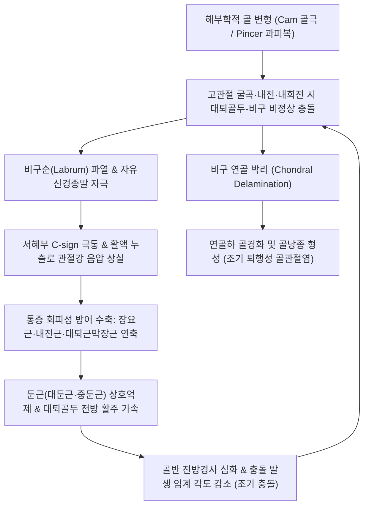

# 🩺 [[고관절 충돌증후군]] (Femoroacetabular Impingement, FAI / 股關節 衝突症候群)

> **핵심 3줄 요약 (Key Summary)**:
> - 📍 병소 부위 & 해부·병태생리: 대퇴골두-경부 이행부의 골성 돌출(Cam 병변)이나 비구 전외측의 과도한 덮임(Pincer 병변, 복합형 85%)으로 인해 고관절 굴곡·내회전 시 대퇴골과 비구가 비정상적으로 맞부딪히며 섬유연골성 [[비구순]](Labrum) 파열과 인접 관절 연골 박리(Chondral delamination)를 초래하고 원발성 고관절 골관절염으로 진행하는 역학적 질환.
> - 🚩 전형적 임상 양상: 대퇴골 대전자와 서혜부 전면을 감싸 쥐는 특징적인 C-사인(C-sign), 장시간 좌식 후 기립 시 찝힘 통증, 깊은 스쿼트 및 양반다리 불가, 고관절 굴곡-내전-내회전 충돌 검사인 [[FADIR 검사]](민감도 > 95%) 양성, X-ray상 알파 각도(Alpha angle > 50~55°) 증가.
> - 🛠️ 한의 통합 치료 & 보존 요약: 영국 The Lancet(UK FASHIoN) 및 BMJ(FAIT) 대규모 다기관 RCT 연구에서 구조화된 비수술 보존 치료의 우수성이 입증된 질환으로, [[환도]], [[거료]], [[비관]] 심부 자침, [[신바로약침]] 및 [[봉약침]] 항염·재생 치료, 고관절 장축 견인 및 후하방 글라이딩 감압 추나를 적용하며 굴곡 90° 초과 제한 및 둔근 강화 재활을 병행함.
> - <font color="#fa7e7e">⚠️ 응급 의뢰 레드플래그: 관절 내 거대 비구순 피판 감돈으로 인한 급격한 기계적 관절 잠김(True mechanical locking) 및 하지 가동 불능, 체중 부하 불가 수준의 급성 통증 악화, 대퇴골두 무혈성 괴사(AVN) 의심 시 정형외과 전원.</font>

---

## 📌 목차
1. [질환 개요 & 해부학적 병태생리](#1--질환-개요---해부학적-병태생리)
2. [병태생리 메커니즘 & 생체역학적 악순환 네트워크](#2--병태생리-메커니즘---생체역학적-악순환-네트워크)
3. [임상 증상 & 이학적 검사 알고리즘](#3--임상-증상---이학적-검사-알고리즘)
4. [감별 진단 매트릭스](#4--감별-진단-매트릭스)
5. [한의 통합 치료 프로토콜](#5--한의-통합-치료-프로토콜)
6. [양방 치료 & 병용·의뢰 기준](#6--양방-치료---병용의뢰-기준)
7. [재활 운동 & 생활습관 티칭 가이드](#7--재활-운동---생활습관-티칭-가이드)
8. [💡 사용자 진료실 핵심 필기 & 임상 노하우 (Melt-In)](#8----사용자-진료실-핵심-필기---임상-노하우-melt-in)
9. [📚 출처 및 현대 학술 연구 요약](#9--출처-및-현대-학술-연구-요약)
10. [🔗 관련 노트](#10--관련-노트)

---

## 1. 🩺 질환 개요 & 해부학적 병태생리

### 1) 질환 정의 및 임상적 중요성
고관절 충돌증후군(Femoroacetabular Impingement Syndrome, FAI Syndrome) 또는 대퇴비구 충돌증후군은 골반의 [[비구]](Acetabulum)와 [[대퇴골두]](Femoral head) 및 대퇴골경부(Femoral neck) 접합부 사이의 미세한 해부학적 골 형태 불일치로 인해, 정상적인 생리적 관절 가동 범위 내(특히 굴곡 및 내회전 시)에서 두 뼈가 반복적으로 비정상적인 기계적 충돌을 일으키는 질환입니다.

```
[고관절 관절와순-골두 정상 접합과 FAI 충돌 비교]

       [정상 고관절 (구형 골두)]                 [캠 충돌 (비구형 비후)]
          ┌─────────────┐                          ┌─────────────┐
          │    비구     │                          │    비구     │
          │ (Acetabulum)│                          │ (Acetabulum)│
          └───┬─────┬───┘                          └───┬─────┬───┘
              │비구순│                                  │비구순│ ◀── [전단 박리 손상!]
          ┌───┴─────┴───┐                          ┌───┴─────┴───┐
          │   완전 구형 │                          │ 골성 돌출   │ ◀── [Cam 골극 융기]
          │  대퇴골두   │                          │(권총손잡이) │
          └─────────────┘                          └─────────────┘
          매끄러운 회전 운동                       굴곡 시 비구 전상방 테두리 타격
```

- **역학**:
  - 축구, 아이스하키, 야구, 태권도, 발레, 크로스핏 등 고관절의 극단적 굴곡(Flexion)과 내회전(Internal rotation)을 반복하는 20~30대 젊은 운동선수 및 활동적 청장년층에서 호발합니다.
  - 전 세계 인구의 약 15~20%가 무증상 골 형태 변형(Cam 또는 Pincer)을 지니고 있으나, 반복적 부하나 역학적 스트레스가 가해질 때 증상성 FAI 증후군으로 이환됩니다.
- **의학사적 의의**:
  - 스위스 베른 대학의 Reinhold Ganz 교수 연구팀(2003)에 의해 고관절 충돌증후군의 병태생리가 명확히 정립되기 전까지, 대다수의 젊은 환자들은 "원인 불명의 서혜부 통증" 또는 단순 "염좌"로 방치되다가 조기에 고관절 퇴행성 관절염으로 진행하였습니다.
  - 현대 정형외과학에서는 본 질환을 **원발성 퇴행성 고관절염(Primary Hip Osteoarthritis)을 촉발하는 가장 결정적인 역학적 위험 인자**로 확립하고 있습니다.

### 2) 비구순(Acetabular Labrum)과 관절 연골의 미세 해부학
고관절은 전형적인 구와 관절(Ball-and-socket joint)로 깊은 비구 안에 대퇴골두의 약 50% 이상이 수용됩니다.
- **섬유연골성 비구순의 해부학적 특성**:
  - 비구 테두리를 360° 둘러싸고 있는 말발굽 형태의 질긴 섬유연골 조직으로, 비구의 깊이를 약 21% 깊게 만들고 관절 표면적을 28% 확장시킵니다.
  - **활액 밀폐 효과(Fluid Seal Effect)**: 비구순은 대퇴골두와 완벽히 밀착하여 관절강 내 활액이 외부로 새어나가지 않도록 음압(Negative intra-articular pressure)을 유지합니다. 이 밀폐 기전은 관절 연골에 가해지는 체중 부하 접촉 응력을 균등하게 분산시키고 마찰 계수를 극도로 낮추는 핵심 생리 기능을 담당합니다.
- **신경 분포와 통증 기전**:
  - 비구순의 기저부와 외측 1/3 섬유층에는 감각신경 섬유, 특히 통각을 전달하는 **무수 및 희돌기 유수 자유신경종말(Free nerve endings)**과 루피니 소체(Ruffini corpuscles), 파치니 소체(Pacinian corpuscles) 등 고유수용성 감각기가 조밀하게 분포합니다.
  - 따라서 충돌로 인해 비구순에 미세 파열이나 박리가 발생하면 매우 예리하고 날카로운 서혜부 심부 극통과 불안정감이 유발됩니다.

### 3) 형태학적 3대 분류 체계
2016년 워릭 합의(Warwick Agreement) 국제 가이드라인에 따른 형태학적 분류입니다.

```
[대퇴비구 충돌증후군의 형태학적 3대 분류 비교]

┌───────────────────┬────────────────────────────────────────────────────────┐
│ 분류 유형         │ 병리 해부학적 특징 및 호발 집단                        │
├───────────────────┼────────────────────────────────────────────────────────┤
│ **캠 충돌**       │ - **대퇴골두-경부 이행부의 골성 융기 (비구형화 Asphericity)**│
│ (Cam Impingement) │ - 권총 손잡이 변형(Pistol-grip deformity), 알파각 > 55°│
│                   │ - **20~30대 젊은 남성 운동선수** 최빈도 호발           │
│                   │ - 병태: 굴곡 시 비후부가 비구 내로 쐐기처럼 박히며     │
│                   │   비구순-연골 경계부의 **연골 박리(Chondral delamination)** 유발│
├───────────────────┼────────────────────────────────────────────────────────┤
│ **핀서 충돌**     │ - **비구의 국소적 또는 전반적 과피복 (Overcoverage)**   │
│ (Pincer Impingement)│ - 심비구(Coxa profunda), 돌출비구, 비구 후경(Retroversion)│
│                   │ - **30~40대 활동적인 여성** 호발                        │
│                   │ - 병태: 대퇴경부가 비구 테두리와 직접 맞부딪히며       │
│                   │   비구순을 짓이기고 분쇄하는 **압박 압괴(Crushing)** 유발│
├───────────────────┼────────────────────────────────────────────────────────┤
│ **혼합형 충돌**   │ - **캠 병변과 핀서 병변이 복합 발현된 형태**           │
│ (Mixed Type)      │ - **실제 임상 진료실 환자의 약 80~85% 차지 (절대 다수)**│
│                   │ - 대퇴골두의 비구형성과 비구의 과피복이 동반되어        │
│                   │   가장 광범위하고 심각한 비구순 파열 및 연골 마모 초래 │
└───────────────────┴────────────────────────────────────────────────────────┘
```

---

## 2. ⚡ 병태생리 메커니즘 & 생체역학적 악순환 네트워크

### 1) 관절강 내 충돌 메커니즘과 연골 박리(Chondral Delamination)
고관절 충돌증후군의 병리적 핵심은 단순한 뼈의 접촉이 아니라, 관절 내부에서 발생하는 파괴적인 전단 응력(Shear stress)입니다.

```
[캠 충돌 시 비구 연골의 박리 기전 (Wave Sign)]

대퇴골 굴곡·내회전 ──> Cam 골극이 비구 전상방 진입 ──> 비구순을 바깥으로 밀어냄 (Outside-in force)
                                                          │
    ┌─────────────────────────────────────────────────────┘
    ▼
비구 관절 연골과 연골하 골판(Subchondral bone plate) 계면 전단 파괴
    │
    ├─ 연골이 뼈에서 풍선처럼 들뜨는 현상 발생 (Chondral Delamination / Wave Sign)
    ├─ 활액 누출로 인한 윤활막 파괴 & 관절강 내 음압 상실
    └─ 연골하 골낭종(Subchondral cyst) 형성 및 조기 [[퇴행성 고관절염]] 직행
```

- **캠형 충돌의 Outside-in 손상**:
  - 비구형화된 Cam 융기부는 곡률 반경이 정상 골두보다 크기 때문에, 고관절 굴곡 시 비구 속으로 부드럽게 미끄러져 들어가지 못하고 억지로 끼어들게 됩니다.
  - 이때 비구순을 바깥쪽으로 밀어내는 강력한 전단력이 발생하면서, 비구순과 관절 연골 사이의 이행부(Chondrolabral junction)가 찢어지고, 관절 연골이 연골하골로부터 카펫이 바닥에서 뜯겨 나가듯 박리(Chondral delamination)됩니다.
- **핀서형 충돌의 지렛대 효과(Lever Effect)와 맞불 손상(Contrecoup Lesion)**:
  - 핀서형 충돌에서는 대퇴골 경부가 비구의 과도한 전방 테두리와 먼저 부딪힙니다.
  - 이때 부딪힌 접촉점이 지렛대의 받침점(Fulcrum) 역할을 하여, 대퇴골두를 비구 뒤쪽 아래로 강하게 밀어내는 지렛대 운동이 일어납니다.
  - 그 결과, 충돌이 일어난 전상방뿐만 아니라 **반대편 후하방 비구 연골과 골두 연골이 서로 강하게 충돌하여 마모되는 맞불 손상(Contrecoup lesion)**이 필연적으로 동반됩니다.

### 2) 고관절 주변 근막 불균형과 [[대퇴 전방 활주 증후군]]
골 구조의 이상뿐만 아니라 근육 불균형은 FAI 증상을 촉발하고 악화시키는 결정적인 기능적 기전입니다.
- **동적 중심화(Centration) 상실**:
  - 정상적인 고관절 굴곡 시, 대퇴골두는 관절와 내에서 회전하면서 동시에 후하방으로 미끄러져 들어가야(Posterior-inferior glide) 전방 비구와 충돌하지 않습니다.
- **[[대퇴 전방 활주 증후군]](Femoral Anterior Glide Syndrome)의 발생**:
  - 장시간 좌식 생활과 운동 부족으로 인해 [[대둔근]](Gluteus maximus)과 [[중둔근]](Gluteus medius) 후부 섬유가 약화(Inhibition)되고,
  - 반대로 골반 앞쪽의 [[장요근]](Iliopsoas) 힘줄과 [[대퇴근막장근]](TFL), 대퇴직근, 내전근군이 단축 및 구축되면,
  - 고관절을 굴곡할 때 대퇴골두를 뒤로 잡아당겨주는 후방 장력이 소실되어 **대퇴골두가 앞쪽으로 불쑥 튀어나오는 전방 활주(Anterior glide)**가 일어납니다.
  - 이는 Cam 골극이나 비구 테두리와의 충돌 타이밍을 훨씬 앞당겨, 불과 60~70°의 가벼운 굴곡에서도 극심한 찝힘을 유발합니다.

### 3) 골반-척추-고관절 운동사슬 (Spino-Pelvic-Hip Chain)
- **골반 전방경사(Anterior Pelvic Tilt)의 악영향**:
  - 요추 전만 증가 및 장요근 단축으로 골반이 앞으로 기울어지면, 해부학적으로 비구가 앞으로 쏟아지며 대퇴골두를 위와 앞에서 더 많이 덮게 됩니다.
  - 즉, 골 구조가 정상이더라도 **기능성 핀서 충돌(Functional Pincer Impingement)**이 인위적으로 유도되어 고관절 굴곡 가능 각도가 급격히 감소합니다.
- **골반 후방경사(Posterior Pelvic Tilt) 및 요추 평평화**:
  - 반대로 골반이 과도하게 후방경사되면 척추의 충격 완충 능력이 소실되고, 보행 추진 시 고관절 신전 가동 범위가 극단적으로 제한되어 관절낭 전방 인대에 비정상적인 견인 스트레스가 집중됩니다.

### 4) 생체역학적 악순환 네트워크
FAI는 골 변형, 연부조직 파열, 신경병증, 근육 억제가 결합된 다차원적 악순환 경로를 거칩니다.



---

## 3. 🔍 임상 증상 & 이학적 검사 알고리즘

### 1) 특징적 주소증 및 C-사인 (C-Sign)
진료실에서 FAI 환자가 호소하는 임상 양상은 매우 전형적입니다.

```
[고관절 충돌증후군의 특징적 통증 표현: C-사인 (C-Sign)]

                  [환자의 손동작 관찰]
                     엄지손가락 (Thumb)
                            │
                            ▼  대퇴골 대전자 후방 (Posterior Greater Trochanter)
                     ┌──────────────┐
                     │   환자의 손  │
                     └──────────────┘
                            ▲
                            │
                     검지손가락 (Index)
                            │
                            ▼  서혜부 전면 심부 (Anterior Groin)
```

- **C-사인 (C-Sign)**:
  - 환자에게 "어디가 어떻게 아프십니까?"라고 물었을 때, 환자는 손바닥을 펼쳐 엄지손가락은 대전자 뒤쪽 둔부에 얹고, 검지손가락은 앞쪽 서혜부에 얹어 **골반 옆을 'C'자 형태로 감싸 쥐며** 고관절 깊은 곳의 통증을 호소합니다.
- **자세 및 동작에 따른 찝힘 통증 (Pinching Pain)**:
  - **장시간 좌식 후 기립 시**: 영화관람, 장거리 운전, 낮은 소파에 오래 앉아 있다가 일어날 때 고관절 앞쪽이 굳어서 바로 펴지 못하고 엉거주춤하게 일어납니다.
  - **특정 동작 악화**: 바닥에 쪼그려 앉기(Deep squat), 양반다리(가부좌), 다리 꼬고 앉기, 양말이나 신발 끈 묶기, 자동차를 타고 내릴 때 사타구니가 찝히는 날카로운 통증이 발생합니다.
- **기계적 증상 (Mechanical Symptoms)**:
  - 관절 안에서 무언가 걸리는 느낌(Catching), 뚝뚝 소리가 나는 탄발음(Clicking), 순간적으로 다리에 힘이 빠지거나 관절이 굳어 움직이지 않는 느낌(Giving-way / Pseudo-locking)을 동반합니다.

### 2) 핵심 특수 이학적 검사 알고리즘

```
[고관절 이학적 검사 감별 알고리즘]

                    ┌──────────────────────────────────────────┐
                    │      서혜부 및 고관절 통증 의심 환자    │
                    └─────────────────────┬────────────────────┘
                                          │
       ┌──────────────────────────────────┼──────────────────────────────────┐
       ▼                                  ▼                                  ▼
 [FADIR 검사]                       [FABER 검사]                       [Scour 검사]
 (Flexion-Add-Int.Rot)              (Flexion-Abd-Ext.Rot)              (Hip Grind Test)
 ├─ 고관절 90° 굴곡                 ├─ 고관절 숫자 4자 형태            ├─ 굴곡 상태에서 장축 압박
 ├─ 강한 수동 내전 및 내회전        ├─ 슬관절 하방 압박                ├─ 비구 테두리 원형 회전
 └─ 서혜부 날카로운 극통 재현       ├─ 전방 통증: 비구순/관절낭        └─ 마찰음, 걸림, 찝힘 재현
    [FAI 진단 민감도 > 95%]         └─ 후방 통증: 천장관절염              [관절연골 손상 의심]
```

1. **[[FADIR 검사]] (Flexion-Adduction-Internal Rotation Test / 전방 충돌 검사)**:
   - **검사 방법**: 환자를 앙와위로 눕히고, 검사자가 환자의 고관절을 90° 굴곡(Flexion)시킨 후 최대 내전(Adduction) 및 내회전(Internal rotation)을 유도합니다.
   - **양성 소견**: 대퇴골두 전상방의 Cam 병변이 비구 전상방 테두리와 강하게 맞부딪히며, 평소 환자가 느끼던 날카로운 서혜부 찝힘 통증이 즉각 재현됩니다.
   - **임상적 가치**: **민감도 95~99%에 달하는 FAI 선별의 골드 스탠다드 검사**로, 본 검사에서 음성이면 관절 내 충돌 질환일 가능성은 극히 낮습니다.
2. **[[FABER 검사]] (Flexion-Abduction-External Rotation / Patrick Test)**:
   - **검사 방법**: 환자의 고관절을 굴곡, 외전, 외회전시켜 검사측 복사뼈를 반대쪽 무릎 위에 올려놓아 다리로 숫자 '4' 모양을 만든 후 슬관절을 바닥 쪽으로 부드럽게 누릅니다.
   - **양성 소견**:
     - **서혜부 앞쪽 통증**: 비구순 파열, 고관절 관절낭염, 장요근 건염 시사.
     - **후방 엉덩이/천골 통증**: 천장관절염(Sacroiliitis) 시사.
3. **고관절 압박 회전 검사 (Scour Test / Hip Grind Test)**:
   - 고관절을 다양한 각도로 굴곡시킨 상태에서 대퇴골 장축 방향으로 체중을 실어 압박을 가하면서 부채꼴 모양으로 내외회전 및 내외전을 유도합니다.
   - 관절 내부에서 뚝뚝 걸리는 마찰음(Crepitus)이나 서혜부 심부 통증이 유발되면 비구순 파열 및 관절 연골 박리를 강력히 시사합니다.
4. **후방 충돌 검사 (Posterior Impingement Test)**:
   - 환자를 침대 끝에 걸터눕히고 검사측 하지를 침대 밖으로 떨어뜨려 고관절을 과신전(Hyperextension)시키며 외회전을 가합니다.
   - 둔부 심부 또는 서혜부 후방에 통증이 발생하면 후방 비구 충돌증후군 양성입니다.

### 3) 영상의학적 정밀 진단 지표

```
[FAI 진단을 위한 방사선학적 핵심 계측선]

                  [Dunn View / Axial View]
                          골두 중심 (Center)
                                ┼ ─── 대퇴골 경부 축 (Neck Axis)
                               /
                              /  알파 각도 (Alpha Angle)
                             /   [정상 < 50° / Cam 변형 > 55°]
                            /
      대퇴골두 구형이 깨지는 점 ◀── 골성 돌출 시작 부위
```

#### (1) 단순 방사선 X-ray (Pelvis AP & Dunn View)
- **Pelvis AP View**:
  - **크로스오버 징후 (Crossover Sign)**: 정상 비구는 전벽선이 후벽선 안쪽에 위치하나, 비구가 뒤로 틀어진 비구 후경(Retroversion) 환자는 전벽선이 후벽선을 교차하여 '8자 모양'을 형성함 (Pincer 충돌 지표).
  - **비구 심도 지표**: 비구저가 장치선(Ilioischial line)을 넘어서면 심비구(Coxa profunda), 골두가 장치선을 넘으면 돌출비구(Protrusio acetabuli)로 Pincer 병변 확진.
- **Dunn View (45° 또는 90° 굴곡-외전 20° 방사선)**:
  - **알파 각도 (Alpha Angle)**: 대퇴골두의 구형 윤곽이 벗어나는 지점과 대퇴골두 중심점을 잇는 선이 대퇴골 경부 중심축과 이루는 각도.
  - **판독 기준**: 정상치는 42~50°이며, **알파각이 55° 이상(엄격한 기준 50° 이상)이면 Cam 병변으로 확진**합니다.
  - **전방 골두-경부 오프셋 (Head-Neck Offset Ratio)**: 골두 전방 돌출부와 경부 전방 피질골 사이의 거리 비율이 0.15 이하로 감소되어 있으면 Cam 골극 형성 시사.

#### (2) MR 관절조영술 (MRA, Magnetic Resonance Arthrography)
- 고관절강 내에 가돌리늄 조영제를 주입한 후 촬영하는 MRA는 FAI 정밀 진단의 최고 정점입니다.
- **비구순 파열의 위치**: 전상방(10시~2시 방향) 비구순 기저부로 조영제가 침투하는 음영 결손을 확인.
- **연골 박리 (Wave Sign)**: 조영제가 관절 연골과 연골하 골판 사이로 스며들어 연골이 풍선처럼 부풀어 오른 상태를 포착.

---

## 4. 🔀 감별 진단 매트릭스

고관절 및 서혜부 통증은 골반 내 장기, 신경, 건, 관절강 내 병변이 복잡하게 얽혀 있어 정밀한 감별이 필수적입니다.

| 질환명 | 주 통증 부위 | 호발 연령 및 유발 요인 | 핵심 이학적 검사 | 영상 및 진단적 감별 포인트 |
| :--- | :--- | :--- | :--- | :--- |
| **고관절 충돌증후군**<br>(FAI) | 서혜부 전면 심부<br>(C-sign) | 20~30대 운동선수, 깊은 스쿼트, 양반다리 | **[[FADIR 검사]] 양성**, FABER 서혜부 통증 | Dunn view 알파각 > 55°, MRA 비구순 파열 및 연골 박리 |
| [[대퇴골두 무혈성 괴사]]<br>(AVN of Femoral Head) | 서혜부 심부 둔통, 둔부, 무릎 방사 | 30~50대 남성, 잦은 과음, 스테로이드 복용력 | 고관절 모든 방향 ROM 제한, 특히 내회전 극심한 제한 | 단순 X-ray 초기에 정상, **MRI T1 저신호 띠(Crescent sign)** 확진 |
| [[퇴행성 고관절염]]<br>(Hip Osteoarthritis) | 서혜부 전반, 대전자, 체중부하 시 둔통 | 60대 이상 고령층, 장시간 보행 시 악화 | 고관절 신전 및 내회전 구축, 관절 잡음(Crepitus) | X-ray 관절 간격 현저한 협착, 골극, 연골하 골경화 |
| **[[장요근 건염]]/활액낭염**<br>(Iliopsoas Tendinitis) | 서혜부 전면 표층, 계단 오를 때 통증 | 달리기, 고관절 반복 굴곡, 발레리나 | **Ludloff 검사 양성**, 고관절 저항 굴곡 시 통증, 건 튕김음 | 관절 내부 정상, 초음파상 장요근건 종창 및 활액낭 삼출 |
| **스포츠 탈장**<br>(Athletic Pubalgia) | 서혜인대 하부, 치골 결합부, 하복부 | 축구 선수, 갑작스러운 방향 전환, 킥 동작 | 기침/발살바 시 팽륜 없음, 저항 복근 수축 시 치골통 | 고관절 자체 ROM 정상, MRI상 복직근-내전근 건막 파열 |
| **대전자 통증증후군**<br>(대퇴전자부 활액낭염) | 골반 외측 대전자 부위, 측와위 수면 불가 | 40~60대 여성, 계단 오르기, 장거리 보행 | **대전자 직접 압통**, 오버 검사(Ober's test) 양성 | 관절 내부 무관, 초음파상 대전자 점액낭 부종 및 중둔근건염 |
| **요추 신경근병증**<br>(L2, L3, L4 HNP) | 서혜부, 대퇴 전내측 방사통, 저림 | 요추 디스크 병력, 허리 숙일 때 악화 | **[[하지직거상검사]](SLR) 또는 대퇴신경신장검사(FST) 양성** | 요추 MRI상 추간판 탈출 및 신경근 압박, 고관절 FADIR 음성 |

```
[서혜부 통증의 3대 구역 감별 체크리스트]

1. 관절강 내부 (Intra-Articular) : FAI, 비구순 파열, AVN, 골관절염 ──> FADIR 검사 양성, C-sign
2. 관절강 외부 (Extra-Articular) : 장요근 건염, 내전근 건염, 대전자 증후군 ──> 저항 근력 검사 양성
3. 투사통 및 골반벽 (Referred/Wall) : 요추 신경근병증, 스포츠 탈장, 천장관절염 ──> 척추/신경 검사 양성
```

---

## 5. 🌿 한의 통합 치료 프로토콜

### 1) 침구 치료

```
[고관절 충돌증후군의 핵심 경혈 배치도]

        (전상장골극 ASIS 직하방)                 (ASIS-대전자 연결선 중점)
              [[비관]] (ST31) ───────────────── [[거료]] (GB29)
                     │                                │
                     │          [고관절 관절낭]       │
                     │                                │
              [[충문]] (SP12) ───────────────── [[환도]] (GB30)
        (서혜인대 외측/대퇴동맥외측)             (대전자-천골열공 1/3 외측)
        [전방 관절순 직접 감압]                 [후방 관절낭 및 둔근 이완]
```

#### (1) 3대 심부 핵심 혈위 자침 술기
- **[[환도]](GB30)**:
  - 위치: 대퇴골 대전자 최고점과 천골열공을 잇는 선의 외측 1/3과 내측 2/3의 교차점.
  - 심도 및 수기법: 75~90mm 장침을 사용하여 수직 직자 2.5~3.5촌으로 이상근 및 심부 관절낭까지 도달시킵니다. 묵직한 득기감(得氣)이 둔부 전체와 하지 후면으로 전파되도록 유도합니다.
  - 작용 기전: 고관절 후방 관절낭의 긴장을 해소하고 단축된 심부 외회전근군을 이완시켜 대퇴골두의 정상 회전축을 복원합니다.
- **[[거료]](GB29)**:
  - 위치: 전상장골극(ASIS)과 대퇴골 대전자 최고점을 연결한 선의 중점.
  - 심도 및 수기법: 직자 또는 고관절 방향으로 1.5~2.5촌 사자.
  - 작용 기전: 족소양담경과 양교맥의 교회혈로, 고관절 전외측 관절낭의 염증을 소퇴시키고 과긴장된 [[대퇴근막장근]](TFL)을 직접 이완하여 전방 충돌 압력을 경감합니다.
- **[[비관]](ST31)**:
  - 위치: 넓적다리 앞쪽면, 전상장골극(ASIS)의 수직 아래, 넙다리곧은근(대퇴직근)과 넙다리빗근(봉공근) 사이의 오목한 곳.
  - 심도 및 수기법: 직자 1.5~2.0촌.
  - 작용 기전: 족양명위경의 관문 혈위로 대퇴직근 기시부의 긴장을 풀고, 고관절 전방 활주를 억제하여 굴곡 시 찝힘을 직접적으로 차단합니다.
- **보조 배혈**:
  - 충문(SP12): 서혜인대 부위, 대퇴동맥 맥동 외측으로 비구 전방 활액막염에 유효.
  - 질변(BL54), 풍시(GB31), 양릉천(GB34): 하지 외측 근막 장력 조절.

#### (2) 전침 (Electroacupuncture) 치료
- **전침 결합**: 비관(ST31) - 거료(GB29) 연결, 환도(GB30) - 질변(BL54) 연결.
- **파형 및 주파수**: 2Hz 연속파 또는 2/100Hz 혼합파를 적용하여 15~20분간 통전.
- **치료 기전**: 관절강 심부의 Substance P 등 통증 유발 물질을 억제하고 국소 미세혈류 순환을 촉진하여 만성 비구순 염증을 흡수시킴.

### 2) 약침 치료 (Pharmacopuncture)
고관절은 관절낭이 매우 깊고 두터워 일반 침술만으로는 관절순 염증 부위에 약효가 도달하기 어려우므로, 정밀한 약침 요법이 탁월한 치료 수단이 됩니다.

```
[고관절 충돌증후군의 단계별 약침 치료 프로토콜]

┌───────────────────┬────────────────────────────────────────────────────────┐
│ 약침 제제         │ 자입점 및 임상 작용 기전                               │
├───────────────────┼────────────────────────────────────────────────────────┤
│ [[신바로약침]] │ - 자입점: 거료, 비관, 충문 심부 관절순 인접부          │
│ (자생 GCSB-5 성분)│ - 무균성 활액막염의 강력한 소염, 연골 파괴 효소(MMP-3, │
│                   │   MMP-13) 억제를 통한 관절 연골 및 비구순 보호         │
│                   │ - 1회 1.0~2.0cc, 23~25G 60mm 장침형 주사기 사용 심부 주입│
├───────────────────┼────────────────────────────────────────────────────────┤
│ [[봉약침]]    │ - 자입점: 환도, 거료 혈위 주변 피내·피하 점적         │
│ (Sweet BV 10%)    │ - 강력한 멜리틴(Melittin) 작용으로 국소 모세혈관 확장, │
│                   │   만성 섬유화된 비구순 주변의 결합조직 자가 치유 유도 │
│                   │ - 알레르기 스킨테스트 필수, 0.2~0.5cc 미량 주입        │
├───────────────────┼────────────────────────────────────────────────────────┤
│ [[중성어혈약침]]│ - 자입점: 서혜인대 하부 및 고관절 전방 압통점          │
│                   │ - 외상성 충돌 직후 급성 혈종 및 활액 삼출액의 신속 흡수│
└───────────────────┴────────────────────────────────────────────────────────┘
```

### 3) 추나치료 (Chuna Manual Therapy) - 정밀 관절 감압 및 활주 술기
대퇴골두의 비정상적인 전방 전위를 교정하고 관절 내 음압 공간을 확보하는 정밀 추나 기법입니다.

#### (1) 고관절 장축 간헐적 견인 추나 (Long-Axis Hip Traction)
- **적응증**: 고관절 굴곡 시 서혜부 찝힘 극통, 관절강 협착.
- **환자 자세**: 앙와위, 하지를 침대 모서리에 위치시킴.
- **시술 방법**:
  - 보조자가 환자의 골반을 고정하거나 골반 벨트로 침대에 단단히 고정합니다.
  - 시술자는 양손으로 환자의 발목 상부 또는 무릎 상부를 파지하고, 하지를 약 20~30° 굴곡, 15~20° 외전, 가벼운 외회전(Loose-packed position) 상태로 정렬합니다.
  - 시술자의 체중을 뒤로 실으며 하지 장축 방향으로 **부드럽고 강력한 간헐적 견인(Grade III~IV Traction)**을 10~15초간 유지하고 서서히 이완하기를 5~7회 반복합니다.
  - 대퇴골두와 비구 사이의 관절 간격이 벌어지며 전상방 충돌 부위의 압박 응력이 즉각 해소됩니다.

#### (2) 고관절 후하방 글라이딩 기법 (Posterior-Inferior Femoral Glide)
- **적응증**: 대퇴골두 전방 활주 증후군 교정, 고관절 굴곡 각도 회복.
- **시술 방법**:
  - 환자를 앙와위로 눕히고 고관절을 90° 굴곡시킵니다.
  - 시술자는 한 손으로 환자의 무릎을 지지하고, 다른 손의 손바닥 수근부를 환자의 대퇴골 근위부 전면에 접촉합니다.
  - 굴곡 상태를 유지하면서 **대퇴골두를 바닥 방향(후방) 및 발치 방향(하방)으로 비스듬히 밀어 넣는 후하방 활주력(Posterior-inferior mobilization)**을 율동적으로 적용합니다.
  - 이를 통해 굴곡 시 대퇴골두가 전방으로 튀어나와 비구와 충돌하는 궤적을 정상 궤적으로 교정합니다.

#### (3) 장요근 및 대퇴근막장근 근에너지기법 (MET)
- 수축-이완 기법(Post-Isometric Relaxation)을 적용하여 단축된 장요근을 신장시키고 골반 전방경사를 완화합니다.

### 4) 변증 한약 치료 (Herbal Medicine)

| 변증 유형 | 주증 및 설태·맥상 | 대표 처방 | 구성 약재 및 가감법 |
| :--- | :--- | :--- | :--- |
| **기체어혈**<br>(氣滯瘀血) | 운동 손상 후 급성 통증, 찌르는 듯한 서혜부 자통, 야간통 심화<br>설암자(舌暗紫), 맥현삽(脈弦澁) | **[[당귀수산]](當歸鬚散)**<br>또는 서경탕 | 당귀미, 적작약, 오약, 향부자, 소목, 홍화, 도인, 계지, 감초.<br>+ 활혈지통: 삼칠근, 현호색, 몰약. |
| **풍한습비**<br>(風寒濕痺) | 흐린 날이나 찬 곳에 앉으면 고관절이 굳고 쑤심, 기립 시 강직<br>설담태백니(舌淡苔白膩), 맥침완(脈沈緩) | **[[독활기생탕]](獨活寄生湯)**<br>또는 [[오적산]] | 독활, 상기생, 두충, 우슬, 세신, 진교, 복령, 방풍, 천궁, 당귀, 백작약, 숙지황.<br>+ 온경통락: 계지, 부자, 강황. |
| **간신휴손**<br>(肝腎虧損) | 만성 비구순 퇴행성 파열, 연골 마모 동반, 다리에 힘이 빠지고 시림<br>설홍소태(舌紅少苔), 맥세삭(脈細數) | **가미대보탕(加味大補湯)**<br>또는 보신장골탕 | 숙지황, 백출, 당귀, 백작약, 황기, 인삼, 두충, 파극, 구척, 골쇄보, 우슬, 속단.<br>+ 관절 연골 재생 촉진. |

---

## 6. 💊 양방 치료 & 병용·의뢰 기준

### 1) 보존적 물리치료 vs 수술적 관절경의 대규모 RCT 근거
과거에는 FAI가 진단되면 조기에 관절경 수술로 뼈를 깎아내는 경향이 강했으나, 최근 최고 수준의 임상 연구들이 발표되면서 **비수술적 보존 치료가 1차 표준 치료로 확립**되었습니다.

```
[FAI 보존 치료 vs 관절경 수술의 대규모 다기관 RCT 연구 비교]

┌───────────────────┬────────────────────────────────────────────────────────┐
│ 랜드마크 연구     │ 연구 설계 및 핵심 결론                                 │
├───────────────────┼────────────────────────────────────────────────────────┤
│ **영국 FASHIoN**  │ - 대상: 448명의 증상성 FAI 환자 대상 다기관 무작위 대조군 연구│
│ (Griffin et al.,  │ - 비교: 관절경 골성형술 vs 맞춤형 보존 물리·운동 치료(PHT)│
│  *Lancet* 2018)   │ - **결론**: 두 군 모두 12개월 추적에서 유의미한 기능 호전 달성.│
│                   │   수술군이 약간 우세했으나 보존치료군 역시 괄목할 치료 효과 입증.│
│                   │   따라서 **모든 환자에게 최소 6개월 이상의 보존 치료 선행 권고**│
├───────────────────┼────────────────────────────────────────────────────────┤
│ **영국 FAIT**     │ - 대상: 222명의 증상성 FAI 환자 무작위 배정            │
│ (Palmer et al.,   │ - 비교: 관절경 수술군 vs 물리치료 및 활동 수정군       │
│  *BMJ* 2019)      │ - **결론**: 구조화된 물리치료와 충돌 회피 교육만으로도  │
│                   │   환자의 통증과 기능 지수(iHOT-33)가 극적으로 개선됨을 확인│
└───────────────────┴────────────────────────────────────────────────────────┘
```

- **국제 합의 (Warwick Agreement 2016)**:
  - FAI의 초기 관리는 수술이 아니며, **활동 수정(Activity modification), 관절 감압 도수 치료, 둔근 강화 중심의 보존적 프로토콜이 반드시 최우선**되어야 함을 천명하였습니다.

### 2) 주사 요법의 역할
- **진단적-치료적 관절강 내 주사 (Diagnostic Intra-Articular Injection)**:
  - 초음파 또는 C-arm 유도하에 고관절강 내로 국소마취제(Lidocaine)와 극미량의 스테로이드를 주입합니다.
  - 주입 직후 1~2시간 동안 환자의 서혜부 통증 및 FADIR 검사 통증이 80% 이상 소실된다면, 통증의 근원지가 고관절강 내부(비구순/연골)임을 확진하는 **결정적 진단 도구**가 됩니다.

### 3) 수술적 치료 적응증 및 관절경 술식
- **수술 적응증**:
  - 최소 6개월 이상의 체계적인 한의 통합 보존 치료 및 재활에도 불구하고 일상생활이 불가능할 정도의 극심한 통증이 지속되는 경우.
  - 찢어진 비구순 조각이 관절 사이에 끼어 명확한 기계적 관절 잠김(Mechanical locking)이 반복되는 경우.
- **고관절 관절경 술식 (Hip Arthroscopy)**:
  - **대퇴골두-경부 골성형술 (Femoroplasty)**: Cam 골성 융기부를 버(Burr)로 갈아내어 정상 구형 곡률을 복원.
  - **비구 변연 절제술 (Acetabuloplasty)**: 핀서 과피복 부위를 부분 절제.
  - **비구순 봉합술 (Labral Repair)**: 파열된 비구순을 봉합 나사못(Suture anchor)을 이용하여 비구 뼈 테두리에 견고하게 재고정.

### 4) 전문과 전원 레드플래그
- 비구순 피판 감돈으로 인해 고관절이 완전히 잠겨 펴지지도 굽혀지지도 않는 응급 상황.
- 대퇴골두 무혈성 괴사(AVN)로 인한 골두 함몰 소견 관찰 시 정형외과 응급 전원.

---

## 7. 🏃 재활 운동 & 생활습관 티칭 가이드

### 1) 고관절 충돌 회피 일상생활 티칭 (Impingement Avoidance)
치료 중 충돌을 유발하는 자세를 지속하면 어떠한 명약도 효과를 볼 수 없습니다.

```
[진료실 환자 생활 티칭: 피해야 할 3대 금기 자세]

   [1. 딥 스쿼트 금지]          [2. 양반다리·다리꼬기 금지]         [3. 낮은 의자 착석 금지]
      허벅지가 수평 이하로         굴곡-내회전 복합 자세               무릎이 고관절보다 위로
      내려가는 깊은 스쿼트         비구순을 지렛대로 찍어누름          올라가 장시간 충돌 압박
```

- **굴곡 90° 초과 동작 엄격 제한**:
  - 자동차 시트나 사무실 의자가 너무 낮으면 고관절이 90° 이상 굴곡되므로, **단단한 방석을 엉덩이 밑에 깔아 무릎이 항상 고관절보다 약간 아래쪽에 위치하도록** 높이를 조절합니다.
- **스쿼트(Squat) 자세 수정**:
  - 허벅지가 바닥과 수평 이하로 내려가는 딥 스쿼트(Deep squat)는 Cam 골극이 비구순을 강타하므로 절대 금기입니다.
  - 엉덩이를 뒤로 빼는 쿼터 스쿼트(Quarter squat) 또는 하프 스쿼트까지만 허용하며, 발끝을 15~20° 약간 외회전시켜 전방 충돌 여유 공간을 확보합니다.
- **바닥 생활 금지**:
  - 양반다리, 가부좌, W자 다리로 앉기, 바닥에 쪼그려 앉아서 하는 집안일(걸레질, 김장 등)을 철저히 금지하고 입식 생활로 전환합니다.

### 2) 둔근 강화 및 대퇴골두 안정화 운동
- **클램쉘 (Clamshell Exercise)**:
  - 측와위에서 무릎을 45° 굽히고 양발을 붙인 상태에서, 골반이 뒤로 넘어가지 않도록 고정하고 위쪽 무릎을 조개껍질 열듯 벌림.
  - **[[중둔근]] 후부 섬유와 심부 외회전근을 선택적으로 강화**하여 보행 및 체중 부하 시 대퇴골의 비정상적 내회전을 방어함 (15회씩 3세트).
- **사이드 라잉 힙 어브덕션 (Side-Lying Hip Abduction)**:
  - 옆으로 누워 다리를 약간 신전 및 외회전시킨 상태에서 천장 방향으로 들어 올림. 중둔근 강화.
- **글루트 브릿지 (Glute Bridge)**:
  - 앙와위에서 무릎을 세우고 둔근을 조이며 골반을 들어 올림.
  - [[대둔근]]을 강화하여 고관절 신전 시 대퇴골두가 전방으로 밀리지 않고 제자리에 안착되도록 유도함.

### 3) 단축된 고관절 굴곡근 자가 신장
- **하프 닐링 장요근 스트레칭 (Half-Kneeling Psoas Stretch)**:
  - 한쪽 무릎을 바닥에 대고 반대쪽 발을 앞으로 디딘 런지 자세에서, 골반을 후방경사(Tuck)시킨 상태로 체중을 천천히 앞으로 이동시킴.
  - 단축된 장요근을 이완하여 골반 전방경사를 정상화함.

---

## 8. 💡 사용자 진료실 핵심 필기 & 임상 노하우 (Melt-In)

### 1) 진료실 실전 감별 및 문진 체크리스트
- **20~30대 젊은 층의 특이적 호소 포착**:
  - 젊은 환자가 "스쿼트나 데드리프트할 때 사타구니 앞쪽이 찝혀서 깊이 못 앉겠다", "양반다리를 하고 앉으면 사타구니가 걸려서 다리가 바닥에 안 닿고 뻐근하다"고 호소하면 1순위로 FAI를 의심해야 합니다.
- **진찰대 위에서의 원터치 FADIR 검사 요령**:
  - 환자를 눕히자마자 무릎을 90°로 접어 환자의 반대쪽 어깨를 향해 강하게 밀어 넣으면서 발목을 바깥으로 회전(고관절 내회전)시킵니다.
  - 이때 환자가 눈을 질끈 감으며 "선생님, 바로 그 자리가 찝혀요!"라고 외치며 손으로 서혜부 앞쪽을 짚는다면 95% 이상 대퇴비구 충돌 및 비구순 병변입니다.

### 2) 서혜부 탈장 및 내전근 건염과의 1분 원포인트 감별법
- **서혜부 탈장(Inguinal Hernia) 감별**:
  - 환자를 세우고 기침을 시키거나 배에 힘을 주게(Valsalva) 했을 때 서혜인대 상부에서 불룩 튀어나오는 돌출 덩어리가 있는지 확인합니다. 관절 운동과 무관하게 복압 상승 시 돌출되면 탈장입니다.
- **내전근 건염(Adductor Tendinitis) 감별**:
  - 환자의 무릎 사이에 진료실 베개를 끼우고 다리를 안쪽으로 강하게 모으게(저항 내전) 합니다.
  - 이때 치골 결절(Pubic tubercle) 부착부에서 찌릿한 표층 통증이 재현되면 내전근 건염이며, 관절 깊숙한 곳의 C-sign 찝힘 통증과는 촉진 깊이와 유발 기전이 완전히 다릅니다.

### 3) 침도요법(도침) 적용 시의 노하우
- 만성 FAI 환자에서 대퇴직근 기시부(AIIS)와 대퇴근막장근 기시부의 유착이 극심할 경우, 일반 호침만으로 장력이 해소되지 않으면 초음파 유도하에 소침도(Small needle-knife)를 이용하여 비관 및 거료 혈위의 유착된 건막 섬유를 미세 절개 박리하면 1회 시술만으로도 굴곡 가동 범위가 15~20° 즉각 개선되는 극적인 결과를 얻을 수 있습니다.

---

## 9. 📚 출처 및 현대 학술 연구 요약

- Ganz R et al. (2003). Femoroacetabular impingement: a cause for osteoarthritis of the hip. *Clin Orthop Relat Res*, (417): 112-120. PMID: 14646708
  - 대퇴비구 충돌증후군(FAI)의 병태생리와 Cam/Pincer 개념을 세계 최초로 체계화한 기념비적 랜드마크 논문. FAI가 고관절 원발성 골관절염의 핵심 선행 병인임을 입증.
- Griffin DR et al. (2016). The Warwick Agreement on femoroacetabular impingement syndrome (FAI syndrome): an international consensus statement. *Br J Sports Med*, 50(19): 1169-1176. PMID: 27629403
  - 전 세계 22명의 다학제 전문가가 참여한 FAI 증후군 국제 합의 성명. 증상, 임상 징후, 방사선 소견의 3요소 진단 기준 확립 및 보존적 치료의 1차적 중요성 명시.
- Griffin DR et al. (2018). Hip arthroscopy versus best conservative care for the treatment of femoroacetabular impingement syndrome (UK FASHIoN): a multicentre randomised controlled trial. *Lancet*, 391(10136): 2225-2235. PMID: 29893223
  - 영국 23개 병원에서 448명을 대상으로 관절경 수술과 개인맞춤형 보존 물리치료(PHT)를 비교한 최고 권위 다기관 RCT 연구. 비수술적 보존 치료의 뛰어난 임상적 유효성과 표준 치료로서의 가치를 과학적으로 입증.
- Palmer AJR et al. (2019). Arthroscopic hip surgery compared with physiotherapy and activity modification for the treatment of symptomatic femoroacetabular impingement: multicentre randomised controlled trial. *BMJ*, 364: l185. PMID: 30733197
  - FAI 환자에서 관절경 수술군과 물리치료 및 충돌 회피 활동 수정군을 비교한 전향적 무작위 대조군 연구(FAIT). 체계적인 물리치료 프로토콜이 수술에 필적하는 임상적 호전도를 가져옴을 증명.
- Kemp JL et al. (2026). Physiotherapist-led treatment for femoroacetabular impingement syndrome (the PhysioFIRST study): an assessor-blinded, limited disclosure randomised controlled trial. *Br J Sports Med*. PMID: 42082318
  - FAI 환자를 대상으로 한 최신 무작위 대조군 임상시험. 물리치료사 주도의 심부 둔근 강화, 충돌 회피 교육, 생체역학적 교정 프로그램이 고관절 기능 장애와 통증을 유의미하게 경감시킴을 재확인.
- Adib F et al. (2023). Two Novel Clinical Tests for the Diagnosis of Hip Labral Tears. *Am J Sports Med*, 51(5): 1205-1212. PMID: 36803076
  - 고관절 비구순 파열 및 충돌증후군 진단에서 이학적 검사법들의 민감도와 특이도를 다각도로 검증하고 정밀한 임상 진단 알고리즘을 제시한 연구.

---

## 10. 🔗 관련 노트
- [[고관절 질환]]
- [[대퇴비구 충돌증후군]]
- [[비구순 파열]]
- [[퇴행성 고관절염]]
- [[대퇴골두 무혈성 괴사]]
- [[장요근 건염]]
- [[대퇴전자부 활액낭염]]
- [[대퇴 전방 활주 증후군]]
- [[FADIR 검사]]
- [[FABER 검사]]
- [[환도]]
- [[거료]]
- [[비관]]
- [[신바로약침]]
- [[봉약침]]
- [[추나치료]]
- [[대둔근]]
- [[중둔근]]
- [[장요근]]
