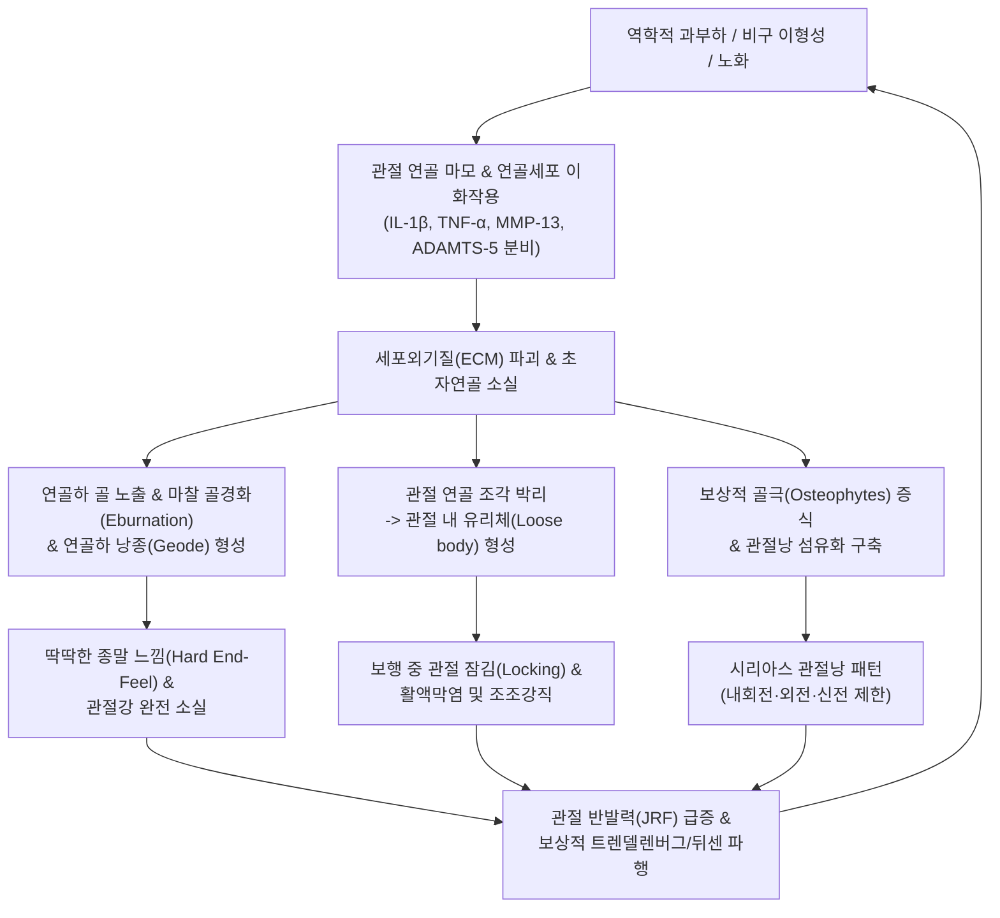

# 🩺 [[골관절증(고관절)]] (Coxarthrosis / Osteoarthritis of Hip, ICD-10 M16)

> **핵심 3줄 요약 (Key Summary)**:
> - 🎯 정의 & 해부·병태생리: 관골구(비구)와 대퇴골두를 덮고 있는 관절 초자연골(Hyaline cartilage)이 점진적으로 마모·변성되고, 연골하 골경화(Subchondral sclerosis), 골극(Osteophytes), 연골하 낭종(Geodes)이 형성되며 관절강이 비가역적으로 좁아지는 만성 진행성 관절 질환(ICD-10 M16).
> - 🚩 전형적 임상 양상 & 3대 징후: 보행 시 서혜부·대퇴 전내측·무릎으로 이어지는 심부 둔통, 30분 미만의 조조강직(Morning stiffness), 시리아스 관절낭 패턴에 따른 수동 내회전 극심한 제한(<15°)과 딱딱한 종말 느낌(Hard end-feel), 관절 내 유리체(Joint mice) 끼임에 의한 보행 중 잠김(Locking).
> - 🛠️ 핵심 감별 검사 & 한·양방 다각적 치료 전략: [[FABER 검사]](Patrick), 수동 내회전 가동역 검사, Tönnis 병기 분류(0~3기)로 확진 후; 관절강 감압 장축 신연 [[추나요법]], 환도·거료·비관 심자침, [[신바로약침]]·[[자하거약침]], 보간신 강근골 [[독활기생탕]]·[[대방풍탕]] 투여; 보존적 치료 실패 시 인공관절 전치환술(THA) 연계.
> - <font color="#fa7e7e">⚠️ 응급 의뢰 레드플래그 & 보행 티칭: 대퇴골두 무혈성 괴사(AVN)의 급성 골두 함몰 및 패혈성 관절염 감별 필수; 지팡이는 반드시 반대측(건측) 손으로 짚어야 고관절 관절 반발력(JRF)을 50% 이상 즉각 감소시킬 수 있음.</font>

---

## 📌 목차
1. [질환 개요 & 해부학적 병태생리](#1-질환-개요--해부학적-병태생리)
2. [병태생리 메커니즘 & 생체역학적 악순환 네트워크](#2-병태생리-메커니즘--생체역학적-악순환-네트워크)
3. [임상 증상 & 이학적 검사 알고리즘](#3-임상-증상--이학적-검사-알고리즘)
4. [감별 진단 매트릭스](#4-감별-진단-매트릭스)
5. [한의 통합 치료 프로토콜](#5-한의-통합-치료-프로토콜)
6. [양방 치료 & 병용·의뢰 기준](#6-양방-치료--병용의뢰-기준)
7. [재활 운동 & 생활습관 티칭 가이드](#7-재활-운동--생활습관-티칭-가이드)
8. [💡 사용자 진료실 핵심 필기 & 임상 노하우 (Melt-In)](#8--사용자-진료실-핵심-필기--임상-노하우-melt-in)
9. [출처 및 현대 학술 연구 요약](#9-출처-및-현대-학술-연구-요약)

---

## 1. 🩺 질환 개요 & 해부학적 병태생리

### 1) 질환 정의 및 분류체계
[[골관절증(고관절)]](Coxarthrosis 또는 Hip Osteoarthritis)은 직립 보행 시 인체 체중의 대부분을 지탱하는 고관절의 관절 연골이 점진적으로 닳아 없어지면서 관절면의 마찰과 파괴가 진행되는 만성 비염증성(Non-inflammatory, 저등급 무균성 염증 동반) 진행성 관절 질환이다.

국제질병분류(ICD-10) 및 한국표준질병사인분류(KCD) 상 `M16` 코드로 분류되며, 발병 원인에 따라 원발성(Primary)과 이차성(Secondary)으로 대별된다:

* **원발성 고관절증 (Primary Coxarthrosis, M16.0 / M16.1)**:
  - 뚜렷한 선행 해부학적 결함이나 외상 없이 노화, 유전적 소인, 생체역학적 누적 마모로 인해 발생한다.
  - 서구 백인 인구에서는 전체 고관절염의 60~70% 이상을 차지한다.
* **이차성 고관절증 (Secondary Coxarthrosis, M16.2 ~ M16.7)**:
  - 기저 질환이나 관절 구조적 이상에 의해 연골 마모가 가속화되는 형태이다.
  - **발육성 비구 이형성증(Developmental Dysplasia of the Hip, DDH / Acetabular Dysplasia)**: 비구가 얕고 대퇴골두 피복 면적이 부족하여 체중 부하 압력이 좁은 면적에 집중됨.
  - **대퇴비구 충돌 증후군([[대퇴비구 충돌 증후군]], FAI)**: Cam 또는 Pincer 골성 변형에 의한 반복적 비구순 파열 및 연골 박리.
  - **소아기 고관절 질환 후유증**: 레그-칼베-페르테스병(LCPD), 대퇴골두 골단 분리증(SCFE).
  - **대퇴골두 무혈성 괴사(AVN)** 후유증에 의한 관절면 붕괴.
  - **외상성**: 관골구 골절, 대퇴골 탈구 후 외상성 관절염.

### 2) 동서양 역학적 특성 및 해부학적 차이
* **동아시아인(한국인)의 독특한 역학 구조**:
  - 서구와 달리 한국, 일본 등 동아시아에서는 **이차성 고관절증이 전체 환자의 80% 이상**을 차지한다.
  - 특히 비구의 전외측 피복이 불완전한 **비구 이형성증(Acetabular Dysplasia)** 기원이 압도적으로 흔하다. 정상인의 Wiberg 중심-외연각(Center-Edge Angle, CEA)은 25° 이상이나, 이형성증 환자는 20° 미만으로 대퇴골두 상외측이 노출되어 단위 면적당 접촉 응력이 정상인 대비 2~3배까지 폭증한다.
* **성별 및 연령 분포**:
  - 여성에서 남성보다 약 1.5~2.5배 호발한다. 이는 여성이 선천적으로 골반이 넓고 비구 이형성증 빈도가 높으며, 폐경 후 에스트로겐 결핍으로 연골하 골 흡수가 가속화되기 때문이다.
  - 60세 이상 인구의 방사선학적 유병률은 10~25%에 달하며, 실제 임상적 유증상 유병률은 3~5% 수준이나 인구 고령화와 함께 급증하는 추세이다.

### 3) 고관절 관절 연골과 연골하 골 복합체의 기능해부학
고관절은 관골구의 월상면(Lunate surface)과 대퇴골두의 관절면이 맞물리는 구와관절이다.

```
       [정상 고관절 연골-골 복합체 구조]
       
      ┌─────────────────────────────┐
      │  초자연골층 (3~4mm)         │  ◄── 제2형 콜라겐 + 아그레칸
      │  (무혈관, 무신경, 윤활 기질)│      점탄성 충격 흡수 & 마찰계수 0.001
      ├─────────────────────────────┤
      │  조수선 (Tidemark)          │  ◄── 석회화 연골층 경계선
      ├─────────────────────────────┤
      │  석회화 연골층 (Calcified)  │
      ├─────────────────────────────┤
      │  연골하 골판 (Subchondral)  │  ◄── 충격 분산용 미세 기둥 구조
      ├─────────────────────────────┤
      │  해면골 및 골수강          │  ◄── 풍부한 혈관 및 신경 종말 분포
      └─────────────────────────────┘
```

* **관절 초자연골(Hyaline Cartilage)**:
  - 두께 3~4mm의 고도로 분화된 무혈관, 무신경, 무림프 조직이다.
  - **세포외기질(ECM)**: 수분 70~80%, 제2형 콜라겐(Type II collagen) 15~20%, 프로테오글리칸(Proteoglycan / Aggrecan) 5~10%로 구성된다. 음전하를 띤 글리코사미노글리칸(GAG) 사슬이 수분을 강력하게 끌어당겨 팽창 압력을 형성함으로써 외력에 대한 완충 작용을 수행한다.
  - **마찰계수**: 활액(Synovial fluid)과 함께 작동할 때 마찰계수는 약 0.001로 얼음판 위를 미끄러지는 것보다 10배 이상 매끄럽다.
* **연골하 골(Subchondral Bone)**:
  - 연골층 바로 아래에 위치하는 치밀골판과 충격 흡수용 해면골(Trabecular bone) 망상 구조로 이루어진다.
  - 연골 자체에는 통각 신경이 없으나, **연골하 골과 관절낭, 활액막에는 풍부한 A-delta 및 C 통각 신경 섬유가 촘촘히 분포**한다. 따라서 연골이 마모되어 연골하 골이 노출되거나 골내 압력이 상승할 때 비로소 환자는 심각한 통증을 자각하게 된다.

---

## 2. ⚡ 병태생리 메커니즘 & 생체역학적 악순환 네트워크



### 1) 분자생물학적 연골 파괴 폭포 (Cartilage Degradation Cascade)
만성적인 기계적 전단 응력(Shear stress)이 연골세포의 생리적 수용 한계를 초과하면, 연골세포의 조용한 동화 상태(Anabolic state)가 붕괴되고 이화작용 표현형(Catabolic phenotype)으로 변환된다:

1. **염증성 사이토카인의 폭발적 분비**:
   - 연골세포 및 활액막 대식세포에서 인터루킨-1베타(IL-1β)와 종양괴사인자-알파(TNF-α)가 분비된다.
   - 이는 세포 내 NF-κB 신호 전달 경로를 활성화하여 일산화질소(NO)와 프로스타글란딘 E2(PGE2)의 합성을 유도하고 연골세포 자멸사(Apoptosis)를 촉발한다.
2. **기질분해효소의 세포외기질 용해**:
   - **MMP-13 (Matrix Metalloproteinase-13 / Collagenase-3)**: 연골의 골격을 지탱하는 제2형 콜라겐 삼중 나선을 절단하는 가장 핵심적인 분해 효소이다.
   - **ADAMTS-4 및 ADAMTS-5 (Aggrecanases)**: 충격 흡수 핵심 분자인 아그레칸의 코어 단백질을 절단하여 프로테오글리칸을 활액강으로 유출시킨다.
3. **연골 기질의 연화 및 균열 (Fibrillation)**:
   - 프로테오글리칸이 소실되면서 연골의 보수력이 상실되고, 표면에서부터 수직 균열(Vertical clefts)과 박리 현상이 심부 조수선(Tidemark)을 향해 파고든다.

### 2) 연골하 골 변화와 딱딱한 종말감 (Hard End-Feel) 기전
* **연골하 골경화증 (Subchondral Sclerosis / Eburnation)**:
  - 완충 작용을 하던 연골이 전층 마모되면 비구와 대퇴골두의 노출된 뼈가 직접 맞닿아 문질러진다. 이에 대한 생체 반응으로 연골하 해면골의 골교(Trabeculae)가 비후되고 치밀해지며, 표면이 상아질처럼 매끄럽고 단단하게 변하는 상아질화(Eburnation)가 발생한다.
* **연골하 낭종 (Subchondral Cysts / Geodes)**:
  - 닳아진 관절 연골의 미세 균열을 통해 고압의 관절 활액이 연골하 골수강 내부로 뿜어져 들어가면서 골조직의 무균성 괴사와 낭종성 공동(Cavitary lesions)을 형성한다.
* **변연부 골극 형성 (Marginal Osteophytes)**:
  - 골막 내 미분화 중간엽 줄기세포가 기계적 자극과 TGF-β의 영향으로 연골화 및 골화를 거쳐 관절 가장자리에 뼈 융기(골극)를 만든다. 이는 관절 표면적을 넓혀 압력을 분산하려는 보상 기전이나, 관절 가동역을 기계적으로 가로막는 장애물이 된다.
* **딱딱한 종말 느낌 (Bone-to-bone / Hard End-Feel)**:
  - 정상적인 고관절은 관절낭과 인대의 팽팽한 장력에 의해 운동 종말 범위에서 질긴 고무줄 같은 탄력적 저항(Firm end-feel)을 보인다.
  - 그러나 골관절증 환자는 연골이 완전히 소실되고 거대한 골극이 맞부딪히며 관절낭이 석회화·섬유화되어, **수동으로 고관절을 굴곡하거나 회전시킬 때 뼈와 뼈가 탁 걸리며 전혀 더 이상 움직이지 않는 돌 같은 저항감(Hard end-feel)** 이 나타난다.

### 3) 관절 내 유리체 (Loose Bodies, 關節鼠)와 걸림 현상
* **병태 형성**: 파괴된 연골 조각이나 부러진 골연골 골극 파편이 활액강 내부로 떨어져 나와 자유롭게 부유하는 유리체(Joint mice)를 형성한다. 이 유리체는 활액으로부터 영양분을 흡수하여 시간이 지나면서 크기가 커지고 표면이 석회화된다.
* **임상적 록킹(Locking/Catching) 현상**:
  - 환자가 평상시처럼 보행하던 중, 부유하던 유리체가 대퇴골두와 비구 관절면 사이에 갑자기 끼어들어가면(Incarceration), 관절이 순간적으로 물려 움직이지 못하는 **잠김 현상(Locking)** 과 함께 "악" 소리가 날 정도의 날카로운 쑤시는 통증이 발생한다.
  - 환자는 다리를 흔들거나 비틀어 유리체가 관절면 밖으로 빠져나와야 다시 걸을 수 있다.
  - 또한 유리체가 활액막을 물리적으로 지속 자극하여 만성 활액막염과 **기상 후 관절이 굳어 움직이기 힘든 조조강직(Morning stiffness)** 을 유발한다.

### 4) 파우웰스(Pauwels) 생체역학: 관절 반발력($JRF$)과 지레 원리

```
             [보행 입각기 단하지 지지 시 고관절 1종 지레 모델]
             
                          (대퇴골두 중심)
                              ▲ [支點]
                             / \
                            /   \
  (체중 모멘트 암 a ≈ 3b)  /     \ (외전근 모멘트 암 b)
  ◄───────────────────────       ──────►
 [체중 중심 (5/6 BW)]                   [외전근 장력 (F_abd)]
  (아래로 작용)                          (아래로 작용)
  
       ★ 지레 균형 조건: (5/6 BW) × a = F_abd × b
          a ≈ 3b 이므로, F_abd ≈ 2.5 ~ 3 × BW
          
       ★ 대퇴골두에 걸리는 총 관절 반발력 (Joint Reaction Force):
          JRF = (5/6 BW) + F_abd ≈ 3 ~ 4 × BW !
```

* **파우웰스의 1종 지레 분석**:
  - 정상 보행의 입각기(Stance phase)에서 한 발로 설 때, 골반은 대퇴골두를 받침점(Fulcrum)으로 하는 제1종 지레로 기능한다.
  - 지지측 반대편으로 떨어지려는 체중(체간, 머리, 양 팔, 반대측 다리 = 전체 체중의 약 5/6)의 회전 모멘트를 상쇄하고 골반 수평을 유지하기 위해, 지지측의 [[중둔근]]과 [[소둔근]](외전근군)이 강력한 수축력을 발휘해야 한다.
  - 해부학적으로 대퇴골두 중심에서 체중 중심선까지의 모멘트 암($a$)은 대퇴골두에서 대전자 외전근 정지부까지의 모멘트 암($b$)보다 약 3배 길다.
  - 따라서 지레의 평형 공식($(5/6 BW) \times a = F_{abd} \times b$)에 의해, 외전근은 **체중의 약 2.5~3배에 달하는 엄청난 견인력($F_{abd}$)** 을 발생시켜야만 한다.
* **관절 반발력(JRF)의 누적 파괴력**:
  - 대퇴골두가 비구 속으로 짓눌리는 총 관절 반발력($JRF$)은 체중과 외전근 장력의 합이다:
    $$JRF = \text{체중 하중} + F_{abd} \approx 3 \sim 4 \times BW$$
  - 체중 70kg인 환자가 한 걸음을 디딜 때마다 고관절에는 약 210~280kg의 하중이 가해지며, 계단을 오를 때는 5배($\approx 350\text{kg}$), 가볍게 뛸 때는 8배($\approx 560\text{kg}$)까지 치솟는다.
  - 고관절염 환자는 이 압박력을 줄이기 위해 체간을 환측으로 기울여 체중 모멘트 암 $a$를 줄이려는 보상 보행인 **뒤센 파행(Duchenne lurch / Trunk lean)** 을 취하게 된다.

### 5) 시리아스 관절낭 패턴 (Cyriax Capsular Pattern of the Hip)
고관절 관절낭 전체의 염증과 만성 섬유화가 진행될 때 기능 제한이 나타나는 정형화된 비례 법칙:

$$\text{내회전(Internal Rotation) 제한} \gg \text{외전(Abduction) 제한} > \text{굴곡(Flexion) 제한}$$

* **신전(Extension)의 조기 소실**: 장골대퇴인대 구축으로 인해 고관절 신전이 조기에 0° 이하로 제한되어 보행 시 보폭이 급격히 짧아진다.
* **내회전 15도 법칙 (Rule of 15° Internal Rotation)**: 초기 관절염 환자는 굴곡 가동역이 100° 이상 유지되어 겉보기에 정상처럼 보일 수 있으나, 앙와위에서 수동 내회전을 측정하면 **정상 가동역(30~40°)에 한참 못 미치는 15° 미만으로 격감**하며 골성 저항이 나타난다. 이는 방사선상 관절강이 좁아지기 전 단계에서도 확인되는 가장 예민한 임상적 조기 진단 지표이다.

---

## 3. 🔍 임상 증상 & 이학적 검사 알고리즘

### 1) 주요 임상 증상
* **서혜부 심부 둔통 (Deep Groin Pain)**:
  - 가장 전형적인 주소증으로, 보행 시작 시, 오래 서 있을 때, 차에서 내릴 때 서혜부 전내측 및 대퇴 전면으로 묵직하고 쑤시는 통증이 발생한다.
* **슬관절 연관통 (Referred Knee Pain)과 오진 함정**:
  - 고관절 내측 관절낭을 지배하는 [[폐쇄신경]](Obturator nerve)의 관절지와 복재신경 피하지배 경로가 척수 후각(L2-L4)에서 수렴(Convergence)하기 때문에, 통증이 **대퇴 내측을 타고 무릎 안쪽으로 방사**된다. 환자의 20~30%는 고관절 통증 없이 "무릎만 시리고 아프다"고 호소하여 슬관절염으로 오진되고 불필요한 무릎 주사 치료를 반복하는 경우가 흔하다.
* **아테나 징후 (Athena Sign) 및 좌골신경통 모방**:
  - 후방 관절낭 및 하둔신경 자극으로 인해 통증이 둔부 심부와 대퇴 후면으로 방사되어 요추 추간판 탈출증(디스크)에 의한 좌골신경통으로 오인되는 현상이다.
* **조조강직 (Morning Stiffness)**:
  - 아침 기상 시 또는 장시간 의자에 앉아 있다가 일어날 때 관절이 굳어 펴지지 않음. 강직 지속 시간은 **보통 15~30분 이내**로, 류마티스 관절염(1시간 이상)보다 짧다.
* **진행성 일상생활 동작(ADL) 장애**:
  - 양말 신기, 발톱 깎기, 신발 끈 묶기 불능 (고관절 굴곡 및 내회전 결손).
  - 계단 승강 시 난간을 잡지 않으면 이동 불가.

### 2) 신체 검진 및 정형외과적 이학적 검사

| 검사 항목 | 검사 술기 및 방법 | 임상적 의의 및 양성 소견 |
| :--- | :--- | :--- |
| **수동 가동역(ROM) & 종말감 검사** | 앙와위에서 고관절 90° 굴곡 상태로 수동 내회전 및 외회전 유도 | **수동 내회전 <15° 제한** 및 뼈끼리 부딪히는 **딱딱한 끝 느낌(Hard end-feel)** |
| **패트릭 검사 ([[FABER 검사]])** | 앙와위에서 환측 발목을 건측 무릎 위에 올리고(굴곡·외전·외회전), 슬관절을 침대 방향으로 하방 압박 | **환측 서혜부 전방에 깊은 통증 유발** 및 무릎이 침대 수평면까지 내려가지 못하고 공중에 뜸 |
| **[[토마스 검사]] (Thomas Test)** | 앙와위에서 건측 무릎을 가슴으로 완전히 당겨 안게 하여 골반 전만을 소실시킴 | 검사측(환측) 다리가 침대에서 위로 들림 $\rightarrow$ **고관절 굴곡 구축(Flexion contracture)** 입증 |
| **트렌델렌버그 검사** | 환측 다리로만 외발 서기를 30초간 유지하게 함 | 골반 수평을 유지하지 못하고 **건측 골반이 아래로 떨어짐 (Pelvic drop)** $\rightarrow$ 중둔근 약화 |
| **관절 마찰음 (Crepitus) 촉진** | 대퇴부를 굴곡·회전시키며 대전자 및 서혜부 심부를 손바닥으로 촉진 | 연골 마모면과 골극이 마찰되는 거칠고 바스락거리는 골성 염발음 촉지 |

### 3) 기능 평가 척도
* **Harris Hip Score (HHS)**:
  - 통증(44점), 기능/보행/일상(47점), 변형 유무(4점), 관절 가동역(5점) 총 100점 척도.
  - 90~100점(우수), 80~89점(양호), 70~79점(보통), 70점 미만(불량, 수술적 THA 고려).
* **WOMAC Hip Index (Western Ontario and McMaster Universities Osteoarthritis Index)**:
  - 통증(5문항), 강직(2문항), 신체적 기능 장애(17문항)의 3개 하위 척도로 보존적 치료 전후 임상 효용성 평가.

---

## 4. 🔀 감별 진단 매트릭스

### 1) 단순 방사선 병기 분류: Tönnis 분류체계
골반 정면(Pelvis AP) 및 Frog-leg 측면 X-ray 상의 퇴행성 변화를 바탕으로 4단계로 분류한다:

```
[Tönnis 0기: 정상] ──────► [Tönnis 1기: 경도] ──────► [Tönnis 2기: 중등도] ────► [Tönnis 3기: 중증]
 - 관절강 간격 정상       - 미세한 관절강 협소      - 현저한 관절강 협소     - 관절강 완전 소실
 - 골극/낭종 없음         - 골두 경계 경미한 경화   - 소형 연골하 낭종       - 거대 골극 & 골두 편평화
 - 구형성 완전 유지       - 미세 골극 형성          - 골두 구형성 변형 시작  - 골두 붕괴 및 아탈구
```

* **Grade 0**: 방사선학적 관절염 소견 없음.
* **Grade 1 (경도)**: 경미한 관절강 협소화, 대퇴골두 경계의 경미한 연골하 골경화증, 미세한 골극.
* **Grade 2 (중등도)**: 뚜렷한 관절강 협소화(정상 폭의 50% 이상 소실), 소형 연골하 낭종 형성, 골두의 구형성 상실 시작, 명확한 비구 및 골두 변연 골극.
* **Grade 3 (중증 / 말기)**: **관절강 간격의 완전 소실(Bone-on-bone 접촉)**, 거대한 연골하 낭종과 광범위한 골경화, 심각한 대퇴골두 변형(편평화/괴사성 함몰) 및 상외측 아탈구.

### 2) 관절강 협소 패턴 분류
* **상외측형 (Superolateral Narrowing)**:
  - 가장 흔한 형태(약 70~80%). 비구 이형성증이나 FAI 후유증으로 발생하며, 대퇴골두가 상외측으로 편위되며 관절강이 좁아짐.
* **내측형 (Medial Narrowing)**:
  - 약 15~20%. 대퇴골두가 비구 내측(중심부)을 마모시키며, 골두 중심화가 비교적 유지됨.
* **동심성형 (Concentric Narrowing)**:
  - 관절강 전체가 균일하게 좁아지는 형태로, 류마티스 관절염 등 염증성 관절 질환이나 연골석회화증을 의심해야 함.

### 3) 감별 진단 종합 매트릭스

| 질환명 | 주 통증 부위 | 호발 연령 및 소인 | X-ray 소견 | 핵심 이학적 감별 포인트 | 치료 원칙 |
| :--- | :--- | :--- | :--- | :--- | :--- |
| **[[골관절증(고관절)]]<br/>(Coxarthrosis)** | 서혜부 심부, 대퇴 전면~무릎 내측 | 60세 이상 고령자, 비구 이형성증 | 상외측 관절강 협소, 연골하 골경화, 골극, 낭종 (Tönnis 1~3기) | **수동 내회전 극심한 제한(<15°), 딱딱한 끝 느낌(Hard end-feel)**, 조조강직 <30분 | 보존적 감압 추나, 약침, 한약 $\rightarrow$ 말기 시 THA |
| **대퇴골두 무혈성 괴사<br/>(AVN)** | 서혜부 및 둔부 심부 | 30~50대 남성, 음주, 스테로이드 | 초기 X-ray 정상 $\rightarrow$ 진행 시 **초승달 징후(Crescent sign)** 및 골두 편평화 | 관절강 협소 이전에도 체중 부하 시 극심한 통증, 야간 자발통 극심 | 초기 감압술/재생 $\rightarrow$ 골두 함몰 시 THA |
| **요추 신경근병증<br/>(좌골신경통 / 아테나 징후)** | 둔부~대퇴 후면~하퇴 방사통 | 30~60대, 허리 굴곡 악화 | 고관절 방사선 정상, 요추 MRI상 추간판 탈출 및 협착 | **고관절 수동 내회전 정상**, 하지직거상(SLR) 양성, 건반사 저하 | 요추 추간판 감압 추나, 신경 약침 |
| **대전자 통증 증후군<br/>(GTPS / 점액낭염)** | 외측 대전자 부위 국한 | 40~60대 여성, 러너 | 고관절 관절강 정상, 대전자 석회화 | **대전자 후외측 극심한 국소 압통**, 관절 내 수동 가동역(내회전) 완전 정상 | TFL/ITB 이완, 국소 소염 약침 |
| **류마티스 관절염<br/>(RA hip)** | 양측 서혜부 및 다발 관절 | 30~50대 여성, 자가면역 | **동심성(전체) 관절강 협소**, 골극 형성 없음, 골미란(Erosion) | 양측 대칭성 침범, 조조강직 >1시간, 혈액 검사상 RF/Anti-CCP 양성 | 전신 항류마티스 약물(DMARDs) 병용 |
| **대퇴경부 피로골절** | 서혜부 전면 | 마라토너, 군인, 골다공증 | 초기 X-ray 음성 $\rightarrow$ MRI/Bone scan상 골절선 | 보행 불가, 발꿈치 타격통(Heel strike pain) 양성 | 즉각 비체중부하, 내고정 수술 |
| **패혈성 관절염** | 고관절 전체 극심한 통증 | 전 연령, 면역저하자 | 관절강 부종, 골파괴 | **수동 가동 절대 불가 (극심한 통증 및 근경련)**, 고열(>38.5°C) | 응급 관절 절개 배농 및 항생제 |

---

## 5. 🌿 한의 통합 치료 프로토콜

한의학에서 골관절증(고관절)은 비증(痺證) 중에서도 골조직이 침범당한 **골비(骨痺)**, 풍한습 삼기가 결합된 **착비(着痺)**, 그리고 간주근(肝主筋)·신주골(腎主骨)의 기능이 퇴화된 **간신양허(肝腎兩虛)** 의 범주로 파악한다. 관절강 내 기계적 압박을 해소하는 신연 추나, 관절 연골 및 골막을 재생·소염하는 약침, 뼈와 힘줄을 튼튼히 하는 한약 요법을 유기적으로 결합한다.

### 1) 침구 치료 (Acupuncture Protocol)

```
        [골관절증(고관절) 심부 관절낭 표적 자침 지도]
                        
       [전방 관절낭 표적]             [외측·후방 관절낭 표적]
     - 비관(ST31): 40~50mm 직자     - 거료(GB29): 40~50mm 직자
     - 충문(SP12): 30~40mm 직자     - 환도(GB30): 60~75mm 심자 (이상근 관통)
     - 족오리(LR10): 내전근 구축     - 질변(BL54): 60~70mm 심자 (천골 신경 감압)
                      \             /
                       \           /
                        ▼         ▼
                     [원위 순환 & 전신 취혈]
                   - 양릉천(GB34, 근회)
                   - 현종(GB39, 골회)
                   - 족삼리(ST36) / 태충(LR3)
```

#### (1) 국소 관절낭 심부 표적 취혈
* **환도(環跳, GB30)**:
  - **위치**: 대전자 정점과 천골열공을 이은 선의 외측 1/3 지점.
  - **자침 기법**: 75~90mm 장호침을 사용하여 측와위에서 고관절을 약간 굴곡시킨 상태로 60~75mm 심자. 이상근을 관통하여 후상방 관절낭에 도달시키며, 뻐근한 득기감과 함께 좌골신경 주행로를 따라 하지로 전도되는 감각 유도.
* **거료(居髎, GB29)**:
  - ASIS와 대전자 정점의 중점. 50mm 호침으로 40~50mm 직자하여 중둔근 건막과 외측 관절낭에 침첨 도달.
* **비관(髀關, ST31)**:
  - 봉공근과 대퇴근막장근 사이 함요처. 50mm 호침으로 40~50mm 심자하여 전방 관절낭과 장요근 외측 건막 자극.
* **충문(衝門, SP12)**:
  - 서혜부 인대 중앙, 대퇴동맥 외측. 폐쇄신경 및 치골근, 전내측 관절낭 표적 (30~40mm 직자).
* **질변(秩邊, BL54)**:
  - 제4천골 신경공 외측 3촌. 75mm 호침으로 60~70mm 심자하여 이상근 하연과 후하방 관절낭 감압.

#### (2) 원위부 특효혈 및 온침 요법
* **양릉천(陽陵泉, GB34)**: 팔회혈 중 근회(筋會)로 하지 연부조직 긴장 해소.
* **현종(懸鐘 / 절골, GB39)**: 팔회혈 중 골회(骨會)로 연골하 골경화증 및 골다공증성 마모 억제.
* **온침(溫鍼, Warm Needle Acupuncture)**:
  - 환도(GB30) 및 거료(GB29)에 자침 후 침병에 쑥탄(Moxa ball)을 꽂아 연소시킴.
  - 심부 5~6cm 관절강 내부로 온열 자극을 침체를 통해 직접 전달하여, 굳어진 관절낭 교원섬유의 점탄성을 개선하고 국소 미세혈관을 확장시켜 조조강직을 신속히 완화.

### 2) 약침 치료 (Pharmacopuncture Protocol)

```
        [골관절증 병태별 맞춤형 약침 처방 매트릭스]
                        
      [연골 마모 & 골소실 & 퇴행] ──► [자하거(인태반) 약침] (1.0~2.0cc)
                                       - 관절낭 심부 & 중둔근 건 부착부
                                       - 골밀도 유지, 보신익정, 연골 영양
      
      [활액막염 & 관절 부종 & 통증] ──► [신바로 약침] (1.0~2.0cc)
                                       - 전방/외측 관절낭 아시혈
                                       - MMP-13 억제, 염증 사이토카인 차단
      
      [만성 섬유화 & 골극 주변 염증] ──► [봉약침 (Apitoxin)] (0.2~0.5cc)
                                       - 대전자 변연 및 인대 부착부
                                       - 만성 신경병성 통증 및 유착 억제
```

* **자하거(紫河車, Hominis Placenta) 약침**:
  - **작용 기전**: 풍부한 폴리펩타이드, 아미노산, 성장인자(TGF-β, IGF-1)를 함유하여 연골세포의 프로테오글리칸 합성을 자극하고 골아세포 활성을 촉진함. 한의학적으로 보신익정(補腎益精), 자음양혈(滋陰養血)하여 마모된 관절면의 퇴행을 지연시킴.
  - **시술 부위**: 환도, 거료 심부 및 비관혈에 각 0.5~1.0cc씩 총 2.0cc 주입.
* **신바로약침 (GCSB-5)**:
  - **작용 기전**: 자원, 구척, 두충, 방풍 등으로 구성된 천연물 생약 추출물. 연골기질분해효소(MMP-13, ADAMTS-5)의 발현을 억제하고 관절강 활액막염을 강력하게 소염시킴.
  - **시술 부위**: 대퇴골두 전방 관절낭 및 대전자 활액낭 주변에 1.0~2.0cc 주입.
* **봉약침 (Sweet Bee Venom / Apitoxin)**:
  - 10,000:1 정제 봉독. 멜리틴 성분이 강력한 항염증 및 진통 효과를 발휘하며, 골극 주변에 형성된 만성 무균성 골막염을 제어. 알레르기 과민반응 검사(Skin test) 필수 (0.2~0.5cc 시술).

### 3) 추나요법 (Chuna Manual Medicine)

고관절증 추나의 핵심은 **"물리적 관절강 감압(Joint Decompression)"** 과 **"제한된 내회전 가동역의 점진적 박리(Gradual Mobilization)"** 에 있다.

```
                  [고관절 골관절증 전문 추나 수기 기법]
                                    │
       ┌────────────────────────────┼────────────────────────────┐
       ▼                            ▼                            ▼
 [고관절 장축 신연 수기법]    [고관절 외측 신연 가동술]    [회전 관절가동술 & MET]
 - 앙와위 발목/대퇴 파지      - 관절가동 벨트 적용         - 저등급(Grade II/III) 진동
 - 30°굴곡·외전·경미외회전    - 대퇴골두 외측 견인         - 제한된 내회전 부드럽게 박리
 - 관절면 1~2mm 분리 음압     - 골두-비구 직접 마찰 해제   - 장요근·내전근 수축-이완
```

1. **고관절 장축 신연 수기법 (Long-axis Distraction Technique)**:
   - **자세**: 앙와위에서 환측 하지를 고관절 30° 굴곡, 30° 외전, 경미한 외회전 상태(관절낭 최대 이완위)로 위치시킨다.
   - **술기**: 시술자는 양손으로 환자의 대퇴 원위부를 감싸 쥐거나 족관절 상부를 파지하고, 시술자 체중을 뒤로 실으며 하지 장축 방향으로 부드럽고 일정한 견인력을 15~30초간 가한다 (간헐적 5회 반복).
   - **효과**: 비구와 대퇴골두 사이의 압박을 순간적으로 해소하여 관절 내 음압을 형성하고 관절액의 대류 순환을 촉진하여 연골에 영양을 공급한다.
2. **고관절 외측 신연 관절가동술 (Lateral Distraction with Belt)**:
   - 환자의 대퇴 근위부 서혜부 안쪽에 패딩된 관절가동 벨트를 걸고, 시술자는 측면에서 벨트를 자신의 골반에 건다.
   - 벨트를 통해 대퇴골두를 외측 방향으로 당기면서 동시에 슬관절을 잡고 고관절 굴곡-신전을 부드럽게 유도한다.
3. **고관절 회전 관절가동술 및 근에너지기법 (MET)**:
   - 시리아스 관절낭 패턴으로 굳어진 내회전 가동역을 회복하기 위해, 통증이 없는 범위 내에서 Maitland Grade II~III의 미세한 율동적 진동 가동술을 적용한다.
   - 단축된 장요근과 대퇴내전근에 대해 등척성 수축 후 이완(Post-Isometric Relaxation) 기법을 적용하여 관절 내 찝힘 응력을 완화한다.

### 4) 한약 처방 (Herbal Medicine)

| 처방명 | 한의학적 변증 및 병태 | 방제 구성 및 용량 | 임상 효용 및 현대 약리 작용 |
| :--- | :--- | :--- | :--- |
| **[[독활기생탕]]<br/>(獨活寄生湯)** | **간신휴손(肝腎虧損), 기혈부족(氣血不足)**<br/>노인성 만성 고관절염, 연골 마모, 보행 시 시리고 힘이 빠짐, 골다공증 동반 | 독활 12g, 상기생 12g, 두충 10g, 우슬 10g, 진교 8g, 세신 4g, 방풍 8g, 복령 10g, 당귀 10g, 작약 10g, 숙지황 12g, 천궁 8g, 인삼 8g, 육계 4g, 감초 4g. | **고관절 골관절염의 1차 선택 처방**.<br/>TGF-β1 발현 촉진으로 연골 기질 합성 유도, 파골세포 억제를 통한 연골하 골밀도 보존, 보간신 강근골. |
| **[[대방풍탕]]<br/>(大防風湯)** | **풍한습비(風寒濕痺), 려절풍(鶴膝風)**<br/>날씨가 흐리거나 찬 곳에 가면 관절이 뻣뻣하고 쑤심이 극심하며 조조강직 동반 | 방풍 10g, 백출 10g, 황기 10g, 당귀 10g, 숙지황 12g, 백작약 10g, 두충 8g, 우슬 8g, 부자(포) 4g, 강활 6g, 천궁 6g, 인삼 6g, 육계 4g, 감초 4g. | 온경산한(溫經散寒), 관절 활액 순환 촉진, 심부 관절 냉통 및 조조강직 완화. |
| **삼기음<br/>(三氣飮)** | 풍·한·습 삼기가 겹쳐 관절이 붓고 무거우며 둔부에서 무릎까지 마비감이 들 때 | 숙지황 12g, 당귀 10g, 백작약 10g, 천궁 6g, 방풍 8g, 강활 6g, 독활 8g, 진교 8g, 세신 4g, 두충 8g, 우슬 8g, 백출 8g, 복령 8g, 감초 4g. | 만성 관절 삼출액 흡수 촉진, 신경병증성 저림 및 무거움 해소. |
| **가미보골환<br/>(加味補骨丸)** | 70세 이상 초고령 환자의 중증 연골하 골 결손 및 대퇴골두 골감소증 | 보골지 12g, 구척 12g, 토사자 10g, 쇄양 10g, 녹각교 8g, 두충 10g, 우슬 10g, 골쇄보 10g, 당귀 10g, 숙지황 12g. | 파골세포 활성 억제 및 조골세포 분화 촉진, 대퇴골두 해면골 미세구조 붕괴 방지. |

---

## 6. 💊 양방 치료 & 병용·의뢰 기준

### 1) 보존적 양방 약물 치료
* **1차 진통소염제**:
  - **아세트아미노펜(Acetaminophen)**: 1일 2,000~3,000mg (경도~중등도 통증).
  - **경구 NSAIDs**: Celecoxib 200mg 1일 1회, Meloxicam 7.5~15mg 1일 1회. 고령자에게는 신독성 및 심혈관 위험 모니터링 필수.
* **중추성 진통제 및 신경조절제**:
  - **Duloxetine (SNRI)**: 30~60mg 1일 1회 (만성 관절염으로 인한 중추 감작 및 신경병성 통증 동반 시).
* **관절강 내 주사 (Intra-articular Injection)**:
  - **히알루론산(Hyaluronic Acid, HA)**: 관절 활액의 점탄성을 회복시키고 윤활 작용을 통해 마찰을 줄임 (1~3회 요법).
  - **스테로이드 주사(Triamcinolone 40mg)**: 급성 활액막염 및 통증 발작 시 신속한 완화를 위해 사용하나, 반복 주입 시 관절 연골 기질 소실을 가속화하고 감염 위험을 높이므로 **1년에 2~3회 이하**로 제한해야 함.

### 2) 수술적 치료: 인공고관절 전치환술 (Total Hip Arthroplasty, THA)

```
             [인공고관절 전치환술(THA) 주요 수술 접근법 비교]
             
       [전방 접근법 (Direct Anterior Approach, DAA)]
       - 비구와 대퇴골두 사이 근간(Tensor-Sartorius) 진입
       - 후방 관절낭 및 외회전근 손상 없음
       - 수술 직후 탈구율 극히 낮음 (0.5% 미만), 조기 보행 가능
       
       [후외측 접근법 (Posterolateral Approach)]
       - 대둔근 및 심부 외회전근(이상근, 쌍자근) 절개 후 진입
       - 수술 시야 확보가 탁월하고 술기가 용이함
       - 수술 후 고관절 굴곡+내전+내회전 시 후방 탈구 위험 (1~3%)
```

* **수술 적응증**:
  - Tönnis Grade 2~3단계의 진행성 관절염 환자.
  - 3~6개월 이상의 적극적 보존적 치료(한의 치료 포함)에도 불구하고 통증성 파행이 지속되어 연속 보행 거리가 100m 미만으로 제한될 때.
  - 극심한 야간통으로 수면 장애가 발생하고 진통제 반응이 없을 때.
* **수술 기법 및 부품**:
  - 마모된 비구면을 절삭하고 금속성 비구 컵(Cup)과 세라믹 라이너(Liner)를 삽입하며, 대퇴골두를 절제하고 대퇴 스템(Stem)과 세라믹 볼(Head)을 결합. 현대 세라믹-온-세라믹(Ceramic-on-ceramic) 인공관절의 수명은 25~30년 이상 유지됨.

### 3) 한·양방 병용 시 주의사항 및 금기
* **THA 수술 전후 침습 시술 관리**:
  - 인공관절 치환술 예정 환자는 인공관절 주위 감염(Prosthetic Joint Infection, PJI) 예방을 위해 **수술 예정일 최소 4주 전부터 고관절 주위 침, 약침, 도침 시술을 전면 중단**해야 한다.
  - THA 수술 후에도 인공관절 부품 주변으로의 직접적인 심자침은 세균 번식의 원인이 될 수 있으므로 엄격히 금기하며, 수술 부위에서 떨어진 원위 취혈 및 둔근·대퇴사두근 연부조직 이완 침치료로 국한한다.

### 4) 응급 전원 및 상급병원 의뢰 레드플래그 (Red Flags)
* **대퇴골두 무혈성 괴사(AVN)의 급격한 골두 함몰**:
  - 보행과 무관하게 자발통이 극심해지고 다리 길이가 짧아지는 하지 부동(Leg length discrepancy) 발생 시 단순 방사선 확인 후 정형외과 전원.
* **패혈성 관절염 (Septic Arthritis)**:
  - 38.5°C 이상의 고열, 관절 부종 및 열감, 수동 관절 가동 시 극심한 통증.
* **대퇴경부 피로골절 및 골다공증성 병적 골절**:
  - 가벼운 엉덩방아 후 자력 기립 불능, 하지의 심한 외회전 및 단축 변형 관찰 시 즉시 응급 이송.

---

## 7. 🏃 재활 운동 & 생활습관 티칭 가이드

### 1) 체중 감량의 생체역학적 절대 법칙
* **1kg 감량 = 고관절 부하 3~4kg 감소**:
  - 파우웰스 지레 원리에 따라 평지 보행 시 고관절 관절 반발력은 체중의 3~4배에 달한다.
  - 따라서 **체중을 단 5kg만 감량해도 걸을 때마다 고관절에 가해지는 하중이 15~20kg씩 줄어든다**.
  - 하루 8,000보를 걷는다고 가정하면, 하루 동안 고관절이 감당해야 하는 누적 압박 하중이 무려 **120~160톤(Ton)** 이나 감소하는 놀라운 연골 보호 효과를 가져온다. 체중 감량은 그 어떤 약물보다 강력한 관절염 지연 치료이다.

### 2) 저충격 관절 운동 처방
* **실내 고정식 자전거 (Stationary Bicycle)**:
  - **원칙**: 안장 높이를 평소보다 약간 높여서, 페달이 가장 아래로 내려갔을 때 무릎이 약 15~20° 구부러지고, 페달이 가장 위로 올라왔을 때 고관절 굴곡 각도가 90°를 넘지 않도록 세팅한다.
  - **효과**: 체중 부하 없이 대퇴골두와 비구면 사이에 활액 대류를 유도하여 연골에 영양을 공급하고 대퇴사두근을 강화함 (저강도로 1회 20~30분, 주 4~5회).
* **수중 운동 (아쿠아로빅 & 수영)**:
  - 물의 부력으로 인해 고관절에 가해지는 중력 부하가 80% 이상 소실된 상태에서 안전하게 관절 가동역과 하지 근력을 증진할 수 있다.
  - ⚠️ **금기 영법**: **평영(Breaststroke) 킥은 절대 금지**한다. 평영 발차기는 고관절의 과도한 외전, 외회전 및 순간적 내회전 충돌을 유발하여 비구 변연과 골극의 기계적 마찰을 극대화하므로, 반드시 자유형(Freestyle) 또는 배영(Backstroke)의 부드러운 물장구(Flutter kick)만 지도한다.

### 3) 둔근 및 외전근 강화 운동 프로토콜
* **앙와위 등척성 외전 운동 (Isometric Hip Abduction)**:
  - 바로 누워 양 무릎 주위에 저항 밴드를 감거나 두꺼운 쿠션을 바깥에 대고, 다리를 바깥쪽으로 10초간 힘껏 벌리며 유지 (10회, 3세트). 관절 가동 없이 중둔근 수축 유도.
* **둔근 브릿지 운동 (Glute Bridge)**:
  - 앙와위에서 발뒤꿈치로 바닥을 밀며 골반을 들어 올려 대둔근을 수축. 요추 과신전 주의.
* **사이드 라잉 레그 레이즈 (Side-lying Leg Raise)**:
  - 중둔근 후부 섬유 강화를 위해 다리를 살짝 뒤로 뻗으며 20~30° 거상.

### 4) 지팡이 짚는 손의 치명적 오류 교정 (원장실 절대 공식)

```
           [지팡이 짚는 손에 따른 고관절 생체역학 비교]
           
   ❌ [잘못된 사용: 환측 손으로 짚음]       ✅ [올바른 사용: 반대측(건측) 손으로 짚음]
   
   - 환측 다리와 환측 지팡이가 함께 나감   - 환측 다리와 건측 지팡이가 나란히 나감
   - 지팡이가 체중을 효과적으로 분산 못 함 - 건측 지팡이가 바닥을 밀며 골반을 떠받침
   - 환측 중둔근은 여전히 체중 지탱 위해   - 지팡이가 체중 모멘트 a를 획기적으로 상쇄!
     체중의 3배에 달하는 장력 발생 강제    - 환측 중둔근 필요 수축력 50% 이상 격감!
   - 관절 반발력(JRF) 전혀 줄지 않음!     - ★ 총 관절 반발력 50% 이상 즉각 감소!! ★
```

* **환자의 90%가 범하는 치명적 실수**: 환자들은 "아픈 쪽 다리가 아프니까 아픈 쪽 손으로 지팡이를 짚어야 힘을 받쳐준다"고 굳게 믿고 환측 손으로 짚고 온다. 이는 고관절 파괴를 가속화하는 최악의 보행이다.
* **생체역학적 원리 티칭**:
  - 지팡이는 반드시 **아프지 않은 쪽(반대측 / 건측)** 손으로 짚어야 한다!
  - 건측 손으로 지팡이를 짚고 환측 발과 함께 디딜 때, 지팡이를 통해 지면 반발력이 발생하여 건측 골반을 위로 밀어 올려준다.
  - 이 지팡이의 지지 모멘트가 체중 모멘트 암을 직접 상쇄하므로, 환측 고관절 외전근([[중둔근]])이 골반 수평을 유지하기 위해 발생시켜야 하는 견인력이 절반 이하로 줄어든다.
  - 결과적으로 대퇴골두를 짓누르는 총 관절 반발력($JRF$)이 **즉각 50% 이상 감소**하여 통증 없이 편안한 보행이 가능해진다.

### 5) 일상생활 금기 동작 지도
* **양반다리(가부좌) 및 쪼그려 앉기 전면 금지**:
  - 바닥에 앉는 좌식 생활은 고관절을 120° 이상 과도하게 굴곡시키고 회전 압박을 가하므로, 철저한 침대·식탁·의자 생활로 전환 지도.
* **낮은 의자 피하기**:
  - 엉덩이가 무릎보다 아래로 내려가지 않도록 단단한 쿠션을 의자 위에 올려 고관절 굴곡 각도를 90° 이상으로 완만하게 유지.

---

## 8. 💡 사용자 진료실 핵심 필기 & 임상 노하우 (Melt-In)

### 1) 진료실 필기 원문 100% 완전 흡수 및 승화
* **지팡이 짚는 손의 오류는 내원 첫날 1분 만에 교정하라**:
  - 진료실 문을 열고 들어오는 환자가 아픈 쪽 손으로 지팡이를 짚고 절뚝거리며 들어온다면, 진찰대에 앉히기도 전에 지팡이를 빼앗아 **"지팡이는 아프지 않은 건강한 손으로 짚으셔야 고관절 연골이 닳지 않습니다"** 라고 즉각 시연하며 교정하라. 환자는 건측 손으로 지팡이를 짚는 순간 엉덩이에 걸리던 묵직한 짓눌림이 절반으로 뚝 떨어지는 기적 같은 편안함을 즉시 경험한다.
* **조기 스크리닝: 수동 내회전 15도 법칙의 손맛**:
  - 고관절 통증 환자가 오면 X-ray를 찍기 전에 반드시 침대에 눕히고 고관절을 90° 굽힌 채 안쪽으로 돌려(수동 내회전)보라.
  - 정상인은 30~40°까지 부드럽게 돌아가지만, 초기 고관절증 환자는 15° 근처에서 뼈끼리 부딪히듯 "탁" 걸리는 딱딱한 종말 느낌(Hard end-feel)이 손끝에 전해진다. 이 손맛이 느껴진다면 X-ray상 관절강이 아직 좁아지지 않았더라도 콕사르트로시스 초기 병태로 확진하고 선제적 감압 치료와 체중 감량을 티칭해야 한다.
* **관절 내 유리체(Loose Body / 關節鼠)의 임상적 대처**:
  - 환자가 "평소엔 그냥 쑤시는데, 길을 걷다가 갑자기 무언가 뼈 사이에 딱 끼는 것처럼 악 소리 나게 아프고 다리가 굳어서 한 발자국도 못 떼요"라고 호소한다면, 이는 100% 관절 내 유리체(관절서)의 감금(Incarceration) 현상이다.
  - 이 환자에게는 관절강을 벌려주는 고관절 장축 신연 추나를 시행하여 유리체가 관절면 바깥 함요처로 빠져나가도록 유도하고, 활액막염을 제어하는 신바로약침과 자하거약침을 관절낭 심부에 투여해야 한다.
* **아테나 징후(Athena Sign)와 허리 디스크 오진 환자 구출하기**:
  - 허리 디스크 수술이나 신경차단술을 수차례 받고도 엉덩이와 허벅지 뒤쪽이 계속 쑤신다는 만성 환자의 절반은 고관절 질환(아테나 징후)이다.
  - 앙와위에서 패트릭 검사를 걸어 서혜부와 둔부로 통증이 뻗치는지 확인하고, 고관절 장축 신연 추나를 적용했을 때 허벅지 뒤쪽 저림이 즉각 경감된다면 요추가 아닌 고관절 원인임을 환자에게 명확히 인지시켜야 한다.

### 2) 무릎 통증으로 내원한 고관절염 환자 설득 티칭법
* **"원장님, 저는 무릎 안쪽이 아픈데 왜 자꾸 엉덩이와 사타구니를 치료하시나요?"**:
  - 환자에게 인체 신경 지도를 그림으로 설명하라: "환자분의 고관절 앞쪽과 안쪽을 담당하는 폐쇄신경은 허리에서 나와 사타구니를 거쳐 무릎 안쪽 피부까지 하나로 길게 이어져 있습니다. 전선줄의 시작 부위(사타구니 관절)가 고장 났는데, 전구 불빛(무릎)이 깜빡거리는 것과 같습니다. 무릎만 백날 치료해도 사타구니 관절의 염증과 압박을 풀어주지 않으면 무릎 통증은 절대로 사라지지 않습니다."

---

## 9. 📚 출처 및 현대 학술 연구 요약

* **Lawford BJ et al.** (2026). Exploring Experiences of People With Hip Osteoarthritis Who Participated in a Multicomponent Lifestyle Intervention Involving Exercise and Weight Loss Diet Delivered via Telehealth: A Qualitative Study. *JOSPT Open*, 4(2):e20250089. PMID: 42686160
  * [PubMed 링크 (PMID: 42686160)](https://pubmed.ncbi.nlm.nih.gov/42686160/)
  * `[연구 요약]`: 고관절 골관절염 환자를 대상으로 한 다면적 생활습관 중재(원격 맞춤형 운동 프로그램 및 체중 감량 식이요법)가 관절 통증 완화, 신체 기능 회복 및 자가 관리 효능감에 미치는 유의미한 임상 효과를 정성적으로 규명함.

* **Sakellariou E et al.** (2026). Differentiating Sciatica from Hip Osteoarthritis: Diagnostic Challenges and the Role of the Athena Sign. *Diagnostics (Basel)*, 16(16):2534. PMID: 42650919
  * [PubMed 링크 (PMID: 42650919)](https://pubmed.ncbi.nlm.nih.gov/42650919/)
  * `[연구 요약]`: 요추 기원 좌골신경통과 고관절 골관절염의 임상적 감별 진단 시 발생하는 혼선을 고찰하고, 둔부 및 대퇴 후면 방사통을 유발하는 아테나 징후(Athena Sign)의 해부학적 기전과 감별 진단 알고리즘을 체계화함.

* **de Moraes Ferreira Jorge D et al.** (2026). The Leiden-Nice Consensus (2024-2025)-Technical Standardization and Clinical Algorithms for Pulsed Radiofrequency for Chronic Pain. *Pain Ther*, 15(5):1123-1145. PMID: 42645742
  * [PubMed 링크 (PMID: 42645742)](https://pubmed.ncbi.nlm.nih.gov/42645742/)
  * `[연구 요약]`: 난치성 만성 고관절 통증 환자에서 고관절 감각 신경 분지(대퇴신경 및 폐쇄신경 관절지)에 대한 펄스 고주파(PRF) 신경조절술의 기술적 표준화 프로토콜 및 다학제 치료 가이드라인을 정립함.

* **Ribeiro DC et al.** (2026). Moderators of the Effects of Exercise and Manual Therapy for People With Knee and Hip Osteoarthritis: A Secondary Analysis of a Randomized Clinical Trial. *Arthritis Care Res (Hoboken)*, 78(9):1239-1246. PMID: 41706544
  * [PubMed 링크 (PMID: 41706544)](https://pubmed.ncbi.nlm.nih.gov/41706544/)
  * `[연구 요약]`: 슬관절 및 고관절 골관절염 환자를 대상으로 운동 요법과 도수/수기 치료(Manual Therapy) 병용 시의 임상적 치료 반응 조절 인자를 분석하고, 관절 가동역 제한 환자에서 수기 신연 기법의 탁월한 치료 효과를 입증함.

* **Ho L et al.** (2026). Adapted Evidence-Informed Expert Consensus on the use of Acupuncture in Managing Chronic Musculoskeletal Pain in Hong Kong: A Delphi Consensus Study. *J Evid Based Integr Med*, 31():2515690X261464860. PMID: 42706514
  * [PubMed 링크 (PMID: 42706514)](https://pubmed.ncbi.nlm.nih.gov/42706514/)
  * `[연구 요약]`: 만성 근골격계 통증 및 퇴행성 하지 관절염에 대한 침구 치료의 임상 적용 지침을 수립하고, 심부 혈위 자침 및 전침 요법의 통증 완화 및 기능 개선에 대한 근거 기반 전문가 합의를 도출함.

* **Kiadaliri A et al.** (2026). Trajectories of physical activity following digital education and exercise therapy-a longitudinal registry study among 15,197 persons with knee or hip osteoarthritis. *BMC Musculoskelet Disord*, 27(1). PMID: 42875770
  * [PubMed 링크 (PMID: 42875770)](https://pubmed.ncbi.nlm.nih.gov/42875770/)
  * `[연구 요약]`: 슬관절 및 고관절 골관절염 환자 15,197명을 대상으로 한 대규모 레지스트리 연구를 통해, 체계적인 환자 교육과 맞춤형 운동 치료가 신체 활동 유지 및 관절 치환술 지연에 미치는 장기적 예후 효과를 검증함.
