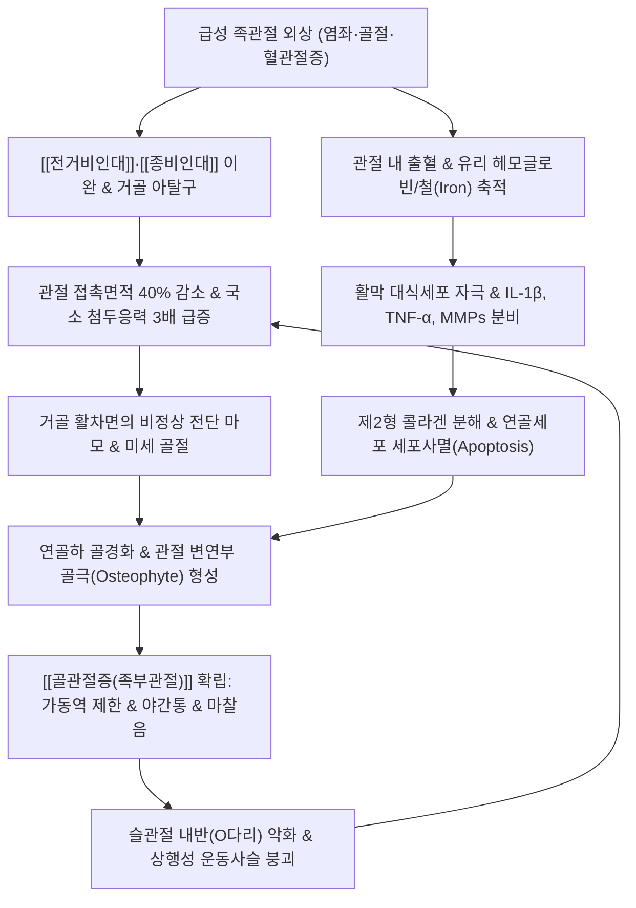

# 🦴 [[골관절증(족부관절)]] (Foot and Ankle Osteoarthritis)

> **핵심 3줄 요약 (Key Summary)**:
> - 📍 병소 부위 & 해부·병태생리: 거퇴관절(Talocrural joint), 거골하관절(Subtalar joint), 중족관절(Chopart·Lisfranc), 제1 중족족지관절(1st MTP)의 관절 연골 마모와 연골하 골경화. 고관절·슬관절과 달리 **70~80%가 과거의 반복된 발목 염좌 및 골절 후유증인 외상 후 골관절염(Post-Traumatic Osteoarthritis, PTOA)**으로 발병.
> - 🚩 전형적 임상 양상 & 4대 징후: 체중 부하 시 발목 심부 통증, 15~30분간 지속되는 조조강직 및 보행 초기 시동통(Starting pain / Gelling phenomenon), 족배굴곡(Dorsiflexion)의 현저한 제한 및 전방 골극 충돌통, 외상성 혈관절증(Hemarthrosis) 후유증 활막염에 기인한 야간통(Nocturnal pain).
> - 🛠️ 핵심 감별 검사 & 한·양방 다각적 치료 전략: 전방 전위 및 전방 충돌 검사, Takakura X-ray 병기 분류(Stage 1~4), 곤륜·태계·구허·조해 심부 자침, 신바로약침 및 봉약침, 거퇴관절 장축 견인 및 후방 활주 추나, 슬관절(내반슬) 동시 교정, 롤러 신발(Rocker-bottom sole) 및 윈드라스 기전 재활 운동.
> - ⚠️ 응급 의뢰 레드플래그 & 악화 요인: 급성 화농성 관절염(Septic arthritis) 의심 시 즉각 관절천자 의뢰, Takakura 3B~4기 말기 관절 파괴 및 난치성 보행 불능 시 족관절 유합술(Arthrodesis) 또는 인공족관절 치환술(TAA) 고려.

---

## 📌 목차
1. [질환 개요 & 해부학적 병태생리](#1-질환-개요--해부학적-병태생리)
2. [병태생리 메커니즘 & 생체역학적 악순환 네트워크](#2-병태생리-메커니즘--생체역학적-악순환-네트워크)
3. [임상 증상 & 이학적 검사 알고리즘](#3-임상-증상--이학적-검사-알고리즘)
4. [감별 진단 매트릭스](#4-감별-진단-매트릭스)
5. [한의 통합 치료 프로토콜](#5-한의-통합-치료-프로토콜)
6. [양방 치료 & 병용·의뢰 기준](#6-양방-치료--병용의뢰-기준)
7. [재활 운동 & 생활습관 티칭 가이드](#7-재활-운동--생활습관-티칭-가이드)
8. [💡 사용자 진료실 핵심 필기 & 임상 노하우 (Melt-In)](#8--사용자-진료실-핵심-필기--임상-노하우-melt-in)
9. [📚 출처 및 현대 학술 연구 요약](#9-출처-및-현대-학술-연구-요약)

---

## 1. 🩺 질환 개요 & 해부학적 병태생리

### (1) 질환 정의 및 임상적 역학 특성
* **정의**: [[골관절증(족부관절)]](Foot and Ankle Osteoarthritis)은 발목 관절을 구성하는 경골 원위부 비구(Tibial plafond), 내외과(Malleoli), 거골 활차(Trochlea tali)로 이루어진 거퇴관절(Talocrural joint)을 비롯하여, 거골하관절(Subtalar joint), 횡족근관절(Chopart joint: 거주상·종입방관절), 족근중족관절(Lisfranc joint), 제1 중족족지관절(1st MTP joint, [[무지외반증]] 및 무지강직증 동반) 등의 관절 연골이 점진적으로 마모되고 연골하 골경화(Subchondral sclerosis), 골극 형성(Osteophyte formation), 연골하 낭종(Subchondral cyst) 및 활막의 만성 무균성 염증을 초래하는 퇴행성 관절 질환이다.
* **슬관절·고관절과의 결정적 역학적 차이 (외상 후 관절염 압도적 우세)**:
  * 무릎([[퇴행성 관절염]])이나 고관절의 관절증은 80~90% 이상이 노화, 체중 과부하, 유전적 소인에 의한 원발성(Primary) 골관절염이다.
  * 반면, **족관절 골관절증은 약 70~80%가 외상 후 골관절염(Post-Traumatic Osteoarthritis, PTOA)**에 해당한다.
  * 원인의 대다수는 과거에 겪었던 중증의 복사뼈 골절(Malleolar fracture), 거골 골절, 혹은 수없이 반복되었던 만성 [[발목 염좌]](전거비인대 [[전거비인대]](ATFL) 및 종비인대 [[종비인대]](CFL) 파열)로 인한 만성 족관절 불안정성(Chronic Ankle Instability, CAI)에서 비롯된다.
* **호발 연령 및 성별 분포**:
  * 슬관절염 환자군에 비해 평균 발병 연령이 10~15년가량 젊다. 40대 후반에서 50대 초중반의 경제 활동 및 신체 활동이 왕성한 연령대에서 진단되는 비율이 매우 높다.
  * 남성과 여성의 발병 비율은 약 1:1 내외이나, 젊은 연령층의 스포츠 손상 및 중노동 외상성 원인에서는 남성의 비율이 다소 높게 관찰된다.
* **하지 운동사슬(Kinetic Chain)의 중심축**:
  * 족관절은 지면으로부터 가해지는 반발력(Ground Reaction Force, GRF)을 가장 먼저 흡수하고 체중을 분산하는 관문이다.
  * 하퇴를 통해 [[퇴행성 관절염]](슬관절) 및 골반과 직접적인 생체역학 사슬을 형성하므로, 족관절 골관절증은 국소적 관절염에 그치지 않고 보행 주기 전체를 붕괴시키는 전신성 운동사슬 질환으로 이해해야 한다.

### (2) 족부 및 족관절의 정밀 기능 해부학
```
                        [ 하퇴 및 족관절 복합체 해부 구조 ]
                                       경골(Tibia) ── 비골(Fibula)
                                             │             │
                             내과(Medial)    │             │  외과(Lateral)
                                  └──────────┼─────────────┘
                                             │ [거퇴관절 격자 (Mortise)]
                                      ┌──────┴──────┐
                                      │ 거골 (Talus) │ (혈관 공급 취약, 연골 피복 60%)
                                      └──────┬──────┘
                                             │ [거골하관절 (Subtalar Joint)]
                                      ┌──────┴──────┐
                                      │ 종골 (Calcaneus)
                                      └──────┬──────┘
                                             │ [Chopart / Lisfranc 관절군]
                                      ┌──────┴──────┐
                                      │ 주상골·입방골·설상골
                                      └──────┬──────┘
                                             │ [제1 중족족지관절 (1st MTP)]
                                      ┌──────┴──────┐
                                      │  중족골 및 족지골 (Windlass 기전 지렛대)
```

1. **거퇴관절 격자(Ankle Mortise)의 기하학적 특성**:
   * 경골 원위 비구 천장(Plafond)과 내과, 외과가 형성하는 'ㄷ'자형 격자(Mortise) 내에 거골 활차(Trochlea tali)가 안착되어 있다.
   * 거골 활차는 전방의 폭이 후방보다 약 2~4mm 넓은 전광후협(Wedge-shaped) 구조를 취한다.
   * **배굴(Dorsiflexion)** 시 넓은 전방부가 격자 사이로 깊숙이 진입하며 비골이 외측으로 미세 이동하고 골간인대가 긴장하여 관절이 가장 단단히 결합되는 **밀착위(Close-packed position)**가 형성된다.
   * **저굴(Plantarflexion)** 시 좁은 후방부가 격자 내에 위치하여 유격이 발생하는 **이완위(Loose-packed position)**가 되며, 이 상태에서 내번 외상이 가해질 때 [[전거비인대]]가 가장 파열되기 쉽다.
2. **거골(Talus)의 독특한 혈행 및 연골 피복률**:
   * 거골 표면의 60% 이상이 관절 연골로 덮여 있으며, 근육이나 건이 직접 부착되지 않는 특수한 뼈이다.
   * 혈류 공급이 후경골동맥의 거골지, 전경골동맥, 비골동맥의 삼각동맥 분지 등 관절낭 주변 혈관망에 전적으로 의존하는 역행성 혈류망(Retrograde blood flow)을 갖추고 있다.
   * 따라서 염좌나 골절 시 혈관 손상이 동반되면 무혈성 괴사(Avascular necrosis) 및 외상 후 급격한 연골 변성으로 이행하기 쉽다.
3. **거골하관절(Subtalar Joint)의 3차원 운동 메커니즘**:
   * 거골과 종골이 이루는 전·중·후 3개의 관절면으로 구성되며, 주 운동은 족부의 회내(Pronation: 배굴 + 외번 + 외전)와 회외(Supination: 저굴 + 내번 + 내전)이다.
   * 보행 시 입각기 초기(Heel strike)에는 유연한 회내를 통해 지면 충격을 흡수하고, 말기(Push-off)에는 단단한 회외를 형성하여 전방 추진력을 제공한다. 거골하관절의 퇴행은 이 충격 흡수 완충 장치의 파탄을 의미한다.
4. **족부 3대 아치와 윈드라스(Windlass) 기전**:
   * 내측 종아치(Medial longitudinal arch: 종골-거골-주상골-내측설상골-제1중족골), 외측 종아치, 횡아치로 구성된다. 거골은 내측 종아치의 꼭짓점(Keystone) 역할을 한다.
   * **윈드라스 기전**: 보행 시 발가락을 들어 올리면(제1 MTP 관절 배굴), 종골 결절에서 시작하여 중족골두를 감싸는 족저근막이 윈치(Winch)처럼 감겨 아치가 저절로 높아지고 후족부와 중족부가 단단한 지렛대로 잠기게 된다. 족부 관절염 환자에서는 이 기전이 파탄되어 평족화 및 비정상 전단 하중이 지속된다.

---

## 2. ⚡ 병태생리 메커니즘 & 생체역학적 악순환 네트워크

### (1) 외상 후 골관절염(PTOA)의 다단계 병태생리
외상 후 족관절염의 발병은 단순한 기계적 마모 과정이 아니라, 관절 불안정성과 생화학적 염증 반응이 결합된 연쇄적 파괴 과정이다.



1. **인대 불안정성과 거골의 비정상 전단 응력(Shear Stress)**:
   * 전거비인대와 종비인대의 만성 이완은 거골이 족관절 격자 내에서 전방 및 내측으로 비정상 회전 전위되도록 만든다.
   * 정상 보행 시 체중은 거골 활차 전면에 고르게 분산되지만, 불안정성이 발생하면 관절 접촉 면적이 최대 40~50%까지 감소하여 특정 접촉면의 국소 첨두 압력(Peak contact stress)이 정상치의 2~3배 이상으로 치솟는다.
   * 이로 인해 연골 표면의 층판 구조가 찢어지고 표재성 세열(Fibrillation)이 발생한다.
2. **외상성 혈관절증(Hemarthrosis) 후유증과 철(Iron) 매개 세포 독성**:
   * 염좌나 골절 당시 관절강 내에 고인 혈액은 활막 세포와 연골 기질에 치명적인 생화학적 손상을 입힌다.
   * 적혈구가 용해되면서 방출된 유리 헤모글로빈과 헴 철(Heme iron)은 펜톤 반응(Fenton reaction)을 유도하여 다량의 활성산소종(ROS)을 생성한다.
   * 이는 활막 대식세포를 지속적으로 자극하여 인터루킨-1베타(IL-1β), 종양괴사인자-알파(TNF-α), 기질금속단백분해효소(MMP-1, MMP-3, MMP-13) 및 ADAMTS-4, ADAMTS-5를 대량 분비시킨다.
   * 결과적으로 연골의 주성분인 제2형 콜라겐망과 프로테오글리칸(Aggrecan)이 급격히 분해되며 연골세포 사멸(Chondrocyte apoptosis)이 가속화된다.
   * 활막의 만성 무균성 증식과 풍부해진 신생 감각 신경망(Substance P, CGRP 함유 신경 섬유)은 쉴 때나 잠잘 때 나타나는 **지속적인 염증성 야간통(Nocturnal pain)**의 병리적 근원이 된다.
3. **골극 형성(Osteophyte)과 관절 충돌(Impingement)**:
   * 연골이 마모됨에 따라 연골하 골수강 내에 혈관이 증식하고 조골세포 활성이 비정상적으로 항진되어 연골하 골경화증과 연골하 낭종이 형성된다.
   * 관절 변연부에서는 견인력과 전단력에 반응하여 골극(Osteophyte)이 자라나며, 특히 원위 경골 전방부와 거골 경부 전상방에 형성되는 전방 골극은 발목을 위로 젖힐 때 서로 부딪히는 **전방 충돌 증후군(Anterior Impingement Syndrome)**을 유발하여 족배굴곡의 물리적 차단벽이 된다.

### (2) 타카쿠라(Takakura) 방사선학적 병기 분류
족관절 골관절증의 진행 정도는 전 세계적으로 타카쿠라 분류(Takakura Classification, Tanaka 변형)를 표준으로 평가한다.

| 병기 (Stage) | 방사선학적 특징 (Weight-bearing X-ray) | 병태생리학적 상태 | 임상적 주 증상 |
| :--- | :--- | :--- | :--- |
| **Stage 1** | 관절강 협소 없음. 연골하 골경화 및 경미한 전·내측 골극 형성 | 관절 연골의 표재성 연화 및 미세 세열기 | 운동 후 뻐근함, 가벼운 피로통 |
| **Stage 2** | 내측 관절강의 경도 협소(Narrowing), 외측 관절강은 정상 유지 | 연골 부분 결손, 거골의 내측 편향 시작 | 조조강직, 계단 하강 시 통증 |
| **Stage 3A** | **내측 관절강 완전 소실**, 내과와 거골 골극 접촉. 거골 천장 골 결손 없음 | 내측 연골 완전 마모, 골극 충돌 심화 | 보행 시 심부 찌릿통, 족배굴곡 10° 미만 제한 |
| **Stage 3B** | **거골 천장(Talar dome) 내측 연골 완전 소실**, 연골하 골 노출 및 골미란 | 연골하 골판 붕괴 및 골수 부종, 거골 경사 증가 | 100m 보행 불능, 휴식통 및 야간통 |
| **Stage 4** | **전 관절면(내측 및 외측 전체) 관절강 완전 소실**, 골-대-골 접촉 | 광범위한 관절 파괴, 관절 유합 또는 아탈구 | 지속적인 극심한 안정통, 심한 파행 |

### (3) 슬관절-족관절 하지 운동사슬(Kinetic Chain) 연쇄 붕괴
* **내반슬(Genu Varum / O다리)의 하행성 악순환**:
  * 슬관절의 내반 변형은 인체의 기계적 축(Mikulicz line)을 내측으로 이동시킨다.
  * 이 하중은 족관절의 내측 거퇴관절면에 편향된 전단 압력을 집중시켜 거골의 내반 경사(Talar varus tilt)를 유발하고, 내측 족관절염을 폭발적으로 가속화한다.
* **족부 평족화(Over-pronation)의 상행성 악순환**:
  * 반대로 족관절염 및 족저근막 이완으로 종골이 외반되고 내측 종아치가 무너지는 과회내 증후군이 발생하면, 경골의 보상적 과도한 내회전(Internal rotation)이 일어나 대퇴골에 대해 슬관절 외반 스트레스 및 슬개대퇴관절 압박을 증가시켜 무릎 관절염을 악화시킨다.
* **임상적 결론**: 따라서 발목 관절염 환자를 진료할 때는 반드시 무릎 정렬을 함께 평가해야 하며, 슬관절과 족관절을 동시에 치료하지 않는 단독 발목 치료는 반드시 재발하거나 실패한다.

---

## 3. 🔍 임상 증상 & 이학적 검사 알고리즘

### (1) 주요 임상 증상 및 4대 징후
1. **체중 부하 시 발목 심부 통증 (Weight-Bearing Deep Pain)**:
   * 평지를 걸을 때, 특히 계단을 내려갈 때나 울퉁불퉁한 비포장도로를 디딜 때 발목 속 깊은 곳에서 찌르는 듯한 묵직한 통증이 발생한다.
   * 질환 초기에는 오래 걸었을 때만 나타나지만, 진행되면 체중을 싣는 첫 디딤부터 극심한 통증이 유발된다.
2. **조조강직(Morning Stiffness) 및 시동통(Starting Pain / Gelling Phenomenon)**:
   * 아침에 기상하여 첫발을 내디딜 때 발목이 굳어 뻣뻣하며 심한 통증이 발생한다.
   * 통상 15~30분 이내로 지속되며, 관절을 몇 번 움직이고 걷다 보면 관절액의 유동성이 증가하면서 일시적으로 부드러워진다(Gelling 현상). 그러나 보행량이 과도해지면 오후나 저녁에 다시 악화된다.
3. **관절 가동범위(ROM)의 점진적 구축 및 족배굴곡 장애**:
   * 가장 먼저, 그리고 가장 심각하게 제한되는 동작은 **발목을 위로 젖히는 족배굴곡(Dorsiflexion)**이다.
   * 정상 족배굴곡 각도는 무릎을 편 상태에서 15~20° 이상이나, 관절염 환자는 0~5° 이하로 급격히 감소한다.
   * 이는 전방 골극 충돌과 함께 후방 관절낭 및 아킬레스건의 이차적 구축이 결합된 결과이며, 보행 시 입각기 후반의 정상적인 롤오버(Roll-over)가 불가능해져 발을 바깥으로 돌려 걷는 외회전 파행(Out-toeing gait)이 나타난다.
4. **외상성 혈관절증 후유증에 의한 염증성 야간통(Nocturnal Pain) 및 관절 삼출**:
   * 과거 심한 염좌나 골절 당시 관절 내 출혈을 겪었던 환자들은 밤에 쉴 때나 수면 중에도 발목 내부가 욱신거리고 화끈거려 잠을 깨는 야간통을 빈번히 호소한다.
   * 관절 주변의 만성적인 무균성 활막염으로 인해 복사뼈 주변이 항상 부어 있고, 관절을 수동으로 움직일 때 모래가 갈리는 듯한 거친 골성 마찰음(Bony crepitus)이 촉진된다.

### (2) 단계별 이학적 검사법 (Physical Examination)
```
[ 족부 및 족관절 골관절증 표준 진찰 순서 ]
  ① 시진 (기립 상태): 슬관절 정렬(내반슬 여부), 헬빙선(Helbing's sign - 종골 축), 족부 종아치
  ② 가동역 측정: 무릎 신전/굴곡 상태에서 능동 및 수동 족배굴곡·저굴·내번·외번 각도
  ③ 국소 압통점 촉진: 전방 관절 열극, 내과하방 삼각인대, 외과하방 ATFL/CFL, 거골하관절
  ④ 불안정성 및 충돌 검사: 전방 전위 검사, 거골 경사 검사, 전방 골극 충돌 유발 검사
  ⑤ 보행 분석: 입각기 단축, 조기 발뒤꿈치 들림, 외회전 보상 보행 관찰
```

1. **전방 전위 검사 (Anterior Drawer Test)**:
   * 환자를 침상 끝에 앉혀 하퇴를 고정하고, 한 손으로 종골을 감싸 쥔 채 발목을 10~15° 저굴 상태에서 거골을 전방으로 견인한다.
   * 정상에 비해 거골이 전방으로 덜컹거리며 빠져나오거나(Subluxation), 단단한 정지감(Hard endpoint) 없이 통증이 발생하면 만성 외측 인대 불안정성 및 외상 후 관절염의 기저 요인으로 판정한다.
2. **전방 충돌 검사 (Anterior Impingement Sign / Molloy-Scranton Test)**:
   * 검사자가 한 손의 엄지손가락으로 환자의 거퇴관절 전외측 또는 전내측 관절 열극(Joint line)을 강하게 압박하면서, 다른 손으로 발목을 빠르게 최대 족배굴곡시킨다.
   * 골극과 비후된 활막이 압박 손가락과 충돌하며 날카로운 압통이 재현되면 양성이다.
3. **거골 경사 검사 (Talar Tilt Test / Inversion Stress Test)**:
   * 발목을 중립위(0°)에 두고 거골과 종골을 내번(Inversion)시켜 외측 관절 열극의 벌어짐 정도를 촉진한다. 종비인대 이완과 함께 관절면의 비대칭적 마모 여부를 확인한다.
4. **거골하관절 가동성 및 통증 검사 (Subtalar Mobility Test)**:
   * 검사자가 거골을 단단히 고정하고 다른 손으로 종골을 잡아 내번 및 외번 글라이딩을 유도한다.
   * 거골하관절면에 거친 마찰음이나 심한 저항, 국소 통증이 유발되면 후족부 관절증의 동반 침범을 의미한다.
5. **윈드라스 검사 (Jack's Test / Windlass Test)**:
   * 환자가 기립하여 체중을 부하한 상태에서 검사자가 제1 족지(엄지발가락)를 수동으로 강하게 배굴시킨다.
   * 정상이라면 내측 종아치가 자연스럽게 거상되어야 하나, 아치가 올라오지 않거나 제1 MTP 관절 및 족저근막 부착부에 심한 통증이 발생하면 윈드라스 기전의 파탄 및 제1 MTP 골관절증(무지강직증)으로 진단한다.

---

## 4. 🔀 감별 진단 매트릭스

족관절 통증은 복합적인 해부학적 구조물로 인해 오진되기 쉽다. 통풍, 신경 포착, 연골 손상 등 유사 질환과의 체계적 감별이 필수적이다.

| 감별 포인트 | [[골관절증(족부관절)]] (본 질환) | 급성 [[통풍]]성 관절염 | [[족근관 증후군]] (Tarsal Tunnel) | 만성 족관절 불안정증 (CAI) | 거골 골연골 병변 (OLT/OCD) |
| :--- | :--- | :--- | :--- | :--- | :--- |
| **발병 기전 및 양상** | 만성 외상 기왕력, 수년에 걸친 점진적 퇴행 마모 | 요산염 결정 침착, 수시간 내 급격한 극심 통증 | 후경골신경 포착, 신경병증성 저림 | 반복 염좌로 인한 인대 이완, 잦은 삠 | 단일 외상 또는 미세 손상 후 거골 연골 괴사 |
| **호발 부위** | 거퇴관절, 거골하관절, 제1 MTP 심부 전체 | **제1 MTP 관절 (70%)**, 발목 전면 | 발바닥 전체, 내측 족저면, 족지 | 외측 복사뼈 전하방 ([[전거비인대]]) | **거골 활차 내측(60%) 또는 외측 돔** |
| **통증 특성** | 체중 부하 시 묵직한 통증, 시동통, 야간통 | 바람만 스쳐도 극심한 작열통, 야간 돌발 | 타는 듯한 작열통, 전기 저림, 무감각 | 걸을 때 불안함, 덜컹거림, 계단 불안 | 특정 각도에서 결림, 관절 잠김(Locking) |
| **조조강직 시간** | **15~30분 이내 (Gelling 현상)** | 강직보다는 극심한 통증과 열감 | 조조강직 없음 (활동 후 악화) | 조조강직 없음 | 조조강직 없음 |
| **이학적 징후** | 족배굴곡 ROM 제한, 마찰음, 전방충돌 양성 | 관절 발적, 열감, 팽륜, 극심한 접촉통 | 내과 후하방 **티넬 징후(Tinel's sign) 양성** | **전방 전위 및 거골 경사 검사 양성** | 거골 돔 배굴/저굴 압통, 잠김 현상 |
| **단순 방사선 (X-ray)** | **관절강 협소, 골극, 연골하 골경화 (Takakura)** | 급성기 정상, 만성 시 천공성 골미란(Punched-out) | 골성 이상 없음 (정상 소견) | 관절강 보존, 거골 경사각 증가 | 초기 정상, 진행 시 거골 돔 골 투과성 병변 |
| **정밀 검사 (MRI/초음파)** | 관절 연골 소실, 연골하 골부종, 활막 비후 | 초음파상 이중 윤곽 징후(Double contour) | 신경 단면적 증가, 굴근건대 내 압박 병변 | 인대 연속성 단절, 반흔성 비후 | **MRI T2 연골하 골괴사 및 연골 분리 확인** |
| **혈액/체액 검사** | 정상 (무균성 삼출액, WBC < 2,000) | **혈청 요산 수치 상승**, 관절액 편광 바늘상 요산염 | 정상 | 정상 | 정상 |

---

## 5. 🌿 한의 통합 치료 프로토콜

### (1) 한의학적 변증 체계
* **어혈정체(瘀血停滯) 및 외상 후유증형**:
  * 병리: 급성 발목 염좌 및 외상성 혈관절증 후유증으로 관절강 내에 사혈(死血)이 정체되어 경락이 조체됨.
  * 증상: 찌르는 듯한 고정성 심부 통증, 야간에 통증이 극심하여 수면 장애(夜間痛), 혀에 어반(瘀斑) 또는 암자색 설질, 맥세삽(脈細澁).
* **간신휴손 및 골비(肝腎虧損 & 骨痺)형**:
  * 병리: 노화와 만성 기계적 과부하로 간음(肝陰)과 신정(腎精)이 고갈되어 근골(筋骨)을 영양하지 못하고 골질이 마모됨.
  * 증상: 보행 시 발목이 쑤시고 힘이 빠짐, 시동통 및 조조강직, 허리와 무릎의 시린 통증 동반, 설홍태소(舌紅苔少), 맥침세무력(脈沈細無力).
* **풍한습비(風寒濕痺)형**:
  * 병리: 관절의 수기(衛氣)가 허약한 틈을 타 풍·한·습의 외사가 관절에 침습하여 기혈 순환을 정체시킴.
  * 증상: 날씨가 흐리거나 비가 오면 통증이 배가됨, 관절이 시리고 무거우며 따뜻하게 찜질하면 완화됨, 설담태백니(舌淡苔白膩), 맥유완(脈濡緩).
* **습열하주(濕熱下注)형**:
  * 병리: 비위 습열이 하지로 하주하거나 만성 무균성 활막염이 급격히 플레어되어 열증을 띰.
  * 증상: 복사뼈 주변의 팽륜 및 열감, 보행 시 화끈거리는 통증, 설홍태황니(舌紅苔黃膩), 맥활삭(脈滑數).

### (2) 침구 치료 & 전침 표준운영절차(SOP)
족관절 주변의 인대 복합체와 관절강을 정밀 타깃팅하는 심부 자침 기법을 적용한다.

```
                  [ 족관절 심부 자침 주요 혈위 배치도 ]
                                  (전면)
                                해계 (ST41) ── 관절 전면 중앙 함요처
                                  /        \
                            (내측)          (외측)
                   상구 (SP5) ───┘            └─── 구허 (GB40)
                  (내과 전하방)                   (족근동, 외과 전하방)
                        │                              │
                   조해 (KI6)                     곤륜 (BL60)
                  (내과 직하방)                   (외과-아킬레스건 함요처)
                        │                              │
                   태계 (KI3) ─────────────────────────┘
                  (내과-아킬레스건 함요처)
```

1. **외측 및 거골하관절 타깃 혈위**:
   * **구허(GB40)**: 외과 전하방 족근동(Sinus tarsi) 함요처. 0.25×40mm 호침으로 족근동 깊숙이 25~30mm 사자하여 거골하관절 및 경비인대 복합체의 활막염을 해소.
   * **곤륜(BL60)**: 외과 첨단과 아킬레스건 사이의 함요처. 침첨을 전내측(태계혈 방향)을 향해 20~30mm 직자하여 외측 관절낭 후방 및 비골근하건낭의 염증성 부종 흡수.
2. **내측 및 삼각인대 타깃 혈위**:
   * **상구(SP5)**: 내과 전하방 함요처. 0.25×30mm 호침으로 주상골 결절 방향으로 15~20mm 사자하여 전내측 관절 열극 활막염 제어.
   * **조해(KI6)**: 내과 하단 직하 1촌 함요처. 거골과 종골 사이 삼각인대 심부를 향해 15~20mm 직자하여 내측 안정성을 지지.
   * **태계(KI3)**: 내과 첨단과 아킬레스건 사이 함요처. 후경골동맥 맥동을 외측으로 젖히고 안전하게 20~25mm 직자하여 신음(腎陰)을 보강하고 후내측 관절낭 감압.
3. **전방 충돌 및 관절강 타깃 혈위**:
   * **해계(ST41)**: 족관절 전면 횡문 중앙, 장모지신근건과 장지신근건 사이 함요처. 침첨을 거퇴관절 열극 내부를 향해 15~20mm 직자하여 전방 골극 주변 활막 비후와 충돌통을 완화.
4. **전침(Electroacupuncture) 파형 및 프로토콜**:
   * 전침 연결 쌍: [구허 - 곤륜], [상구 - 태계], [해계 - 조해].
   * 통전 파형: 2Hz 저주파(엔돌핀 및 엔케팔린 분비 촉진)와 100Hz 고주파(다이노르핀 분비 및 척수 관문 통각 차단)를 교대하는 2/100Hz 혼합파(Dense-Disperse Wave)를 20분간 적용.
   * 연골하 골 흡수를 방지하고 국소 미세 혈류 순환을 극대화하여 만성 통증 역치를 정상화한다.

### (3) 약침 및 봉약침 요법 (Pharmacoacupuncture)
1. **신바로약침 (GCSB-5 기원)**:
   * 작용 기전: 방풍, 우슬, 오가피, 구척, 두충 등으로 구성된 생약 복합체로, 관절 연골 분해 효소(MMP-3, MMP-13)의 활성을 억제하고 연골하 골세포의 프로테오글리칸 합성을 촉진.
   * 시술 부위: 해계혈 및 구허혈을 통한 거퇴관절강 내 천자(Intra-articular), 전·후 관절낭 부착부에 0.5~1.0mL 주입.
2. **봉약침 (Sweet Bee Venom / BV)**:
   * 작용 기전: 멜리틴(Melittin)과 아파민(Apamin) 성분이 NF-κB 염증 전사 인자를 차단하여 만성 무균성 활막염을 신속히 소퇴시키고 신생 혈관성 야간통을 억제.
   * 시술 부위: 외과하 전거비인대 부착부, 족근동, 내과하 삼각인대 천자점에 0.1~0.3mL 분할 피내/피하 주입. 반드시 사전 스킨 테스트 시행.
3. **자하거(Hominis Placenta) 약침**:
   * 골비 및 간신휴손형 환자에게 적용하며, 태계, 조해, 삼음교 혈위에 각 0.2~0.5mL씩 주입하여 연골하 골 기질에 영양을 공급하고 관절 퇴행 진행을 지연.

### (4) 추나 요법 (Chuna Manual Medicine) - 3대 관절 가동 프로토콜
```
               [ 족관절 추나 3대 관절 가동 프로토콜 ]
  ① 거퇴관절 장축 견인 및 후방 활주 (Long-axis Traction & Posterior Glide)
     - 목적: 전방 아탈구된 거골을 격자 내로 정복하여 족배굴곡 가동성 즉각 확보
  ② 거골하관절 회외-회내 전단 가동술 (Subtalar Joint Mobilization)
     - 목적: 종골의 삼차원 미세 움직임을 회복하여 충격 흡수 완충능 회복
  ③ 슬관절-경비관절-골반 통합 하지 운동사슬 교정 (Kinetic Chain Correction)
     - 목적: O다리(내반슬) 교정을 통해 발목 내측으로 편향된 체중 부하선 분산
```

1. **거퇴관절 장축 견인 및 후방 활주 기법 (Talocrural Long-axis Traction & Posterior Glide)**:
   * **원리**: 족관절염 환자는 전방 골극과 인대 이완으로 거골이 전방으로 미세 아탈구되어 족배굴곡이 잠기게 된다. 거골을 뒤로 밀어 넣어야 관절 활주(Joint glide)가 일어난다.
   * **조작법**:
     * 환자를 앙와위로 눕히고 발을 침상 밖으로 뺀다.
     * 시술자는 양손을 깍지 껴 환자의 발등(거골 경부)을 감싸 쥐고, 양 엄지손가락으로 족저면을 지지한다.
     * 먼저 장축으로 지긋이 체중을 실어 견인(Traction, Grade II~III)하여 관절강을 벌린다.
     * 그 상태에서 시술자의 체중을 뒤로 실으며 거골을 하퇴 장축에 수직인 후하방(Posterior-inferior)으로 강하게 밀어 넣으면서 동시에 수동 족배굴곡을 유도한다.
     * 시술 직후 잠겨 있던 족배굴곡 각도가 즉각적으로 5~10° 이상 회복된다.
2. **거골하관절 회외-회내 가동술 (Subtalar Mobilization)**:
   * 시술자가 한 손으로 거골을 단단히 고정하고, 다른 손바닥으로 종골을 감싸 쥔 후 종골을 내측 및 외측으로 회전 글라이딩시킨다.
   * 굳어 있는 종골의 회내-회외 유동성을 회복시켜 보행 시 지면 충격이 거퇴관절에 직접 전달되는 것을 방지한다.
3. **슬관절-경골 통합 교정술 (Knee-Tibia Alignment)**:
   * 슬관절 내반(O다리) 환자에게 경골 내회전 교정 추나 및 비골두 전방·후방 글라이딩을 적용하여, 슬관절에서 발목으로 이어지는 체중 부하선을 외측으로 정상 분산시킨다.

### (5) 한약 치료 (방제 의학)
환자의 변증과 병태생리 단계에 맞추어 처방을 정밀하게 선택한다.

* **어혈정체 및 외상성 야간통**:
  * [[신통축어탕]](身痛逐瘀湯): 당귀, 천궁, 도인, 홍화, 몰약, 유향, 우슬, 지룡 등으로 구성. 관절강 내 미세 출혈(혈관절증) 후유증과 활막의 만성 울혈을 강력히 소퇴시켜 야간 자통을 신속히 차단.
  * [[활혈제통탕]](活血止痛湯): 외상 후 급성기 염증 및 심한 부종이 잔존할 때 당귀, 작약, 유향, 몰약에 포황, 오령지 등을 가미하여 통증과 부종을 병행 치료.
* **간신휴손 및 만성 골비(골극·연골 결손)**:
  * [[독활기생탕]](獨活寄生湯): 독활, 상기생, 두충, 우슬, 세신, 진범, 복령, 당귀, 백작약, 숙지황, 천궁, 인삼, 육계 등으로 구성. 하지 관절의 퇴행성 마모를 억제하고 관절낭과 인대의 결합조직을 보강하며 보행 지구력을 향상.
  * [[대방풍탕]](大防風湯): 만성 관절증으로 다리에 힘이 빠지고 관절 변형이 심화된 기혈양허 환자에게 백출, 부자, 황기, 당귀, 숙지황 등을 배합하여 골질 영양 및 근위축 회복.
* **풍한습비 및 한성 족부 냉통**:
  * [[오적산]](五積散): 찬 바람이나 에어컨, 비 올 때 발목이 시리고 굳는 환자에게 온경산한(溫經散寒) 및 거습통락(祛濕通絡) 효능 발휘.
  * [[영선제통음]](靈仙除痛飲): 위령선, 창출, 방기, 강활을 가미하여 관절 주위 수독(水毒)과 삼출물을 배출.

---

## 6. 💊 양방 치료 & 병용·의뢰 기준

> 🎯 **이 섹션의 목적**: 족관절염 환자는 이미 장기간 소염진통제, 관절 주사를 맞고 내원하는 경우가 많다. 1차 한의 진료에서 양방 치료의 약리적 한계를 파악하고, 안전한 병용 관리 및 수술 의뢰 기준을 명확히 설정해야 한다.

### (1) 양방 보존적 약물 치료 & 관절강 내 주사 요법
1. **경구 약물 요법**:
   * **아세트아미노펜 (Acetaminophen)**: 1차 선택 약제로 권고되나 관절강 내 염증 제어 효과는 미미함 (최대 3~4g/day).
   * **경구 NSAIDs (Celecoxib, Meloxicam, Aceclofenac 등)**: 급성 플레어 시 통증과 활막염을 조절하는 표준 약제. 단, 65세 이상 고령자 및 심혈관·신장·위장관 기저질환자에게 장기 투여 시 위장관 출혈, 신기능 저하, 혈압 상승 위험이 있으므로 2~4주 이내 단기 사용 원칙.
2. **관절강 내 주사 요법 (Intra-Articular Injections)**:
   * **히알루론산 주사 (Hyaluronic Acid, HA)**: 관절액의 점탄성을 일시 보충(Viscosupplementation)하여 연골 간 마찰을 줄임. 슬관절에 비해 족관절은 관절강 용적이 좁아(약 2~4mL) 주입 후 일시적 팽만통(Flare)이 흔함.
   * **코르티코스테로이드 주사 (Corticosteroid)**: 트리암시놀론(Triamcinolone) 20~40mg 주입. 염증성 야간통과 활막염을 급격히 진정시키나, **연골세포 독성(Chondrotoxicity)**으로 인해 연골 마모를 가속화하고 연골하 골 붕괴를 유발할 수 있음. 연간 3~4회 이하로 엄격히 제한.
   * **PRP (Platelet-Rich Plasma / 자가혈소판 풍부혈장)**: 성장인자(TGF-β, PDGF)를 통한 조직 치유 촉진 목적이나, 타카쿠라 3기 이상의 진행된 관절염에서는 근거 수준이 낮음.

### (2) 한·양방 병용 시 주의사항 및 감량 전략
* **주사 후 한의 시술 안전 간격 (감염 방지 원칙)**:
  * 양방 관절강 내 주사(스테로이드 또는 HA)를 맞은 환자는 **최소 1~2주간 관절강 내 약침 자입이나 심부 침 치료를 금지**한다. 침습적 바늘 자입이 중복될 경우 관절강 내 세균 감염(화농성 관절염) 위험이 급증하기 때문이다.
* **NSAIDs 복용 환자의 한약 병용 및 감량 테이퍼링**:
  * 만성 NSAIDs 복용으로 소화장애, 속쓰림, 부종을 호소하는 환자에게 [[신통축어탕]]이나 [[독활기생탕]]을 병용하면 관절 통증 역치가 개선되면서 양방 진통제를 서서히 감량(Tapering)할 수 있다. 평위산(平胃散) 제제를 합방하여 위장관 점막을 보호한다.

### (3) 수술적 치료 적응증 및 최신 술식
보존적 치료에 반응하지 않는 진행성 관절염의 경우 적절한 시기에 정형외과 수술을 고려해야 한다.

```
                      [ 족관절 골관절증 수술적 치료 결정 알고리즘 ]
                                           │
                    ┌──────────────────────┴──────────────────────┐
            [관절 보존 가능 군]                                  [말기 관절 파괴 군]
         (Takakura Stage 2 ~ 3A)                               (Takakura Stage 3B ~ 4)
                    │                                                     │
        ┌───────────┴───────────┐                         ┌───────────────┴───────────────┐
        ▼                       ▼                         ▼                               ▼
  관절경 골극 절제술      과상부 절골술 (SMO)       족관절 유합술 (Arthrodesis)   인공 족관절 치환술 (TAA)
  (전방 충돌증후군 해소)   (경골 체중부하선 외측 이동)  (확실한 통증소실, 인접관절과부하) (가동성 보존, 해리 위험)
```

1. **관절 보존 수술 (Joint-Preserving Surgery)**:
   * **관절경적 골극 절제술 및 연골 성형술 (Anterior Debridement & Chondroplasty)**: 족배굴곡을 차단하는 전방 골극과 활막 밴드를 관절경으로 절제하여 관절 가동역을 회복.
   * **과상부 절골술 (Supramalleolar Osteotomy, SMO)**: 내반 변형이 동반된 Takakura 2~3A기 환자에서 경골 원위부를 절골하여 내반 각도를 외반으로 교정, 체중 부하선을 건강한 외측 연골면으로 이동시키는 관절 보존술.
2. **말기 관절 수술 (End-Stage Surgery, Stage 3B~4)**:
   * **족관절 유합술 (Ankle Arthrodesis)**:
     * 거퇴관절의 관절 연골을 완전히 제거하고 경골과 거골을 나사못이나 금속판으로 영구 고정하는 술식.
     * 장점: 통증 완화 효과가 가장 확실하며, 영구적인 체중 지지가 가능함. 젊고 활동량이 많은 노동자에게 선호됨.
     * 단점: 발목 관절 가동성이 영구 소실되어 보행 시 충격이 인접한 거골하관절과 횡족근관절로 전달되어 10~15년 후 인접 관절 골관절염(Adjacent joint OA)이 필연적으로 발생함.
   * **인공 족관절 치환술 (Total Ankle Arthroplasty, TAA)**:
     * 마모된 경골 비구와 거골 활차를 인공 금속 및 폴리에틸렌 삽입물로 대체.
     * 장점: 정상 족배굴곡 및 저굴 가동성을 보존하여 자연스러운 보행이 가능하고 인접 관절의 과부하를 방지함.
     * 단점: 인공 삽입물의 무균성 해리(Aseptic loosening), 침강(Subsidence), 감염 위험. 60세 이상의 고령자, 골밀도가 양호하고 심한 정렬 이상이 없는 환자에게 주로 적응됨.

### (4) 양방 및 상급병원 의뢰 기준 (Referral Criteria)
* **응급 의뢰 (Emergency Red Flags)**:
  * **화농성 관절염(Septic Arthritis)** 의심: 발목 관절의 급격한 열감, 홍반, 극심한 박동성 통증, 체온 38°C 이상의 발열, 전신 오한, 체중 부하 완전 불능 소견 시 즉각 상급병원 응급실로 전원하여 관절액 흡인 배양 및 항생제 투여 의뢰.
  * 거골의 급성 무혈성 괴사(AVN)에 의한 광범위한 거골 돔 붕괴 소견.
* **정형외과 전문의 전원 기준**:
  * Takakura Stage 3B 또는 4기로 방사선상 골-대-골 충돌이 명확하고, 3~6개월 이상의 적극적인 한의 보존 치료에도 일상 보행이 불가능할 정도의 극심한 통증과 파행이 지속되는 경우.
  * 족관절의 심각한 내·외반 부정렬(거골 경사각 > 10°)로 인해 보행 시 족외측 피부 궤양이나 이차적 인대 파열이 급속히 진행되는 경우.

---

## 7. 🏃 재활 운동 & 생활습관 티칭 가이드

### (1) 윈드라스 기전 회복 및 연부조직 신장 프로토콜
1. **벽 지지 비복근 & 가자미근 단계별 스트레칭**:
   * 목적: 족배굴곡을 물리적으로 제한하는 후방 단축 구조물(아킬레스건, 비복근, 가자미근)을 신장.
   * 방법:
     * 벽을 양손으로 짚고 환측 다리를 뒤로 뻗는다.
     * 1단계(비복근 신장): 뒤쪽 무릎을 완전히 편 상태에서 발뒤꿈치를 바닥에 밀착시키고 골반을 전하방으로 밀어준다. 20초 유지.
     * 2단계(가자미근 신장): 뒤쪽 무릎을 살짝 구부린 상태에서 발뒤꿈치가 바닥에서 뜨지 않도록 유지하며 아킬레스건 심부를 스트레칭한다. 20초 유지.
     * 3회 반복, 하루 3~5회 실시.
2. **족저근막 롤링 및 제1 MTP 수동 신장**:
   * 얼린 생수병이나 골프공을 발바닥 아치 밑에 두고 뒤꿈치부터 발가락 기저부까지 체중을 실어 3~5분간 굴린다.
   * 앉은 자세에서 손으로 엄지발가락을 발등 쪽으로 젖혀 족저근막의 윈드라스 기전을 활성화한다.

### (2) 족관절 동적 안정성(Dynamic Stability) 강화 운동
인대의 구조적 이완을 주변 근육군의 동적 수축력으로 보상해야 한다.

1. **비골근(Peroneus Longus & Brevis) 세라밴드 외번 강화 운동**:
   * 목적: 외측 인대 손상으로 인한 거골의 내반 편향을 막아주는 핵심 외번 근육 강화.
   * 방법:
     * 의자에 앉아 양발에 탄력 밴드를 감거나, 밴드의 한쪽 끝을 가구 다리에 고정한다.
     * 발목을 중립위에서 바깥쪽 위로 들어 올리는 외번(Eversion) 수축을 수행한다.
     * 끝 범위에서 3초간 정지한 후 천천히 원위치로 돌아온다(신장성 수축 강조).
     * 15회씩 3세트 진행.
2. **후경골근(Tibialis Posterior) 내측 종아치 지지 운동**:
   * 목적: 내측 종아치를 끌어올리고 거골의 내측 붕괴를 지지.
   * 방법:
     * 양 발뒤꿈치 사이에 작은 테니스공을 끼우고 선다.
     * 공이 빠지지 않도록 발뒤꿈치를 안쪽으로 살짝 모으면서 천천히 까치발을 든다(Heel raise).
     * 12회씩 3세트 진행.
3. **전경골근(Tibialis Anterior) 등척성 족배굴곡 운동**:
   * 발목을 위로 들어 올리는 밴드 저항 운동을 통해 보행 시 유각기(Swing phase)의 발끌림을 방지.

### (3) 고유수용성 감각(Proprioception) 및 신경근 재교육
* **한 발 서기 밸런스 트레이닝 (Single-Leg Stance)**:
  * 초기: 맨바닥에서 벽이나 의자를 살짝 잡고 환측 발로 30초간 버티기.
  * 중기: 손을 떼고 팔을 가슴에 모은 채 한 발로 60초간 균형 유지.
  * 고급: 밸런스 패드(Airex pad)나 흔들리는 보드(BAPS board) 위에서 한 발로 서서 무릎을 살짝 굽히고 버티기. 거골하관절의 미세 신경근 반응 속도를 재훈련한다.

### (4) 신발 선택 및 보조기 착용 티칭 (Footwear & Orthotics)
* **롤러 신발 (Rocker-Bottom Sole Shoes) 착용 필수 교육**:
  * 밑창의 앞뒤가 둥글게 굴곡진 로커 바텀 신발은 입각기 후반 발가락이 꺾이며 발목이 족배굴곡되어야 하는 기계적 요구도를 신발 밑창의 구름 작용이 대신해 준다.
  * 이를 통해 **전방 골극 충돌 압력과 거퇴관절면의 접촉 부하를 30~40% 이상 극적으로 감소**시켜 보행 통증을 즉각 완화시킨다.
* **후족부 외반 쐐기 깔창 (Lateral Heel Wedge)**:
  * 내측 족관절염 환자에게 3~5° 외측이 높은 힐 웨지 깔창을 적용하여 체중 부하선을 내측에서 외측으로 이동시킨다.
* **발목 보조기 (ASO Ankle Brace)**:
  * 만성 인대 불안정성이 동반된 환자에게 끈 동여맴 형태의 8자 스트랩 보조기를 착용시켜 보행 시 거골의 회전 아탈구를 억제한다.

---

## 8. 💡 사용자 진료실 핵심 필기 & 임상 노하우 (Melt-In)

### (1) 진료실 핵심 원장님 메모 집약 (Clinical Pearls)
* **외상 후 관절염(PTOA)의 절대적 기왕력 확인**:
  * 족관절 골관절증 환자가 내원하면 반드시 "10년, 20년 전에 발목을 심하게 접질렸거나 깁스(골절)를 한 적이 있는가?"를 가장 먼저 물어야 한다.
  * 환자 본인은 과거의 단순 삠으로 기억하지만, 당시 전거비인대 파열과 관절 내 미세 출혈이 수십 년에 걸쳐 연골을 갉아먹은 결과가 현재의 관절염이다. 원인 규명이 환자의 치료 순응도를 결정한다.
* **"무릎(슬관절)과 발목은 한 몸이다" — 하지 운동사슬 동시 치료 대원칙**:
  * 족관절염 환자 10명 중 8명은 무릎에 [[퇴행성 관절염]](슬관절)이나 [[내반슬]](O다리) 변형을 동반하고 있다.
  * 무릎의 내반각을 교정하지 않고 발목 관절만 치료하는 것은 밑 빠진 독에 물 붓기다. 상부의 내반 하중이 계속 발목 안쪽을 짓누르기 때문에 반드시 슬관절 교정 추나와 하지 정렬 테이핑을 병행해야 한다.
* **외상성 혈관절증(Hemarthrosis) 후유증 환자의 야간통(Nocturnal Pain) 공략법**:
  * "밤에 잘 때 발목 속이 쑤시고 욱신거려서 잠을 못 자겠다"고 호소하는 환자는 관절 내 출혈 후유증으로 인한 만성 활막염이 100% 존재한다.
  * 이때는 단순 소염진통제나 보간신 한약만으로는 낫지 않는다. 초기 2~4주간 어혈을 깨뜨리는 [[신통축어탕]] 또는 활혈제통탕을 강력하게 투여하고, 족근동(구허)과 곤륜혈에 봉약침을 시술하여 관절강 내 활막 울혈을 배출시켜야 비로소 야간통이 잡힌다.

### (2) 즉각적인 족배굴곡 개선을 위한 도수 정복 노하우
* **거골 전방 아탈구 해소 수기법 (Talar Reduction Maneuver)**:
  * "원장님, 발목을 위로 꺾으려고 하면 발목 앞쪽이 뭔가에 찝히면서 도저히 안 올라가요"라고 호소하는 환자.
  * 이는 전방 골극과 함께 거골이 앞으로 튀어나와 격자 입구를 틀어막고 있는 전형적인 상태다.
  * **수기 팁**:
    * 환자를 눕히고 발뒤꿈치를 침대 모서리에 걸친다.
    * 시술자의 한쪽 손바닥 수근부(Thenar)로 환자의 거골 목(Talar neck) 전면을 정확히 접촉한다.
    * 다른 손으로는 발바닥을 잡고 서서히 족배굴곡을 유도하면서, 수근부로 **거골을 바닥 방향(후하방)으로 묵직하게 지속 압박(Posterior glide)**을 가한다.
    * 순간적으로 덜컥하며 거골이 격자 속으로 미끄러져 들어가는 정복감이 느껴지며, 그 자리에서 환자가 발목을 들어 올릴 때 앞쪽 찝힘 통증이 사라지고 가동 범위가 5~10° 즉각 개선된다.

---

## 9. 📚 출처 및 현대 학술 연구 요약

1. **Saltzman CL et al.** (2005). *Epidemiology of ankle arthritis: report of a consecutive series of 639 patients from a tertiary orthopaedic center*. Iowa Orthop J, 25:44-46. PMID: 16089071.
   - [연구 요약] 639명의 족관절염 환자를 전수 조사하여 발목 골관절염의 70~80%가 외상성 후유증(PTOA)으로 발병하며, 고관절이나 슬관절의 원발성 골관절염과 역학적·병태생리학적으로 완전히 구분되는 질환임을 최초로 입증한 랜드마크 역학 논문.

2. **Backus JD et al.** (2026). *Advancing Prevention and Treatment of Ankle Osteoarthritis: A Translational Clinical Roadmap from the 2026 AOFAS/Arthritis Foundation Ankle Arthritis Think Tank*. Foot Ankle Orthop, 11(3):2473011426123456. PMID: 42602148.
   - [연구 요약] 미국 정형외과 족부족관절학회(AOFAS)와 관절염재단이 공동 발표한 최신 임상 가이드라인으로, 외상 후 관절염의 조기 진단, 생체역학적 보조기(Rocker sole), 연골하 골 보호 전략 및 단계별 수술 알고리즘을 종합 제시함.

3. **Herrera-Perez M et al.** (2022). *Ankle osteoarthritis: comprehensive review and treatment algorithm proposal*. EFORT Open Rev, 7(7):448-459. PMID: 35900210.
   - [연구 요약] 유럽 정형외과 연합회(EFORT)의 종합 리뷰로, 보존적 치료(물리치료, 인체공학적 신발)부터 관절 보존술(과상부 절골술), 족관절 유합술 및 인공치환술에 이르는 포괄적 치료 알고리즘을 정립함.

4. **Godoy-Santos AL et al.** (2024). *PATHOPHYSIOLOGY OF POSTTRAUMATIC ANKLE OSTEOARTHRITIS: A MULTICENTER PERSPECTIVE*. Acta Ortop Bras, 32(3):e282286. PMID: 39086847.
   - [연구 요약] 외상 후 족관절염에서 반복적 인대 손상과 외상성 혈관절증(Hemarthrosis)이 연골세포 사멸 및 활막 염증 촉진에 미치는 분자생물학적 병태생리 메커니즘을 규명함.

5. **Lee KB et al.** (2026). *The knee-ankle link: impact of knee varus severity on distal joint malalignment and concomitant pathologies*. Knee, 62:104574. PMID: 42501732.
   - [연구 요약] 슬관절 내반(O다리) 변형의 중증도가 족관절 내측 관절증 및 거골 경사에 미치는 직접적 생체역학 영향을 분석하여 슬관절과 족관절의 하지 운동사슬 통합 치료 필요성을 임상적으로 증명함.

6. **Kim J et al.** (2026). *Multi-joint gait adaptation patterns in medial ankle osteoarthritis with and without concurrent knee osteoarthritis*. Gait Posture, 130:110292. PMID: 42485858.
   - [연구 요약] 내측 족관절염 환자에서 슬관절염 동반 여부에 따른 3차원 보행 적응 패턴과 거골 접촉 응력 분산 장애를 3D 보행 분석을 통해 규명함.

7. **Fu Z et al.** (2026). *Intra-Articular miR-199a-5p Attenuates Post-traumatic Ankle Cartilage Degeneration With Reduced IHH Expression and Hypertrophic-Catabolic Marker Expression*. Cartilage, 19476035261482024. PMID: 42635596.
   - [연구 요약] 외상성 족관절염 모델에서 관절강 내 염증성 사이토카인 및 연골 분해 효소(MMP-13, ADAMTS) 발현 경로를 규명하고 연골 변성 억제 기전을 제시함.

8. **Shimokawa K et al.** (2026). *Quantitative Bone SPECT/CT in Varus-Type Ankle Osteoarthritis: Association With Radiographic Stage and Preoperative Pain*. Foot Ankle Int, 47(9):1170-1177. PMID: 42638423.
   - [연구 요약] 내반형 족관절염에서 방사선학적 병기(Takakura)에 따른 연골하 골 대사 활성과 환자의 임상적 통증 강도의 유의미한 상관관계를 정량적 SPECT/CT로 입증함.

9. **Xie DD et al.** (2026). *Electroacupuncture Combined with Diclofenac Emulgel for Post-Traumatic Ankle Osteoarthritis: A Randomized Controlled Trial Protocol*. J Pain Res, 19:123-134. PMID: 42145866.
   - [연구 요약] 외상 후 족관절 골관절증 환자를 대상으로 구허, 곤륜, 해계, 태계 등 족관절 국소 혈위 전침 복합 치료의 통증 완화 및 기능 개선 효과를 검증하는 무작위 대조 임상시험 프로토콜.
