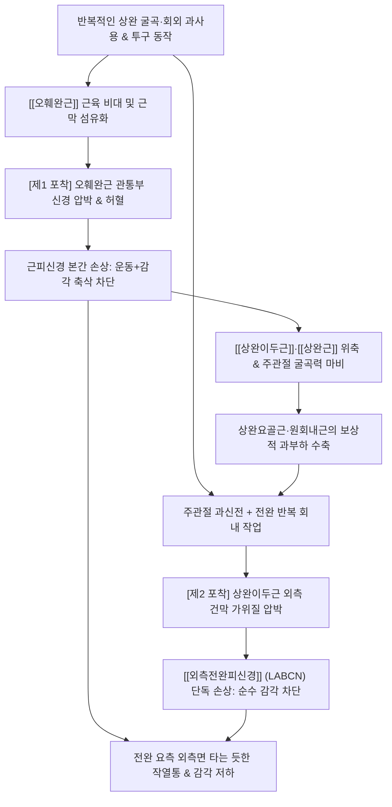

# 🩺 [[근피신경 포착 증후군]] (Musculocutaneous Nerve Entrapment)

> **핵심 3줄 요약 (Key Summary)**:
> - 📍 병소 부위 & 해부·병태생리: [[완신경총]](Brachial plexus) 외측삭(Lateral cord, C5~C7) 기원의 [[근피신경]](Musculocutaneous nerve)이 상완 근위부의 [[오훼완근]](Coracobrachialis) 관통부나 주관절 원위부 상완이두근 건막 외측에서 물리적으로 포착·마찰·견인되어 발생.
> - 🚩 전형적 임상 양상 & 3대 징후: [[상완이두근]](Biceps) 및 [[상완근]](Brachialis) 근력 약화로 인한 주관절 굴곡력 저하(특히 전완 회외 시), 이두근 건반사 감퇴, 종말지인 [[외측전완피신경]](LABCN) 영역(전완 요측 외측면)의 저림 및 타는 듯한 작열통. 손바닥 및 손가락 감각은 정중·요골신경 지배로 완전히 정상 보존됨.
> - 🛠️ 핵심 감별 검사 & 한·양방 다각적 치료 전략: 오훼돌기 하방 압박 티넬 검사, LACN 신장 검사, 천천·곡지 취혈 및 오훼돌기 외하방 안전 심부 약침(신바로·봉약침), 상완이두근-상완근 계면 신경수압박리술, [[서경탕]]·[[활락효령단]], 신경 가동술(LABCN Flossing).
> - ⚠️ 응급 의뢰 레드플래그 & 안전 주의: 오훼돌기 내측 심부 자침 시 액와동맥 및 상완신경총 내측속 손상 절대 주의, 진행성 상완이두근 근위축 및 완전 마비 시 수술적 감압 의뢰.

---

## 📌 목차
1. [질환 개요 & 해부학적 병태생리](#1-질환-개요--해부학적-병태생리)
2. [병태생리 메커니즘 & 생체역학적 악순환 네트워크](#2-병태생리-메커니즘--생체역학적-악순환-네트워크)
3. [임상 증상 & 이학적 검사 알고리즘](#3-임상-증상--이학적-검사-알고리즘)
4. [감별 진단 매트릭스](#4-감별-진단-매트릭스)
5. [한의 통합 치료 프로토콜](#5-한의-통합-치료-프로토콜)
6. [양방 치료 & 병용·의뢰 기준](#6-양방-치료--병용의뢰-기준)
7. [재활 운동 & 생활습관 티칭 가이드](#7-재활-운동--생활습관-티칭-가이드)
8. [💡 사용자 진료실 핵심 필기 & 임상 노하우 (Melt-In)](#8--사용자-진료실-핵심-필기--임상-노하우-melt-in)
9. [📚 출처 및 현대 학술 연구 요약](#9-출처-및-현대-학술-연구-요약)

---

## 1. 🩺 질환 개요 & 해부학적 병태생리

### (1) 질환 정의 및 임상적 역학 특성
* **정의**: [[근피신경 포착 증후군]](Musculocutaneous Nerve Entrapment)은 [[완신경총]](Brachial plexus) 외측삭(Lateral cord, C5~C7 신경근)에서 기원한 [[근피신경]](Musculocutaneous nerve, MCN)이 주행 경로 상의 해부학적 협착 부위에서 기계적 압박, 마찰, 또는 과도한 신장 견인(Traction)을 받아 운동 마비 및 감각 장애를 초래하는 말초신경 포착 질환이다.
* **임상적 희귀성과 높은 오진율**:
  * 상지에서 발생하는 말초신경 포착 증후군([[수근관 증후군]], [[주관절 터널 증후군]] 등) 전체 중에서 근피신경 포착이 차지하는 비율은 1% 미만으로 매우 드물다.
  * 이로 인해 임상 진료실에서 전완 외측 통증을 호소하는 환자를 단순 외측상과염(테니스 엘보), 상완이두근 장두건염, 혹은 경추 추간판 탈출증([[경추 추간판 탈출증]] C5/C6 신경근병증)으로 오진하여 수개월에서 수년간 엉뚱한 치료를 받는 사례가 빈번하다.
* **호발 대상 및 직업적 특성**:
  * **보디빌더 및 웨이트 트레이닝 선수**: 프리처 컬(Preacher curl), 과도한 중량의 덤벨 컬, 턱걸이 등을 통해 상완이두근과 오훼완근이 비정상적으로 비대해진 상태에서 신경이 근육 터널에 끼이면서 발생.
  * **오버헤드 스포츠 선수**: 야구 투수, 배구 스파이커, 테니스 선수 등 상완을 강하게 외전·외회전했다가 내회전으로 전환하는 채찍질 동작에서 반복적인 신경 신장 손상 발생.
  * **중량물 운반 노동자 및 군인**: 무거운 군용 배낭의 숄더 스트랩이 오훼돌기 주변을 직접 압박하여 발생하는 이른바 **배낭 마비(Rucksack palsy)**의 주된 원인이 됨.
  * **핸드백을 팔꿈치에 걸치는 습관을 가진 여성**: 무거운 가방이나 장바구니를 주관절 굴곡 주름 부위에 걸치고 다니는 경우, 피하로 주행하는 [[외측전완피신경]](LABCN)이 상완이두근 건막과 가방 끈 사이에 직접 눌려 발생하는 **핸드백 마비(Handbag neuropathy)**.

### (2) 근피신경의 3차원 해부학적 주행 & 2대 포착 협착 터널
근피신경은 혼합 신경(Mixed nerve)으로서 상완에서는 운동 신경으로 작용하고, 주관절 원위부 전완에서는 순수 감각 신경으로 기능한다.

```
                      완신경총 외측삭 (Lateral Cord, C5~C7)
                                       │
                                       ▼ (소흉근 심부 주행)
                      오훼돌기(Coracoid Process) 내하방 통과
                                       │
        ┌──────────────────────────────┴──────────────────────────────┐
        ▼ [제1 포착 터널: 상완 근위부]                                │
  [[오훼완근]](Coracobrachialis) 근복 관통 터널 (오훼돌기 하방 5~8cm)  │
    - 오훼완근 비대, 상완 과외전·외회전 시 압박                       │
        │                                                             │
        ├─────────────────────────────────────────────────────────────┤
        ▼ [운동 신경 지배 영역]                                       │
  ① [[오훼완근]] (Coracobrachialis)                                   │
  ② [[상완이두근]] (Biceps brachii: 단두 및 장두)                    │
  ③ [[상완근]] (Brachialis: 주관절 최강 굴곡근)                       │
        │                                                             │
        ▼ [제2 포착 터널: 주관절 원위부]                              │
  상완이두근 외측 건막(Bicipital aponeurosis) 테두리 통과              │
  심부 상완근막(Deep brachial fascia) 천공 피하 출구                   │
        │                                                             │
        ▼ [순수 감각 신경 이행]                                       │
  ★ 종말지: [[외측전완피신경]] (Lateral Antebrachial Cutaneous Nerve, LABCN)
    - 전완 요골측(외측면, Radial border) 전외측 및 배외측 피부 감각  │
    - ⚠️ 손바닥 및 엄지/검지 손가락 감각은 정상 보존 (정중·요골 지배) ┘
```

1. **상완 신경총에서의 기원 및 근위부 주행**:
   * 근피신경은 제5, 6, 7 경추 신경근(C5~C7)의 전지로 구성된 외측삭(Lateral cord)의 종말 분지이다.
   * 소흉근(Pectoralis minor)의 심부를 지나 액와동맥(Axillary artery)의 외측을 따라 하행하여 오훼돌기(Coracoid process) 내하방으로 진입한다.
2. **제1 포착 터널: 오훼완근(Coracobrachialis) 관통부**:
   * 신경은 오훼돌기 부착부로부터 하방 약 5~8cm 지점에서 오훼완근의 근복 내측으로 진입하여 근육 섬유 사이를 대각선으로 관통한다.
   * 이때 신경은 오훼완근을 관통하는 동안 오훼완근 자체로 운동 분지를 낸다.
   * 오훼완근을 빠져나온 신경은 [[상완이두근]](전방)과 [[상완근]](후방) 사이의 근간 결합조직 면(Intermuscular plane)을 따라 하행하면서 상완이두근의 장두·단두 및 상완근으로 주 운동 분지들을 순차적으로 공급한다.
3. **제2 포착 터널: 주관절 외측 건막 및 심부근막 천공부**:
   * 상완 원위부에 도달한 신경은 운동 신경 섬유를 모두 소진하고 순수 감각 신경으로 전환된다.
   * 주관절 상방 2~3cm 지점에서 상완이두근 외측 테두리를 따라 주와(Cubital fossa) 외측으로 주행한다.
   * 이곳에서 상완이두근 건막(Bicipital aponeurosis / Lacertus fibrosus)의 외측 유리연(Free margin)과 상완근 사이를 통과한 후, 심부 상완근막(Deep brachial fascia)을 뚫고 피하 지방층으로 나온다.
   * 이 천공 구멍(Fascial hiatus)이 제2의 물리적 포착 터널을 형성한다.
4. **외측전완피신경(LABCN)의 주행과 감각 지배의 결정적 특성**:
   * 근막을 뚫고 나온 외측전완피신경은 요골피정맥(Cephalic vein) 심부 및 주변을 따라 전완 요측(Radial border, 앞팔의 엄지손가락 쪽 외측면)으로 하행한다.
   * 전완 외측면의 앞쪽(Volar-lateral)과 뒤쪽(Dorso-lateral) 피부 감각을 완관절 기저부(Styloid process of radius) 부근까지 담당한다.
   * **임상적으로 극히 중요한 포인트**:
     * 외측전완피신경은 손목 관절을 넘어서 손바닥(Thenar eminence)이나 손가락으로는 진입하지 않는다.
     * 따라서 **손바닥 모지구 및 손가락 감각은 완전히 정상**이어야 한다. 손가락 저림이 동반된다면 이는 정중신경([[수근관 증후군]])이나 요골신경 천지 포착(Wartenberg 증후군), 혹은 경추 C6 신경근병증을 강력히 시사한다.

---

## 2. ⚡ 병태생리 메커니즘 & 생체역학적 악순환 네트워크

### (1) 2대 호발 터널의 병태생리학적 기전 비교
근피신경의 포착은 병변의 위치에 따라 운동 마비의 동반 여부가 완전히 달라진다.



1. **상완 근위부 오훼완근 관통부 포착 (Proximal Entrapment)**:
   * **기전**: 상완을 외전, 외회전 및 신전시키는 자세(예: 벤치프레스 바닥 지점, 투구 시 코킹 단계)에서는 오훼돌기가 상완골두로부터 멀어지며 오훼완근이 최대로 팽팽해진다. 이때 비대해진 오훼완근 근복이 근피신경 본간(Main trunk)을 옭아매며 신경 내 미세혈관 순환을 차단하여 허혈성 신경 부종을 초래한다.
   * **결과**: 신경의 본간이 손상되므로 **운동 신경 결손과 감각 신경 결손이 동시에 발생**한다. 상완이두근 및 상완근의 탈신경 위축, 주관절 굴곡력 약화, 이두근 반사 소실과 함께 전완 외측 피부의 감각 저림이 동반된다.
2. **주관절 원위부 외측전완피신경 포착 (Distal Entrapment / LABCN Neuropathy)**:
   * **기전**: 주관절을 완전히 신전한 상태에서 전완을 최대로 회내(Pronation)시킬 때, 상완이두근 건막의 외측 가장자리가 팽팽하게 당겨지며 하방의 심부 근막과 맞물려 가위질 현상(Scissoring effect)을 일으킨다. 이 틈바구니에 끼인 외측전완피신경이 반복적으로 짓눌리고 마찰된다.
   * 또한 팔꿈치 안쪽에 무거운 핸드백을 걸고 장시간 걷는 경우, 가방 끈의 하중이 피하로 노출된 신경을 상완이두근 건과 상완골 외과 사이에 직접 압궤(Crush)시킨다.
   * **결과**: 이미 운동 분지가 모두 빠져나간 뒤의 순수 피하 감각 신경만이 손상되므로, **근력 약화는 전혀 나타나지 않고 오직 전완 요측 외측면의 타는 듯한 작열통(Burning dysesthesia)과 감각 저하만 단독으로 발생**한다.

### (2) 생체역학적 보상 작용과 악순환 네트워크
* 상완이두근과 상완근이 마비되거나 약화되면, 인체는 팔꿈치를 굽히기 위해 요골신경의 지배를 받는 [[상완요골근]](Brachioradialis)과 정중신경 지배의 [[원회내근]](Pronator teres)을 비정상적으로 과도하게 동원한다.
* 이 보상 작용으로 인해 환자는 숟가락질이나 물건을 들 때 팔꿈치를 굽히면서 자연스럽게 팔을 안쪽으로 비트는 전완 회내(Pronation) 보상 패턴을 반복하게 된다.
* 반복된 과회내 동작은 주관절 외측의 상완이두근 건막 긴장도를 더욱 악화시켜 제2 포착 터널의 LABCN 압박을 한층 가중시키는 파괴적인 생체역학적 악순환을 형성한다.

---

## 3. 🔍 임상 증상 & 이학적 검사 알고리즘

### (1) 주요 임상 증상 3대 징후 (Triad) 및 병기별 진행
1. **주관절 굴곡 및 전완 회외 근력 약화 (Motor Deficit)**:
   * 전완을 손바닥이 위로 향하게 회외(Supination)시킨 상태에서 팔꿈치를 굽히려 할 때 뚜렷한 근력 감퇴를 보인다.
   * 일상생활에서 무거운 냄비를 들거나, 문손잡이를 바깥으로 돌려 여는 동작, 스크루드라이버를 돌리는 동작이 몹시 힘들어진다.
   * 상완이두근 건반사(Biceps tendon reflex)가 건측에 비해 뚜렷하게 감퇴하거나 소실된다.
   * 수개월 이상 지속된 만성 환자에서는 상완 전면 근육이 눈에 띄게 꺼지는 상완이두근 근위축(Muscle atrophy)이 육안으로 확인된다.
2. **전완 요측 외측면의 신경병증성 감각 이상 (Sensory Deficit & Burning Pain)**:
   * 전완의 엄지손가락 쪽 외측면을 따라 저림, 시림, 둔감, 혹은 피부가 타는 듯한 작열통(Burning pain)이 발생한다.
   * 옷소매가 살짝 스치기만 해도 소름이 돋거나 통증을 느끼는 이질통(Allodynia)이 동반될 수 있다.
   * **감각 경계**: 통증과 저림이 주관절 외측에서 시작하여 전완 외측을 타고 내려오다가 **손목 관절(요골 경상돌기) 부근에서 정확히 멈춘다.** 손바닥이나 손가락에는 아무런 이상 감각이 없다.
3. **국소 압통 및 방사통 (Local Tenderness & Radiation)**:
   * 오훼완근 포착 시: 오훼돌기 내하측 2~3cm 지점을 엄지로 누르면 극심한 비명 반응과 함께 전완 외측으로 찌릿한 전기가 방사된다.
   * LABCN 포착 시: 팔꿈치 접히는 주름 부위에서 상완이두근 건의 바로 외측 가장자리를 촉진할 때 극심한 국소 압통과 티넬 징후가 나타난다.

```
[ 근피신경 포착 증후군의 3단계 임상 진행 경과 ]
  - 경증 (초기): 무거운 운동이나 노동 후 전완 외측의 일시적 찌릿함, 주관절 굴곡 피로감
  - 중등도 (중기): 일상 동작(문손잡이, 식사)에서 굴곡력 약화 체감, 야간 전완 작열통 발생
  - 중증 (말기): 상완이두근의 비가역적 위축, 팔꿈치 굴곡 불능, 전완 외측의 완전 감각 탈실
```

### (2) 필수 이학적 검사법 & 알고리즘
```
[ 근피신경 포착 진단 이학적 검사 흐름도 ]
                  전완 외측 통증 및 팔꿈치 굴곡 약화 호소
                                    │
                                    ▼
                      경추 유발 검사 ([[스펄링 검사]])
                          ├── [양성] ──▶ 경추 C5/C6 신경근병증 정밀 평가
                          └── [음성]
                                    │
                                    ▼
                   삼각근(Deltoid) 외전 도수근력검사
                          ├── [약화] ──▶ 완신경총 상신경간 또는 액와신경 병변
                          └── [정상]
                                    │
                                    ▼
                 상완이두근 분리 굴곡 근력검사 (회외 vs 중립)
                          ├── [회외 시 현저한 약화]
                          │         │
                          │         ▼
                          │   오훼돌기 하방 티넬 검사 (Tinel's sign)
                          │         ├── [양성] ──▶ 제1 포착: 오훼완근 관통부 병변
                          │         └── [음성]
                          └── [근력 정상]
                                    │
                                    ▼
                         외측전완피신경 (LACN) 신장 검사
                                    ├── [양성] ──▶ 제2 포착: 주관절 외측 LABCN 병변
                                    └── [음성] ──▶ 테니스 엘보, 요골신경 천지 포착 등 감별
```

1. **오훼완근 압박 티넬 검사 (Tinel's Sign at Coracoid Process)**:
   * 환자의 어깨를 약 30° 외전시키고 팔을 편안히 늘어뜨리게 한다.
   * 검사자는 환자의 오훼돌기(쇄골 외측 1/3 하방의 골성 돌출부)를 촉지한 후, 그 내하측 약 2~3cm 지점의 오훼완근 근복을 엄지손가락으로 깊숙이 압박하거나 타진기로 가볍게 두드린다.
   * 양성 반응: 즉각적으로 상완 전면을 타고 전완 요측 외측면까지 번개 치듯 찌릿한 방사통이나 저림이 재현된다.
2. **외측전완피신경 신장 검사 (LACN Tension Test)**:
   * 검사자가 환자의 주관절을 완전히 신전(Extension)시키고, 전완을 최대로 안쪽으로 돌리는 회내(Pronation) 상태를 만든다.
   * 그 상태에서 손목을 새끼손가락 쪽으로 꺾는 척측 편위(Ulnar deviation) 및 신전을 유도하여 신경 주행로를 최대로 긴장시킨다.
   * 양성 반응: 주관절 외측 상완이두근 건 부위에서 뚝 당기는 느낌과 함께 전완 외측면으로 타는 듯한 작열통이 극적으로 유발된다.
3. **상완이두근 분리 도수근력검사 (Isolated Biceps MMT)**:
   * **검사 1 (상완이두근 집중 평가)**: 전완을 완전 회외(손바닥이 얼굴을 향함)시킨 상태에서 팔꿈치를 90° 굽히게 하고, 검사자가 신전 방향으로 강한 저항을 가한다. 근피신경 마비 시 현저한 근력 저하(Grade 3~4 이하)를 보인다.
   * **검사 2 (상완요골근 보상 배제 평가)**: 전완을 중립위(엄지가 위를 향하는 해머 자세)로 두고 굴곡 저항을 가한다. 요골신경 지배의 상완요골근이 작용하므로 검사 1에 비해 근력이 비교적 잘 유지되는 해리(Dissociation) 현상이 관찰된다.

---

## 4. 🔀 감별 진단 매트릭스

근피신경 포착 증후군은 증상이 모호하여 유사 상지 질환으로 오진되기 가장 쉬운 질환 중 하나이다. 명확한 비교 매트릭스를 통해 감별한다.

| 감별 포인트 | [[근피신경 포착 증후군]] (본 질환) | 경추 C5/C6 신경근병증 ([[경추 추간판 탈출증]]) | 요골신경 천지 포착 (Wartenberg 증후군) | 외측상과염 ([[테니스 엘보]]) | 상완이두근 장두건염 |
| :--- | :--- | :--- | :--- | :--- | :--- |
| **병변 위치** | [[오훼완근]] 관통부 또는 주관절 외측 건막 | 경추 추간판 C4-5 또는 C5-6 추간공 | 완관절 근위부 요골 건막 (상완요골근) | 상완골 외측상과 총신근건 기저부 | 상완골 결절간구 (Bicipital groove) |
| **경추통 및 유발 검사** | 경추통 전혀 없음, [[스펄링 검사]] 음성 | **경추 방사통 동반**, 스펄링 검사 양성 | 경추 무관, 스펄링 음성 | 경추 무관, 스펄링 음성 | 경추 무관, 스펄링 음성 |
| [[삼각근]](Deltoid) 근력 | **정상 (액와신경 지배)** | **동반 약화 (C5 신경근 손상)** | 정상 | 정상 | 정상 |
| **감각 저하 분포 영역** | **전완 요측 외측면에만 국한 (수부 정상)** | 상완 외측(C5) 또는 **엄지/검지 손가락(C6)** | **손등 요측 및 엄지·검지 기저부 배면** | 감각 저하 전혀 없음 (순수 건병증) | 감각 저하 전혀 없음 |
| **핵심 근력 약화** | [[상완이두근]], [[상완근]] (주관절 굴곡·회외) | 삼각근, 상완이두근, 손목 신근 동반 약화 | 근력 약화 없음 (순수 감각 신경) | 악력(Grip) 시 외측상과 통증 | 주관절 굴곡력 자체는 정상 유지 |
| **심부건반사 (DTR)** | 상완이두근 반사 감퇴/소실 | 이두근(C5) 또는 상완요골근(C6) 반사 저하 | 정상 | 정상 | 정상 |
| **이학적 특이 검사** | **오훼완근 티넬 양성, LACN 신장 양성** | 경추 견인 및 압박 검사 양성 | 요골 경상돌기 8cm 상방 티넬 양성 | **코젠 검사(Cozen's), 밀 검사(Mill's) 양성** | **스피드 검사(Speed's), 예가손(Yergason) 양성** |
| **근전도 (EMG/NCV)** | 이두근 탈신경 전위, LABCN SNAP 감소 | C5/C6 척추주위근 및 상지 분절 탈신경 | 요골신경 천지 SNAP 잠시 지연 | 정상 | 정상 |

---

## 5. 🌿 한의 통합 치료 프로토콜

### (1) 한의학적 변증 체계
* **기체어혈(氣滯瘀血) 및 노손(勞損)형**:
  * 병리: 과도한 웨이트 트레이닝, 투구 동작, 직접 압궤 외상으로 상완 전면 경락의 기혈이 응체되고 근맥이 파열되어 어혈이 형성됨.
  * 증상: 주관절 굴곡 시 찌르는 듯한 국소 자통, 전완 외측 작열통, 야간에 통증 심화, 설질자암(舌質紫暗) 및 어점, 맥현삽(脈弦澁).
* **풍한습비(風寒濕痺)형**:
  * 병리: 상완 및 전완 부위에 차가운 기운과 습기가 침습하여 경락의 기혈 운행을 차단함.
  * 증상: 전완 외측이 시리고 저리며 둔감함, 찬물을 만지거나 에어컨 바람을 쐬면 저림이 극심해짐, 따뜻하게 찜질하면 완화, 설담태백니(舌淡苔白膩), 맥침완(脈沈緩).
* **기혈양허 및 근맥실양(氣血兩虛 & 筋脈失養)형**:
  * 병리: 신경 포착이 장기화되어 상완이두근에 영양 공급이 끊기고 근육이 위축되는 마목(麻木) 및 위증(痿證)으로 전이됨.
  * 증상: 팔꿈치에 힘이 전혀 들어가지 않음, 상완 전면 근육이 눈에 띄게 말라붙음, 만성 피로 및 기운 없음, 설담태소(舌淡苔少), 맥세약(脈細弱).

### (2) 침구 치료 & 전침 표준운영절차(SOP)
2대 협착 터널을 해부학적으로 안전하게 감압하는 정밀 침구 치료를 시행한다.

```
                  [ 근피신경 주행로 침구 치료 배치도 ]
                     (어깨 전면)
                    오훼돌기(Coracoid)
                        │  (외하방 1.5촌 안전 자침)
                    천천 (PC2) ── 오훼완근 관통부 감압
                        │
                        │  (상완이두근-상완근 근간막 주행)
                        ▼
                    곡택 (PC3) ── 상완 중앙부 활류 촉진
                        │
                     (팔꿈치 외측 주와)
                    척택 (LU5) 외측 1촌 ── 상완이두근 외측 건막 출구 감압
                        │  (피하 15° 평자 자침)
                    곡지 (LI11)
```

1. **제1 포착점 (오훼완근 관통부 감압 자침)**:
   * **취혈**: 천천혈(PC2) 및 오훼돌기 외하방 1.5촌 지점.
   * **침구 조작**: 0.25×40mm 호침 사용. 오훼돌기 하방에서 긴장된 오훼완근의 단단한 결절 밴드를 향해 비스듬히 외하방으로 15~20mm 사자(Oblique insertion)하여 뻐근한 득기감을 유도한다.
   * **🚨 초특급 혈관·신경 안전 가이드라인 (반드시 준수)**:
     * 오훼돌기 내측 심부에는 액와동맥(Axillary artery), 액와정맥, 그리고 완신경총의 내측속이 지나간다.
     * 따라서 자침 전 반드시 **액와동맥의 박동을 촉지**하고, **맥동으로부터 외측으로 최소 1.5cm 이상 떨어진 위치에서 상완골 골면을 향해 외하방으로 비스듬히 자입**해야 한다.
     * 맥동이 느껴지는 내측이나 흉곽 방향으로 깊숙이 직자하는 행위는 동맥 파열 및 기흉을 유발할 수 있으므로 절대 엄금한다.
2. **제2 포착점 (외측전완피신경 건막 출구 감압 자침)**:
   * **취혈**: 척택(LU5) 외측 1촌, 상완이두근 건 외측 가장자리와 곡지(LI11) 사이 함요처.
   * **침구 조작**: 이 부위의 LABCN은 피하 근막 직하에 위치하므로 깊이 찌르면 안 된다. 0.20×30mm 호침으로 피부와 15~20° 각도를 유지하며 원위부(손목 방향)를 향해 10~15mm 완만하게 **평자(Subcutaneous flat insertion)**한다.
   * 상완이두근 건막의 외측 유리연을 가볍게 자극하여 신경 주위 근막 유착을 기계적으로 분리한다.
3. **전침(Electroacupuncture) 프로토콜**:
   * 전침 연결 쌍: [천천 - 척택 외측 LABCN점].
   * 통전 파형: 2~4Hz 저주파 연속파를 15분간 적용한다. 저주파 자극은 근피신경의 축삭 수송 능력을 촉진하고 혈관 확장 펩타이드(CGRP, Substance P) 분비를 유도하여 신경 허혈을 개선한다.

### (3) 약침 요법 & 신경수압박리술 (Hydrodissection)
1. **상완이두근-상완근 계면 신경수압박리술 (Hydrodissection)**:
   * 목적: 만성 염증으로 상완이두근과 상완근 사이에 들러붙은 근막 유착을 약침액의 수력학적 압력으로 부드럽게 떼어내어 신경의 활주 공간을 복원한다.
   * 주입 기법: 초음파 유도하 또는 정밀 촉진하에 상완 중앙 외측에서 상완이두근과 상완근 사이의 근간면으로 진입하여 **신바로약침 또는 생리식염수 희석 약침액 2.0~3.0mL를 서서히 주입**한다. 약침액이 신경 주위로 퍼지면서 저에코의 도넛 징후(Halo sign)를 형성하며 유착이 분리된다.
2. **봉약침 (Sweet Bee Venom / BV)**:
   * 오훼완근 관통부 및 주와 외측 건막 출구에 Sweet BV(0.1mL)를 분할 주입하여 신경 주위 무균성 부종을 빠르게 소퇴시키고 통각 수용기 감작을 차단한다.
3. **죽염약침 및 중성어혈약침**:
   * 급성기 열감과 타는 듯한 작열통을 호소하는 환자에게 LABCN 주행로를 따라 피내 구진(Wheal) 형태로 0.1mL씩 점자 주입하여 삼투압에 의한 신경 부종 제거 및 진통 효과를 거둔다.

### (4) 침도 요법 (Acupotomy)
* **적응증**: 보존적 침구 치료로 호전되지 않는 만성 오훼완근 비대 및 상완이두근 외측 건막의 섬유화 구축 환자.
* **시술 방법**:
  * 제1 침도점(오훼완근 부착부): 0.5×50mm 평인형 침도를 사용하여 오훼돌기 외하방 1.5cm 지점에서 근막 장축과 평행하게 날을 세워 진입한다. 골막에 닿지 않는 안전 심도(15mm 내외)에서 오훼완근의 비후된 근막 밴드를 1~2회 율동적으로 종축 절개(Longitudinal release)한다.
  * 제2 침도점(주관절 건막 출구): 0.35×30mm 미세 침도로 상완이두근 외측 건막의 팽팽한 테두리만을 표재성으로 1mm 미세 절개하여 신경 압박을 해제한다.

### (5) 추나 요법 & 근막 이완술 (Chuna Manual Medicine)
```
[ 근피신경 감압을 위한 3단계 추나 프로토콜 ]
  ① 오훼완근·소흉근 직접 근막 이완술 (Direct Myofascial Release)
     - 환자 견관절을 외전한 상태에서 오훼돌기 하방 근복을 수직으로 컨택하여 신장
  ② 상완골두 후하방 글라이딩 관절 가동술 (Posterior-Inferior Glenohumeral Glide)
     - 상완골두 전방 활주 증후군을 교정하여 상완 전면 신경의 견인 장력 차단
  ③ 경추 C5-C7 분절 관절 가동 추나 (Cervical Mobilization)
     - 완신경총 기원 신경근의 신경공 압박을 감압하고 축삭 흐름 촉진
```

1. **오훼완근 직접 근막 이완 (Coracobrachialis MFR)**:
   * 환자를 앙와위로 눕히고 견관절을 45° 외전시킨다.
   * 시술자는 엄지손가락 또는 수근부로 오훼돌기 하방 오훼완근의 팽팽한 결절을 부드럽게 압박하면서, 다른 손으로 환자의 팔을 외전 및 외회전 방향으로 천천히 신장시켜 근막 긴장을 푼다.
2. **상완골두 후하방 관절 가동술 (Glenohumeral Glide)**:
   * 상완골두가 앞으로 밀려 나와 있는 전방 활주 증후군(Anterior glide syndrome) 환자는 상완 전면의 신경과 혈관이 활시위처럼 팽팽하게 당겨진다.
   * 시술자가 상완골두 전면을 후하방으로 부드럽게 밀어 넣어 중심화(Centering)시킴으로써 신경에 걸리는 기계적 견인 스트레스를 근본적으로 제거한다.

### (6) 한약 치료 (방제 의학)
* **급성기 및 기체어혈(통증·저림 우세)**:
  * [[서경탕]](舒經湯): 강황, 당귀, 해동피, 백출, 적작약, 강활, 방풍, 감초 등으로 구성. 상지 어깨와 팔의 경락을 소통시키고 기혈 응체를 풀어주는 대표 방제. 상완 전면의 욱신거림과 전완 저림을 신속히 완화.
  * [[활락효령단]](活絡效靈丹): 당귀, 단삼, 유향, 몰약으로 구성. 신경 주위 미세 혈관의 혈전과 어혈을 녹여내어 신경 내 혈류 순환을 재개하고 작열통을 억제.
  * 통증이 극심할 경우 상지 경락 인경약인 [[강황]]과 경항부 긴장을 풀어주는 [[갈근]]을 8~12g 증량 배합한다.
* **만성기 및 기혈양허(상완이두근 위축·근력 저하 우세)**:
  * **[[보중익기탕]](補中益氣湯) 합 [[대황기음]](大黃芪飮)**: 황기, 인삼, 백출, 당귀, 진피 등을 배합하여 중초 기운을 북돋우고 사지 말초로 기혈을 보낸다.
  * 근육 위축을 막고 신경 재생을 돕기 위해 서근활락(舒筋活絡) 작용이 뛰어난 [[모과]], [[우슬]], 오가피를 가미 처방한다.

---

## 6. 💊 양방 치료 & 병용·의뢰 기준

> 🎯 **이 섹션의 목적**: 근피신경 포착 환자는 통증클리닉이나 정형외과에서 신경 차단술을 받거나 가바펜티노이드를 복용 중인 경우가 흔하다. 1차 한의 진료에서 양방 치료의 약리 기전을 이해하고, 안전한 병용 관리와 수술적 전원 기준을 명확히 제시한다.

### (1) 양방 보존적 약물 요법
* **신경병증성 통증 1차 조절 약제 (Gabapentinoids)**:
  * **가바펜틴 (Gabapentin)**: 초기 300mg 취침 전 복용으로 시작하여 환자 반응에 따라 900~1,800mg/day까지 점진 증량.
  * **프레가발린 (Pregabalin)**: 75mg 1일 2회 복용 시작, 최대 150~300mg/day.
  * 전압 개폐 칼슘 채널의 알파-2-델타 서브유닛에 결합하여 글루타메이트 등 흥분성 신경전달물질 분비를 억제, 전완 외측 작열통을 완화함. 어지럼증, 졸림, 체중 증가 부작용 모니터링 필요.
* **경구 소염진통제 및 단기 스테로이드 요법 (Oral Steroid Taper)**:
  * 급성 신경 부종기에는 메틸프레드니솔론(Methylprednisolone Medrol dose pack)을 6일간 단계적 감량 투여하여 신경 내 부종을 신속히 차단하기도 함.

### (2) 초음파 유도하 신경 차단술 (Perineural Injection)
* 1% 리도카인(Lidocaine) 국소마취제 2~3mL와 트리암시놀론(Triamcinolone) 10~20mg을 혼합하여 오훼돌기 하방 오훼완근 관통부 또는 주와 외측 LABCN 주위에 정밀 주입.
* 진단적 가치: 국소마취제 주입 5~10분 후 전완 외측 작열통과 저림이 즉각 소실된다면 병변 부위가 확진됨.
* 주의점: 반복적인 스테로이드 주입은 주변 상완이두근 건의 변성 및 파열, 피하 지방 위축, 피부 탈색을 초래하므로 2~3회 이내로 제한.

### (3) 전기진단학적 평가 (Electrodiagnosis: EMG & NCV)
확진 및 예후 판정을 위해 근전도 및 신경전도 검사를 적극 활용한다.

```
[ 근피신경 포착 증후군의 전기진단학적 특징 ]
  ① 침근전도 검사 (Needle EMG):
     - 상완이두근(Biceps) 및 상완근(Brachialis): 탈신경 자발전위(Fibrillation potential, Positive sharp wave)
     - 오훼완근(Coracobrachialis): 포착 부위보다 근위부에서 분지하는 경우 정상 소견을 보일 수 있음
     - 삼각근(Deltoid) 및 척추주위근(Paraspinal): 정상 소견 (경추 디스크 및 상신경간 손상 배제)
  ② 감각신경전도 검사 (Sensory NCV):
     - 외측전완피신경 (LABCN): 건측 대비 감각신경활동전위(SNAP) 진폭 50% 이상 감소 또는 잠시 지연
```

### (4) 수술적 치료 적응증 및 술식
* **수술 적응증**:
  * 3~6개월 이상의 적극적인 한·양방 보존적 치료(약침, 침도, 물리치료, 주사 등)에도 전완 작열통이 지속되어 일상생활이 불가능한 경우.
  * **상완이두근의 진행성 근위축 및 주관절 굴곡 마비(MMT Grade 2 이하)**가 뚜렷하게 관찰되는 경우 (영구적 신경 손상 방지 목적).
* **수술 술식**:
  * **오훼완근 관통부 신경 감압술(Neurolysis & Coracobrachialis Release)**: 삼각흉근 절개(Deltopectoral approach)를 통해 오훼돌기 하방으로 접근하여 오훼완근 근막을 종축으로 절개하고 신경 주변의 섬유성 유착 밴드를 박리.
  * **외측전완피신경 감압술**: 주와 외측에서 상완이두근 외측 건막의 테두리를 절제하여 신경의 가위질 압박을 해제.

### (5) 한·양방 병용 판단 & 전문과 의뢰 기준 (Referral Criteria)
* **약물 병용 가이드**: 가바펜티노이드를 복용 중인 환자에게 [[서경탕]]이나 [[활락효령단]]을 병용하면 통증 조절 시너지 효과를 기대할 수 있다. 한약 투여 후 환자의 자각 증상이 호전되면 양방 주치의와 상의하여 가바펜틴 용량을 1~2주 간격으로 서서히 감량 테이퍼링한다.
* **응급 의뢰 및 정형외과 전원 레드플래그**:
  * 팔꿈치를 전혀 구부릴 수 없는 급격한 운동 마비 진행 시.
  * 액와부나 오훼돌기 주변에서 단단한 종괴가 만져지는 경우 (신경초종 Schwannoma 등 양성 신경종양 배제 위해 즉각 MRI 의뢰).

---

## 7. 🏃 재활 운동 & 생활습관 티칭 가이드

### (1) 오훼완근 및 소흉근 능동 스트레칭
오훼돌기 주변의 전방 연부조직 단축을 해소하여 신경 주행 공간을 확보한다.

1. **코너 스트레칭 (Corner Chest Stretch)**:
   * 방 모퉁이나 문틀(Doorway)에 서서 양 팔꿈치를 90° 굽히고 어깨를 90° 외전시켜 벽에 전완을 밀착시킨다.
   * 한쪽 발을 앞으로 내딛으며 체중을 전방으로 실어 가슴 전면과 상완 전내측([[오훼완근]], [[대흉근]], [[소흉근]])을 지긋이 늘려준다.
   * 이때 어깨가 위로 으쓱 올라가지 않도록 날개뼈를 하강(Depression)시킨 상태를 유지한다.
   * 15~20초 유지, 3~5회 반복.
2. **벽 지지 단측 상완 외회전 신장**:
   * 환측 손바닥을 벽에 대고 팔을 어깨높이로 편 상태에서 몸통을 반대쪽으로 서서히 회전시켜 상완 전면 신경 주행로를 부드럽게 이완한다.

### (2) 외측전완피신경 신경 가동술 (LABCN Nerve Flossing / Gliding)
신경을 기계적으로 늘리는 것이 아니라, 터널 내부에서 신경이 앞뒤로 미끄러지도록(Sliding) 유도하여 유착을 분리하는 재활 운동이다.

```
                      [ 외측전완피신경 (LABCN) 플로싱 2단계 동작 ]

    [ 1단계: 원위부 신장 - 근위부 이완 ]          [ 2단계: 근위부 신장 - 원위부 이완 ]
              (머리 동측 기울임)                              (머리 반대측 기울임)
                      \                                               /
                   (팔꿈치 신전)                                   (팔꿈치 굴곡)
                      │                                               │
                   (전완 회내)                                     (전완 회외)
                      │                                               │
               (손목 척측 편위)                                   (손목 중립)
```

* **동작 방법**:
  * **자세 A (신경을 손목 쪽으로 당김)**: 머리를 환측 어깨 쪽으로 살짝 기울인 상태(경추 신경근 이완)에서, 팔꿈치를 완전히 펴고 전완을 최대로 안쪽으로 돌리며(회내), 손목을 새끼손가락 쪽으로 꺾어 내린다.
  * **자세 B (신경을 목 쪽으로 당김)**: 팔꿈치를 살짝 접으며 전완을 손바닥이 보이게 돌리고(회외), 손목을 편안히 중립으로 두면서 머리를 반대쪽 어깨로 천천히 기울여 신경 근위부를 당겨준다.
  * 자세 A와 B를 물 흐르듯이 천천히 10~15회 왕복 반복한다. 하루 3세트 실시.
  * ⚠️ 주의: 동작 중 전완 외측으로 찌릿한 방사통이 심하게 유발되면 즉시 가동 범위를 줄여 통증 없는 범위 내에서만 부드럽게 시행한다.

### (3) 인체공학적 생활습관 지도 (Ergonomic Teaching)
* **핸드백 및 장바구니 걸치기 절대 금지 (Bag Hanging 금지)**:
  * 무거운 물건을 운반할 때는 절대로 팔꿈치 안쪽 접히는 부위에 가방 끈을 걸지 말고, 어깨에 메는 크로스백이나 손으로 쥐는 방식을 사용하도록 티칭한다.
* **보디빌딩 리프팅 자세 수정**:
  * 프리처 벤치에서 팔꿈치를 패드에 고정하고 고중량을 당기는 프리처 컬 동작은 상완이두근 건막과 오훼완근에 극단적인 전단력을 가하므로 전면 중단시킨다.
  * 덤벨 컬 대신 케이블 머신을 활용하여 관절 전 가동역에 걸쳐 부하가 일정하게 분산되도록 유도한다.
* **컴퓨터 작업 환경 개선**:
  * 키보드 타이핑 시 팔꿈치를 책상 모서리에 강하게 누르는 자세를 피하고, 젤 패드가 달린 손목·팔꿈치 받침대를 사용한다. 전완의 과도한 회내를 줄이기 위해 버티컬 마우스 사용을 적극 권장한다.

---

## 8. 💡 사용자 진료실 핵심 필기 & 임상 노하우 (Melt-In)

### (1) 진료실 핵심 원장님 메모 집약 (Clinical Pearls)
* **보디빌더의 전완 저림 호소 시 외측상과염(테니스 엘보) 오진 함정**:
  * 헬스장에서 무거운 덤벨 컬이나 바벨 운동을 열심히 하는 건장한 남성이 "원장님, 팔꿈치 바깥쪽부터 앞팔 엄지 쪽이 타는 듯이 저리고 아파요"라며 내원하면, 십중팔구 타 병원에서 테니스 엘보 진단을 받고 체외충격파나 스테로이드 주사를 맞고 온 환자다.
  * **감별의 핵심 비결**:
    * 외측상과(Lateral epicondyle) 뼈 자체를 눌렀을 때의 압통과 코젠 검사가 애매하다면, 즉시 환자의 어깨 쪽 **오훼돌기 내하방 2~3cm 지점을 엄지로 꾹 눌러보라.**
    * 그 자리에서 환자가 깜짝 놀라며 "맞아요, 거기를 누르니까 앞팔 저린 곳으로 전기가 찌릿 흘러요!"라고 외친다면 100% 근피신경 포착이다. 외측상과를 백날 치료해도 낫지 않던 통증이 오훼완근을 풀면 그날로 완화된다.
* **경추 C5 디스크와의 10초 즉각 감별 비결**:
  * 팔꿈치를 굽히는 힘이 떨어지고 앞팔 외측이 저리다고 하면 경추 C5/C6 신경근병증을 가장 먼저 의심하기 쉽다.
  * **진료실 즉각 감별 팁**:
    * 환자에게 양팔을 옆으로 나란히 들어 올리는 **어깨 외전(Abduction)을 시켜서 삼각근(Deltoid) 근력을 검사**하라.
    * 경추 C5 신경근병증이라면 삼각근과 상완이두근이 동시에 약화되므로 팔을 옆으로 들어 올리는 버티는 힘이 푹 떨어진다.
    * 반면, **삼각근 근력(어깨 외전)은 완전히 정상인데 팔꿈치 굽히는 힘만 뚝 떨어져 있다면 99% 근피신경 포착**이다. 경추 MRI를 찍으러 보내기 전에 오훼완근과 상완이두근 주행로를 먼저 진찰하라.

### (2) 안전 자침 가이드라인 (Safety Pearls)
* **오훼돌기 하방 심부 자침 시 대형 혈관·신경총 손상 방지**:
  * 오훼돌기 주변은 한의원 진료실에서 기피하기 쉬운 위험 구역이다. 내측 깊숙한 곳으로 액와동맥(Axillary artery)과 상완신경총 내측속이 지나가기 때문이다.
  * 그러나 오훼완근의 포착을 풀지 못하면 근피신경병증은 절대로 완치될 수 없다.
  * **절대 안전 자침 공식**:
    1. 환자의 오훼돌기 골성 융기를 검지 손가락으로 먼저 짚는다.
    2. 중지 손가락으로 액와동맥의 펄떡이는 맥동을 반드시 확인하여 내측 경계선을 긋는다.
    3. 맥동 부위로부터 외측으로 1.5cm 이상 확실히 떨어진 오훼완근 부위에서, **침 끝을 흉곽(내측) 쪽이 아니라 바깥쪽 아래(상완골 외측 방향)를 향해 비스듬히 사자(Oblique insertion)**한다.
    4. 골면에 닿지 않도록 15~20mm 깊이 내외에서 부드럽게 염전 득기 후 약침이나 전침을 걸면 동맥 손상 위험이 0%로 완벽히 차단된다.

---

## 9. 📚 출처 및 현대 학술 연구 요약

1. **Davidson JS, Metzinger SE.** (1998). *Musculocutaneous nerve entrapment revisited*. J Hand Surg Am, 23(1):84-87. PMID: 9658350.
   - [연구 요약] 오훼완근 근복 비대로 인해 유발된 근피신경 본간 포착 증후군의 해부학적 병리기전과 외과적 감압 수술 치험례를 통해 진단 및 보존적 치료 프로토콜을 체계화한 고전적 임상 논문.

2. **Bassett FH 3rd, Nunley JA.** (1982). *Compression of the musculocutaneous nerve at the elbow*. J Bone Joint Surg Am, 64(7):1050-1052. PMID: 7118970.
   - [연구 요약] 주관절 외측에서 상완이두근 건막 및 심부근막에 의해 발생하는 외측전완피신경(LABCN) 포착 증례를 최초로 보고하고 임상적 유발 신장 검사법을 확립함.

3. **Bardellini G et al.** (2026). *Entrapment of the Lateral Cutaneous Nerve of the Forearm in Competitive Weightlifters: A Case Series with Medium and Long-Term Follow-Up*. JB JS Open Access, 11(1):e25.00123. PMID: 41788399.
   - [연구 요약] 고중량 웨이트 트레이닝 선수들에게서 호발하는 외측전완피신경 포착의 임상 양상, 오진 사례, 장기 추적 관찰을 통한 초음파 유도하 시술 및 보존적 재활 치료의 효과를 규명함.

4. **Tivorsak TL et al.** (2026). *US-guided Perineural Injections of the Upper Extremity from the Arm to the Wrist*. Radiographics, 46(4):e250112. PMID: 41785118.
   - [연구 요약] 상완 및 주관절 주변 말초신경의 초음파 유도하 신경 주위 주사 및 신경수압박리술 기법을 체계화하고 근피신경과 외측전완피신경의 안전 자입 경로를 제시함.

5. **Bardellini G et al.** (2025). *Compression of the lateral cutaneous nerve of the forearm: assessment and treatment strategies*. JSES Rev Rep Tech, 5(4):612-619. PMID: 41179458.
   - [연구 요약] 전완 외측 통증을 호소하는 환자에서 외측전완피신경 포착의 단계별 평가 진단법, 보조기 적용, 신경 가동술 및 비수술적 중재 프로토콜을 종합 분석한 최신 리뷰.

6. **Mari R et al.** (2025). *Musculocutaneous Nerve Compression by a Humeral Osteophyte: An Unusual and Difficult-to-Diagnose Cause of Peripheral Neuropathy*. Cureus, 17(9):e92314. PMID: 41170275.
   - [연구 요약] 상완골 골극 및 주변 근막 비후로 인한 근피신경 포착의 희귀 증례를 통해 상완이두근 근력 감퇴와 전완 감각 이상의 임상적 상관관계를 규명함.

7. **Shaw T et al.** (2023). *Conservative management of distal bicipital tendinopathy with lateral antebrachial nerve entrapment: A case report*. J Bodyw Mov Ther, 33:142-145. PMID: 36775510.
   - [연구 요약] 원위부 상완이두근 건병증에 동반된 외측전완피신경 포착 환자를 대상으로 도수 근막 이완술, 신경 가동술(Flossing), 침구 치료를 결합한 통합 보존 치료 치험례 보고.

8. **Nguyen ML et al.** (2020). *MRN findings of lateral antebrachial cutaneous nerve impingement in a collegiate athlete*. Skeletal Radiol, 49(5):809-814. PMID: 31807874.
   - [연구 요약] 운동선수에서 발생한 외측전완피신경 포착의 자기공명신경조영술(MRN) 소견을 분석하여 상완이두근 외측 건막에서의 기계적 마찰과 신경 비후를 영상의학적으로 입증함.
