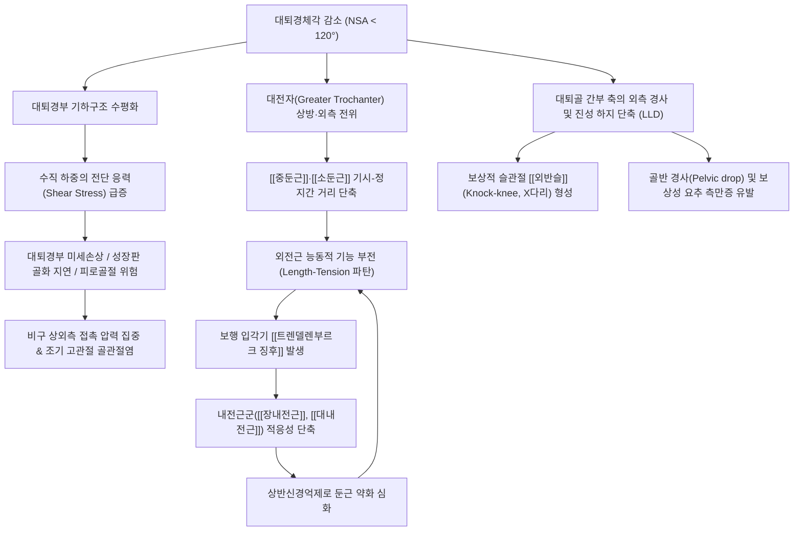

---
title: 내반고
created: 2026-09-19
updated: 2026-10-24
tags:
  - 이론
  - 근골격계질환
  - 하지질환
  - 고관절
  - 보행장애
  - 생체역학
출처: "PMID: 42726694"
aliases:
  - 내반고
  - Coxa Vara
  - 대퇴골 내반고
  - 대퇴경체각 감소
  - Coxa vara deformity
  - 콕사 바라
type: 의학개념
category: 질환
---

# 🩺 [[내반고]] (Coxa Vara / 股關節 內反, ICD-10: M21.15, Q65.8)

> **핵심 3줄 요약 (Key Summary)**:
> - 📍 병소 부위 & 해부·병태생리: 대퇴골 간부(Shaft)와 대퇴경부(Neck)가 형성하는 경체각(Neck-Shaft Angle, NSA / CCD angle)이 정상 성인 기준(125~135°)보다 현저히 감소하여 120° 미만으로 꺾이는 근위 대퇴골의 구조적 골격 기형. 대전자가 상대적으로 상방 전위되며 [[중둔근]]의 수축 효율 저하와 대퇴경부 수직 전단 응력(Shear stress) 집중을 초래함.
> - 🚩 전형적 임상 양상 & 3대 징후: 보행 시 환측 발을 디딜 때 반대측 골반이 아래로 처지는 [[트렌델렌부르크 징후]](Trendelenburg sign / 양측성일 경우 오리걸음 보행), 고관절 외전(Abduction) 및 내회전(Internal rotation)의 뚜렷한 가동성 제한, 1~3cm가량의 진성 하지 단축(True LLD) 및 이에 따른 보상성 [[외반슬]](Knock-knee, X자 다리) 동반.
> - 🛠️ 핵심 감별 검사 & 한·양방 다각적 치료 전략: X-ray 상 대퇴경체각(<120°) 및 힐겐라이너 성장판 각도(HEA >60° 시 진행성 수술 적응증) 계측; 고관절 장축 신연 및 내전근 MET 추나 교정, [[중둔근]]·[[소둔근]] 전침 및 신바로약침, 골반 높이 보정 깔창(Heel lift) 적용; 뼈의 전단 응력을 압박 응력으로 전환하는 외반 절골술(Pauwels valgus osteotomy)과의 긴밀한 협진 의뢰.
> - <font color="#fa7e7e">⚠️ 응급 의뢰 레드플래그 & 악화 요인: 소아·청소년기 급격한 고관절 회전 제한 및 파행 출현 시 대퇴골두 골단분리증(SCFE) 즉각 감별 필요; 체중 증가 시 대퇴경부 전단 응력이 3~4배 증폭되어 피로골절 및 골두 붕괴 위험 급증하므로 체중 조절이 필수적임.</font>

---

## 📌 목차
1. [질환 개요 & 해부학적 병태생리](#1-질환-개요--해부학적-병태생리)
2. [병태생리 메커니즘 & 생체역학적 악순환 네트워크](#2-병태생리-메커니즘--생체역학적-악순환-네트워크)
3. [임상 증상 & 이학적 검사(Physical Exam) 알고리즘](#3-임상-증상--이학적-검사physical-exam-알고리즘)
4. [감별 진단 매트릭스 (Differential Diagnosis)](#4-감별-진단-매트릭스-differential-diagnosis)
5. [한의 통합 치료 프로토콜 (침·약침·추나·한약)](#5-한의-통합-치료-프로토콜-침약침추나한약)
6. [양방 치료 & 병용·의뢰 기준 (Conventional Treatment & Referral)](#6-양방-치료--병용의뢰-기준-conventional-treatment--referral)
7. [재활 운동 & 생활습관 티칭 가이드](#7-재활-운동--생활습관-티칭-가이드)
8. [💡 사용자 진료실 핵심 필기 & 임상 노하우 (Melt-In 잔여 심화 집약)](#8--사용자-진료실-핵심-필기--임상-노하우-melt-in-잔여-심화-집약)
9. [출처 및 현대 학술 연구 요약 (References)](#9-출처-및-현대-학술-연구-요약-references)

---

## 1. 🩺 질환 개요 & 해부학적 병태생리

### 1) 개념 정의 및 대퇴경체각(CCD Angle)의 진단 기준
[[내반고]](Coxa Vara)는 대퇴골의 장축(Longitudinal axis of femoral shaft)과 대퇴경부의 중심축(Axis of femoral neck)이 관상면(Coronal plane) 상에서 교차하며 형성하는 각도인 **대퇴경체각(Neck-Shaft Angle, NSA 또는 Caput-Collum-Diaphyseal angle, CCD 각도)**이 정상 생리적 범위보다 감소하여 **120° 미만**으로 꺾인 근위 대퇴골(Proximal femur)의 해부학적 구조 변형입니다.

인간의 대퇴경체각은 일생에 걸쳐 기계적 부하와 보행 발달에 따라 역동적으로 변화합니다:
- **신생아 및 영아기**: $140^\circ \sim 150^\circ$ (기립 부하 이전의 상대적 외반 상태).
- **소아기 (만 3~10세)**: 약 $130^\circ \sim 140^\circ$.
- **정상 성인**: $125^\circ \sim 135^\circ$ (평균 $128^\circ \sim 130^\circ$).
- **노년기**: 체중 부하 누적 및 골밀도 감소로 생리적 감소 경향 ($120^\circ \sim 125^\circ$).
- [[내반고]] 진단 기준**: 연령에 상관없이 성인 기준 **$120^\circ$ 미만**으로 고착된 경우 (중증의 경우 $90^\circ$ 이하로 직각에 가깝게 변형).

대퇴경체각이 감소하면 대퇴골두(Femoral head)는 비구(Acetabulum) 내에서 상대적으로 수평화되고, 대전자(Greater trochanter)는 정상 위치보다 외측 및 상방(Cranial & Lateral)으로 전위됩니다. 이는 고관절 외전근 복합체의 모멘트 암과 근육 길이-장력 관계를 근본적으로 교란시키고, 대퇴경부에 걸리는 응력의 성질을 압박력에서 파괴적인 수단력(전단 응력, Shear stress)으로 변질시킵니다.

### 2) 대퇴골 근위부 3차원 골격 해부학 & 골소주(Trabecular) 시스템
근위 대퇴골은 직립 보행 시 상체의 체중을 양측 하지로 분산 전달하는 핵심 하중 지지 구조물입니다. 정상적인 역학적 전달을 위해 대퇴골두와 대퇴경부 내부에는 정교한 골소주 네트워크가 발달해 있습니다:
1. **주 압박 골소주군 (Principal Compressive Group)**: 대퇴골두의 상내측 관절면에서 시작하여 대퇴경부 내측 피질골(Calcar femorale)을 거쳐 대퇴 간부 내측 피질골로 수직 하강합니다. 체중 부하에 따른 압축력을 흡수합니다.
2. **주 인장 골소주군 (Principal Tensile Group)**: 대퇴골두 하부에서 시작하여 경부 상면을 비스듬히 가로질러 대전자 하방 외측 피질골로 주행합니다. 체중 부하 시 대퇴경부 상면에 걸리는 인장력을 지탱합니다.
3. **와드 삼각형 (Ward's Triangle)**: 주 압박 골소주군과 주 인장 골소주군, 그리고 부 압박 골소주군이 서로 교차하면서 형성하는 중심부의 엷은 삼각형 골소주 희소 구역입니다. 골다공증이나 역학적 불균형 시 가장 먼저 골흡수가 일어나며 미세 골절의 취약지가 됩니다.
4. [[내반고]]에서의 골소주 파탄**: 경체각이 120° 이하로 꺾이면 체중에 의해 수직으로 내려오는 하중이 대퇴경부 장축과 직각에 가까운 각도를 이루게 됩니다. 이로 인해 주 인장 골소주군에 가해지는 장력이 임계점을 초과하고, 대퇴경부 하연에는 비정상적인 전단력이 집중되어 연골하 골절 및 성장판 해리, 가골 형성 부전이 유발됩니다.

```
[근위 대퇴골 관상면 각도 및 랜드마크 비교]

       정상 고관절 (Normal: 125~135°)               내반고 (Coxa Vara: < 120°)
       
             ( 대퇴골두 )                                ( 대퇴골두 )
             /        \                                  |        |
        경부/          \                                 | 대퇴경부| 수평 편위
           /  130°      \                                +--------+
          /              \ 대전자 (정상)                  |        | 105°
         |                |                      대전자  |        |
         |     대퇴간부   |                      (상방전위) \      /
         |                |                        [▲]    | 대퇴간부 |
         |                |                               |        |
```

### 3) 원인 및 역학적 분류 (선천성/발달성 vs 후천성)

| 분류 | 세부 원인 및 질환 | 병태생리학적 특징 | 호발 연령 및 특이점 |
| :--- | :--- | :--- | :--- |
| **선천성 / 발달성 내반고 (Developmental Coxa Vara, DCV)** | 대퇴경부 내하측 골화 연골판 발달 부전 | 태생기 형성 이상 또는 영유아기 대퇴경부 성장판의 연골내 골화(Endochondral ossification) 부전. 체중 부하 시작 시 경체각 급격히 감소 | 생후 1~4세 보행 개시 후 절뚝거림으로 발견. 방사선상 Fairbank's triangle(역Y자형 투명대) 관찰 |
| **골단 분리 후유증** | [[대퇴골두 골단분리증]](SCFE) | 근위 대퇴 성장판을 통해 대퇴골두가 후내측으로 미끄러져 전위된 후 내반 위치로 유합 | 급성장기 청소년(10~15세), 비만 남아 호발. 내회전 제한 뚜렷 |
| **혈관성 / 무혈성 괴사** | [[레그-칼베-페르테스병]](LCP병), [[대퇴골두 무혈성 괴사]](AVN) | 대퇴골두 외측 골단 동맥 혈류 장애로 골두 함몰 및 대퇴경부 비후, 대전자 상대적 과성장 초래 | LCP병은 4~8세 소아, AVN은 30~50대 성인(스테로이드, 음주력) |
| **대사성 / 골격 이형성증** | 구루병(Rickets), 골연화증, 섬유성 골이형성증, 골형성부전증 | 비타민 D 결핍 또는 유전적 골기질 결함으로 대퇴경부 피질골이 하중을 견디지 못하고 휘어짐 | 양측성 호발, 셰퍼드 지팡이 변형(Shepherd's crook deformity) 동반 |
| **외상성 / 불유합** | 대퇴경부 골절(Pauwels Type III) 부정유합, 전자간 골절 | 수직 전단력이 강한 대퇴경부 골절이 불완전 정복되거나 내고정 실패로 내반 붕괴 유합 | 전 연령대 외상 후 발생. 하지 단축 및 외전 제한 급속 진행 |

### 4) 관련 근육·인대 및 신경 복합체

#### (1) 관절 및 인대 구조
- **장골대퇴인대(Iliofemoral ligament / Bigelow 인대)**: 고관절 전면을 보강하는 인체 최강의 인대로, 내반고 시 하외측 섬유의 긴장도가 비대칭적으로 변형되어 과신전 및 외회전 가동역에 영향을 미칩니다.
- **비구순(Acetabular labrum)**: 대퇴골두의 수평화로 인해 비구 상외측 연골면과 비구순에 가해지는 접촉 응력이 비정상적으로 국소 집중되어 조기 비구순 파열(Labral tear)의 소인이 됩니다.

#### (2) 근육군의 기능적 불균형
- **외전근 복합체 (Abductor Complex)**:
  - [[중둔근]](Gluteus medius): 장골익 외측면에서 기시하여 대전자 외측면에 부착. 대전자가 상방으로 올라감에 따라 근육의 기시-정지점 간 거리가 단축되어 구조적 이완(Slack) 및 능동적 수축 부전(Active insufficiency)에 빠집니다.
  - [[소둔근]](Gluteus minimus): 비구 상부에서 대전자 전면에 정지하며 관절낭을 안정화하나, 대퇴골두 전방 지지력이 상실됩니다.
  - [[대퇴근막장근]](Tensor fasciae latae, TFL): 장경인대(ITB)를 통해 고관절 외전을 보조하려 하지만 굴곡 및 내회전 모멘트가 함께 발생하여 역학적 뒤틀림을 가중시킵니다.
- **내전근 복합체 (Adductor Complex - 만성 단축군)**:
  - [[장내전근]](Adductor longus), [[단내전근]](Adductor brevis), [[대내전근]](Adductor magnus), [[치골근]](Pectineus), [[박근]](Gracilis).
  - 경체각 감소로 인해 대퇴골 간부가 중심선 쪽으로 모이는 벡터를 지속적으로 받아 내전근군은 만성적인 구축(Contracture)과 적응성 단축 상태로 고착됩니다.
- **심부 외회전근군**:
  - [[이상근]](Piriformis), 내·외폐쇄근, 상·하쌍자근, 대퇴방형근: 대퇴골의 내회전 경향에 대항하여 만성적 신장성 긴장 상태를 유지합니다.

#### (3) 신경 분포 및 포착 위험
- [[상둔신경]](Superior gluteal nerve, L4-S1): 이상근 상공을 빠져나와 [[중둔근]], [[소둔근]], TFL을 지배하며, 대전자의 위치 변위와 둔근의 만성 긴장 시 견인 스트레스를 받습니다.
- [[폐쇄신경]](Obturator nerve, L2-L4): 폐쇄공을 지나 내전근 다발 사이를 관통하므로, 내전근군의 만성 구축 시 서혜부 심부 및 대퇴 내측의 감각 이상 및 연관통을 일으킵니다.
- [[좌골신경]](Sciatic nerve, L4-S3): 이상근 하공을 지나 대퇴 후면으로 주행하며, 골반 경사와 둔근 위축 시 기계적 자극 위험에 노출됩니다.

---

## 2. ⚡ 병태생리 메커니즘 & 생체역학적 악순환 네트워크



### 1) 대퇴경부 전단력(Shear Force) 급증과 기계적 취약성
생체역학적으로 고관절에 가해지는 체중 부하 벡터($F_{\text{load}}$)는 대퇴경부의 장축에 대해 두 가지 분력으로 분해됩니다:
1. **축성 압박력 ($F_{\text{comp}} = F_{\text{load}} \cdot \cos\theta$)**: 대퇴경부 장축 방향으로 작용하여 골소주를 치밀화하고 골유합을 유도하는 생리적 하중.
2. **수직 전단력 ($F_{\text{shear}} = F_{\text{load}} \cdot \sin\theta$)**: 대퇴경부를 가로질러 꺾으려는 파괴적 전단 응력.

정상적인 고관절 경체각($\approx 130^\circ$)에서는 하중의 대부분이 축성 압박력으로 흡수되므로 골절에 강한 저항력을 갖습니다. 그러나 [[내반고]]에서는 경체각이 $100^\circ \sim 115^\circ$ 이하로 떨어져 대퇴경부가 수평면에 가까워집니다. 이로 인해 수직 하중이 대퇴경부 단면에 직각에 가까운 전단력($F_{\text{shear}}$)으로 작용하게 됩니다.
- 전단 응력의 급증은 성장기 소아에서는 근위 대퇴 성장판의 연골내 골화를 방해하여 변형을 더욱 가속화(Heuter-Volkmann 법칙: 과도한 압박 및 전단력은 골 성장을 지연시킴)합니다.
- 성인에서는 대퇴경부 내측 피질골에 미세 골절, 불유합(Nonunion), 조기 골두 붕괴를 초래하는 기계적 파탄의 주원인이 됩니다.

### 2) 외전근 모멘트 암의 역설과 길이-장력 관계(Length-Tension Relationship)의 붕괴
기하학적으로 대전자가 외측으로 돌출되면 회전 중심(대퇴골두 중심)으로부터 외전근 작용선까지의 수직 거리인 외전 모멘트 암(Abductor moment arm) 자체는 유지되거나 다소 길어질 수 있습니다. 그러나 임상적으로 내반고 환자에서는 예외 없이 심각한 **외전근 근력 저하(Abductor weakness)**가 관찰됩니다. 그 이유는 다음과 같습니다:
- **기시-정지점 간격의 해부학적 축소**: 대전자가 장골능(Iliac crest) 방향으로 상방 이동함에 따라 [[중둔근]]과 [[소둔근]] 섬유의 주행 거리가 비정상적으로 짧아집니다.
- **능동적 수축 부전 (Active Insufficiency)**: 골격근은 휴식 시 최적 길이($L_0$)에서 액틴-미오신 교차 결합(Cross-bridge)이 최대로 형성되어 최대 장력을 발휘합니다. 그러나 거리가 좁아져 이미 근육이 느슨해진 상태에서는 근수축이 일어나도 충분한 장력을 발생시키지 못합니다.
- **기계적 충돌(Impingement)**: 고관절 외전 시 대전자가 장골익(Iliac wing) 외측면에 조기에 골성 충돌을 일으키므로, 물리적으로 $30^\circ$ 이상의 외전이 불가능해집니다.

### 3) 하지 키네틱 체인의 보상적 연쇄 반응

#### (1) 내전근군 만성 단축과 상반억제의 악순환
대퇴골 간부가 안쪽으로 모이면서 고관절 내전근군([[장내전근]], [[단내전근]], [[대내전근]], [[치골근]])은 단축된 위치에 놓이게 됩니다. 장기간의 단축은 근막 결합조직의 섬유화와 근방추의 과민화를 유발하여 내전근 구축을 완성합니다. 셔링턴의 상반억제 법칙(Reciprocal inhibition)에 의해 과긴장된 내전근은 길항근인 중둔근의 신경근 활성을 추가로 차단하여 외전근 위축을 영구화합니다.

#### (2) 보상적 외반슬 (Genu Valgum / Knock-Knee, X자 다리)의 발생 기전
대퇴경체각의 감소는 근위 대퇴골을 내측으로 꺾이게 만들지만, 인체는 기저면(Base of support) 상에서 양 발의 보행 궤적을 유지하기 위해 원위 대퇴골 간부를 외측으로 기울이게 됩니다. 이로 인해 무릎 관절에서는 대퇴골과 경골이 외측으로 꺾이는 보상적 [[외반슬]](Knock-knee)** 정렬이 필연적으로 형성됩니다. 무릎 관절 외측 구획의 압박 마모와 내측측부인대(MCL)의 만성 견인이 동반됩니다.

#### (3) 진성 하지 단축 (True Leg Length Discrepancy, LLD)
대퇴경부가 수평화되면 고관절 중심에서 발목까지의 수직 높이가 물리적으로 감소하여 환측 하지가 건측에 비해 **1.0~3.0cm가량 짧아지는 진성 하지 단축**이 발생합니다.
- 기립 및 보행 시 환측 골반이 아래로 기울어지는 골반 경사(Pelvic obliquity)가 초래됩니다.
- 신체는 시선을 지면과 수평으로 맞추기 위해 요추부에서 환측으로 볼록한 보상성 **기능적 척추 측만증(Functional scoliosis)**을 형성하며, 이는 만성 편측 요통과 이상근 증후군의 직접적 원인이 됩니다.

---

## 3. 🔍 임상 증상 & 이학적 검사 알고리즘

### 1) 주요 주소증 및 보행 이상 패턴
- **동요성 파행 (Trendelenburg Gait / Duchenne Lurch)**:
  - **편측성 내반고**: 환측 발로 체중을 지탱하는 단하지 입각기(Single limb stance) 동안, 약화된 [[중둔근]]이 골반을 잡지 못해 반대측(건측) 골반이 아래로 뚝 떨어집니다. 환자는 이를 보상하기 위해 상체를 환측으로 과도하게 기울이는 체간 측굴(Duchenne sign)을 보입니다.
  - **양측성 내반고**: 양측 대퇴경체각이 모두 감소한 경우, 걸을 때마다 상체와 골반이 좌우로 심하게 흔들리는 전형적인 **오리걸음 보행(Waddling gait)**을 나타내며, 골반 전방경사와 과도한 요추 전만(Hyperlordosis)이 동반됩니다.
- **고관절 가동범위(ROM)의 비대칭적 제한**:
  - **외전(Abduction)의 현저한 제한**: 정상 범위($45^\circ$)에 크게 못 미치는 $10^\circ \sim 20^\circ$ 수준으로 제한되며, 대전자 충돌로 인해 딱딱한 골성 말단 저항(Hard bony end-feel)이 느껴집니다.
  - **내회전(Internal rotation)의 제한**: 대퇴경부의 후경사 및 비구 충돌로 내회전이 심하게 감소하고, 상대적으로 외회전(External rotation)은 정상이거나 증가합니다.
- **하지 단축 및 신발 마모**:
  - 환측 다리가 짧아 걷거나 뛸 때 절뚝거리며, 환측 신발 굽의 마모가 비대칭적으로 심하게 나타납니다.
- **서혜부 및 고관절 통증**:
  - 초기 소아기에는 통증이 없는 무통성 파행(Painless limp)이 흔하지만, 청소년기 및 성인기로 갈수록 체중 부하 시 서혜부 심부 및 대전자 외측의 둔통이 심화되며, 조기 고관절 골관절염으로 이행 시 안정 시 통증 및 야간통으로 발전합니다.

### 2) 단계별 이학적 검사(Physical Exam) 알고리즘

```
[내반고 진단 이학적 검사 흐름도]

1. 보행 분석 (Gait Observation)
   └─ 편측 골반 낙하 / 상체 기울임 관찰 ──> 트렌델렌부르크 보행 의심
       │
2. 단하지 기립 검사 (Trendelenburg Test)
   └─ 환측 지지 시 반대측 골반 하강 확인 ──> 외전근 기능 부전 양성
       │
3. 하지 길이 계측 (Leg Length Measurement)
   ├─ ASIS ~ Medial malleolus (진성 단축 LLD) ──> 1~3cm 단축 확인
   └─ Galeazzi (Allis) 검사 ──> 앙와위 무릎 굴곡 시 환측 무릎 높이 저하
       │
4. 고관절 가동역 정밀 측정 (Passive ROM)
   ├─ 고관절 외전(Abduction) 측정 ──> < 20° 심한 제한 (대전자 골성 충돌)
   └─ 고관절 내회전(Internal rotation) 측정 ──> 현저한 회전 제한
       │
5. 방사선 확진 (Pelvic X-ray AP & Frog-leg)
   └─ NSA < 120°, HEA > 60° 계측 ──> 내반고 확진 및 수술/보존 치료 판정
```

#### (1) [[트렌델렌부르크 검사]](Trendelenburg Test)
- **검사 방법**: 환자에게 의자나 지지대 없이 환측 하지 하나만으로 바닥을 딛고 서게 합니다(단하지 기립 30초 유지).
- **양성 반응**: 환측의 [[중둔근]]이 골반을 수평으로 유지하지 못하고, 공중에 떠 있는 반대측(건측) 골반이 아래로 처지는 현상(Pelvic drop)이 관찰됩니다.
- **임상적 의미**: 대전자의 상방 전위로 인한 중둔근의 능동적 수축 부전을 정량화하는 핵심 검사입니다.

#### (2) 진성 하지 길이 계측 (True Leg Length Discrepancy)
- **검사 방법**: 환자를 앙와위로 바르게 눕히고 양측 골반을 수평으로 정렬한 뒤, 전상장골극(ASIS)부터 족관절 내과(Medial malleolus) 최하단까지의 거리를 줄자로 측정합니다.
- **판독**: 배꼽(Umbilicus)에서 내과까지의 가성(겉보기) 길이와 비교하여, ASIS-내과 간 실제 골격 단축(1~3cm)을 확인합니다.

#### (3) 갈레아치 검사 (Galeazzi / Allis Test)
- **검사 방법**: 앙와위에서 양측 고관절을 $45^\circ$, 슬관절을 $90^\circ$ 굴곡하여 양 발바닥을 침대에 나란히 밀착시킵니다.
- **양성 반응**: 정면과 측면에서 관찰했을 때 환측 무릎의 전방 높이가 건측보다 낮아져 있는 것을 확인합니다(대퇴골의 기하학적 수직 높이 감소 반영).

#### (4) 토마스 검사([[Thomas Test]]) & 오버 검사([[Ober Test]])
- 토마스 검사: 고관절 굴곡근([[장요근]], [[대퇴직근]])의 단축 여부를 평가하여 골반 전방경사 동반 여부 확인.
- 오버 검사: 대퇴골의 내전 경향으로 인해 2차적으로 단축된 [[대퇴근막장근]](TFL)과 [[장경인대]](ITB)의 구축도를 평가.

### 3) 영상의학적 정밀 진단 기준 및 방사선 지표

| 영상학적 계측 지표 | 정상 기준치 | 내반고 진단 기준 | 임상적 의의 |
| :--- | :--- | :--- | :--- |
| **대퇴경체각 (Neck-Shaft Angle, NSA)** | $125^\circ \sim 135^\circ$ | **$< 120^\circ$** (중증 $< 100^\circ$) | 근위 대퇴골 내반 변형의 절대적 확진 기준 |
| **힐겐라이너 성장판 각도 (Hilgenreiner-Epiphyseal Angle, HEA)** | $< 35^\circ \sim 40^\circ$ | **$> 60^\circ$**: 진행성 악화<br>$45^\circ \sim 60^\circ$: 경계성<br>$< 45^\circ$: 자연 안정화 | 대퇴경부 성장판(Physis)과 양측 비구 연골을 잇는 수평선 사이의 각도로, **수술(절골술) 여부를 결정하는 가장 중요한 예후 지표** |
| **페어뱅크 삼각형 (Fairbank's Triangle)** | 정상에서는 없음 | 대퇴경부 내하측에 존재하는 역V자 또는 역Y자형 투명 연골대 | 발달성 내반고(DCV)의 병리적 특징으로, 내하측 골화 부전 및 가성관절증(Pseudarthrosis) 소견 |
| **와드 삼각형 (Ward's Triangle) 음영** | 뚜렷한 골소주 경계 | 내반 변형으로 인한 골소주 파괴 및 음영 확장 | 대퇴경부 골소주 구조의 역학적 붕괴와 피로골절 위험성 시사 |

---

## 4. 🔀 감별 진단 매트릭스 (Differential Diagnosis)

| 감별 질환 | 호발 연령 및 병인 | 주소증 및 보행 특성 | 관절 가동역(ROM) 특징 | 영상학적 핵심 소견 (X-ray) |
| :--- | :--- | :--- | :--- | :--- |
| [[내반고]] (Coxa Vara)** | 소아 발달성(1~4세) 또는 청소년/성인 후천성 | 트렌델렌부르크 파행, 진성 하지 단축, 서혜부 둔통 | **외전 & 내회전 현저 제한**, 굴곡 유지 | **경체각(NSA) < 120°**, HEA > 60°, 대전자 상방 전위 |
| [[외반고]] (Coxa Valga)** | 뇌성마비 등 신경근육성 마비 환자, 불용성 위축 | 하지 연장, 가위 보행(Scissor gait) 경향, 슬관절 [[내반슬]](O다리) | **내전 제한**, 외전 가동역 과다 | **경체각(NSA) > 135~140°**, 대퇴골두 비구 피복도 저하 |
| [[발달성 고관절 이형성증]](DDH)** | 영유아기(여아 다발), 비구 발달 부전 | 기저귀 주름 비대칭, 단하지 지지 시 파행 | **외전 굴곡 시 클릭음(Ortolani/Barlow)** | 대퇴골두 상외측 탈구, 비구각(Acetabular angle) 증가 |
| **대퇴골두 골단분리증 (SCFE)** | 10~15세 비만 청소년, 성장 호르몬 이상 | 서혜부 또는 **무릎 방사통**, 급성 파행 | **내회전 완전 소실**, 굴곡 시 자동 외회전 유발 | 대퇴골두가 경부 후내측으로 활주, Klein 선 미통과 |
| [[레그-칼베-페르테스병]](LCP병)** | 4~8세 소아, 대퇴골두 무혈성 괴사 | 활동 후 서혜부 통증, 절뚝거림 | 고관절 외전 및 내회전 구축 | 대퇴골두 분절화, 편평화(Coxa plana), 골두 경화 |
| [[L5 신경근병증]] (Lumbar Radiculopathy)** | 30~60대 성인, 요추 추간판 탈출증 | 요통 동반, 하지 방사통, 트렌델렌부르크 양성 | 고관절 자체 ROM 정상, **SLR 검사 양성** | 요추 MRI 상 L4-L5 디스크 탈출, 둔근 근전도(EMG) 이상 |

---

## 5. 🌿 한의 통합 치료 프로토콜

### 1) 침구 치료 (Acupuncture) & 전침 프로토콜

#### (1) 타겟 근육군별 주요 경혈 및 자침 심도
- **둔부 외전근 복합체 활성화 및 상둔신경 자극**:
  - **환도(GB30)**: 대전자와 천골열공을 잇는 선의 외측 1/3 지점. 3.0~3.5치 직자(75~90mm)하여 [[중둔근]] 심부 및 좌골신경 인접 부위에 도달, 둔부 전체로 뻐근한 득기(De-qi) 유도.
  - **거료(GB29)**: ASIS와 대전자 정점을 잇는 선의 중점. 1.5~2.0치 직자(40~50mm)하여 [[대퇴근막장근]]과 중둔근 전부 섬유의 유착을 해소.
  - **풍시(GB31)**: 대퇴 외측 정중선상, 차렷 자세에서 중지 끝이 닿는 곳. 장경인대(ITB)와 외측광근 사이를 1.5~2.0치 직자하여 하지 외측 긴장 완화.
  - **질변(BL54) & 포황(BL53)**: 천골 신경총 및 둔근 심부 안정화.
- **단축된 내전근군 이완 및 폐쇄신경 감압**:
  - **음렴(LR10)**: 기충혈 외하방, 대퇴동맥 맥동처 내측 치골 하방. 1.0~1.5치 직자하여 [[장내전근]] 기시부의 만성 단축 해소.
  - **족오리(LR11)**: 음렴혈 직하 1치. 1.0~1.5치 직자하여 [[단내전근]] 및 대내전근 긴장 완화.
  - **음포(LR9)**: 대퇴골 내과 상방 4치, 봉공근과 박근 사이. 1.5치 직자하여 무릎 내측 보상성 외반 스트레스 차단.
- **근골 영양 및 전신 기혈 순환 (팔회혈/원혈)**:
  - **양릉천(GB34 - 근회혈)**: 비골두 전하방 함요처. 하지 전체 건·인대 연부조직 긴장 완화.
  - **현종/절골(GB39 - 수회혈)**: 외과 첨 상방 3치. 골소주 재생 및 골조직 강화.
  - **태계(KI3)**: 내과 첨과 아킬레스건 사이. 신주골(腎主骨) 기전에 따른 퇴행성 관절염 억제.

#### (2) 전침(Electroacupuncture) 주파수 세팅
- **외전근 복합체 (환도-거료)**: **2Hz 저주파 지속파(Continuous wave)**를 20분간 적용. 약화된 중둔근 운동신경원을 지속적으로 점화하여 신경근 재교육(Neuromuscular re-education) 및 근섬유 수축력 복원을 유도합니다.
- **내전근 복합체 (음렴-족오리)**: **2/100Hz 혼합파(Dense-disperse wave)**를 15분간 적용. 단축된 근섬유의 강축을 유도한 뒤 이완시키는 수기 효과로 근막 긴장 완화 및 엔돌핀 매개 진통 효과를 도출합니다.

### 2) 약침 치료 (Pharmacopuncture)

| 약침 종류 | 주요 시술 부위 | 주입 용량 | 치료 기전 및 목표 |
| :--- | :--- | :--- | :--- |
| **신바로약침 (GCSB-5)** | 고관절 관절낭 전외측(거료 부근), 대전자 부착부, 대퇴경부 연골하 부위 | 부위당 0.5~1.0cc (총 2.0~3.0cc) | 천연물 소염·진통 성분으로 대퇴경부 전단력에 의한 관절낭 무균성 염증 제어 및 연골 파괴 효소(MMP-13) 억제 |
| **자하거 (Hominis Placenta) 약침** | 중둔근 후부 부착부, 비구 상외측순, 와드 삼각형 투영 피하 | 부위당 0.5cc (총 1.0~2.0cc) | 풍부한 성장인자(EGF, FGF)와 영양 물질 공급으로 위축된 둔근의 재생 촉진 및 골소주 대사 활성화 |
| **중성어혈 약침** | 서혜부 심부(음렴, 기충 주변), 치골 결합 인접 부위 | 부위당 0.3~0.5cc | 만성 하중 집중으로 인한 미세 순환 장애 및 어혈성 조직 섬유화 개선 |

### 3) 추나 요법 (Chuna Manual Therapy)

#### (1) 고관절 장축 견인 신연 수기 (Hip Axial Traction Mobilization)
- **자세**: 환자를 앙와위로 눕히고, 시술자는 환측 발목과 하퇴 원위부를 양손으로 단단히 파지합니다.
- **시술법**: 고관절을 약 $15^\circ \sim 20^\circ$ 굴곡, $10^\circ$ 외전 상태(고관절 휴식 위상, Resting position)로 맞춘 후, 대퇴골 장축 방향으로 체중을 실어 부드럽고 지속적인 견인력(Traction grade II~III)을 가합니다.
- **목적**: 대퇴경부와 비구 사이에 가해지는 수직 압박 및 전단 응력을 물리적으로 감압하고, 활액 순환을 촉진하여 통증을 완화합니다.

#### (2) 내전근군 근에너지 기법 (MET / PIR)
- **자세**: 환자는 앙와위, 시술자는 환측 하지를 외전 방향으로 수동 이동시켜 최초의 운동 제한 장벽(Motion barrier)에 도달합니다.
- **시술법**: 환자에게 시술자의 손에 대항하여 다리를 안쪽으로 모으는 힘(최대 근력의 20~25%)을 7~10초간 유지하게 한 뒤(등척성 수축), 완전 호흡과 함께 이완시킵니다. 이완 시 새로운 외전 장벽으로 부드럽게 신장시킵니다(3~5회 반복).
- **목적**: 단축된 [[장내전근]], [[대내전근]]의 골지건기관(GTO)을 자극하여 자가인성 억제(Autogenic inhibition)를 유도, 고관절 외전 가동역을 즉각적으로 확장합니다.

#### (3) 골반 및 천장관절 교정 추나 (Pelvic Leveling Manipulation)
- 하지 단축으로 인해 발생한 환측 장골의 후하방 회전 변위(PI ilium) 및 천골 편위를 정복하기 위해 측와위 장골 교정 기법(Side-lying ilium drop technique)을 적용하여 천장관절 정렬을 정상화합니다.

### 4) 한약 치료 (방제 의학 및 변증 처방)

#### (1) 간신부족(肝腎不足) 및 근골위약(筋骨痿弱)형
- **임상 양상**: 소아 발달성 내반고 환자로서 뼈 성장이 느리고 보행 개시가 늦었거나, 성인 환자로서 관절의 쑤심, 하지 무력감, 피로 시 악화되는 둔통 호소.
- **대표 처방**: [[독활기생탕]](獨活寄生湯)** 또는 [[가미삼기음]](加味三氣飮)**
  - *구성*: 독활, 상기생, 두충, 우슬, 세신, 진교, 복령, 구척, 당귀, 백작약, 숙지황, 천궁, 인삼, 육계, 감초.
  - *기전*: 간신(肝腎)을 보하고 골수를 채우며 기혈을 보양하여, 약화된 대퇴경부 골소주 구조를 치밀화하고 연골 퇴행을 방어합니다.
- **가감법**: 골연화 소견이 뚜렷하면 구판(龜板), 녹각교(鹿角膠) 각 8g을 가하여 보신건골(補腎健骨)력을 극대화합니다.

#### (2) 기혈어체(氣血瘀滯) 및 관절 구축형
- **임상 양상**: 외상 또는 골단 분리 후유증으로 발생한 내반고로서 야간통이 뚜렷하고, 관절 가동 시 찌르는 듯한 통증 및 관절낭 유착 호소.
- **대표 처방**: [[신통축어탕]](身痛逐瘀湯)** 합 [[서경탕]](舒經湯)**
  - *구성*: 당귀, 천궁, 도인, 홍화, 몰약, 오령지, 천우슬, 향부자, 지각, 강황, 해동피.
  - *기전*: 대퇴골두 주변의 미세 혈류 순환을 촉진하고 정체된 어혈성 삼출물을 흡수하여 관절낭 내압을 낮춥니다.

---

## 6. 💊 양방 치료 & 병용·의뢰 기준

### 1) 양방 보존적 치료 및 약물 요법
- **비감염성 소염진통제 (NSAIDs)**:
  - 급성 통증기 경구 투여: Celecoxib 200mg qd, Meloxicam 7.5~15mg qd, 또는 Aceclofenac 100mg bid. 대퇴비구 활액막염 및 관절통 완화.
  - 위장관 부작용 예방을 위해 PPI 복합제 처방 권장.
- **골대사 촉진제 및 비타민 요법**:
  - 구루병 또는 골다공증성 내반고 환자: 활성형 Vitamin D(Calcitriol) 및 칼슘 제제, 중증 골밀도 저하 시 Bisphosphonate 또는 Denosumab 고려.
- **관절강 내 주사 치료**:
  - 히알루론산(HA) 관절강 내 주사: 6개월 간격 투여로 연골 마찰 감소 및 윤활 작용.
  - 스테로이드 주사(Triamcinolone): 급성 활액막염 시 제한적 사용(연간 2~3회 이하), 잦은 사용은 골두 무혈성 괴사 및 골다공증을 촉진하므로 각별한 주의 필요.

### 2) 정형외과적 수술 치료 (Surgical Intervention)

#### (1) 파우웰 외반 전자간 절골술 (Pauwels Valgus Intertrochanteric Osteotomy)
- **원리**: 대퇴골 전자간부(Intertrochanteric area)에서 외측 쐐기형(Lateral closed-wedge) 또는 내측 개방형(Medial open-wedge) 절골을 시행하여 대퇴경체각을 인위적으로 정상 각도($130^\circ \sim 135^\circ$) 이상으로 외반 교정하는 술식입니다.
- **생체역학적 의의**:
  - 수직에 가깝던 대퇴경부 각도를 사선으로 세움으로써, 하중 지지 시 작용하는 **파괴적인 수직 전단력($F_{\text{shear}}$)을 유익한 축성 압박력($F_{\text{comp}}$)으로 역전**시킵니다.
  - 골유합 촉진 및 대퇴경부 가골 형성을 유도하며, 대전자를 하방으로 이동시켜 [[중둔근]]의 적정 길이를 회복시킵니다.

#### (2) 대전자 골단고정술 (Greater Trochanteric Epiphysiodesis)
- 성장기 소아에서 대전자의 비정상적인 상방 과성장을 억제하여 중둔근 지렛대의 상대적 효율성을 유지시키는 예방적 보조 수술입니다.

#### (3) 인공 고관절 전치환술 (Total Hip Arthroplasty, THA)
- 성인기 내반고 방치로 인해 말기 고관절 골관절염(Kellgren-Lawrence Grade IV), 대퇴골두 편평화 붕괴, 불응성 극통이 발생한 경우 최종적으로 선택하는 관절 재건술입니다.

### 3) 한·양방 병용 시 주의점 및 상호작용
- **NSAIDs 복용 환자의 한약 병용**: NSAIDs와 [[독활기생탕]] 등 활혈거어 계열 한약을 병용할 경우 위점막 출혈 위험을 면밀히 모니터링해야 합니다. 한약 치료로 통증이 조절되면 양방 진통제를 서서히 감량(Tapering)하여 약물 유발성 소화기 장애를 예방합니다.
- **수술 후 한의 재활**: 외반 절골술 후 6~8주간의 골유합 안정기 동안에는 직접적인 고관절 스러스트 추나를 절대 금하며, 주변 연부조직(하퇴, 요배부) 침치료와 접골 촉진 한약 처방을 병행합니다.

### 4) 정형외과 긴급/전문과 의뢰 기준 (Referral Criteria)

```
[정형외과 의뢰 필수 트리거]

🚨 즉각적 응급 의뢰 (Red Flags):
   1. 소아·청소년기 환자가 외상 없이 갑자기 절뚝거리며 심한 서혜부/무릎 통증 호소
      └─ 대퇴골두 골단분리증 (SCFE) 의심: 방치 시 골두 무혈성 괴사 초래 (응급 핀 고정술 필요)
   2. 방사선상 힐겐라이너 성장판 각도(HEA) > 60° 확인
      └─ 진행성 내반고: 보존적 치료로 회복 불가능하며 절골술 절대 적응증

⚠️ 정형외과 전문의 정밀 의뢰:
   1. 방사선상 대퇴경체각(NSA) < 100°의 고도 골격 변형
   2. 대퇴경부 내하측에 페어뱅크 삼각형(Fairbank's triangle) 가성관절증 확인
   3. 진성 하지 단축(LLD) > 2.5cm 이상 진행하여 보행 붕괴 초래
   4. 대퇴골두 무혈성 괴사(AVN)에 의한 골두 압괴(Collapse) 징후 확인
```

---

## 7. 🏃 재활 운동 & 생활습관 티칭 가이드

### 1) 타겟 근육 단계별 재활 운동 프로토콜

```
[내반고 재활 운동 3단계 진행 모델]

1단계: 통증 조절 및 등척성 외전근 점화
   └─ 측와위 클램쉘 (Clamshell) & 벽 밀기 등척성 외전
       │
2단계: 내전근 자가 이완 및 동적 외전 강화
   └─ 폼롤러 내전근 근막 이완 + 사이드 라잉 레그 레이즈
       │
3단계: 닫힌 사슬 기능적 골반 안정화 훈련
   └─ 몬스터 워크 (밴드 저항 보행) + 단하지 브릿지
```

#### (1) 1단계: [[중둔근]] 등척성 활성화 훈련 (Side-lying Isometric Abduction)
- **클램쉘 (Clamshell Exercise)**:
  - 환자는 옆으로 누워 무릎을 $90^\circ$ 구부리고 양 발뒤꿈치를 붙입니다.
  - 골반이 뒤로 넘어가지 않도록 고정한 채 위쪽 무릎을 천천히 벌렸다가 5초간 유지 후 내립니다(15회씩 3세트).
  - 중둔근 후부 섬유의 선택적 수축을 유도하여 보행 시 골반 수평 지지력을 기릅니다.
- **벽 밀기 등척성 외전 (Wall-Press Exercise)**:
  - 서 있는 상태에서 건측 다리를 들어 벽에 대고 바깥쪽으로 벽을 밀어냅니다.
  - 이때 바닥을 지탱하는 환측 하지의 중둔근이 반사적으로 강력한 지지 수축을 하게 됩니다.

#### (2) 2단계: 내전근 자가 근막 이완 (Adductor Self-Myofascial Release)
- 환자는 엎드린 자세에서 한쪽 다리를 개구리 다리 모양으로 벌려 대퇴 내측 아래에 폼롤러를 위치시킵니다.
- 치골 결합부부터 무릎 내측 상방까지 부드럽게 체중을 실어 굴리며, 가장 통증이 심한 압통점(Trigger point)에서 30초간 정지하여 압박 이완합니다.

#### (3) 3단계: 기능적 닫힌 사슬 강화 (Closed Kinetic Chain Training)
- **미니 밴드 몬스터 워크 (Monster Walk)**:
  - 양측 발목 또는 무릎 상단에 탄력 저항 밴드를 착용하고, 고관절과 무릎을 가볍게 구부린 하프 스쿼트 자세에서 옆으로 꽃게걸음(Lateral walk)을 수행합니다.
- **단하지 기립 밸런스 (Single Leg Stance with Stability)**:
  - 환측 하지로 외다리 서기를 시행하며, 골반이 아래로 떨어지지 않도록 거울을 보며 수평을 유지하는 고유수용성 감각(Proprioception) 훈련을 진행합니다.

### 2) 하지 길이 차이(LLD) 보정 솔루션
- **진성 하지 단축 1.5cm 미만**:
  - 단축된 환측 신발 안쪽에 **뒤꿈치 패드(Heel lift, 5~8mm)**를 삽입하여 골반 수평을 맞춥니다.
- **진성 하지 단축 1.5cm 이상**:
  - 뒤꿈치만 높이면 족관절 첨족(Equinus) 변형과 아킬레스건 단축이 발생하므로, 신발 밑창 전체를 균일하게 높이는 **전외측 풀 솔(Full-sole shoe lift)**을 제작 처방합니다.
  - 이를 통해 골반 경사와 보상성 척추 측만증 진행을 차단합니다.

### 3) 일상생활 금기 및 환자 교육 (Ergonomics)
- **체중 관리의 절대적 중요성**:
  - 내반고 환자의 대퇴경부는 수직 하중에 매우 취약합니다. 체중 1kg 증가는 대퇴경부에 가해지는 유효 전단력을 3~4배 증폭시키므로, 엄격한 식이요법과 체중 감량이 관절 수명을 연장하는 제1의 치료입니다.
- **절대 금기 자세**:
  - **다리 꼬고 앉기 (Crossed-leg sitting)**: 대퇴골의 내전을 극대화하여 대퇴경부에 전단 스트레스를 집중시킵니다.
  - **W자세(양 무릎 꿇고 앉기)**: 고관절에 비틀림 토크를 가하여 성장판 손상을 촉진합니다.
  - **짝다리 짚기**: 단축된 환측으로 체중을 몰아 짚는 습관은 골반 비대칭을 가속화합니다.
- **권장 운동**:
  - 체중 부하가 적고 고관절 가동성을 유지해 주는 **수영(자유형, 배영)** 및 **고정식 실내 자전거** 권장. (달리기, 줄넘기, 계단 뛰어오르기 등 고충격 운동 엄격 금지).

---

## 8. 💡 사용자 진료실 핵심 필기 & 임상 노하우 (Melt-In 잔여 심화 집약)

### 1) 진료실 핵심 임상 메모의 유기적 융합
- **대퇴경체각 120도 미만의 임상적 본질**:
  - 내반고는 단순한 X-ray 상의 수치 이상이 아니라, 대퇴골의 기하학적 지렛대 체계가 붕괴되어 발생하는 **"근육 불균형 + 골격 전단력 집중"**의 복합 질환입니다.
- **"내전근 단축 + 외전근 신장 ➔ 보상적 [[외반슬]](Knock-knee)"의 필연적 연쇄 고리**:
  - 임상에서 O다리([[내반슬]])와 X다리([[외반슬]])를 볼 때 고관절을 반드시 함께 봐야 합니다.
  - 고관절이 꺾여 경체각이 줄어들면(내반고), 대퇴골 간부는 외측으로 벌어지려는 힘을 받게 되고, 신체는 무릎 관절을 안쪽으로 모아 중심을 잡으려 하므로 **필연적으로 무릎에서는 보상적 X자 다리([[외반슬]])가 형성**됩니다.
  - 즉, 무릎이 X자로 변형된 환자를 진찰할 때 무릎만 치료해서는 안 되며, 반드시 고관절의 대퇴경체각 감소([[내반고]]) 여부를 확인해야 합니다.

### 2) 진료실 보행 진단 팁: "문 열고 들어오는 순간 판별하라"
- 환자가 진료실 문을 열고 걸어 들어올 때 한쪽 엉덩이가 아래로 덜컹 떨어지며 상체가 기우는 트렌델렌부르크 파행을 보인다면, 한의사는 머릿속에서 즉시 다음 3가지를 감별해야 합니다:
  1. **요추 추간판 탈출증에 의한 [[L5 신경근병증]]: 둔근 마비로 인한 골반 낙하. (허리 통증 선행, 족지 신전력 저하 동반).
  2. **고관절의 해부학적 [[내반고]]: 골격 구조 변형으로 인한 기하학적 둔근 부전. (고관절 외전/내회전 ROM 제한 뚜렷, 다리 길이 단축 확인).
  3. **대퇴골두 무혈성 괴사([[대퇴골두 무혈성 괴사]]) 또는 LCP병**: 골두 압괴로 인한 2차적 내반고.
- 고관절 ROM을 체크하여 **수동적 외전 시 $20^\circ$ 미만에서 대전자가 장골익에 턱 걸리는 골성 저항**이 나타나면 요추 질환이 아닌 고관절 골격 문제([[내반고]])로 즉시 진단 방향을 잡아야 합니다.

### 3) 체중 감량 티칭의 손맛 노하우
- 진료실에서 환자에게 단순히 "살 빼세요"라고 하면 순응도가 떨어집니다.
- 내반고 환자에게는 공학적 지렛대 원리를 설명해야 합니다:
  > *"환자분의 허벅지 뼈 목 부분(대퇴경부)은 정상인보다 각도가 낮아져 거의 수평으로 누워 있습니다. 서 있을 때 체중이 수직으로 내리누르면, 정상인은 뼈가 압축되며 버티지만 환자분은 뼈를 옆으로 꺾으려는 가위질 힘(전단력)을 받습니다. 체중이 1kg 늘면 이 목 부위에는 3~4kg의 꺾는 힘이 더 실립니다. 체중을 3kg만 줄여도 관절이 받는 파괴적인 힘은 10kg 이상 줄어들어 뼈의 수명을 10년 연장할 수 있습니다."*

### 4) 촉진(Palpation) 팁: 대전자-장골능 간격 평가
- 환자를 앙와위로 눕히고 양측 장골능(Iliac crest)과 대전자(Greater trochanter) 사이의 수직 거리를 양손 손가락 마디로 비교 촉진합니다.
- 환측에서 **대전자 정점과 장골능 사이 거리가 건측에 비해 손가락 1~2마디 이상 좁아져 있고, 대전자가 비정상적으로 높게 만져진다면** 단순 근육통이 아닌 대퇴경체각 감소 및 대전자 상방 전위([[내반고]])를 강력히 시사합니다.

---

## 9. 📚 출처 및 현대 학술 연구 요약 (References)

* **Memis KB, Kızılgöz V, Aydın S. (2026)**. *Normative Values of Femoral Inclination Angle and Medial Proximal Femoral Angle: An MRI-Based Study*. Med Sci Monit, 32:e948721. PMID: 42726694
  * `[연구 요약]`: 3차원 MRI 기반 분석을 통해 정상 대퇴경체각(NSA, 120~135°) 대비 내반고(<120°)의 구조적 역학 변화를 계량화하고, 대퇴골두-경부 전단력 증가와 외전근 모멘트 암 변형 기준을 정립함.
* **Erdoğan F, Cengiz T, Şimşek ŞA. (2026)**. *Two versus three cannulated screws in pediatric Delbet type II femoral neck fractures: a retrospective comparative study*. Ulus Travma Acil Cerrahi Derg, 32(6):512-519. PMID: 42261864
  * `[연구 요약]`: 대퇴경부 손상 시 발생하는 대표적 2차성 변형인 내반고(Coxa vara)의 발생 기전과 안정적 내고정을 통한 내반 변형 억제 효과를 분석함.
* **Mishra R, Gowda AKS, Singh V. (2026)**. *Valgus Intertrochanteric Osteotomy Without Fibular Strut Grafting for Femoral Neck Nonunion in Children: A Retrospective Case Series*. Indian J Orthop, 60(5):789-796. PMID: 42221176
  * `[연구 요약]`: 내반고 변형으로 인해 대퇴경부에 집중되는 수직 전단 응력을 외반 절골술을 통해 압박 응력으로 전환시킴으로써 골유합과 생체역학적 안정성을 회복시키는 기전을 규명함.
* **Audisio A, Cacciola G, Braconi L. (2024)**. *Proximal femoral valgus osteotomy for the treatment of developmental coxa vara: a systematic review of the literature*. J Orthop, 55:120-128. PMID: 38495579
  * `[연구 요약]`: 발달성 내반고 환자에서 시행되는 근위 대퇴 외반 절골술(Pauwels osteotomy)의 치료 성적을 체계적으로 고찰하여, 힐겐라이너 각도(HEA)가 60° 이상인 환자에서 조기 수술적 교정의 필요성과 장기 관절 보존 효과를 입증함.
* **Bian Z, Xu YJ, Guo Y. (2019)**. *Analyzing risk factors for recurrence of developmental coxa vara after surgery*. J Child Orthop, 13(4):408-415. PMID: 31489041
  * `[연구 요약]`: 발달성 내반고 수술 후 재발 위험 인자를 후향적으로 분석하여, 술 전 및 술 후 HEA 각도와 대퇴경체각의 정복 정도가 관절 예후와 생체역학적 안정성 유지의 결정적 요인임을 확인함.
* **Elzohairy MM, Khairy HM. (2016)**. *Fixation of Intertrochanteric Valgus Osteotomy with T Plate in Treatment of Developmental Coxa Vara*. Clin Orthop Surg, 8(3):289-297. PMID: 27583115
  * `[연구 요약]`: 발달성 내반고 환아를 대상으로 외반 전자간 절골술 및 T 플레이트 고정술을 시행하여 대퇴경체각을 평균 92°에서 132°로 회복시키고, 트렌델렌부르크 보행 및 하지 단축을 유의미하게 개선한 임상 추적 연구.
