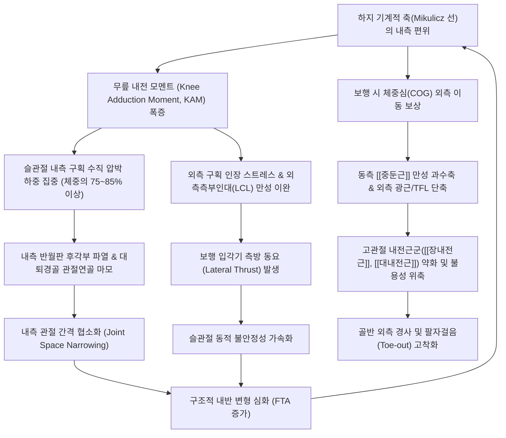

# 🩺 [[내반슬]] (Genu Varum / 膝內反 / O자 다리, ICD-10: M21.16, Q68.5)

> **핵심 3줄 요약 (Key Summary)**:
> - 📍 병소 부위 & 해부·병태생리: 양측 족관절 내과(Medial malleolus)를 밀착시키고 기립했을 때 양 슬관절 내측 과(Medial condyle)가 맞닿지 않고 외측으로 활처럼 벌어지는 하지 관상면 정렬 이상. 체중 부하선(Mechanical axis / Mikulicz 선)이 무릎 중심에서 내측으로 심하게 편위되어 무릎 내전 모멘트(KAM)가 폭증하고 내측 대퇴경골 구획에 하중의 75~85% 이상이 집중됨.
> - 🚩 전형적 임상 양상 & 3대 징후: 계단 하강 및 체중 부하 시 슬관절 내측 관절열극 통증, 보행 입각기 시 무릎이 외측으로 튕겨 나가는 측방 동요(Lateral thrust), 내측 반월판 파열 및 [[퇴행성 슬관절염]]의 조기 가속(정상 대비 4배 이상 위험 폭증). 과간 거리(ICD) > 5.0cm 시 중증 병적 내반으로 판정.
> - 🛠️ 핵심 감별 검사 & 한·양방 다각적 치료 전략: 하지 전장 방사선(Full-leg standing AP) 상 FTA > 180° 및 MPTA < 85° 계측, 슬관절 내반 스트레스 검사(Varus stress test); 대퇴-경골 관절 외측 활주 및 회전 정복 추나, 내측광근(VMO) 선택적 전침 촉진, 신바로약침 및 외측 쐐기 안창(Lateral wedge insole) 처방; 소아 블라우트병(Blount disease) 및 진행성 관절염에 대한 근위 경골 절골술(HTO) 협진.
> - <font color="#fa7e7e">⚠️ 응급 의뢰 레드플래그 & 악화 요인: 시중의 'O다리 강제 묶기 교정 밴드'는 비골두를 지나는 심비골신경을 압박하여 족하수(Foot drop) 및 슬개대퇴 연골 손상을 초래하므로 절대 금기; 만 2세 이후 편측성으로 급격히 악화되는 소아 내반슬은 블라우트병 의심 하에 즉각 정형외과 전원 필요.</font>

---

## 📌 목차
1. [질환 개요 & 해부학적 병태생리](#1-질환-개요--해부학적-병태생리)
2. [병태생리 메커니즘 & 생체역학적 악순환 네트워크](#2-병태생리-메커니즘--생체역학적-악순환-네트워크)
3. [임상 증상 & 이학적 검사(Physical Exam) 알고리즘](#3-임상-증상--이학적-검사physical-exam-알고리즘)
4. [감별 진단 매트릭스 (Differential Diagnosis)](#4-감별-진단-매트릭스-differential-diagnosis)
5. [한의 통합 치료 프로토콜 (침·약침·추나·한약)](#5-한의-통합-치료-프로토콜-침약침추나한약)
6. [양방 치료 & 병용·의뢰 기준 (Conventional Treatment & Referral)](#6-양방-치료--병용의뢰-기준-conventional-treatment--referral)
7. [재활 운동 & 생활습관 티칭 가이드](#7-재활-운동--생활습관-티칭-가이드)
8. [💡 사용자 진료실 핵심 필기 & 임상 노하우 (Melt-In 잔여 심화 집약)](#8--사용자-진료실-핵심-필기--임상-노하우-melt-in-잔여-심화-집약)
9. [출처 및 현대 학술 연구 요약 (References)](#9-출처-및-현대-학술-연구-요약-references)

---

## 1. 🩺 질환 개요 & 해부학적 병태생리

### 1) 개념 정의 및 하지 정렬 지표 (대퇴경골각 & 기계적 축)
[[내반슬]](Genu Varum, 휜다리, O자 다리, Bowlegs)은 양측 발목 안쪽 복사뼈(내과, Medial malleolus)를 맞닿게 모으고 똑바로 섰을 때, 대퇴골(Femur)과 경골(Tibia)의 기능적 축이 바깥쪽으로 꺾여 양 무릎 내측 과(Medial femoral condyle) 사이에 틈이 생기고 다리가 바깥쪽으로 활 모양(Bow)으로 휘어지는 하지 관상면 정렬 기형(Coronal plane alignment deformity)입니다.

인체 하지 정렬의 정량적 평가를 위한 핵심 해부학적 축과 각도는 다음과 같습니다:
1. **해부학적 대퇴경골각 (Anatomical Femorotibial Angle, aFTA / FTA)**:
   - 대퇴골 간부의 중심선과 경골 간부의 중심선이 교차하여 이루는 외측 각도.
   - 정상 성인은 약 $173^\circ \sim 175^\circ$ (즉, $5^\circ \sim 7^\circ$의 생리적 외반 상태)를 형성합니다.
   - [[내반슬]]에서는 이 외측 각도가 증가하여 **$180^\circ$ 이상**(직선 또는 내반)으로 역전됩니다.
2. **기계적 축 (Mechanical Axis / Mikulicz Line)**:
   - 체중 부하의 중심선으로, 대퇴골두(Femoral head)의 기하학적 중심에서 족관절 거골(Talus)의 중심을 직선으로 연결한 가상선.
   - **정상 상태**: 미쿨리츠 선은 슬관절 과간 융기(Intercondylar eminence)의 정중앙 또는 약간 내측(약 4±2mm 내측)을 통과합니다.
   - [[내반슬]] 상태**: 기계적 축이 무릎 관절 중심에서 **내측으로 심하게 이탈(Medial deviation)**합니다. 이탈 거리가 경골 고평부 전체 폭의 25% 이상 내측으로 벗어나면 중증 내반 변형으로 간주됩니다.
3. **근위 경골 내측각 (Medial Proximal Tibial Angle, MPTA)**:
   - 경골의 기계적 축과 경골 고평부 관절면이 이루는 내측 각도.
   - 정상치는 $87^\circ \pm 3^\circ$이며, 내반슬에서는 $85^\circ$ 미만으로 감소합니다.
4. **외측 원위 대퇴각 (Mechanical Lateral Distal Femoral Angle, mLDFA)**:
   - 대퇴골 기계적 축과 원위 대퇴 관절면이 이루는 외측 각도로 정상치는 $87^\circ \pm 3^\circ$입니다. 대퇴골성 내반 변형이 존재할 경우 $90^\circ$ 이상으로 증가합니다.

```
[하지 기계적 축(Mikulicz 선)과 무릎 정렬 비교]

       정상 정렬 (Normal Valgus: 5~7°)              내반슬 (Genu Varum / O다리)
       
           (대퇴골두 중심)                              (대퇴골두 중심)
                 o                                           o
                /                                            |
               /  대퇴골                                     |  대퇴골 (외측 만곡)
              /                                              |
      [무릎 중심 통과] ── o                                   | ──> [무릎 중심에서
             /     (경골)                                    |      내측으로 심한 이탈]
            /                                                |
           o (거골 중심)                                     o (거골 중심)
      하중 분산: 내측 60% : 외측 40%                 하중 집중: 내측 85% 이상 과부하!
```

### 2) 연령별 생리적 하지 정렬 발달 주기 (Developmental Timeline)
소아의 하지 정렬은 출생부터 성인에 이르기까지 일정한 생리적 변화 주기를 거칩니다. 이를 명확히 이해해야 정상적인 발달 단계와 치료가 필요한 병적 내반슬을 정확히 감별할 수 있습니다:
- **신생아 ~ 만 1.5세 (18개월)**: **생리적 내반슬 (Physiologic Genu Varum)**. 자궁 내 태아 체위(Intrauterine packing)의 영향으로 모든 영아는 약 $10^\circ \sim 15^\circ$의 내반 정렬을 나타내며, 이는 정상 발달 과정입니다.
- **만 1.5세 ~ 2세**: 직립 보행을 시작하면서 내반 각도가 서서히 펴져 중립 정렬($0^\circ$)로 이행합니다.
- **만 2세 ~ 4세**: **생리적 외반슬 (Physiologic Genu Valgum)**. 과보상 작용으로 인해 다리가 X자 형태로 휘어지며, 만 3~4세경 최대 외반($10^\circ \sim 12^\circ$)을 기록합니다.
- **만 6세 ~ 7세**: 생리적 외반이 점진적으로 감소하여 성인의 정상 하지 정렬(약 $5^\circ \sim 7^\circ$ 외반)로 최종 안정화됩니다.
- **병적 내반슬의 경고 신호**: 만 2세(24개월) 이후에도 O자 다리가 펴지지 않고 오히려 심해지거나, 비대칭적으로 한쪽 다리만 휘어지는 경우, 혹은 과간 거리(ICD)가 5cm를 초과하는 경우에는 즉시 병적 내반슬에 대한 정밀 검사가 요구됩니다.

### 3) 무릎 관절의 구획별 해부학적 구조물

#### (1) 내측 구획 (Medial Compartment - 만성 압박 및 마모 구획)
- **대퇴골 내과 및 경골 내측 고평부 (Medial Femoral & Tibial Condyle)**: 체중 부하선의 내측 편위로 단위 면적당 가해지는 수직 압축 응력이 기하급수적으로 폭증합니다. 관절 연골의 기질 단백질 분해와 연골하 골경화(Subchondral sclerosis), 골극(Osteophyte) 형성이 유발됩니다.
- **내측 반월판 (Medial Meniscus)**: 외측 반월판에 비해 관절낭 및 내측측부인대에 단단히 고정되어 있어 가동성이 적습니다. 내반 변형에 의해 가해지는 과도한 전단 압박으로 인해 특히 **후각부(Posterior horn)의 수평 파열, 방사형 파열 및 퇴행성 복합 파열**이 빈발합니다.
- **거위발건 복합체 (Pes Anserinus Complex)**: [[봉공근]](Sartorius), [[박근]](Gracilis), [[반건양근]](Semitendinosus)의 3개 건이 경골 조면 내측에 부착하는 구조물로, 슬관절 내측 정렬이 무너질 때 비정상적인 견인 장력을 받아 2차적 거위발 점액낭염(Pes anserine bursitis)을 일으킵니다.

#### (2) 외측 구획 (Lateral Compartment - 만성 인장 및 이완 구획)
- **외측측부인대 (Lateral Collateral Ligament, LCL)**: 대퇴골 외과에서 비골두로 이어지는 인대로, 무릎 관절의 내번(Varus) 스트레스에 저항하는 주된 정적 안정자입니다. 내반슬 환자에서는 지속적인 신장 장력(Tension stress)을 받아 만성 미세 손상과 인대 이완증(Laxity)이 초래됩니다.
- **장경인대 (Iliotibial Band, ITB)**: [[대퇴근막장근]](TFL)과 [[대둔근]]에서 시작하여 대퇴 외측을 따라 경골 외측 Gerdy 결절에 부착합니다. 내반슬 변형 시 외측 안정성을 만회하기 위해 과도하게 수축하여 팽팽한 띠를 형성하며, 대퇴 외과와의 마찰로 인해 [[장경인대 증후군]](ITBS)을 유발합니다.
- **대퇴이두근건 (Biceps Femoris Tendon) & 비골신경 (Common Peroneal Nerve)**: 비골두 주변을 감아 도는 총비골신경은 외측 관절 간격이 벌어지고 연부조직이 긴장될 때 견인 손상 및 압박 위험에 노출됩니다.

#### (3) 슬개대퇴 관절 (Patellofemoral Joint)
- Q-각의 감소로 인해 슬개골이 정상적인 대퇴 활차구(Trochlear groove)를 따라 활주하지 못하고 내측으로 편위되거나, 슬개골 내측 지대(Medial retinaculum)의 만성 단축 및 연골연화증 소인이 형성됩니다.

---

## 2. ⚡ 병태생리 메커니즘 & 생체역학적 악순환 네트워크



### 1) 무릎 내전 모멘트(KAM)의 폭증과 내측 구획 골관절염 4배 가속
인간이 보행할 때 지면을 디디는 순간 발생하는 지면반발력(Ground Reaction Force, GRF) 벡터는 슬관절의 중심 회전축보다 내측을 통과합니다. 이로 인해 무릎을 안쪽으로 꺾으려는 강력한 외부 회전력인 **무릎 내전 모멘트(Knee Adduction Moment, KAM)**가 발생합니다.

- **역학 공식**: $\text{KAM} = \text{GRF} \times d_{\text{KAM}}$ (여기서 $d_{\text{KAM}}$은 지면반발력 벡터 선과 슬관절 회전 중심 간의 수직 모멘트 암 거리).
- **정상 보행**: 정상 정렬에서도 슬관절 내측 구획이 전체 체중 하중의 약 $60\%$를 지탱하고, 외측 구획이 약 $40\%$를 지탱합니다.
- [[내반슬]] 상태**: 기계적 축이 안쪽으로 벗어날수록 $d_{\text{KAM}}$ 거리가 기하급수적으로 늘어납니다. 보행 입각기 초기(전체 입각기의 약 15~20%)와 후기(약 60%)의 피크 KAM 값이 정상인 대비 2~3배 이상으로 폭증합니다.
- **결과**: 무릎 관절에 걸리는 하중의 **$75\% \sim 85\%$ 이상이 내측 구획으로 집중**됩니다. 연골세포는 생리적 한계를 넘어서는 압박 스트레스를 받아 세포외 기질(콜라겐 및 프로테오글리칸)을 파괴하고, 연골하 골판의 미세 골절을 초래합니다.
- **Sharma et al. (2001) JAMA 랜드마크 연구 결과**: 내반 정렬을 가진 환자는 정상 정렬 무릎에 비해 내측 슬관절 골관절염(OA)의 방사선학적 진행 위험이 무려 **4.09배(OR 4.09, 95% CI 2.20~7.62)** 폭증하는 것으로 규명되었습니다.

#### (2) 보행 주기별 무릎 내전 모멘트(KAM) 및 하중 전이 특성

| 보행 주기 단계 (Gait Phase) | 정상 무릎 역학 (Normal Mechanics) | 내반슬(O다리) 병리 역학 (Varus Pathomechanics) | 임상적 증상 및 손상 조직 |
| :--- | :--- | :--- | :--- |
| **초기 접촉기 (Initial Contact / Heel Strike, 0~2%)** | 거골하관절 회외, 지면 충격이 대퇴사두근 편심 수축으로 완충 | 지면반발력이 경골 내측에 직접 충돌, 감쇠 기전 부전 | 발꿈치 착지 시 내측 관절면 충격통, 슬개하 지방체 자극 |
| **체중 수용기 (Loading Response, 2~12%)** | 슬관절 15° 굴곡, 대퇴사두근 수축 및 미약한 내전 토크 | **제1차 피크 KAM 출현** (정상치 대비 200~300% 폭증) | 외측측부인대(LCL) 급격한 신장, 외측 관절 틈새 벌어짐 |
| **중간 입각기 (Mid-Stance, 12~30%)** | 단하지 지지, 체중심이 지지발 바로 위를 통과 | **측방 동요(Lateral Thrust)** 극대화, 무릎이 외측으로 튕김 | 내측 반월판 후각부 전단 압박, [[퇴행성 슬관절염]] 연골 마모 가속 |
| **말기 입각기 (Terminal Stance, 30~50%)** | 고관절 신전 및 슬관절 완전 신전, 추진력 형성 | **제2차 피크 KAM 출현**, 대퇴골-경골 비틀림 토크 집중 | 거위발건 복합체 견인통, 비골신경 기계적 스트레스 |
| **전 유각기 (Pre-Swing / Toe-off, 50~60%)** | 족저굴곡근 수축으로 도약, 슬관절 40° 굴곡 | 팔자걸음(Toe-out)에 의한 외회전 전단력 지속 | 엄지발가락 밀기 시 비정상 외측 체중 쏠림 |
| **유각기 (Swing Phase, 60~100%)** | 하지 자유 흔들림, 슬관절 최대 60° 굴곡 | 발이 안쪽으로 걸리는 것 방지하기 위한 보상적 외전 휘돌림 보행 | 고관절 외전근 피로, 에너지 소모량 25~30% 증가 |

### 2) 외측 지지 복합체의 만성 인장 손상과 측방 동요(Lateral Thrust)
내측 구획이 압박을 받아 찌그러지는 동안, 슬관절 외측부는 반대로 강력한 인장력(Tension force)을 받아 관절이 벌어지는 응력을 받습니다:
- **LCL 및 관절낭 이완**: 외측측부인대와 후외측 관절낭 복합체(PLC)가 만성적으로 늘어나 탄성 복원력을 상실합니다.
- **측방 동요 (Lateral Thrust)**: 보행 입각기 초기(Heel strike에서 Mid-stance)에 체중이 실리는 순간, 외측 인대가 지탱해 주지 못해 무릎 관절이 바깥쪽으로 튕겨 나갔다가 돌아오는 동적 불안정성 현상입니다. 측방 동요가 출현한 내반슬은 관절염의 파괴적 진행 속도가 2~3배 더 빨라집니다.

### 3) 키네틱 체인(Kinetic Chain)의 두 가지 발생 경로: 족관절 vs 고관절

#### (1) 상행성 사슬 (Ascending Chain: 족관절/발 기원)
- **과회내 보상형 (Foot Overpronation Pattern)**:
  - 거골하관절(Subtalar joint)의 과도한 회내(외번, 외전, 배굴) $\rightarrow$ 거골 하강 및 내측 전위 $\rightarrow$ [[경골]]의 보상적 내회전(Internal tibial torsion) 발생.
  - 내회전된 경골에 맞물려 대퇴골도 내회전되지만, 보행 시 발이 안쪽으로 쏠리는 것을 막고 기저면을 확보하기 위해 신체는 고관절을 외전(Abduction)시키는 보상 작용을 취합니다.
  - 그 결과 겉보기에 무릎 사이가 바깥으로 벌어지는 기능적 O자 다리([[내반슬]])가 형성됩니다.
- **팔자걸음 외회전형 (Toe-Out Pattern)**:
  - 보행 시 발끝을 바깥으로 넓게 벌리는 팔자걸음은 경골에 지속적인 외회전 토크를 가합니다.
  - 이에 대항하여 무릎을 안쪽으로 닫아주는 고관절 내전근군의 근력이 부족할 때, 슬관절은 관상면 외측으로 활처럼 휘어지며 고착화됩니다.

#### (2) 하행성 사슬 (Descending Chain: 골반/고관절 기원)
- **골격적 변형 소인**: [[외반고]](Coxa Valga, 대퇴경체각 $>135^\circ$) 또는 [[대퇴후념]](Femoral Retroversion)이 존재하는 경우, 대퇴골두가 전외측을 향하므로 대퇴골 전체가 외회전 및 외전 위치로 편위되어 무릎 사이를 벌어지게 만듭니다.
- **근육 불균형 패턴**:
  - **단축·과긴장군**: 고관절 외전근군([[대퇴근막장근]], [[대퇴이두근]], [[외측광근]]) 및 외회전근군([[대둔근]], [[이상근]]).
  - **약화·신장군**: 고관절 내전근군([[장내전근]], [[단내전근]], [[대내전근]], [[박근]]) 및 슬관절 내측 안정화 근육인 **내측광근(VMO)**, [[장요근]].
  - 단축된 외측 근막이 대퇴골을 바깥으로 잡아당기고, 약화된 내전근이 이를 제어하지 못하면서 O다리 변형이 만성화됩니다.

#### (3) 보행 시 체중심 외측 이동과 중둔근 피로의 악순환
내반슬 환자는 보행 입각기에서 체중 중심선이 무릎 내측으로 지나치게 치우치기 때문에 넘어지지 않으려는 본능적 방어 기전이 작동합니다:
- 신체는 상체를 지지하는 디딤발 쪽으로 기울이고(Lateral trunk lean), 동측 [[중둔근]](Gluteus medius)을 과도하게 수축시켜 체중심(Center of gravity)을 외측으로 강하게 끌어당깁니다.
- 체간을 외측으로 기울이면 무릎 중심에 대해 지면반발력 작용선이 상대적으로 외측으로 이동하여 유효 모멘트 암($d_{\text{KAM}}$)을 줄여주는 장점이 있지만, 그 대가로 중둔근에 엄청난 피로성 과부하가 걸립니다.
- 이로 인해 내반슬 환자는 둔부 외측의 만성적인 통증과 피로감을 호소하게 되며, **중둔근의 발통점(TrP) 형성 및 긴장성 요통, 천장관절염**이 연쇄 유발됩니다.

---

## 3. 🔍 임상 증상 & 이학적 검사 알고리즘

### 1) 주요 임상 증상
- **슬관절 내측 관절열극 통증**: 보행 시, 계단을 내려갈 때, 오래 서 있을 때 무릎 안쪽 관절면을 따라 쑤시고 욱신거리는 통증.
- **관절 뻣뻣함 및 시작통 (Morning Stiffness & Start-up Pain)**: 아침에 일어나 첫 발을 디딜 때 무릎이 굳어 있다가 조금 움직이면 풀리는 퇴행성 관절염 초기 증상.
- **보행 시 불안정감 및 측방 동요**: 환자 표현: *"걸을 때마다 무릎이 바깥쪽으로 덜컹거리거나 튕겨 나가는 느낌이 든다."*
- **외측 연부조직 긴장통**: 대퇴 외측 장경인대 주행부를 따라 뻐근한 당김 및 비골두 주변의 둔통.
- **외형적 콤플렉스 및 바지 핏 변형**: 양 무릎 사이가 벌어져 치마나 바지를 입었을 때 바깥 라인이 휘어져 보이며, 신발 뒤축의 외측이 비정상적으로 빨리 마모됨.

### 2) 과간 거리(Intercondylar Distance, ICD) 측정 및 중증도 등급 분류
환자를 바르게 세우고 양측 족관절 내과(Medial malleolus)를 가볍게 맞닿게 밀착시킨 상태에서, 양측 대퇴골 내과(Medial femoral condyle) 사이의 최단 거리를 줄자로 측정합니다:

| 등급 (Grade) | 과간 거리 (ICD) | 임상적 소견 및 병태 | 치료 및 관리 가이드 |
| :--- | :--- | :--- | :--- |
| **1등급 (Grade I, 경도)** | **$< 2.5\text{ cm}$**<br>(손가락 1마디 미만) | 기능적 근육 불균형 위주, 관절염 소견 없음. 보행 피로감 경미 | 한의 추나 요법, 내전근 및 VMO 강화 운동, 보행 교육 |
| **2등급 (Grade II, 중등도)** | **$2.5 \sim 5.0\text{ cm}$**<br>(손가락 2마디 내외) | 인대 이완 동반, 보행 시 무릎 피로 및 내측 관절선 둔통 출현 | 침·약침 치료, 대퇴-경골 관절 교정 추나, 외측 쐐기 안창 고려 |
| **3등급 (Grade III, 중증)** | **$> 5.0\text{ cm}$**<br>(손가락 3마디 이상) | **구조적 골 변형 확정**, 내측 반월판 파열 및 관절염 동반, 측방 동요 뚜렷 | 정형외과 X-ray 전장 검사, 근위 경골 절골술(HTO) 적응증 평가 병행 |

### 3) 단계별 이학적 검사(Physical Exam) 알고리즘

```
[내반슬 정밀 이학적 검사 알고리즘]

1. 입각기 및 기립 정렬 평가 (Standing Inspection)
   ├─ 족관절 내과 밀착 후 양 무릎 과간 거리(ICD) 계측 ──> Grade I~III 판정
   └─ 보행 분석: 입각기 측방 동요 (Lateral Thrust) 유무 관찰
       │
2. 슬관절 인대 안정성 평가 (Ligamentous Stress Test)
   ├─ 내반 스트레스 검사 (Varus Stress Test, 0° & 30° 굴곡) ──> 외측측부인대(LCL) 이완 판정
   └─ 전·후방 십자인대 검사 (Lachman & Sag sign) ──> 복합 불안정성 감별
       │
3. 반월판 손상 유발 검사 (Meniscal Provocation)
   ├─ 맥머레이 검사 (McMurray Test) ──> 경골 내/외회전 시 내측 관절선 클릭음 및 통증
   └─ 애플리 압박 검사 (Apley Grind Test) ──> 복와위 압박 시 통증 확인
       │
4. 키네틱 체인 회전 평가 (Rotational & Torsion Assessment)
   ├─ Q-각 (Q-angle) 측정 ──> < 10° (내반 변형 반영)
   ├─ Craig's Test ──> 대퇴골 전념/후념각 평가
   └─ 발 진행각 (Foot Progression Angle) ──> 과회내 및 팔자걸음 평가
```

#### (1) 내반 스트레스 검사 (Varus Stress Test)
- **검사 방법**:
  - 환자를 앙와위로 눕히고, 시술자는 한 손으로 환자의 슬관절 내측을 지지하고 다른 손으로 족관절 외측을 파지합니다.
  - **슬관절 $30^\circ$ 굴곡 상태**: 족관절을 안쪽으로 당기며 무릎에 내번(Varus) 스트레스를 가합니다. 이때 대퇴사두근과 후방 십자인대의 간섭이 배제되어 **순수한 외측측부인대(LCL)**의 이완 및 통증 유발을 평가할 수 있습니다.
  - **슬관절 $0^\circ$ 완전 신전 상태**: 동일하게 내번 스트레스를 가합니다. 이때 외측 관절 간격이 벌어진다면 LCL뿐만 아니라 후외측 관절낭 복합체(PLC) 및 십자인대까지 손상된 중증 복합 불안정성을 의미합니다.

#### (2) [[맥머레이 검사]](McMurray Test)
- **검사 방법**: 환자의 고관절과 슬관절을 최대로 굴곡시킨 상태에서, 경골을 외회전시키면서 무릎을 서서히 신전시킵니다.
- **양성 반응**: 내측 관절열극에서 툭 하는 탄발음(Clicking sound)과 함께 날카로운 통증이 유발되면 **내측 반월판 파열**을 확진합니다.

#### (3) Q-각 (Quadriceps Angle, Q-angle) 측정
- ASIS와 슬개골 중심을 잇는 선, 그리고 슬개골 중심과 경골 조면(Tibial tuberosity)을 잇는 선이 교차하는 각도.
- 정상치는 남성 $10^\circ \sim 14^\circ$, 여성 $15^\circ \sim 18^\circ$입니다.
- [[내반슬]]에서는 경골 조면이 내측으로 이동하여 Q-각이 $10^\circ$ 미만으로 감소**하거나 음수각으로 전환됩니다.

### 4) 영상의학적 정밀 진단 기준 (하지 전장 방사선 Telos / Scanogram)
- **체중부하 하지 전장 방사선 사진 (Full-Leg Standing AP)**:
  - 환자가 양 발에 동일하게 체중을 싣고 선 상태에서 골반부터 발목까지 한 번에 촬영하는 필수 검사입니다.
  - **기계적 축 편위 (Mechanical Axis Deviation, MAD)**: 미쿨리츠 선이 경골 고평부 중앙에서 내측으로 몇 mm 이탈했는지 계측합니다.
  - **대퇴경골각 (FTA)**: $> 180^\circ$ 시 구조적 내반슬 확진.
  - **관절 간격 협소화 (Joint Space Narrowing)**: 방사선상 내측 대퇴경골 관절 간격이 $3\text{ mm}$ 이하로 좁아지거나 연골하 골경화가 관찰되면 Kellgren-Lawrence(KL) grade II 이상의 골관절염으로 판정합니다.

---

## 4. 🔀 감별 진단 매트릭스 (Differential Diagnosis)

| 감별 질환 | 호발 연령 및 주요 병인 | 병태생리 및 임상 양상 | 방사선학적 특징 (X-ray) | 치료 원칙 |
| :--- | :--- | :--- | :--- | :--- |
| **성인 [[내반슬]] (퇴행성 Genu Varum)** | 40~70대 성인, 노화 및 기계적 과부하 | 체중 부하 시 내측 통증, 측방 동요, 보행 피로 | **FTA > 180°**, 내측 관절 간격 협소, 골극 형성 | 한의 침·약침·추나 보존 치료, 외측 쐐기 안창, 절골술(HTO) |
| **소아 생리적 내반슬 (Physiologic Varum)** | 생후 6개월 ~ 만 2세 미만 영유아 | **대칭적 만곡**, 통증 없음, 정상 발달 과정 | 완만한 대퇴-경골 만곡, 성장판 정상 | **치료 불필요 (경과 관찰)**, 만 2~3세경 자연 호전 |
| **블라우트병 (Blount Disease / 경골 내반)** | 유아기형(1~3세 비만아) 또는 청소년기형(8~15세) | **비대칭적 급격한 악화**, 경골 근위 내측 골성 돌출 촉진 | **근위 경골 골간단 내측 함몰 및 쐐기형 붕괴** (랑겐스키욀드 병기) | 보존 치료 불가, **정형외과 즉각 의뢰** (성장판 감압/절골술) |
| **구루병 (Rickets / 골연화증)** | 소아 영양 결핍(비타민 D), 유전성 저인산혈증 | 양측성 심한 O다리, 손목·발목 뼈 비후, 성장 지연 | 성장판 확장, 골간단 술잔 모양(Cupping) 및 술 장식 변형 | 소아과 대사 치료 (비타민 D 및 칼슘 투여), 보조기 |
| [[외반슬]] (Genu Valgum / X다리)** | 만 3~4세 소아 과보상 또는 성인 골관절염 외측형 | 양 무릎이 맞닿고 발목 사이가 벌어짐 (과간 거리 대신 과간 발목 거리 측정) | **FTA < 170°**, 외측 관절 구획 압박 마모 | 내측 쐐기 안창, 고관절 외전근 강화 |
| **외측측부인대 (LCL) 만성 단독 파열** | 외상 병력 있는 성인 (스포츠 손상) | 내번 외상 후 외측 불안정감, 보행 시 무릎 꺾임 | 골격 자체는 정상, **스트레스 X-ray 상 외측 관절 열림** | 인대 재건술 또는 인대 증식 약침 요법 |

---

## 5. 🌿 한의 통합 치료 프로토콜

### 1) 침구 치료 (Acupuncture) & 전침 치료

#### (1) 타겟 해부학적 부위별 경혈 배합 및 자침 수기
- **슬관절 내측 구획 소염 및 관절강 감압**:
  - **곡천(LR8)**: 반막양근과 반건양근 건 내측 함요처. 1.0~1.5치 직자하여 내측 반월판 후각부 인접 조직 순환 촉진.
  - **음릉천(SP9)**: 경골 내측 과 하연 함요처. 1.0~1.5치 직자하여 관절강 내 삼출물 흡수 및 활액막염 완화.
  - **내측 슬안 (내독비, Extra point)**: 슬개인대 내측 함요처. $45^\circ$ 상향 사자(1.0치)하여 과간 절흔 방향으로 유침.
- **외측 긴장근군 이완 (TFL, ITB, 외측광근)**:
  - **풍시(GB31) & 중독(GB32)**: 대퇴 외측 장경인대 후연. 1.5~2.0치 심자하여 팽팽해진 ITB의 신경근 긴장을 이완.
  - **양릉천(GB34 - 근회혈)**: 비골두 전하방 함요처. 1.5치 직자하여 총비골신경 포착을 감압하고 하지 전체 근건 이완.
- **약화된 내측광근(VMO) 및 내전근군 활성화 (신경근 재교육)**:
  - **혈해(SP10)**: 슬개골 내상연 상방 2치, 내측광근 융기부. 1.0~1.5치 직자.
  - **음포(LR9) & 족오리(LR10)**: 대퇴 내측 내전근 주행부. 1.5치 직자하여 위축된 내전근의 근력 복원.
- **둔부 골반 안정화 경혈**:
  - **환도(GB30) & 질변(BL54)**: 만성 보행 보상으로 과긴장된 [[중둔근]] 및 이상근의 트리거포인트 자침.

#### (2) 전침(Electroacupuncture) 주파수 특화 세팅
- **내측광근 및 내전근 복합체 (혈해-음포)**: **2Hz 저주파 지속파(Continuous wave)**를 20분간 적용. 근섬유의 리드미컬한 등척성 수축을 유도하여 내측광근의 신경근 점화율(Firing rate)을 높이고 위축된 근육을 재건합니다.
- **외측 장경인대 복합체 (풍시-양릉천)**: **2/100Hz 혼합파(Dense-disperse wave)**를 15분간 적용. 단축된 근막 긴장을 효과적으로 해소합니다.

### 2) 약침 치료 (Pharmacopuncture)

| 약침 종류 | 시술 부위 및 경혈 | 주입 용량 | 치료 기전 및 임상 효과 |
| :--- | :--- | :--- | :--- |
| **신바로약침 (GCSB-5)** | 내측 관절열극, 내측 반월판 부착부, 음릉천, 곡천 | 부위당 0.5~1.0cc (총 2.0~3.0cc) | COX-2 및 iNOS 발현 억제를 통한 강력한 항염 진통, 연골세포 사멸 억제 및 프로테오글리칸 분해 차단 |
| **자하거 (Hominis Placenta) 약침** | 외측측부인대(LCL) 부착부, 비골두, 대퇴외과 | 부위당 0.5cc (총 1.0~1.5cc) | 지속적인 인장으로 느슨해진 LCL에 섬유아세포 증식 및 제1형 콜라겐 합성을 촉진하는 인대 강화(Prolotherapy) 효과 |
| **봉약침 (Bee Venom, BV)** | 거위발건 점액낭염 부착부, 내측 슬안 심부 | 0.1~0.3cc (피내/피하 점적) | 만성적인 신경성 염증 완화 및 국소 미세혈관 확장으로 만성 삼출액 흡수 촉진 |

### 3) 추나 요법 (Chuna Manual Therapy)

#### (1) 대퇴-경골 관절 외측 활주 교정 추나 (Tibiofemoral Lateral Glide Mobilization)
- **자세**: 환자는 앙와위로 눕고 무릎을 약 $20^\circ \sim 30^\circ$ 굴곡시킵니다.
- **시술법**: 시술자는 한 손으로 대퇴골 원위부 외측을 단단히 고정하고, 다른 손의 수근부로 경골 근위부 내측을 접촉합니다. 호흡 이완에 맞춰 경골을 내측에서 외측 방향(Lateral direction)으로 부드럽게 활주시킵니다(Grade III Mobilization, 10~15회).
- **목적**: 내측으로 찌그러진 경골 고평부 정렬을 외측으로 복원하여 내측 관절 간격을 넓히고 전단 압박을 해소합니다.

#### (2) 경골 회전 정복 추나 (Tibial Torsion Correction Technique)
- 대퇴골에 대해 경골이 내회전되어 있는 경우, 족관절을 잡고 경골을 부드럽게 외회전시키면서 무릎을 신전시키는 관절가동기법을 적용하여 회전 변위를 교정합니다.

#### (3) 대퇴근막장근-장경인대(TFL-ITB) 근막 이완 (JS 수기 / IASTM)
- 환자를 측와위로 눕히고 대퇴 외측을 따라 단축된 장경인대와 외측광근 사이의 근막 유착부를 장골능에서 비골두까지 수근 압박 및 근막 신장 수기로 이완합니다.

### 4) 한약 치료 (변증 처방)

#### (1) 풍한습비(風寒濕痺) 및 습열저체(濕熱沮滯)형
- **임상 양상**: 무릎 내측이 붓고 열감이 있으며, 비가 오거나 날씨가 흐리면 관절이 무겁고 시리며 계단 보행이 극도로 고통스러운 급성 악화기.
- **대표 처방**: [[독활기생탕]](獨活寄生湯)** 합 [[오적산]](五積散)**
  - *구성*: 독활, 상기생, 방풍, 진교, 복령, 당귀, 백작약, 천궁, 숙지황, 두충, 우슬, 마황, 백지, 창출, 후박, 길경, 지각, 건강, 육계, 반하, 진피, 감초.
  - *기전*: 관절강 내 정체된 수습(水濕)과 염증성 활액을 배출하고 풍한(風寒) 사기를 몰아내어 부종과 관절 조조강직을 해소합니다.

#### (2) 간신휴허(肝腎虧虛) 및 골절퇴행(骨節退行)형
- **임상 양상**: 50대 이후 만성 내반슬 환자로서 무릎에 힘이 빠지고 다리가 후들거리며, 방사선상 뚜렷한 연골 마모와 골극 형성을 보이는 만성기.
- **대표 처방**: [[숙지양근탕]](熟地養筋湯)** 또는 [[보간환]](補肝丸)**
  - *구성*: 숙지황, 당귀, 백작약, 천궁, 산수유, 산약, 두충, 파극, 속단, 구척, 황기, 우슬.
  - *기전*: 간신(肝腎)을 자보(滋補)하여 근맥을 자양하고 연골하 골소주 재생을 도와 관절 변형의 가속화를 차단합니다.

---

## 6. 💊 양방 치료 & 병용·의뢰 기준

### 1) 보존적 치료 및 약물·보조기 요법
- **약물 치료**:
  - NSAIDs 경구 투여: Celecoxib, Pelubiprofen, Loxoprofen.
  - 연골 보호제: Glucosamine sulfate, Chondroitin, Diacerein.
- **관절강 내 주사 요법**:
  - 교차결합 히알루론산(Synvisc-One 등) 관절강 내 주입: 충격 흡수 및 점탄성 회복.
  - 폴리뉴클레오티드(PN, 콘쥬란) 관절강 주사: 연골 표면 완충 및 마찰 계수 감소.
- **보조기 및 인솔 요법 (Orthotics)**:
  - **외측 쐐기 안창 (Lateral Wedge Insole)**:
    - 신발 깔창의 외측 부위를 **$5^\circ \sim 8^\circ$ (약 5~8mm)가량 높여 제작**합니다.
    - 보행 시 발의 외번(Eversion)을 유도하여 지면반발력 선을 외측으로 이동시킴으로써, **무릎 내전 모멘트(KAM)를 $10\% \sim 15\%$ 즉각적으로 감소**시킵니다.
  - **외반 부하 완화 보조기 (Unloader Varus Brace)**: 외측 힌지에 3점 지지 외반 토크를 가하여 내측 구획을 물리적으로 벌려주는 보조기.

### 2) 정형외과적 수술 치료 (HTO & Arthroplasty)

#### (1) 근위 경골 절골술 (High Tibial Osteotomy, HTO)
- **적응증**:
  - 65세 이하의 활동적인 환자.
  - 내측 구획에 국한된 퇴행성 골관절염 (KL grade II~III).
  - 굴곡 구축 $< 10^\circ$, 외측 구획 연골 및 십자인대가 정상 보존된 경우.
- **술식**:
  - **내측 개방형 절골술 (Medial Open-Wedge HTO)**: 근위 경골 내측 피질골을 절개하여 벌린 후 금속판으로 고정하고 자가골/인공골을 이식.
  - **목표**: 체중 부하선을 경골 고평부 중앙에서 **외측 62.5% 지점(Fujisawa point)**으로 이동시켜 체중의 대부분을 건강한 외측 구획으로 전달시킵니다.

#### (2) 인공 슬관절 치환술 (Knee Arthroplasty)
- **단일 구획 치환술 (Unicompartmental Knee Arthroplasty, UKA)**: 손상된 내측 구획만 인공관절로 교체.
- **전치환술 (Total Knee Arthroplasty, TKA)**: 70세 이상 고령 환자에서 관절 전 구획의 파괴와 중증 골 결손이 동반된 말기 내반슬.

### 3) 정형외과 전문의 의뢰 기준 (Referral Criteria)

```
[내반슬 정형외과 의뢰 필수 트리거]

🚨 즉각 전원 의뢰:
   1. 소아(만 1~4세)에서 편측성으로 급격히 다리가 휘며 경골 내측 결절이 촉진되는 경우
      └─ 블라우트병 (Blount disease) 의심: 보존 치료 불가, 조기 수술 필요
   2. 급성 외상 후 슬관절 내반 스트레스 검사 시 $0^\circ$에서 외측이 심하게 벌어지는 경우
      └─ 외측측부인대(LCL) 및 후외측 관절낭 복합체(PLC) 완전 파열

⚠️ 전문과 정밀 검사 의뢰:
   1. 과간 거리(ICD) > 5.0cm 이상의 중증 골격 변형
   2. 보행 시 뚜렷한 측방 동요(Lateral thrust)와 함께 관절 붕괴 불안정성을 호소하는 경우
   3. 한의 보존 치료 및 외측 쐐기 안창 적용 3~6개월 후에도 내측 통증이 지속되는 65세 이하 활동기 환자 (HTO 평가)
   4. 방사선상 Kellgren-Lawrence grade IV (골간 완전 골유합 및 심한 골극)
```

---

## 7. 🏃 재활 운동 & 생활습관 티칭 가이드

### 1) 타겟 근육 단계별 교정 재활 운동

```
[내반슬 맞춤형 재활 운동 3단계]

1단계: 내측광근(VMO) 고립 활성화 & 외측 근막 이완
   └─ 숏 아크 쿼드 (Short-Arc Quad) + 폼롤러 ITB 이완
       │
2단계: 고관절 내전근 및 둔근 협응 강화
   └─ 볼 스퀴즈 브릿지 (Ball-Squeeze Bridge) + 수건 조이기
       │
3단계: 기능적 닫힌 사슬 하지 정렬 통합 훈련
   └─ 밴드 저항 터미널 니 익스텐션 (TKE) + 11자 스쿼트
```

#### (1) 내측광근(VMO) 특화 훈련: 터미널 니 익스텐션 (Terminal Knee Extension, TKE)
- 기둥이나 문고리에 탄력 밴드를 걸고, 환측 무릎 뒤 오금(Popliteal fossa)에 밴드를 겁니다.
- 무릎을 약 $30^\circ$ 굴곡한 상태에서, 밴드의 저항을 이겨내며 발뒤꿈치를 바닥에 붙인 채 무릎을 완전히 펴서($0^\circ$ 신전) 대퇴사두근 내측 융기부(VMO)를 5초간 강하게 쥐어짭니다(20회씩 3세트).

#### (2) 고관절 내전근 등척성 강화: 볼 스퀴즈 브릿지 (Ball-Squeeze Bridge)
- 앙와위에서 무릎을 세우고 양 무릎 사이에 필라테스 볼 또는 미니 베개를 끼웁니다.
- 양 무릎으로 볼을 안쪽으로 강하게 조이면서(내전근 수축) 엉덩이를 천장 방향으로 들어 올려 대둔근과 햄스트링을 동시에 수축시킵니다(10초 유지, 10회 반복).

#### (3) 대퇴근막장근(TFL) 및 장경인대 폼롤러 스트레칭
- 옆으로 누워 대퇴 외측면 아래에 폼롤러를 두고, 위쪽 다리를 앞으로 교차하여 바닥을 지지합니다.
- 골반 외측 대전자 하방부터 무릎 외측 상방까지 천천히 롤링하며 단축된 외측 근막을 깊게 이완합니다.

### 2) 보행 패턴 교정: 11자 보행 훈련
- 내반슬 환자는 대부분 팔자걸음(Toe-out gait)을 걷습니다.
- 의식적으로 양측 발의 두 번째 발가락과 뒤꿈치를 연결한 선이 진행 방향과 평행을 이루는 **11자 보행**을 연습시킵니다.
- 보행 시 **뒤꿈치 착지(Heel strike) $\rightarrow$ 발바닥 외측 지지 $\rightarrow$ 엄지발가락 도약(Toe-off)**의 3단계 롤링을 의식적으로 수행하게 합니다.

### 3) 일상생활 절대 금기 및 위험 요인 경고

#### (1) ⚠️ O다리 묶기 교정 밴드의 위험성 (절대 금기)
- **시중 유행 교정 밴드의 폐해**:
  - 홈쇼핑이나 온라인에서 유행하는 '다리를 밧줄이나 밴드로 묶고 자는 교정 벨트'는 지극히 위험한 행위입니다.
  - 내반슬은 대퇴골과 경골의 입체적 비틀림(Torsion)과 관절면의 정렬 문제인데, 이를 무시하고 외부에서 강제로 무릎만 묶으면 **비골두 외측을 지나는 총비골신경(Common peroneal nerve)이 강하게 압박**됩니다.
  - 이는 신경 허혈을 유발하여 발목을 위로 들지 못하는 **족하수(Foot drop, 영구적 보행 장애)** 및 발등의 감각 마비를 일으킬 수 있으며, 슬개대퇴관절 연골에 비정상적인 압박 마찰을 주어 **슬개골 연골연화증**을 급속히 악화시킵니다.

#### (2) 좌식 문화의 개폐 (바닥 생활 금지)
- **양반다리 (가부좌, Tailor style)**: 대퇴골을 외회전시키고 슬관절 내측 관절면을 강하게 벌리며 외측 인대를 늘어나게 하므로 절대 금지.
- **무릎 꿇기 및 쪼그려 앉기**: 슬관절 내압을 8~10배 상승시켜 반월판 후각부 파열을 촉진하므로 침대, 소파, 식탁을 사용하는 완전한 입식 생활로 전환해야 합니다.

---

## 8. 💡 사용자 진료실 핵심 필기 & 임상 노하우 (Melt-In 잔여 심화 집약)

### 1) 진료실 핵심 필기 융합: 보행 시 무게중심 이동과 중둔근 피로의 연결고리
- **원장님 필기 핵심**: 내반슬 환자가 호소하는 "엉덩이 옆쪽 통증(중둔근염)"은 단순한 둔부 질환이 아니라, **O다리로 인한 보행 보상작용의 결과물**입니다.
- **역학적 기전**:
  - 내반슬 환자는 한 발로 디딜 때 체중심이 무릎 안쪽으로 심하게 쏠립니다.
  - 넘어지지 않기 위해 신체는 본능적으로 상체를 디딤발 쪽으로 기울이면서 동측 [[중둔근]]을 과도하게 수축시켜 체중심을 바깥쪽으로 끌어옵니다.
  - 따라서 O다리 환자의 중둔근은 하루 종일 과도한 신장성-단축성 수축에 시달리며 만성 트리거포인트와 허혈성 둔부통을 발생시킵니다.
- **임상 처방 팁**:
  - 이때 엉덩이 옆쪽(환도, 거료)에만 침을 놓고 끝내면 며칠 뒤 100% 재발합니다.
  - 반드시 **슬관절 내측 정렬 교정 추나 + 내전근 강화 운동**을 병행하여, 체중심이 외측으로 도망가야만 하는 생체역학적 원인 자체를 제거해주어야 중둔근 통증이 근본적으로 치료됩니다.

### 2) 발(Foot)에서 시작되는 O다리: 과회내 족부의 상행성 감별법
- 진료실에서 O다리 환자가 오면 신발을 벗기고 뒤에서 아킬레스건 라인을 관찰해야 합니다:
  - 아킬레스건이 안쪽으로 꺾여 무너져 있다면(Helbing's sign 양성), 이는 족부의 **과회내(Overpronation)로 인해 유발된 기능적 내반슬**입니다.
  - 발의 아치가 무너지며 경골이 안쪽으로 비틀리고, 이에 대항해 대퇴골이 벌어지면서 겉보기에 O다리가 된 것입니다.
  - 이 경우 무릎만 교정해서는 절대 교정되지 않으며, **족부 족궁 지지 보형물(Arch support insole) 처방과 후경골근(Tibialis posterior) 강화**를 반드시 1차 치료로 병행해야 합니다.

### 3) 소아 블라우트병(Blount Disease) vs 생리적 내반슬 감별의 '손맛' 노하우
- 소아 환자가 O다리로 내원했을 때, 한의사가 손가락 끝으로 반드시 확인해야 하는 촉진 포인트가 있습니다:
  - 경골 상단 안쪽(경골 근위 내측 골간단 부위, 음릉천 하방 1~2cm)을 엄지손가락으로 깊게 만져봅니다.
  - 정상적인 생리적 내반슬은 뼈의 윤곽이 매끄럽게 만곡을 이룹니다.
  - 그러나 만약 **경골 안쪽 뼈가 국소적으로 뾰족하게 부리처럼 튀어나와 돌출되어 만져진다면(Bony beak / Langenskiöld 징후)**, 이는 단순 O다리가 아니라 근위 경골 성장판이 비정상적으로 파괴되는 **블라우트병**입니다.
  - 이 소견이 만져지면 즉시 부모에게 설명하고 지체 없이 대학병원 소아정형외과로 전원시켜야 의료사고를 방지하고 환아의 영구 장애를 막을 수 있습니다.

---

## 9. 📚 출처 및 현대 학술 연구 요약 (References)

* **Sharma L, Song J, Felson DT, et al. (2001)**. *The role of knee alignment in disease progression and functional decline in knee osteoarthritis*. JAMA, 286(2):188-195. PMID: 11448282
  * `[연구 요약]`: 전향적 코호트 연구를 통해 내반슬(Varus alignment) 정렬이 슬관절 내측 구획 골관절염 진행 위험을 4배 이상(OR 4.09) 폭증시키고 신체 기능 저하를 가속화하는 핵심 독립 인자임을 최초로 규명한 랜드마크 연구.
* **Brouwer GM, van Tol AW, Bergink AP, et al. (2007)**. *Association between valgus and varus alignment and the development and progression of radiographic osteoarthritis of the knee*. Arthritis Rheum, 56(4):1204-1211. PMID: 17393449
  * `[연구 요약]`: 무릎의 내반 및 외반 부정렬이 슬관절 방사선학적 골관절염의 발생뿐만 아니라 질환의 구조적 악화를 유의미하게 선행 촉진함을 장기 추적 분석을 통해 실증함.
* **Sabharwal S. (2015)**. *Blount disease: an update*. Orthop Clin North Am, 46(1):37-47. PMID: 25435033
  * `[연구 요약]`: 유아기 및 청소년기 병적 내반슬의 대표 질환인 블라우트병(경골 내반)의 병태생리, 랑겐스키욀드 방사선 병기 분류, 생리적 내반슬과의 감별 진단 및 치료 최신 지견을 집대성한 종설.
* **Ramos A, Zafra J, Villalba J, et al. (2026)**. *High Tibial Osteotomy for Knee Osteoarthritis with Genu Varum: A Retrospective, Observational Study*. J Funct Morphol Kinesiol, 11(2):45-56. PMID: 41900536
  * `[연구 요약]`: 내반슬을 동반한 슬관절 골관절염 환자를 대상으로 시행한 근위 경골 절골술(HTO)의 임상적 및 방사선학적 결과를 후향적으로 분석하여, 기계적 축 교정과 내측 구획 하중 분산의 장기적 관절 보존 유효성을 입증함.
* **Chandarana M, Gupta M, Gautam D, et al. (2026)**. *A Computational Framework for Modelling Subject Specific Changes in Knee Ligaments and Tibiofemoral Contact Associated With Varus Deformity*. Int J Numer Method Biomed Eng, 42(10):e3842. PMID: 42875950
  * `[연구 요약]`: 유한요소 생체역학 전산 모델링을 통해 내반슬 변형에 따른 슬관절 인대의 장력 변화와 대퇴경골 접촉 응력 분포를 정량화함.
* **Lee SM, D'Lima D, Yun MS, et al. (2026)**. *Factors Affecting Changes in Ankle Symptoms Following Total Knee Arthroplasty for Varus Knee Osteoarthritis*. J Arthroplasty, 41(10):2410-2418. PMID: 42843683
  * `[연구 요약]`: 내반슬 골관절염 환자에서 슬관절의 내반 변형이 족관절 거골하관절의 대상성 회외/회내 변형과 족관절 통증에 미치는 상행성·하행성 키네틱 체인 영향을 분석함.
