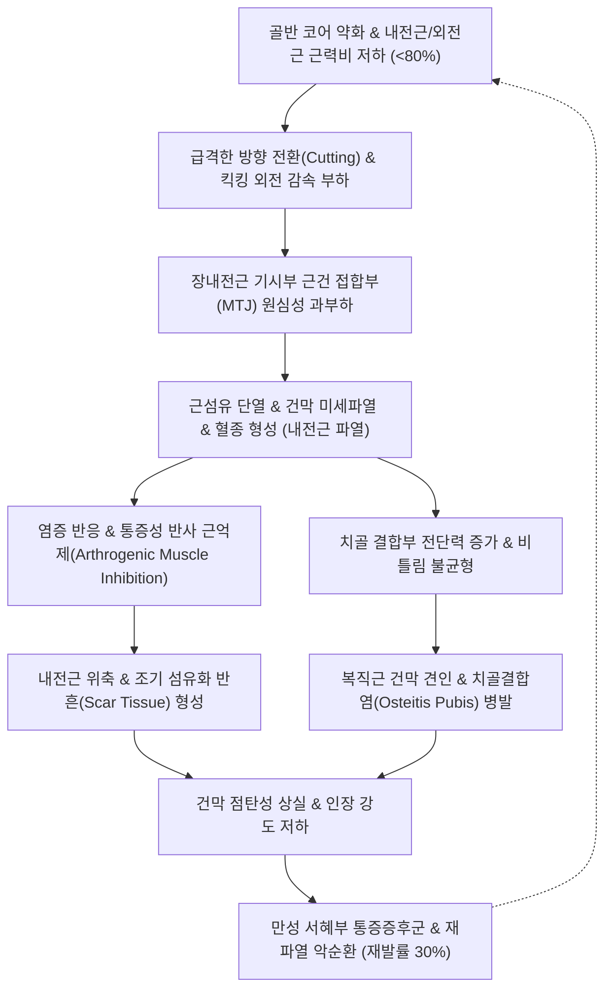
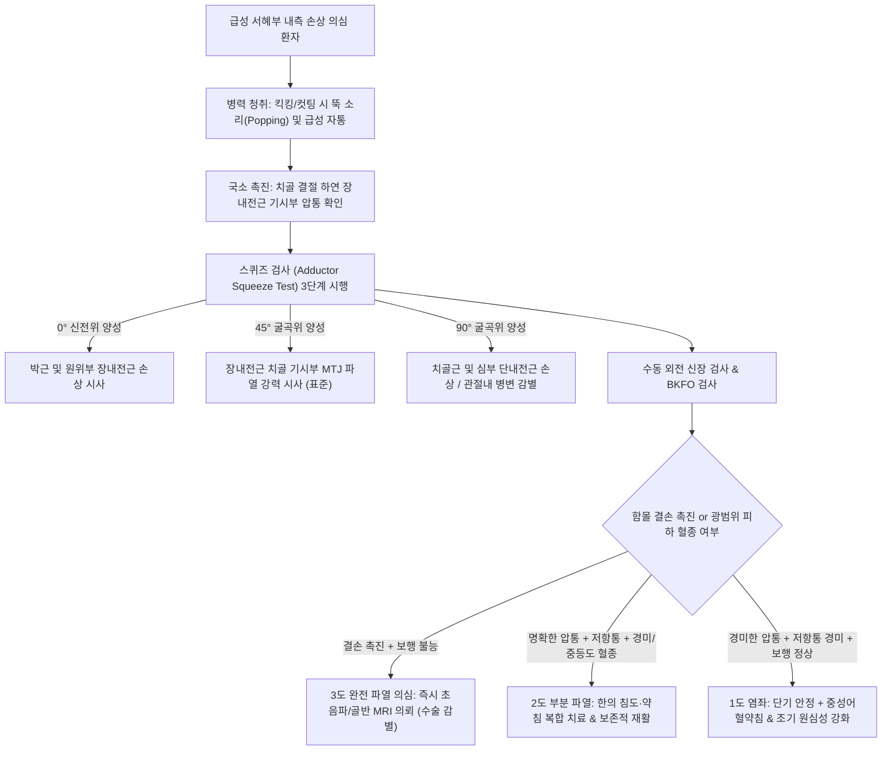
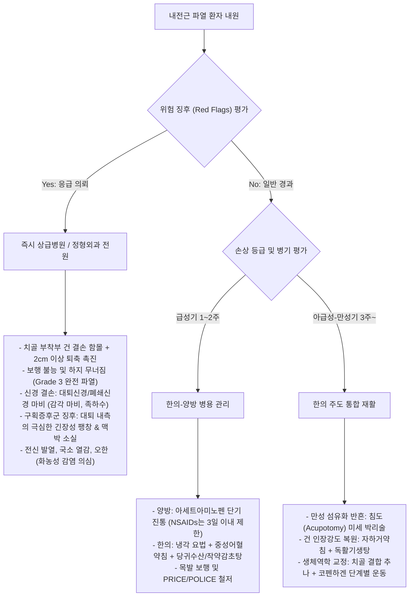
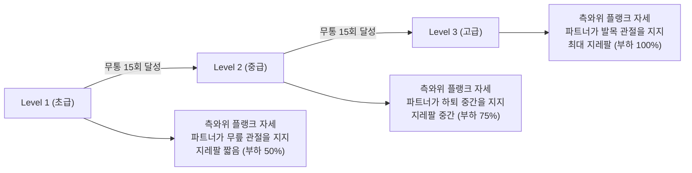

# 🫁 [[내전근 파열]] (Adductor Muscle Strain and Tear)

> **핵심 3줄 요약 (Key Summary)**:
> 🎯 치골 결합부에서 대퇴골 내측으로 주행하는 [[장내전근]] 기시부 건막의 급격한 신장-원심성 수축 과부하로 인한 근건 접합부(MTJ) 및 골-건 부착부 파열 손상입니다.
> 🚩 축구, 하키 등 급격한 방향 전환(Cutting), 킥킹(Kicking), 외전 감속 동작 중 '뚝' 하는 파열음과 함께 서혜부 내측에 극심한 자통, 종창 및 피하 반상출혈을 유발합니다.
> 🔍 0°·45°·90° 스퀴즈 검사(Squeeze test) 및 수동 외전 시 신장통 양성이며, 급성기 냉각 및 [[중성어혈약침]] 처치 후 만성 섬유화에 대한 침도(Acupotomy) 박리술과 코펜하겐 원심성 내전근 강화 프로토콜로 단계별 재활을 완성합니다.
> ⚠️ 3도 완전 파열(치골 결절 골막 견열 및 2cm 이상 퇴축) 시 영구적 근력 저하와 파행이 남을 수 있으므로 조기 정밀 초음파 및 MRI 감별과 수술적 의뢰 여부 판정이 필수적입니다.

---

## 📌 목차
1. [🩺 질환 개요 & 해부학적 병태생리](#1--질환-개요--해부학적-병태생리)
2. [⚡ 병태생리 메커니즘 & 생체역학적 악순환 네트워크](#2--병태생리-메커니즘--생체역학적-악순환-네트워크)
3. [🔍 임상 증상 & 이학적 검사 알고리즘](#3--임상-증상--이학적-검사-알고리즘)
4. [🔀 감별 진단 매트릭스](#4--감별-진단-매트릭스)
5. [🌿 한의 통합 치료 프로토콜](#5--한의-통합-치료-프로토콜)
6. [💊 양방 치료 & 병용·의뢰 기준](#6--양방-치료--병용의뢰-기준)
7. [🏃 재활 운동 & 생활습관 티칭 가이드](#7--재활-운동--생활습관-티칭-가이드)
8. [💡 사용자 진료실 핵심 필기 & 임상 노하우 (Melt-In)](#8--사용자-진료실-핵심-필기--임상-노하우-melt-in)
9. [📚 출처 및 현대 학술 연구 요약](#9--출처-및-현대-학술-연구-요약)

---

## 1. 🩺 질환 개요 & 해부학적 병태생리

### 1.1 질환 정의 및 임상적 의의
* **내전근 파열(Adductor Muscle Strain / Tear)**은 고관절을 중심축으로 대퇴부를 내측으로 모으는 고관절 내전근 복합체(Adductor muscle complex)의 근섬유, 근건 접합부(Myotendinous junction, MTJ), 또는 치골 골-건 부착부(Enthesis)가 과도한 장력 부하와 신장 응력을 견디지 못하고 불완전 또는 완전 단열되는 급성 하지 스포츠 외상 질환입니다.
* 하지 스포츠 손상 중 햄스트링 파열 다음으로 빈발하는 대표적 가속-감속성 손상이며, 국제축구연맹(FIFA) 및 도하 서혜부 통증 합의(Doha agreement) 분류에 따라 **내전근 연관 서혜부 통증(Adductor-related groin pain)**의 가장 핵심적이고 급격한 원인 질환으로 규정됩니다.
* 내전근 손상은 단순 근육통으로 오인되어 조기 복귀를 시도하다가 만성 건병증, 치골결합염(Osteitis pubis), 스포츠 탈장(Athletic pubalgia) 등으로 악화되는 만성화 비율이 15~30%에 달하므로 초기부터 정밀한 해부학적 진단과 체계적 프로토콜이 요구됩니다.

### 1.2 고관절 내전근군의 해부학적 구성과 특성
고관절 내전근군은 치골(Pubis)과 좌골(Ischium)에서 기시하여 대퇴골 조선(Linea aspera) 및 경골 내측에 부착되는 5개의 주요 근육으로 구성되며, 각 근육의 해부학적 주행과 취약 부위는 다음과 같습니다.

| 근육명 | 기시부 (Origin) | 정지부 (Insertion) | 신경 지배 | 기능 및 역학적 특성 | 파열 빈도 및 취약성 |
| :--- | :--- | :--- | :--- | :--- | :--- |
| **[[장내전근]] (Adductor Longus)** | 치골체(Body of pubis) 전면 상부, 치골 결절 하방 | 대퇴골 조선(Linea aspera) 중 1/3부 내측순 | 폐쇄신경 전지 (L2-L4) | 고관절 내전, 굴곡 보조, 외회전/내회전 중립화 | **전체 파열의 62~85% 차지 (압도적 1위)**. 기시부 건막이 좁고 원추형이며 전단력이 극도로 집중됨 |
| **[[단내전근]] (Adductor Brevis)** | 치골 하구(Inferior pubic ramus) 전면 외측 | 대퇴골 치골근선(Pectineal line) 및 조선 상부 1/3 | 폐쇄신경 전지 및 후지 (L2-L3) | 고관절 내전, 초기 굴곡 보조 | 장내전근 심층에 위치하며 단독 파열은 드무나 장내전근 파열 시 동반 손상 빈발 |
| **[[대내전근]] (Adductor Magnus)** | 치골 하구, 좌골지(Ischial ramus), 좌골결절(Ischial tuberosity) | 대퇴골 조선 전체 내측순, 내전근결절(Adductor tubercle) | 폐쇄신경 후지 (내전근부) + 좌골신경 경골지 (슬괵근부) | 내전근부(내전, 굴곡), 슬괵근부(고관절 신전 보조, 골반 후방안정화) | 하지에서 가장 거대한 근육 중 하나로, 과신전 및 딥 스쿼트 시 원위부 건 부착부 손상 호발 |
| **[[박근]] (Gracilis)** | 치골체 하연 및 치골 하구 내측 | 경골 내측 상부 거위발건(Pes anserinus) 복합체 | 폐쇄신경 전지 (L2-L3) | 고관절 내전 및 슬관절 굴곡, 슬관절 내회전 보조 | **유일한 다관절(Bi-articular) 내전근**. 슬관절 내측 통증과 연계되어 신장 손상 발생 |
| **[[치골근]] (Pectineus)** | 치골 빗(Pecten pubis) 및 치골상구 | 대퇴골 소전자 하방의 치골근선 | 대퇴신경 (L2-L3), 간혹 폐쇄신경 보조 | 고관절 굴곡, 내전, 내회전 개시 | 서혜인대 바로 아래 대퇴삼각(Femoral triangle)의 바닥을 형성하며 고관절 급속 굴곡 시 손상 |

### 1.3 복직근-장내전근 공통 건막 복합체 (Aponeurotic Plate)
* **해부학적 연속성**: 치골 결합부(Symphysis pubis) 전면에서 상방에서 내려오는 [[복직근]](Rectus abdominis)의 외측 건막 섬유와 하방에서 올라오는 [[장내전근]](Adductor longus)의 건막 섬유는 분리된 조직이 아니라, 치골 골막(Periosteum) 위에서 서로 교차하며 하나의 거대한 섬유연골성 복합판(Aponeurotic plate)을 형성합니다.
* **장력 균형자 역할**: 복직근은 골반을 상후방으로 끌어당겨 골반의 후방 경사를 유도하고, 장내전근은 골반을 전하방으로 당겨 전방 경사를 유도합니다. 두 근육이 이루는 길항-협력 짝힘(Force-couple)은 보행과 런닝 시 치골 결합부의 시상면 및 전두면 안정성을 유지하는 핵심 구조물입니다.
* **전단 손상의 집중**: 하지의 급격한 회전과 감속 시, 상체의 회전 모멘텀과 하지의 외전 장력이 이 공통 건막판에 집중되면서 건막 박리(Aponeurotic avulsion), 서혜관 후벽 손상, 치골 결합 연골판의 미세 파열이 복합적으로 일어납니다.

### 1.4 역학 및 호발 인구
* **스포츠 종목**: 축구(전체 부상의 10~18%), 아이스하키, 럭비, 미식축구, 육상 허들, 태권도, 가라테 등 폭발적인 가속과 감속, 급격한 측방향 전환(Cutting), 킥킹(Kicking) 동작이 반복되는 종목에서 집중적으로 발생합니다.
* **호발 성별**: 남성 운동선수에서 여성보다 3~5배 호발합니다. 남성의 상대적으로 좁은 골반 너비(Pelvic width)와 높은 골격근량, 그리고 킥킹 시 발생하는 폭발적 토크가 치골 건-골 접합부에 더 높은 단위 면적당 전단 응력을 가하기 때문입니다.
* **계절성 및 시기**: 시즌 개막 직후, 동계 훈련 직후 또는 고강도 훈련 캠프 초기에 준비운동 부족 및 근육의 점탄성 저하 상태에서 손상이 집중됩니다.

---

## 2. ⚡ 병태생리 메커니즘 & 생체역학적 악순환 네트워크

### 2.1 생체역학적 손상 기전: 원심성 수축 과부하 (Eccentric Overload)
* **원심성 수축의 파괴적 특성**: 골격근 손상의 90% 이상은 근육이 늘어나면서 힘을 발휘하는 원심성 수축(Eccentric contraction) 단계에서 발생합니다. 내전근 파열은 다음 두 가지 전형적인 동작 메커니즘에서 격발됩니다.
  1. **킥킹 동작의 후속기(Follow-through Phase)**: 공을 차기 위해 고관절을 외전 및 신전시켰다가 강하게 내전-굴곡시킨 후, 반대편으로 넘어가면서 급격히 외전될 때 장내전근이 브레이크 역할을 수행하며 강한 원심성 장력을 받습니다.
  2. **급격한 외측 컷팅 및 감속(Cutting Maneuver & Deceleration)**: 질주 중 방향을 급전환하기 위해 한쪽 발로 지면을 딛고 반대편 하지로 중심을 이동할 때, 지지하는 쪽 고관절이 급격한 외전 및 외회전 토크를 받게 되며, 이때 대퇴골의 외측 이탈을 억제하기 위해 장내전근이 최대 근력을 발휘하면서 근건 접합부가 찢어집니다.
* **근건 접합부(MTJ)의 해부역학적 취약성**:
  * 장내전근의 치골 부착부는 직경 1cm 미만의 좁은 건성 구조물로 시작하여 원위부로 가면서 넓은 근복으로 전환됩니다.
  * 건 섬유의 콜라겐(Type I)과 근세포의 근원섬유(Myofibrils)가 깍지(Interdigitation) 형태로 결합하는 근건 접합부는 조직 간의 탄성 계수(Elastic modulus)가 급격히 변하는 지점으로, 전단 응력(Shear stress)이 집중되어 가장 먼저 파열이 발생합니다.

### 2.2 근력 불균형: 내전근 대 외전근 근력비 (Adductor to Abductor Strength Ratio)
* 정상적인 고관절 생체역학에서 내전근의 등속성 근력은 외전근([[중둔근]]) 근력의 약 **80~100%**를 유지해야 골반의 동적 수평 안정성이 확보됩니다.
* Tyler et al. (2001, PMID: 11292035)의 획기적인 전향적 연구에 따르면:
  * 내전근 근력이 외전근 근력의 **80% 미만**인 선수는 정상 근력비를 가진 선수에 비해 급성 내전근 염좌 및 파열 발생률이 **17배(Odds Ratio = 17.2)** 높았습니다.
  * 유연성 저하(내전근 수동 가동범위 제한) 역시 단독 위험 인자로 작용하여 손상 위험을 유의하게 증가시켰습니다.
* 피로 상태에서 중둔근이 약화되면 보행 및 질주 시 골반의 트렌델렌버그(Trendelenburg) 낙하가 발생하고, 이를 보상하기 위해 내전근이 과도한 원심성 긴장을 떠안게 되면서 손상 역치에 쉽게 도달합니다.

### 2.3 복직근-장내전근 짝힘 붕괴와 골반 비틀림
* 치골 결합부 전면에서 상하로 팽팽하게 맞서던 복직근과 장내전근의 장력 균형이 깨지면 치골 결합에 수직 및 비틀림 전단력이 작용합니다.
* 장내전근의 단축 및 과긴장은 치골체를 하방으로 견인하여 동측 장골의 전방 회전(Anterior pelvic tilt) 또는 치골 결합의 하방 아탈구를 유도합니다.
* 이는 서혜관(Inguinal canal)의 후벽을 형성하는 복횡근 건막 및 복내사근 결합건(Conjoint tendon)에 비정상적인 견인력을 가하여 만성 스포츠 탈장(Athletic pubalgia)의 기저 원인이 됩니다.

### 2.4 생체역학적 악순환 네트워크 다이어그램

---

## 3. 🔍 임상 증상 & 이학적 검사 알고리즘

### 3.1 중증도별 임상 분류 (Grading System)
내전근 파열은 조직학적 손상 범위와 기능적 결손에 따라 1도(경도 염좌), 2도(부분 파열), 3도(완전 파열)로 분류됩니다.

| 손상 등급 | 병리 조직학적 손상 | 통증 및 촉진 소견 | 보행 및 관절 가동역 | 국소 결손 및 혈종 | 예상 회복 기간 |
| :--- | :--- | :--- | :--- | :--- | :--- |
| **1도 (Grade I, 경도 염좌)** | 근섬유 5% 미만 미세 단열, 건막 및 골막 연속성 완전 보존 | 경미한 서혜부 뻐근함, 치골 결절 부위 미세 압통, 저항 내전 시 경미한 통증 | 정상 보행 가능, 전력 질주나 급격한 컷팅 시에만 통증 발현 | 피하 결손 없음, 반상출혈 음성 | 1 ~ 2주 |
| **2도 (Grade II, 부분 파열)** | 근섬유 및 건막의 불완전 단열 (5~50%), MTJ 부분 파열 | 날카로운 자통, 명확한 국소 압통, 저항 내전 시 극심한 통증으로 힘주기 불능 | 절뚝거림(파행 보행), 고관절 수동 외전 시 현저한 신장통 및 가동범위 제한 | 국소 종창, 24~48시간 후 피하 반상출혈(멍) 출현 | 3 ~ 6주 |
| **3도 (Grade III, 완전 파열)** | 근건 접합부 완전 단열 또는 치골 부착부 건 견열(Avulsion) | 손상 순간 격렬한 자통 후 묵직한 둔통, 치골 결절 하연 극심한 압통 | 보행 불능(체중 부하 시 사타구니 무너짐), 능동 내전 불능 | 명확한 건 결손부 함몰(Gap) 촉진, 광범위한 혈종 및 허벅지 내측 멍 | 8 ~ 12주 이상 (수술 고려) |

### 3.2 단계별 이학적 검사 알고리즘
진료실에서 내전근 파열을 정확히 판별하기 위해 도하 합의(Doha agreement) 기준에 따른 체계적 검사를 시행합니다.

#### ① 스퀴즈 검사 (Adductor Squeeze Test)
환자를 침대에 바로 눕힌(앙와위) 상태에서 검사자의 주먹이나 압력계(Sphygmomanometer cuff)를 양 무릎 또는 발목 사이에 끼우고 최대 힘으로 양 다리를 모으도록 지시합니다. 무릎의 굴곡 각도에 따라 주동근이 달라지므로 3가지 각도에서 모두 평가합니다.
* **0° 무릎 신전위 (0° Hip/Knee Extension)**:
  * 무릎을 완전히 펴고 다리를 모으게 함.
  * 주로 **[[박근]](Gracilis)**과 [[장내전근]]의 원위부 긴장도를 평가하며, 슬관절 내측 통증과의 연계성을 확인합니다.
* **45° 무릎 굴곡위 (45° Hip/Knee Flexion)**:
  * 고관절과 슬관절을 45도 구부리고 발바닥을 침대에 댄 상태에서 무릎 사이에 주먹을 넣고 조이게 함.
  * **장내전근의 치골 부착부에 최대 전단 응력이 가해지는 가장 민감한(Sensitive) 표준 검사법**입니다. 치골 결절 부위에 즉각적인 날카로운 통증이 재현되면 강력한 양성입니다.
* **90° 무릎 굴곡위 (90° Hip/Knee Flexion)**:
  * 고관절과 슬관절을 90도로 들어 올린 상태에서 내전 저항을 줌.
  * **[[치골근]](Pectineus)** 및 [[단내전근]]의 심부 수축력을 평가하며, 고관절 관절 내 충돌통과 감별합니다.

#### ② 수동 고관절 외전 스트레칭 검사 (Passive Hip Abduction Test)
* 환자의 긴장을 완전히 풀게 한 상태에서 검사자가 고관절을 외전 및 외회전 방향으로 서서히 벌립니다.
* 장내전근 및 박근의 치골 기시부에 강한 인장력이 가해지면서 파열 부위의 날카로운 신장통(Stretching pain)이 격발되고, 건막 손상으로 인한 반사성 근경련(Spasm)으로 인해 건측 대비 외전 가동범위가 현저히 감소합니다.

#### ③ 치골 결절 및 건 기시부 정밀 촉진 (Palpation)
* 검사자의 엄지손가락으로 서혜인대 내측 끝에 위치한 치골 결절(Pubic tubercle)을 먼저 확인합니다.
* 결절 하연에서 대퇴 내측으로 1~2cm 주행하는 장내전근 건의 원추형 기시부를 수직으로 지그시 압박합니다.
* 2도 이상 파열 시 극심한 압통(Jump sign)이 나타나며, 완전 파열(3도)의 경우 건이 뜯겨 나가며 만져지는 함몰 결손(Defect)과 근복의 원위부 뭉침(Retracted muscle belly)을 직접 촉진할 수 있습니다.

#### ④ 무릎 굴곡 외회전 낙하 검사 (Bent Knee Fall Out, BKFO Test)
* 앙와위에서 양 무릎을 굽히고 발바닥을 마주 대어 무릎을 바깥쪽 바닥으로 자연스럽게 떨어뜨립니다.
* 무릎 외측과 침대 바닥 사이의 수직 거리를 측정합니다. 환측 내전근의 구축 및 통증으로 인해 건측보다 무릎이 바닥에 닿지 못하고 공중에 뜨게 됩니다.

### 3.3 영상 진단 가이드라인
* **근골격계 초음파 (High-Resolution Musculoskeletal Ultrasound)**:
  * 진료실에서 즉각적으로 시행 가능한 1차 영상 진단 도구입니다.
  * 장내전근 건 기시부의 두께 증가, 건막 섬유의 불연속성, 건-골 접합부 하부의 저에코성(Hypoechoic) 혈종 저류를 실시간으로 확인합니다.
  * 동적 검사(Dynamic test)를 통해 환자가 가볍게 내전 힘을 줄 때 파열된 건 단열부가 벌어지는 양상을 직접 관찰할 수 있습니다.
* **골반 자기공명영상 (Pelvic MRI - STIR, T2 Fat-Suppressed)**:
  * 내전근 파열의 깊이, 범위, 건 견축(Retraction) 거리를 평가하는 골드 스탠다드입니다.
  * **주요 소견**: MTJ 부위의 깃털 모양 고신호강도 근주위 부종, 치골체 골수 부종(Bone marrow edema sign), 복직근-장내전근 건막 파열, 관골구 비구순 파열 동반 여부를 종합 진단합니다.

---

## 4. 🔀 감별 진단 매트릭스

서혜부 내측 통증은 복합적인 해부학적 구조가 밀집되어 있어 오진율이 매우 높습니다. 아래 매트릭스를 통해 정확히 감별해야 합니다.

| 감별 질환 | 호발 연령 및 직업 | 주 통증 부위 | 전형적 통증 유발 동작 | 특이 이학적 검사 | 영상 소견 (X-ray / MRI / US) | 감별 핵심 포인트 |
| :--- | :--- | :--- | :--- | :--- | :--- | :--- |
| **[[내전근 파열]] (Adductor Longus Tear)** | 10~30대 축구, 하키, 럭비 선수 | 치골 결절 하연 및 대퇴 내측 근복 | 급격한 킥킹, 방향 전환 시 급성 자통, 다리 모으기 | **45° 스퀴즈 검사 양성**, 수동 외전 신장통, 치골 결절 하연 압통 | 초음파/MRI상 장내전근 MTJ 고신호강도, 피하 혈종 | **급성 발병**, 명확한 외상 기전, 저항 내전 시 통증 극대화 |
| **스포츠 탈장 / 서혜부 파열 (Athletic Pubalgia)** | 20~40대 격렬한 회전 운동선수 | 서혜인대 직상방, 치골결합 상외측 | 기침, 재채기, 윗몸일으키기, 전력 질주 | 서혜관 외서혜륜 촉진 시 압통 및 팽창감, 저항 복근 수축통 | MRI상 복횡근 결합건 단열, 서혜관 후벽 팽윤 | 진성 탈장 낭(Hernial sac) 없이 만성적으로 진행, **복압 상승 시 악화** |
| **치골결합염 (Osteitis Pubis)** | 마라톤, 축구, 산후 여성 | 치골 결합부 정중앙 (Midline pubis) | 보행 시 양다리 교차, 계단 오르기, 앙와위 다리 들기 | **치골 결합 정중앙 골 압통**, 스프링 검사 양성 | X-ray상 치골 결합면 경화, 골흡수, 플라밍고 뷰상 불안정성 | 건 부착부가 아닌 **치골 결합 연골판 자체의 무균성 염증**, 만성 경과 |
| **[[대퇴비구 충돌증후군]](FAI) & 비구순 파열** | 20~40대 활동적 성인, 고관절 과사용군 | 고관절 심부 전외측, C-sign 부위 | 깊은 스쿼트, 양반다리, 장시간 운전 | **FADIR 검사 양성** (굴곡-내전-내회전 시 찝힘), 클릭킹(Clicking) | X-ray/MRI상 캠(Cam) 골극, 핀서(Pincer) 과포개짐, 전상방 관절순 파열 | 내전 저항통이 없으며, **고관절 회전 시 관절 내부의 기계적 걸림** |
| **폐쇄신경 포착 증후군 (Obturator Entrapment)** | 장거리 달리기, 산악 마라톤 | 대퇴 내측 중하부 방사통, 감각 이상 | 지속적인 런닝 시 운동 후반부 악화 | 내전근 근력 약화, 대퇴 내측 피부 감각 둔마, Tinel 징후 | 골반 MRI상 이상 무, 근전도(EMG)상 폐쇄신경 탈신경 전위 | 외상 없이 운동 중 서서히 나타나는 **신경인성 저림 및 근력 저하** |
| **대퇴골두 무혈성 괴사 (AVN)** | 30~50대 음주력, 스테로이드 복용력 | 서혜부 전면 깊숙한 곳, 둔부 방사 | 초기 체중 부하 시 통증, 후기 야간통 및 휴식기 통증 | Patrick 검사 양성, 모든 방향의 고관절 가동역 제한 | X-ray상 골두 압궤, 초승달 징후(Crescent sign), MRI 저신호 밴드 | **비외상성**, 알코올/스테로이드 병력, 체중 부하 불능의 급격한 악화 |
| **치골지 피로골절 (Stress Fracture)** | 군인(행군), 마라톤 초심자 | 치골 하구 및 서혜인대 하방 뼈 | 체중 부하 시 뼈가 부러질 듯한 통증, 한 발 뛰기 불능 | 치골지 직접 골 압통, Fulcrum 검사 양성 | 초기 X-ray 정상, 골스캔/MRI상 치골지 선상 골절선 및 골막 비후 | 외상성 파열이 아닌 **과도한 반복 훈련 후 골막 반응**, 한 발 지지 불가 |

---

## 5. 🌿 한의 통합 치료 프로토콜

한의학에서 내전근 파열은 경락이 손상되어 어혈이 맺히는 **상근(傷筋)** 및 **근모(筋耗)**, **어혈비(瘀血痺)**의 범주에 속합니다. 손상 초기에는 어혈을 제거하고 부종을 가라앉히며(活血化瘀 消腫止痛), 회복기에는 손상된 건막 섬유를 재생하고 인장 강도를 회복시키는(補肝腎 續筋骨) 단계별 통합 치료를 적용합니다.

### 5.1 한의 변증 분류
* **기체어혈형(氣滯瘀血型)**:
  * 급성 외상 직후 격렬한 국소 자통, 거안(拒按), 심한 부종, 피하 반상출혈, 보행 곤란.
  * 설진: 설질자암(舌質紫暗) 또는 어반(瘀斑). 맥진: 맥현삽(脈弦澁).
  * 치법: 활혈화어(活血化瘀), 행기지통(行氣止痛), 소종산결(消腫散結).
* **간신휴손형(肝腎虧損型)**:
  * 만성화된 부분 파열 또는 반복적 재발, 과로 시 사타구니 안쪽이 은은하게 당기고 시림, 다리에 힘이 빠짐.
  * 설진: 설담태백(舌淡苔白). 맥진: 맥침세무력(脈沈細無力).
  * 치법: 보익간신(補益肝腎), 강근건골(强筋健骨), 양혈온경(養血溫經).

### 5.2 침구 및 전침 치료 프로토콜
* **주요 배혈 경락**: 족궐음간경(足厥陰肝經), 족태음비경(足太陰脾經), 족양명위경(足陽明胃經).
* **핵심 취혈점**:
  * **기충(ST30) & 곡골(CV2)**: 치골 결합부 전면 및 복직근-내전근 건막 복합체의 기혈 순환 촉진.
  * **급맥(LR12) & 음렴(LR11)**: 장내전근 치골 기시부 바로 외측 및 직하부로, 기시부 건막 긴장 완화.
  * **족오리(LR10) & 음포(LR9)**: 장내전근 및 대내전근 근복의 경결점 이완, 근경련 차단.
  * **혈해(SP10) & 삼음교(SP6)**: 전신의 활혈거어(活血祛瘀) 및 미세 혈류 촉진.
  * **태충(LR3)**: 족궐음간경의 원혈로 간주근(肝主筋) 기능 활성화 및 국소 진통 효과.
* **전침(Electroacupuncture) 자극 파형**:
  * **급성 염증기 (1~2주)**: 음렴(LR11)-족오리(LR10) 구간에 **2Hz 저빈도 연속파**를 적용하여 베타-엔도르핀 및 다이노르핀 분비를 유도하고, 국소 근육의 림프 배액을 촉진하여 혈종 흡수를 가속화합니다.
  * **만성 리모델링기 (3주 이후)**: **2/100Hz 혼합파(Dense-disperse wave)**를 적용하여 조직 치유 인자(VEGF, bFGF) 발현을 유도하고 섬유화된 콜라겐 다발의 탄성 복원을 촉진합니다.

### 5.3 약침 및 자하거(태반) 요법
손상 병기와 조직 반응에 따라 약침 제제를 엄격히 구분하여 투여합니다.

| 시기 | 추천 약침 제제 | 주입 혈위 및 해부학적 타깃 | 용량 및 횟수 | 작용 기전 및 임상 효과 |
| :--- | :--- | :--- | :--- | :--- |
| **급성기 (1~2주)** | [[중성어혈약침]] 또는 **소염약침** | 치골 결절 하연 장내전근 기시부, 음렴(LR11), 혈종 주변부 | 1.0 ~ 2.0cc, 주 2~3회 | 파열 부위의 혈종 및 염증성 삼출물 흡수 촉진, COX-2 억제를 통한 통증 완화 |
| **아급성기 (3~4주)** | [[황련해독탕약침]] or **녹용약침** | 장내전근 MTJ, 족오리(LR10), 치골 결합부 | 1.0cc, 주 2회 | 잔여 저등급 염증 제어 및 국소 미세혈관 신생 촉진 |
| **만성 회복기 (5주~)** | **자하거(태반)약침** or [[신바로약침]] | 치골 골-건 부착부(Enthesis), 음포(LR9) 심부 | 1.0 ~ 2.0cc, 주 1~2회 | 손상된 건막의 Type I 콜라겐 합성 촉진, 인장 강도 복원, 건병증성 퇴행 억제 |

### 5.4 만성 골부착부 섬유화에 대한 침도(Needle Knife) 박리술
* **적응증**: 2도 이상 파열 후 4~6주 이상 경과하였으나 치골 결절 하연에 단단한 반흔 섬유화(Scar tissue) 밴드가 형성되어 고관절 외전 시 팽팽한 당김과 만성 서혜부 통증이 잔존하는 증례.
* **사용 기구**: 0.75mm × 50mm 일회용 멸균 소침도(Flat needle-knife).
* **해부학적 안전 자입 가이드**:
  1. 환자를 앙와위로 눕히고 환측 고관절을 30도 외전 및 경도 굴곡시킵니다.
  2. 검사자의 비시술 손가락으로 대퇴동맥 맥박을 촉진하여 외측 안전 마진(대퇴혈관초로부터 내측으로 최소 2.5cm 이상 이격)을 철저히 확보합니다.
  3. 치골 결절 하연에서 가장 단단하고 날카로운 압통이 나타나는 장내전근 건 기시부 골막면을 자입점으로 잡습니다.
  4. 침도 날을 **장내전근의 주행 방향(상외측에서 하내측)과 완벽히 평행하게** 위치시킨 후 골면에 닿을 때까지 직자 진입합니다.
  5. 골면에 닿은 상태에서 침도를 1~2mm 후퇴시킨 뒤, 엉겨 붙은 섬유성 결절을 결 방향으로 2~3회 부드럽게 종절개·박리(Longitudinal stripping)합니다.
  6. ⚠️ **금기**: 침도 날을 횡방향으로 교차하여 휘젓거나 대퇴혈관이 주행하는 외측 방향으로 침첨을 기울이는 행위는 절대 엄금합니다.

### 5.5 추나요법 (치골 정렬 및 근에너지기법)
* **치골 결합 근에너지기법 (MET for Pubic Symphysis Subluxation)**:
  * 장내전근의 비대칭적 과긴장으로 인해 치골 결합부가 하방 또는 상방으로 아탈구된 경우 적용합니다.
  * 환자는 앙와위에서 무릎을 세우고 양 발바닥을 침대에 붙입니다(Hook lying).
  * 1단계: 치료사가 양 무릎 바깥을 막고 환자에게 다리를 바깥으로 벌리게 저항(외전 등척성 수축 5초, 3회).
  * 2단계: 치료사의 팔뚝이나 단단한 베개를 양 무릎 사이에 끼우고 환자에게 다리를 안쪽으로 강하게 모으게 저항(내전 등척성 수축 5초, 3회).
  * 마지막 회차에서 순간적인 내전 수축을 통해 치골 결합면의 관절면 정렬을 복원(Shotgun technique)합니다.
* **장골 회전 변위 교정**: 장내전근 단축으로 동반된 골반 전방 경사를 바로잡기 위한 장골 후방 회전 기법을 병행합니다.

### 5.6 단계별 한약 치료 처방

| 치료 단계 | 주치 변증 | 대표 처방 | 군약 및 주요 배오 본초 | 임상 효능 및 목표 |
| :--- | :--- | :--- | :--- | :--- |
| **급성 출혈기 (1~3일)** | 기체어혈, 혈종 저류 | **[[당귀수산]](當歸鬚散)** 가감 | 당귀미, 적작약, 도인, 홍화, 소목, 오약, 향부자 + [[삼칠근]], 몰약 | 손상된 미세혈관의 지혈 촉진, 급성 혈종의 혈괴 분해 및 통증 완화 |
| **급성 염증·부종기 (4~14일)** | 어혈정체, 수습정류 | **도홍사물탕(桃紅四物湯)** 합 **[[작약감초탕]](芍藥甘草湯)** | 당귀, 천궁, 백작약(16g), 감초(8g), 도인, 홍화 + [[복령]], 저령, 택사 | 내전근의 급성 통증성 근연축(Spasm) 해소, 국소 부종 배출, 미세 혈류 순환 개통 |
| **아급성 회복기 (3~4주)** | 간신휴손, 기혈부족 | **신통축어탕(身痛逐瘀湯)** 가감 | 진교, 강황, 도인, 홍화, 당귀, 천궁, 몰약, 우슬 + [[속단]], 골쇄보 | 파열 부위의 육아조직 형성 촉진, 반흔 섬유화 방지, 인대 및 건 결합 강화 |
| **만성 재활기 (5주 이후)** | 간신양허, 근골위약 | **[[독활기생탕]](獨活寄生湯)** 또는 **대강활탕** | 독활, 상기생, 두충, 우슬, 세신, 방풍, 당귀, 작약, 숙지황, 인삼 | 고관절 건막의 Type I 콜라겐 합성 촉진, 골반 안정성 회복, 재파열 영구 예방 |

---

## 6. 💊 양방 치료 & 병용·의뢰 기준

### 6.1 급성기 표준 처치: PRICE에서 POLICE로의 전환
* 과거의 무조건적인 침상 안정(RICE)은 내전근 건막의 무질서한 반흔 섬유화와 근위축을 초래하므로, 최근 스포츠의학 가이드라인은 **POLICE 원칙**을 강력히 권고합니다.
  * **Protection (보호)**: 손상 직후 48시간 동안 목발(Crutches)을 사용하여 체중 부하를 제한하고 서혜부 압박 붕대 적용.
  * **Optimal Loading (적정 부하)**: 48~72시간 후 통증이 허용하는 범위 내에서 조기 무통 등척성 수축과 능동적 관절 가동 운동 개시.
  * **Ice (냉각)**: 1회 15~20분, 하루 3~4회 국소 얼음찜질을 적용하여 급성 혈관 수축 및 부종 확산 억제.
  * **Compression (압박)**: 네오프렌 서혜부 서포터나 탄력 붕대로 대퇴 내측을 감싸 혈종 저류 방지.
  * **Elevation (거상)**: 하지 밑에 베개를 받쳐 골반보다 높게 위치.

### 6.2 약물 치료의 명암 (NSAIDs 사용의 주의점)
* **약물 처방 관행**:
  * 1차 선택: [[아세트아미노펜]](Acetaminophen, 1일 최대 4,000mg) - 혈소판 응집이나 조직 재생을 방해하지 않는 안전한 진통제.
  * NSAIDs([[이부프로펜]], [[나프록센]], [[세레콕시브]], [[록소프로펜]]): 초기 극심한 통증 조절 목적으로 처방.
* ⚠️ **NSAIDs의 양날의 검과 근육 재생 억제 기전**:
  * 비스테로이드성 소염진통제는 COX 효소를 차단하여 프로스타글란딘 합성을 억제함으로써 통증을 즉각 줄여주지만, 골격근 재생의 핵심인 **위성세포(Satellite cells)의 증식과 분화를 억제**합니다.
  * 급성기 이후(손상 3일 이후) 무분별한 장기 복용은 콜라겐 기질의 리모델링을 저해하여 파열 부위의 인장 강도를 떨어뜨리고 만성 재발성 건병증을 유발할 수 있으므로, **소염진통제 복용은 손상 직후 3~5일 이내로 제한**해야 합니다.

### 6.3 중재적 시술 (Interventional Procedures)
* **혈종 흡인술 (Ultrasound-Guided Hematoma Aspiration)**: 2도 후반 및 3도 부분 파열에서 근육 내 3cm 이상의 거대 혈종이 관찰될 경우, 초음파 유도하에 혈종을 주사기로 흡인하여 구획 압력을 낮추고 석회화 건염(Myositis ossificans) 발생을 예방합니다.
* **PRP (Platelet-Rich Plasma, 자가 혈소판 풍부 혈장) 주사**:
  * 고농축 혈소판에서 분비되는 성장인자(PDGF, TGF-β, VEGF)를 파열 부위에 주입하여 콜라겐 합성과 혈관 신생을 촉진.
  * 엘리트 운동선수에서 스포츠 복귀 기간을 1~2주 단축시키는 효과가 보고되나, 장기적 재발률 감소에 대해서는 연구마다 이견이 존재합니다.
* ⛔ **코르티코스테로이드 국소 주사 절대 금기**:
  * 건 기시부나 MTJ 부위의 스테로이드 주사는 섬유모세포 괴사와 콜라겐 분해를 촉진하여 **급성 건 파열(Tendon rupture)을 직접 격발**시키므로 절대 금기입니다.

### 6.4 수술적 적응증 (Surgical Indications)
대부분의 내전근 손상(Grade 1, 2)은 비수술적 보존 치료로 완치되지만, 다음과 같은 경우 정형외과적 수술을 즉각 고려합니다.
* **절대적 수술 적응증**:
  1. 장내전근 치골 기시부의 **완전 박리 파열(Grade 3 Complete Avulsion)**로 인해 건 단열부가 치골체로부터 **2cm 이상 퇴축(Retraction)**된 경우.
  2. 치골 결절 부위의 골편을 물고 떨어진 **견열 골절(Avulsion fracture)**이 전위된 경우.
  3. 급성 파열 후 발생한 거대 혈종으로 인한 비가역적 혈관·신경 압박.
* **상대적 수술 적응증**:
  * 체계적인 한의-양방 통합 보존 치료 및 재활 프로토콜을 3~6개월 이상 성실히 수행했음에도 불구하고 지속적인 고관절 내전 근력 저하와 파행이 지속되는 엘리트 운동선수.
* **수술 기식**:
  * **봉합 앵커 재부착술(Suture Anchor Repair)**: 퇴축된 건을 원래의 치골 결절 해부학적 위치에 앵커를 박아 단단히 재고정.
  * **내전근 절제술(Adductor Longus Tenotomy)**: 만성 유착과 난치성 건병증으로 재생이 불가능한 경우, 긴장 완화를 위해 건 기시부를 부분 절제.

### 6.5 한의 병용 판단 및 전문과 의뢰 기준 (Red Flags)

---

## 7. 🏃 재활 운동 & 생활습관 티칭 가이드

내전근 손상 후 재활의 핵심은 손상된 근건 복합체에 적절한 기계적 부하(Mechanotransduction)를 제공하여 정상적인 Type I 콜라겐 섬유의 배열을 유도하고, 원심성 근력을 외전근의 90% 이상으로 복원하는 것입니다.

### 7.1 코펜하겐 내전근 운동 (Copenhagen Adduction Exercise) 3단계 프로토콜
Harøy et al. (2019, PMID: 29891614)의 대규모 무작위 대조군 연구에서 축구 선수의 내전근 부상 발생률을 **41% 감소**시킨 표준 원심성 운동 프로그램입니다.

* **수행 방법**:
  1. 환자는 옆으로 누워 아래쪽 팔꿈치로 상체를 지지하고 몸통을 일직선으로 세웁니다(사이드 플랭크 자세).
  2. 파트너가 환자의 위쪽 다리를 지지(레벨에 따라 무릎, 정강이, 발목)합니다.
  3. 환자는 위쪽 다리의 내전근 힘으로 골반과 아래쪽 다리를 공중으로 들어 올려 몸통과 일직선이 되도록 3초간 수축(동심성)합니다.
  4. 이후 3초에 걸쳐 천천히 아래쪽 다리와 골반을 바닥으로 내리며 원심성 수축(Eccentric) 부하를 가합니다.
* **처방 용량**: 주 2~3회, 세트당 8~12회, 3세트 반복.

### 7.2 단계별 기능적 재활 타임라인
* **1단계: 급성 보호 및 무통 등척성기 (0~7일)**:
  * 목표: 염증 및 부종 억제, 통증 없는 최소 수축 개시.
  * 운동:
    * **소프트볼 스퀴즈(Isometric Ball Squeeze)**: 앙와위에서 무릎을 45도 구부리고 양 무릎 사이에 지름 20cm 짐볼이나 베개를 끼운 뒤, 통증이 없는 강도(최대 근력의 30~50%)로 5초간 지그시 조였다가 이완 (10회씩 3세트).
    * 통증이 없는 범위 내에서의 능동적 발목 펌핑 및 대퇴사두근 세팅(Q-setting).
* **2단계: 가동역 회복 및 저부하 동심성기 (1~3주)**:
  * 목표: 정상 관절 가동범위 회복 및 근비대 개시.
  * 운동:
    * **사이드 라잉 힙 어덕션(Side-lying Hip Adduction)**: 옆으로 누워 위쪽 다리를 앞으로 접어 세우고, 아래쪽 다리를 천장 방향으로 들어 올리는 능동 운동.
    * **탄력 밴드 고관절 내전(Resisted Band Adduction)**: 기둥에 밴드를 묶고 안쪽 다리에 건 뒤 몸 안쪽으로 당기는 저강도 동심성 수축.
    * 고정식 실내 자전거(Stationary Bike) 저항 없이 가볍게 페달링.
* **3단계: 원심성 과부하 및 동적 제어기 (3~6주)**:
  * 목표: 근건 접합부 인장 강도 복원 및 코어 협응력 강화.
  * 운동:
    * **코펜하겐 운동 레벨 1 및 레벨 2** 도입.
    * **슬라이딩 사이드 런지(Lateral Slide Lunge)**: 미끄러지는 양말이나 슬라이드 패드를 신고 한쪽 다리를 옆으로 미끄러뜨리며 내전근을 원심성으로 늘렸다가 모으는 운동.
    * 트레드밀 조깅 및 전방 직선 질주(Straight-line jogging).
* **4단계: 플라이오메트릭 및 스포츠 복귀기 (6주 이후)**:
  * 목표: 다방향 감속 능력, 컷팅 및 킥킹 복원.
  * 운동:
    * 코펜하겐 운동 레벨 3 완성.
    * 지그재그 달리기(Figure-8 run), 45도 및 90도 컷팅 훈련, 셔틀 런.
    * 점진적 축구공 킥킹 (쇼트 패스 → 롱 패스 → 슈팅).

### 7.3 스포츠 복귀 기준 (Return-to-Sport, RTS Checklist)
재파열을 방지하기 위해 다음 5가지 기준을 **100% 충족**해야 필드로 복귀시킵니다.
1. **임상적 무통**: 45° 스퀴즈 검사 시 환측 통증 점수가 **0/10 (NRS 0)**이어야 함.
2. **유연성 회복**: 수동 고관절 외전 가동범위가 건측 대비 **100% 동등**할 것.
3. **근력 객관화**: 휴대용 다이나모미터(Hand-held dynamometer) 측정 시 내전근/외전근 근력비가 **90% 이상**이며, 환측 내전근력이 건측 대비 **90% 이상**일 것.
4. **기능성 테스트 통과**: 전력 직선 질주, 90도 전속력 컷팅, 최대 파워 킥킹 시 통증이나 심리적 두려움(Kinesiophobia)이 없을 것.
5. **촉진 압통 소실**: 치골 결절 하연을 강하게 압박 촉진했을 때 국소 압통이 완전히 소실될 것.

---

## 8. 💡 사용자 진료실 핵심 필기 & 임상 노하우 (Melt-In)

### 8.1 진료실 3대 오진의 함정과 촉진의 손맛
* **사타구니를 부여잡고 온 환자를 만났을 때의 3대 함정**:
  1. *함정 1: "단순 서혜인대 염좌겠지"* → 서혜인대는 ASIS에서 치골결절로 주행하므로 외측 상방입니다. 사타구니 안쪽 깊숙한 곳의 통증은 80% 이상 장내전근 파열입니다.
  2. *함정 2: "고관절이 찝힌다고 하니 FAI(충돌증후군)다"* → FAI는 굴곡-내회전 시 관절 내부의 깊은 찝힘(C-sign)이지만, 장내전근 파열은 다리를 벌릴 때(외전) 찢어질 듯 당기고 다리를 모을 때(내전 저항) 악 소리가 납니다.
  3. *함정 3: "치골결합염이다"* → 치골결합염은 정중앙 뼈 자체의 극심한 골 압통이지만, 장내전근 파열은 정중앙에서 외측으로 1cm 벗어난 치골 결절 하연의 건 부착부 압통입니다.
* **촉진의 손맛 노하우**:
  * 환자를 눕히고 무릎을 살짝 구부려 바깥으로 벌리게 한 뒤, 대퇴 내측에서 가장 팽팽하게 튀어나오는 밧줄 같은 띠를 손가락으로 쥡니다. 그것이 장내전근의 근복입니다.
  * 그 밧줄을 따라 상방 치골 결절을 향해 거슬러 올라가면 뼈에 닿기 직전 연필심 굵기 정도로 가늘어지는 단단한 건 부착부가 나옵니다.
  * 이곳을 뼈를 향해 수직으로 지그시 눌렀을 때 환자가 펄쩍 뛸 정도로 극심한 통증(Jump sign)을 호소한다면 장내전근 기시부 병변을 100% 확진할 수 있습니다.

### 8.2 침도(Acupotomy) 시술 시 절대 안전 수칙과 임상 팁
* 서혜부 내측은 대퇴삼각(Femoral triangle)과 인접해 있어 초심자가 침도를 쓰기 가장 두려워하는 부위입니다. 다음 3중 안전 장치를 지키면 절대 사고가 나지 않습니다.
  1. **왼손 검지는 항상 대퇴동맥 위에 얹어둔다**: ASIS와 치골결합의 중간 지점에서 뛰는 대퇴동맥 맥박을 왼손 검지로 누른 상태에서, 시술점인 치골 결절은 그보다 훨씬 내측(최소 2~3횡지 안쪽)에 있음을 촉지하며 안전 구역을 확인합니다.
  2. **침도는 뼈에 닿을 때까지 직자로만 들어간다**: 연부조직 중간에서 침도를 휘두르면 정삭(Spermatic cord)이나 신경 분지를 건드릴 수 있습니다. 침도를 결 방향으로 치골 골막면에 닿을 때까지 직자 진입한 후, 뼈에 닿은 상태에서만 1mm 내외로 미세하게 움직여야 합니다.
  3. **횡절개는 엄금, 오직 종절개(결 방향)만 시행한다**: 건 섬유를 가로로 자르면 건의 연속성이 파괴되어 재파열을 초래합니다. 반드시 섬유 주행 방향과 평행하게 침도 날을 맞추고 세로로만 분리합니다.

### 8.3 피하 반상출혈(멍)에 대한 환자 티칭 노하우
* 2도 이상 파열 환자는 수상 2~4일 뒤 갑자기 허벅지 안쪽이나 무릎 내측, 심지어 음낭 주위까지 보라색 멍이 퍼지는 것을 보고 "병이 덧나서 다리가 썩는 것 아니냐"며 사색이 되어 내원합니다.
* 이때 **"근육 안쪽에서 터진 피가 중력을 받아 근막을 타고 무릎 쪽으로 내려오는 지극히 정상적인 회유 과정이며, 피가 밖으로 빠져나오고 있다는 것은 속의 압력이 떨어져 치유가 본격화되고 있다는 청신호"**라고 설명하면 환자의 불안감이 즉각 해소되고 치료 순응도가 비약적으로 올라갑니다.
* 이때 원내에서 당귀수산 합 오령산을 3~5일분 투여하고 혈종 주변부에 중성어혈약침을 촘촘히 시술하면 보라색 멍이 황색으로 바뀌며 흡수되는 기간을 절반 이하로 단축시킬 수 있습니다.

### 8.4 코펜하겐 운동 처방 시 환자 레벨 조절의 실제
* 유튜브나 논문만 보고 환자에게 처음부터 발목을 잡고 하는 코펜하겐 레벨 3를 시키면, 다음 날 환자는 파열 부위가 다시 찢어져 절뚝거리며 돌아옵니다.
* 진료실에서는 무조건 **무릎 지지(Level 1)**부터 시작해야 합니다.
* 환자에게 집에서 침대나 소파 모서리에 위쪽 무릎을 올려놓고 아래쪽 다리를 드는 변형 홈트레이닝을 지도하고, 이 동작에서 통증 점수가 0점이고 15회를 거뜬히 채울 때 비로소 하퇴 지지(Level 2)로 진급시켜야 재발 없는 안전한 복귀가 보장됩니다.

---

## 9. 📚 출처 및 현대 학술 연구 요약

* Tyler TF, et al. (2001). The association of hip strength and flexibility with the incidence of adductor muscle strains in professional ice hockey players. *Am J Sports Med*. 29(2):124-128. [PMID: 11292035](https://pubmed.ncbi.nlm.nih.gov/11292035/)
  * `[연구 요약]` 프로 아이스하키 선수를 대상으로 내전근 근력 및 유연성을 전향적으로 추적 관찰한 결과, 내전근 근력이 외전근 근력의 80% 미만으로 저하된 경우 내전근 염좌 발생 위험이 **17배(OR 17.2)** 급증함을 입증하여 내전/외전 근력 비율의 생체역학적 중요성을 임상 표준으로 정립함.
* Weir A, Brukner P, Delahunt E, et al. (2015). Doha agreement meeting on terminology and definitions in groin pain in athletes. *Br J Sports Med*. 49(12):768-774. [PMID: 26031643](https://pubmed.ncbi.nlm.nih.gov/26031643/)
  * `[연구 요약]` 전 세계 서혜부 통증 전문가들이 모여 개최한 도하 합의 회의(Doha Agreement) 가이드라인으로, 모호하던 운동선수 서혜부 통증을 **내전근 연관(Adductor-related)**, 장요근 연관, 서혜부 연관, 치골 연관의 4대 임상 실체로 명확히 재분류하고 촉진 및 저항 검사 기준을 규정함.
* Harøy J, Clarsen B, Wiger EG, et al. (2019). The Adductor Strengthening Programme prevents groin problems among male football players: a cluster-randomised controlled trial. *Br J Sports Med*. 53(3):150-157. [PMID: 29891614](https://pubmed.ncbi.nlm.nih.gov/29891614/)
  * `[연구 요약]` 35개 남성 축구팀 652명을 대상으로 코펜하겐 내전근 원심성 강화 운동 프로그램을 적용한 클러스터 무작위 대조군 연구(RCT)로, 정규 훈련에 코펜하겐 운동을 병행한 군에서 서혜부 통증 및 내전근 손상 발생률이 **41% 유의하게 감소**함을 입증함.
* Hölmich P, Uhrskou P, Ulnits L, et al. (1999). Effectiveness of active physical training as treatment for long-standing adductor-related groin pain in athletes: randomised trial. *Lancet*. 353(9151):439-443. [PMID: 9989713](https://pubmed.ncbi.nlm.nih.gov/9989713/)
  * `[연구 요약]` 만성 내전근 연관 서혜부 통증 환자를 대상으로 능동적 신체 훈련(내전근 및 골반 안정화 운동)과 수동적 물리치료(레이저, 도수치료, 스트레칭)를 비교한 획기적 란셋(Lancet) RCT로, 능동적 운동군에서 통증 없는 스포츠 복귀율(79% vs 14%)이 압도적으로 우수함을 증명함.
* Serner A, Weir A, Tol JL, et al. (2021). One-Year Clinical and Imaging Follow-up After Exercise-Based Treatment for Acute Complete Adductor Longus Tendon Avulsions in Athletes: A Prospective Case Series. *Am J Sports Med*. 49(11):3004-3013. [PMID: 34161743](https://pubmed.ncbi.nlm.nih.gov/34161743/)
  * `[연구 요약]` 급성 완전 장내전근 건 견열 파열(Grade 3 Avulsion) 환자를 대상으로 운동 기반 보존적 재활 치료를 1년간 추적한 전향적 연구로, 완전 파열 환자에서도 적절한 단계별 재활을 거칠 경우 수술 없이 85% 이상이 높은 스포츠 기능 수준으로 복귀할 수 있음을 규명함.
* Serner A, Mosler AB, Tol JL, et al. (2020). Associations Between Initial Clinical Examination and Imaging Findings and Return-to-Sport in Male Athletes With Acute Adductor Injuries: A Prospective Cohort Study. *Am J Sports Med*. 48(5):1151-1159. [PMID: 32182099](https://pubmed.ncbi.nlm.nih.gov/32182099/)
  * `[연구 요약]` 급성 내전근 부상을 입은 남성 운동선수의 초기 이학적 검사 소견 및 MRI 병변 범위와 실제 스포츠 복귀(RTS) 기간 간의 상관성을 분석하여, 치골 부착부 손상 및 MRI상 혈종 크기가 복귀 지연을 예측하는 가장 유의한 인자임을 밝힘.
* Taylor R, Vuckovic Z, Mosler A, et al. (2018). Multidisciplinary Assessment of 100 Athletes With Groin Pain Using the Doha Agreement: High Prevalence of Adductor-Related Groin Pain in Conjunction With Multiple Causes. *Clin J Sport Med*. 28(4):364-369. [PMID: 28654441](https://pubmed.ncbi.nlm.nih.gov/28654441/)
  * `[연구 요약]` 도하 합의 분류를 적용하여 100명의 서혜부 통증 운동선수를 다학제적으로 평가한 결과, 68%에서 내전근 연관 통증이 존재하였으며 이 중 44%는 복직근이나 치골결합 병변 등 다발성 원인이 중첩되어 있음을 규명함.
