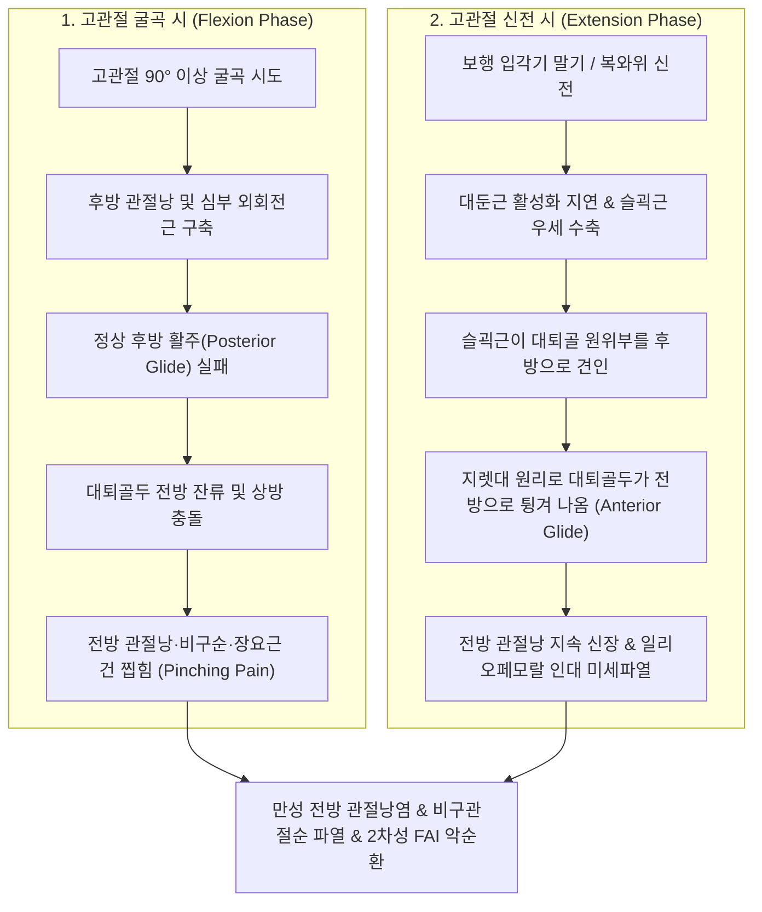
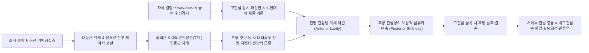
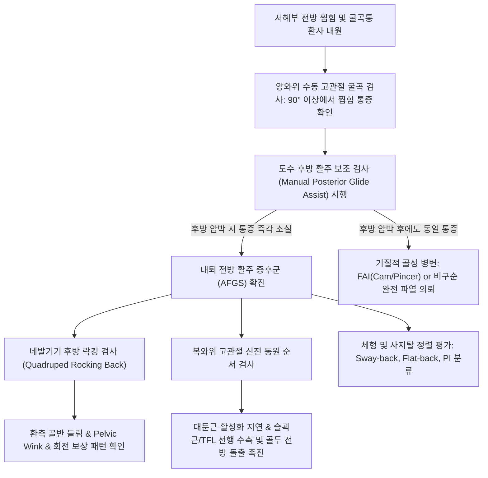
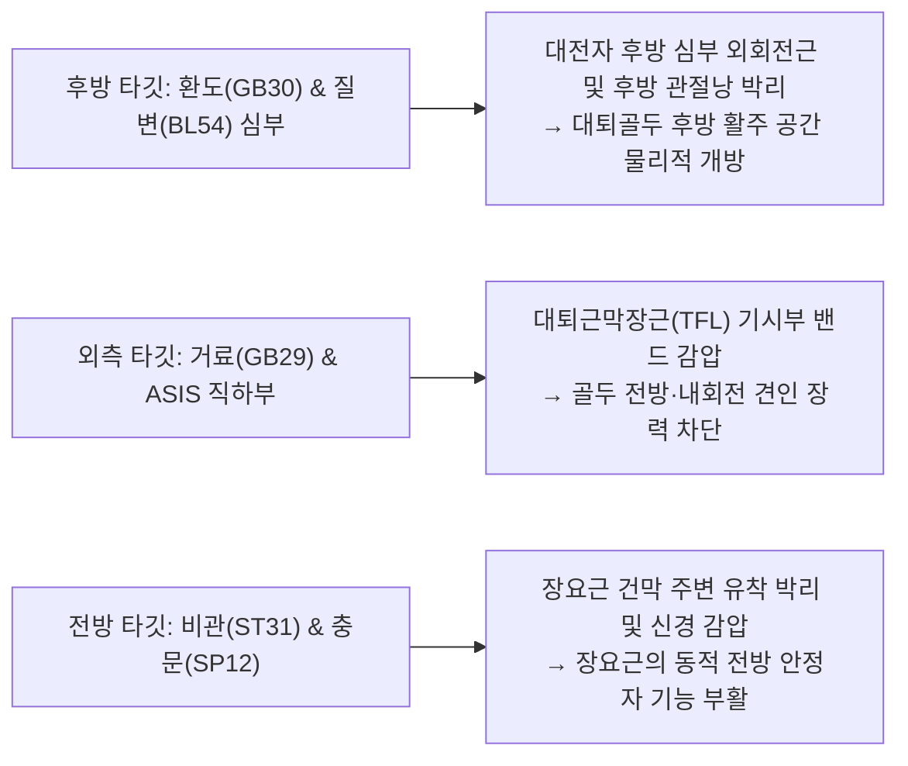
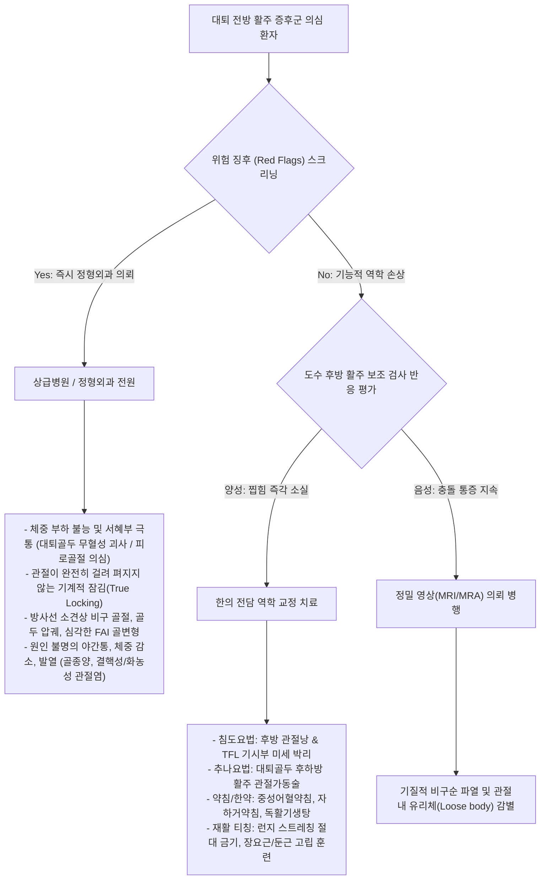
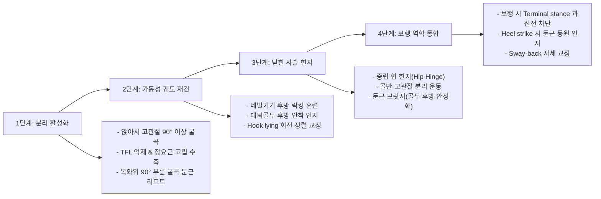

# 🫁 [[대퇴 전방 활주 증후군]] (Anterior Femoral Glide Syndrome)

> **핵심 3줄 요약 (Key Summary)**:
> 🎯 셜리 샤먼(Shirley Sahrmann)의 운동손상증후군(MSI) 핵심 범주로, 고관절 굴곡 시 필수적인 대퇴골두의 '후방 활주(Posterior Glide)'가 결손되고 신전 시 전방 병진 이동(Anterior Translation)이 과도해져 전방 관절낭 및 비구순을 지속 충돌시키는 기능적 역학 질환입니다.
> 🚩 심부 [[장요근]] 및 [[대둔근]]의 동적 제어 결손과 [[슬괵근]]·[[대퇴근막장근]](TFL)의 협동근 지배(Synergistic Dominance)로 인해, 90도 이상 굴곡 시 서혜부 전방 찝힘(Pinching pain) 및 보행 시 고관절 신전통을 유발합니다.
> 🔍 도수 후방 활주 보조 검사(Manual Posterior Glide Correction Test), 네발기기 후방 락킹 검사 및 복와위 신전 동원 순서 검사로 확진하며, 후방 관절낭 침도 박리술, 대퇴골두 후하방 활주 추나, 장요근·대둔근 고립 강화 운동으로 근본 치료합니다.
> ⚠️ 서혜부 앞쪽의 뻣뻣함을 단순 장요근 단축으로 오인하여 무분별한 런지(Lunge) 과신전 스트레칭을 시행하면 전방 관절낭을 영구 이완시키고 비구순 파열을 격발하므로 절대 금기입니다.

---

## 📌 목차
1. [🩺 질환 개요 & 해부학적 병태생리](#1--질환-개요--해부학적-병태생리)
2. [⚡ 병태생리 메커니즘 & 생체역학적 악순환 네트워크](#2--병태생리-메커니즘--생체역학적-악순환-네트워크)
3. [🔍 임상 증상 & 이학적 검사 알고리즘](#3--임상-증상--이학적-검사-알고리즘)
4. [🔀 감별 진단 매트릭스](#4--감별-진단-매트릭스)
5. [🌿 한의 통합 치료 프로토콜](#5--한의-통합-치료-프로토콜)
6. [💊 양방 치료 & 병용·의뢰 기준](#6--양방-치료--병용의뢰-기준)
7. [🏃 재활 운동 & 생활습관 티칭 가이드](#7--재활-운동--생활습관-티칭-가이드)
8. [💡 사용자 진료실 핵심 필기 & 임상 노하우 (Melt-In)](#8--사용자-진료실-핵심-필기--임상-노하우-melt-in)
9. [📚 출처 및 현대 학술 연구 요약](#9--출처-및-현대-학술-연구-요약)

---

## 1. 🩺 질환 개요 & 해부학적 병태생리

### 1.1 질환 정의 및 셜리 샤먼(Shirley Sahrmann)의 MSI 분류
* **대퇴 전방 활주 증후군(Anterior Femoral Glide Syndrome, AFGS)**은 근골격계 운동계 손상 분류(Movement System Impairment, MSI)의 창시자인 셜리 샤먼(Shirley Sahrmann) 워싱턴대학교 교수가 정립한 고관절 운동 역학 질환의 핵심 범주입니다.
* 정상적인 고관절 관절운동학(Arthrokinematics)에서 관절 운동이 일어날 때 대퇴골두(Femoral head)는 관골구(Acetabulum)의 기하학적 중심축인 순간 회전 중심(Instantaneous Center of Rotation, ICR)을 엄격히 유지해야 합니다.
* 그러나 대퇴 전방 활주 증후군에서는 고관절 굴곡 시 대퇴골두가 정상적으로 후방으로 미끄러져 들어가지 못하고, 고관절 신전 시 대퇴골두가 관골구 중심을 벗어나 **전방으로 과도하게 병진 이동(Excessive Anterior Translation)**합니다.
* 이로 인해 대퇴골두 전면이 관골구 전상방 테두리, [[비구관절순]], 전방 관절낭(Anterior capsule), 장골대퇴인대(Iliofemoral ligament / Y-ligament), 그리고 장요근 건 복합체를 지속적으로 압박, 마찰, 충돌(Impingement)시키는 기능적 미세 손상 질환입니다.
* 셜리 샤먼의 분류상 순수 전방 활주 증후군 외에도, 하지의 회전 정렬 불균형과 결합된 **대퇴 전방 활주-내회전 복합 증후군(Anterior Glide with Medial Rotation)** 및 **대퇴 전방 활주-외회전 복합 증후군(Anterior Glide with Lateral Rotation)**의 하위 아형으로 정밀 세분화됩니다.

### 1.2 관절운동학적 기초: 볼록-오목 법칙과 정상 회전 중심
* 고관절은 구상관절(Ball-and-socket joint)로서 볼록한 대퇴골두(Convex surface)가 오목한 관골구(Concave surface) 안에서 움직입니다.
* **볼록-오목 법칙(Convex-Concave Rule)**에 따라:
  * **고관절 굴곡(Flexion)** 시: 대퇴골 간부가 전상방으로 회전(Roll)할 때, 대퇴골두는 관골구 내부에서 **후하방으로 미끄러지는 후방 활주(Posterior glide)**가 완벽히 동반되어야만 관골구 전상방 테두리와의 충돌을 방지할 수 있습니다.
  * **고관절 신전(Extension)** 시: 대퇴골 간부가 후방으로 회전할 때, 대퇴골두는 관골구 내부에서 미세한 전방 활주(Anterior glide)를 일으키나, 강력한 전방 관절낭 인대와 대둔근의 후방 지지력에 의해 전방 병진 거리가 1~2mm 이내로 엄격히 제한되어야 합니다.
* 대퇴 전방 활주 증후군은 바로 이 관절운동학적 활주 법칙이 붕괴되어, 굴곡 시 후방 활주가 차단되고 신전 시 전방 활주가 병적으로 제어되지 못하는 상태입니다.

### 1.3 고관절 주위의 연부조직 해부학 및 비대칭적 변화
대퇴 전방 활주 증후군 환자의 고관절 주위 연부조직은 전방 조직의 병적 이완과 후방 조직의 병적 구축이라는 극단적인 비대칭(Anterior Laxity vs Posterior Stiffness)을 보입니다.

| 해부학적 구조물 | 위치 및 정상 기능 | 대퇴 전방 활주 증후군에서의 병적 변화 | 임상적 결과 |
| :--- | :--- | :--- | :--- |
| **전방 관절낭 및 장골대퇴인대 (Y-ligament)** | 고관절 전면을 덮는 인체에서 가장 강한 인대, 과신전 제한 | 만성적인 대퇴골두의 전방 병진에 의해 지속적으로 과신장(Over-stretched)되어 이완(Laxity) 발생 | 전방 안정성 완전 상실, 환자는 서혜부 앞쪽이 팽팽하게 당긴다고 호소 |
| **후방 관절낭 (Posterior Capsule)** | 고관절 후면을 감싸며 고관절 내회전 및 과굴곡 제한 | 섬유성 비후 및 콜라겐 교차결합 증가로 극도로 뻣뻣해짐(Stiffness/Tightness) | 고관절 굴곡 시 대퇴골두가 후방으로 미끄러져 들어갈 공간을 물리적으로 차단 |
| **심부 외회전근군 ([[이상근]], [[상쌍자근]], [[하쌍자근]], [[내폐쇄근]])** | 대퇴골 대전자 후면에 부착하여 고관절 동적 회전 및 골두 안정화 | 단축 및 만성 경결, 유착 형성으로 후방 관절낭과 함께 후방 가동성을 봉쇄 | 고관절 굴곡 시 후방 활주 장애 격발, 보상적 외회전 경향 유도 |
| **심부 [[장요근]] (Iliopsoas Complex)** | 대퇴골두 전면을 활주하며 소전자에 부착, 골두를 관골구에 안착 | 신장성 약화(Long and weak), 동적 전방 안정자 기능 상실 | 골두를 후상방 관골구 중심으로 끌어당겨 주지 못하여 전방 이탈 방조 |
| **[[대둔근]] (Gluteus Maximus)** | 고관절 신전의 주동근, 대퇴골두를 후방에서 지지하는 강력한 앵커 | 상위 억제(Reciprocal inhibition)로 인한 활성화 지연 및 근위축 | 보행 입각기 말기 대퇴골두가 전방으로 튕겨 나가는 것을 제어하지 못함 |

### 1.4 역학 및 호발 체형
* **자세성 결함 호발군**:
  * **[[sway back]] 체형 및 [[관골 후방 경사]](Posterior Pelvic Tilt)**: 골반이 신체 중심선보다 전방으로 밀려 나가고 상체는 뒤로 젖혀지는 체형. 평상시 서 있을 때 고관절이 항상 상대적 과신전(Hyperextension) 상태에 놓이며, 환자는 근육을 쓰지 않고 대퇴골두를 전방 관절낭과 Y-인대에 얹어 놓은 채(Hanging on Y-ligament) 체중을 지지합니다.
  * **편평등(Flat-back) 체형**: 요추 전만이 소실되고 천골 경사각이 감소하여 고관절 후방 관절낭에 상시 압박이 가해집니다.
* **스포츠 활동군**: 마라톤 및 장거리 육상 선수, 발레 및 현대 무용수, 기계 체조 선수, 축구 선수, 요가 수련자 등 고관절 신전 가동범위를 극단적으로 사용하거나 발차기를 반복하는 군.
* **성별 및 골반 입사각(Pelvic Incidence, PI) 특성**:
  * **남성 (낮은 PI, Type 1~2)**: 골반 후방 경사, 편평등, 고관절 외회전 결합형 전방 활주가 호발.
  * **여성 (높은 PI, Type 3~4)**: 요추 과전만, 골반 전방 경사, 대퇴 내회전 및 슬관절 외반(Genu valgum) 결합형 전방 활주가 다빈도.

---

## 2. ⚡ 병태생리 메커니즘 & 생체역학적 악순환 네트워크

### 2.1 관절운동학 파탄: 굴곡 시 후방 활주 결손 & 신전 시 전방 밀림
Cara Lewis and Shirley Sahrmann (2007, PMID: 17707385)의 기념비적 근골격계 생체역학 연구는 대퇴골두에 작용하는 관절 접촉력과 병진 벡터를 수학적으로 완벽히 증명하였습니다.

1. **굴곡 단계의 병태역학 (후방 활주 결손)**:
   * 의자에 앉거나 계단을 오를 때 대퇴골이 90도 이상 굴곡되면, 대퇴골두는 뒤쪽으로 미끄러져 들어가야 관골구 전상방 테두리와의 거리를 유지할 수 있습니다.
   * 그러나 후방 관절낭의 뻣뻣함(Stiffness)으로 인해 골두가 뒤로 가지 못하고 관골구 전방에 꽉 끼이게 되며, 이로 인해 전방 관절낭, [[비구관절순]], 장요근 점액낭이 대퇴골두와 관골구 사이에 끼여 날카로운 찝힘 통증(Pinching pain)이 격발됩니다.
2. **신전 단계의 병태역학 (전방 병진의 지렛대 원리)**:
   * 고관절 신전 시 주동근은 대퇴골 근위부 후면에 직접 부착하는 [[대둔근]]이어야 합니다. 대둔근이 수축하면 대퇴골두를 후방에서 강력하게 당겨 관골구 중심에 안정화시킵니다.
   * 그러나 대둔근이 억제되고 좌골결절에서 기시하여 경골/비골에 부착하는 **[[슬괵근]](Hamstrings)**이 주동근으로 과작용(Synergistic dominance)하면 치명적인 역학적 왜곡이 일어납니다.
   * 슬괵근은 대퇴골두 근위부가 아닌 대퇴골 원위부와 무릎 하퇴를 뒤로 잡아당기므로, 대퇴골 전체가 시소(Seesaw) 형태의 1종 지렛대로 작동하여 대퇴골두가 관골구 바깥 앞쪽으로 강하게 밀려나오게 됩니다(Anterior Femoral Head Translation).

### 2.2 근육 불균형과 협동근 지배(Synergistic Dominance) 네트워크
* **[[장요근]] 약화 vs [[대퇴근막장근]](TFL)·[[대퇴직근]]의 과사용**:
  * 견관절에서 [[견갑하근]](Subscapularis)이 상완골두 전면을 지지하며 후방 안착을 유도하듯, 고관절에서는 **[[장요근]]이 대퇴골두 전면을 지지하여 관골구 중심에 골두를 밀착시키는 유일한 '동적 전방 안정자(Dynamic Anterior Stabilizer)'**입니다.
  * 만성 좌식 생활이나 잘못된 자세로 장요근이 억제·약화되면, 천층의 고관절 굴곡 협동근인 [[대퇴근막장근]](TFL)과 [[대퇴직근]]이 굴곡을 보상합니다.
  * TFL은 골반 외측 ASIS에서 기시하여 전하방 및 외측 벡터를 형성하므로, 골두를 관골구 안쪽으로 밀어 넣지 못하고 오히려 대퇴골두를 전방으로 밀어내며 내회전 토크를 유발하여 충돌을 악화시킵니다.
* **[[대둔근]] 수축 지연 vs [[슬괵근]]의 과긴장**:
  * Lewis and Sahrmann (2009, PMID: 19478835)의 근전도(EMG) 연구에 따르면, 전방 통증 환자는 엎드려 다리를 들 때(복와위 신전) 대둔근보다 슬괵근과 척추기립근이 먼저 점화(Premature firing)되는 운동 제어 이상을 보였습니다.
  * 대둔근의 힘이 50% 감소할 때 대퇴골두에 가해지는 전방 전단력은 **2배 이상 증가**함이 생체역학적으로 규명되었습니다.
* **외회전근군 구축과 회전 정렬 왜곡**:
  * 후방의 심부 외회전근군([[이상근]], [[상쌍자근]], [[하쌍자근]], [[내폐쇄근]])이 굳어지면 대퇴골두를 전외측으로 밀어내는 고정 편향(Positional bias)이 고착화됩니다.

### 2.3 생체역학적 인과 사슬 다이어그램

---

## 3. 🔍 임상 증상 & 이학적 검사 알고리즘

### 3.1 주요 자각 증상 및 임상 특징
* **서혜부(Groin) 전방 찝힘 및 둔통**:
  * 가장 전형적인 주소증으로, 사타구니 안쪽 깊숙한 곳에서 무언가 꽉 끼이거나 찌르는 듯한 날카로운 통증(Pinching pain)을 호소합니다.
* **굴곡 말기 통증 악화 (End-range Flexion Pain)**:
  * 0도에서 70도까지는 통증 없이 부드럽게 구부러지나, **90도 이상 깊게 굴곡되는 순간(스쿼트 바닥 지점, 양말 신기, 쪼그려 앉기, 낮은 의자에 앉기, 운전석에서 내릴 때)** 대퇴골두가 전방에 걸리며 날카로운 통증이 유발됩니다.
* **고관절 신전 시 전방 견인통**:
  * 보행 중 다리가 신체 뒤쪽으로 빠지는 유각기 직전(Terminal stance)이나 엎드려 다리를 뒤로 들 때 서혜부 앞쪽이 팽팽하게 찢어질 듯 당기는 통증이 발생합니다.
* **가짜 장요근 단축감 (Pseudo-psoas tightness)**:
  * 환자는 서혜부 앞쪽이 뻣뻣하고 당긴다고 느껴 장요근이 짧아진 줄 알고 런지(Lunge) 스트레칭을 끊임없이 시도하지만, 스트레칭 직후 전방 관절낭이 더 뜯겨 나가며 증상이 급격히 악화됩니다.

### 3.2 단계별 특이 이학적 검사 알고리즘

#### ① 도수 후방 활주 보조 검사 (Manual Posterior Glide Correction Test) — 확진 검사
* **검사 방법**:
  1. 환자를 앙와위로 눕히고 검사자가 환자의 고관절을 수동으로 90도 이상 굴곡시켜 서혜부 전방 찝힘 통증이 재현되는지 확인합니다.
  2. 다음 단계에서 검사자의 한 손을 대퇴골 근위부 전면(서혜인대 바로 아래)에 얹고, 바닥 방향(후하방 45도)으로 대퇴골두를 지그시 밀어 넣으면서(Posterior glide assist) 동시에 고관절을 다시 굴곡시킵니다.
* **양성 판독**:
  * 단순 굴곡 시 발생하던 서혜부 찝힘 통증이 **검사자가 대퇴골두를 후방으로 밀어주었을 때 마법처럼 즉각 소실되거나 현저히 경감**된다면 대퇴 전방 활주 증후군으로 100% 확진할 수 있습니다.

#### ② 네발기기 후방 락킹 검사 (Quadruped Rocking Back Test)
* **검사 방법**:
  * 환자에게 양손과 양 무릎을 바닥에 대는 네발기기 자세(All-fours position)를 취하게 하고, 요추의 중립(평평한 등)을 유지한 상태에서 엉덩이를 뒤꿈치 쪽으로 천천히 내리게(Rocking back) 합니다.
* **양성 판독**:
  * **정상**: 양측 대퇴골두가 관골구 후방으로 매끄럽게 미끄러져 들어가며 척추 변형 없이 엉덩이가 뒤꿈치에 닿음.
  * **전방 활주 환측**: 후방 활주가 막혀 고관절 굴곡이 정지되므로, 환측 골반이 위로 들리거나 반대편으로 회전하는 보상 동작이 나타납니다.
  * 또한 고관절 대신 요추를 둥글게 말아버리는 **요추 보상성 굴곡(Pelvic wink)**이 조기에 격발되거나 환측 서혜부 찝힘이 나타납니다.

#### ③ 복와위 고관절 신전 근육 동원 순서 검사 (Prone Hip Extension Test)
* **검사 방법**:
  * 환자를 엎드리게(복와위) 한 후 검사자는 한 손의 엄지와 검지를 [[대둔근]]에, 다른 손을 동측 [[슬괵근]]과 요추 기립근에 얹습니다.
  * 환자에게 무릎을 편 채 다리를 천장 방향으로 10~15cm 들어 올리도록 지시합니다.
* **양성 판독**:
  * **정상 동원 순서**: 대둔근 수축 개시 → 슬괵근 협력 수축 → 반대측 기립근 안정화.
  * **병적 패턴 (양성)**: 대둔근의 윤곽이 거의 보이지 않고 **슬괵근과 동측 요추 기립근이 비정상적으로 먼저 튕기듯 수축**하며, 검사자가 대퇴골두 전면을 촉진했을 때 대퇴골두가 테이블 바닥을 전방으로 강타하며 밀려나오는 것이 촉진됩니다.

#### ④ 변형 토마스 검사 (Modified Thomas Test with Anterior Head Palpation)
* 환자를 검사대 끝에 걸터앉게 한 후 한쪽 무릎을 가슴에 안고 뒤로 눕게 합니다.
* 늘어뜨린 다리의 고관절이 신전될 때, 검사자의 손으로 대퇴골두 전면을 촉진합니다.
* 장골대퇴인대가 이완된 환자는 대퇴골두가 전상방으로 볼록하게 융기되어 튀어나오는 아탈구감을 손끝으로 명확히 느낄 수 있습니다.

---

## 4. 🔀 감별 진단 매트릭스

대퇴 전방 활주 증후군은 기능적 운동 역학 장애이므로, 기질적 골성 변형이나 연골 파열과의 감별이 치료 성패를 좌우합니다.

| 감별 질환 | 병리 기전 및 본질 | 주 통증 양상 및 부위 | 이학적 검사 감별점 | 영상의학적 특이 소견 | 치료 방향성 차이 |
| :--- | :--- | :--- | :--- | :--- | :--- |
| **[[대퇴 전방 활주 증후군]] (AFGS)** | 기능적 관절운동학 파탄 (후방 활주 결손, 전방 관절낭 이완) | 굴곡 90° 이상 찝힘, 신전 시 전방 견인통 | **도수 후방 활주 시 통증 즉각 소실**, 복와위 신전 시 슬괵근 우세 | X-ray/MRI상 뼈 이상 없음 (기능적 병변) | **비수술적 역학 교정**: 침도, 후방 활주 추나, 장요근/둔근 운동 |
| **[[비구관절순 파열]] (Acetabular Labral Tear)** | 섬유연골성 관절순의 기질적 단열 (전방 활주가 만성화된 종착역) | 서혜부 심부의 날카로운 자통, 고관절 회전 시 걸림(Clicking) | FADIR 검사 양성, McCarthy 검사 양성, 기계적 잠김(Locking) | MRA(조영 MRI)상 비구 전상방 관절순 내 조영제 침투 및 단열 | 관절순 안정화 침구 치료, 보존적 치료 실패 시 관절경 봉합술 |
| **[[대퇴비구 충돌증후군]](FAI)** | 골성 변형: 캠(Cam, 골두 비후) 또는 핀서(Pincer, 비구 과포개짐) | C-sign 서혜부 심부 뻐근함, 장시간 좌식 후 악화 | FADIR 검사 양성, 후방 활주 보조를 해도 골 충돌로 통증 잔존 | 골반 X-ray(Dunn view)상 Alpha angle >55°, Cross-over sign | 골성 돌출이 심한 경우 관절경 골 절제술(Osteoplasty) 의뢰 |
| **[[장요근점액낭염]] (Iliopsoas Bursitis)** | 장요근 건과 관절낭 사이 점액낭의 급만성 무균성 염증 | 서혜인대 직하부 국소 압통, 계단 오를 때 통증 | 능동 고관절 굴곡 저항 시 극심한 통증, 수동 신전통 | 초음파상 장요근 건 하부 저에코성 낭종성 삼출액 저류 | 점액낭 부위 소염약침 및 중성어혈약침 주입, 단기 안정 |
| **대전자 통증 증후군 ([[대전자점액낭염]]/둔근건병증)** | 대전자 외측 연부조직 염증 및 [[중둔근]]/소둔근 건병증 | 대퇴 외측 대전자 부위 압통, 옆으로 누울 때 외측 통증 | 대전자 직접 골 압통, 외전 저항통, 단하지 지지 시 외측통 | 초음파/MRI상 대전자 점액낭 삼출, 중둔근 건 부착부 고신호강도 | 고관절 외측에 국한되며 서혜부 전방 통증 및 찝힘 없음 |
| **대퇴골두 무혈성 괴사 (AVN)** | 대퇴골두 혈류 차단으로 인한 골세포 괴사 및 골두 붕괴 | 체중 부하 시 서혜부 심부 극통, 야간 안정 시 통증 | Patrick 검사 양성, 고관절 내회전/외회전 전방향 극심한 제한 | X-ray상 골두 압궤, Crescent sign, MRI T1 저신호 밴드 | **절대적 응급/전문의 의뢰**: 체중 부하 금지, 인공관절 치환술 |
| **소전자 스트레스 골절** | 장요근 건의 반복 견인으로 인한 소전자 피로 골절 | 서혜부 내측 깊은 골 통증, 보행 시 다리 끌림 | 소전자 부위 심부 골 압통, 앙와위 직하지 거상(SLR) 불능 | 골스캔/MRI상 소전자 골수 부종 및 피질골 골절선 확인 | 4~6주 절대 비체중부하(목발 보행), 골유합 유도 한약 투여 |

---

## 5. 🌿 한의 통합 치료 프로토콜

한의학에서 대퇴 전방 활주 증후군은 고관절 주위 기혈(氣血)의 순환이 저체되고 근육의 협조와 균형이 무너져 관절의 정상 위치를 상실한 **근비(筋痺)**, **골비(骨痺)** 및 **관절실형(關節失衡)**의 범주로 파악합니다. 치료의 핵심은 굳어진 후방 관절낭을 열어주고(開鬱通絡), 약화된 전방 및 둔근 조직을 보강하여(補虛強筋) 관절의 본래 궤도를 회복시키는 것입니다.

### 5.1 한의 변증 분류
* **간신휴손·근골실양형(肝腎虧損·筋骨失養型)**:
  * 장기간의 자세 불량 및 만성 과사용으로 간신(肝腎)이 허약해져 근건의 탄력성이 소실되고 둔근이 위축되어 발생.
  * 증상: 서혜부가 은은하게 찝히고 다리에 힘이 빠지며, 오래 서 있으면 허리와 골반이 무너지는 느낌.
  * 설진: 설담태백(舌淡苔白). 맥진: 맥세약(脈細弱).
  * 치법: 보간신(補肝腎), 강근골(强筋骨), 조기혈(調氣血).
* **기체어혈·경락조체형(氣滯瘀血·經絡阻滯型)**:
  * 반복적인 전방 관절낭 충돌로 인해 미세 출혈과 어혈이 맺혀 국소 유착과 날카로운 자통이 고착화된 상태.
  * 증상: 특정 각도(굴곡 90도)에서 칼로 찌르는 듯한 날카로운 찝힘, 누르면 몹시 아픔(거안).
  * 설진: 설자암(舌紫暗) 또는 어점. 맥진: 맥현삽(脈弦澁).
  * 치법: 활혈화어(活血化瘀), 소종지통(消腫止痛), 통락개비(通絡開痺).

### 5.2 특수 침도요법 (Acupotomy) 프로토콜
대퇴 전방 활주 증후군 치료에서 가장 결정적인 시술은 **후방 관절낭 및 심부 외회전근의 유착을 물리적으로 박리하여 대퇴골두의 후방 활주 경로를 개방하는 침도요법**입니다.

1. **후방 관절낭 및 심부 외회전근 이완술**:
   * **환자 체위**: 환측을 위로 한 측와위(Side-lying), 고관절 45도 굴곡.
   * **자입점**: 대전자 후연과 좌골결절을 잇는 선상의 압통점(환도 및 심부 외회전근 부착부).
   * **시술 방법**: 0.75mm × 60mm 멸균 소침도를 수직 자입하여 대퇴골 후방 대전자 능선 및 관절낭 골면에 접촉시킵니다. 골막면에서 침도를 1mm 후퇴시킨 뒤, 굳어진 이상근, 쌍자근, 대퇴방형근 건막의 섬유성 유착을 결 방향으로 2~3회 박리(Stripping)합니다. 대퇴골두가 뒤로 미끄러져 들어갈 수 있는 물리적 체적이 즉각 확보됩니다.
2. **외측 대퇴근막장근(TFL) 기시부 감압술**:
   * **자입점**: ASIS 직하방 2~3cm 지점의 TFL 근복 내 가장 단단한 경결 밴드.
   * **시술 방법**: 침도 날을 하지 장축과 평행하게 두고 진입하여 장경인대 근위부의 긴장 밴드를 2회 절개(Cutting)하여 감압합니다. 고관절 굴곡 시 TFL이 대퇴골두를 전방으로 잡아채는 비틀림 토크를 차단합니다.
3. **전방 장요근 부착부 미세 감압술**:
   * **자입점**: 대퇴삼각 외측, 비관(ST31) 혈위 부근.
   * **주의**: 대퇴동맥 맥박을 왼손으로 촉지하여 완벽히 내측으로 밀어 보호한 후, 장요근 건 외측면을 따라 조심스럽게 자입하여 건막 주변의 유착을 미세 박리합니다.

### 5.3 약침 및 재생 치료
* **전방 염증 제어: [[중성어혈약침]] & [[황련해독탕약침]]**:
  * 타깃: 서혜인대 하방, 비관(ST31), 충문(SP12) 주변의 전방 관절낭 및 장요근 점액낭 부위.
  * 용량: 1.0 ~ 1.5cc 분할 주입.
  * 효과: 전방 충돌로 인해 발생한 관절낭 미세 부종, 무균성 염증 삼출액 흡수, 신경 포착성 뻐근함 해소.
* **후방 조직 강화: 자하거(태반)약침 & [[신바로약침]]**:
  * 타깃: 대전자 후방 관절낭 부착부, 좌골결절 상외측, [[대둔근]] 기시부.
  * 용량: 1.5 ~ 2.0cc 심층 주입.
  * 효과: 약화되고 신장된 대둔근-건막 복합체의 콜라겐 합성 촉진, 인대 재생 및 만성 퇴행 억제.

### 5.4 고관절 후하방 활주 교정 추나요법 (Chuna Mobilization)
* **대퇴골두 후하방 활주 관절가동술 (Posterior-Inferior Glide Mobilization)**:
  * **환자 체위**: 앙와위로 눕고 환측 고관절을 90도 굴곡, 슬관절 90도 굴곡.
  * **시술 방법**:
    1. 치료사는 환측 다리 안쪽에 서서 치료용 골반 벨트(Belt)를 치료사의 둔부와 환자의 대퇴골 최상단 근위부(서혜부 접히는 선 바로 아래)에 겁니다.
    2. 양손으로 환자의 무릎을 부드럽게 감싸 쥐고, 치료사의 체중을 뒤로 실어 벨트를 통해 대퇴골두를 **후하방 45도(바닥 및 발 쪽) 방향으로 지속 견인(Long-axis distraction & Posterior glide)**합니다.
    3. Grade III~IV의 진폭으로 30초간 3~5회 율동적 가동술(Oscillation)을 시행합니다.
  * **효과**: 후방 관절낭의 기계적 신장을 유도하여 정상적인 굴곡 관절운동학 궤도를 재건합니다.
* **골반 및 요추 사지탈 밸런스 교정 추나**:
  * Sway-back 및 골반 후방 경사를 교정하기 위한 장골 전방 변위 기법과 요추 신전 가동술을 병행하여 전신 무게중심을 정상화합니다.

### 5.5 침구 및 전침 치료
* **핵심 취혈점**:
  * 고관절 주위: 거료(GB29), 환도(GB30), 비관(ST31), 충문(SP12), 승부(BL36), 은문(BL37).
  * 원위부 배혈: 양릉천(GB34, 근회), 족삼리(ST36), 현종(GB39, 수회), 태충(LR3).
* **전침 자극 프로토콜**:
  * **[[대둔근]] 재교육**: 환도(GB30)-승부(BL36) 구간에 **2Hz 저빈도 강자극**을 적용하여 근육의 수축-이완을 육안으로 관찰하며, 억제된 둔근 운동신경원의 동원 역치를 낮춥니다.
  * **[[슬괵근]] 과긴장 완화**: 은문(BL37)-위중(BL40) 구간에 **100Hz 고빈도** 또는 저강도 혼합파를 적용하여 과도한 근방추 활성을 억제합니다.

### 5.6 단계별 한약 치료 처방

| 치료 단계 | 주치 변증 | 추천 한약 처방 | 주요 구성 본초 | 임상 치료 목표 |
| :--- | :--- | :--- | :--- | :--- |
| **초기 충돌 염증기 (1~2주)** | 기체어혈, 관절종통 | **[[작약감초탕]](芍藥甘草湯)** 합 **도홍사물탕** | 백작약(20g), 감초(8g), 당귀, 천궁, 도인, 홍화, 현호색 | 전방 관절낭의 급성 연축 및 신경성 통증 차단, 미세 어혈 소퇴 |
| **중기 역학 교정기 (3~4주)** | 풍한습비, 경락어체 | **서경탕(舒經湯)** 또는 **오적산(五積散)** 가감 | 강활, 방풍, 당귀, 천궁, 창출, 진피, 반하, 적작약 + 우슬, 모과 | 관절낭 후방의 섬유성 경결 연화, 경락 소통, 관절 가동역 회복 |
| **후기 둔근 강화기 (5주~)** | 간신휴손, 근위무력 | **[[독활기생탕]](獨活寄生湯)** 가미 | 독활, 상기생, 두충, 우슬, 인삼, 복령, 숙지황 + [[속단]], 골쇄보, 구척 | 대둔근 및 장요근의 근력 복원, 건막 인장 강도 증대, 체형 역학 영구 안정화 |

---

## 6. 💊 양방 치료 & 병용·의뢰 기준

### 6.1 양방 보존적 치료 및 약물 요법
* **약물 치료**:
  * 비스테로이드성 소염진통제([[NSAIDs]]): 관절낭염 및 점액낭염으로 인한 급성 통증기에 단기(1~2주) 처방.
  * 근이완제: TFL 및 슬괵근의 과도한 근긴장을 완화하기 위해 병용.
* **물리치료 및 관절가동술**:
  * 정형도수물리치료(Orthopedic Manual Physical Therapy)를 통해 대퇴골두 후방 활주 도수 치료(Posterior glide mobilization)를 적용합니다.

### 6.2 주사 요법의 주의점 및 한계
* **초음파 유도하 관절강내 주사 (Intra-articular Injection)**:
  * 비구순 파열이나 급성 활액막염이 동반된 경우 코르티코스테로이드와 국소마취제 혼합액을 관절강 내로 주입하여 염증을 소퇴시킵니다.
  * ⚠️ **주의**: 스테로이드를 관절강 전방에 반복 주사할 경우 이미 늘어나 있는 전방 관절낭과 일리오페모랄 인대의 교차결합을 더욱 약화시켜 전방 불안정성을 영구화시킬 위험이 있습니다.
* **초음파 유도하 히알루론산(Hyaluronic Acid) 주사**:
  * 관절 내 연골 마찰을 줄이고 윤활 작용을 개선하기 위해 적용되며 연부조직 손상 위험이 적어 안전한 대안입니다.

### 6.3 수술적 적응증 (Surgical Indications)
대퇴 전방 활주 증후군은 원칙적으로 운동 조절과 생체역학의 이상이므로 비수술적 한의-물리 치료가 1차 표준이지만, 다음과 같은 기질적 파탄이 확인되면 수술을 의뢰합니다.
* **절대적 수술 적응증**:
  1. 관절조영 MRI(MRA)상 **[[비구관절순]]의 광범위한 불안정성 파열(Unstable Labral Tear)**이 확인되고, 기계적 관절 잠김(Locking)과 심각한 파행이 동반될 때.
  2. 대퇴골두의 골성 캠(Cam) 병변이 극심하여(Alpha angle >65°) 비수술적 가동술로도 물리적 충돌이 해소되지 않을 때.
  3. 관골구 이형성증(Acetabular Dysplasia)에 의한 이차성 구조적 전방 아탈구.
* **수술 기식**:
  * **고관절 관절경 수술(Hip Arthroscopy)**: 파열된 비구순을 앵커로 봉합(Labral repair)하고, 충돌을 일으키는 대퇴골두 경부의 골극을 깎아내는 골성형술(Femoroacetabular osteoplasty) 시행. 필요시 이완된 전방 관절낭을 조여주는 관절낭 축소술(Capsular plication) 병행.

### 6.4 한의 병용 판단 및 전문과 의뢰 기준 (Red Flags)

---

## 7. 🏃 재활 운동 & 생활습관 티칭 가이드

대퇴 전방 활주 증후군 재활의 대원칙은 **"협동근(TFL, 슬괵근)을 철저히 억제하고, 주동근([[장요근]], [[대둔근]])을 선택적으로 분리 수축시키는 뇌신경-근육 재교육"**입니다.

### 7.1 🚨 절대 금기 운동: 런지(Lunge) 스트레칭의 치명적 위험
* **임상 현장의 비극**: 환자들은 사타구니 앞쪽이 뻐근하고 당기면 십중팔구 "장요근이 굳었다"고 자가 진단하고, 다리를 뒤로 길게 빼고 골반을 앞으로 밀어 넣는 **런지(Lunge) 고관절 과신전 스트레칭**을 매일 반복합니다.
* **치명적 파괴 기전**:
  * 대퇴 전방 활주 증후군 환자의 전방 관절낭과 Y-인대는 이미 헐거워질 대로 헐거워져 있습니다(Laxity).
  * 이 상태에서 런지 스트레칭을 하면 대퇴골두가 전방으로 완전히 이탈하며 헐거운 전방 관절낭을 더욱 찢어발기게 되고, 비구관절순을 압궤시켜 회복 불능의 기질적 파열로 직행하게 됩니다.
* **환자 티칭 지침**: "사타구니 앞쪽을 뒤로 젖혀 늘리는 모든 형태의 스트레칭을 오늘 즉시 중단하십시오!"

### 7.2 단계별 기능적 재활 운동 프로토콜

#### 1단계: 협동근 억제 및 주동근 고립 활성화 (Phase 1)
* **① [[대퇴근막장근]](TFL) 억제 및 [[장요근]] 선택적 동원 훈련**:
  * 의자에 척추를 세우고 바르게 앉습니다(고관절 90도 굴곡 상태).
  * 검사자 또는 환자 자신의 손을 허벅지 전외측(TFL 부위)에 얹어 TFL이 불룩 튀어나오지 않는지 감시합니다.
  * 그 상태에서 무릎을 가슴 쪽으로 2~3cm만 살짝 들어 올립니다(고관절 90도 이상의 굴곡).
  * 90도 이상 각도에서는 대퇴직근과 TFL의 지레팔이 급감하고 순수 장요근만이 작용합니다. 서혜부 깊숙한 곳의 뻐근한 수축감을 인지하며 5초간 유지(10회씩 3세트).
* **② [[슬괵근]] 무력화 및 [[대둔근]] 고립 수축 훈련 (Prone Knee-Bent Hip Extension)**:
  * 엎드린 자세(복와위)에서 환측 **무릎을 90도로 완전히 구부립니다**.
  * 무릎을 90도 구부리면 슬괵근이 이미 단축되어 더 이상 힘을 쓸 수 없는 **능동적 기능부전(Active Insufficiency)** 상태에 빠집니다.
  * 이 상태에서 엉덩이(대둔근)에 먼저 힘을 꽉 준 뒤, 허벅지를 바닥에서 3~5cm만 살짝 들어 올립니다.
  * 슬괵근의 개입 없이 순수 대둔근만으로 대퇴골을 신전시키는 신경근 연결을 재건합니다 (10회씩 3세트).

#### 2단계: 관절운동학적 가동성 궤도 재건 (Phase 2)
* **네발기기 후방 락킹 운동 (Quadruped Rocking Back Exercise)**:
  * 네발기기 자세에서 척추를 완전히 중립으로 유지합니다.
  * 허리가 둥글게 말리지 않는 범위까지만 천천히 엉덩이를 뒤로 보냅니다.
  * 대퇴골두가 골반 안쪽 깊숙이 쏙 미끄러져 들어가는 느낌(Posterior glide)을 뇌에 학습시킵니다. 서혜부에 찝힘이 나타나기 직전 각도에서 멈추고 제자리로 돌아옵니다 (15회씩 3세트).

#### 3단계: 닫힌 사슬 힙 힌지 및 안정화 (Phase 3)
* **중립 힙 힌지(Neutral Hip Hinge)**:
  * 벽을 등지고 30cm 앞에 서서, 무릎을 최소한으로 구부린 채 고관절만 접어 엉덩이로 벽을 터치하고 돌아옵니다.
  * 척추의 중립을 유지하며 고관절 회전 중심축이 관골구 중심에 머무르도록 하는 기능적 패턴을 확립합니다.

#### 4단계: 보행 역학 재교육 (Phase 4)
* **유각기 직전(Terminal Stance) 과신전 제어**:
  * 걸을 때 뒷다리가 몸 뒤로 과도하게 빠지며 골반이 앞으로 밀려 나가는 동작을 차단합니다.
  * 고관절 신전 각도를 10도 이내로 제한하고, 신전 시 허리가 젖혀지지 않도록 복부 코어를 유지합니다.
* **접지기(Heel Strike) 둔근 안착 훈련**:
  * 발뒤꿈치가 지면에 닿는 순간 대둔근에 의도적으로 힘을 주어 대퇴골두를 관골구 안쪽으로 당기면서 지지하도록 훈련합니다.

---

## 8. 💡 사용자 진료실 핵심 필기 & 임상 노하우 (Melt-In)

### 8.1 원장실 실전 문진 및 체형 역학 평가 필기
* **"서혜부 앞쪽이 뻣뻣하다고 런지 스트레칭을 열심히 했다는 환자는 100% 대퇴 전방 활주다!"**:
  * 환자가 문을 열고 들어오며 "원장님, 사타구니 앞쪽이 너무 뻣뻣해서 매일 런지 자세로 다리를 뒤로 찢고 장요근 스트레칭을 1시간씩 하는데 이상하게 할수록 더 아파요"라고 말한다면 검사할 필요도 없이 대퇴 전방 활주 증후군입니다.
  * 이 환자들은 앞쪽 관절낭이 늘어나서 팽팽하게 굳어 있는 것인데, 이를 '근육이 짧아서 뻣뻣하다'고 착각한 것입니다. 치료의 첫걸음은 무조건 전방 스트레칭을 금지시키고 후방 활주를 유도하는 것입니다.
* **굴곡-외회전은 편하고, 신전-내회전 및 순수 굴곡 시 찝히는 생체역학적 이유**:
  * 고관절은 해부학적으로 굴곡 시 후방 활주, 외회전 시 전방 활주가 결합되어 일어납니다.
  * 따라서 이미 대퇴골두가 전방으로 활주되어 있는 환자는 고관절을 외회전(양반다리 방향)시키면 관골구 전상방 변연과의 거리가 확보되므로 덜 찝히고 편안하게 느낍니다.
  * 반대로 순수 굴곡을 시키거나 내회전을 동반하면 골두 전면이 관골구 전상방 테두리에 정면으로 들이받히며 극심한 찝힘이 격발됩니다. 치료의 핵심은 **과도한 외회전 보상을 제한하면서 순수한 후방 활주 궤적을 뚫어주는 것**입니다.

### 8.2 외회전 우세 패턴 vs 내회전 동반 패턴 교정 팁
* **외회전 우세 패턴 ( 남성, Flat-back, Sway-back 호발 )**:
  * 환자를 무릎 세우고 눕혔을 때(Hook lying) 환측 다리가 바깥으로 툭 벌어집니다.
  * 엉덩이 뒤쪽 심부 외회전근군이 밧줄처럼 굳어 골두를 전외측으로 밀고 있는 상태입니다.
  * **교정 팁**: 침도로 환도와 이상근 부착부를 박리한 후, 탄력 밴드를 무릎 바깥에 감거나 단단한 베개를 무릎 사이에 끼우고 다리를 모으는 내전 및 점진적 내회전 조절 능력을 재교육해야 합니다.
* **내회전 동반 패턴 ( 여성, 골반 전방 경사, 요추 과전만 호발 )**:
  * TFL과 소둔근 전부 섬유가 극도로 긴장하여 굴곡 시 대퇴골이 안쪽으로 돌아가며 충돌합니다.
  * **교정 팁**: ASIS 직하부 TFL을 침도로 감압하고, 중둔근 후부 섬유와 이상근의 원심성 제어력을 강화해야 합니다.

### 8.3 골반 입사각(Pelvic Incidence, PI) 및 시상면 정렬 연계 분석
환자의 방사선 사진 및 체형 분석 시 사지탈 밸런스(Sagittal balance)를 파악하면 전방 활주의 발생 원인을 근본적으로 이해할 수 있습니다.
* **Type 1 & Type 2 (낮은 골반 입사각, PI < 45°)**:
  * 천골이 서 있고 요추 전만이 편평한 Flat-back 및 Sway-back 체형.
  * 상체 무게중심이 뒤로 쏠려 골반이 앞으로 밀려나오며, 고관절 과신전으로 인한 순수 대퇴 전방 활주가 형성되기 가장 쉽습니다.
* **Type 3 & Type 4 (높은 골반 입사각, PI > 55°)**:
  * 천골 경사각이 크고 요추 과전만이 동반되는 체형.
  * 골반 전방 경사와 함께 고관절 내회전 경향이 결합된 전방 활주-내회전 복합 증후군이 다빈도로 나타납니다.

### 8.4 관골 경사에 따른 중둔근(Gluteus Medius)의 역학적 작용 전환
* 많은 임상의들이 전방 활주 환자에게 무턱대고 [[중둔근]] 운동(클램쉘 등)을 시키지만, 이는 골반 경사에 따라 독이 될 수 있습니다.
* **[[관골 전방 경사]] 상태**:
  * 골반이 앞으로 기울면 중둔근 섬유 전체가 전하방으로 회전하면서, 전부 섬유뿐 아니라 중부 섬유까지 강력한 **내회전 모멘트 암(Internal rotation moment arm)**을 형성하게 됩니다. 이 상태에서 중둔근을 강화하면 내회전 충돌이 더욱 가속화됩니다.
* **[[관골 후방 경사]] 상태**:
  * 골반이 뒤로 기울면 중둔근 섬유가 뒤로 누우면서 외회전 모멘트를 형성합니다.
* **결론**: 골반의 전후방 경사 패턴을 추나로 먼저 중립화하지 않고 무조건 중둔근 운동을 시키면 오히려 회전 변형과 전방 충돌을 악화시키므로, 반드시 골반 경사 정렬을 선행해야 합니다.

### 8.5 보행 주기 시 무게중심 이동 결함과 하행성 연쇄 손상
* 정상 보행에서는 발뒤꿈치가 닿는 접지기(Heel strike)에서 신체 무게중심(Center of gravity)이 부드럽게 전방으로 이동해야 합니다.
* 대퇴 전방 활주 및 Sway-back 환자는 골반이 앞으로 밀린 채 상체가 뒤에 남아 있으므로, 힐 스트라이크 순간 무게중심이 뒤쪽에 머무릅니다.
* 이 결함은 하지 키네틱 체인을 타고 하행성으로 연쇄되어:
  1. 발목의 족저굴곡 추진력이 결손되고 발목을 억지로 들어 올리기 위해 [[전경골근]]이 과긴장 및 약화됩니다.
  2. 보행 충격이 족저근막에 직접 내리꽂히며 난치성 [[족저근막염]]을 병발합니다.
  3. 발가락 신근인 [[장지신근]]과 [[단지신근]]의 과사용성 건염 및 족부 족배통을 유발합니다.
* 따라서 서혜부 전방 활주를 치료할 때는 발목과 족부의 연쇄 손상을 반드시 함께 평가하고 치료해야 재발을 차단할 수 있습니다.

### 8.6 트렌델렌버그 검사(Trendelenburg Test) 연계 평가
* 중둔근 약화가 있는 환측 다리로 지탱하고 반대측 다리를 들었을 때, 골반이 반대측으로 떨어지는 트렌델렌버그 양성이 나타나면 척추는 환측으로 측굴되고 골반과 대퇴골 사이에는 비틀림 전단력이 가해집니다.
* 이때 지탱하는 쪽 고관절은 체중 지지를 위해 대퇴골두를 관골구 전방으로 더욱 밀어내게 되므로, 전방 활주 환자에서 중둔근의 동적 수평 유지 능력을 재건하는 것은 전방 활주 억제의 필수 조건입니다.

---

## 9. 📚 출처 및 현대 학술 연구 요약

* Lewis CL, Sahrmann SA, Moran DW. (2007). Anterior hip joint force increases with hip extension, decreased gluteal force, or decreased iliopsoas force. *J Biomech*. 40(16):3725-3731. [PMID: 17707385](https://pubmed.ncbi.nlm.nih.gov/17707385/)
  * `[연구 요약]` 3차원 근골격계 생체역학 모델을 구축하여 고관절 각도 및 근육 수축력 변화가 대퇴골두 전방 관절력(Anterior hip joint force)에 미치는 영향을 정량 분석함. 고관절 신전 각도가 증가하거나, 대둔근 근력이 감소하거나, 장요근 근력이 감소할 때 대퇴골두를 전방으로 밀어내는 관절력이 기하급수적으로 급증함을 증명하여 대퇴 전방 활주 증후군의 생체역학적 병태 모델을 완벽히 규명함.
* Lewis CL, Sahrmann SA, Moran DW. (2010). Effect of hip angle on anterior hip joint force during gait. *Gait Posture*. 32(4):603-607. [PMID: 20934338](https://pubmed.ncbi.nlm.nih.gov/20934338/)
  * `[연구 요약]` 보행 분석(Gait analysis)을 통해 보행 주기 중 고관절 각도가 전방 관절력에 미치는 영향을 조사함. 보행 입각기 말기(Terminal stance)에 고관절 신전 각도가 증가할수록 대퇴골두 전방 전단력이 극대화됨을 확인하고, 보행 시 골반 전방 이동과 고관절 과신전을 제어하는 보행 재교육이 전방 활주 치료의 핵심 전략임을 입증함.
* Lewis CL, Sahrmann SA. (2009). Muscle activation and movement patterns during prone hip extension exercise in women. *J Athl Train*. 44(3):238-248. [PMID: 19478835](https://pubmed.ncbi.nlm.nih.gov/19478835/)
  * `[연구 요약]` 건강한 여성과 고관절 전방 통증 환자를 대상으로 복와위 고관절 신전 운동 시 근전도(EMG) 활성화 패턴을 비교 분석함. 전방 통증 환자군에서 대둔근의 활성화가 지연되고 슬괵근과 척추기립근이 비정상적으로 먼저 점화되는 협동근 지배 현상과 대퇴골두의 병적 전방 변위 간의 강력한 인과 관계를 증명함.
* Lewis CL, Sahrmann SA, Moran DW. (2009). Effect of position and alteration in synergist muscle force contribution on hip forces when performing hip strengthening exercises. *Clin Biomech (Bristol)*. 24(1):35-42. [PMID: 19028000](https://pubmed.ncbi.nlm.nih.gov/19028000/)
  * `[연구 요약]` 고관절 근력 강화 운동 시 운동 자세와 협동근의 기여도 변화가 고관절 전방력에 미치는 영향을 전산 역학으로 분석함. 슬괵근의 불필요한 과활성화를 차단하고 대둔근을 고립시키는 운동 포지셔닝(무릎 90도 굴곡 자세 등)이 전방 관절낭 부하를 최소화하는 필수적 재활 원칙임을 입증함.
* Lewis CL, Sahrmann SA. (2015). Effect of posture on hip angles and moments during gait. *Man Ther*. 20(1):176-182. [PMID: 25262565](https://pubmed.ncbi.nlm.nih.gov/25262565/)
  * `[연구 요약]` 체간 및 골반의 기립 자세(Sway-back 등)가 보행 시 고관절 각도 및 내적 모멘트에 미치는 영향을 규명함. Sway-back 자세에서 고관절 신전 모멘트 암이 비정상적으로 왜곡되어 전방 관절낭 압박력을 가중시킴을 입증하고 체형 교정의 필요성을 제시함.
* Lewis CL, Sahrmann SA. (2006). Acetabular labral tears. *Phys Ther*. 86(1):110-121. [PMID: 16386066](https://pubmed.ncbi.nlm.nih.gov/16386066/)
  * `[연구 요약]` 비구관절순 파열의 병태생리, 진단 및 보존적 운동 치료에 대한 종합적 종설 논문으로, 대퇴골두의 비정상적 전방 활주와 장요근/둔근 약화가 비구관절순 파열을 격발하는 핵심 역학적 기전임을 밝히고 관절운동학 기반 교정 운동의 임상 지침을 제공함.
* Weir A, Brukner P, Delahunt E, et al. (2015). Doha agreement meeting on terminology and definitions in groin pain in athletes. *Br J Sports Med*. 49(12):768-774. [PMID: 26031643](https://pubmed.ncbi.nlm.nih.gov/26031643/)
  * `[연구 요약]` 운동선수 서혜부 통증의 다학제적 분류 체계를 정립한 국제 합의 가이드라인으로, 고관절 관절 내 병변(FAI, 관절순 파열, 전방 활주 연관 통증)과 근건 부착부 병변(내전근, 장요근 연관)의 임상적 이학 검사 감별 알고리즘을 표준화함.
