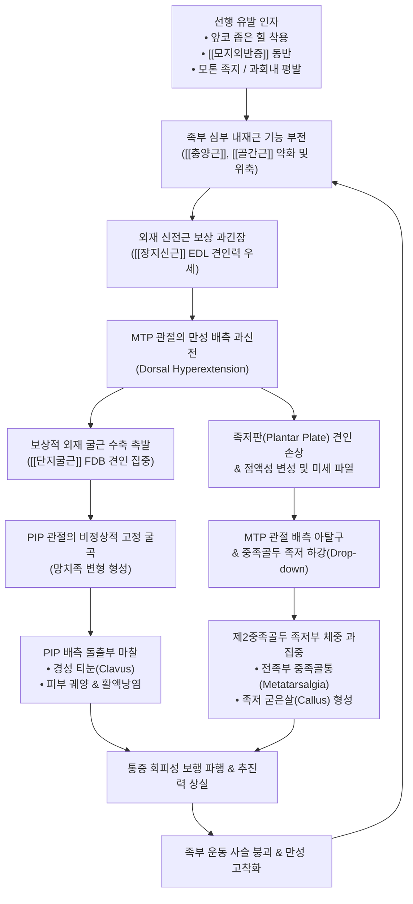
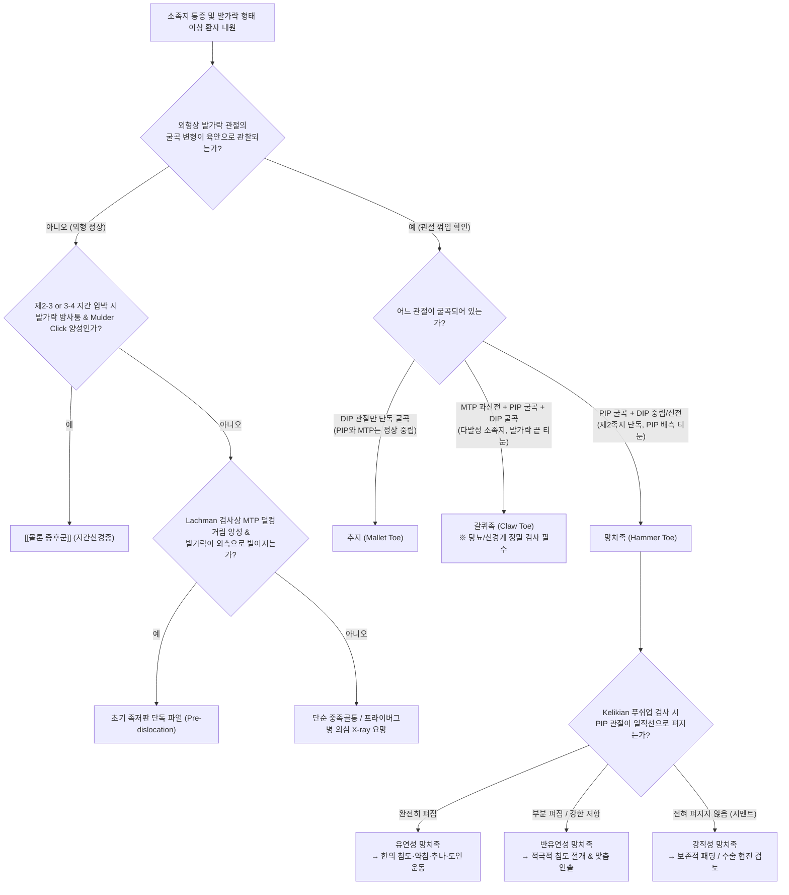

# 🩺 [[망치족]] (Hammer Toe / 망치발가락, 소족지 변형)

> **핵심 3줄 요약 (Key Summary)**:
> - 📍 **병소 부위 & 해부·병태생리**: 제2~5 소족지 중 주로 제2족지에서 호발하며, 근위지간관절(PIP joint)의 고정성 굴곡(Flexion), 원위지간관절(DIP joint)의 중립 또는 대상성 신전(Extension), 중족지간관절(MTP joint)의 배측 과신전(Dorsal hyperextension)이 결합된 3차원 시상면 소족지 복합 변형 질환입니다.
> - 🚩 **전형적 임상 양상 & 3대 징후**: 돌출된 PIP 관절 배측의 신발 마찰성 경성 티눈(Heloma durum / Clavus) 및 활액낭염, 족저판(Plantar plate) 지지력 약화와 중족골두 하강으로 인한 전족부 중족골통(Metatarsalgia), 유연성(Flexible)에서 강직성(Rigid)으로 진행되는 보행 추진력(Push-off) 결손입니다.
> - 🛠️ **핵심 감별 검사 & 한·양방 다각적 치료 전략**: 켈리키안-랜싱거 푸쉬업 검사(Kelikian-Lansinger push-up test)로 유연성 여부를 판정하고 갈퀴족(Claw toe) 및 추지(Mallet toe)와 감별하며, 유연성 단계에서 단축된 굴근건 피하 침도 감압술, [[신바로약침]] 및 자하거 약침을 통한 족저판 리모델링, MTP 견인 추나, 족부 내재근([[골간근]], [[충양근]]) 강화 도인 운동을 우선 적용합니다.
> - ⚠️ **응급 의뢰 레드플래그 & 악화 요인**: 당뇨병성 말초신경병증 환자에서 감각 저하로 인한 PIP 배측 무통성 피하 궤양(Ulceration) 및 급성 골수염(Osteomyelitis), [[모지외반증]]에 의한 제2족지 교차 탈구 시 즉각적인 감염 제어 및 정형외과적 수술 협진이 요구됩니다.

---

## 📌 목차
1. [질환 개요 & 해부학적 병태생리](#1-질환-개요--해부학적-병태생리)
2. [병태생리 메커니즘 & 생체역학적 악순환 네트워크](#2-병태생리-메커니즘--생체역학적-악순환-네트워크)
3. [임상 증상 & 이학적 검사 알고리즘](#3-임상-증상--이학적-검사-알고리즘)
4. [감별 진단 매트릭스](#4-감별-진단-매트릭스)
5. [한의 통합 치료 프로토콜](#5-한의-통합-치료-프로토콜)
6. [양방 치료 & 병용·의뢰 기준](#6-양방-치료--병용의뢰-기준)
7. [재활 운동 & 생활습관 티칭 가이드](#7-재활-운동--생활습관-티칭-가이드)
8. [💡 사용자 진료실 핵심 필기 & 임상 노하우 (Melt-In)](#8--사용자-진료실-핵심-필기--임상-노하우-melt-in)
9. [출처 및 현대 학술 연구 요약](#9-출처-및-현대-학술-연구-요약)

---

## 1. 🩺 질환 개요 & 해부학적 병태생리

### 1.1 질환 정의 및 병태생리학적 본질
* **망치족(Hammer Toe / 망치발가락)**은 족부의 제2, 3, 4, 5 소족지(Lesser toes)에서 발생하는 가장 흔한 시상면상의 관절 구축성 기형입니다.
* 해부학적 관절 분절별 위치 변형은 다음과 같이 엄격히 정의됩니다:
  1. **근위지간관절 (Proximal Interphalangeal Joint, PIP 관절)**: 병적인 지속성 **굴곡(Flexion)** 상태 고착.
  2. **원위지간관절 (Distal Interphalangeal Joint, DIP 관절)**: 정상 **중립(Neutral)** 또는 대상성 **신전(Extension)** 상태.
  3. **중족지간관절 (Metatarsophalangeal Joint, MTP 관절)**: 족배 방향으로의 보상성 **과신전(Hyperextension)** 및 배측 아탈구 경향.
* 족지의 시상면상 정렬이 망치 머리(Hammer) 형태로 꺾이면서, 지면 및 신발 상단 갑피(Upper toe box)와의 비정상적인 접촉 압력이 발생합니다. 이는 단순한 외형적 변형을 넘어 족부 전반의 체중 부하 분산 시스템을 파괴하는 생체역학적 기능 상실 질환입니다.

### 1.2 역학, 호발 족지 및 위험 인자
* **호발 족지**: **제2족지(Second toe)에서 75% 이상 압도적으로 호발**합니다. 이는 인간의 족부 골격 구조상 제2중족골이 가장 길고 고정되어 있거나, 제1중족골이 상대적으로 짧은 모톤 족지(Morton's toe / Greek foot) 구조에서 보행 추진기(Push-off phase) 시 제2족지에 집중되는 축성 압박 부하가 극대화되기 때문입니다. 제3족지, 제4족지가 그 뒤를 잇습니다.
* **성별 및 연령 분포**:
  * 여성 대 남성의 발생 비율은 약 **4:1에서 5:1**로 여성에서 유의하게 높습니다.
  * 50대 이후 폐경 여성 및 고령층에서 인대와 관절낭의 결합조직 퇴행, 족부 심부 내재근의 위축과 맞물려 유병률이 급격히 증가하며, 65세 이상 고령층의 소족지 변형 유병률은 30%를 상회합니다.
* **주요 병인적 위험 인자**:
  * **부적절한 신발 착용(Ill-fitting footwear)**: 앞코가 좁고(Narrow toe-box), 굽이 높은(High-heeled) 신발은 발가락들을 좁은 공간으로 구겨 넣고 체중 중심을 전족부로 강제 이동시켜 PIP 관절의 굴곡을 유발합니다.
  * **[[모지외반증]](Hallux Valgus)과의 동반**: 제1중족모지관절이 외측으로 편위되면서 엄지발가락이 제2족지의 족저부를 파고들거나 배측으로 밀어 올리면서 제2족지의 기계적 탈구와 망치족 변형을 강제합니다(망치족 환자의 60~80%에서 모지외반증 동반).
  * **해부학적 구조 이상**: 제2중족골의 과도한 길이(Long second metatarsal), 과도하게 높은 요족(Pes cavus), 과회내된 평발([[평발]] / Pes planus).
  * **신경근육계 질환**: 당뇨병성 말초신경병증([[당뇨병]]), [[샤르코-마리-투스병]](Charcot-Marie-Tooth disease), 뇌졸중 후유증 등으로 인한 족부 내재근의 조기 탈신경성 위축.
  * **염증성 관절 질환**: [[류마티스 관절염]](Rheumatoid arthritis), 건선성 관절염으로 인한 MTP 관절낭 및 족저판의 파괴.

### 1.3 소족지(Lesser Toes)의 기능 해부학적 복합체
소족지는 근위지골(Proximal phalanx), 중위지골(Middle phalanx), 원위지골(Distal phalanx)의 3개 지골과 이들이 이루는 3개 관절(MTP, PIP, DIP)로 구성됩니다.
* **골성 구조와 지레 메커니즘**:
  * 근위지골은 소족지의 기초 기둥으로, 보행 주기 중 입각기 말기(Terminal stance)에 중족골두와 함께 지면을 지지합니다.
  * 중위지골과 원위지골은 지면을 움켜쥐는 파악력(Grip force)을 제공하여 전족부에 가해지는 과도한 전단 응력을 흡수하고 안정적인 보행을 완성합니다.
* **신전건 복합체(Extensor Digitorum Apparatus)**:
  * 외재근인 [[장지신근]](Extensor digitorum longus, EDL) 건과 [[단지신근]](Extensor digitorum brevis, EDB) 건이 MTP 관절 배측에서 합쳐져 '신전건막(Extensor hood / Expansion)'을 형성합니다.
  * 신전건막은 중앙 지골 기저부로 주행하는 중앙 슬립(Central slip)과 양측으로 갈라져 원위지골 기저부에 부착하는 외측 슬립(Lateral slips)으로 분지합니다.
  * 이때 신전건막의 시상대(Sagittal band)는 MTP 관절을 감싸며 건이 배측 정중앙에서 이탈하지 않도록 고정하는 역할을 합니다.

### 1.4 인대 및 관절낭 안정화 구조: 족저판과 측부인대
소족지 MTP 관절의 안정성을 지배하는 가장 핵심적인 구조물은 관절낭 족저면에 위치한 **족저판(Plantar Plate)**입니다.
* **족저판(Plantar Plate)의 미세 해부학**:
  * 섬유연골성(Fibrocartilaginous) 복합 구조물로, 중족골 경부(Metatarsal neck)에서 느슨하게 기시하여 근위지골 기저부의 족저 결절(Plantar tubercle)에 매우 견고하게 부착합니다.
  * 족저판의 두께는 약 2mm 내외이며, Type I 콜라겐(인장 하중 저항)과 Type II 콜라겐(압박 하중 저항)이 격자상으로 배열되어 있습니다.
  * 족저판은 MTP 관절의 과도한 배측 신전을 물리적으로 제한하는 '정적 안정자(Static stabilizer)'의 80% 이상을 담당합니다.
* **측부인대 복합체(Collateral Ligament Complex)**:
  * 주 측부인대(Proper collateral ligament): 중족골두 결절에서 기시하여 근위지골 기저부로 주행하며, 관절의 내외반 변형을 억제합니다.
  * 부 측부인대(Accessory collateral ligament): 중족골두 결절에서 기시하여 족저판의 외측 연골연에 부착하여 족저판을 매달아 놓는 서스펜션 역할을 수행합니다.
* **심횡중족인대(Deep Transverse Metatarsal Ligament, DTML)**:
  * 인접한 족저판들을 가로 방향으로 견고하게 연결하여 전족부의 횡아치(Transverse arch)가 벌어지는 것을 막고 중족골두 사이의 공간을 유지합니다.

```
       [ 소족지 시상면 해부학적 구조 및 망치족 관절 변위 모델 ]

   배측 (Dorsal)
   -------------------------------------------------------
                    EDL 신전건 (과도한 배측 견인) ↗
                         ┌───────┐ (PIP 굴곡 정점: 티눈/활액낭염 호발)
                         │  PIP  │
           ┌─────────────┴───────┴─────────────┐
           │   근위지골 (PP)      중위지골(MP)   │
           │  (배측 과신전 45°↑) (족저 굴곡 60°↓)│  원위지골(DP)
   ────────┴───────────────────────────────────┴──────────
   중족골두 (MT Head)         FDB 건막 부착부        DIP (중립/신전)
   (족저 하강: 중족골통)      ↙ (강력한 굴곡 견인)
   [족저판 파열 부위] ─── FDL 건 (장지굴근)
   -------------------------------------------------------
   족저측 (Plantar)
```

### 1.5 족부 내재근과 외재근의 짝힘(Force Couple) 시스템
정상 소족지의 완벽한 직립 정렬은 신경계의 정밀한 조절 하에 내재근과 외재근이 이루는 동적 짝힘(Force couple)에 의해 유지됩니다.
* **족부 내재근(Intrinsic muscles) — 'MTP 굴곡 & IP 신전' 기전**:
  * **[[충양근]](Lumbrical muscles)**: FDL 건에서 기시하여 근위지골의 내측을 돌아 신전건막의 배측으로 들어갑니다.
  * **[[골간근]](Interossei muscles - 배측 4개, 족저측 3개)**: 중족골 체부에서 기시하여 신전건막 및 근위지골 기저부에 정지합니다.
  * **기능**: 회전 중심축(MTP 관절의 굴신 회전축)보다 족저측을 주행하므로 **MTP 관절을 족저 굴곡(Flexion)**시키는 동시에, 신전건막의 측부 밴드를 당겨 **PIP 및 DIP 지간관절을 신전(Extension)**시킵니다. 즉, 발가락이 바닥을 안정적으로 누르면서 곧게 펴지도록 지탱합니다.
* **족부 외재근(Extrinsic muscles) — '강력한 굴신 파워 엔진'**:
  * **[[장지신근]](Extensor digitorum longus, EDL)**: 하퇴 전방 구획에서 내려와 소족지 지간관절을 신전시키지만, 단독 수축 시 MTP 관절을 강력하게 배측으로 과신전시키는 부작용을 갖습니다.
  * **[[단지굴근]](Flexor digitorum brevis, FDB)**: 종골 족저 결절에서 기시하여 중위지골 기저부 양측에 정지하며, **PIP 관절의 일차적 강력 굴곡근**으로 작용합니다.
  * **[[장지굴근]](Flexor digitorum longus, FDL)**: 하퇴 후방 심부에서 내려와 원위지골 기저부에 부착하며, DIP 관절을 굴곡시킵니다.

---

## 2. ⚡ 병태생리 메커니즘 & 생체역학적 악순환 네트워크

### 2.1 내재근 결손 증후군(Intrinsic Minus Foot)과 외재근 보상 수축
망치족의 근본적인 생체역학적 시발점은 **족부 내재근의 상대적 약화 또는 기능 부전(Intrinsic Minus Foot)**입니다.
* 정상 보행 주기에서 입각기 중기(Mid-stance)부터 말기(Terminal stance)로 전환될 때, 내재근이 먼저 활성화되어 MTP 관절을 굴곡 방향으로 팽팽하게 잠가주어야 외재 신전근과 굴근이 발가락의 꺾임 없이 전진 추진력을 발휘할 수 있습니다.
* 그러나 만성 피로, 좁은 신발 압박, 노화, 신경병증 등으로 인해 [[충양근]]과 [[골간근]]의 근력이 상실되면, MTP 관절을 아래에서 잡아주는 장력이 사라집니다.
* 이때 발생하는 길항력의 공백으로 인해 강력한 외재근인 [[장지신근]](EDL)이 MTP 관절을 배측으로 무제한 견인하게 되며, 이에 대응하여 발가락 끝을 바닥에 붙여 지지면을 확보하려는 반사 작용으로 [[단지굴근]](FDB) 및 [[장지굴근]](FDL)이 과도하게 수축합니다.
* FDB 건의 정지부는 중위지골 양측이므로, FDB의 과도한 수축력은 고스란히 **PIP 관절의 비정상적인 급성 굴곡**으로 집중됩니다.

### 2.2 3대 운동역학적 붕괴 기전 (Biomechanical Etiology)
소족지 변형을 유발하는 생체역학적 기전은 족부외과학적으로 다음 3가지로 명확히 분류됩니다:

| 분류 | 역학적 원인 및 근육 밸런스 붕괴 | 주 호발 보행 위상 및 병태 |
| :--- | :--- | :--- |
| **굴근 안정화 (Flexor Stabilization)** | • **가장 흔한 기전** (전체 망치족의 약 60~70%).<br>• 과회내(Pronated foot) 및 [[평발]]에서 발생.<br>• 보행 중기~후기 거골하관절(Subtalar joint)의 과도한 회내로 인해 장지하퇴근들이 족부의 불안정성을 보상하기 위해 조기에 과수축함.<br>• FDL과 FDB가 골간근보다 훨씬 강하게 동원되어 PIP 관절을 꺾어버림. | • 보행 입각기 후기(Terminal stance).<br>• 전족부 과운동성과 동반된 망치족. |
| **신근 치환 (Extensor Substitution)** | • 전경골근([[전경골근]])의 약화나 경골신경 마비, 혹은 요족(Pes cavus)에서 발생.<br>• 족관절의 배굴(Dorsiflexion)력이 부족해지자 하퇴 전방의 [[장지신근]](EDL)이 발목을 들어 올리기 위해 과도하게 보상 작용(Substitution)함.<br>• 유각기(Swing phase)마다 MTP 관절이 극단적으로 배측 신전되며 인대와 관절낭이 후방 구축됨. | • 보행 유각기(Swing phase).<br>• 유각기 전반에 걸친 발가락 들림 현상 및 MTP 관절 구축. |
| **굴근 치환 (Flexor Substitution)** | • 가장 드문 기전.<br>• 아킬레스건([[아킬레스건염]])의 단열, 비복근([[비복근]]) 및 가자미근([[가자미근]]) 복합체의 마비·약화로 인해 족저굴곡력이 상실됨.<br>• 발목을 미는 힘을 메우기 위해 심부 족저굴근인 FDL, FHL, 후경골근([[후경골근]])이 비정상적으로 강력하게 수축하여 발가락 관절들이 꺾여 들어감. | • 보행 추진기(Push-off phase).<br>• 삼두근 약화 보상성 전족부 굴곡 변형. |

### 2.3 족저판(Plantar Plate)의 만성 견인 손상, 파열 및 MTP 배측 아탈구
1. MTP 관절이 만성적으로 30° 이상 배측 신전 상태를 유지하면, 기저부에서 버티고 있던 족저판 원위 부착부(근위지골 기저부)에 비정상적인 전단 인장력(Shear tensile stress)이 지속적으로 가해집니다.
2. 미세 혈류가 취약한 족저판 원위-외측 부착부에서 결합조직의 점액성 변성(Myxoid degeneration)과 미세 파열(Micro-tearing)이 시작됩니다.
3. 족저판이 부분 파열되거나 신장되면 MTP 관절의 '배측 감금 장치(Dorsal restraint)'가 완전히 해제됩니다.
4. 결국 중족골두에 대해 근위지골 기저부가 배측으로 미끄러져 올라가는 **배측 아탈구(Dorsal subluxation)**가 발생하고, 심한 경우 완전 탈구(Dislocation)되어 제2지골이 중족골두 등 쪽으로 올라타게 됩니다.

### 2.4 전족부 횡아치(Transverse Arch) 붕괴와 중족골두 하강, 전족부 체중 과부하
* MTP 관절이 배측 아탈구되면 근위지골이 지면을 지지하지 못하므로, 보행 시 발가락이 흡수해주어야 할 체중 부하(정상 전족부 부하의 약 30~40%)가 제2, 3중족골두 하방으로 고스란히 전가됩니다.
* 지렛대 원리에 의해 중족골두는 족저 방향으로 곤두박질치듯 내려앉는 **하강(Drop-down metatarsal head)** 상태가 됩니다.
* 이로 인해 제2중족골두 하방의 피부와 피하 지방 패드(Fat pad)가 뼈와 지면 사이에서 맷돌처럼 짓이겨지며 만성 허혈성 활액낭염, 각화증, 극심한 족저부 통증을 야기하는 **중족골통(Metatarsalgia)**이 고착화됩니다.

### 2.5 생체역학적 악순환 네트워크 다이어그램



---

## 3. 🔍 임상 증상 & 이학적 검사 알고리즘

### 3.1 주요 임상 증상 및 단계별 징후
환자가 호소하는 임상 증상은 관절 변형의 해부학적 위치와 신발과의 접촉 양상에 따라 다발적으로 나타납니다:
1. **PIP 관절 배측의 극심한 마찰통 및 티눈 (Heloma durum / Clavus)**:
   * 가장 주된 내원 이유입니다. 위로 솟구친 PIP 관절 배측이 신발 안쪽 상단 가죽과 지속적으로 마찰되어 피부 각질층이 쐐기 모양으로 비후되는 경성 티눈이 발생합니다.
   * 티눈 하부의 심부 결합조직에 마찰성 외상성 활액낭염(Adventitious bursitis)이 병발하여 신발을 신을 때마다 불에 데인 듯한 화끈거림과 보행 시 날카로운 자통을 호소합니다.
2. **전족부 족저면의 중족골통 (Metatarsalgia)**:
   * 환자는 흔히 "발바닥 앞쪽에 자갈을 밟고 걷는 것 같다", "발바닥 앞꿈치에 화끈거리는 불이 난다"고 호소합니다.
   * 제2, 제3중족골두 족저면에 광범위한 압박성 굳은살(Tyloma / Plantar callus)이 형성되며, 발바닥을 짚을 때마다 찌릿한 통증이 발생합니다.
3. **원위지골 끝단(Toe tip)의 압박 증상**:
   * 망치족은 DIP 관절이 중립 또는 신전 상태이므로 추지(Mallet toe)에 비해 발가락 끝단의 통증은 덜하지만, 신발 앞코가 좁을 경우 발톱이 신발 바닥이나 앞벽에 부딪히며 조갑하 혈종(Subungual hematoma)이나 조갑감입증([[내향성 모지조갑]])이 2차적으로 동반될 수 있습니다.
4. **보행 추진력(Push-off)의 결손과 피로감**:
   * 소족지가 지면을 박차고 나가는 레버 암(Lever arm) 역할을 하지 못하므로 보행 입각기 후기가 단축되고, 족관절과 슬관절, 요추부로 보상성 피로가 누적됩니다.

### 3.2 유연성(Flexible) vs 반유연성(Semi-rigid) vs 강직성(Rigid) 3단계 병기 판정
망치족의 치료 방침(보존적 한의 교정 vs 수술적 절골·유합술)을 결정하는 절대적 기준은 **변형의 유연성(Flexibility)** 평가입니다.

```
       [ 망치족의 3단계 병기 진행 및 병태 특성 ]

[ 1단계: 유연성 (Flexible) ]
  • 관절낭 섬유화 없음, 연부조직 긴장만 존재
  • 도수 정복 및 푸쉬업 시 완전히 일직선 환원
  • 한의 보존 치료(침도, 약침, 도인 운동) 완치율 극대

       ▼ (만성 마찰, 족저판 파열 및 관절낭 구축)

[ 2단계: 반유연성 (Semi-rigid) ]
  • 관절낭 및 측부인대 부분 섬유화
  • 수동으로 힘을 주면 부분 환원되나 강한 탄성 저항
  • 침도 인대 절개술 및 집중 추나 교정 필요

       ▼ (골극 형성, 골성 관절 강직 및 족저판 완전 파열)

[ 3단계: 강직성 (Rigid) ]
  • 뼈와 관절이 시멘트처럼 굳어버린 완전 고착 기형
  • 도수 정복 불가능 (0° 환원)
  • 보존적 패딩 및 증상 완화 치료 / 필요 시 수술 의뢰
```

* **유연성 망치족 (Flexible Hammer Toe)**:
  * 서 있을 때는 발가락이 굽어 망치 형태를 띠지만, 체중을 싣지 않고 손으로 펴거나 중족골두를 받쳐 올리면 정상적인 일직선 정렬로 완전히 펴집니다.
  * 관절 연골의 파괴나 영구적인 골극 형성이 없으며, 근육의 동적 불균형만 존재하는 초기 상태입니다.
* **반유연성 망치족 (Semi-rigid Hammer Toe)**:
  * 도수 조작으로 펴려고 할 때 부분적으로는 펴지지만, 팽팽한 저항감이 느껴지며 완전히 0°로 환원되지 않는 상태입니다. 측부인대와 족저 관절낭의 섬유성 단축이 진행된 상태입니다.
* **강직성 망치족 (Rigid Hammer Toe)**:
  * 손으로 아무리 강하게 펴려고 해도 PIP 관절이 꿈쩍도 하지 않고 굳어 있는 고정 기형입니다.
  * PIP 관절낭, 측부인대, 굴근건의 완전한 섬유화 구축과 관절순의 골화, MTP 관절의 배측 구축이 영구 고착된 상태입니다.

### 3.3 필수 이학적 검사 프로토콜

#### ① 켈리키안-랜싱거 푸쉬업 검사 (Kelikian-Lansinger Push-Up Test)
* **목적**: 망치족의 유연성 여부 및 MTP 관절의 정복력을 평가하는 소족지 검사의 골드 스탠다드입니다.
* **검사 수기**:
  1. 환자를 진료대에 앙와위로 편안히 눕히고 족관절을 중립(90°)에 둡니다.
  2. 검사자는 한 손으로 환자의 발목을 안정시키고, 다른 손의 엄지손가락으로 이환된 제2(혹은 제3) 중족골두의 족저면을 아래에서 위(배측 방향)로 강하게 밀어 올립니다.
* **임상 판독**:
  * **음성 (유연성 변형)**: 중족골두를 위로 밀어 올렸을 때 근위지골이 족저 굴곡되면서 **PIP 관절이 저절로 시원하게 펴지며 소족지 전체가 일직선 정렬로 복원**됩니다. (한의 보존 치료 및 비수술 교정의 완벽한 적응증)
  * **양성 (강직성 변형)**: 중족골두를 강하게 밀어 올려도 PIP 관절의 굴곡 구축이 그대로 유지되거나 미미하게만 펴집니다.

#### ② MTP 관절 서랍 검사 (Lachman Test of the MTP Joint / Drawer Test)
* **목적**: 족저판(Plantar plate)의 파열 및 MTP 관절의 배측 불안정성을 정밀 평가합니다.
* **검사 수기**:
  1. 검사자의 한 손 엄지와 검지로 이환된 중족골 경부를 단단히 잡아 고정합니다.
  2. 다른 손 엄지와 검지로 근위지골 기저부를 잡고, 수직 배측 방향(Dorsal translation)으로 밀어 올립니다.
* **임상 판독**:
  * 정상 측에 비해 근위지골이 배측으로 **2mm 이상 덜컹거리며 전위(Subluxation)**되거나, 관절낭 끝느낌(End-feel)이 흐물흐물(Soft endpoint)하고 날카로운 통증이 유발되면 **족저판의 완전 파열 또는 만성 파열**로 진단합니다.

#### ③ 족저판 직접 압통 유발 검사 (Plantar Plate Direct Palpation)
* 환자의 발가락을 부드럽게 배측 굴곡시킨 상태에서, 검사자의 손가락 끝으로 중족골두 바로 원위부의 족저 관절선(Plantar sulcus)을 직접 깊게 촉진합니다. 국소 압통과 함께 부종이 만져지면 활성기 족저판염(Plantar platitis)을 시사합니다.

#### ④ 전족부 횡압박 검사 및 몰톤 검사 (Mulder's Click & Compression Test)
* 제1중족골과 제5중족골을 양옆에서 쥐어짜듯 모으면서 제2-3, 제3-4 중족골두 사이 족저면을 압박합니다.
* 날카로운 신경 방사통이나 '딸깍'하는 클릭음(Mulder's click)이 발생하면 [[몰톤 증후군]](지간신경종)의 병발을 감별합니다.

### 3.4 방사선학적 영상 진단 (Imaging Evaluation)
* **체중 부하 족부 방사선 단순 촬영 (Weight-Bearing Foot X-ray)**:
  * 반드시 환자가 일어선 상태에서 체중을 실어 촬영해야 합니다(Non-weight-bearing 사진은 변형 각도를 심각하게 저평가함).
  * **전후방(AP) 뷰**: 제2중족골의 상대적 길이(Morton's metatarsal), MTP 관절의 외반/내반 편위 및 관절 간격 협착 확인.
  * **측면(Lateral) 뷰**: MTP 관절의 배측 아탈구 정도, PIP 관절의 굴곡 각도, 중족골두의 족저 돌출(Plantar declination angle) 정량화.
  * **사위(Oblique) 뷰**: 지골 골극(Osteophyte), 관절 융합 여부, 진구성 피로골절 배제.
* **초음파 검사 (High-Resolution Ultrasonography)**:
  * 족저판의 연속성 단절(Plantar plate tear), MTP 관절 및 PIP 배측 활액낭염(Bursitis)의 삼출액 저류, 장지굴근건의 건막염을 실시간으로 확인하는 데 매우 유용합니다.

---

## 4. 🔀 감별 진단 매트릭스

소족지의 시상면상 변형은 침범된 관절 분절(MTP, PIP, DIP)의 조합에 따라 치료 접근법과 예후가 완전히 달라지므로 정밀한 분절 감별이 필수적입니다.

### 4.1 족부 3대 소족지 굴곡 변형 비교 매트릭스

| 감별 항목 | 망치족 (Hammer Toe) | 갈퀴족 (Claw Toe) | 추지 (Mallet Toe) |
| :--- | :--- | :--- | :--- |
| **MTP 관절 정렬** | **경도~중등도 배측 과신전** (보상적) | **극심한 배측 과신전 및 아탈구/탈구** | **정상 (중립 0°)** |
| **PIP 관절 정렬** | **비가역적 굴곡 (Flexion)** | **비가역적 굴곡 (Flexion)** | **정상 (중립 0°)** |
| **DIP 관절 정렬** | **중립(Neutral) 또는 대상성 신전** | **굴곡 (Flexion)** | **비가역적 단독 굴곡 (Flexion)** |
| **변형 외형** | '망치(Hammer)' 형태 | '맹수의 갈퀴(Claw)' 형태 | '목이 꺾인 망치(Mallet)' 형태 |
| **호발 족지** | **제2족지 단독 다발** (모지외반증 동반) | **제2~5 소족지 전체 다발성** 침범 | 제2족지 또는 제3족지 단독 |
| **핵심 병태생리** | 신발 마찰, FDB 단축, 내재근 약화 | **중추/말초 신경병증으로 인한 전족부 내재근 마비** | 외상성 원위 지골 신전건 파열, 신발 끝 마찰 |
| **티눈 및 굳은살 호발 부위** | **• PIP 관절 배측**<br>• 중족골두 족저면 | **• PIP 관절 배측**<br>**• 발가락 끝단(Tip)**<br>• 중족골두 족저면 (3개소) | **• 발가락 끝단 족저면(Tip)**<br>• 조갑하(발톱 밑) 각화증 |
| **동반 기저 질환** | 모지외반증, 좁은 힐, 모톤 족지 | **당뇨 신경병증, 샤르코-마리-투스, 척수공동증** | 축구 등 발가락 차임 외상, 신발 길이 부족 |

### 4.2 전족부 통증 및 기타 신경·관절 질환 감별
1. **[[몰톤 증후군]] (Morton's Neuroma / 지간신경종)**:
   * **감별점**: 관절의 꺾임 변형이 전혀 없습니다. 통증이 제3-4 혹은 제2-3 지간 족저부에 국한되며, 발가락 끝으로 뻗치는 전기 통하는 저림(Shooting paresthesia)과 먹먹한 감각 저하가 주 증상입니다. 뮐더 클릭 검사(Mulder's test) 양성.
2. **단독 족저판 파열 (Isolated Plantar Plate Tear / Pre-dislocation Syndrome)**:
   * **감별점**: 초기에는 육안상 뚜렷한 망치족 변형이 나타나지 않고, 보행 시 제2중족골두 하방의 극심한 통증만 호소합니다. 시간이 지나면서 발가락이 외측으로 벌어지는 '교차 족지 징후(Crossing toe sign)'가 발생합니다. Lachman 검사 양성.
3. **프라이버그병 (Freiberg's Infarction / 제2중족골두 무혈성 괴사)**:
   * **감별점**: 주로 10~20대 여성에서 제2중족골두의 허혈성 괴사로 인해 발생합니다. PIP 관절이 아닌 MTP 관절 자체의 극심한 팽윤과 배측 압통, 관절 가동 범위의 전반적 제한이 나타납니다. X-ray상 중족골두의 편평화(Flattening)와 경화 관찰.
4. **류마티스 관절염 전족부 병변 (Rheumatoid Forefoot Deformity)**:
   * **감별점**: 양측성, 대칭적으로 제2~5 소족지 MTP 관절의 심한 미란과 함께 전 족지가 외측으로 돌아가는 외반 편위(Fibular drift) 및 다발성 갈퀴족 변형이 동반됩니다. 혈액 검사상 RF, anti-CCP 양성.

### 4.3 감별 진단 의사결정 알고리즘



---

## 5. 🌿 한의 통합 치료 프로토콜

### 5.1 한의학적 병인병기 및 변증론치
한의학에서 망치족은 비위(脾胃) 기능 실조로 인한 **사지기육(四肢肌肉) 영양 공급 부전**, 간신(肝腎) 기능 쇠퇴로 인한 **근건(筋腱) 구축**, 그리고 외력 및 한습(寒濕)에 의한 **근비(筋痺)**와 **족지구련(足趾拘攣)**의 범주로 파악합니다.
* **기체어혈(氣滯瘀血)형**:
  * 좁은 신발의 압박으로 족지 말초의 기혈 순환이 차단되어 PIP 배측에 자흑색 티눈과 찌르는 듯한 고정성 야간 자통 호소.
  * 설질 암홍, 어점, 맥 현삽.
* **비신양허(脾腎兩虛)형**:
  * 노화 및 만성 소모로 족부 심부 기육을 주재하는 비(脾)와 골격을 주재하는 신(腎)이 허약해져 아치가 무너지고 내재근이 위축되며 발가락이 굳어짐.
  * 설담태백, 맥 침세무력.
* **습열하주(濕熱下注)형**:
  * 마찰 부위에 급성 활액낭염이 동반되어 환부가 붉게 붓고 화끈거리며 닿기만 해도 통증이 극심함.
  * 설홍태황니, 맥 활삭.

### 5.2 침구 치료 (Acupuncture Protocol)
* **치료 원칙**: 단축된 외재 신전근 및 굴근의 긴장을 이완시키고, 약화된 족저 심부 내재근의 운동 신경 흥분성을 촉진하며, 국소 기혈 순환을 개선합니다.
* **주요 경혈 및 자침 심도**:
  * **태충(LR3)**: 제1, 2중족골 결합부 원위 함요처. 직자 0.5~1.0촌. 족궐음간경의 수목혈이자 원혈로 소간식풍, 근건의 경련과 구련을 진정시키는 최고 요혈.
  * **함곡(ST43)**: 제2, 3중족골 간 결합부 전방 함요처. 직자 0.5~0.8촌. 족양명위경의 수목혈로 전족부 열감과 중족골통, 부종을 소퇴시킴.
  * **내정(ST44)**: 제2, 3족지 지간연 경계 후방. 사자 0.3~0.5촌. 양명경의 영수혈로 PIP 배측 활액낭의 급성 염증과 작열통을 끄는 청열사화 작용.
  * **행간(LR2)**: 제1, 2족지 지간연. 사자 0.3~0.5촌. 간화(肝火)를 내리고 모지외반증 동반 환자의 제1-2지간 긴장 완화.
  * **족임읍(GB41)**: 제4, 5중족골 결합부 전방. 직자 0.5~0.8촌. 대맥(帶脈)의 통혈로 족배부 건막 긴장 해소.
  * **아시혈 (PIP 배측 지간 관절낭 결절부)**: 0.20×15mm 미세 침으로 티눈 기저부 주위를 4방향에서 15° 사각으로 둘러싸며 자침(위자법 圍刺法).
* **전침 요법 (Electroacupuncture)**:
  * 함곡(ST43) - 내정(ST44), 족삼리(ST36) - 풍륭(ST40) 배혈.
  * 혼합파(Dense-Disperse Wave, 2Hz/100Hz 교대), 환자가 견딜 수 있는 쾌적한 역치(1.5~2.5mA)로 20분간 유침하여 강직된 굴근건과 신전건의 연축을 전기생리학적으로 차단.

### 5.3 특수 침도요법 (Acupotomy Protocol)
유연성~반유연성 망치족에서 영구적 변형으로의 진행을 막고 굴곡 구축을 해부학적으로 즉각 정복하는 가장 강력한 한의 최소침습 술기입니다.

```
              [ 침도(Acupotomy) 해부학적 자입 포인트 및 술기 ]

       PIP 관절 배측 (Dorsal)
       ┌────────────────────────┐
       │ (Point 2)              │  ← PIP 양측 측부인대 및 관절낭 유착 박리
       │ 측부인대 박리술        │     (칼날을 관절선과 수평하게 진입, 0.5~1mm 절개)
       └────────────────────────┘
                 │
           [ 지골 관절강 ]
                 │
       ┌────────────────────────┐
       │ (Point 1)              │  ← PIP 족저면 단축된 FDB/FDL 건막 피하 절개
       │ 족저 굴근건 유리술     │     (신경혈관속 회피 위해 정중앙 종축 찌르기)
       └────────────────────────┘
       PIP 관절 족저측 (Plantar)
```

1. **포인트 1: PIP 관절 족저면 굴근건 피하 미세 절개술 (Percutaneous Flexor Tenotomy)**:
   * **해부학적 목표**: 중위지골 기저부 족저면에 부착하여 PIP 관절을 아래로 꺾고 있는 [[단지굴근]](FDB) 건막 및 [[장지굴근]](FDL) 건의 섬유화 밴드.
   * **자입 술기**: 0.4×40mm 일회용 침도를 사용합니다. 환자의 발가락을 최대로 수동 신전시킨 상태에서, PIP 관절 족저 횡문 정중앙(신경혈관속은 양측 모서리로 주행하므로 정중선 1mm 구역은 안전 구역)으로 자입합니다.
   * 지골 골막에 침도 날이 닿으면 수평으로 15° 눕혀 팽팽하게 당겨진 굴근건 섬유를 종축으로 2~3회 조작(Peeling)하여 '툭' 하는 건막 유리 감각을 확인합니다.
2. **포인트 2: PIP 관절 배측-외측 관절낭 감압술**:
   * **해부학적 목표**: PIP 배측에 구축된 측부인대의 전방 섬유와 비후된 관절낭.
   * **자입 술기**: 티눈 바로 옆 관절 틈새로 침도를 0.3mm 깊이로 얕게 진입시켜 관절낭 섬유를 횡방향으로 1~2회 미세 박리하여 수동 신전 각도를 즉각 확보합니다.
3. **포인트 3: MTP 족저판 기저부 유착 박리술**:
   * 중족골두 하방 족저판 주변의 만성 염증성 유착을 침도로 긁어내어 하강된 중족골두의 감압을 유도합니다.

### 5.4 약침 치료 (Pharmacopuncture Protocol)
* **급성 활액낭염 및 염증 제어기 (소염진통)**:
  * **황련해독탕 약침 / 중성어혈 약침**:
  * 시술 부위: PIP 관절 배측 티눈 하부 활액낭 및 MTP 족저 활액낭 주위.
  * 용량: 각 포인트당 0.1~0.2cc, 인슐린 주사기(30G 1/2인치)를 사용하여 피하 및 관절낭 외측에 팽진법으로 미세 주입.
  * 작용: 베르베린(Berberine) 등 생리활성 성분을 통해 COX-2 및 TNF-alpha 발현을 억제하여 마찰성 열감과 발적 부종을 신속히 소퇴.
* **만성 인대 이완 및 결합조직 재건기 (조직 재생)**:
  * **[[신바로약침]] (Shinbaro) / 자하거 약침**:
  * 시술 부위: 이환된 MTP 관절의 족저판 부착부(근위지골 기저부 족저 결절) 및 측부인대.
  * 용량: 0.3~0.5cc 심부 인대 부착부 직자.
  * 작용: 천수근 성분의 연골 및 인대 결합조직 강화, 콜라겐 합성 유도로 이완된 족저판의 장력을 회복시켜 MTP 관절 배측 아탈구를 방어.

### 5.5 족부 교정 추나요법 (Chuna Manipulation Protocol)
* **기법 1: MTP 관절 견인-족저 굴곡 가동술 (MTP Traction-Plantarflexion)**:
  * 검사자는 한 손으로 환자의 제2중족골 경부를 단단히 파지하여 고정합니다.
  * 다른 손 엄지와 검지로 근위지골 기저부를 잡고, 원위 방향으로 부드럽게 **축성 견인(Axial traction)**력을 가한 상태에서 천천히 **족저 굴곡(Plantarflexion)** 방향으로 30초간 가동(Mobilization)합니다.
  * 배측으로 아탈구되려는 근위지골을 족저 관절와(Plantar socket) 내부로 환원시키는 핵심 수기입니다.
* **기법 2: PIP 관절 수동 신전-회선 가동술**:
  * 중위지골을 잡고 PIP 관절의 굴곡 구축을 반대 방향인 신전 방향으로 부드럽게 진동(Oscillation)을 주며 늘려줍니다.
* **기법 3: 족부 횡아치 및 족저근막 근막 이완 기법 (Myofascial Release)**:
  * 주상골, 입방골, 설상골 사이의 리스프랑(Lisfranc) 관절면을 족저에서 배측으로 들어 올리며 족저건막을 수장부로 강하게 밀어내어 전족부 횡아치를 세워줍니다.

### 5.6 맞춤 한약 처방 (Herbal Medicine Protocol)
* **오적산 (五積散) 가감방**:
  * 적응증: 풍한습(風寒濕)의 외사에 감수되어 족부 말초가 차고 굳어지며 보행 시 족지 통증이 악화되는 기체혈어 환자.
  * 기본 구성 및 용량: 창출 6g, 마황·진피·후박·지각·당귀·건강·백작약·백복령 각 3g, 천궁·백지·반하·갈근·육계·감초 각 2g.
  * 가감법: 국소 혈행 장애가 심할 시 우슬(牛膝) 6g, 모과(木瓜) 6g을 가하여 하지 관절을 유연하게 통리(通利)함.
* **대방풍탕 (大防風湯) 가감방**:
  * 적응증: 기혈부족(氣血不足) 및 간신허약으로 인해 소족지 변형이 만성화되고 관절이 뻣뻣하게 굳어가는 고령 환자.
  * 기본 구성: 숙지황·백출·방풍·당귀·백작약·황기·두충 각 4g, 복령·인삼·우슬 각 3g, 부자·천궁·강활·감초 각 2g.
  * 작용: 보기혈(補氣血), 강근골(强筋骨), 온경통락(溫經通絡).
* **영선제통음 (靈仙除痛飲)**:
  * 적응증: 급성 마찰로 인해 활액낭염이 심하고 열감이 동반된 습열비통(濕熱痺痛).
  * 위령선 6g, 창출 4g, 당귀·적작약·황백·방기·택사 각 3g 등 청열이습, 통락지통.

---

## 6. 💊 양방 치료 & 병용·의뢰 기준

### 6.1 보존적 양방 치료 (Nonsurgical Management)
양방 족부정형외과에서 유연성 망치족의 1차 치료는 신발 교정과 국소 압력 차단 보조기입니다:
* **신발 수정 (Shoe Modification)**:
  * 가장 기본적이면서도 중요한 보존적 처치입니다.
  * **조건**: 발가락 방(Toe-box)이 넓고(Wide), 발등 높이가 깊어(Deep) 돌출된 PIP 배측이 가죽에 닿지 않는 부드러운 천연 가죽 소재 신발 착용. 굽 높이는 2.5cm(1인치) 이하로 제한하여 전족부 압박을 차단.
* **실리콘 패드 및 토 크레스트 (Silicone Toe Crest & Sleeve)**:
  * **크레스트 패드(Crest pad)**: 굴곡된 소족지 바닥 아래에 실리콘 받침대를 끼워 발가락이 바닥에 닿는 힘을 받쳐줌으로써 PIP 관절이 상대적으로 펴지도록 지지.
  * **젤 슬리브(Gel sleeve)**: PIP 배측 돌출부에 젤 튜브를 씌워 신발과의 직접 전단 마찰력을 흡수.
* **버디 테이핑 (Buddy Taping)**:
  * 유연성 제2족지 망치족을 인접한 건강한 제3족지에 의료용 반창고로 나란히 묶어 고정함으로써 제3족지가 부목(Splint) 역할을 하도록 유도.
* **맞춤형 족부 보조기 (Custom Orthotics with Metatarsal Pad)**:
  * 제2중족골두 바로 몸쪽(Proximal) 부위에 **중족골 패드(Metatarsal pad)**를 장착하여, 보행 시 중족골두를 공중에 띄우고 체중을 중족골 체부로 분산시킴.

### 6.2 약물 요법 (Medication)
* **경구 NSAIDs (비스테로이드성 소염진통제)**:
  * 활액낭염 통증기에 단기 처방 (Aceclofenac 100mg bid, Meloxicam 7.5mg qd, Celecoxib 200mg qd 등).
  * 위궤양, 신기능 저하 위험 환자는 위장관 보호제(PPI) 병용.
* **외용 소염진통제**:
  * Diclofenac 겔 또는 Flurbiprofen 파스를 PIP 배측에 부착하여 전신 흡수를 줄이면서 국소 염증 완화.

### 6.3 주사 치료의 득과 실 (Injections: Benefits & Risks)
* **국소 코르티코스테로이드 주사 (Corticosteroid Injection)**:
  * 급성 활액낭염으로 극심한 통증 시 국소 마취제(Lidocaine)와 Triamcinolone(5~10mg)을 PIP 배측 활액낭에 주입하여 통증을 급격히 진정시킬 수 있습니다.
  * ⚠️ **치명적 위험성 (Black-box Caution)**:
    * MTP 관절 족저부나 족저판 근처에 스테로이드를 절대 반복 주입해서는 안 됩니다.
    * 스테로이드는 콜라겐 합성을 억제하여 이미 약해진 **족저판(Plantar plate)의 급성 파열을 촉발**하며, 족저 피하 지방 패드의 영구적 위축(Fat pad atrophy)을 유발하여 돌이킬 수 없는 난치성 중족골통을 만듭니다.

### 6.4 수술적 교정술 적응증 및 기법 (Surgical Procedures)
보존적 치료를 3~6개월 이상 철저히 시행했음에도 신발 착용 및 보행이 불가능할 정도의 통증이 지속되거나, 피부 궤양이 반복될 때 수술을 고려합니다:

| 수술 기법 명칭 | 적응 병기 | 수술 술기 상세 | 장단점 및 합병증 |
| :--- | :--- | :--- | :--- |
| **Girdlestone-Taylor 건 이전술** (Flexor-to-Extensor Transfer) | **유연성 (Flexible)** 망치족 | • 장지굴근(FDL) 건을 원위부에서 채취하여 종축으로 반을 가름.<br>• 근위지골을 양측으로 감싸 올라가 배측의 장지신근(EDL) 건막에 봉합. | • FDL의 굴곡력을 MTP 안정화 힘으로 전환.<br>• 관절을 보존하는 생리적 술식.<br>• 지간관절의 경미한 강직 가능. |
| **경피적 굴근건 절제술** (Percutaneous Tenotomy) | 고령층의 유연성 망치족, 당뇨 궤양 | • 주사 바늘이나 미세 수술도로 FDL/FDB 건을 경피적으로 절단하여 굴곡 구축 즉각 해제. | • 국소마취 5분 시술, 침도요법과 유사.<br>• 침습도 극소, 회복 극히 빠름. |
| **DuVries PIP 관절 성형술** (PIP Resection Arthroplasty) | **강직성 (Rigid)** 망치족 | • 근위지골 두(Head of proximal phalanx)를 절제하여 뼈의 길이를 줄이고 관절을 느슨하게 함.<br>• 1~2mm K-wire(강선)을 3~4주간 삽입하여 일직선 고정. | • 가장 보편적인 수술.<br>• 지골 단축으로 신발 마찰 소실.<br>• 발가락이 헐렁해지는 소시지 토(Sausage toe) 가능성. |
| **PIP 관절 유합술** (PIP Arthrodesis) | 재발성 또는 중증 강직성 망치족 | • PIP 관절 연골면을 완전히 깎아내고 뼈와 뼈를 영구 융합(Fusion).<br>• 골수강 내 스크류(Intramedullary implant)나 강선 고정. | • 재발률이 거의 없음.<br>• 영구적으로 PIP 관절이 구부러지지 않는 강직 상태가 됨. |
| **Weil 중족골 단축 절골술** (Weil Metatarsal Osteotomy) | MTP 배측 아탈구 및 중족골통 동반 | • 제2중족골두를 지면과 평행하게 경사 절골하여 3~5mm 후방으로 밀어 넣어 단축 고정. | • 하강된 중족골두를 거상하여 족저 압력 완벽 해소.<br>• 발가락이 지면에 안 닿는 부유족(Floating toe) 합병증 주의. |

### 6.5 한·양방 병용 판단 기준
* **병용 가능 (Synergy)**:
  * 양방 진통소염제(NSAIDs) 단기 복용 중 침구 치료, 소염약침 치료, 추나 치료 병용은 국소 미세혈류를 개선하고 약물 투여 기간을 50% 이상 단축시킵니다.
  * 양방 맞춤 인솔(Metatarsal pad) 착용 상태에서 한의 내재근 도인 재활 및 침도 치료 병행.
* **병용 주의**:
  * 양방 국소 스테로이드 주사를 맞은 부위는 최소 2주간 침도 및 강자극 전침 시술을 금합니다(조직 괴사 및 감염 위험).
* **수술 후 한의 관리**:
  * K-wire 제거(수술 4~6주 후) 이후 발생하는 관절 강직과 족배부 부종에 대해 당귀수산 투약 및 온침, 가동 추나요법 적용 시 조기 보행 복귀율이 탁월합니다.

### 6.6 전문과 및 응급 의뢰 기준 (Red Flags)
* **즉각적 응급 상급병원 의뢰 (Red Flags)**:
  * 당뇨병 환자에서 PIP 배측 티눈 하부의 깊은 궤양, 악취 나는 삼출물, 급격한 발적 팽창 및 발열 동반 시 (당뇨발 괴사 및 급성 골수염 의심).
  * 족지 말초의 맥박 소실, 청색증, 창백 및 급격한 감각 마비 (급성 혈관 포착).
* **정형외과 정밀 수술 의뢰**:
  * 3단계 완전 강직성 망치족으로 인해 심각한 보행 장애 및 2차 슬·고관절염이 유발되는 경우.
  * MTP 관절이 완전 배측 탈구되어 제2족지가 제1족지 위로 완전히 올라탄 교차 기형(Crossover toe).

---

## 7. 🏃 재활 운동 & 생활습관 티칭 가이드

망치족의 재활은 단축된 외재근을 늘려주고(신장), 약화된 심부 내재근을 활성화(강화)하는 짝힘 재건에 집중됩니다.

### 7.1 족부 심부 내재근 강화 도인 운동 (Intrinsic Strengthening)

```
        [ 족부 심부 내재근(충양근·골간근) 활성화 도인 재활 운동 ]

  1. 수건 끌어당기기 (Towel Curl)
     ┌────────────────────────────────────────────────────────┐
     │ [발뒤꿈치 고정] ──> 발가락 힘으로 수건을 부채꼴로 주름잡아 당김 │
     └────────────────────────────────────────────────────────┘

  2. 단족 운동 (Short Foot Exercise)
     ┌────────────────────────────────────────────────────────┐
     │ 발가락을 굽히지 않고, MTP 관절을 끌어당겨 족궁(아치)을 1cm 거상 │
     └────────────────────────────────────────────────────────┘

  3. 발가락 벌리기 및 가위바위보 (Toe Splay & Rock-Paper-Scissors)
     ┌────────────────────────────────────────────────────────┐
     │ 엄지 들고 소족지 누르기 ↔ 엄지 누르고 소족지 쫙 벌리기 (부채꼴) │
     └────────────────────────────────────────────────────────┘
```

1. **수건 끌어당기기 (Towel Curl Exercise)**:
   * **방법**: 의자에 바르게 앉아 맨바닥에 얇은 수건을 깔고 발을 올립니다. 발뒤꿈치를 바닥에 견고히 붙인 채, 순수하게 발가락 전체를 굽히고 펴는 동작을 통해 수건을 몸쪽으로 주름잡아 끌어당깁니다. 수건 끝에 500g 아령이나 물병을 올려 저항을 증가시킬 수 있습니다.
   * **빈도**: 1회 10회 끌어당기기, 하루 3세트.
   * **임상 효과**: [[단지굴근]]과 족저 내재근 전반의 파악력(Grip strength)을 강화합니다.
2. **구슬 집어 올리기 (Marble Pick-Up)**:
   * **방법**: 바닥에 10~20개의 유리구슬을 놓고, 발가락으로 하나씩 집어 올려 옆에 놓인 종이컵 안으로 옮겨 담습니다.
   * **임상 효과**: 소족지의 미세 운동 제어 신경을 재교육하고 [[충양근]]의 정밀 수축력을 촉진합니다.
3. **단족 운동 (Short Foot Exercise / Janda's Short Foot)**:
   * **방법**: 발가락을 망치처럼 구부리지 않은 상태를 엄격히 유지하면서, 제1중족골두와 제5중족골두를 발뒤꿈치 방향으로 수평하게 끌어당긴다는 느낌으로 발바닥 중앙의 내측 종아치를 1cm 위로 볼록하게 거상합니다. 5초간 유지 후 이완.
   * **빈도**: 10회씩 3세트.
   * **임상 효과**: 족저건막과 내재근을 동시 활성화하여 횡아치와 종아치를 견고하게 재건.
4. **발가락 가위-바위-보 운동 (Toe Rock-Paper-Scissors / Toe Splay)**:
   * **가위**: 엄지발가락만 위로 번쩍 들고 나머지 4개 발가락은 바닥을 누름.
   * **바위**: 발가락 전체를 발바닥 쪽으로 꼭 쥐어 웅크림.
   * **보**: 5개 발가락 전체를 부채꼴 모양으로 최대한 넓게 양옆으로 벌림(Toe splay).
   * **임상 효과**: [[골간근]]의 외전 모멘트를 활성화하여 오그라든 소족지 관절 사이를 열어줌.

### 7.2 단축된 연부조직 신장 스트레칭 (Stretching Protocol)
1. **PIP 굴곡 구축 수동 신전 스트레칭**:
   * 환자 스스로 한 손으로 중족골두를 단단히 잡고, 다른 손 손가락으로 구부러진 PIP 관절의 등 쪽을 펴면서 원위부를 배측 방향으로 지그시 들어 올려 20초간 유지합니다. 통증이 없는 범위에서 하루 5회 이상 수시로 반복합니다.
2. **비복근-가자미근 복합체 및 아킬레스건 스트레칭**:
   * 벽 짚고 서서 뒤쪽 다리의 무릎을 곧게 펴고 발꿈치를 바닥에 붙여 종아리를 늘려줍니다. 후방 사슬의 과긴장을 해소하여 보행 시 전족부에 걸리는 과부하를 30% 이상 경감시킵니다.

### 7.3 교정 테이핑 및 보조기 착용법
* **키네시오 신전 보조 테이핑**:
  1. 폭 2.5cm 키네시오 테이프의 한쪽 끝을 제2족지 족저면(발바닥)에 고정합니다.
  2. 테이프를 약 50%의 장력으로 당기며 구부러진 PIP 관절의 배측을 감싸 돌아 중족골 배측으로 길게 부착합니다.
  3. 보행 시 PIP 관절이 위로 솟구치지 않도록 물리적으로 탄성 저항을 제공합니다.

### 7.4 신발 선택 및 일상생활 티칭
* **토박스(Toe-box) 공간 확인법**: 신발을 신은 상태에서 엄지손가락으로 신발 앞코를 눌렀을 때, 가장 긴 발가락 끝과 신발 앞벽 사이에 **약 1.0~1.3cm(엄지손가락 한 마디 폭)의 여유 공간**이 반드시 존재해야 합니다.
* **신발 형태**: 앞코가 뾰족한 신발은 절대 금기이며, 둥글거나 사각 형태의 넓은 토박스를 선택합니다. 신발의 갑피 재질은 가죽이 단단하지 않고 신축성이 있는 니트(Mesh)나 부드러운 가죽을 권장합니다.

---

## 8. 💡 사용자 진료실 핵심 필기 & 임상 노하우 (Melt-In)

### 8.1 티눈을 깎아도 깎아도 다시 자라는 이유: 골격성 돌출 압력 원인론
* **진료실 환자들의 공통된 하소연**:
  * "원장님, 피부과에서 레이저로 티눈을 파내고 티눈 밴드를 수십 개 붙여도 한 달만 지나면 그 자리에 또 딱딱하게 뼈처럼 티눈이 솟아나요."
* **환자 티칭 핵심**:
  * 티눈(Corn)은 바이러스 질환(사마귀)이나 단순 피부 질환이 아닙니다. **뼈와 관절의 비정상적인 골격 역학 돌출(PIP 관절의 시상면 굴곡)로 인해, 신발 가죽이라는 단단한 벽과의 사이에서 피부가 맷돌처럼 짓이겨져 발생하는 물리적 방어 반응**입니다.
  * 피부는 내부의 뼈 돌출 압력으로부터 심부 조직을 보호하기 위해 각질을 과도하게 생성하여 각질 마개(Keratotic plug)를 만듭니다.
  * 따라서 피부 표면을 깎아내는 것은 일시적인 감압일 뿐이며, **내부의 굴곡 구축된 관절을 침도요법과 도인 운동으로 펴서 골격성 돌출을 낮추지 않는 한 티눈은 100% 영구 재발**합니다. 이를 환자에게 명확히 교육해야 비수술 한의 교정 치료에 순응합니다.

### 8.2 모지외반증과의 공존 연쇄 패턴: 80% 이상의 동반율
* **진료실 임상 통계**:
  * 망치족으로 내원하는 환자의 80% 이상은 제1중족모지관절에 중등도 이상의 [[모지외반증]]을 기저 질환으로 동반하고 있습니다.
* **연쇄 붕괴 메커니즘**:
  * 엄지발가락이 외측으로 휘어지면서 제2족지의 정상적인 해부학적 공간을 침범합니다.
  * 제2족지는 도망갈 공간이 없으므로 위로 들려 올라가며 PIP 관절이 꺾이게 됩니다(Underriding 또는 Overriding).
  * ⚠️ **임상 주의점**: 제2족지의 망치족만 치료하고 기저의 모지외반증을 방치하면, 엄지발가락의 지속적인 외측 압박력 때문에 망치족 교정 치료가 번번이 실패합니다. 반드시 모지외반증에 대한 침도 치료, 토 세퍼레이터(Toe separator), 족부 횡아치 회복 교정을 동시 처방해야 합니다.

### 8.3 당뇨 환자에서의 망치족 경고 징후: 무통성 피하 출혈과 골수염 위험
* 당뇨병성 말초신경병증 환자는 감각이 둔화되어 PIP 배측 티눈 하방에 극심한 마찰과 압력이 가해져도 통증을 느끼지 못합니다.
* 겉으로는 단순한 티눈으로 보이지만, 각질층 하부에서 **무통성 피하 출혈(Subkeratotic hematoma)과 장액종, 세균 감염**이 급속도로 진행되어 궤양(Diabetic foot ulcer)이 형성되고, 이것이 지골 골수염(Osteomyelitis)으로 파급되어 발가락을 절단해야 하는 비극이 발생합니다.
* **진료실 촉진 수칙**: 당뇨 환자의 망치족 티눈 주위를 촉진할 때 미세한 파동감(Fluctuation)이 있거나 암적색 변색이 관찰되면 절대로 무리하게 침도나 자침을 시행하지 말고, 무균 드레싱 후 즉각적인 감염 제어 및 상급병원 당뇨발 클리닉으로 전원해야 합니다.

### 8.4 진료실 촉진 및 손맛 노하우 (Kelikian 손맛과 침도 자입 각도)
* **Kelikian 검사 손맛 판정**:
  * 중족골두 바닥을 엄지로 지그시 밀어 올릴 때, 젤리처럼 부드럽게 펴지면 침구 및 약침 치료만으로도 4~6주 내에 완치가 가능합니다.
  * 펴질 때 가죽끈을 당기듯 팽팽하게 튕기는 탄성 저항(Rubbery resistance)이 느껴지면 FDB 건의 섬유화가 상당하므로 즉시 침도 피하 절개술을 병행해야 합니다.
  * 뼈가 맞부딪히며 딱딱한 돌덩이 같은 저항(Bony hard end-feel)이 느껴지면 이미 관절 강직성 3단계이므로 무리한 교정보다는 통증 완화 패딩과 수술 협진을 안내합니다.
* **침도 자입 시 신경혈관 다발 회피 요령**:
  * 족지의 고유 지신경과 지동정맥(Proper digital nerve & artery)은 지골의 내외측 족저 모서리(4시 및 8시 방향)를 따라 주행합니다.
  * 따라서 PIP 관절 족저면 굴근건 절개술을 시행할 때는 반드시 **정중앙선(6시 방향)**으로만 직자 진입해야 하며, 양옆으로 1.5mm 이상 칼날을 기울이지 않아야 신경혈관 손상을 완벽히 예방할 수 있습니다.

---

## 9. 📚 출처 및 현대 학술 연구 요약

* Formosa C et al. (2022). Conservative Approach in the Management of Lesser Toe Deformities in Older Adults. *J Am Podiatr Med Assoc*. PMID: 36074350

  `[연구 요약]` 고령자 집단에서 발생하는 망치족 등 소족지 변형에 대한 신발 수정, 실리콘 패딩, 맞춤형 인솔 등 보존적 중재 치료의 임상적 유효성을 체계적으로 검증한 임상 연구. 보존적 처치만으로 통증 지수 및 궤양 발생률이 유의하게 감소함을 입증.

* Roukis TS et al. (2023). Minimally Invasive Versus Open Hammertoe Correction: A Retrospective Comparative Study. *J Foot Ankle Surg*. PMID: 37806485

  `[연구 요약]` 경직성 및 반유연성 망치족 환자를 대상으로 경피적 미세침습 굴근건 절제술과 개방성 절골술의 임상 결과를 후향적으로 비교 분석함. 미세침습 술식이 조직 손상과 부종을 최소화하고 회복 속도가 우월함을 보고.

* Bus SA et al. (2024). Associations Between Diabetic Foot Deformity and the Intrinsic Foot Muscles: A Systematic Review. *Diabetes Metab Res Rev*. PMID: 40726028

  `[연구 요약]` 당뇨병성 족부 기형과 족부 심부 내재근의 위축·퇴행 간의 병태생리학적 상관관계를 규명한 체계적 문헌고찰. 내재근의 부피 감소가 MTP 관절 과신전 및 PIP 굴곡 변형의 직접적 원인임을 확인.

* Shirzad K et al. (2011). Lesser toe deformities. *J Am Acad Orthop Surg*. PMID: 21807918

  `[연구 요약]` 망치족, 추지, 갈퀴족의 해부학적 분절 감별, 생체역학적 발생 기전, 족저판 손상 평가 및 단계별 수술 알고리즘을 집대성한 미국정형외과학회 랜드마크 종설 논문.

* Monteagudo M et al. (2026). Orthotics for the Treatment of Lesser Toe Deformities. *Clin Podiatr Med Surg*. PMID: 42209085

  `[연구 요약]` 중족골 패드, 토 크레스트 등 족부 보조기가 소족지 관절 분절의 압력 분포 및 관절 정렬에 미치는 생체역학적 교정 메커니즘을 심층 분석한 임상 연구.

* Arumugam V et al. (2025). Implants for proximal interphalangeal joint arthrodesis of the lesser toes: Where are we? A systematic review. *Foot (Edinb)*. PMID: 40132246

  `[연구 요약]` 강직성 망치족의 PIP 관절 유합술에 사용되는 골수강 내 임플란트와 전통적 K-wire 고정술의 융합 성공률 및 합병증을 메타분석한 최신 연구.

---

## 🔗 관련 노트
- [[모지외반증]]
- [[족저근막염]]
- [[몰톤 증후군]]
- [[장지신근]]
- [[단지신근]]
- [[장지굴근]]
- [[단지굴근]]
- [[충양근]]
- [[골간근]]
- [[전경골근]]
- [[후경골근]]
- [[비복근]]
- [[가자미근]]
- [[신바로약침]]
- [[봉약침]]
- [[평발]]
- [[류마티스 관절염]]
- [[샤르코-마리-투스병]]
- [[당뇨병]]
- [[아킬레스건염]]
- [[내향성 모지조갑]]
