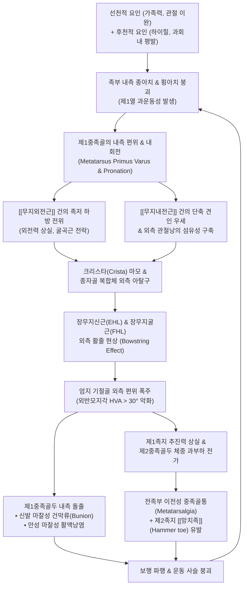
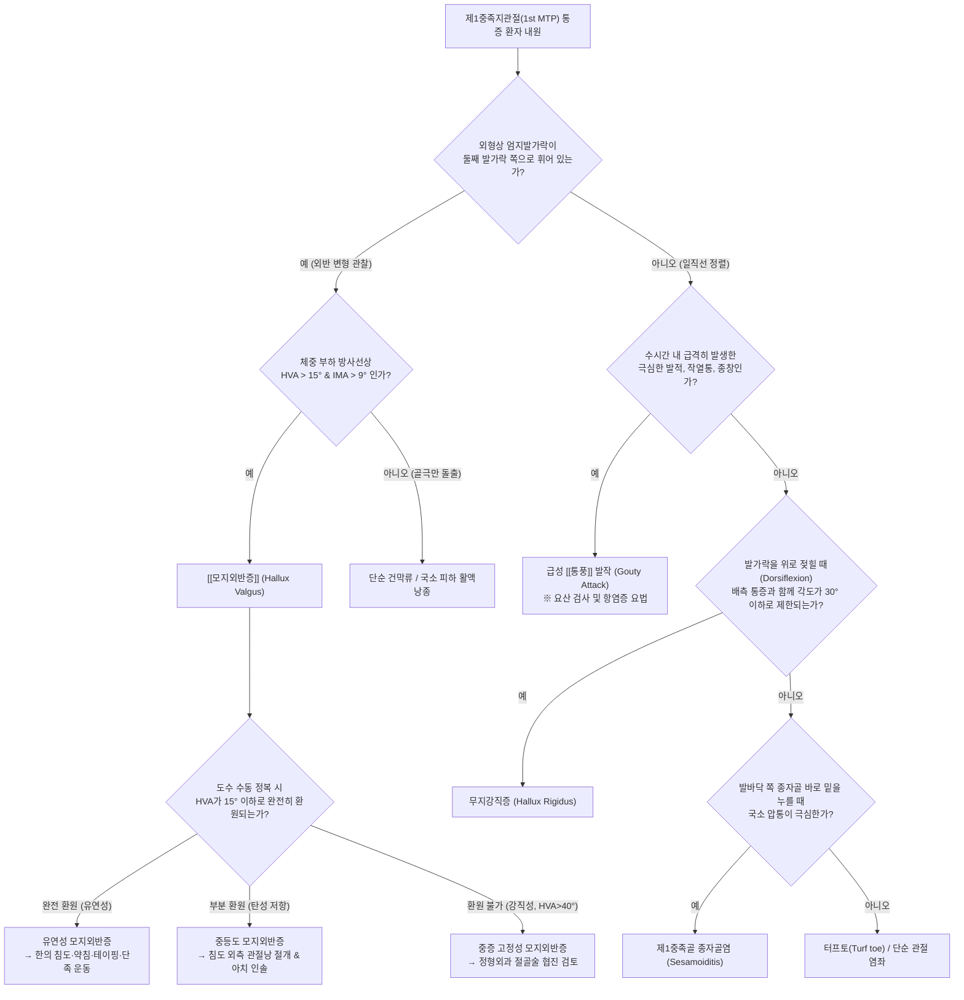

# 🫁 [[모지외반증]] (Hallux Valgus / Bunion, 무지외반증)

> **핵심 3줄 요약 (Key Summary)**:
> - 📍 **병소 부위 & 해부·병태생리**: 제1중족지관절(1st MTP joint)에서 제1중족골은 내측으로 편위(Varus) 및 내회전(Pronation)되고 근위기절골은 외측으로 편위(Valgus)되어 내측 관절두가 불룩하게 돌출(건막류, Bunion)되는 3차원 복합 족부 변형 질환입니다.
> - 🚩 **전형적 임상 양상 & 3대 징후**: 돌출된 제1중족골두 내측 건막류의 마찰성 활액낭염 및 발적 작열통, 종자골(Sesamoids) 외측 탈구와 제1열 과운동성으로 인한 추진력 결손, 체중이 제2·3중족골로 쏠리면서 발생하는 이전성 전족부 중족골통(Transfer metatarsalgia) 및 제2족지 [[망치족]] 병발입니다.
> - 🛠️ **핵심 감별 검사 & 한·양방 다각적 치료 전략**: 체중 부하 X-ray상 외반모지각(HVA > 15°) 및 중족골간각(IMA > 9°)으로 진단하며, 통풍([[통풍]]) 및 무지강직증과 감별하고, 유연성 단계에서 단축된 [[무지내전근]] 건 부착부 피하 침도 감압술, [[신바로약침]] 및 봉약침, 주상골 거상 및 횡아치 조임 2단계 비탄력 교정 테이핑, 단족 운동(Short foot exercise)을 적용합니다.
> - ⚠️ **응급 의뢰 레드플래그 & 악화 요인**: 건막류 궤양에 동반된 봉와직염, 보행 불가능 수준의 극심한 관절 파괴(HVA > 40°, IMA > 16°), 제2족지 교차 탈구가 진행된 강직성 변형은 Chevron, Scarf, Lapidus 절골술 등 정형외과적 수술을 협진 의뢰합니다.

---

## 📌 목차
1. [질환 개요 & 해부학적 병태생리](#1-질환-개요--해부학적-병태생리)
2. [병태생리 메커니즘 & 생체역학적 악순환 네트워크](#2-병태생리-메커니즘--생체역학적-악순환-네트워크)
3. [임상 증상 & 이학적 검사 알고리즘](#3-임상-증상--이학적-검사-알고리즘)
4. [감별 진단 매트릭스](#4-감별-진단-매트릭스)
5. [한의 통합 치료 프로토콜](#5-한의-통합-치료-프로토콜)
6. [양방 치료 & 병용·의뢰 기준](#6-양방-치료--병용의뢰-기준)
7. [재활 운동 & 생활습관 티칭 가이드](#7-재활-운동--생활습관-티칭-가이드)
8. [💡 사용자 진료실 핵심 필기 & 임상 노하우 (Melt-In)](#8--사용자-진료실-핵심-필기--임상-노하우-melt-in)
9. [출처 및 현대 학술 연구 요약](#9-출처-및-현대-학술-연구-요약)

---

## 1. 🩺 질환 개요 & 해부학적 병태생리

### 1.1 질환 정의 및 3차원 복합 변형(Triplanar Deformity)의 본질
* **모지외반증(Hallux Valgus / Bunion, 무지외반증)**은 제1중족지관절(First Metatarsophalangeal Joint, 1st MTP joint)에서 발생하는 인간 족부의 가장 대표적인 퇴행성 및 생체역학적 구조 기형입니다.
* 전통적으로는 단순 시상면 또는 횡단면상에서 엄지발가락(근위지골)이 제2족지 방향(외측)으로 꺾이는 '외반(Valgus)' 변형으로만 인식되었으나, 현대 족부생체역학에서는 **시상면(Sagittal plane), 관상면(Coronal / Frontal plane), 횡단면(Transverse plane)의 3개 축 모두에서 동시 다발적으로 발생하는 3차원 복합 회전 변형(Triplanar Deformity)**으로 정의합니다.
* 해부학적 3차원 변형 축의 정밀 분석:
  1. **횡단면 (Transverse Plane)**: 제1중족골은 체간 중심선 쪽으로 벌어지는 내전(Adduction / Varus) 편위를 보이고, 반대로 엄지 기절골은 외측으로 꺾이는 외전(Abduction / Valgus) 편위를 나타냅니다.
  2. **관상면 (Frontal / Coronal Plane)**: 제1중족골이 장축을 중심으로 **내회전(Pronation / Eversion)** 회전합니다. 이로 인해 본래 족저면에 수평으로 놓여 있어야 할 종자골(Sesamoids)이 외측 고랑으로 회전 이탈합니다.
  3. **시상면 (Sagittal Plane)**: 제1열(1st Ray)의 거상(Dorsiflexion / Elevatus)이 동반되어 보행 추진 시 지면을 누르는 압력이 소실됩니다.
* 제1중족골두의 내측 부위가 신발 안쪽 가죽과 지속적으로 마찰되면서 피하 활액낭이 비후되고 뼈가 과증식하여 불룩 튀어나오는 돌출 결절을 **건막류(Bunion / 버니언)**라고 부릅니다.

### 1.2 역학, 성별 편중 및 유전적 위험 인자
* **유병률 (Prevalence)**:
  * 전 세계 일반 성인 인구의 약 **23%**, 65세 이상 고령 인구에서는 **35.7%**에 육박하는 극히 흔한 족부 질환입니다.
  * 산업화된 현대 사회에서 신발을 착용하는 인구 집단이 맨발로 생활하는 미개척 집단에 비해 유병률이 15배 이상 높습니다.
* **성별 비대칭성**:
  * 여성 대 남성의 발생 비율은 **4:1에서 최대 9:1**에 이르기까지 여성이 압도적 다수를 차지합니다.
  * 이는 앞코가 좁고(Narrow toe box), 굽이 높은(High-heeled) 여성 신발의 구조적 마찰 압박과 더불어, 여성 호르몬(에스트로겐, 릴랙신) 주기에 따른 인대 이완성(Ligamentous laxity), 전족부 골격의 상대적 취약성이 복합 작용한 결과입니다.
* **유전적 소인 (Genetic Predisposition)**:
  * 환자의 60~70% 이상에서 직계 존속(어머니, 할머니)에 모지외반증 병력이 확인되는 강력한 가족력을 지닙니다.
  * 상염색체 우성(Autosomal dominant) 불완전 침투 유전 양상을 띠며, 특히 20세 이전에 발병하는 청소년기 모지외반증(Juvenile hallux valgus)은 유전적 원인이 90% 이상을 차지합니다.

### 1.3 제1열(First Ray)의 기능 해부학적 복합체
제1열(1st Ray)은 내측 설상골(Medial cuneiform)과 제1중족골(1st Metatarsal)로 구성된 기능적 단위로, 족부 내측 종아치(Medial longitudinal arch)의 핵심 기둥 역할을 합니다.
* **관절 운동학**:
  * 제1중족설상관절(1st TMT joint / Lisfranc joint)은 보행 입각기 동안 미세한 굴신 및 회전 운동을 통해 지면의 충격을 완충합니다.
  * **정상 상태**: 발뒤꿈치가 바닥에 닿는 초기 접지기에는 제1열이 유연하게 배굴(Dorsiflexion) 및 역회전하며 충격을 흡수하고, 발뒤꿈치가 들리는 추진기(Push-off)에는 단단하게 족저굴곡(Plantarflexion) 및 회외(Supination)되면서 발을 단단한 지레(Rigid lever)로 전환시킵니다.
  * **병적 상태**: 제1열의 관절낭과 인대가 느슨해지는 **제1열 과운동성(1st Ray Hypermobility)**이 존재하면, 추진기에 제1중족골이 지면을 누르지 못하고 위로 들려 올라가면서(Metatarsus primus elevatus) 제1중족골두가 내측으로 벌어지게 됩니다.

### 1.4 종자골(Sesamoids) 복합체와 관절 연골·인대 구조
제1중족골두 족저면에는 무릎의 슬개골(Patella)과 유사한 역할을 하는 2개의 완두콩 모양 종자골(내측/경골 종자골, 외측/비골 종자골)이 존재합니다.
* **크리스타(Crista, 능선)**:
  * 제1중족골두 족저면의 정중앙을 종축으로 가로지르는 골성 능선입니다. 내측 종자골과 외측 종자골을 물리적으로 격리하여 각자의 활주 고랑(Groove) 안에서만 미끄러지도록 가이드하는 레일 역할을 합니다.
* **종자골간 인대(Intersesamoid Ligament) 및 족저판**:
  * 두 종자골은 매우 견고한 종자골간 인대로 묶여 있으며, 두꺼운 섬유연골판인 제1족저판(Plantar plate) 내에 파묻혀 있습니다.
  * 단무지굴근(Flexor hallucis brevis, FHB)의 내측두와 외측두 건이 각각 내외측 종자골에 부착하여 기절골 기저부로 주행합니다.
* **종자골의 기능**:
  1. 단무지굴근건의 작용 각도를 증가시켜 지레 팔(Lever arm)의 역학적 이득을 약 30% 증대시킵니다.
  2. 보행 시 체중의 2~3배에 달하는 전족부 충격을 분산 흡수합니다.
  3. 장무지굴근(FHL) 건이 통과하는 활주로를 제공하여 마찰 손상을 방지합니다.

```
       [ 제1중족지관절(1st MTP) 정상 vs 모지외반증 횡단면 정렬 모델 ]

  [ 정상 정렬 (Normal Alignment) ]
                 엄지 기절골 (Proximal Phalanx)
                        │ (일직선 정렬 HVA < 15°)
                  제1중족골두 (1st MT Head)
                     ┌───────┐
       내측 종자골 ──│ Cr   │── 외측 종자골 (크리스타 양측에 안착)
       [[무지외전근]] ──└───────┘── [[무지내전근]] (대칭적 장력 밸런스)
  
  [ 모지외반증 변형 (Hallux Valgus Triplanar Deformity) ]
                            엄지 기절골 (외측 편위 HVA > 30°)
                           ↗
       건막류 (Bunion)   ┌───────┐
       (내측 돌출/활액낭) ◀│       │ ──> 제1중족골 내반 편위 (IMA > 12°)
                        └───────┘
                     (크리스타 마모) ──> [내측·외측 종자골 전체가 외측으로 아탈구]
       [[무지외전근]] 하방 전위 ↙        ↘ [[무지내전근]] 단축 견인 극대화
```

### 1.5 무지 주변 근육군의 동적 짝힘(Force Couple)과 활줄 현상
정상 제1 MTP 관절의 외형은 족저 내측의 [[무지외전근]](Abductor hallucis)과 족저 외측의 [[무지내전근]](Adductor hallucis)이 이루는 완벽한 짝힘에 의해 제어됩니다.
* **[[무지외전근]](Abductor hallucis)**:
  * 종골 족저 내측 결절에서 기시하여 내측 종자골을 거쳐 기절골 기저부 내측에 부착합니다.
  * 엄지발가락을 내측(체간 중심)으로 벌리고, 제1열의 족저굴곡을 보조하며 내측 종아치를 끌어올리는 주동근입니다.
* **[[무지내전근]](Adductor hallucis)**:
  * 횡두(Transverse head: 제3~5 MTP 관절낭 및 심횡중족인대 기시)와 사두(Oblique head: 제2~4 중족골 기저부 및 장족저인대 기시)로 구성됩니다.
  * 외측 종자골을 감싸며 기절골 기저부 외측에 부착하여 엄지발가락을 제2족지 쪽으로 강하게 당깁니다.
* **활줄 현상 (Bowstring Effect)**:
  * 제1중족골이 내측으로 회전 편위되면, 중앙선을 따라 주행하던 **장무지신근(Extensor hallucis longus, EHL)** 건과 **장무지굴근(Flexor hallucis longus, FHL)** 건의 주행 축이 외측으로 미끄러져 탈구됩니다.
  * 활의 양 끝에 매달린 시위처럼, EHL과 FHL이 수축할 때마다 엄지발가락을 정상 정렬로 펴는 것이 아니라 **엄지발가락을 바깥쪽으로 더욱 꺾어버리는 굴곡-외전 모멘트 암(Bowstring force)**으로 역전되어 변형을 기하급수적으로 폭주시키는 악순환을 유발합니다.

---

## 2. ⚡ 병태생리 메커니즘 & 생체역학적 악순환 네트워크

### 2.1 내외전근 짝힘 붕괴와 무지내전근 단축 견인
1. **외전근의 기능 부전 및 해부학적 탈구**:
   * 제1중족골이 내회전(Pronation)되면서 내측에 위치하던 [[무지외전근]] 건이 족저면(발바닥 아래)으로 미끄러져 떨어집니다.
   * 원래 엄지발가락을 수평면에서 안쪽으로 벌려주어야 할 외전근이 회전축보다 아래로 전위되면서 외전력을 완전히 상실하고, 오히려 엄지발가락을 아래로 굽히며 회내(Pronation)시키는 비정상적 기전으로 전환됩니다.
2. **내전근의 독주와 관절낭 구축**:
   * 외전근의 대항력이 사라진 상태에서 [[무지내전근]]의 횡두와 사두는 아무런 저항 없이 수축하여 기절골 기저부를 외측으로 맹렬히 견인합니다.
   * 이에 따라 제1 MTP 관절의 외측 관절낭(Lateral capsule)과 외측 측부인대가 만성적으로 단축, 섬유화되어 단단한 띠(Tight band)를 형성합니다.

### 2.2 종자골 크리스타(Crista) 마모 및 외측 아탈구
* 제1중족골두가 내측으로 빠져나가는 동안, 종자골 복합체는 심횡중족인대(DTML)와 무지내전근 건에 단단히 묶여 제자리에 남아있으려 합니다.
* 상대적인 변위로 인해 제1중족골두 족저면의 골성 능선인 **크리스타(Crista)**에 막대한 외측 마찰 전단 응력이 집중됩니다.
* 수년에 걸친 만성 압박으로 크리스타가 맷돌에 갈리듯 납작하게 마모(Erosion & Flattening)되어 골성 장벽이 소실됩니다.
* 장벽이 무너지면 내측 종자골이 중앙 고랑으로 넘어가고, 외측 종자골은 제1-2 중족골 사이 지간 공간으로 완전히 빠져나가는 **종자골 외측 아탈구(Sesamoid Subluxation / Dislocation)**가 고착화됩니다. 이로 인해 단무지굴근건의 당김선이 완전히 외측으로 편향됩니다.

### 2.3 족부 과회내(Overpronation) 및 평발과의 역학적 연계, 제1열 과운동성
* **보행 주기에서의 회내 연쇄 반응**:
  * 족부의 과도한 회내([[평발]] / Pes planus)가 존재하는 환자는 보행 주기 입각기 동안 거골(Talus)이 족저-내측으로 전하방 활주합니다.
  * 거골하관절(Subtalar joint)이 열리면서 족부의 종아치가 주저앉고, 지면 반발력이 제1중족골두 내측면에 지속적인 외측-상방 전단력을 가합니다.
  * 회내된 발은 추진기(Push-off)에 지레가 잠기지(Rigid lever) 못하므로, 제1중족설상관절(1st TMT)의 인대가 만성적으로 늘어나며 **제1열 과운동성(First Ray Hypermobility)**을 초래합니다.
* 제1열이 위로 들리면서(Elevatus) 제1중족골 체부는 바깥으로 벌어지는 내반(Metatarsus primus varus) 기형으로 영구 진행됩니다.

### 2.4 전족부 횡아치 붕괴와 제2, 3중족골두 이전성 과부하
* **심횡중족인대의 이완과 전족부 확장**:
  * 앞코가 좁은 신발을 지속적으로 착용하거나 횡아치가 무너지면, 중족골두들을 가로로 묶어주던 인대 복합체가 이완되어 발볼이 옆으로 퍼지는 '개장족(Splay foot)'이 발생합니다.
* **이전성 중족골통 (Transfer Metatarsalgia)**:
  * 정상적인 보행에서는 체중의 약 60% 이상이 제1중족골두와 엄지발가락을 통해 추진됩니다.
  * 그러나 모지외반증에서는 종자골 탈구와 제1열 거상으로 인해 제1족지의 체중 지지 기능이 완전히 붕괴됩니다.
  * 추진 시 빠져나가지 못한 체중 부하가 인접한 **제2중족골두와 제3중족골두로 폭발적으로 전가(Transfer)**됩니다.
  * 이로 인해 제2중족골두 바닥에 굳은살(Callus)이 생기고 통증이 극심해지며, 장기적으로 제2족지 MTP 족저판이 파열되면서 제2족지가 위로 솟구쳐 구부러지는 2차성 **[[망치족]](Hammer toe)** 및 **교차 족지 기형(Crossover toe)**을 필연적으로 병발시킵니다.

### 2.5 생체역학적 악순환 네트워크 다이어그램



---

## 3. 🔍 임상 증상 & 이학적 검사 알고리즘

### 3.1 주요 임상 증상 및 단계별 징후
모지외반증 환자의 증상은 외형적 기형의 정도와 항상 비례하지는 않지만, 임상적으로 다음 3대 주소증을 나타냅니다:
1. **제1중족골두 내측 건막류 통증 및 활액낭염 (Bunion Pain & Bursitis)**:
   * 가장 보편적인 주소증입니다. 신발 안쪽 가죽과의 지속적인 압박과 마찰로 인해 내측 융기 부위의 피부가 붉게 달아오르고(Erythema), 각화되어 굳은살이 형성됩니다.
   * 심부 피하 활액낭에 무균성 삼출액이 고이는 외상성 활액낭염이 동반되어 보행 시 욱신거리는 작열통과 야간 욱신거림을 호소합니다.
2. **전족부 족저면의 이전성 중족골통 (Transfer Metatarsalgia)**:
   * 제1족지의 기능 부전으로 체중이 둘째, 셋째 발가락 밑으로 쏠리면서, 제2중족골두 하방에 돌멩이를 밟고 서 있는 듯한 극심한 족저 압통과 두꺼운 못(Callus / Tyloma)이 발생합니다.
3. **제2족지 변형 및 발가락 겹침 (Toe Overlapping & Hammer Toe)**:
   * 외측으로 꺾인 엄지발가락이 둘째 발가락을 밀어내어, 둘째 발가락이 엄지 위로 올라타거나(Overriding) 밑으로 파고들면서(Underriding) 심각한 신발 착용 곤란을 초래합니다.
4. **보행 장애 및 2차 하지 관절통**:
   * 발가락으로 지면을 차고 나가지 못하므로 환자는 발을 바깥쪽으로 돌려 걷는 외회전 보행(Out-toeing gait)을 하게 되며, 이는 무릎 관절([[퇴행성 슬관절염]]) 및 고관절, 요추의 2차 생체역학적 과부하를 유발합니다.

### 3.2 중증도 임상-방사선학적 4단계 분류
방사선상 계측되는 **외반모지각(HVA)**과 **중족골간각(IMA)**, 그리고 **종자골 아탈구 정도**를 종합하여 4단계로 분류합니다:

| 중증도 등급 | 외반모지각 (HVA) | 중족골간각 (IMA) | 종자골 아탈구 위치 | 임상 증상 및 관절 정합성 |
| :--- | :--- | :--- | :--- | :--- |
| **정상 (Normal)** | **< 15°** | **< 9°** | 0~1단계 (정상 안착) | 통증 없음, 관절 정합(Congruent) |
| **경도 (Mild)** | **15° ~ 20°** | **9° ~ 11°** | 2~3단계 (< 50% 아탈구) | 경미한 내측 돌출, 볼 넓은 신발 착용 시 증상 소실, 관절 정합 유지 |
| **중등도 (Moderate)** | **20° ~ 40°** | **11° ~ 16°** | 4~5단계 (50~75% 아탈구) | 지속적 건막류 통증, 신발 선택 제한, 제2족지 경미한 압박, 관절 부정합(Incongruent) |
| **중증 (Severe)** | **> 40°** | **> 16°** | 6~7단계 (> 75% 완전 탈구) | 극심한 건막류 활액낭염, 이전성 중족골통, 제2족지 교차 탈구, 관절 아탈구 고착 |

### 3.3 필수 이학적 검사 프로토콜

#### ① 제1 MTP 관절 수동 도수 정복력 평가 (Reducibility / Flexibility Test)
* **검사 수기**:
  1. 환자를 진료대에 앉히고 족관절을 90° 중립으로 유지합니다.
  2. 검사자는 한 손으로 환자의 제1중족골두를 단단히 잡고, 다른 손으로 엄지 기절골을 잡아 내측(원래의 정상 정렬) 방향으로 천천히 수동 교정합니다.
* **임상 판독**:
  * **유연성 (Flexible)**: 손으로 밀었을 때 저항 없이 HVA 15° 이하의 정상 일직선 정렬로 완전히 환원되는 상태. (한의 침도, 교정 테이핑, 운동 치료의 최적 적응증)
  * **부분 유연성 (Partially flexible)**: 통증과 함께 강한 탄성 저항이 느껴지며 50% 정도만 환원되는 상태. (침도를 통한 외측 관절낭 절개 필수)
  * **강직성 (Rigid / Fixed)**: 손으로 강하게 힘을 주어도 관절이 꿈쩍도 하지 않고 굳어 있는 고정 변형. (관절증 및 골극 형성, 수술 고려 대상)

#### ② 제1열 과운동성 검사 (Root Test for First Ray Hypermobility)
* **검사 수기**:
  1. 한 손으로 제2~5중족골두를 위아래에서 꽉 쥐어 전족부를 고정합니다.
  2. 다른 손 엄지와 검지로 제1중족골두를 잡고, 수직 배측(위) 및 수직 족저(아래) 방향으로 수동 이동시킵니다.
* **임상 판독**:
  * 제1중족골두의 상하 가동 범위가 **8~10mm 이상** 과도하게 덜컹거리며 움직이거나, 배측 이동량이 족저 이동량보다 현저히 크면 **제1열 과운동성 양성**으로 판정합니다. (Lapidus 관절 융합술 또는 족부 인솔 적응증)

#### ③ 전족부 횡압박 검사 (Squeeze Test)
* 제1중족골두와 제5중족골두를 양측에서 손바닥으로 강하게 압박합니다.
* 중족골두 사이의 간격이 비정상적으로 좁혀지며 제2-3 지간 통증이나 중족골통이 재현되는지 확인하여 횡아치 이완도를 평가합니다.

#### ④ 종자골 축상 압통 검사 (Sesamoid Palpation)
* 엄지발가락을 수동으로 배굴시킨 상태에서, 제1중족골두 하방의 내측 및 외측 종자골을 검사자의 엄지 끝으로 직접 지그시 압박합니다.
* 극심한 국소 압통이 유발되면 단순 모지외반증 외에 종자골염(Sesamoiditis)이나 종자골 피로골절 동반을 감별합니다.

### 3.4 체중 부하 방사선 계측 프로토콜 (Weight-Bearing Radiography)
모지외반증의 모든 진단과 각도 계측은 **반드시 체중 부하(Weight-bearing) 상태의 단순 방사선 X-선**으로 측정해야 합니다. 비체중 부하 사진은 중족골간각을 최대 4~6°까지 과소평가합니다.

```
       [ 체중 부하 전후방(AP) 방사선 주요 계측 각도 ]

                      제1기절골 축선
                          \
                           \  HVA (외반모지각: 정상 < 15°)
                            \ 
        제1중족골 축선 ─── 제1 MTP 관절 ─── 제2중족골 축선
              \               /
               \             /
                \   IMA     /  (중족골간각: 정상 < 9°)
                 \         /
                  \       /
```

1. **외반모지각 (Hallux Valgus Angle, HVA)**:
   * **측정법**: 제1중족골 간부(Diaphysis)의 종축선과 엄지 기절골 간부의 종축선이 이루는 사잇각.
   * **기준**: 정상 < 15°, 경도 15~20°, 중등도 20~40°, 중증 > 40°.
2. **제1-2 중족골간각 (First-Second Intermetatarsal Angle, IMA)**:
   * **측정법**: 제1중족골 종축선과 제2중족골 종축선이 이루는 사잇각.
   * **기준**: 정상 < 9°, 경도 9~11°, 중등도 11~16°, 중증 > 16°.
3. **원위 중족골 관절면각 (Distal Metatarsal Articular Angle, DMAA)**:
   * **측정법**: 제1중족골 종축선의 수직선과 제1중족골두 관절 연골면선이 이루는 각도.
   * **기준**: 정상 < 10°. DMAA가 크면 관절면 자체가 이미 바깥쪽으로 기울어져 있음을 의미하며, 단순 연부조직 수술로는 재발률이 높습니다.
4. **종자골 위치 평가 (Hardy & Clapham 7단계 분류)**:
   * 전후방 방사선에서 제1중족골 종축선에 대해 내측 종자골이 위치한 위치를 1단계(완전 내측)부터 7단계(완전 외측 탈구)로 정량화.

---

## 4. 🔀 감별 진단 매트릭스

제1 MTP 관절 부위의 통증과 종창은 모지외반증 외에도 대사성 질환, 퇴행성 관절염, 외상 등 다양한 질환에 의해 유발되므로 감별이 필수적입니다.

### 4.1 제1중족지관절 질환 감별 매트릭스

| 감별 질환 | 호발 병소 및 특징적 병태 | 외형상 변형 및 각도 특성 | 통증 발현 양상 및 검사 소견 | 치료 접근 차이 |
| :--- | :--- | :--- | :--- | :--- |
| **[[모지외반증]] (본 질환)** | 제1중족골 내측 융기 (건막류) 및 외측 편위 | **HVA > 15°, IMA > 9°** (엄지가 바깥으로 휨) | • 신발 마찰 시 작열통<br>• 보행 시 둔통<br>• 관절 굴신 가동역은 대개 보존 | 침도 감압, 횡아치 테이핑, 인솔, 절골술 |
| **무지강직증 (Hallux Rigidus)** | 제1 MTP 관절의 심한 골관절염([[퇴행성 관절염]]) | **외반 변형 없음 (일직선)**, 배측 거대 골극 돌출 | • **발가락을 위로 젖히는 배굴(Dorsiflexion) 극심한 제한 (< 30°)**<br>• 관절 분쇄음(Crepitus) | 관절 견인 추나, 골극 절제술(Cheilectomy), 유합술 |
| **통풍성 관절염 ([[통풍]])** | 요산나트륨 결정(MSU) 침착에 의한 급성 활액막염 | 변형 유무와 무관, 제1 MTP 전반의 극심한 발적 팽윤 | • **야간 급성 발작, 극심한 박동성 자통 (닿기만 해도 비명)**<br>• 혈청 요산 수치 상승, 편광현미경 결정 | 양방 콜키신/알로푸리놀, 한방 청열사화, 온열 자극 금기 |
| **종자골염 (Sesamoiditis)** | 종자골 연골연화증 또는 스트레스 피로골절 | 외형상 외반 변형 없음 | • **제1중족골두 바닥(족저면) 직접 압통 국한**<br>• 까치발 들 때 족저 통증 악화 | 종자골 패딩(Dancer's pad), 체외충격파, 봉약침 |
| **터프토 (Turf Toe)** | 인조잔디 등에서 무지의 급성 과배굴 손상 | 급성 외상 병력, 족저판 염좌 | • 제1 MTP 관절 족저부의 급성 부종 및 반상출혈<br>• 수동 배굴 시 극심한 통증 | 깁스 고정, 냉찜질, 안정화 |

### 4.2 류마티스 관절염 및 전신 결합조직 질환 감별
* **[[류마티스 관절염]] (Rheumatoid Forefoot)**:
  * 양측성으로 발생하며, 제1 MTP 관절의 골 미란과 함께 제2~5 소족지 전체가 외측으로 쓸려나가는 **비골측 편위(Fibular drift)** 및 중족골두의 완전 탈구가 조기에 동반됩니다.
  * 혈청 검사상 RF 및 anti-CCP 항체 양성, 조조강직 1시간 이상 지속.
* **엘러스-단로스 증후군 (Ehlers-Danlos / 전신 인대 이완증)**:
  * 전신 관절의 과가동성(Beighton score 5점 이상)을 동반하며, 10대 초반부터 양측성 중증 모지외반증이 조기 발병합니다.

### 4.3 감별 진단 의사결정 알고리즘



---

## 5. 🌿 한의 통합 치료 프로토콜

### 5.1 한의학적 병인병기 및 변증론치
한의학에서 모지외반증은 선천적 비신(脾腎) 허약으로 인한 **근골이완(筋骨弛緩)**을 기저로 하여, 신발 압박과 과도한 마찰로 인해 발생하는 **기체어혈(氣滯瘀血)**, 국소 염증으로 인한 **습열응체(濕熱凝滯)**의 병태로 분류합니다.
* **근골이완(筋骨弛緩)형**:
  * 비주기육(脾主肌肉), 신주골(腎主骨) 기능 감퇴로 족부 인대와 근막이 느슨해져 전족부 아치를 지탱하지 못하고 뼈가 부채꼴로 벌어짐. 평발 동반 빈발.
  * 설담태백, 맥 침세.
* **기체어혈(氣滯瘀血)형**:
  * 좁은 신발의 만성 압박으로 족모지 경락의 기혈 주행이 차단되어 건막류가 자흑색을 띠고 찌르는 듯한 고정성 통증 호소.
  * 설암, 어반, 맥 현삽.
* **습열응체(濕熱凝滯)형**:
  * 건막류에 급성 활액낭염이 병발하여 환부가 붉게 붓고 뜨거우며 닿기만 해도 통증이 극심함.
  * 설홍태황니, 맥 활삭.

### 5.2 침구 치료 (Acupuncture Protocol)
* **치료 원칙**: 제1-2 중족골간 단축된 무지내전근을 이완하고, 족태음비경 및 족궐음간경의 순환을 촉진하여 건막류 부종을 소퇴시킵니다.
* **주요 경혈 및 자침 심도**:
  * **태충(LR3)**: 제1, 2중족골 결합부 원위 함요처. 직자 0.8~1.2촌. 간주근(肝主筋)의 원혈로 족부 근건의 경련과 긴장을 총괄 진정.
  * **행간(LR2)**: 제1, 2족지 지간연 경계 후방. 사자 0.5촌. 제1-2 중족골 사이의 무지내전근 횡두 단축을 이완하는 핵심 혈위.
  * **태백(SP3)**: 제1중족골두 원위-족저 함요처 (적백육제). 사자 0.3~0.5촌. 비경의 수목혈이자 원혈로 관절강 염증과 삼출액을 흡수.
  * **공손(SP4)**: 제1중족골 기저부 전하방 함요처. 직자 0.5~0.8촌. 충맥(衝脈)과 통하는 팔맥교회혈로 족부 내측 종아치를 거상하는 데 필수.
  * **은백(SP1) & 대돈(LR1)**: 엄지발톱 뿌리 모서리 0.1촌. 점자출혈(Bloodletting) 1~2방울로 국소 어혈과 급성 염증성 압력을 즉각 감압.
  * **삼음교(SP6)**: 내과첨 상 3촌, 경골 후연. 직자 1.0~1.5촌. 족삼음경의 교회혈로 족부 전반의 결합조직 긴장도 정상화.
* **전침 자극 세팅**:
  * 태충(LR3) - 행간(LR2) 배혈, 연속파 2Hz 저주파를 20분간 인가하여 단축된 무지내전근 섬유의 근방추(Muscle spindle) 억제를 유도.

### 5.3 특수 침도요법 (Acupotomy Protocol)
모지외반증의 근본적인 기계적 병인인 **외측 관절낭의 섬유성 구축**과 **무지내전근 건의 단축**을 해부학적으로 즉각 감압하는 핵심 최소침습 한의 술기입니다.

```
            [ 침도(Acupotomy) 해부학적 자입 포인트 및 술기 경로 ]

                     엄지 기절골 (외측 편위)
                           /
       (Point 2)          /
  ┌──────────────────┐   /
  │ 외측 관절낭      │  /
  │ 미세 이완술      │ ─  제1 MTP 관절 외측선 (측부인대 유착 1~2mm 박리)
  └──────────────────┘ \
                        \  제1중족골두
                         \
       (Point 1)          \
  ┌──────────────────┐     \
  │ [[무지내전근]]   │ ────── 제1-2 중족골간 간극 족저 외측
  │ 건 부착부 절개술 │        (심부 족저동맥궁 분지 회피하며 건막 절개)
  └──────────────────┘
```

1. **포인트 1: 무지내전근(Adductor hallucis) 건 부착부 피하 미세 절개술**:
   * **해부학적 목표**: 제1-2 중족골 사이에서 외측 종자골 및 기절골 기저부 외측에 부착하여 엄지발가락을 바깥으로 강하게 잡아당기는 무지내전근의 횡두/사두 정지건.
   * **자입 술기**: 0.4×40mm 일회용 멸균 침도를 사용합니다. 제1 MTP 관절 외측 간극에서 약간 족저측 방향으로 자입하여, 기절골 기저부 외측 결절의 골면에 닿은 후 침도를 종축과 평행하게 세워 팽팽하게 당겨진 내전근 건 섬유를 2~3회 조작(Peeling)하여 '툭' 하는 절개감을 얻습니다.
2. **포인트 2: 제1 MTP 관절 외측 관절낭 감압술**:
   * 관절의 외측 관절선을 따라 침도를 0.5mm 깊이로 조심스럽게 진입시켜 구축된 외측 측부인대와 관절낭을 횡방향으로 미세 절개하여 엄지발가락의 수동 내반 가동 각도를 즉각 확보합니다.
3. **포인트 3: 내측 건막류 주위 섬유화 박리술**:
   * 돌출된 뼈 표면과 비후된 피하 활액낭 사이의 유착을 침도 날로 십자 박리하여 마찰성 내압을 분산시킵니다.

### 5.4 약침 치료 (Pharmacopuncture Protocol)
* **건막류 급성 활액낭염 소염기**:
  * **황련해독탕 약침 / 중성어혈 약침**:
  * 주입점: 제1중족골두 내측 돌출부(건막류) 정점 및 주변 피하 활액낭.
  * 용량: 포인트당 0.1cc씩 총 0.3~0.5cc를 30G 인슐린 주사기로 팽진 주입.
  * 효과: 마찰성 무균성 염증 부종을 빠르게 소퇴시키고 발적 열감을 완화.
* **만성 결절성 건막 비후 및 연골 손상기**:
  * **[[신바로약침]] (Shinbaro)**:
  * 주입점: 제1 MTP 관절강 내 및 족저판 부착부.
  * 용량: 0.3~0.5cc 심부 관절강 직자.
  * 효과: 연골 기질 분해 효소(MMP) 억제 및 프로테오글리칸 합성 촉진, 관절염성 통증 억제.
  * **[[봉약침]] (Sweet BV 10% / 0.1~0.2cc)**:
  * 만성적으로 두꺼워진 건막류 결절 주위에 미량 점자하여 강력한 항염증 반응과 결합조직 리모델링을 유도. (시술 전 스킨 테스트 필수)

### 5.5 족부 교정 추나요법 (Chuna Manipulation Protocol)
* **기법 1: 제1 MTP 관절 견인-내반 가동술 (1st MTP Traction-Varus Mobilization)**:
  * 시술자는 한 손으로 환자의 제1중족골 경부를 단단히 쥐어 고정합니다.
  * 다른 손 엄지와 검지로 엄지 기절골을 파지하고, 장축 방향으로 부드럽게 **축성 견인(Axial traction)**을 유지한 상태에서 엄지발가락을 안쪽(내반, Varus) 및 회외(Supination) 방향으로 천천히 회전 가동합니다.
  * 30초 유지, 5회 반복하여 외측으로 탈구된 관절면을 중앙으로 유도합니다.
* **기법 2: 제1열 과운동성 안정화 및 족저굴곡 가동술**:
  * 제1중족설상관절(1st TMT) 부위를 족배에서 족저 방향으로 지그시 압박하여 들려있는 제1열을 아래로 내려주는 수기를 적용합니다.
* **기법 3: 족부 3대 아치 회복 교정 추나**:
  * 거골하관절(Subtalar joint)을 가동하여 과회내된 종골을 중립으로 유도하고, 주상골-입방골-설상골 사이를 가동하여 횡아치와 내측 종아치를 물리적으로 거상합니다.

### 5.6 맞춤 한약 처방 (Herbal Medicine Protocol)
* **당귀점통탕 (當歸拈痛湯) 가감방**:
  * 적응증: 습열(濕熱)이 하주하여 건막류가 붉게 붓고 열감이 있으며, 디딜 때마다 욱신거리는 통증이 극심한 전형적 급성 활액낭염 환자.
  * 처방 구성: 당귀·강활·창출·고삼·방기·황금·지모·인삼·백출·저령·택사·갈근·마황·감초.
  * 청열이습(淸熱利濕), 거풍지통(祛風止痛)의 대표 방제.
* **계지작약지모탕 (桂枝芍藥知母湯)**:
  * 적응증: 관절이 붓고 아프며 변형이 진행되고 야간에 냉감과 통증이 교차하는 한열착잡(寒熱錯雜) 및 만성 퇴행성 관절염 병발 환자.
  * 계지 8g, 작약 6g, 지모 6g, 백출 6g, 방풍 6g, 생강 6g, 마황 4g, 부자 2g, 감초 4g.
* **독활기생탕 (獨活寄生湯) 가감방**:
  * 적응증: 간신휴손(肝腎虧損)으로 족부 아치가 주저앉고 무릎과 허리가 시리며 피로 시 발가락 통증이 악화되는 고령층 환자.
  * 보기혈(補氣血), 익간신(益肝腎), 거풍습(祛風濕)으로 근골을 튼튼히 보강.

---

## 6. 💊 양방 치료 & 병용·의뢰 기준

### 6.1 보존적 양방 치료 (Conservative Treatment)
모지외반증의 양방 보존적 치료는 변형 각도를 원래대로 되돌리는 교정보다는, 통증 완화와 변형 악화 방지에 목적을 둡니다:
* **신발 변경 (Footwear Modification)**:
  * 가장 기본적이면서 효과적인 1차 중재입니다.
  * 앞코가 넓고 둥글어 발가락이 자유롭게 움직일 수 있는 신발(Wide toe-box), 굽 높이 2.5cm 이하의 낮은 굽, 신축성 있는 가죽 소재 신발 착용.
* **실리콘 토 세퍼레이터 (Toe Separator / Spacer)**:
  * 제1족지와 제2족지 사이에 실리콘 스페이서를 끼워 엄지발가락이 외측으로 쓰러지는 것을 물리적으로 지탱하고 신발 압박을 분산.
* **야간 외반 교정 부목 (Night Splint)**:
  * 수면 시간 동안 엄지발가락을 내측으로 당겨 고정해주는 플라스틱 부목. 주간의 단축된 연부조직을 밤사이 신장시키는 효과가 있으나, 성인에서 이미 고착된 골성 각도를 영구 교정하지는 못함.
* **기능성 맞춤 인솔 (Custom Foot Orthotics)**:
  * 평발 및 과회내를 제어하기 위한 내측 종아치 서포트와, 횡아치를 거상시켜 제2중족골두 압력을 덜어주는 **중족골 패드(Metatarsal pad)** 처방.

### 6.2 약물 요법 (Medication)
* **경구 NSAIDs**:
  * 건막류 활액낭염 및 통증기에 Celecoxib 200mg qd, Aceclofenac 100mg bid 등 단기 처방.
* **아세트아미노펜 (Acetaminophen)**:
  * 위장관 장애나 신기능 저하로 NSAIDs 복용이 어려운 환자에게 1차 진통제로 처방.

### 6.3 관절강 내 주사 (Injections: Benefits & Risks)
* **스테로이드 주사 (Corticosteroid Injection)**:
  * 건막류 점액낭염이 극심하여 신발을 전혀 신지 못할 때 Triamcinolone을 국소 주입하여 급성 부종을 빠르게 가라앉힐 수 있습니다.
  * ⚠️ **주의점**: 관절낭 내 반복 주사는 제1 MTP 관절 연골의 괴사를 촉진하고, 건막류 주변 피하 지방 패드를 위축시켜 피부가 얇아지고 변색되는 합병증을 유발하므로 1년에 2~3회 이하로 엄격히 제한해야 합니다.

### 6.4 수술적 교정술 적응증 및 술기 (Surgical Management)
비수술적 보존 치료를 6개월 이상 적극 시행했음에도 일상생활이 불가능할 정도의 통증이 지속될 때 정형외과적 수술을 시행합니다. 단순히 미용적 목적으로 수술하는 것은 절대 금기입니다.

| 수술 기법 명칭 | 적응증 및 각도 기준 | 수술 술기 상세 | 장단점 및 특징 |
| :--- | :--- | :--- | :--- |
| **원위 Chevron 절골술** (Chevron Osteotomy / Austin) | **경도~중등도**<br>(HVA < 30°, IMA < 13°) | • 제1중족골두 원위부에서 V자형(60°) 절골을 시행.<br>• 골두를 외측으로 3~5mm 평행 이동시켜 스크류 고정. | • 관절면 침범 최소화, 빠른 골유합.<br>• 회복 빠름 (수술 후 2주 보행 가능).<br>• 중증 변형에서는 교정력 부족. |
| **간부 Scarf 절골술** (Scarf Osteotomy) | **중등도~중증**<br>(HVA 30~40°, IMA 13~18°) | • 제1중족골 체부를 Z자 모양(수평 및 상하)으로 길게 절골.<br>• 넓은 접촉면을 유지하며 외측으로 미끄러뜨려 고정. | • 교정력이 매우 우수하고 강력함.<br>• 3차원 회전 교정 가능.<br>• 수술 술기가 복잡하고 골두 괴사 주의. |
| **기저부 Lapidus 관절 유합술** (Lapidus Procedure) | **제1열 과운동성 동반** 중증<br>(IMA > 16°, 평발 동반) | • 제1중족설상관절(1st TMT)의 연골을 제거하고 뼈를 영구 유합(Arthrodesis).<br>• 제1열을 족저굴곡 및 회외 위치로 고정. | • 과운동성 원인을 근본 차단하여 재발률 최저.<br>• 6주간 완전 비체중부하(깁스) 필수.<br>• 관절 유합 불융합(Nonunion) 위험. |
| **최소침습 절골술 (MICA)** (Minimally Invasive Chevron-Akin) | 경도~중등도, 미용 및 조기 회복 요구 | • 2~3mm 미세 피부 절개를 통해 특수 버(Burr)로 뼈를 절골하고 나사 고정. | • 흉터 극소, 연부조직 손상 적음.<br>• 조기 일상 복귀.<br>• 정밀한 방사선 투시장비 숙련도 필수. |

### 6.5 한·양방 병용 판단 기준
* **병용 가능 (Synergy)**:
  * 양방의 기능성 보조기(인솔, 토 세퍼레이터)를 착용하면서 한의 침도요법, 약침, 도인 운동을 병용하는 것은 보존적 치료 성공률을 극대화하는 최상의 조합입니다.
  * 수술 후 6~8주 경과 시점의 잔여 부종, 관절 강직, 전족부 통증에 대해 한방 침구 및 추나요법을 적용하면 관절 가동역 회복 속도가 현저히 빨라집니다.
* **병용 주의**:
  * 양방 국소 스테로이드 주사 직후 2주 이내에는 해당 부위에 봉약침이나 강자극 침도 시술을 금합니다.

### 6.6 전문과 및 응급 의뢰 기준 (Red Flags)
* **즉각적 응급 상급병원 의뢰**:
  * 당뇨병 환자에서 건막류 궤양 발생 후 급격한 족부 봉와직염, 농양 형성, 전신 발열 동반 시.
* **정형외과 수술 의뢰 권고**:
  * 체중 부하 X-ray상 HVA > 40°, IMA > 16°의 고정된 중증 변형으로 제2족지 탈구가 동반되어 독립 보행이 심각하게 제한되는 경우.

---

## 7. 🏃 재활 운동 & 생활습관 티칭 가이드

모지외반증의 비수술적 재활은 무너진 족부 3대 아치를 재건하고, 약화된 [[무지외전근]]을 활성화하는 능동 운동이 핵심입니다.

### 7.1 발가락 능동 운동 (Active Toe Exercises)
1. **발가락 벌리기 운동 (Toe Spread Out, TSO)**:
   * **방법**: 맨발로 바닥에 편안히 앉아, 모든 발가락을 바닥에 붙인 상태에서 엄지발가락은 안쪽(체간 쪽)으로, 새끼발가락은 바깥쪽으로 부채를 펼치듯 양옆으로 쫙 벌립니다. 5초간 유지 후 이완.
   * **빈도**: 1회 15회, 하루 3세트.
   * **임상 효과**: 하방으로 전위된 [[무지외전근]]의 운동단위를 재활성화하여 엄지발가락의 외전 모멘트를 회복시킵니다.
2. **발가락 가위-바위-보 (Toe Rock-Paper-Scissors)**:
   * **가위**: 엄지발가락만 위로 번쩍 치켜들고 나머지 4개 발가락은 바닥을 누름.
   * **바위**: 발가락 전체를 발바닥 쪽으로 꼭 쥐어 웅크림.
   * **보**: 발가락 전체를 최대한 넓게 부채꼴로 펼침.
   * **임상 효과**: 족부 심부 내재근과 외재 신전근 간의 협응력을 극대화.

### 7.2 단족 운동 (Short Foot Exercise, SFE)
* **방법**:
  1. 의자에 앉아 무릎을 90°로 두고 발바닥 전체를 바닥에 평평하게 댑니다.
  2. 발가락을 구부려 바닥을 긁지 않은 상태를 유지하면서, 제1중족골두를 발뒤꿈치(종골) 방향으로 수평하게 슬라이딩하여 끌어당긴다는 느낌으로 발바닥 중앙의 아치를 1cm 위로 바짝 들어 올립니다.
  3. 6초간 아치를 수축 유지한 후 천천히 내려놓습니다.
* **빈도**: 10회씩 3세트, 숙련되면 서서 체중을 싣고 시행.
* **임상 효과**: [[무지외전근]], [[단지굴근]], 후경골근의 동시 수축을 유도하여 횡아치와 종아치를 견고하게 재건.

### 7.3 교재 표준 2단계 비탄력 테이핑 요법 (Rigid Taping Protocol)
진료실에서 즉각적인 통증 완화와 변형 각도 교정을 제공하는 교재 표준 비탄력(White rigid) 테이핑 요법입니다:

```
        [ 모지외반증 교재 표준 2단계 비탄력 교정 테이핑 ]

  [ 1단계: 주상골(Navicular) 내측 거상 테이핑 ]
  ┌─────────────────────────────────────────────────────────┐
  │ 비탄력 테이프 가운데를 접어 종아치 정점인 주상골 밑에 부착 ──> │
  │ 양쪽 끝을 강하게 당겨 족배부 외측으로 감아 올려 내측 아치 거상  │
  └─────────────────────────────────────────────────────────┘

  [ 2단계: 횡아치 조임 및 무지 내반 정렬 테이핑 ]
  ┌─────────────────────────────────────────────────────────┐
  │ 종골에서 시작하여 엄지 기절골을 감싸 안쪽(내반)으로 당김 ──>    │
  │ 제1중족골두를 가로질러 전족부 횡아치를 단단히 조여 모아줌        │
  └─────────────────────────────────────────────────────────┘
```

1. **1단계: 주상골 내측 거상 지지 테이핑 (Navicular Sling Tape)**:
   * 폭 3.8cm 비탄력 테이프의 가운데를 세로로 접어 두껍게 만든 후, 내측 종아치의 정점인 주상골(Navicular) 결절 바로 아래 족저면에 단단히 밀착시킵니다.
   * 테이프의 양쪽 끝을 발등(족배부) 외측 방향으로 강한 장력을 주어 끌어올려 부착함으로써 무너진 주상골을 허공으로 번쩍 들어 올려 종아치를 회복시킵니다.
2. **2단계: 횡아치 조임 및 무지 내반 정렬 테이핑 (Transverse Arch & Varus Alignment)**:
   * 테이프를 발뒤꿈치(종골) 외측에서 시작하여 발바닥을 지나 엄지발가락 기절골 내측을 감쌉니다.
   * 엄지발가락을 안쪽(내반)으로 곧게 편 상태를 유지하면서 테이프를 강하게 당겨 제1-2중족골두 주위를 한 바퀴 둘러 전족부 횡아치를 단단하게 모아줍니다.

### 7.4 신발 착용 및 일상생활 티칭
* **신발 선택 황금률**:
  * 굽 높이는 2~3cm 이하, 발볼이 넓고 토박스가 둥근 신발을 선택합니다.
  * 가죽 소재는 발볼 부위가 부드럽게 늘어나는 천연 소가죽이나 양가죽, 혹은 메쉬 소재를 착용합니다.
* **하이힐 착용 제한**:
  * 업무상 불가피하게 힐을 신어야 하는 경우, 이동 중에는 편안한 운동화를 착용하고 직장에서만 제한적으로 착용하며, 1회 착용 시간은 2시간을 넘기지 않도록 교육합니다.

---

## 8. 💡 사용자 진료실 핵심 필기 & 임상 노하우 (Melt-In)

### 8.1 교재 원문 비탄력 테이핑 2단계 실전 손맛 및 적용 노하우
* **비탄력 테이핑의 핵심은 '장력의 방향'**:
  * 신축성 키네시오 테이프는 모지외반증의 강한 골성 외반력을 버티지 못하고 쉽게 늘어납니다. 따라서 교재 원문대로 **반드시 늘어나지 않는 백색 비탄력(Rigid Zinc Oxide) 테이프**를 사용해야 합니다.
  * **1단계(주상골 거상) 손맛**: 주상골 결절 밑에 테이프 중앙을 걸 때, 발을 수동으로 약간 안쪽으로 돌려(Inversion) 종아치를 인위적으로 높여놓은 상태에서 테이프를 당겨 붙여야 일어섰을 때 아치가 완벽히 지지됩니다.
  * **2단계(무지 내반) 손맛**: 테이프를 감을 때 엄지발가락을 과교정(Hypercorrection, 살짝 안쪽으로 더 꺾인 상태)한 상태에서 제1중족골두를 둘러싸야 보행 시 테이프 장력이 유지되며 건막류 통증이 즉각적으로 50% 이상 소실됩니다.

### 8.2 침도치료 시 무지내전근 건 부착부 자입 포인트와 심부 신경혈관속 보호 요령
* **자입 포인트의 정밀 위치**:
  * 제1 MTP 관절 외측 틈새에서 근위부로 약 0.5cm, 제1-2 중족골 사이 지간 공간의 족저-외측 모서리가 자입점입니다.
* **신경혈관속 보호 수칙**:
  * 제1 지간 공간의 심부에는 족배동맥에서 분지하는 **심족저동맥(Deep plantar artery)**과 심비골신경(Deep peroneal nerve)의 종말지가 족저면으로 관통합니다.
  * 따라서 침도를 자입할 때는 바늘 끝이 제2중족골 쪽으로 깊숙이 파고들지 않도록 주의해야 합니다.
  * 침도 날을 엄지 기절골 외측 결절 골면에 정확히 밀착시킨 상태에서, 뼈 표면을 긁어내듯(Bony attachment peeling) 0.5~1.0mm 범위 내에서만 조작해야 혈관 손상과 혈종 형성을 원천 차단할 수 있습니다.

### 8.3 봉약침 점자 시 건막류 팽윤 반응 관리법과 환자 티칭
* **건막류 부위 봉약침 시술 노하우**:
  * 만성적으로 두꺼워진 건막류 결절에 봉약침을 시술할 때, 고농도를 한 번에 다량 주입하면 환부가 벌겋게 붓고 팽윤되어 신발을 전혀 신지 못하는 급성 면역 팽윤 반응이 나타날 수 있습니다.
  * 반드시 **저농도(0.1~0.2cc)로 시작하여 결절 주위 3~4군데에 피내 점자(Intradermal micro-injection)** 형태로 나누어 주입해야 합니다.
* **환자 사전 티칭**:
  * "약침 맞고 1~2일간 모기 물린 것처럼 가렵고 붓는 것은 굳어있는 결절을 녹이고 혈류를 모으는 정상적인 치유 과정입니다. 얼음찜질을 10분간 해주시면 가라앉습니다"라고 시술 전 반드시 예고해야 환자의 불필요한 불안을 방지합니다.

### 8.4 신발을 바꿔도 변형이 계속 진행되는 환자에게 설명하는 보행 주기 추진기 역학
* **환자의 흔한 질문**:
  * "원장님, 저는 하이힐도 안 신고 10년째 볼 넓은 편한 운동화만 신었는데 엄지발가락이 왜 점점 더 휘나요?"
* **원장실 설명 멘트**:
  * "모지외반증은 좁은 신발이 밖에서 미는 힘뿐만 아니라, **환자분의 걸음걸이 내부에서 엄지발가락을 꺾는 힘** 때문에 진행합니다."
  * "발바닥 아치가 무너지면(과회내), 걸을 때 발가락이 바닥을 똑바로 밀지 못하고 안쪽으로 미끄러집니다. 이때 발가락을 펴주는 힘줄(장무지신근)이 바깥쪽으로 탈구되어 활시위(Bowstring)처럼 팽팽해지면서, 걸을 때마다 스스로 발가락을 바깥으로 꺾어버리는 자가 추진 변형이 일어납니다."
  * "따라서 신발만 바꾼다고 멈추지 않으며, 침도로 바깥쪽 힘줄을 늦춰주고 단족 운동으로 무너진 발바닥 아치를 세워야만 뼈가 더 휘는 것을 막을 수 있습니다."

---

## 9. 📚 출처 및 현대 학술 연구 요약

* Coughlin MJ, Jones CP. (2007). Hallux valgus: demographics, etiology, and radiographic assessment. *Foot Ankle Int*. 28(7):759-777. PMID: 17666168

  `[연구 요약]` 모지외반증 환자 대규모 코호트를 대상으로 유전적 소인, 신발 요인, 체중 부하 방사선 계측 지표(HVA, IMA, DMAA) 및 종자골 아탈구 병태생리를 체계화한 족부외과학의 핵심 랜드마크 논문.

* Nix S, Smith M, Vicenzino B. (2010). Prevalence of hallux valgus in the general population: a systematic review and meta-analysis. *J Foot Ankle Res*. 3:21. PMID: 20868524

  `[연구 요약]` 전 세계 일반 인구 집단에서 모지외반증의 유병률(전체 23%, 여성 30%, 65세 이상 고령자 35.7%)과 성별·연령별 위험 인자를 규명한 대규모 메타분석 연구.

* Perera AM, Mason L, Stephens MM. (2011). The pathogenesis of hallux valgus. *J Bone Joint Surg Am*. 93(17):1650-1661. PMID: 21915581

  `[연구 요약]` 모지외반증의 발생 단계에서 무지외전근과 내전근의 짝힘 불균형, 심횡중족인대의 이완 및 장무지신근의 활시위 현상에 이르는 3차원 생체역학적 진행 기전을 상세히 규명함.

* Katakura M et al. (2024). A comparison of abductor hallucis muscle activation and medial longitudinal arch angle during nine different foot exercises. *Gait Posture*. 113:162-168. PMID: 38905851

  `[연구 요약]` 9가지 서로 다른 족부 재활 운동 시 무지외전근의 근전도 활성도와 내측 종아치 각도 변화를 정량 비교한 연구. 단족 운동과 발가락 벌리기 운동이 무지외전근 근력 강화에 가장 탁월함을 입증.

* Dayton P et al. (2014). Observed changes in radiographic measurements of the first metatarsal after frontal plane rotation. *J Foot Ankle Surg*. 53(3):274-279. PMID: 24703378

  `[연구 요약]` 제1중족골의 관상면 회전(Pronation) 교정이 모지외반각 및 중족골간각에 미치는 영향을 방사선학적으로 분석하여 모지외반증의 3차원 회전 기전의 임상적 중요성을 규명.

* Akaras E et al. (2020). The acute effects of two different rigid taping methods in patients with hallux valgus deformity. *J Back Musculoskelet Rehabil*. 33(4):649-656. PMID: 31033456

  `[연구 요약]` 모지외반증 환자를 대상으로 비탄력 테이핑 요법을 적용했을 때 보행 주기 족저압 분포, 외반 각도 및 통증 지수(VAS)가 즉각적으로 유의하게 개선됨을 입증한 임상 연구.

* Robinson AH, Limbers JP. (2005). Modern concepts in the treatment of hallux valgus. *J Bone Joint Surg Br*. 87(8):1038-1045. PMID: 16103597

  `[연구 요약]` 모지외반증의 중증도별 보존적 처치 및 Chevron, Scarf, Lapidus 등 현대적 절골술의 선택 기준과 합병증 예방 가이드라인을 집대성한 종설.

---

## 🔗 관련 노트
- [[망치족]]
- [[족저근막염]]
- [[몰톤 증후군]]
- [[무지외전근]]
- [[무지내전근]]
- [[단무지굴근]]
- [[장무지굴근]]
- [[장무지신근]]
- [[충양근]]
- [[골간근]]
- [[전경골근]]
- [[후경골근]]
- [[비복근]]
- [[가자미근]]
- [[신바로약침]]
- [[봉약침]]
- [[평발]]
- [[퇴행성 관절염]]
- [[퇴행성 슬관절염]]
- [[통풍]]
- [[류마티스 관절염]]
- [[아킬레스건염]]
