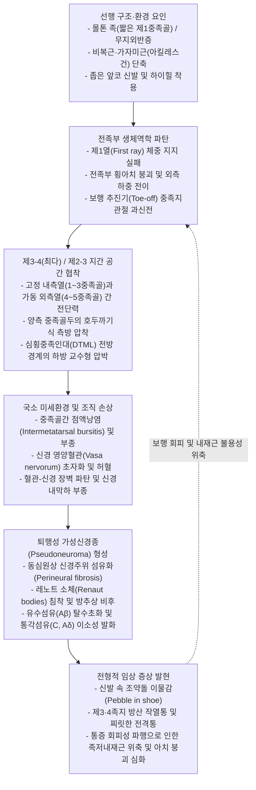
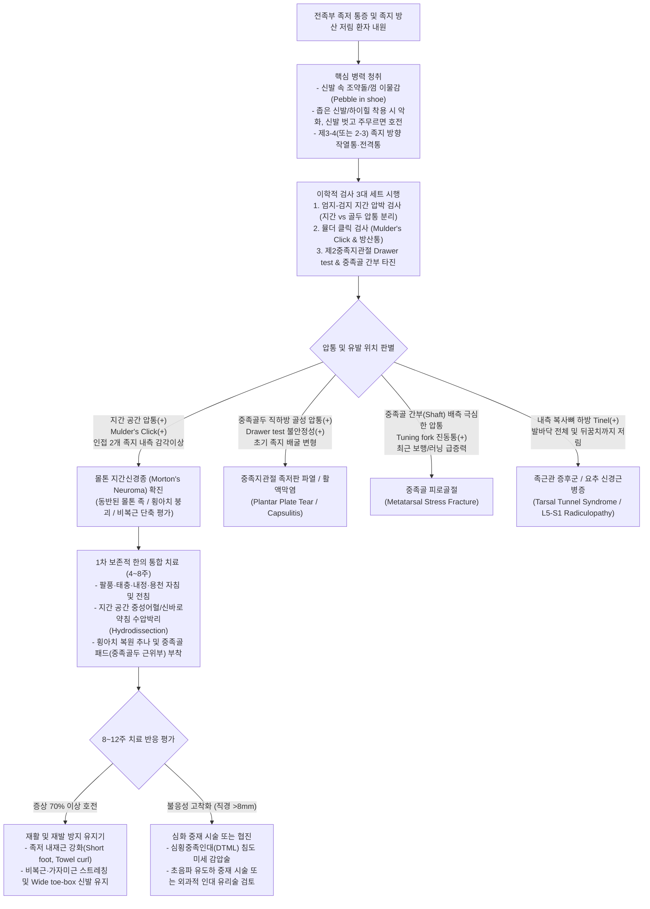
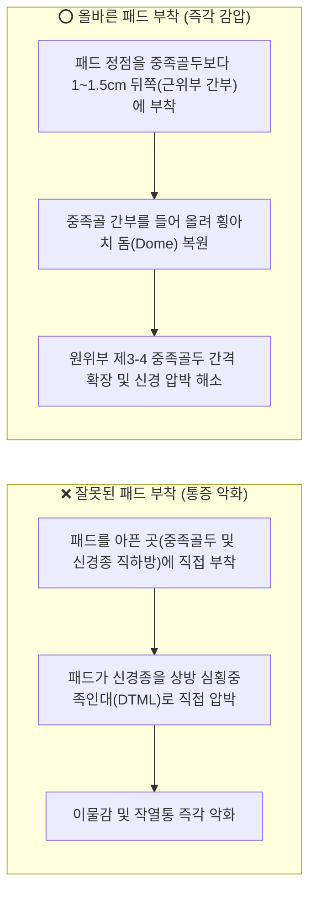

# 🩺 [[몰톤 증후군]] (Morton's Neuroma / Morton's Metatarsalgia / Morton's Toe, 지간신경종 및 몰톤 족 증후군)

> **핵심 3줄 요약 (Key Summary)**:
> 🎯 발바닥 제3-4 중족골두(75~85% 최다 호발) 또는 제2-3 중족골두 사이의 공통 족저지간신경이 심횡중족인대(Deep transverse metatarsal ligament, DTML) 하방에서 만성 압박과 전단력을 받아 신경주위 섬유화(Perineural fibrosis) 및 방추상 비후를 일으키는 대표적 전족부 포착성 말초신경병증이며, 선천적으로 짧은 제1중족골로 인해 제2중족골두에 과부하가 집중되는 몰톤 족(Morton's toe)의 역학적 개념과 통합·감별하여 접근해야 한다.
> 🚩 앞코가 좁고 굽 높은 신발 착용 및 보행 말기 입각기(Toe-off) 시 발바닥 앞쪽에 불로 지지는 듯한 작열통, 찌릿한 전격통, 족지 방산 저림 및 신발 속에 조약돌이나 껌이 들어있는 듯한 이물감(Pebble in shoe)을 유발하며, 신발을 벗고 전족부를 주무르면 통증이 즉각 경감되는 특징적 병력을 보인다.
> 🔍 전족부 좌우 횡압박과 지간 족저면 동시 촉진 시 딸깍 소리와 방사통을 재현하는 뮬더 클릭 검사(Mulder's Click Test), 엄지-검지 지간 압박 검사(Thumb-Index Finger Squeeze Test), 티넬 징후(Tinel sign)로 진단하며, 팔풍(八風)·태충·내정·용천 자침, 중족골간 공간 확장을 위한 [[중성어혈약침]]·[[신바로약침]] 수압박리술, 횡아치 복원 [[추나요법]] 및 중족골 패드(Metatarsal pad) 정밀 부착 티칭으로 치료한다.
> ⚠️ 진성 종양이 아닌 퇴행성 가성신경종(Pseudoneuroma)이므로 무분별한 스테로이드 다회 주사(족저 지방패드 위축 유발)나 조기 신경종 절제술(절단신경종 위험)을 지양하고, 중족골 피로골절, 제2중족지관절 족저판 파열(Plantar plate tear), [[족근관 증후군]], [[프라이버그병]]과의 정밀 감별 진단이 필수적이다.

---

## 📌 목차
1. [🩺 질환 개요 & 해부학적 병태생리](#1--질환-개요--해부학적-병태생리)
2. [⚡ 병태생리 메커니즘 & 생체역학적 악순환 네트워크](#2--병태생리-메커니즘--생체역학적-악순환-네트워크)
3. [🔍 임상 증상 & 이학적 검사 알고리즘](#3--임상-증상--이학적-검사-알고리즘)
4. [🔀 감별 진단 매트릭스](#4--감별-진단-매트릭스)
5. [🌿 한의 통합 치료 프로토콜](#5--한의-통합-치료-프로토콜)
6. [💊 양방 치료 & 병용·의뢰 기준](#6--양방-치료--병용의뢰-기준)
7. [🏃 재활 운동 & 생활습관 티칭 가이드](#7--재활-운동--생활습관-티칭-가이드)
8. [💡 사용자 진료실 핵심 필기 & 임상 노하우 (Melt-In)](#8--사용자-진료실-핵심-필기--임상-노하우-melt-in)
9. [📚 출처 및 현대 학술 연구 요약](#9--출처-및-현대-학술-연구-요약)

---

## 1. 🩺 질환 개요 & 해부학적 병태생리

### 1.1 정의 및 핵심 개념: 몰톤 지간신경종 vs 몰톤 족(Morton's Toe)의 통합과 감별
임상 현장에서 [[몰톤 증후군]](Morton's Syndrome)이라는 명칭은 역사적·해부학적으로 서로 다른 두 명의 의학자(Thomas George Morton과 Dudley Joy Morton)가 기술한 두 가지 전족부 병태를 포괄하거나 혼용하여 지칭한다. 임상의는 이 두 개념의 차이와 생체역학적 연결고리를 명확히 구분하고 통합적으로 평가해야 한다.
* **토마스 몰톤의 지간신경종 (Morton's Interdigital Neuroma / Morton's Metatarsalgia, 1876)**:
  * 발가락으로 분지하는 [[경골신경]]의 종말 분지인 [[내측족저신경]](Medial plantar nerve)과 [[외측족저신경]](Lateral plantar nerve)에서 기원한 **공통 족저지간신경(Common plantar digital nerve)**이 인접한 두 중족골두(Metatarsal heads) 사이의 좁은 지간 공간(Intermetatarsal web space)을 통과할 때, 상부의 **심횡중족인대(Deep transverse metatarsal ligament, DTML)**와 하방의 지면 반발력 및 중족골두 사이에서 만성적인 기계적 압박(Compression), 마찰(Friction), 견인(Traction)을 받아 발생하는 **포착성 말초신경병증(Entrapment neuropathy)**이다.
* **더들리 몰톤의 몰톤 족지 증후군 (Morton's Toe / Morton's Foot Syndrome, 1927)**:
  * 선천적 혹은 발달성으로 **제1중족골이 제2중족골에 비해 비정상적으로 짧은 해부학적 변이(Short first metatarsal, BrachyMetatarsia of 1st ray)**와 제1설상골-제1중족골 관절(First tarsometatarsal joint)의 과운동성(Hypermobility)을 특징으로 하는 구조적 증후군이다.
  * 보행 추진기(Push-off phase)에 원래 체중의 약 40~50%를 감당해야 할 내측 종아치의 제1열(First ray)이 지면을 충분히 지지하지 못해 체중 부하 축이 외측으로 이동하며, 상대적으로 길게 돌출된 **제2중족골두 및 제3중족골두에 과도한 수직 압력과 전단 응력이 집중**된다.
* **두 병태의 생체역학적 통합**:
  * 몰톤 족(Morton's toe)을 가진 환자는 보행 시 전족부 내측 지지력 상실로 인해 중족부의 과도한 회내([[과회내 증후군]], Overpronation)가 유발되고, 이로 인해 전족부 횡아치(Transverse arch)가 붕괴(Splayfoot)되면서 제2-3 및 제3-4 중족골두 간격이 좁아지고 하방으로 주저앉아 결국 **몰톤 지간신경종(Morton's neuroma)**을 촉발하는 강력한 구조적 선행 인자로 작용한다.

| 비교 항목 | 몰톤 지간신경종 (Morton's Neuroma) | 몰톤 족 / 몰톤 족지 (Morton's Toe / Foot Syndrome) | 임상적 상호 연관성 및 통합 시각 |
| :--- | :--- | :--- | :--- |
| **최초 기술자 및 연도** | Thomas George Morton (1876) | Dudley Joy Morton (1927) | 동명이인(성씨 동일)에 의해 각각 기술된 전족부 병변 |
| **해부학적 핵심 구조물** | 공통 족저지간신경, 심횡중족인대(DTML), 중족골간 점액낭 | 제1중족골(단축), 제2중족골(상대적 돌출), 제1열 과운동성 | 제1열 지지 실패 ➔ 제2·3중족골두 낙하 ➔ 지간신경 압박 가속 |
| **병리학적 본질** | 신경주위 섬유화(Perineural fibrosis)에 의한 가성신경종 | 골격 길이 비율 이상에 따른 역학적 중족골두 과부하([[중족골통]]) | 역학적 골격 부하가 만성화되면 인접 지간신경의 포착으로 이행 |
| **최다 호발 위치** | **제3-4 족지간 공간 (3rd web space, 75~85%)**, 제2-3 지간(15~20%) | **제2중족골두 바닥면**, 제2중족골 간부(피로골절), 제1-2 설상골간 | 제2중족골 과부하 시 제2-3 지간신경종 및 제2중족지관절 족저판 파열 동반 |
| **특징적 통증 양상** | 타는 듯한 작열통, 전기 오듯 찌릿한 방사통, 조약돌 이물감 | 제2중족골두 하방의 둔하고 쑤시는 기계적 압통, 두꺼운 굳은살 | 환자가 "발바닥 앞쪽이 박히듯 아프면서 발가락 끝이 저리다"고 복합 호소 |
| **결정적 진단 지표** | **뮬더 클릭 검사(Mulder's Click)** 양성, 지간 압박 통증, 초음파 | 외관상 둘째 발가락이 엄지보다 김(Grecian foot), 제2중족골두胼胝(굳은살) | 체중부하 족부 X-ray(전후면)에서 제1·2중족골 길이 차(Morton's index) 측정 |

### 1.2 병리조직학적 본질: 진성 종양이 아닌 '퇴행성 가성신경종(Pseudoneuroma)'
* **비종양성 반응성 병변**: '신경종(Neuroma)'이라는 명칭과 달리 신경초종(Schwannoma)이나 신경섬유종(Neurofibroma) 같은 진성 신생물(True neoplasm)이나 외상성 절단신경종(Traumatic amputation neuroma)이 아니다. 축삭의 완전 절단 후 무질서하게 재생되는 축삭 증식이 아니라, 지속적인 압박과 허혈에 대한 **퇴행성·반응성 섬유증(Reactive degenerative perineural fibrosis)**이다.
* **4대 병리조직학적 특징**:
  1. **신경주위 및 신경내막 섬유화 (Perineural and Endoneurial Fibrosis)**: 신경다발막(Perineurium)과 신경내막(Endoneurium)에 교원섬유(Collagen fiber)가 동심원상(Concentric)으로 두껍게 증식하여 신경 외경이 정상의 2~4배(직경 5~15mm 이상)로 방추상 비후(Fusiform swelling)된다.
  2. **신경내막 부종 및 레노트 소체 (Renaut Bodies)**: 초기에는 반복적 압박에 의한 혈관-신경 장벽(Blood-nerve barrier) 파탄으로 신경내막하 부종(Subperineurial edema)이 발생하고, 점액성 기질 축적 및 섬유아세포 증식으로 이루어진 무세포성 초자질 결절인 **레노트 소체(Renaut bodies)**가 신경다발막 직하부에 특징적으로 관찰된다.
  3. **신경내 혈관 초자화 및 혈전성 폐색 (Vascular Hyalinization & Thrombosis)**: 신경에 혈류를 공급하는 미세 영양혈관(Vasa nervorum)의 내막 비후, 혈관벽의 초자질 변성(Hyalinization), 미세 혈전 형성이 동반되어 만성적인 신경내 국소 허혈(Intraneural ischemia)을 초래한다.
  4. **유수신경섬유의 탈수초화 및 축삭 변성 (Demyelination & Axonal Degeneration)**: 만성 압박과 허혈이 지속되면서 굵은 유수 감각신경섬유(A$eta$ 섬유)가 선택적으로 탈수초화(Segmental demyelination)되고 워러 변성(Wallerian degeneration)을 겪으며, 상대적으로 가는 통각 섬유(A$\delta$ 및 C 섬유)의 이소성 발화(Ectopic firing)가 증가하여 자발적 작열통과 이상감각을 유발한다.

### 1.3 제3-4 족지간(3rd Web Space)이 75~85%로 최다 호발하는 3대 해부학적 근거
몰톤 지간신경종은 전체 발생의 **75~85%가 제3-4 중족골간 공간(제3지간, 3rd intermetatarsal space)**에서 발생하며, **제2-3 중족골간 공간(제2지간, 2nd intermetatarsal space)**이 약 **15~20%**로 차순위를 차지한다. 반면 제1-2 지간 및 제4-5 지간에서의 발생은 5% 미만으로 극히 드물다. 제3-4 족지간에 병변이 집중되는 해부학적·생체역학적 이유는 다음과 같다.
1. **내·외측 족저신경의 해부학적 문합 (Anastomosis of Medial and Lateral Plantar Nerves)**:
   * 제1, 2지간 신경은 [[내측족저신경]] 단독에서 분지되고, 제4지간 신경은 [[외측족저신경]] 천지(Superficial branch) 단독에서 분지된다.
   * 반면 제3지간을 주행하는 제3공통족저지간신경은 [[내측족저신경]]의 가장 외측 분지와 [[외측족저신경]]의 교통지(Communicating branch)가 합류하는 경우가 많아(약 27~66% 해부학적 변이), 태생적으로 신경 다발의 **직경이 다른 지간신경보다 굵고(Increased caliber)** Y자형 문합부가 심횡중족인대 전방 경계에 걸려 **종축 활주(Longitudinal excursion)가 강하게 제한(Tethering effect)**된다.
2. **내측 고정 열(Medial Column)과 외측 가동 열(Lateral Column)의 생체역학적 경계면**:
   * 족부의 제1, 2, 3중족골은 내측·중간·외측 설상골(Cuneiform bones)과 견고한 장부(Mortise) 구조로 맞물려 보행 시 상하 움직임이 매우 적은 **고정된 내측 열(Rigid medial column)**을 형성한다.
   * 반면 제4, 5중족골은 입방골(Cuboid bone)과 관절을 이루어 지면 굴곡에 적응하기 위해 상하(배측-족저측) 가동 범위가 매우 큰 **유동적인 외측 열(Mobile lateral column)**을 형성한다.
   * 따라서 제3중족골(고정 열의 외측 끝)과 제4중족골(가동 열의 내측 시작) 사이인 **제3-4 지간 공간은 보행 시마다 두 골격 열 사이의 극심한 수직 전단력(Vertical shearing force)과 비틀림 응력이 집중되는 해부학적 단층선(Fault line)**이 된다.
3. **중족골간 공간의 협소성 및 점액낭-신경혈관다발의 밀집 구조**:
   * 제2-3 및 제3-4 중족골두 사이의 골간 간격(Intermetatarsal distance)은 제1-2나 제4-5 공간에 비해 해부학적으로 훨씬 좁다.
   * 이 좁은 터널 내에는 상방에 강인한 **심횡중족인대(DTML)**가 지붕을 이루고, 그 직하방에 **중족골간 점액낭(Intermetatarsal bursa)**과 **공통 족저지간신경**, **족저중족동맥(Plantar metatarsal artery)**, 그리고 [[충양근]](Lumbrical muscle) 건이 층층이 밀집되어 있어 약간의 부종만으로도 터널 내 압력이 급격히 상승한다.

### 1.4 역학 및 위험 인자
* **성별 및 연령 분포**: 여성에서 남성보다 **8~10배** 높은 유병률을 보이며, 주로 **40~60대 중년 여성**에서 최다 발병한다.
* **외인성 위험 인자**: 앞코가 뾰족하고 볼이 좁은 구두(Narrow toe-box shoes), 굽이 높은 하이힐(High heels — 족관절 저굴 및 중족지관절 과신전 강제), 단단한 바닥에서의 장시간 기립 근무, 반복적인 전족부 충격이 가해지는 러닝·발레·등산·댄스 스포츠.
* **내인성(구조적) 위험 인자**: 몰톤 족(짧은 제1중족골), [[무지외반증]](Hallux valgus — 제1열 지지력 약화로 외측 중족골두 전이성 중족골통 유발), [[요족]](Pes cavus, 오목발 — 전족부 체중 부하 집중), [[편평족]] 및 [[과회내 증후군]], [[비복근]]·[[가자미근]] 및 [[아킬레스건]] 단축(Equinus contracture — 보행 시 조기 뒤꿈치 거상으로 전족부 압박 시간 연장).

---

## 2. ⚡ 병태생리 메커니즘 & 생체역학적 악순환 네트워크

### 2.1 4대 핵심 포착 및 손상 기전
1. **심횡중족인대(DTML) 하방 포착 및 교수형 효과 (Bowstring / Guillotine Effect)**:
   * 공통 족저지간신경은 중족골간 공간에서 심횡중족인대의 **족저면(바닥 쪽)**을 지나 발가락 쪽으로 주행한 뒤, 고유 족저지간신경(Proper plantar digital nerves)으로 갈라져 인접한 두 발가락의 내·외측 피부 감각을 지배한다.
   * 보행의 말기 입각기(Terminal stance) 및 추진기(Toe-off)에 뒤꿈치가 들리고 중족지관절(MTP joint)이 강하게 **배굴(과신전, Hyperextension)**되면, 지간신경은 원위부 족지 쪽으로 팽팽하게 당겨지면서 상방에 위치한 **심횡중족인대(DTML)의 날카로운 전방 유리연(Anterior free edge)**에 걸려 상방으로 꺾이며 짓눌린다.
2. **횡아치 붕괴와 측방 압착 (Transverse Arch Collapse & Lateral Squeeze)**:
   * 정상 전족부의 중족골두들은 완만한 횡방향 아치를 형성하여 체중을 분산한다. 그러나 내재근 약화, 인대 이완, 혹은 폭이 좁은 신발 착용으로 양측에서 중족골두들이 내측으로 조여지면, 인접한 두 중족골두가 **호두까기(Nutcracker)**처럼 지간신경과 중족골간 점액낭을 양옆에서 강하게 압착한다.
3. **중족골간 활액낭염 연쇄 가설 (Intermetatarsal Bursitis Theory)**:
   * 제2, 3지간 공간에서 중족골간 점액낭은 심횡중족인대 상방을 넘어 원위부로 돌출하여 신경혈관다발과 직접 맞닿아 있다. 반복적 마찰로 인해 **중족골간 점액낭염(Intermetatarsal bursitis)**이 일차적으로 발생하면, 팽창된 점액낭과 염증성 사이토카인(TNF-$lpha$, IL-1$eta$, PGE2)이 바로 아래의 지간신경을 압박하고 화학적 신경염 및 신경주위 유착을 유도한다.
4. **신경내 미세순환 장애 및 허혈-재관류 손상 (Ischemia-Reperfusion Cascade)**:
   * 중족골두 압박 시 지간신경 내의 미세 정맥 환류가 먼저 차단되어 **신경내 정맥 울혈 및 구획 내압 상승**이 발생하고, 뒤이어 세동맥 압박으로 인한 급성 허혈이 유발된다. 신발을 벗거나 보행을 멈추어 압박이 풀릴 때 재관류되면서 활성산소종(ROS)이 방출되어 신경내막 섬유아세포를 자극하고 교원질 침착을 가속화한다.

### 2.2 하부 운동사슬(Lower Kinetic Chain) 생체역학적 악순환 다이어그램

### 2.3 아킬레스건 단축(Equinus)과 지간신경종의 숨겨진 연결고리
* 임상에서 전족부 지간신경종 환자를 진찰할 때 종아리 후면의 [[비복근]]과 [[가자미근]] 단축을 놓치는 경우가 많다.
* 보행 입각기 중기(Mid-stance)에는 경골이 거골 위에서 전방으로 넘어가는 족관절 배굴(Ankle dorsiflexion, 최소 10도 이상 필요)이 원활히 일어나야 한다. 만약 [[비복근]]·[[가자미근]] 단축으로 족관절 배굴이 제한되면, 보상으로 뒤꿈치가 조기에 들리면서(Early heel rise) 체중이 전족부 중족골두에 머무는 시간과 피크 압력이 비정상적으로 증가하여 지간신경 포착을 끊임없이 재발시킨다.

---

## 3. 🔍 임상 증상 & 이학적 검사 알고리즘

### 3.1 특징적 임상 증상 (Clinical Presentation)
1. **신발 속 이물감 (Pebble in the Shoe / Bunched-up Sock Sign)**:
   * 환자들이 가장 일관되게 표현하는 주소증으로, *"신발 밑창에 작은 자갈(조약돌)이나 모래알이 들어있는 느낌"*, *"양말이 발바닥 앞쪽에서 구겨져 뭉쳐 있는 느낌"*, *"발바닥에 껌이나 딱딱한 사탕이 붙어 있어 걸을 때마다 밟히는 느낌"*을 호소한다. 이는 비후된 신경종과 부어오른 중족골간 점액낭이 중족골두 사이에서 족저 지방패드 쪽으로 밀려 내려오며 고유수용성 감각기를 자극하기 때문이다.
2. **신경병증성 방산통 및 이상감각 (Neuropathic Radiating Pain & Paresthesia)**:
   * 제3-4 지간 병변 시 **셋째 발가락(중지)과 넷째 발가락(약지)의 마주 보는 내·외측면(Web space kissing sides)**을 따라 불로 지지는 듯한 **작열통(Burning pain)**, 전기가 통하거나 바늘로 찌르는 듯한 **전격통(Shooting/Lancinating pain)**, 저림(Tingling) 및 먹먹한 감각 저하(Numbness)가 방산된다.
3. **신발 착탈에 따른 극적인 증상 변화 (Shoe Removal Relief Sign)**:
   * 앞코가 좁은 구두, 등산화, 축구화, 골프화를 신고 걸을 때 수십 분 내에 통증이 급격히 악화되며, **신발을 즉시 벗고 발 앞쪽을 손으로 주무르거나 발가락을 구부렸다 펴주면 수 분 내에 통증이 소실되거나 현저히 완화**된다.
   * 초기에는 좁은 신발 착용 시에만 간헐적으로 발생하나, 신경주위 섬유화가 고착화된 만성기에는 맨발로 딱딱한 마룻바닥을 걸을 때나 안정 시(야간)에도 자발통이 지속된다.

### 3.2 정밀 이학적 검사 프로토콜 (Physical Examination)
진찰 시 환자를 진찰대 위에 앉히거나 앙와위로 눕히고, 족관절을 중립위에 둔 상태에서 다음 5단계 검사를 순차적으로 시행한다.

| 검사명 (Test Name) | 표준 시행 술기 (Step-by-Step Procedure) | 양성 판정 기준 (Positive Finding) | 진단적 가치 및 임상 해석 |
| :--- | :--- | :--- | :--- |
| **1. 엄지-검지 지간 압박 검사** (Thumb-Index Finger Squeeze Test) | 검사자의 엄지를 해당 지간 공간(예: 제3-4 중족골두 바로 근위부)의 **족저면**에, 검지를 **족배면**에 마주 대고 상하로 강하게 압박한다. | 중족골두 자체(골성 돌출부)를 누를 때보다 **중족골두 사이의 지간 연부조직을 누를 때** 극심한 압통 및 족지 방산통 재현. | **민감도 최고(약 90~96%)**. 단순 [[중족골통]]이나 족저판 파열(중족골두 직하방 압통)과 감별하는 1차 선별 검사. |
| 2. 뮬더 클릭 검사 ([[뮬더 클릭 검사]], Mulder's Click Test) | 한 손으로 제1~5중족골두를 양옆에서 감싸 쥐어 전족부를 횡방향으로 강하게 압착(Transverse squeeze)하면서, 다른 손의 엄지로 제3-4 지간 족저면을 배측(위쪽)으로 밀어 올렸다가 압착을 서서히 푼다. | 좁아진 중족골두 사이에서 비후된 신경종이 심횡중족인대 하방으로 튕겨 내려오며 **손끝에 만져지는 '딸깍(Click/Clunk)' 탄발감**과 함께 날카로운 방사통 유발. | **특이도 최고(약 95~98%)**. 신경종 크기가 직경 5mm 이상일 때 명확히 촉지됨. (작은 초기 신경종에서는 클릭 없이 통증만 유발될 수 있음). |
| **3. 전족부 좌우 압착 검사** (Forefoot Lateral Squeeze Test) | 두 손으로 환자의 제1중족골두 내측과 제5중족골두 외측을 감싸고 전족부 전체를 내외측으로 지그시 짜듯이 압박한다. | 압박 즉시 제3-4 또는 제2-3 지간 부위에 평소 겪던 작열통이나 저림이 재현됨. (단, 골간 관절염 시에도 통증 가능). | 좁은 신발 착용 환경을 물리적으로 재현하는 검사로, 중족골 패드로 공간을 넓혀주면 통증이 감소하는지 역확인 가능. |
| **4. 지간 티넬 징후 및 감각 검사** (Web Space Tinel's Sign & Sensory Test) | 중족지관절을 수동적으로 배굴시켜 신경을 팽팽하게 신장시킨 상태에서, 제3-4 지간 족저면을 해머나 손가락 끝으로 가볍게 타진한다. 이후 클립이나 모노필라멘트로 인접 족지 내측면 감각을 비교한다. | 타진 시 해당 지간이 지배하는 **제3족지 외측면과 제4족지 내측면 끝으로 전기가 흐르는 듯한 이상감각** 방사 및 고유 지배 영역의 경미한 감각 둔화 확인. | 신경병증성 이소성 흥분성 및 축삭 기능 저하의 범위를 객관화함. |
| **5. 가그노르-살로몬 발가락 벌어짐 징후** (Sullivan's Sign / V-Sign) | 환자를 맨발로 체중 부하하여 똑바로 서게 한 뒤 위에서 발가락 배열을 관찰한다. | 거대한 신경종이나 부어오른 중족골간 점액낭이 중족골두 사이를 차지하여 **제3족지와 제4족지 사이가 V자 모양으로 비정상적으로 벌어져 있음(Divergence of toes)**. | 신경종 크기가 상당히 크거나 만성 중족골간 활액낭염 및 족저판 파열이 동반되었음을 시사하는 시진 소견. |

### 3.3 영상 진단 기준 (Ultrasound & MRI)
* **체중부하 족부 X-ray (Weight-bearing Foot AP/Lateral/Oblique)**:
  * 신경종 자체는 방사선 투과성이므로 보이지 않으나, **몰톤 족(짧은 제1중족골 길이 비율)**, 제2·3중족골 피로골절, [[프라이버그병]](제2중족골두 무혈성 괴사 및 편평화), [[무지외반증]], 중족지관절 퇴행성 관절염을 배제하기 위해 1차로 촬영한다.
* **고해상도 근골격계 초음파 (High-Resolution Dynamic Ultrasound)**:
  * **정적 소견**: 중족골두 레벨의 지간 공간에서 심횡중족인대 직하방에 위치한 경계가 명확한 **난원형 또는 방추형의 균질한 저에코성 종괴(Well-defined ovoid hypoechoic mass)**가 관찰된다. 횡단면 직경이 **5mm 이상**이면 임상적으로 유의미한 신경종으로 진단한다.
  * **초음파 유도하 뮬더 검사 (Sonographic Mulder's Test)**: 탐촉자로 지간 족저면을 누르면서 동시에 전족부를 측방 압박하면, 저에코성 신경종이 두 중족골두 사이에서 족저측으로 갑자기 밀려 나오는 **동적 전위(Dynamic plantar displacement)**와 함께 아래쪽 지방조직이 압축되는 **은행잎 징후(Ginkgo leaf sign)**를 실시간으로 확인할 수 있다 (민감도 90~95%).
* **족부 MRI (Coronal T1-weighted & Fat-suppressed T2-weighted)**:
  * **T1 강조 관상면(Coronal T1) 영상이 가장 진단에 유리**하며, 고신호강도를 띠는 지간 지방조직(Bright fat) 속에서 심횡중족인대 아래로 물방울이나 아령 모양으로 돌출하는 **저신호~중등도 신호강도(Low-to-intermediate signal)의 경계가 뚜렷한 결절**로 관찰된다.
  * T2 강조 영상에서는 섬유화가 심한 고전적 신경종은 저신호~등신호를 보이나, **중족골간 점액낭염이 동반된 경우 인대 상방 및 신경 주위에 고신호강도(Bright fluid signal)**가 뚜렷하게 나타나 치료 타겟(수압박리 vs 소염약침) 설정에 결정적 정보를 제공한다.

### 3.4 임상 진단 및 치료 의사결정 플로우차트

---

## 4. 🔀 감별 진단 매트릭스

전족부 통증(Forefoot pain)을 호소하는 모든 환자를 지간신경종으로 단정해서는 안 된다. 특히 임상에서 가장 흔히 오진되는 **제2중족지관절 족저판 파열(Plantar plate tear)**과 **중족골 피로골절**을 정확히 가려내는 것이 치료 성패를 좌우한다.

| 감별 질환 | 핵심 병태 및 해부학적 위치 | 통증 양상 및 특징적 증상 | 결정적 감별 이학적 검사 | 영상 진단 특징 및 감별 포인트 |
| :--- | :--- | :--- | :--- | :--- |
| [[몰톤 증후군]] (지간신경종) | 제3-4(최다) 또는 제2-3 **지간 공간** 내 심횡중족인대 하방 공통족저지간신경 섬유화 | 타는 듯한 작열통, 찌릿한 방사통, **신발 속 조약돌 느낌**, 신발 벗으면 즉시 호전 | **지간 연부조직 압통(+)**, [[뮬더 클릭 검사]](+), 중족골두 자체 압통(-) | 초음파/MRI상 중족골두 사이 직경 5mm 이상 저에코/저신호 결절 |
| **제2중족지관절 족저판 파열 및 활액막염** (Plantar Plate Tear) | 제2중족지관절(2nd MTPJ) 바닥을 지지하는 섬유연골성 **족저판(Plantar plate)**의 미세 파열 (몰톤 족에서 다발) | 지간이 아닌 **제2중족골두 바로 아래**의 쑤시는 통증, 진행 시 제2족지가 배측/내측으로 들리는 망치족·교차족 변형 | **제2중족골두 직하방 압통(+)**, **수직 라크만 검사(Vertical Drawer Test)** 시 배측 아탈구 및 통증(+) | 초음파/MRI 시상면에서 중족골두 하방 족저판의 연속성 단절 및 관절 삼출액 (신경종과 약 20% 동반 가능) |
| 중족골 피로골절 ([[피로골절]], March Fracture) | 주로 제2 또는 제3중족골 간부(Diaphysis/Neck)의 반복 하중에 의한 피질골 미세 골절 | 체중 부하 시 발등과 발바닥을 관통하는 날카로운 골성 통증, 발등의 국소 부종 및 열감, 방산 저림 없음 | **중족골 발등 쪽 뼈 간부 직접 압통(+)**, 종축 압박통(Axial loading test)(+), 뮬더 클릭(-) | 초기 2~3주간 X-ray 정상 가능 ➔ 3주 후 **방사선상 가골(Callus) 형성**, 조기 진단은 초음파(골막하 혈종) 및 MRI |
| [[중족골통]] (Primary Metatarsalgia) | 횡아치 붕괴, 몰톤 족, 지방패드 위축으로 인한 **중족골두 바닥면의 순수 기계적 과압력** | 발바닥 앞쪽이 넓게 욱신거리고 화끈거림, 발가락 끝으로 쏘는 전기적 신경통은 없음 | 중족골두 바닥 피부에 **두꺼운 굳은살(Intractable plantar keratosis, Callus)** 형성, 뮬더 클릭(-) | 신경종 종괴 소견 없으며 체중부하 X-ray상 제2·3중족골의 상대적 돌출 확인 |
| [[프라이버그병]] (Freiberg's Infraction) | 주로 10~20대 여성의 **제2중족골두 골단(Epiphysis)의 무혈성 괴사(Osteochondrosis)** 및 함몰 | 제2중족지관절의 운동 제한(특히 배굴 제한), 관절 부종, 보행 시 관절 내 걸림과 골성 연발음 | 제2중족지관절의 수동 관절가동범위(ROM) 현저한 감소 및 관절면 주위 골극 촉지 | **X-ray만으로 확진 가능**: 제2중족골두 관절면이 납작하게 함몰(Flattening)되고 골경화 및 분절화 관찰 |
| [[족근관 증후군]] (Tarsal Tunnel Syndrome) | 내측 복사뼈 후하방 굴근지대(Flexor retinaculum) 아래에서 [[경골신경]] 본간 또는 내·외측족저신경 포착 | 특정 지간에 국한되지 않고 **발바닥 전체, 내측 아치, 발뒤꿈치까지 넓게 퍼지는** 작열통 및 야간통 | **내측 복사뼈 후하방 족근관 부위 티넬 징후(+)**, 삼중 압박 검사(배굴+외번+족지신전 유지) 양성 | 근전도/신경전도검사(EMG/NCS)상 내·외측 족저신경 원위 잠복기 연장, 족근관 내 결절종/정맥류 확인 |
| **요추 신경근병증 / 말초신경병증** (L5/S1 Radiculopathy & DPN) | 요추 제4-5번(L5) 또는 제5요추-제1천추(S1) 추간판 탈출증, 혹은 당뇨병성 다발신경병증 | L5(발등·엄지발가락), S1(발바닥 외측·새끼발가락) 분절 저림, 혹은 양측 대칭성 버선 모양(Stocking) 감각이상 | [[하지직거상 검사]](SLR test) 양성, 족무지 신전력(EHL) 또는 족저굴곡력 약화, 아킬레스건 반사 저하 | 전족부 국소 압박(Mulder test)으로 통증이 재현되지 않으며 요추 MRI 또는 혈당/HbA1c 이상 동반 |

---

## 5. 🌿 한의 통합 치료 프로토콜

### 5.1 한의학적 변증 체계 (Syndrome Differentiation)
한의학 고전 문헌에서 몰톤 증후군은 족저부의 통증을 총칭하는 **족저통(足底痛)**, **족심통(足心痛)**, 그리고 말초 경락에 기혈이 막혀 저리고 아픈 **비증(痺證 — 착비·통비·어혈비)**의 범주에 속한다. 발바닥 전족부는 [[족소음신경]](용천혈 기시), [[족태음비경]], [[족궐음간경]](내측), [[족양명위경]](중간), [[족소양담경]](제4지간)이 교차하고 종말 낙맥(絡脈)이 분포하는 구역이다.

| 변증 유형 | 핵심 병기 및 임상 증상 특징 | 설진·맥진 | 대표 처방 | 가감 및 배합 본초 |
| :--- | :--- | :--- | :--- | :--- |
| **1. 어혈조락형** (瘀血阻絡型) | 만성적인 물리적 압박과 미세 외상으로 지간 손락(孫絡)에 어혈이 엉겨 붙어 신경주위 섬유화(결절)가 형성된 단계. **바늘로 찌르거나 칼로 베는 듯한 고정된 자통(刺痛)**, 신발 속 조약돌 같은 뚜렷한 종괴감, 야간 악화. | 설질 암자(暗紫) 또는 어반, 맥삽(脈澁) 또는 침현 | [[도홍사물탕]] 합 [[작약감초탕]] 또는 [[신통축어탕]] | [[도인]], [[홍화]], [[당귀]], [[천궁]], [[적작약]], [[우슬]], [[지렁이]](지룡 — 통락진통), [[오공]](신경병증성 방산통 차단), [[삼릉]], [[아출]](섬유화 결절 연화) |
| **2. 습열하주형** (濕熱下注型) | 통풍성 소인, 비만, 혹은 장시간 밀폐된 신발 착용으로 하초에 습열(濕熱)이 울체되어 **중족골간 활액낭염과 신경내막 부종이 극심한 급성 염증기**. 발바닥 앞쪽이 불로 지지는 듯 화끈거리고(작열통) 발가락 사이가 붓고 열감이 남. | 설홍 태황니(黃膩), 맥활삭(脈滑數) | [[이묘산]] / [[삼묘산]] 합 [[사묘탕]] 또는 [[당귀점통탕]] | [[황백]], [[창출]], [[의이인]], [[우슬]](하초 습열 배출 및 신경부종 감압), [[방기]], [[택사]], [[모과]], [[인동덩굴]](금은화), [[치자]] |
| **3. 한습응체형** (寒濕凝滯型) | 양기 부족 상태에서 찬 바닥을 맨발로 걷거나 냉기에 노출되어 한습 사기가 족저 근막과 인대를 수축시킨 유형. 발바닥과 발가락 끝이 **얼음장처럼 시리고 저리며**, 따뜻한 물에 족욕을 하면 통증이 경감됨. | 설담 백윤태, 맥침긴(脈沈緊) 또는 침지 | [[오적산]] 또는 [[계지작약지모탕]] 합 [[오두탕]] 가감 | [[계지]], [[마황]], [[백작약]], [[방풍]], [[백출]], [[세신]], [[건강]], [[포부자]](온경산한 및 말초 혈류 확장), [[위령선]] |
| **4. 간신음허·혈비형** (肝腎陰虛·血痺型) | 40~60대 중년 및 폐경기 여성에서 간신(肝腎)의 정혈이 고갈되어 근막과 인대(간주근)가 위축되고 전족부 족저 지방패드가 얇아진 만성 퇴행기. 은은한 작열감(음허화동)과 함께 걸으면 쉽게 발이 피로하고 쥐가 자주 남. | 설홍 소태(少苔), 맥세삭(脈細數) 또는 현세 | [[독활기생탕]] 또는 [[육미지황탕]] 합 [[황기계지오물탕]] | [[숙지황]], [[두충]], [[우슬]], [[속단]], [[구기자]](보간신 강근골), [[황기]], [[계지]], [[백작약]](익기화영 통비), [[모과]] |

### 5.2 경혈 자침 및 동씨침·오행침 프로토콜 (Acupuncture Protocol)
1. **근위부 표적 취혈 (Local Target Needling — 지간 공간 감압 및 신경 조절)**:
   * **팔풍(八風, EX-LE10) 및 제3-4 지간 아시혈 (핵심 타겟)**:
     * 제3-4 중족골두 사이(또는 제2-3 지간) 발등 쪽 오목한 곳에서 족저 방향을 향해 0.30×40mm 호침을 **수직 또는 중족골간 축을 따라 15~25mm 깊이로 직자(直刺)**한다.
     * 자입 시 심횡중족인대(DTML)의 질긴 저항감을 통과하는 손맛을 느끼되, 신경종 본체를 직접 강하게 찔러 전격통을 반복 유발하기보다는 **신경종 바로 인접 공간과 비후된 심횡중족인대, 그리고 충양근·골간근의 단축 대역**을 자침하여 공간 내압을 떨어뜨린다.
   * **협계(俠谿, GB43) 및 족임읍(足臨泣, GB41)**:
     * 제3-4 지간신경종은 족소양담경의 주행선(제4-5 중족골간) 바로 내측 인접부에 위치하므로, 족임읍에서 협계 방향으로 중족골간을 따라 투자(透刺)하거나 전침(2~10Hz 저주파와 100Hz 고주파 교대 파형, 15분)을 연결하여 진통 내인성 오피오이드 분비를 유도한다.
   * **내정(內庭, ST44) 및 함곡(陷谷, ST43)**: 제2-3 지간신경종 및 몰톤 족에 의한 제2중족골두 과부하 시 필수 취혈점이다.
   * **태충(太衝, LR3) 및 행간(行間, LR2)**: 제1열(First ray) 주변 [[무지내전근]]의 과긴장을 풀고 족부 전체의 기혈 울체를 소통시킨다.
   * **용천(湧泉, KI1)**: 제2·3중족골 저부 사이의 족저 건막과 [[단지굴근]], [[무지내전근]] 횡두가 만나는 급소로, 전족부 횡아치를 지지하는 내재근의 허혈성 경련을 해소한다.
2. **원위부 하부 운동사슬 연계 자침 (Kinetic Chain Needling)**:
   * **비복근·가자미근 단축 해소 (Equinus Release)**: 승산(BL57), 승근(BL56), 비양(BL58), 삼음교(SP6)를 자침하여 족관절 배굴 제한을 풀어주어야 보행 시 전족부 중족골두에 걸리는 지면 반발력을 근본적으로 줄일 수 있다.
   * **사암침 및 동씨침 응용**:
     * 건측 **소장정격(후계·족임읍 보, 속골·통곡 사)** 또는 **간정격(음곡·곡천 보, 경거·중봉 사)**을 운용하고, 동씨침의 **오호혈(五虎穴 — 특히 오호3·4혈, 족지통 특효)** 또는 반대측 수장부의 **소절혈·팔사혈(상응점 자법 — 제3-4 수지간 후계~중저 영역)**에 자침 후 환자로 하여금 제자리걸음을 걷게 하는 동기법(動氣法)을 시행하면 즉각적인 이물감 감소를 확인할 수 있다.

### 5.3 약침 수압박리술(Hydrodissection) 및 침도 미세 감압술
* **약침을 활용한 중족골간 공간 수압박리술 (Pharmacopuncture Hydrodissection)**:
  * **원리**: 좁아진 중족골두 사이에서 심횡중족인대와 유착된 공통 족저지간신경 및 중족골간 점액낭 주위에 약침액을 주입하여, **물리적인 수압(Hydraulic pressure)으로 신경주위 섬유성 유착을 박리하고 지간 공간을 확장**함과 동시에 화학적 염증 매개물질을 세척(Wash-out)한다.
  * **제제 선택 및 용량**:
    * 1차 선택 — [[중성어혈약침]] 또는 [[신바로약침]]: 30G×25mm(또는 31G) 세침을 사용하여 발등 쪽(Dorsal approach — 발바닥의 두꺼운 각질층과 지방패드 손상을 피하고 통증이 훨씬 적음)에서 제3-4 중족골두 사이 공간으로 자입한 뒤, 심횡중족인대 직하방 및 인대 상방 점액낭 층에 **0.5~1.0cc**를 완만하게 주입하여 수압박리를 시행한다.
    * 2차 선택 — [[봉약침]](Sweet BV, 10,000:1~20,000:1): 만성 신경주위 섬유화와 난치성 작열통이 지속되는 경우, 알레르기 스킨테스트 확인 후 지간 공간에 **0.1~0.2cc** 소량 점자하여 멜리틴(Melittin) 성분의 강력한 신경염증 억제 및 TRPV1 수용체 탈감작 효과를 유도한다.
* **심횡중족인대(DTML) 침도 미세 감압술 (Acupotomy Decompression)**:
  * **적응증**: 8주 이상의 보존적 침·약침 및 패드 교정에도 불구하고 뮬더 클릭이 뚜렷하고 직경 6~8mm 이상의 고착화된 신경종으로 보행 장애가 심한 경우.
  * **시술 기법**: 양방의 외과적 신경종 절제술(Neurectomy)은 신경 자체를 잘라내어 발가락 영구 감각마비와 끔찍한 절단신경종(Stump neuroma)을 남길 위험이 있으나, 한의 **침도요법(0.4~0.6mm 미세 평안침도)**은 신경을 보존한 채 신경을 위에서 짓누르는 지붕 구조인 **심횡중족인대(DTML)의 전방 비후 섬유만 선택적으로 미세 절개(Percutaneous ligament release)**하여 터널 지붕을 열어줌으로써(수근관 증후군의 횡수근인대 절개와 동일 원리) 안전하고 근본적인 신경 감압을 달성한다.

### 5.4 추나요법 (Chuna Manual Therapy) 및 횡아치 복원 수기
1. **전족부 중족골두 횡아치 돔 복원 기법 (Metatarsal Dome Restoration & Mobilization)**:
   * 시술자가 양손의 엄지들을 환자 발바닥의 **제2, 3, 4중족골두 바로 근위부(경부/간부)**에 대고, 나머지 네 손가락들로 발등의 제1중족골과 제5중족골 외측연을 감싸 쥔다.
   * 양손 네 손가락으로 제1, 5중족골을 바닥 쪽(족저 방향)으로 부드럽게 감싸 내리면서 동시에 양 엄지로 가라앉은 제2, 3중족골을 발등 쪽(배측)으로 밀어 올려 **무너진 전족부 횡아치(Transverse arch)의 돔 형태를 입체적으로 성형**하고 중족골간 인대를 신장시킨다.
2. **제3-4 중족골간 상하 전단 가동술 및 장축 견인 (Intermetatarsal Shear & Axial Distraction)**:
   * 한 손으로 고정 열인 제3중족골두를 파지하고 다른 손으로 가동 열인 제4중족골두를 파지하여, 상하(배측-족저측) 방향으로 부드럽게 교대 활주(Dorso-plantar glide)시켜 골간근과 점액낭의 유착을 풀어준다.
   * 이어서 제3, 4중족지관절을 원위부 방향으로 **장축 견인(Longitudinal traction)**하여 좁아진 관절강과 심횡중족인대 하방 공간을 물리적으로 넓혀준다.
3. **거퇴관절(Talocrural joint) 후방 활주 추나**:
   * 아킬레스건 단축으로 제한된 족관절 배굴을 회복시키기 위해, 거골(Talus)을 후방으로 활주(Posterior talar glide)시키며 경골 전방 이동을 유도하는 관절 가동술을 병행한다.

---

## 6. 💊 양방 치료 & 병용·의뢰 기준

### 6.1 양방 약물 및 비수술적 중재 시술 (Conventional Management)
* **경구 약물 치료**:
  * 비스테로이드성 소염진통제 (NSAIDs): [[이부프로펜]], [[록소프로펜]], [[아세클로페낙]], [[셀레콕시브]] 등은 급성 중족골간 활액낭염이나 동반된 중족지관절 활액막염의 염증성 통증에는 효과가 있으나, 만성 신경주위 섬유화로 인한 순수 신경병증성 통증에는 단독 효과가 제한적이다.
  * **신경병증성 통증 조절제**: 작열통과 전기적 방산통이 심한 경우 [[프레가발린]](Pregabalin 75~150mg/일), [[가바펜틴]](Gabapentin), 또는 [[둘록세틴]](Duloxetine)이 처방된다.
* **초음파 유도하 국소 주사 및 비수술 시술**:
  * **스테로이드 국소 주사 (Corticosteroid Injection)**: [[트리암시놀론]] 또는 베타메타손과 [[리도카인]] 혼합액을 초음파 유도하에 지간 공간(발등 접근법 권장)에 주사한다. 단기(1~3개월) 통증 완화율은 50~70%로 높으나, 약 30~50%에서 1년 내 재발한다.
  * **⚠️ 스테로이드 주사의 치명적 부작용 주의**: 반복 주사 시 족저 지방패드 위축(Plantar fat pad atrophy)을 유발하여 중족골두 완충 장치가 영구 소실되면서 원래의 신경종 통증보다 더 고치기 힘든 난치성 기계적 [[중족골통]]을 초래할 수 있으며, 중족지관절 족저판(Plantar plate) 및 관절낭 약화·파열로 인한 발가락 탈구(망치족 변형)와 피부 탈색을 유발할 수 있으므로 연 1~2회로 엄격히 제한해야 한다.
  * **기타 중재술**: 알코올 경화요법(Alcohol sclerosing injection — 신경 독성 및 심한 주사 후 통증 논란), 고주파 열응고술(Radiofrequency ablation, RFA), 체외충격파 치료(ESWT), 히알루론산(Hyaluronic acid) 주사 등이 시도된다.

### 6.2 외과적 수술 치료와 '절단신경종(Stump Neuroma)'의 딜레마
6~12개월 이상의 철저한 보존적 치료에도 반응하지 않는 난치성 환자에서 수술적 치료가 고려되며 크게 두 가지 방식이 존재한다.
1. **신경종 절제술 (Neurectomy — Dorsal or Plantar Excision)**:
   * 비후된 공통 족저지간신경을 심횡중족인대 근위부 1~2cm 지점에서 잘라내어 적출하는 고전적 수술법이다 (성공률 약 75~85%).
   * **수술 후 불가피한 후유증 및 합병증**:
     * ① **영구적 감각 소실**: 절제된 신경이 지배하던 인접 두 발가락 내측면의 감각이 영구적으로 먹먹해진다.
     * ② **재발성 절단신경종 (Recurrent Traumatic Stump Neuroma — 최대 난제)**: 수술자의 약 5~15%에서 잘려 나간 신경 근위부 단면(Cut nerve end)에서 축삭이 무질서하게 자라나 주변 흉터 조직과 유착되면서, 수술 전보다 훨씬 극심하고 체중 부하조차 불가능한 **진성 외상성 절단신경종**이 발생한다.
2. **심횡중족인대 감압 유리술 (Endoscopic or Open DTML Decompression) 및 원위 중족골 절골술 (DMMO)**:
   * 신경을 절단하지 않고 심횡중족인대(DTML)만 절개하여 공간을 넓혀주거나, 최소침습 원위 중족골 골간단 절골술(DMMO)로 중족골두 압력을 줄여주는 최신 술기다. 감각 소실과 절단신경종 위험이 없다는 장점이 있다.

### 6.3 한·양방 병용 지침 및 전문과 의뢰(Referral) 기준
* **한·양방 병용 및 감량 가이드**:
  * 환자가 이미 양방에서 [[프레가발린]]이나 NSAIDs를 복용 중이라도 침, [[중성어혈약침]]·[[신바로약침]] 수압박리술, [[도홍사물탕]]·[[독활기생탕]] 등 한약 치료와 안전하게 병용 가능하며, 한의 치료 2~4주 후 야간 작열통과 보행 시 이물감이 50% 이상 경감되면 중추신경계 부작용(어지럼증, 졸림, 부종)이 있는 [[프레가발린]]부터 단계적으로 감량·중단(Tapering)한다.
  * **금기 및 주의**: 최근 2~4주 이내에 동일 지간 부위에 고용량 스테로이드 주사를 맞은 환자는 국소 조직 면역력 저하 및 감염 예방을 위해 해당 부위의 깊은 침도 시술이나 고용량 봉약침 시술은 최소 3~4주 간격을 두고 시행하며, 출혈 경향성(항응고제 복용) 환자는 심부 침도 시술 시 혈종 주의가 필요하다.
* **양방 정형외과·영상의학과 의뢰 기준 (Red Flags & Referral Triggers)**:
  1. 이학적 검사상 지간 공간이 아닌 **중족골 간부(Shaft)의 극심한 골막 압통과 발등 부종**이 뚜렷하여 중족골 [[피로골절]]이 강력히 의심되는 경우 (X-ray 및 고정 처치 의뢰).
  2. 제2족지가 급격히 위로 들리거나 내측으로 휘어지는 변형(Crossover toe)과 함께 수직 전위 검사(Drawer test)에서 심한 불안정성이 확인되어 **제2중족지관절 족저판 완전 파열(Complete plantar plate tear)**이 의심되는 경우.
  3. 3~6개월 이상의 정밀한 한의 통합 치료(수압박리 약침, 침도 감압, 중족골 패드 및 신발 교정)에도 통증이 전혀 호전되지 않고, 초음파/MRI상 신경종 직경이 **8~10mm 이상**으로 거대하여 기계적 걸림이 극심한 경우.

---

## 7. 🏃 재활 운동 & 생활습관 티칭 가이드

몰톤 증후군의 재발을 막는 핵심 열쇠는 **"지간 공간을 물리적으로 넓혀주는 환경 조성"**과 **"무너진 전족부 횡아치를 능동적으로 들어 올리는 내재근 재활"**이다.

### 7.1 중족골 패드(Metatarsal Pad) 정밀 부착 위치 티칭 (가장 중요한 임상 팁)
환자들이 시중에서 중족골 패드(눈물방울 모양 실리콘/펠트 패드)를 구매해 붙일 때 **가장 흔히 범하는 치명적인 실수는 "아픈 곳(중족골두 및 지간신경종 바로 아래)에 패드를 직접 붙이는 것"**이다.
* **❌ 잘못된 부착 (중족골두 직하방 부착)**: 이미 좁아지고 압박받는 중족골두와 신경종 바로 밑에 볼록한 패드를 대면, 신경종을 아래에서 위로 심횡중족인대에 더 강하게 짓눌러 **통증이 즉시 악화**된다.
* **⭕ 올바른 부착 위치 (중족골두 바로 근위부 / 몸쪽 부착)**:
  * 발바닥 앞쪽의 가장 튀어나온 뼈(제2·3·4중족골두 볼록한 부위)를 손가락으로 만져 확인한 뒤, **그 뼈 봉우리보다 1~1.5cm 뒤쪽(발뒤꿈치 방향, 즉 중족골 경부/간부 오목한 곳)**에 눈물방울 모양 패드의 가장 볼록한 정점(Apex)이 위치하도록 깔창 위에 부착한다.
  * **생체역학적 원리**: 중족골두 뒤쪽(근위부 간부)을 아래에서 위로 받쳐 들어 올리면, 원위부의 중족골두들이 부채살처럼 옆으로 자연스럽게 벌어지면서(Splaying) **제3-4 중족골두 사이의 수평 간격이 넓어지고 횡아치 돔이 복원되어 지간신경에 가해지는 압력이 즉각 감압**된다.

### 7.2 몰톤 족(Morton's Toe) 교정을 위한 '모튼 연장 패드(Morton's Extension Pad)'
* 선천적으로 제1중족골이 짧은 **몰톤 족**이 동반된 환자는 중족골 패드만으로는 보행 추진기(Push-off)의 제2중족골두 과부하를 완전히 막을 수 없다.
* 이 경우 제1중족골두와 엄지발가락(제1족지) 바닥 아래에만 얇은(2~3mm) 평평한 EVA 폼 패드(**First-ray Morton's extension**)를 덧대어 주면, 보행 시 짧았던 제1중족골이 지면과 조기에 접촉하여 정상적으로 체중을 분담하게 되므로 제2·3중족골두와 지간신경에 쏠리던 하중이 획기적으로 줄어든다.

### 7.3 단계별 자가 재활 운동 프로토콜
1. **1단계: 발가락 벌리기 및 지간 공간 스트레칭 (Toe Splaying & Interdigital Mobilization)**:
   * 저녁에 신발을 벗은 후 손가락 다섯 개를 발가락 사이사이에 끝까지 끼워 넣는 **'손가락-발가락 깍지 끼기(Finger-to-toe interlace)'**를 시행한 상태로 발가락을 발바닥 쪽/발등 쪽으로 천천히 15회 굴신시킨다. (실리콘 발가락 교정기/토 스프레더를 하루 20~30분 착용하는 것도 훌륭한 보조 수단이다).
2. **2단계: 종아리 근육(비복근·가자미근) 벽 짚고 스트레칭 (Wall Calf Stretch)**:
   * 전족부 압력을 줄이기 위해 하루 3회, 한 번에 30초씩 무릎을 편 상태([[비복근]] 타겟)와 무릎을 살짝 구부린 상태([[가자미근]] 타겟)로 아킬레스건을 충분히 늘려주어 보행 시 족관절 배굴 각도를 확보한다.
3. **3단계: 족저 내재근 및 횡아치 강화 운동 (Intrinsic Foot Muscle Strengthening)**:
   * **단족 운동 (Short Foot Exercise / Arch Doming)**: 발가락 끝을 구부리지(Clawing 금지) 않고 발바닥에 완전히 붙인 상태에서, 제1중족골두를 뒤꿈치 쪽으로 살짝 끌어당기며 내측 종아치와 전족부 횡아치를 돔 모양으로 들어 올려 5초간 버티기를 15회×3세트 반복한다 ([[무지외전근]] 및 [[골간근]] 선택적 활성화).
   * **수건 당기기 및 구슬 집기 (Towel Curl & Marble Pick-up)**: 통증이 없는 범위 내에서 바닥에 깔린 수건을 발가락으로 움켜쥐어 당기거나 구슬을 집어 올리는 운동으로 [[충양근]]과 [[단지굴근]]의 지구력을 키운다.
4. **신발 선택 4대 철칙 (Footwear Modification)**:
   * ① **넓고 높은 토박스 (Wide & High Toe-box)**: 발가락을 안에서 마음껏 꼼지락거리고 좌우로 벌릴 수 있는 넉넉한 앞코의 신발을 신는다.
   * ② **제로 드롭 또는 낮은 굽 (Low Heel-to-Toe Drop)**: 뒤꿈치 굽이 2.5cm 이하인 신발을 선택하여 체중이 앞코로 쏟아지는 것을 방지한다.
   * ③ **충분한 전족부 쿠셔닝과 로커 바텀 밑창 (Rocker-bottom Sole)**: 앞코 밑창이 배 밑바닥처럼 완만하게 위로 들려 있는 로커 바텀 운동화는 보행 말기 입각기에서 중족지관절이 과도하게 꺾이는(배굴) 것을 대신 굴러가 주므로 심횡중족인대의 신경 견인을 극적으로 줄여준다.
   * ④ **실내 맨발 보행 금지**: 집안의 딱딱한 마룻바닥을 맨발로 걸으면 완충 없이 중족골두가 직접 찍히므로, 실내에서도 반드시 아치 서포트가 있는 폭신한 리커버리 슬리퍼를 착용한다.

---

## 8. 💡 사용자 진료실 핵심 필기 & 임상 노하우 (Melt-In)

### 8.1 진료실 1분 감별 타겟팅: "어디가 어떻게 아픈가?"
* **환자의 첫 마디가 진단의 80%를 결정한다**:
  * 환자가 진료실에 들어오면서 *"원장님, 신발 안에 모래알이나 조약돌이 들어간 것처럼 발바닥 앞쪽이 배기고, 조금만 걸으면 셋째·넷째 발가락 끝으로 불이 나듯 찌릿거려서 신발을 벗고 주물러야 살 것 같아요"*라고 말하면 거의 95% 확률로 제3-4 지간 [[몰톤 증후군]](지간신경종)이다.
* **촉진 시 손끝 감각(손맛)의 핵심 — '뼈 봉우리'냐 '뼈 사이 골짜기'냐**:
  * 초보 임상의는 발바닥 앞쪽을 대충 넓게 눌러보고 "아프네요, 지간신경종입니다"라고 오진한다.
  * 반드시 검사자의 엄지손가락 끝을 세워 **제2·3·4중족골두의 볼록한 뼈 봉우리(Metatarsal head) 바로 밑**을 먼저 눌러보고, 이어서 **뼈와 뼈 사이의 오목한 지간 골짜기(Intermetatarsal space)**를 눌러 비교해야 한다.
  * 뼈 봉우리 직하방이 가장 아프고 둘째 발가락을 위아래로 흔들 때(Drawer test) 덜컥거리면 중족지관절 족저판 파열(Plantar plate tear) 또는 단순 [[중족골통]]이고, 제3-4 중족골두 사이의 골짜기를 발등-발바닥 양면에서 꼬집듯 눌렀을 때(Thumb-Index Squeeze) 환자가 기겁하며 발가락 끝으로 전기가 쏜다고 하면 진성 [[몰톤 증후군]]이다.
  * 한 손으로 발볼 양옆(제1·5중족골두)을 꽉 쥐어짜면서 다른 손 엄지로 제3-4 지간 바닥을 위로 밀어 올릴 때 '툭(딸깍)' 하고 걸렸다 넘어가는 [[뮬더 클릭 검사]](Mulder's Click)가 손끝에 느껴지면 100% 확진이다.

### 8.2 전족부 횡아치 교정 테이핑 (Metatarsal Arch Taping) 실전 노하우
* 기존 교재 원문 필기에서 강조한 **전족부 횡아치 재건 테이핑**은 시술 직후 환자가 침대에서 내려와 디딜 때 통증이 절반 이하로 줄어드는 즉각적인 치료 효과를 보여 환자 순응도를 극대화한다.
* **테이핑 부착 술기**:
  1. 폭 2.5~3.8cm의 비탄력 스포츠 테이프(또는 강하게 당긴 키네시오 테이프)를 준비한다.
  2. 환자의 제1중족골두와 제5중족골두를 양손으로 살짝 모아 횡아치 돔을 만들어 준 상태에서, **중족골두 바로 근위부(몸쪽) 둘레**를 발등에서 시작해 양측면을 거쳐 발바닥 쪽으로 감싸 조여준다.
  3. 단, 발바닥 한가운데를 너무 팽팽하게 일자로 조이면 보행 시 중족골두가 더 몰려 신경종이 눌릴 수 있으므로, **발바닥 중앙(제2·3중족골 경부 아래)에 작은 거즈 접은 것이나 눈물방울 스펀지 패드를 먼저 대고 그 위를 테이프로 감싸 고정**하면 중족골두 사이가 벌어지면서 완벽한 감압 테이핑이 완성된다.

### 8.3 침·약침·침도 시술 시 실전 주의사항 및 환자 설명 스크립트
* **발바닥 자침보다 '발등 접근(Dorsal Approach)'이 훨씬 유리하다**:
  * 발바닥(족저면) 피부는 각질층이 두껍고 감각신경 종말이 밀집되어 있어 주사나 굵은 침을 찌를 때 통증이 극심하며, 시술 후 보행 시 자침 부위 통증과 감염 위험이 있다.
  * 반면 **발등 쪽 제3-4 중족골두 사이(팔풍혈 근위부)**에서 수직으로 자입하면 피부가 얇아 자입통이 거의 없고, 바늘 끝이 심횡중족인대(DTML)를 뚫고 들어가는 저항감(Pop 느낌)을 손끝으로 정확히 감지할 수 있어 [[중성어혈약침]]이나 [[신바로약침]] 0.5~1.0cc 수압박리술(Hydrodissection)을 시행하기에 최적의 경로가 된다.
* **환자 안심 및 치료 동기 부여 스크립트**:
  * *"환자분, 병명이 '몰톤 신경종'이라 혹시 발바닥에 암이나 혹(종양)이 생긴 건 아닐까 걱정하셨죠? 안심하셔도 됩니다. 이것은 진짜 종양이 아니라, 셋째와 넷째 발가락 사이로 가는 신경이 좁은 뼈와 인대 사이에서 반복해서 끼이고 눌려서 **신경 껍질에 굳은살처럼 흉터(섬유화)가 생겨 통통하게 부어오른 것**입니다. 양방에서 스테로이드 주사를 여러 번 맞으면 발바닥 지방층이 녹아내려 나중엔 뼈가 땅에 바로 닿아 더 아파질 수 있고, 신경을 잘라내는 수술을 하면 발가락 감각이 영구히 없어지거나 잘린 신경 끝에서 더 아픈 절단신경종이 생길 수 있습니다. 한의원에서는 **약침 수압박리술**로 좁아진 뼈와 인대 사이에 공간을 넓혀 신경 유착을 풀어주고, **횡아치 추나와 중족골 패드**로 신경이 다시 눌리지 않는 발 구조를 만들어 수술 없이 근본적으로 치료합니다."*

---

## 9. 📚 출처 및 현대 학술 연구 요약

* **Di Caprio F, Meringolo R, Shehab Eddine M et al.** (2018). Morton's interdigital neuroma of the foot: A literature review. *Foot Ankle Surg*. 24(2):92-98. [PMID: 29409221](https://pubmed.ncbi.nlm.nih.gov/29409221/)
  * `[연구 요약]`: 몰톤 지간신경종의 해부학적 발생 기전(제3지간 최다 호발 및 신경주위 섬유화), 뮬더 클릭 검사 등 이학적 진단법의 정확도, 그리고 보존적·수술적 치료 알고리즘을 총망라한 핵심 문헌고찰.
* **MULDER JD.** (1951). The causative mechanism in morton's metatarsalgia. *J Bone Joint Surg Br*. 33-B(1):94-5. [PMID: 14814167](https://pubmed.ncbi.nlm.nih.gov/14814167/)
  * `[연구 요약]`: 전족부 횡압박 시 중족골두 사이에서 비후된 지간신경종과 점액낭이 심횡중족인대 하방으로 튕기며 클릭음과 통증을 유발하는 기전을 세계 최초로 규명한 역사적 랜드마크 논문(Mulder's sign).
* **Thomson CE, Gibson JN, Martin D.** (2004). Interventions for the treatment of Morton's neuroma. *Cochrane Database Syst Rev*. 2004(3):CD003118. [PMID: 15266472](https://pubmed.ncbi.nlm.nih.gov/15266472/)
  * `[연구 요약]`: 몰톤 신경종 치료에서 회내 교정 인솔, 국소 주사 및 외과적 절제술의 임상적 유효성과 절단신경종 등 수술 후 부작용 위험을 체계적으로 분석한 코크란 리뷰.
* **Cashley DG, Gleeson N, Cashley MA.** (2026). Manipulation versus steroid injection in the treatment of Morton's neuroma: a randomized control trial. *J Man Manip Ther*. ():1-11. [PMID: 42023668](https://pubmed.ncbi.nlm.nih.gov/42023668/)
  * `[연구 요약]`: 몰톤 신경종 환자를 대상으로 족부 수기 교정(Manipulation)과 스테로이드 주사 치료를 비교한 무작위 대조군 연구로, 수기 가동술이 스테로이드 부작용 없이 장기적인 통증 감소와 기능 회복에 탁월한 효과를 보임을 입증함.
* **Aguiar ROC, Umans H.** (2026). Imaging Considerations in Differentiating Plantar Plate Pathology and Webspace Neuroma. *Clin Podiatr Med Surg*. 43(3):329-348. [PMID: 42209084](https://pubmed.ncbi.nlm.nih.gov/42209084/)
  * `[연구 요약]`: 임상에서 가장 흔히 혼동되는 중족지관절 족저판 파열(Plantar plate pathology)과 지간신경종(Webspace neuroma)을 고해상도 초음파 및 MRI를 통해 정밀 감별하는 영상의학적 기준을 제시함.
* **Ferreira GF, Lewis TL, Fernandes TD et al.** (2024). Ultrasound-guided infiltration with hyaluronic acid compared with corticosteroid for the treatment of Morton's neuroma. *Bone Joint J*. 106-B(10):1093-1099. [PMID: 39348919](https://pubmed.ncbi.nlm.nih.gov/39348919/)
  * `[연구 요약]`: 초음파 유도하 히알루론산 침윤 주사와 스테로이드 주사를 비교한 무작위 임상시험으로, 비스테로이드성 제제를 이용한 공간 확보 및 윤활 주사가 피부/지방패드 위축 등의 합병증 없이 안전한 통증 개선을 유도함을 보고함.
* **Sato G, Ferreira GF, Sevilla D et al.** (2022). Treatment of Morton's neuroma with minimally invasive distal metatarsal metaphyseal osteotomy (DMMO) and percutaneous release of the deep transverse metatarsal ligament (DTML): a case series with minimum two-year follow-up. *Int Orthop*. 46(12):2829-2835. [PMID: 36031662](https://pubmed.ncbi.nlm.nih.gov/36031662/)
  * `[연구 요약]`: 신경을 절제하지 않고 경피적으로 심횡중족인대(DTML)를 절개 감압하고 중족골 압력을 낮추는 최소침습 술기가 2년 이상 장기 추적에서 높은 만족도와 낮은 합병증을 보임을 입증하여, 한의 침도 감압술의 해부학적 근거를 뒷받침함.
* **Albano D, Bonifacini C, Zannoni S et al.** (2021). Plantar forefoot pain: ultrasound findings before and after treatment with custom-made foot orthoses. *Radiol Med*. 126(7):963-970. [PMID: 33881714](https://pubmed.ncbi.nlm.nih.gov/33881714/)
  * `[연구 요약]`: 전족부 통증 및 몰톤 신경종 환자에서 맞춤형 족부 보조기(중족골 패드 포함) 착용 전후 초음파 변화를 추적하여, 역학적 횡아치 지지가 중족골간 점액낭염 감소와 증상 호전에 유의미하게 기여함을 확인함.
* **Naraghi R, Bremner A, Slack-Smith L et al.** (2017). Radiographic Analysis of Feet With and Without Morton's Neuroma. *Foot Ankle Int*. 38(3):310-317. [PMID: 27837053](https://pubmed.ncbi.nlm.nih.gov/27837053/)
  * `[연구 요약]`: 몰톤 신경종 환자군과 대조군의 족부 방사선학적 지표를 비교 분석하여 중족골 정렬 및 제1·2중족골 길이 비율의 생체역학적 특성을 고찰한 연구.
