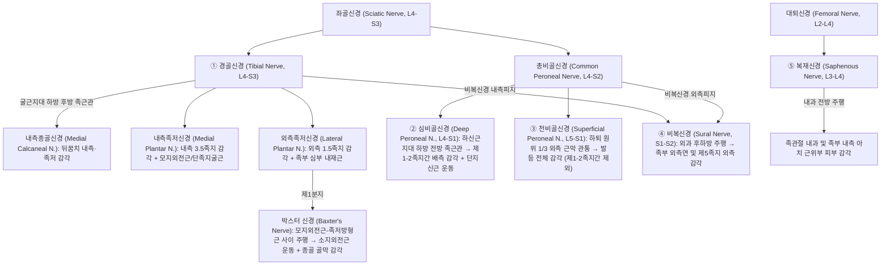
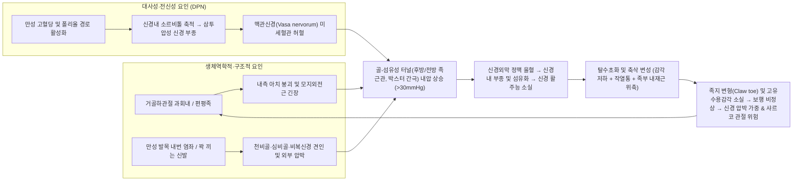

# 🩺 발 신경병증 (Foot Neuropathy & Entrapment Syndromes of the Foot and Ankle)

> **핵심 3줄 요약 (Key Summary)**:
> - 📍 병소 부위 & 해부·병태생리: 족관절 및 족부를 주행하는 5대 말초신경인 [[경골신경]](내·외측 족저신경 및 제1외측족저신경 분지인 [[박스터 신경]]), [[심비골신경]], [[천비골신경]], [[비복신경]], [[복재신경]]이 좁은 골-섬유성 터널(굴근지대, 하신근지대, 심부근막 관통부)에서 기계적 압박·견인·허혈성 손상을 받거나 [[당뇨병성 말초신경병증]] 등 대사성 축삭 변성이 중첩되어 발생하는 신경병증 스펙트럼입니다.
> - 🚩 전형적 임상 양상: 포착된 신경의 고유 피부분절(Cutaneous distribution)을 따라 작열감, 전기 충격양 방사통, 이상감각(착감각·무감각), 야간통이 나타나며, 만성화 시 [[모지외전근]], [[소지외전근]], [[단지신근]] 등 족부 내재근의 선택적 위축과 갈퀴발 변형(Claw toe)을 초래합니다.
> - 🛠️ 핵심 검사 & 치료 전략: 포착 터널 직상방의 [[티넬 징후]], [[삼중 압박 스트레스 검사]](Triple compression stress test), [[10g 모노필라멘트 검사]] 및 신경전도검사(NCS)·고해상도 초음파로 병소를 확정한 뒤, 팔풍·태충·태계·곤륜·조해·해계·족삼리 전침(2Hz/100Hz 교대), 초음파 유도하 신경주위 수압박리 약침술(Hydrodissection), [[우차신기환]]·[[보양환오탕]]·[[황기계지오물탕]] 투여 및 족궁 교정 추나를 통합 시행합니다.
> - ⚠️ 응급 의뢰 레드플래그: 급격히 진행하는 족하수(Foot drop, MRC Grade 3 이하), 무통성 족부 궤양과 결합된 급성 발적·열감·골파괴 소견의 [[샤르코 관절병증]](Charcot neuroarthropathy) 의심 시, 또는 대소변 장애·안장 마비를 동반한 [[마미증후군]] 감별 시 즉각 응급 영상 검사 및 전문과 의뢰를 시행합니다.

---

## 📌 목차
1. [🩺 질환 개요 & 해부학적 병태생리](#1--질환-개요--해부학적-병태생리)
2. [⚡ 병태생리 메커니즘 & 생체역학적 악순환 네트워크](#2--병태생리-메커니즘--생체역학적-악순환-네트워크)
3. [🔍 임상 증상 & 이학적 검사 알고리즘](#3--임상-증상--이학적-검사-알고리즘)
4. [🔀 감별 진단 매트릭스](#4--감별-진단-매트릭스)
5. [🌿 한의 통합 치료 프로토콜](#5--한의-통합-치료-프로토콜)
6. [💊 양방 치료 & 병용·의뢰 기준](#6--양방-치료--병용의뢰-기준)
7. [🏃 재활 운동 & 생활습관 티칭 가이드](#7--재활-운동--생활습관-티칭-가이드)
8. [💡 사용자 진료실 핵심 필기 & 임상 노하우 (Melt-In)](#8--사용자-진료실-핵심-필기--임상-노하우-melt-in)
9. [📚 출처 및 현대 학술 연구 요약](#9--출처-및-현대-학술-연구-요약)

---

## 1. 🩺 질환 개요 & 해부학적 병태생리

### 1.1 정의 및 임상 역학적 중요성
* **질환의 정의**: [[발 신경병증]](Foot Neuropathy)은 족관절(Ankle)과 족부(Foot)를 지배하는 5대 주요 말초신경 줄기 및 그 종말 분지들이 해부학적 협소 구간(골-섬유성 터널, 근막 열공, 인대 하방)에서 국소적 포착(Entrapment), 반복적 미세 외상, 공간 점유 병변(결절종, 정맥류, 건초염)에 의해 손상되거나, 전신성 대사 질환([[당뇨병]], 만성 신부전, 알코올 중독, 화학요법)에 의한 원위부 대칭성 다발신경병증(Distal Symmetric Polyneuropathy, DSPN)으로 발현되는 모든 말초신경 장애를 포괄합니다.
* **역학적 핵심**:
  - 임상에서 만성 족저부 및 발뒤꿈치 통증(Chronic heel pain)으로 내원하는 환자의 **약 15~20%**는 단순 [[족저근막염]]이 아니라 외측족저신경 제1분지인 [[박스터 신경]](Baxter's nerve, 하종골신경)의 포착이 주원인이거나 동반된 혼합 병변입니다.
  - [[족근관 증후군]](Tarsal tunnel syndrome)을 포함한 족부 포착 신경병증은 평발([[편평족]], Pes planovalgus)이나 과도한 거골하관절 회내(Subtalar overpronation)를 가진 환자, 장거리 달리기 선수, 꽉 끼는 신발(등산화, 축구화, 하이힐) 착용자에서 유병률이 급증합니다.
  - 전신성 원인 중 [[당뇨병성 말초신경병증]](DPN)은 유병 기간 10년 이상 당뇨 환자의 약 50%에서 발생하며, 비외상성 하지 절단(Lower extremity amputation)의 가장 흔한 선행 요인(약 75%)으로 작용합니다.

### 1.2 족부 및 족관절 5대 말초신경의 정밀 임상 해부학
족부의 감각과 내재근 운동은 [[좌골신경]](Sciatic nerve, L4-S3)에서 갈라진 4개 신경([[경골신경]], [[심비골신경]], [[천비골신경]], [[비복신경]])과 [[대퇴신경]](Femoral nerve, L2-L4)의 종말 분지인 [[복재신경]]에 의해 완벽히 구획화되어 지배됩니다.



#### ① [[경골신경]] (Tibial Nerve, L4–S3) 및 주요 종말 분지
* **해부학적 주행과 후방 족근관 (Posterior Tarsal Tunnel)**:
  - [[경골신경]]은 하퇴 후방 심부 구획에서 [[후경골근]](Tibialis posterior), [[장족지굴근]](Flexor digitorum longus), [[장모지굴근]](Flexor hallucis longus)과 함께 내려와 내과(Medial malleolus) 후하방의 **굴근지대(Flexor retinaculum, 열상인대 Laciniate ligament)** 아래에 형성된 골-섬유성 터널인 **후방 족근관**을 통과합니다.
  - 터널 내부 배열은 전내측에서 후외측 순서로 **T-D-A-V-N-H** ([[후경골근]] 건 - [[장족지굴근]] 건 - 후경골동맥 - 후경골정맥 - [[경골신경]] - [[장모지굴근]] 건)의 엄격한 위상학적 순서를 유지합니다.
* 3대 종말 분지 및 [[박스터 신경]] (Baxter's Nerve):
  1. **내측종골신경 (Medial Calcaneal Nerve, MCN)**: 굴근지대 근위부(약 40%) 또는 터널 내부에서 직접 분지하여 굴근지대를 관통한 뒤 뒤꿈치 후내측 피부와 지방패드(Heel fat pad)의 감각을 지배합니다.
  2. [[내측족저신경]] (Medial Plantar Nerve, MPN): [[모지외전근]](Abductor hallucis) 심부의 상부 근육-섬유 터널을 통과하며, 거골-주상골 관절 하방 및 헨리 매듭(Master Knot of Henry, [[장모지굴근]] 건과 [[장족지굴근]] 건이 교차하는 부위)에서 잘 포착됩니다(일명 **조거의 발, Jogger's foot**). 발바닥 내측 3.5족지 감각과 [[모지외전근]], [[단족지굴근]], [[단모지굴근]], 제1충양근의 운동을 담당합니다.
  3. [[외측족저신경]] (Lateral Plantar Nerve, LPN): 하부 근육-섬유 터널을 지나 발바닥 외측 1.5족지 감각과 족부 심부 내재근([[족저방형근]], 골간근, 제2~4충양근, [[모지내전근]])을 지배합니다.
  4. [[박스터 신경]] (Baxter's Nerve, 제1외측족저신경 / 하종골신경 Inferior Calcaneal Nerve): [[외측족저신경]]의 가장 첫 번째 분지로, 내과 하방에서 분지하여 ① 비후된 [[모지외전근]]의 심부 근막과 내측연, ② [[족저방형근]](Quadratus plantae)의 내측연 사이, 그리고 ③ 종골 내측 결절(Medial calcaneal tuberosity) 및 [[단족지굴근]] 기시부 바로 앞쪽을 수직에서 수평으로 급격히 꺾이며 주행합니다. 종골 골막의 통각과 [[소지외전근]](Abductor digiti minimi)의 운동을 지배하므로, 포착 시 만성 발뒤꿈치 통증과 새끼발가락 외전력 약화를 동시에 유발합니다.

#### ② [[심비골신경]] (Deep Peroneal Nerve, L4–S1) — 전방 족근관 증후군
* **해부학적 주행과 전방 족근관 (Anterior Tarsal Tunnel)**:
  - 하퇴 전방 구획에서 [[전경골근]](Tibialis anterior), [[장모지신근]](Extensor hallucis longus), [[장족지신근]](Extensor digitorum longus)을 지배한 [[심비골신경]]은 족관절 전방에서 Y자 형태의 **하신근지대(Inferior extensor retinaculum)** 아래의 좁은 공간인 **전방 족근관**을 통과합니다.
  - 이 구간에서 신경은 바닥의 거골경부(Talar neck)·거주상관절(Talonavicular joint) 골표면과 천장의 하신근지대 및 [[장모지신근]]·[[장족지신근]] 건 사이에 끼여 주행하며, 이후 제1중족골간 공간에서 [[단모지신근]](Extensor hallucis brevis) 건 아래를 교차합니다.
* **운동 및 감각 분지**:
  - **외측 종말 분지 (운동지)**: 족배부 외측으로 주행하여 [[단지신근]](Extensor digitorum brevis, EDB)과 [[단모지신근]](EHB)을 운동 지배합니다.
  - **내측 종말 분지 (감각지)**: 족배동맥(Dorsalis pedis artery) 내측을 따라 주행하여 **제1족지와 제2족지 사이의 물갈퀴 공간(First dorsal web space)**의 좁고 명확한 삼각형 피부 영역 감각만을 전담합니다.

#### ③ [[천비골신경]] (Superficial Peroneal Nerve, L5–S1)
* **해부학적 주행과 근막 관통부 포착**:
  - 하퇴 외측 구획에서 [[장비골근]](Peroneus longus)과 [[단비골근]](Peroneus brevis)을 운동 지배한 후, **외과 첨부(Tip of lateral malleolus) 상방 약 10~12cm 지점(하퇴 원위 1/3 전외측)**에서 심부 하퇴근막(Crural fascia)의 섬유성 열공을 뚫고 피하 조직으로 천출합니다.
  - 피하로 나온 뒤 **내측배측피신경(Medial dorsal cutaneous nerve, MDCN)**과 **중간배측피신경(Intermediate dorsal cutaneous nerve, IDCN, 일명 레몬티어 신경 Lemont's nerve)**으로 나뉘어 신근지대 위쪽(피하층)을 가로질러 내려갑니다.
* **감각 지배 영역**: 제1-2족지간 물갈퀴 공간([[심비골신경]] 영역)과 족부 외측연([[비복신경]] 영역)을 제외한 **발등(Dorsum of foot) 전체와 제1~5족지 배측 근위부**의 광범위한 감각을 담당합니다.

#### ④ [[비복신경]] (Sural Nerve, S1–S2)
* **해부학적 주행과 포착 호발부**:
  - [[경골신경]]에서 나온 내측비복피신경과 [[총비골신경]]에서 나온 비골교통지가 합쳐져 형성된 순수 감각신경입니다.
  - [[아킬레스건]](Achilles tendon) 외측연을 따라 소복재정맥(Small saphenous vein)과 나란히 하행하여, **외과(Lateral malleolus) 후하방 약 1~1.5cm 지점**을 돌아나간 뒤 종골 외측면과 **제5중족골 기저부(Base of 5th metatarsal, 존스 골절 및 건 부착 호발부)**를 따라 주행합니다.
* **감각 지배 영역**: 뒤꿈치 후외측, 족관절 외측, **족부 외측연(Lateral border of the foot)** 및 제5족지 외측면의 피부 감각을 지배합니다.

#### ⑤ [[복재신경]] (Saphenous Nerve, L3–L4)
* **해부학적 주행과 포착 호발부**:
  - [[대퇴신경]]의 가장 긴 순수 감각 분지로, 대퇴 내측의 내전근관(Adductor canal)을 빠져나와 대복재정맥(Great saphenous vein)과 동행하며 하퇴 내측을 타고 내려옵니다.
  - 족관절 레벨에서 **내과(Medial malleolus)의 전방 약 1~2cm 지점**을 지나 족부 내측연(제1중족골두 내측까지)에 분포합니다.
* **감각 지배 영역**: 하퇴 내측면, **내과 전방 및 족부 내측 아치(Medial longitudinal arch) 근위부 상방**의 피부 감각을 담당합니다(발바닥 바닥면은 지배하지 않음).

### 1.3 족부 5대 말초신경 해부학적 주행 및 지배 구역 총괄 비교표

| 신경명 (기원 신경근) | 주요 해부학적 포착 터널·부위 | 운동 지배 근육 (약화 시 임상 징후) | 고유 감각 지배 영역 (Cutaneous Zone) | 대표 유발 요인 및 임상 증후군 |
| :--- | :--- | :--- | :--- | :--- |
| [[경골신경]] 본간 (L4-S3) | 내과 후하방 굴근지대 하방 (후방 족근관) | 족부 내재근 전체 (갈퀴발 변형, 족지 굴곡·외전 약화) | 발바닥 전체, 발가락 족저면, 뒤꿈치 내측 | [[족근관 증후군]], 결절종, 정맥류, 후경골건염, [[편평족]] |
| [[박스터 신경]] (L4-S3, 외측족저 제1분지) | [[모지외전근]] 심부 근막 ~ [[족저방형근]] 내측연 간극 | [[소지외전근]] (새끼발가락 능동 외전 불능: Baxter sign) | 종골 내측 결절 골막, 뒤꿈치 바닥 전내측 심부 | 만성 뒤꿈치 통증(20%), [[족저근막염]] 동반, 종골 골극, 과회내 |
| [[내측족저신경]] (L4-L5) | [[모지외전근]] 터널, 헨리 매듭 (주상골 조면 하방) | [[모지외전근]], [[단족지굴근]], [[단모지굴근]], 제1충양근 | 발바닥 내측 아치 및 내측 3.5족지 족저면 | 조거의 발(Jogger's foot), 마라톤 주자, 과도한 아치 서포트 깔창 |
| [[심비골신경]] (L4-S1) | 하신근지대 하방 (전방 족근관), 거주상관절 골극 상방 | [[단지신근]](EDB), [[단모지신근]] (외과 전방 근복 위축·함몰) | **제1-2족지간 배측 물갈퀴 공간 (First web space)** | [[전방 족근관 증후군]], 꽉 조인 신발끈(Ski boot syndrome), 족배 골극 |
| [[천비골신경]] (L5-S1) | 외과 상방 10~12cm 하퇴 원위 1/3 심부근막 관통 열공 | 없음 (원위 분지는 순수 감각; 근위에서 장·단비골근 지배) | **발등(족배부) 전체** 및 제1~5족지 배측 (제1-2족지간 제외) | 만성 [[발목 염좌]](반복적 내번 견인), 근육 탈장(Fascial hernia), 군화 압박 |
| [[비복신경]] (S1-S2) | 외과 후하방, 종골 외측, 제5중족골 기저부 | 없음 (순수 감각신경) | 뒤꿈치 외측, **족부 외측연**, 제5족지 외측 | 외측 [[발목 염좌]], 제5중족골 기저부 골절(Jones fracture) 가골, 아킬레스 건염 |
| [[복재신경]] (L3-L4) | 내과 전방 1~2cm 피하 (대복재정맥 인접부) | 없음 (순수 감각신경) | 내과 전방, **족부 내측연(내측 아치 상방)** | 내과 골절 수술 반흔, 정맥류 발거술, 족관절 전내측 관절경 포트 손상 |

---

## 2. ⚡ 병태생리 메커니즘 & 생체역학적 악순환 네트워크

### 2.1 골-섬유성 터널 내 기계적 포착과 신경내 미세순환 장애 (Ischemic-Edematous Cascade)
* **터널 내압 상승과 혈류 차단**:
  - 정상적인 말초신경 터널 내 압력은 2~10 mmHg 수준이나, 굴근지대나 하신근지대 아래에서 압력이 **20~30 mmHg**를 초과하면 신경외막(Epineurium)의 정맥 환류가 가장 먼저 차단됩니다.
  - 정맥 울혈은 신경섬유다발막(Perineurium) 내부의 모세혈관 투과성을 증가시켜 **신경내 부종(Intraneural edema)**을 유발하며, 압력이 **60~80 mmHg**에 도달하면 맥관신경(Vasa nervorum)의 동맥 혈류가 완전히 차단되어 급성 허혈성 전도 차단(Neurapraxia)이 일어납니다.
* **만성 섬유화와 축삭 변성 (Wallerian Degeneration)**:
  - 신경내 부종이 장기화되면 섬유아세포가 증식하여 신경 내부와 주위에 반흔 조직을 형성합니다. 이로 인해 보행 시 관절 움직임에 따라 신경이 자연스럽게 미끄러지는 **신경 활주능(Neural gliding/excursion)이 소실**됩니다.
  - 결국 수초(Myelin sheath)가 벗겨지는 국소 탈수초화(Segmental demyelination)에서 시작하여, 말기에는 축삭 자체가 파괴되는 **왈러 변성(Wallerian degeneration)**으로 이행하며 족부 내재근의 비가역적 지방 변성(Fatty infiltration)을 초래합니다.

### 2.2 족부 생체역학적 결함(과회내 vs 요족)에 따른 신경 견인-압박 기전
* 거골하관절 과회내(Overpronation) 및 [[편평족]]의 동적 포착:
  - 입각기(Stance phase) 중 거골하관절이 과도하게 회내(외번 Eversion + 배측굴곡 + 외전)되면 내측 세로 아치(Medial longitudinal arch)가 무너집니다.
  - 이때 내과 후방을 지나는 [[경골신경]], [[내측족저신경]], [[외측족저신경]]은 활시위처럼 팽팽하게 당겨지는 **동적 견인 스트레스(Traction neuropathy)**를 받는 동시에, 늘어난 [[모지외전근]]의 심부 근막이 [[박스터 신경]]을 종골 내측면에 강하게 짓누르게 됩니다.
* **반복적 내번 염좌(Inversion Sprain)와 외측·배측 신경 손상**:
  - 만성 족관절 불안정성(CAI) 환자에서 발목이 내번(Inversion) 및 족저굴곡될 때마다 외과 전방을 지나는 [[천비골신경]]과 외과 후하방의 [[비복신경]]은 생리적 한계(신경 신장률 8~15% 이상)를 넘어서는 반복적 채찍질 견인(Traction injury)을 입어 신경종성 섬유화(Perineural fibrosis)가 진행됩니다.
* **이중 압착 증후군 (Double Crush Syndrome)**:
  - 요추부 L4, L5, S1 신경근의 미세한 협착이나 디스크 병변([[요추 추간판 탈출증]], [[척추관 협착증]])이 존재하면 축삭 원형질 수송(Axoplasmic transport)이 저하되어, 하류에 위치한 족관절 터널의 경미한 물리적 압박에도 [[경골신경]]이나 [[심비골신경]]이 훨씬 쉽게 증상을 일으키는 **이중 압착 현상**이 임상에서 매우 빈번하게 관찰됩니다.

### 2.3 대사성 신경병증(DPN)의 생화학적 손상과 기계적 포착의 상승 작용
* **폴리올 경로(Polyol pathway)와 신경 부종**:
  - [[당뇨병]] 환자에서 만성 고혈당은 신경 세포 내로 포도당을 과다 유입시키고, 알도스 환원효소(Aldose reductase)에 의해 **소르비톨(Sorbitol)**과 과당으로 전환됩니다.
  - 소르비톨은 세포막을 통과하지 못해 신경 축삭 내부에 축적되면서 **삼투압성 수분 유입(Osmotic swelling)**을 일으켜 신경 단면적(Cross-sectional area, CSA) 자체를 비대하게 만듭니다.
  - 여기에 최종당화산물(AGEs) 축적, 미세혈관 기저막 비후, 산화 스트레스(ROS)가 더해져 부어오른 신경이 해부학적으로 좁은 후방·전방 족근관을 통과할 때 정상인보다 3~5배 높은 빈도로 기계적 포착(Superimposed entrapment)을 겪게 됩니다.



---

## 3. 🔍 임상 증상 & 이학적 검사 알고리즘

### 3.1 신경별 특이 임상 증상 프로파일
1. [[경골신경]] 및 [[족근관 증후군]] (Posterior Tarsal Tunnel Syndrome):
   - 발바닥 전체 또는 내·외측에 **화끈거리는 작열통(Burning pain), 바늘로 찌르는 듯한 통증, 모래나 자갈 위를 걷는 듯한 이물감**이 나타납니다.
   - 오래 서 있거나 보행 시 악화되며, 특히 **밤에 자다가 발바닥이 불타는 듯하여 이불 밖으로 발을 내놓게 되는 야간통(Nocturnal paresthesia)**이 특징적입니다. 통증이 종아리 내측으로 역행성 방사되는 **발레 현상(Valleix phenomenon)**이 동반될 수 있습니다.
2. [[박스터 신경]] 포착 (Baxter's Nerve Entrapment):
   - 뒤꿈치 전내측 심부의 묵직하고 타는 듯한 통증입니다. **아침 첫발 통증(First-step pain)**만 두드러지는 전형적 [[족저근막염]]과 달리, **오래 서 있거나 걸을수록 뒤꿈치 통증이 점점 심해지고 저녁이나 야간에 누워 있어도 욱신거리는 통증이 지속**됩니다.
   - 만성화 시 [[소지외전근]] 위축으로 새끼발가락을 옆으로 벌리는 힘이 소실됩니다.
3. [[심비골신경]] 포착 ([[전방 족근관 증후군]]):
   - 발등 한가운데의 둔한 통증과 함께 **엄지발가락과 둘째 발가락 사이 물갈퀴 공간(First dorsal web space)의 명확한 저림·감각 저하**가 나타납니다.
   - 신발끈을 묶거나 발등을 굽힐 때(족저굴곡) 증상이 악화되며, 외과 전방의 [[단지신근]](EDB) 근복이 말랑해지거나 움푹 파이는 위축 소견이 관찰됩니다.
4. [[천비골신경]] 포착:
   - 하퇴 외측 원위부에서 발등 전체로 뻗치는 저림과 감각 이상이 달리기나 등산 시 악화됩니다. 제1-2족지간 공간의 감각은 정상으로 보존되는 것이 [[심비골신경]] 포착과의 결정적 차이입니다.
5. [[비복신경]] 및 [[복재신경]] 포착:
   - [[비복신경]]: 외과 뒤쪽부터 발 바깥쪽 날(제5중족골 외측)을 따라 찌릿한 통증이 나타나며, 스키 부츠나 딱딱한 신발 뒤축에 닿을 때 심해집니다.
   - [[복재신경]]: 내과 앞쪽의 국소적인 시큰거림과 과민성(Allodynia)이 주증상입니다.

### 3.2 핵심 이학적 검사(Physical Examination) 및 정량적 진단 가치

| 검사명 | 대상 신경 | 세부 시행 프로토콜 | 양성 판정 기준 | 진단적 정확도 (민감도 / 특이도) |
| :--- | :--- | :--- | :--- | :--- |
| [[티넬 징후]] (Tinel's Sign) | 5대 신경 공통 | 각 신경의 해부학적 포착 지점(내과 후하방, 하신근지대, 외과 상방 10cm 근막 열공, 외과 후하방, 내과 전방)을 해머나 검지로 가볍게 타진 | 해당 신경의 원위부 고유 감각 지배 영역으로 뻗치는 찌릿한 전기 충격감(Paresthesia) 재현 | 민감도 58~75% / 특이도 70~85% |
| [[삼중 압박 스트레스 검사]] (Triple Compression Stress Test) | [[경골신경]] / [[박스터 신경]] | 족관절을 **최대 족저굴곡(Plantarflexion)** + 거골하관절을 **최대 내번(Inversion)**시킨 상태에서 내과 후하방 [[경골신경]] 주행부를 검지·중지로 **30초간 일정 압력으로 압박** | 30초 이내에 발바닥이나 뒤꿈치의 평소 저림·작열통이 재현되거나 증폭됨 | **민감도 85.9% / 특이도 99.0%** (족근관 증후군 최고 정확도 검사) |
| [[배굴-외번 검사]] (Dorsiflexion-Eversion Test) | [[경골신경]] | 족관절을 **최대 배측굴곡(Dorsiflexion)** + **최대 외번(Eversion)**시키고 전족부 족지(MTP 관절)를 모두 신전시킨 상태로 **5~10초간 유지** (신경 최대 신장 자세) | 발바닥 및 족근관 부위의 방사통·저림 유발 및 국소 압통 증가 | 민감도 82.0% / 특이도 92.0% |
| [[팔렌 유사 족관절 검사]] (Plantarflexion-Inversion Test) | [[심비골신경]] / [[천비골신경]] | 발목과 발가락을 **최대 족저굴곡 및 내번**시킨 상태에서 전방 족근관(하신근지대) 또는 외과 상방 10cm 천비골신경 관통부를 30초간 압박 | 제1-2족지간 물갈퀴(심비골) 또는 발등 전체(천비골)의 저림·통증 재현 | 민감도 72% / 특이도 84% |
| [[소지외전근 근력 검사]] (Abductor Digiti Minimi Test) | [[박스터 신경]] | 환자에게 발바닥을 바닥에 붙인 채 **새끼발가락(제5족지)을 바깥쪽으로 힘껏 벌리도록(Abduction)** 지시하고 건측과 저항력을 비교 | 환측 제5족지의 능동 외전 불능 또는 뚜렷한 근력 약화 및 외측 족저근 위축 | 특이도 88% 이상 (박스터 신경 운동 마비 특이 징후) |
| [[단지신근 위축 촉진 검사]] (EDB Atrophy Test) | [[심비골신경]] / L5 신경근 | 환자에게 발가락을 위로 모두 젖히게(신전) 한 상태에서 외과 전하방(종입방관절 배측 외측)의 [[단지신근]] 근복 융기 정도를 양측 비교 촉진 | 환측 [[단지신근]] 근복이 팽창하지 않고 말랑하거나 함몰되어 있음 | 특이도 85% (심비골신경 운동지 또는 L5 신경근 병변 시사) |
| [[10g 모노필라멘트 검사]] (Semmes-Weinstein 5.07) | [[당뇨병성 말초신경병증]] (대섬유) | 환자가 눈을 감은 상태에서 제1·3·5족지 족저면 및 중족골두 등 10개 지점에 나일론 필라멘트가 **C자형으로 휘어질 때(10g 압력)까지 1~2초간 수직 압박** | 10개 지점 중 **4곳 이상에서 감각을 인지하지 못할 경우** 보호감각 상실(LOPS) 판정 | 민감도 85~90% / 특이도 80~88% (족부 궤양 예측 표준) |
| [[128Hz 소리굽쇠 진동감각 검사]] | 대섬유 신경병증 (DPN, S1) | 진동하는 128Hz 소리굽쇠를 제1중족지절관절(MTP) 배측 골돌기 위에 얹고 진동이 멈추는 순간을 말하게 한 뒤 검사자의 손가락 감각과 비교 | 환자가 진동 소실을 느끼는 시점 이후에도 검사자가 10초 이상 진동을 계속 느끼면 양성 | 민감도 80% / 특이도 85% (가장 조기에 소실되는 대섬유 징후) |

### 3.3 영상 및 전기생리학적 확진 프로토콜
* **고해상도 근골격계 초음파 (High-Resolution Ultrasound, HRUS)**:
  - 12~18 MHz 고주파 선형 탐촉자를 사용하여 신경의 주행을 실시간 추적(Elevator technique)합니다.
  - 포착 부위 직상방에서 신경이 붓고 저에코(Hypoechoic)로 변하며 내부 속상 구조(Fascicular pattern)가 소실되는 **노치 징후(Notch sign)**를 확인합니다. [[경골신경]]의 단면적(CSA)이 후방 족근관 내에서 **15 mm² 이상**(또는 근위부 대비 5 mm² 이상 증가)이면 포착으로 진단하며, 결절종(Ganglion cyst), 부주상골, 비복근 부근육(Accessory soleus), 정맥류 등 공간 점유 병변을 동시에 찾아냅니다.
* **신경전도검사(NCS) 및 근전도(EMG)**:
  - [[내측족저신경]] 및 [[외측족저신경]]의 혼합신경 활동전위(Mixed nerve action potential)와 감각신경 활동전위(SNAP)의 잠복기 지연 및 진폭 감소를 평가합니다.
  - 침근전도(Needle EMG)에서 [[모지외전근]]이나 [[소지외전근]], [[단지신근]]에 탈신경 전위(Fibrillation potential, Positive sharp wave)가 관찰되면서 하퇴 근위 근육([[전경골근]], [[비복근]], [[후경골근]])과 요추 주위근(Paraspinal muscles)이 정상이면 요추 신경근병증을 배제하고 족관절 이하의 말초 포착으로 확진합니다.

```mermaid
flowchart TD
    Start["족부·족관절 저림, 작열통, 감각저하 또는 만성 뒤꿈치 통증 환자 내원"] --> Pattern{"1단계: 증상 분포 패턴 확인"}
    
    Pattern -->|양측 대칭성 장갑-양말 패턴| DPN_Check["10g 모노필라멘트 + 128Hz 진동감각 + 발등 맥박(ABI) + HbA1c 검사"]
    DPN_Check -->|보호감각 상실 양성| DPN_Dx["당뇨병성/대사성 다발신경병증 (DPN)<br/>※ 급성 발적·열감·부종 동반 시 샤르코 관절병증 응급 배제!"]
    
    Pattern -->|편측성 또는 국소 분절성| Spine_Check{"2단계: 요추 신경근병증 배제<br/>(SLR 검사, 아킬레스건 반사, 근위 근력)"}
    Spine_Check -->|SLR 양성, 요통/둔부 방산통, 근위 근력(EHL/TA) 약화| Radic["요추 신경근병증 (L4, L5, S1)<br/>또는 이중 압착 증후군 (Double Crush)"]
    
    Spine_Check -->|요추 검사 음성, 족관절 이하 국소 티넬 양성| Local_Map{"3단계: 5대 말초신경 해부학적 구획 매핑"}
    
    Local_Map -->|발바닥 전체 작열통 + 삼중압박/배굴외번 양성| TTS["① 경골신경 포착 (후방 족근관 증후군)"]
    Local_Map -->|뒤꿈치 내측 심부통(보행 시 악화) + 소지외전근 약화| Baxter["①-1 박스터 신경 포착 (외측족저신경 제1분지)"]
    Local_Map -->|제1-2족지간 물갈퀴 저림 + 단지신근(EDB) 위축| ATTS["② 심비골신경 포착 (전방 족근관 증후군)"]
    Local_Map -->|발등 전체 저림(제1-2족지간 정상) + 외과 상방 10cm 티넬| SPN_Ent["③ 천비골신경 포착 (하퇴 근막 열공)"]
    Local_Map -->|족부 외측연/제5중족골 저림 + 외과 후하방 티넬| Sural_Ent["④ 비복신경 포착"]
    Local_Map -->|내과 전방 및 내측 아치 상방 시큰거림| Saph_Ent["⑤ 복재신경 포착"]
```

---

## 4. 🔀 감별 진단 매트릭스

### 4.1 족부 말초신경 포착 vs 요추 신경근병증(L4, L5, S1) vs 전신성 다발신경병증(DPN) 3차원 감별 매트릭스

| 감별 기준 | 족부 말초신경 포착 (Entrapment Neuropathy) | 요추 신경근병증 (Lumbar Radiculopathy: L4, L5, S1) | 당뇨병성 다발신경병증 (Diabetic Polyneuropathy, DPN) |
| :--- | :--- | :--- | :--- |
| **증상 분포 및 대칭성** | **편측성(Unilateral)** 주류, 해당 말초신경의 고유 해부학적 피부 영역에 엄격히 국한됨 | 편측성(중심성 협착 시 양측 가능), 요추 **피부분절(Dermatome: L4 내측, L5 배측, S1 외측/족저)**을 따름 | **양측 대칭성(Bilateral symmetric)**, 발끝에서 시작해 발목·종아리로 올라오는 **양말 패턴(Stocking distribution)** |
| **근위부 통증 (요통·둔부통)** | 없음 (단, 발레 현상으로 종아리 하부까지 역행성 연관통은 가능) | 요통, 둔부 통증, 대퇴 후외측을 타고 내려오는 신경근성 방사통(Sciatica) 동반 | 없음 (양측 발바닥의 자발적 작열통, 시림, 무감각이 주증상) |
| 국소 [[티넬 징후]] | **강양성** (후방/전방 족근관, 외과 상방 10cm 등 포착 터널 직상방 타진 시 증상 재현) | 음성 (단, 이중 압착 증후군 동반 시 말초 터널에서도 양성 가능) | 전반적 신경 부종으로 내과 후방(경골신경)이나 비골두에서 티넬 양성 흔함 (수술 감압 적응증 선별 지표) |
| **이학적 유발 검사** | [[삼중 압박 스트레스 검사]], [[배굴-외번 검사]], 족관절 족저굴곡-내번 압박 검사 양성 | [[하지 직거상 검사]](SLR test), 크로스 SLR, 발살바 수기, 요추 신전-회전 부하 시 악화 | [[10g 모노필라멘트 검사]] 감각 소실, [[128Hz 소리굽쇠 진동감각 검사]] 조기 저하 |
| **운동 마비의 범위** | **족부 내재근에 국한** ([[모지외전근]], [[소지외전근]], [[단지신근]] 위축; 발목 배굴/족저굴곡 본간 근력은 정상) | **하퇴 근위 근육 침범** (L4: [[전경골근]] 내번/배굴 약화, L5: [[장모지신근]]/[[중둔근]] 약화, S1: [[비복근]] 까치발 약화) | 말기에 족부 내재근 전반의 대칭적 위축으로 양측성 갈퀴발(Claw toes) 및 고도의 족저 압력 불균형 발생 |
| **심부건반사 (DTR)** | **정상 보존** (슬개건 반사 L4, 아킬레스건 반사 S1 모두 정상) | 침범 신경근에 따라 감소/소실 (L4: 슬개건 반사 저하, S1: **아킬레스건 반사 저하/소실**) | **양측 아킬레스건 반사(Ankle jerk)의 대칭적 소실**이 초기부터 나타남 |
| **전기생리학 (EMG/NCS)** | 포착 터널 원위부에서만 전도 속도 감소; 하퇴 근육 및 요추 다열근 침근전도 정상 | 감각신경전도(SNAP)는 정상 보존(후근신경절 근위 병변), 요추 주위근 및 해당 근절(Myotome) 침근전도 이상 | 양측 하지 감각신경(비복신경 등) 및 운동신경 진폭의 전반적·대칭적 감소 (축삭 변성 패턴) |

### 4.2 주요 유사 족부 질환과의 실전 감별 포인트
1. [[족저근막염]] (Plantar Fasciitis) vs [[박스터 신경]] 포착 (Baxter's Neuropathy):
   - [[족저근막염]]: 종골 내측 결절 바닥면(인대 부착부)에 국한된 날카로운 압통이 있으며, **아침에 일어나 첫발을 디딜 때(First-step pain)** 가장 아프고 걸으면 조금 풀리는 양상을 보입니다. [[윈들라스 검사]](Windlass test, 엄지발가락 수동 배측굴곡)에서 통증이 재현되며 감각 이상이나 저림은 없습니다.
   - [[박스터 신경]] 포착: 압통점이 종골 바닥보다 약간 더 내측·상방([[모지외전근]] 심부 경계)에 위치하며, 압박 시 뒤꿈치 외측으로 찌릿하게 뻗치는 방사통이 있습니다. **아침보다 오후·저녁에 오래 걸은 뒤 통증이 극심해지고 안정 시에도 타는 듯한 야간통**이 지속되며, [[소지외전근]] 외전력 약화가 동반됩니다.
2. [[모톤 신경종]] (Morton's Neuroma, 지간신경종) vs [[심비골신경]] 포착:
   - [[모톤 신경종]]: 총족저지신경이 심횡중족인대 아래에서 압박되어 발생하는 신경주위 섬유화로, 주로 **제3-4중족골두 사이(또는 제2-3사이) 발바닥 앞쪽**에 조약돌을 밟는 듯한 통증과 발가락 끝 저림이 발생합니다. 중족골두를 좌우에서 짜는 [[몰더 클릭 검사]](Mulder's click test)가 양성입니다.
   - [[심비골신경]] 포착: 통증과 감각 저하가 발바닥이 아닌 **발등(Dorsum)의 제1-2족지간 물갈퀴 공간**에 나타나며, 압통점이 발목 앞쪽 하신근지대(전방 족근관)에 위치합니다.
3. [[샤르코 관절병증]] (Charcot Neuroarthropathy) vs 급성 [[통풍]] / 봉와직염:
   - [[당뇨병성 말초신경병증]] 환자의 발이 갑자기 붓고 붉어지며 열감이 날 때(Eichenholtz Stage 1), 감각 신경이 마비되어 **뼈가 부서지고 탈구되는데도 통증이 경미하거나 전혀 없는 것**이 [[샤르코 관절병증]]의 결정적 특징입니다.
   - 다리를 심장보다 높게 거상(Elevation)한 채 5~10분간 유지했을 때 발적이 현저히 창백해지면(Brodsky elevation test 양성) 감염(봉와직염/골수염)보다 [[샤르코 관절병증]] 가능성이 높으며, 즉각 비체중부하(Total contact cast) 고정 의뢰가 필요합니다.

---

## 5. 🌿 한의 통합 치료 프로토콜

### 5.1 침구 및 전침 치료 프로토콜 (Acupuncture & Electroacupuncture)
* **5대 말초신경 해부학적 타겟 경혈 매핑**:
  1. [[경골신경]] 및 [[박스터 신경]] (후방 족근관 & 내측 아치):
     - **태계(KI3)**: 내과 첨부와 [[아킬레스건]] 사이의 함요처로, 굴근지대 진입 직전의 [[경골신경]] 본간 및 후경골동맥 주행부입니다.
     - **조해(KI6) 및 수천(KI5)**: 내과 바로 아래 재거돌기(Sustentaculum tali) 주변으로, 굴근지대 하방 터널 및 [[내측족저신경]]·[[외측족저신경]] 분지점 감압의 핵심 혈위입니다.
     - **연곡(KI2) 및 공손(SP4)**: 주상골 조면 하방과 제1중족골 기저부 내측으로, [[모지외전근]]의 긴장을 풀고 [[박스터 신경]]이 통과하는 심부 근막 간극을 직접 이완하는 특효혈입니다.
  2. [[심비골신경]] (전방 족근관 & 제1-2족지간):
     - **해계(ST41)**: 족관절 전방 횡문 중앙, [[장모지신근]] 건과 [[장족지신근]] 건 사이로, 하신근지대(전방 족근관)를 통과하는 [[심비골신경]]의 직상방 타겟입니다.
     - **태충(LR3) 및 행간(LR2)**: 제1-2중족골간 배측 공간으로, [[심비골신경]] 내측 감각 종말 분지를 직접 자극하여 물갈퀴 공간의 이상감각을 회복시킵니다.
     - **구허(GB40)**: 외과 전하방 함요처로, [[심비골신경]] 외측 운동 분지가 지배하는 [[단지신근]](EDB)의 모터 포인트(Motor point)에 정확히 일치합니다.
  3. [[천비골신경]] (하퇴 외측 근막 열공 & 족배부):
     - **현종(GB39, 절골) 및 광명(GB37)연결선**: 외과 상방 3~5촌 비골 전연 부위로, [[천비골신경]]이 심부근막을 뚫고 나오는 천출부(Fascial exit portal)의 근막 긴장을 해소합니다.
     - **족임읍(GB41) 및 내정(ST44)**: 발등 외측 및 중앙으로 주행하는 내측·중간배측피신경 분지를 타겟팅합니다.
  4. [[비복신경]] 및 [[복재신경]]:
     - **곤륜(BL60) 및 신맥(BL62), 속골(BL65)**: 외과 후방과 외과 하방, 제5중족골두 후방으로 [[비복신경]]의 주행 경로와 100% 일치합니다.
     - **상구(SP5) 및 중봉(LR4)**: 내과 전하방으로 [[복재신경]]의 종말 분지 포착을 제어합니다.
  5. **공통 원위·근위 배혈**:
     - **팔풍(EX-LE10)**: 제1~5족지간 물갈퀴 공간 8개 혈위로, 족부 말초 미세순환을 극대화하고 고유수용감각을 깨우는 [[당뇨병성 말초신경병증]] 및 다발성 포착의 필수 혈위입니다.
     - **족삼리(ST36) 및 양릉천(GB34), 삼음교(SP6)**: 하퇴 전·외·후방 구획의 근막 내압을 낮추고 축삭 수송을 촉진합니다.
* **전침(Electroacupuncture) 주파수 및 기전**:
  - **조합 회로**: 포착 근위부-원위부 연결 — 예: `태계(KI3) ↔ 공손(SP4)` ([[경골신경]]/[[박스터 신경]]), `해계(ST41) ↔ 태충(LR3)` ([[심비골신경]]), `현종(GB39) ↔ 족임읍(GB41)` ([[천비골신경]]), `곤륜(BL60) ↔ 속골(BL65)` ([[비복신경]]), `족삼리(ST36) ↔ 팔풍(EX-LE10)` (DPN).
  - **파형 및 시간**: **2Hz/100Hz 교대파(Dense-disperse wave)**, 역치 이상의 무통성 근수축 강도로 15~20분간 자극합니다. 2Hz 저주파는 엔케팔린·베타엔도르핀 분비를 유도하고 슈반세포(Schwann cell)에서 **신경성장인자(NGF, BDNF)** 발현을 촉진하며, 100Hz 고주파는 다이너핀(Dynorphin) 분비를 통해 척수 후각의 통증 관문(Gate control)을 즉각 차단하고 NLRP3 인플라마좀 매개 신경염증을 억제합니다.

### 5.2 신경주위 수압박리 약침술 (Ultrasound-Guided Hydrodissection Pharmacopuncture) & 도침
* **초음파 유도하 신경주위 수압박리술 (Perineural Hydrodissection)**:
  - 포착된 말초신경과 주변 섬유성 인대(굴근지대, 하신근지대) 또는 근막([[모지외전근]] 심부 근막) 사이의 유착된 신경외막 공간을 약침액의 수압으로 부드럽게 분리하여 **신경 활주 공간(Gliding plane)을 확보하고 맥관신경 혈류를 즉각 재개통**시키는 핵심 술기입니다.
  - **적용 약침 및 용량**:
    - [[신바로약침]] / [[중성어혈약침]] (또는 자하거약침): 신경 손상 및 기계적 압박 시 회당 **1.0~2.0 cc**를 27G~30G 주사기로 초음파 단축(Out-of-plane) 또는 장축(In-plane) 시야 하에서 신경 둘레에 도넛 모양의 무에코 달무리(Anechoic halo sign)가 형성되도록 서서히 주입합니다.
    - [[황련해독탕]] 약침: 급성 건초염이나 족배부 관절 활막염이 동반되어 열감과 부종이 뚜렷할 때 0.5~1.0 cc 병용합니다.
    - [[봉약침]](Sweet Bee Venom, SBV): 만성 난치성 신경병증성 통증이나 [[박스터 신경]] 포착에서 알러지 반응 확인 후 1:20,000~1:10,000 농도로 포착 터널 주변에 0.2~0.5 cc 분주하여 강력한 항신경염증 및 하행성 통증 억제 기전을 가동합니다(단, 감각이 떨어진 당뇨병성 족부 궤양 위험군에서는 피부 괴사 및 감염 예방을 위해 고농도 봉독을 금하고 자하거·중성어혈약침 위주로 시술).
* **도침(Acupotomy) 미세 감압술**:
  - 보존적 치료에 반응하지 않는 만성 [[족근관 증후군]], [[박스터 신경]] 포착, [[전방 족근관 증후군]]에서 0.4~0.5mm 소침도를 사용하여 비후된 굴근지대 표층 섬유, [[모지외전근]] 상연의 질긴 근막 테두리, 하신근지대의 교차 섬유 밴드를 신경 주행과 평행하게 2~3회 자입·절개하여 터널 내압을 비수술적으로 감압합니다.

### 5.3 추나 수기 요법 (Chuna Manual Therapy) 및 신경가동술
* **거골하관절(Subtalar Joint) 및 거주상관절(Talonavicular Joint) 교정 추나**:
  - 과회내([[편평족]])로 인해 거골두가 내측·족저측으로 아탈구되고 주상골이 하강(Navicular drop)하면 [[경골신경]]과 [[내측족저신경]]에 지속적인 견인 부하가 걸립니다.
  - 거골하관절 내번 가동술과 주상골 배측 거상 추나(Plantar-to-dorsal thrust/mobilization)를 통해 내측 종아치를 복원하여 신경의 장력을 원천적으로 해소합니다.
* **족관절 거퇴관절(Talocrural Joint) 후방 활주 및 견인 추나**:
  - 전방 충돌 골극이나 만성 내번 염좌로 인해 거골이 전방 변위된 경우, 원위 경비관절(Distal tibiofibular syndesmosis) 가동술과 거골 후방 활주(Posterior talar glide) 추나를 시행하여 [[심비골신경]]과 [[천비골신경]]의 전외측 포착 스트레스를 줄입니다.

### 5.4 한의 변증별 맞춤 한약 처방 매트릭스

| 변증 유형 | 핵심 병기 및 임상 적응증 | 대표 처방 | 군·신약 핵심 본초 및 현대 약리 기전 |
| :--- | :--- | :--- | :--- |
| **양허한응 및 신기부족** (陽虛寒凝 / 腎氣不足) | 발바닥과 발가락이 얼음장처럼 시리거나 반대로 밤마다 화끈거리는 이상감각, 하지 무력감, 야간뇨, [[당뇨병성 말초신경병증]](DPN) 1차 표준 처방 | [[우차신기환]] (牛車腎氣丸 / 팔미지황환 합 우슬·차전자) | [[부자]], [[육계]], [[숙지황]], [[우슬]], [[차전자]]. 부자의 아코니틴 유도체와 계지·우슬 성분이 산화질소(NO) 생성을 통한 말초 미세혈관 확장, 척수 내 다이노르핀 분비 촉진 및 알도스 환원효소 억제로 신경 전도 속도를 유의하게 개선함 |
| **기허혈어 및 맥락어조** (氣虛血瘀 / 脈絡瘀阻) | 만성 포착 신경병증이나 수술·외상 후 발생한 난치성 발 저림, 찌르는 듯한 고정통(刺痛), [[단지신근]]·[[모지외전근]] 위축 및 족하수 경향 | [[보양환오탕]] (補陽還五湯) | 대량 [[황기]](40~60g), [[당귀]], [[천궁]], [[적작약]], [[도인]], [[홍화]], [[지룡]]. 황기의 아스트라갈로사이드 IV(Astragaloside IV)와 지룡 성분이 슈반세포 증식 및 축삭 재생(GAP-43, NGF 발현)을 촉진하고 신경내 혈전·섬유화를 용해함 |
| **혈비허한 및 영위불화** (血痺虛寒 / 營衛不和) | 찬 바람을 쐬거나 피로할 때 심해지는 발등·발바닥의 무감각(麻木不仁)과 저림, 맥이 미약하고 사지가 냉한 초기~중기 신경병증 | [[황기계지오물탕]] (黃芪桂枝五物湯) | [[황기]], [[계지]], [[백작약]], [[생강]], [[대조]]. 계지의 [[신남알데하이드]]와 백작약의 패오니플로린(Paeoniflorin)이 TRPA1/TRPV1 이온채널을 조절하여 신경병증성 냉이질통·기계적 이질통을 진정시키고 표재 감각신경 혈류를 개선함 |
| **습열하주 및 어혈조락** (濕熱下注 / 瘀血阻絡) | 발바닥과 발목이 붓고 실제로 열감이 있으면서 불타는 듯한 작열통이 극심한 급성기 [[족근관 증후군]], 정맥류·건초염 동반 포착 | [[사묘산]] 합 [[도홍사물탕]] (또는 [[소경활혈탕]]) | [[황백]], [[창출]], [[의이인]], [[우슬]], [[도인]], [[홍화]]. 황백의 [[베르베린]]과 창출 성분이 국소 신경주위 부종(삼출물)을 배출하고, TNF-α 및 IL-1β 등 염증성 사이토카인을 억제하여 터널 내압을 신속히 감소시킴 |

---

## 6. 💊 양방 치료 & 병용·의뢰 기준

### 6.1 약물 치료 (Medication) 및 한의 병용 가이드
* **신경병증성 통증 1차 약제 (Calcium Channel $\alpha_2\delta$ Ligands & SNRIs)**:
  - [[프레가발린]](Pregabalin, 리리카 75~300mg/일) 및 [[가바펜틴]](Gabapentin, 뉴론틴 300~1800mg/일): 전압 개폐 칼슘채널의 $\alpha_2\delta$ 소단위에 결합하여 흥분성 신경전달물질(글루타메이트, Substance P) 유리를 억제합니다. 어지럼증, 졸음, **하지 말초 부종(Peripheral edema)**이 흔한 부작용인데, 특히 하지 부종은 후방 족근관 내압을 오히려 높일 수 있으므로 주의 깊게 관찰해야 합니다.
  - [[둘록세틴]](Duloxetine, 심발타 30~60mg/일) 및 삼환계 항우울제([[아미트립틸린]] 10~25mg): 세로토닌-노르에피네프린 재흡수를 억제하여 하행성 통증 억제 경로를 강화합니다.
  - [[알파리포산]](Alpha-lipoic acid, 치옥트산 600mg/일): [[당뇨병성 말초신경병증]]에서 미토콘드리아 산화 스트레스를 줄이고 신경 혈류를 개선하는 병인 지향적 항산화제입니다.
* **한의 치료 병용 및 감량(Tapering) 전략**:
  - [[프레가발린]]이나 [[둘록세틴]]을 복용 중인 환자에게 전침(2Hz/100Hz)과 [[우차신기환]]·[[황기계지오물탕]]을 병용하면 진통 시너지가 뛰어나며 약물 증량을 막을 수 있습니다.
  - 단, [[부자]]가 포함된 [[우차신기환]] 투여 시에는 심계항진이나 구갈 여부를 모니터링하고, 통증 VAS가 50% 이상 감소하여 양약을 감량할 때는 반동성 통증이나 금단 증상(불면, 불안)을 막기 위해 2~4주에 걸쳐 단계적으로 감량하도록 지도합니다.

### 6.2 비약물 주사 시술 및 수술적 감압 적응증
* **양방 주사 치료**:
  - 국소 스테로이드(트리암시놀론 등)와 리도카인 혼합액을 족근관이나 [[박스터 신경]] 주변에 주사하여 급성 부종을 줄입니다. 단, 후경골건이나 [[족저근막]] 본체에 스테로이드가 반복 주입될 경우 **건 파열(Tendon rupture) 및 뒤꿈치 지방패드 위축(Fat pad atrophy)**이라는 치명적 합병증이 발생할 수 있으므로 반복 주사는 지양해야 합니다.
* **수술적 치료 (Surgical Decompression) 적응증**:
  1. **공간 점유 병변(Space-occupying lesion)**이 초음파나 MRI에서 명확히 확인된 경우(예: 족근관 내 결절종, 신경초종, 정맥류, 부주상골, 비복근 부근육).
  2. 3~6개월 이상의 적극적인 보존적 치료(한의 침·약침·추나, 깔창 교정, 약물)에도 불구하고 통증이 악화되는 경우.
  3. **진행성 운동 신경 마비**([[모지외전근]], [[소지외전근]], [[단지신근]]의 뚜렷한 위축 및 근력 저하)와 근전도상 심한 탈신경 전위가 나타나는 경우(굴근지대 절개술, [[모지외전근]] 심부 근막 유리술 시행).

### 6.3 양방·전문과 응급 의뢰 기준 (Red Flags)
* 🚨 즉각 의뢰 1순위 ([[샤르코 관절병증]] 및 당뇨발 감염): 당뇨 환자의 발이 통증 유무와 관계없이 **갑자기 붉게 붓고 반대쪽 발보다 피부 온도가 2°C 이상 높거나**, 발바닥에 무통성 궤양·화농성 삼출물·악취가 동반된 경우(즉시 정형외과/내분비내과 의뢰).
* 🚨 **즉각 의뢰 2순위 (급성 족하수 및 중추/척수 병변)**: 발목을 위로 전혀 들지 못하는 급성 족하수(Foot drop)가 발생했거나, 양측 하지 마비·대소변 장애·회음부 감각 소실([[마미증후군]])이 동반된 경우(즉시 신경외과 응급 MRI 의뢰).
* 🚨 **즉각 의뢰 3순위 (허혈성 말초동맥질환 PAD 중첩)**: 족배동맥(Dorsalis pedis)과 후경골동맥(Posterior tibial) 맥박이 촉지되지 않고, 발가락 끝이 창백하거나 청색증·괴사가 진행되는 경우(혈관외과 의뢰, 침·뜸 시술 절대 금기).

---

## 7. 🏃 재활 운동 & 생활습관 티칭 가이드

### 7.1 말초신경 활주 운동 (Sciatic-Tibial-Peroneal Nerve Flossing / Slider Exercise)
신경 포착 환자에게 처음부터 신경 양 끝을 동시에 당기는 고강도 신장(Tensioner)을 시키면 신경 허혈이 악화됩니다. 반드시 한쪽 관절을 늘릴 때 다른 쪽 관절은 풀어주는 **슬라이더(Slider, 신경 활주) 기법**부터 교육합니다.
1. [[경골신경]] 및 족저신경 슬라이더 (Tibial Nerve Slider):
   - 의자에 걸터앉아 허리와 목을 곧게 펴고 아픈 쪽 무릎을 천천히 펴면서(슬관절 신전), 동시에 발목은 **배측굴곡 및 외번(발바닥을 바깥으로 뒤집음)**시킵니다. 이때 머리는 뒤로 살짝 젖혀(경추 신전) 척수 경막의 상부 장력을 풀어줍니다.
   - 반대로 무릎을 구부릴 때는 고개를 숙이면서 발목 힘을 뺍니다. 통증이나 강한 저림이 유발되지 않는 범위에서 1회 10~15번씩 하루 3세트 반복합니다.
2. [[심비골신경]] 및 [[천비골신경]] 슬라이더 (Peroneal Nerve Slider):
   - 의자에 앉아 무릎을 천천히 펴면서 발목과 발가락을 **안쪽 아래로 구부립니다(족저굴곡 + 내번)**. 동시에 고개는 뒤로 젖힙니다.
   - 무릎을 다시 구부릴 때 발목을 위로 당기며 고개를 숙입니다. 하신근지대와 하퇴 외측 근막 열공에서 비골신경이 부드럽게 미끄러지도록 유도합니다.

### 7.2 족부 내재근 강화 (Short Foot Exercise) 및 하퇴 삼두근 이완
* **숏풋 운동 (Short Foot Exercise, 족부 코어 활성화)**:
  - 의자에 앉아 발바닥을 바닥에 평평하게 둔 상태에서, **발가락을 구부리지 않고(갈퀴처럼 말지 않고)** 제1중족골두(엄지발가락 뿌리 관절)를 뒤꿈치 쪽으로 살짝 끌어당겨 내측 세로 아치를 돔(Dome) 형태로 들어 올립니다.
  - 이 자세를 5초간 유지 후 이완하기를 15회 반복합니다. 약화된 [[모지외전근]]을 강화하여 보행 시 거골하관절 과회내를 막고 [[경골신경]]·[[박스터 신경]]에 가해지는 견인 스트레스를 줄여줍니다.
* [[비복근]]·[[가자미근]] 스트레칭 (Gastrocnemius-Soleus Stretching):
  - 하퇴 삼두근과 [[아킬레스건]]이 단축되면 보행 입각기 말기에 족관절 배측굴곡이 제한되고, 이를 보상하기 위해 거골하관절이 과도하게 회내되어 후방 족근관 압력이 치솟습니다. 벽을 짚고 무릎을 편 상태([[비복근]])와 무릎을 살짝 굽힌 상태([[가자미근]])에서 각각 30초씩 하루 3회 스트레칭합니다.

### 7.3 신발 선택 및 일상생활 관리 수칙
* 전방/배측 포착 환자([[심비골신경]]·[[천비골신경]]): 발등을 압박하는 끈을 십자 교차(Criss-cross)로 묶지 말고, 압통이 있는 발등 구간의 구멍을 한 칸 건너뛰어 평행하게 묶는 **래더 레이싱(Ladder lacing / Skip-lacing)** 기법을 적용하며, 설포(Shoe tongue)가 두껍고 푹신한 신발을 신습니다.
* 후방/족저 포착 환자([[경골신경]]·[[박스터 신경]]): 뒤꿈치 컵(Heel counter)이 견고하여 종골 외번을 잡아주고, 내측 아치를 부드럽게 지지하는 기능성 인솔(Orthotics)을 착용합니다. 단, 아치 서포트가 너무 딱딱하고 높으면 오히려 [[내측족저신경]](조거의 발)이나 [[박스터 신경]]을 아래에서 직접 압박할 수 있으므로, 통증 부위에 맞춰 완충 홈(Relief pocket)을 파주는 것이 핵심입니다.
* [[당뇨병성 말초신경병증]] 환자 발 관리: 맨발 보행을 절대 금하고, 매일 저녁 거울로 발바닥의 물집·상처 유무를 점검하며, 온도 감각이 둔하므로 **전기장판·핫팩·고온 족욕(화상 위험)을 엄격히 금지**합니다.

---

## 8. 💡 사용자 진료실 핵심 필기 & 임상 노하우 (Melt-In)

### 8.1 만성 발뒤꿈치 통증에서 [[족저근막염]] 치료 실패 시 [[박스터 신경]] 감별 공식
* 💡 **"족저근막염 주사 맞고 충격파 10번을 받아도 안 낫는 뒤꿈치 통증"**:
  - 진료실에 만성 뒤꿈치 통증으로 오시는 환자 중 상당수는 이미 타원에서 [[족저근막염]] 진단을 받고 스테로이드 주사나 체외충격파를 수차례 받았음에도 호전이 없는 분들입니다.
  - 이때 반드시 **통증의 시간대**와 **압통점의 미세 위치**, 그리고 **새끼발가락 외전력** 3가지를 확인해야 합니다:
    1. 순수 [[족저근막염]]은 아침 첫발이 가장 아프고 움직이면 조금 풀리지만, [[박스터 신경]] 포착은 **오래 서 있거나 걸을수록 점점 더 아파지고, 밤에 자려고 누워도 뒤꿈치 안쪽이 화끈거리고 욱신거립니다.**
    2. 압통점을 만져볼 때 종골 바닥 한가운데가 아니라, 내과 아래쪽에서 뒤꿈치 내측 벽을 따라 내려오다 만져지는 [[모지외전근]]의 아래쪽 경계선(종골 내측 결절 바로 앞·위쪽)을 꾹 눌렀을 때 뒤꿈치 바깥쪽으로 찌릿한 통증이 뻗치면 100% [[박스터 신경]]입니다.
    3. 이 부위에 초음파 유도하 수압박리 약침([[신바로약침]] 또는 [[중성어혈약침]] 1.5cc)으로 [[모지외전근]] 심부 근막과 [[족저방형근]] 사이를 벌려주고 **연곡(KI2)·태계(KI3) 전침**을 걸어주면, 수개월간 끌던 난치성 뒤꿈치 통증이 2~3회 만에 극적으로 풀립니다.

### 8.2 발등 저림의 '1초 감별법' — 제1-2족지간 물갈퀴 공간(First Web Space)
* 💡 **발등이 저리다고 할 때 엄지-둘째 발가락 사이부터 찔러보라**:
  - 환자가 "발등이 남의 살 같고 저려요"라고 할 때, 클립이나 이쑤시개(Pinprick), 알코올 솜으로 **엄지발가락과 둘째 발가락 사이 물갈퀴 공간(태충~행간 구간)**을 먼저 검사합니다.
  - **물갈퀴 공간만 유독 감각이 둔하고 나머지 발등은 괜찮다면** $\rightarrow$ 발목 앞쪽 주름(해계혈, 하신근지대) 아래에서 눌린 [[심비골신경]] 포착([[전방 족근관 증후군]])입니다. 이때 외과 앞쪽의 [[단지신근]](구허혈 부위)을 만져보면 반대쪽보다 물렁하게 빠져 있는 경우가 많습니다.
  - **반대로 물갈퀴 공간은 멀쩡한데 나머지 발등 전체가 저리다면** $\rightarrow$ 외과 위로 손가락 한 뼘(약 10~12cm, 현종혈 위쪽) 높이에서 근막을 뚫고 나오는 [[천비골신경]] 포착입니다. 발목을 자주 접질렸던(내번 염좌) 환자에서 매우 흔하며, 해계혈이 아니라 외과 상방 10cm 근막 열공 부위에 도침·약침을 놓아야 낫습니다.
  - 발등 전체(물갈퀴 포함)가 다 저리고 엄지발가락을 위로 드는 힘([[장모지신근]])까지 약하다면 $\rightarrow$ 발목이 아니라 허리의 L5 신경근병증([[요추 추간판 탈출증]])이나 비골두(양릉천 아래)의 [[총비골신경]] 마비이므로 반드시 허리와 비골두를 함께 치료해야 합니다.

### 8.3 환자 설명용 1분 스크립트 (신경 터널과 이중 압착 설명법)
* 🗣️ **진료실 티칭 멘트**:
  > "환자분, 발바닥이 화끈거리고 모래 밟는 것 같은 건 발바닥 살이나 뼈 문제가 아니라, 발목 안쪽 복숭아뼈 뒤를 지나가는 **'경골신경'이라는 전깃줄이 좁은 터널(족근관) 안에서 눌려서 합선이 일어난 것**입니다. 손목터널증후군이 발목에 생겼다고 보시면 됩니다. 특히 평발처럼 아치가 무너지면 걸을 때마다 이 신경줄이 활시위처럼 팽팽하게 당겨지면서 더 붓게 됩니다. 오늘 약침으로 신경이 지나가는 터널의 유착을 물로 씻어내듯 넓혀드리고, 전침으로 손상된 신경 피복을 재생시킬 겁니다. 집에서는 신발 끈을 너무 꽉 묶지 마시고, 알려드리는 발바닥 아치 올리기 운동을 꼭 해주셔야 재발하지 않습니다."

---

## 9. 📚 출처 및 현대 학술 연구 요약

1. **De Maeseneer M, Madani H, Lenchik L, et al.** (2015). Normal Anatomy and Compression Areas of Nerves of the Foot and Ankle: US and MR Imaging with Anatomic Correlation. *Radiographics*. 35(5):1469-1482. PMID: 26284303.
   - [PubMed 원문 보기](https://pubmed.ncbi.nlm.nih.gov/26284303/)
   - [연구 요약]: 족부 및 족관절 5대 말초신경([[경골신경]], [[심비골신경]], [[천비골신경]], [[비복신경]], [[복재신경]])의 해부학적 주행과 골-섬유성 포착 터널을 사체 단면 해부, 고해상도 초음파(US), MRI 영상과 1:1 대조하여 규명한 표준 영상의학 종설입니다.
2. **Flanigan RM, DiGiovanni BF.** (2011). Peripheral nerve entrapments of the lower leg, ankle, and foot. *Foot Ankle Clin*. 16(2):255-274. PMID: 21600446.
   - [PubMed 원문 보기](https://pubmed.ncbi.nlm.nih.gov/21600446/)
   - [연구 요약]: 하퇴, 족관절, 족부에서 발생하는 말초신경 포착 증후군의 임상 양상, 이학적 유발 검사([[삼중 압박 스트레스 검사]], [[배굴-외번 검사]] 등), 감별 진단 및 비수술적·수술적 치료 알고리즘을 체계적으로 정립하였습니다.
3. **Choi JW, Lee HJ, Nam YS, et al.** (2025). Optimizing injection accuracy for Baxter's nerve entrapment: an ultrasonography-guided approach based on anatomical surface landmarks. *Ann Med*. 57(1):2450525. PMID: 39773256.
   - [PubMed 원문 보기](https://pubmed.ncbi.nlm.nih.gov/39773256/)
   - [연구 요약]: 만성 발뒤꿈치 통증의 핵심 원인인 [[박스터 신경]](제1외측족저신경) 포착에 대하여, 해부학적 표면 랜드마크와 초음파 유도하 주사 기법을 결합했을 때 [[모지외전근]]과 [[족저방형근]] 사이 신경 타겟팅의 정확도가 극대화됨을 입증하였습니다.
4. **Kaur H, Tiwari P, Bansal N.** (2024). Plantar Fasciitis with Chronic Baxter's Neuropathy Causing Hindfoot Pain - A Case Report. *J Orthop Case Rep*. 14(2):150-154. PMID: 38420250.
   - [PubMed 원문 보기](https://pubmed.ncbi.nlm.nih.gov/38420250/)
   - [연구 요약]: 난치성 [[족저근막염]] 환자에서 만성 [[박스터 신경]] 신경병증이 동반되어[[소지외전근]] 지방 위축과 지속적인 후족부 통증을 유발하는 기전을 분석하고, 단순 근막 치료만으로는 호전되지 않는 혼합형 뒤꿈치 통증의 진단 기준을 제시하였습니다.
5. **Yan Y, Wang D, Kalia V, et al.** (2024). MRI Findings of Bilateral Anterior Tarsal Tunnel Syndrome - A Case Report. *J Musculoskelet Neuronal Interact*. 24(4):433-438. PMID: 39616513.
   - [PubMed 원문 보기](https://pubmed.ncbi.nlm.nih.gov/39616513/)
   - [연구 요약]: 하신근지대 하방에서 [[심비골신경]]이 포착되는 [[전방 족근관 증후군]]에서 제1-2족지간 배측 감각 저하와 [[단지신근]](EDB) 탈신경 부종 및 위축이 나타나는 전형적 임상·영상학적 특징을 보고하였습니다.
6. **Beltran LS, Bencardino J, Ghazikhanian V, et al.** (2010). Entrapment neuropathies III: lower limb. *Semin Musculoskelet Radiol*. 14(5):501-511.
   - [PubMed 원문 보기](https://pubmed.ncbi.nlm.nih.gov/21072728/)
   - [연구 요약]: 하지 말초신경 포착(후방 및 전방 족근관, [[천비골신경]] 근막 탈장, [[비복신경]] 및 [[복재신경]] 손상, [[모톤 신경종]])의 생체역학적 발병 기전과 근육 탈신경 패턴을 상세히 분류하였습니다.
7. **Pérez Hernández MF, Rodríguez Guerrero E, Ocharan Hernández ME, et al.** (2025). Effect of electroacupuncture for pain relief in diabetic distal symmetric polyneuropathy: a pilot randomized clinical trial. *BMC Complement Med Ther*. 25(1):438. PMID: 41366387.
   - [PubMed 원문 보기](https://pubmed.ncbi.nlm.nih.gov/41366387/)
   - [연구 요약]: [[당뇨병성 말초신경병증]](DSPN) 환자를 대상으로 하지 경혈에 전침 치료를 시행한 무작위 대조 임상시험으로, 신경병증성 작열통 감소와 족부 감각 기능 및 삶의 질 지표에서 유의한 개선 효과를 입증하였습니다.
8. **Zhu Z, Zou Q, Su C, et al.** (2026). Electroacupuncture Attenuates Peripheral Neuropathy Development in Hyperglycemic Rats and Is Associated With NLRP3 Inflammasome Modulation. *J Diabetes Res*. 2026(1):e6233881. PMID: 42895204.
   - [PubMed 원문 보기](https://pubmed.ncbi.nlm.nih.gov/42895204/)
   - [연구 요약]: 고혈당 유발 말초신경병증 모델에서 전침 자극이 좌골·경골신경의 NLRP3 인플라마좀 활성과 염증성 사이토카인을 억제하여 기계적 이질통과 열 과민성을 완화하고 신경 수초 구조를 보호함을 규명하였습니다.

---

## 관련 노트
- [[족근관 증후군]]
- [[전방 족근관 증후군]]
- [[박스터 신경]]
- [[경골신경]]
- [[심비골신경]]
- [[천비골신경]]
- [[비복신경]]
- [[복재신경]]
- [[당뇨병성 말초신경병증]]
- [[족저근막염]]
- [[모톤 신경종]]
- [[요추 추간판 탈출증]]
