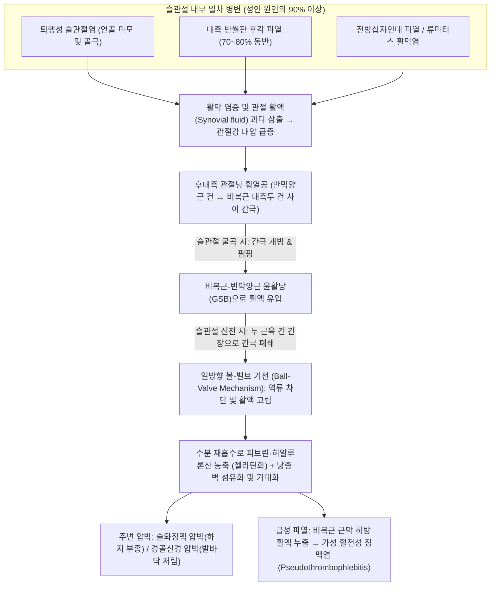

# 🩺 베이커 낭종 (Baker's Cyst / Popliteal Cyst)

> **핵심 3줄 요약 (Key Summary)**:
> - 📍 병소 부위 & 해부·병태생리: 슬와부(오금) 후내측에서 [[비복근]] 내측두(Medial head of gastrocnemius)와 [[반막양근]](Semimembranosus) 건 사이에 위치한 윤활낭이 슬관절 후방 관절낭과의 교통로(일방향 볼-밸브 기전, Ball-valve mechanism)를 통해 유입된 관절 활액으로 팽창하여 형성되는 가장 흔한 슬와부 낭종성 질환입니다.
> - 🚩 전형적 임상 양상: 성인 [[베이커 낭종]]의 90~95% 이상은 관절 내 일차 병변([[반월판 손상]] 중 특히 내측 반월판 후각 파열, [[퇴행성 슬관절염]], [[전방십자인대 파열]], [[류마티스 관절염]])의 결과물이며, 무릎 신전 시 팽팽해지고 45° 굴곡 시 부드러워지는 [[포샤르 징후]](Foucher's sign)와 슬관절 완전 굴곡·신전 제한을 보입니다.
> - 🛠️ 핵심 검사 & 치료 전략: 고해상도 초음파상 [[반막양근]] 건과 [[비복근]] 내측두 사이의 콤마 형태 경부(Comma-shaped neck)를 확인하여 확진하며, 위중(BL40, 슬와동정맥·[[경골신경]] 천자 주의)·음곡(KI10)·위양(BL39)·음릉천(SP9) 자침 및 포위침(Surround needling), 관절 내 일차 염증을 제어하는 [[신바로약침]], 밸브 슬릿을 감압하는 도침, [[방기황기탕]]·[[오령산]]·[[대강활탕]] 투여를 통합 시행합니다.
> - ⚠️ 응급 의뢰 레드플래그: 낭종이 급성 파열되어 활액이 종아리 근막 하방으로 누출되면 급성 종아리 부종·발적·통증을 일으키는 가성 혈전성 정맥염(Pseudothrombophlebitis)이 발생하므로, 도플러 초음파와 D-dimer 검사를 통해 진성 [[심부정맥혈전증]](DVT)과 반드시 감별해야 합니다(오진하여 항응고제 투여 시 낭종 내 대량 출혈 및 구획증후군 악화 위험).

---

## 📌 목차
1. [🩺 질환 개요 & 해부학적 병태생리](#1--질환-개요--해부학적-병태생리)
2. [⚡ 병태생리 메커니즘 & 생체역학적 악순환 네트워크](#2--병태생리-메커니즘--생체역학적-악순환-네트워크)
3. [🔍 임상 증상 & 이학적 검사 알고리즘](#3--임상-증상--이학적-검사-알고리즘)
4. [🔀 감별 진단 매트릭스](#4--감별-진단-매트릭스)
5. [🌿 한의 통합 치료 프로토콜](#5--한의-통합-치료-프로토콜)
6. [💊 양방 치료 & 병용·의뢰 기준](#6--양방-치료--병용의뢰-기준)
7. [🏃 재활 운동 & 생활습관 티칭 가이드](#7--재활-운동--생활습관-티칭-가이드)
8. [💡 사용자 진료실 핵심 필기 & 임상 노하우 (Melt-In)](#8--사용자-진료실-핵심-필기--임상-노하우-melt-in)
9. [📚 출처 및 현대 학술 연구 요약](#9--출처-및-현대-학술-연구-요약)

---

## 1. 🩺 질환 개요 & 해부학적 병태생리

### 1.1 정의 및 역학적 특징 (1차성 vs 2차성 슬와 낭종)
* **질환의 정의**: [[베이커 낭종]](Baker's Cyst, 1877년 영국의 외과의사 William Morrant Baker가 최초 체계화) 또는 **슬와 낭종(Popliteal Cyst)**은 무릎 뒤쪽 오금(슬와부, Popliteal fossa)의 후내측 사분면(Posteromedial quadrant)에 위치한 [[비복근]]-반막양근 윤활낭(Gastrocnemius-semimembranosus bursa, GSB)에 관절 활액(Synovial fluid)이 비정상적으로 유입·저류되어 형성되는 활막성 낭종(Synovial cyst)입니다.
* **역학 및 유병률**:
  - 슬관절 통증으로 MRI나 초음파 검사를 받는 성인 환자의 약 **5~38%**(고령층 및 관절염 환자군에서는 최대 40% 이상)에서 발견되는 슬와부 최고 빈도 종괴입니다.
  - **1차성(특발성, Primary/Idiopathic) vs 2차성(속발성, Secondary) 낭종의 결정적 차이**:
    1. 1차성 [[베이커 낭종]] (소아·청소년형): 주로 4~7세 소아에서 호발하며, 슬관절 내부 병변이나 관절강과의 교통로(Communication slit) 없이 [[비복근]]-[[반막양근]] 점액낭 자체의 국소적 미세 자극으로 발생합니다. 대부분 무증상이며 수년 내에 **70~80% 이상 자연 소실(Spontaneous resolution)**됩니다.
    2. 2차성 [[베이커 낭종]] (성인형, 90~95% 이상): 성인에서 발견되는 [[베이커 낭종]]의 **90~95% 이상은 슬관절 내부의 일차적 관절 내 병변(Intra-articular pathology)에 의해 과다 생성된 염증성 활액이 후방 관절낭의 약한 틈을 통해 밀려 나와 형성된 결과물**입니다. 따라서 관절 내 일차 원인 질환을 치료하지 않고 단순 주사 천자(Aspiration)로 물만 빼낼 경우 **재발률이 70% 이상**에 달합니다.

### 1.2 슬와부(Popliteal Fossa) 및 후내측 관절낭의 정밀 임상 해부학
* **슬와부 마름모(Popliteal Diamond)의 경계와 신경혈관 다발**:
  - **상외측 경계**: [[대퇴이두근]](Biceps femoris) 건 / **상내측 경계**: [[반막양근]](Semimembranosus) 및 [[반건양근]](Semitendinosus) 건.
  - **하외측·하내측 경계**: [[비복근]](Gastrocnemius) 외측두 및 내측두.
  - **슬와부 중심 신경혈관 배열 (천층 $\rightarrow$ 심층 순서)**: 오금 정중앙(위중혈 BL40 직하방)에는 가장 표층이자 외측에 [[경골신경]](Tibial nerve)이 주행하고, 그 바로 심부(중간층)에 **슬와정맥(Popliteal vein)**, 그리고 가장 깊은 곳(대퇴골 슬와면 및 후방 관절낭 직상방)에 **슬와동맥(Popliteal artery)**이 위치합니다(**N-V-A 배열**).
* [[베이커 낭종]]의 해부학적 관문 (Anatomical Portal / Neck of the Cyst):
  - [[베이커 낭종]]은 오금 정중앙이 아니라 **오금의 내측 상방**에서 시작됩니다.
  - 사체 해부 연구에 따르면 성인의 약 30~50%(나이가 들수록 증가)에서 슬관절 후내측 관절낭(Posteromedial joint capsule)에 후사슬와인대(Oblique popliteal ligament)의 확장이 불완전하여 생기는 가로 방향의 좁은 틈(Transverse capsular slit, 폭 5~20mm)이 존재합니다.
  - 이 교통로는 정확히 내측의 [[반막양근]] 건(수직 주행)과 외측의 [[비복근]] 내측두 건(사선 주행)이 교차하는 사이 공간에 열려 있어, 관절강과 [[비복근]]-[[반막양근]] 윤활낭을 연결하는 **낭종 경부(Cystic neck)**를 형성합니다.



### 1.3 성인 [[베이커 낭종]]을 유발하는 4대 관절 내 일차 병변
1. 내측 [[반월판 손상]] (Medial Meniscus Tear — 특히 후각부 파열 Posterior Horn Tear):
   - [[베이커 낭종]] 환자의 **약 70~83%**에서 동반되는 가장 흔한 단일 원인입니다. 내측 반월판 후각부는 후내측 관절낭 및 [[반막양근]] 건막과 섬유성으로 직접 연결되어 있어, 후각부 파열이나 수평 파열(Horizontal cleavage tear)이 발생하면 후방 관절낭 벽이 기계적으로 약화되고 활막 자극이 지속됩니다.
2. [[퇴행성 슬관절염]] (Knee Osteoarthritis, OA):
   - 연골 조각(Cartilage debris)이 활막을 자극하여 만성 활막염(Synovitis)과 관절수종을 유발하며, Kellgren-Lawrence 등급이 높을수록 낭종의 발생 빈도와 크기가 비례하여 증가합니다.
3. [[전방십자인대 파열]] (ACL Tear) 및 슬관절 불안정성:
   - [[전방십자인대]] 기능이 소실되면 보행 시 경골의 전방 전위와 회전 불안정성이 증가하여 내측 반월판 후각에 과부하가 걸리고 만성 삼출액이 형성됩니다.
4. 염증성·결정성 관절염 ([[류마티스 관절염]], [[통풍]], 가성통풍):
   - 판누스(Pannus) 형성과 폭발적인 염증성 삼출액 생성으로 인해 거대 [[베이커 낭종]]이 형성되며, 종아리 하방까지 길게 뻗어 내리는 박리성 낭종(Dissecting cyst)이나 급성 파열의 위험이 가장 높습니다.

---

## 2. ⚡ 병태생리 메커니즘 & 생체역학적 악순환 네트워크

### 2.1 일방향 밸브 기전 (Ball-Valve / Bunsen-Valve Mechanism)과 유체역학
[[베이커 낭종]]이 저절로 줄어들지 않고 점점 단단한 혹으로 커지는 핵심 이유는 슬관절 굴신 운동에 따른 **일방향 밸브(One-way valve) 효과** 때문입니다.
* **굴곡기 (Flexion Phase — 밸브 개방 및 활액 유입)**:
  - 무릎을 구부릴 때(특히 쪼그려 앉거나 계단을 오를 때) 대퇴골 과(Femoral condyle)가 후방으로 구르면서 전방·중앙 관절강의 활액을 후방 관절낭 쪽으로 강하게 밀어냅니다(슬관절 내압 상승).
  - 동시에 무릎이 굴곡되면 [[비복근]] 내측두와 [[반막양근]] 건의 장력이 이완되면서 두 힘줄 사이의 관절낭 틈새(Slit)가 벌어져, 관절강 내의 활액이 압력 경사(Pressure gradient)를 따라 저항 없이 윤활낭 내부로 쏟아져 들어갑니다.
* **신전기 (Extension Phase — 밸브 폐쇄 및 역류 차단)**:
  - 무릎을 완전히 펴면(신전 0°), 관절강 내부의 압력은 음압 또는 저압으로 떨어져 물리적으로는 낭종의 물이 다시 관절강으로 돌아가야 합니다.
  - 그러나 신전 순간 [[비복근]] 내측두와 [[반막양근]] 건이 동시에 팽팽하게 수축·긴장하면서 두 건이 가위처럼 교차하여 낭종 경부(Cystic neck)를 물리적으로 꽉 조여 닫아버립니다(Pinch-cock effect).
  - 또한 낭종 입구에 형성된 피브린 판막이나 비후된 활막 주름(Capsular fold)이 볼-밸브(Ball-valve)처럼 틈새를 막아, 한 번 들어간 활액은 절대 관절강으로 되돌아가지 못합니다.
* **활액의 농축과 젤라틴화 (Gelatinous Inspissation)**:
  - 낭종 안에 갇힌 활액에서 물과 저분자 전해질만 점액낭 모세혈관과 림프관을 통해 서서히 재흡수되고, 고분자 물질인 **히알루론산(Hyaluronic acid), 피브린(Fibrin), 점액단백질**은 그대로 농축됩니다.
  - 그 결과 시일이 지난 만성 [[베이커 낭종]]의 내부는 맑은 물이 아니라 **끈적끈적한 노란 젤리(점조성 젤라틴액)나 쌀알 모양의 유리체(Rice bodies), 다발성 격벽(Septations)**으로 채워져 얇은 주사 바늘로는 아예 뽑히지 않는 상태가 됩니다.

### 2.2 낭종 거대화에 따른 슬와부 구획 압박 및 파열(Pseudothrombophlebitis) 기전
1. **슬와정맥 압박 증후군 (Venous Outflow Obstruction)**:
   - 거대해진 낭종이 외측으로 팽창하여 벽이 얇은 슬와정맥(Popliteal vein)을 직접 압박하면, 혈전이 없는데도 정맥 환류가 정체되어 하퇴 및 발목의 함요 부종(Pitting edema)과 정맥 역류(Venous reflux)가 발생하며, 장기화 시 실제 [[심부정맥혈전증]](DVT)을 유발하는 이차적 원인이 되기도 합니다.
2. [[경골신경]] 포착 신경병증 (Tibial Nerve Entrapment):
   - 낭종이 슬와정맥 바로 표층의 [[경골신경]]을 압박하면 종아리 후면의 경련, 발바닥 전체의 저림·작열통(가성 [[족근관 증후군]]), 그리고 심한 경우 발가락 굴곡 및 [[비복근]] 근력 약화를 유발합니다.
3. **급성 낭종 파열과 가성 혈전성 정맥염 (Pseudothrombophlebitis Syndrome)**:
   - 무리한 보행이나 깊은 굴곡 동작 시 낭종 내압이 한계치를 넘으면 낭종 하벽이 파열됩니다.
   - 관절염에서 유래한 다량의 **전염증성 사이토카인(TNF-α, IL-1β, IL-6), 프로스타글란딘, 단백분해효소(MMPs)가 함유된 활액**이 [[비복근]] 내측두와 표층 근막(Superficial posterior compartment fascia) 사이를 타고 종아리 아래로 급격히 흘러내립니다.
   - 이 화학적 자극 물질들이 종아리 근육과 피하 지방층에 극심한 **화학적 근막염(Chemical fasciitis)**을 일으켜, 종아리가 순식간에 붓고 열이 나며 붉어지고 디딜 수 없는 통증을 유발합니다. 누출된 혈액과 체액이 중력을 따라 내려오면 며칠 뒤 **안쪽 복숭아뼈(내과) 아래나 발등에 반달 모양의 멍이 맺히는 반월 징후(Crescent sign / Ecchymosis)**가 나타납니다.

---

## 3. 🔍 임상 증상 & 이학적 검사 알고리즘

### 3.1 임상 증상 프로파일
* **무증상 ~ 경증기**: 우연히 오금 안쪽에서 만져지는 매끄럽고 탄력 있는 혹(물풍선이나 삶은 달걀 느낌) 외에 특별한 통증이 없거나, 오래 걸은 뒤 오금이 약간 묵직하고 뻐근한 정도입니다.
* **활동기 및 기계적 제한기**:
  - **완전 굴곡 제한**: 쪼그려 앉거나 무릎을 끝까지 구부릴 때 오금 뒤에 테니스공이 끼인 것 같은 팽만감(Posterior fullness)과 통증이 발생합니다.
  - **완전 신전 제한 및 당김**: 무릎을 쭉 펴고 서 있을 때 [[비복근]]과 [[반막양근]]이 낭종을 압박하여 오금이 팽팽하게 당기고 저릿합니다.
  - **관절 내 일차 병변 증상 동반**: 무릎 내측 관절선 압통(Medial joint line tenderness), 계단 승강 시 무릎 앞·안쪽 통증, 걸림 현상(Locking)이나 탄발음(Clicking)이 함께 나타납니다.
* **파열기 (급성 응급 양상)**:
  - 오금에서 "툭" 하고 무언가 터지는 느낌과 함께 원래 만져지던 오금의 혹이 작아지거나 사라지면서, 수시간 내에 종아리 전체가 단단하게 붓고 화끈거리며 발목을 위로 당기면(배측굴곡) 종아리가 찢어질 듯 아픈 증상(양성 [[호만스 징후]] 유사 소견)이 발생합니다.

### 3.2 핵심 이학적 검사 및 영상 진단 프로토콜

| 검사 및 진단법 | 시행 방법 및 해부학적 원리 | 양성 소견 및 임상적 의의 | 감별 가치 및 주의점 |
| :--- | :--- | :--- | :--- |
| [[포샤르 징후]] (Foucher's Sign) | ① 환자를 엎드리게(복와위) 한 뒤 **무릎을 완전 신전(0°)** 상태에서 슬와 내측 종괴의 경도와 크기를 촉진함<br/>② 이어서 **무릎을 45° 굴곡**시킨 상태에서 다시 촉진하여 비교함 | **신전 시에는 단단하고 팽팽하게 돌출**되던 종괴가, 45° 굴곡 시에는 [[반막양근]]·[[비복근]] 장력이 풀리고 활액이 관절강 쪽으로 일부 밀려들어가면서 말랑해지거나 작아짐 | [[베이커 낭종]]의 가장 특이적인 이학적 징후. 굴곡 후에도 단단함이 그대로 유지되면 반월판 낭종, 지방종, 신경초종, 슬와동맥류 등 고형/고정성 종괴를 의심함 |
| **박동성 촉진 및 청진 검사** (Pulsation Check) | 종괴 위에 검지·중지를 얹어 동맥 박동(Expansile pulsation)이 느껴지는지 확인하고 청진기로 혈관 잡음(Bruit) 유무를 확인 | 박동성이 전혀 없어야 정상 [[베이커 낭종]]임 (**박동이 느껴지면 즉시 슬와동맥류 의심!**) | ⚠️ **침·약침·도침 시술 전 100% 필수 확인 수칙** (박동성 종괴 자침 시 대량 동맥 출혈 위험) |
| **투광 검사** (Transillumination Test) | 진료실 조명을 어둡게 하고 펜라이트(강한 LED 광원)를 종괴 한쪽 피부에 밀착시켜 빛의 투과도를 관찰 | 내부가 맑은 장액성 활액으로 차 있어 **종괴 전체가 붉고 투명하게 빛을 투과**함 | 고형 종양(육종, 지방종)이나 혈전으로 가득 찬 동맥류(빛 투과 안 됨)를 진료실에서 1차 배제 (단, 격벽이 심한 만성 농축 낭종은 위음성 가능) |
| **기저 병변 검사** ([[맥머리 검사]] / [[압플리 검사]]) | 슬관절 굴곡 상태에서 경골을 외회전·외반 부하하며 신전시켜 내측 반월판 후각을 압박 | 무릎 내측 관절선의 날카로운 통증 및 탄발음(Click) 유발 | [[베이커 낭종]]의 근본 원인인 내측 [[반월판 손상]] 동반 여부를 확인하는 필수 검사 |
| **내과 하방 반월 징후** (Crescent Sign) | 급성 종아리 부종 환자에서 내과(안쪽 복숭아뼈) 하방 및 발목 내측 피부를 시진 | 내과 아래를 따라 **초승달 모양의 피하 반상출혈(멍, Ecchymosis)**이 관찰됨 | 진성 [[심부정맥혈전증]](DVT)에서는 절대 나타나지 않고 파열된 [[베이커 낭종]]에서만 나타나는 특이 징후 |
| **고해상도 근골격계 초음파** (HRUS — 1차 확진 표준) | 슬와부 내측에서 횡단면(Short-axis)으로 [[반막양근]] 건(내측)과 [[비복근]] 내측두(외측)를 찾고, 두 구조물 사이를 연결하는 낭종 경부를 스캔 | **반막양근 건을 감싸며 관절강으로 들어가는 콤마 모양의 무에코 경부(Comma-shaped neck / Speech bubble sign)** 확인 시 **민감도·특이도 거의 100%** 확진. 파열 시 종아리 근막 하방의 뾰족한 유체 저류(Pointed fluid collection) 관찰 | 컬러 도플러(Color Doppler) 모드를 켜서 내부 혈류 없음(동맥류 배제)과 슬와정맥 압박/혈전 유무(DVT 배제)를 동시에 판독함 |

```mermaid
flowchart TD
    Start["슬와부(오금) 종괴, 뻐근한 팽만감 또는 급성 종아리 부종 환자 내원"] --> Palp{"1단계: 박동성(Pulsation) 촉진 및 포샤르 징후 검사"}
    
    Palp -->|박동성 촉지 또는 혈관 잡음 양성| Aneurysm["🚨 슬와동맥류 (Popliteal Artery Aneurysm) 강력 의심<br/>(절대 자침/천자 금지 → 혈관외과/도플러 초음파 즉시 의뢰)"]
    
    Palp -->|박동성 없음 + 포샤르 징후 양성<br/>(신전 시 팽팽, 45도 굴곡 시 연화)| US_Check{"2단계: 초음파 스캔 및 파열 여부 확인"}
    
    US_Check -->|급성 종아리 부종·발적·통증 동반| Rupture_DDx["진성 DVT vs 베이커 낭종 파열(가성 혈전정맥염) 감별<br/>(슬와정맥 압박 도플러 + D-dimer + 내과 반월 징후 확인)"]
    Rupture_DDx -->|정맥 내 혈전 확인| True_DVT["🚨 심부정맥혈전증 (DVT) 확진 → 내과/혈관외과 항응고 치료 의뢰"]
    Rupture_DDx -->|혈전 없음 + 비복근 근막하 유체 누출 확인| Ruptured_BC["파열성 베이커 낭종 확진 (항응고제 금기! 안정·거상·어혈약침·오령산)"]
    
    US_Check -->|비파열성 낭종 (반막양근-비복근 사이 콤마형 경부 확인)| Primary_Check["3단계: 슬관절 내 일차 병변 평가<br/>(맥머리 검사, 내측 관절선 압통, 필요시 MRI)"]
    Primary_Check --> Integrated_Tx["한의 통합 치료 가동: 관절강 내 신바로약침 + 슬와 포위침·온침 + 밸브 도침 감압 + 방기황기탕"]
```

---

## 4. 🔀 감별 진단 매트릭스

### 4.1 파열된 [[베이커 낭종]](가성 혈전성 정맥염) vs 진성 [[심부정맥혈전증]](DVT) 응급 감별 매트릭스

> ⚠️ **임상적 생사 갈림길**: 파열된 [[베이커 낭종]]을 [[심부정맥혈전증]](DVT)으로 오진하여 헤파린이나 경구용 항응고제(DOAC, 와파린)를 투여하면 **파열된 낭종 부위와 종아리 근육 내로 대규모 혈종(Hematoma)이 형성되어 급성 구획증후군(Compartment syndrome)**을 일으킬 수 있습니다. 반대로 진성 DVT를 단순 낭종 파열이나 근육통으로 오인하여 종아리를 강하게 주무르거나(추나/마사지) 방치하면 **치명적인 폐색전증(Pulmonary embolism)**으로 이어집니다. (단, 거대 낭종이 슬와정맥을 압박하여 **파열과 DVT가 동시에 존재하는 경우가 약 3~5%** 있으므로 반드시 도플러 초음파로 양측 모두 확인해야 합니다.)

| 감별 항목 | 파열된 [[베이커 낭종]] (가성 혈전성 정맥염, Pseudothrombophlebitis) | 진성 [[심부정맥혈전증]] (Deep Vein Thrombosis, DVT) |
| :--- | :--- | :--- |
| **선행 병력 및 위험 인자** | [[퇴행성 슬관절염]], [[반월판 손상]], [[류마티스 관절염]] 병력; 파열 전 오금에 혹이나 팽만감이 있었음 | 최근 장시간 비행/수술 후 부동(Immobilization), 악성 종양, 경구피임약 복용, 혈전 성향증(Wells score 고위험) |
| **발병 양상 및 전구 증상** | 쪼그려 앉거나 계단을 내려갈 때 **오금에서 '뚝' 터지는 느낌**과 함께 기존 오금 혹이 홀쭉해지면서 종아리 상부부터 아래로 통증·부종이 번짐 | 발목과 종아리 하부에서부터 서서히 또는 아급성으로 묵직한 부종과 통증이 위로 올라오며, 오금 혹의 소실 병력이 없음 |
| [[호만스 징후]] (Homans' Sign) | **위양성(False positive) 매우 흔함** (발목 배측굴곡 시 누출된 활액으로 염증이 생긴 [[비복근]]이 신장되면서 종아리 통증 유발) | 양성 가능하나 민감도·특이도가 모두 낮음(약 30~50%) — **단독으로 두 질환을 절대 구별할 수 없음** |
| **특이 피부 징후** | 파열 2~4일 후 내과(안쪽 복숭아뼈) 아래나 발등에 초승달 모양의 멍이 나타나는 **반월 징후(Crescent sign)** 및 종아리 가려움증(Pruritus) | 하지 전반의 암적색·청색조 부종(Phlegmasia), 표재 정맥의 확장, 피부 긴장도 증가 (발목 국소 반월형 멍은 없음) |
| **혈액 검사 (D-dimer)** | 일반적으로 정상 또는 경도 상승 (단, 심한 활막염이나 피하 출혈 동반 시 중등도 상승 가능하여 음성 예측도 위주로 활용) | **현저한 상승 (> 500 ng/mL)** (음성일 경우 급성 DVT를 95% 이상 배제 가능) |
| **초음파 소견 (Duplex US)** | 슬와정맥 및 심부정맥이 **탐촉자 압박에 완전히 납작하게 눌림(정상 압박성)**; [[비복근]] 내측두 하방 근막을 따라 아래로 뾰족하게 뻗은 유체 저류 확인 | 정맥 내부에 에코성 혈전이 차 있어 **탐촉자로 눌러도 정맥이 눌리지 않음(Non-compressibility)**, 도플러 혈류 신호 결손 |
| **치료 원칙 및 금기** | **항응고제 투여 금기!** 하지 거상, 냉찜질(초기), 압박 붕대, 어혈약침 및 이수소종 한약([[오령산]]·[[방기황기탕]])으로 흡수 촉진 | **즉각적인 항응고제(DOAC, 헤파린) 투여 필수**, 초기 강한 종아리 마사지·침 자극 절대 금기 (혈전 색전 이탈 위험) |

### 4.2 슬와부(오금) 종괴의 해부학적 감별 진단 매트릭스

| 질환명 | 호발 위치 | 핵심 임상 및 이학적 특징 | 초음파 / MRI 영상학적 감별 포인트 |
| :--- | :--- | :--- | :--- |
| [[베이커 낭종]] (Baker's Cyst) | 슬와부 **후내측** ([[반막양근]] 건과 [[비복근]] 내측두 사이) | [[포샤르 징후]] 양성(굴곡 시 연화), 투광 검사 양성, 내측 관절염/반월판 파열 동반 | [[반막양근]] 건과 [[비복근]] 내측두 사이의 콤마 형태 경부(Neck)가 후내측 관절낭과 연결됨 |
| **반월판 낭종** (Meniscal Cyst / Parameniscal Cyst) | 내측 또는 외측 **관절선(Joint line) 직상방** (외측이 더 흔하게 촉지됨) | 무릎 굴신 각도와 무관하게 관절선에서 **단단하고 고정된 작은 혹**으로 만져짐 (Pisani 징후: 45° 굴곡 시 외측 낭종이 더 뚜렷해지기도 함) | 반월판의 수평 파열(Horizontal tear) 틈새와 직접 연결되어 관절선 바로 바깥에 국한됨 (비복근-반막양근 간극과 무관) |
| **결절종** (Ganglion Cyst) | 슬와부 어디나 가능 (건초, 관절낭, 전·후방십자인대 기시부) | 매우 단단하고 잘 움직이지 않으며 [[포샤르 징후]] 음성 (관절강과 자유로운 활액 이동이 없음) | 관절강과의 열려 있는 교통로(Slit)가 없거나 미세한 줄기(Stalk)만 있으며 다엽성(Multiloculated) 점액 덩어리 형태 |
| **슬와동맥류** (Popliteal Artery Aneurysm) | 슬와부 **정중앙 심부** (위중혈 직하방) | **손을 대면 심장 박동과 동기화되어 불룩거리는 박동성 종괴(Pulsatile mass)**, 청진 시 혈관 잡음(Bruit), 원위부 족배동맥 맥박 약화 | 컬러 도플러 초음파상 종괴 내부에서 소용돌이치는 **태극 무늬 동맥 혈류(Yin-Yang sign)** 및 벽재성 혈전 관찰 |
| **양성/악성 연부조직 종양** (지방종, 신경초종, 활막육종) | 슬와부 신경 주행선(신경초종) 또는 심부 근막(육종) | [[포샤르 징후]] 음성, 투광 검사 음성. 신경초종(Schwannoma)은 타진 시 발바닥/종아리로 찌릿한 [[티넬 징후]] 유발; 육종은 야간통과 급격한 크기 증가 | 내부가 무에코 액체가 아닌 **고형 에코(Solid echogenicity)**를 띠며 종괴 내부로 신생 혈관(Internal vascularity)이 유입됨 |

---

## 5. 🌿 한의 통합 치료 프로토콜

> 🎯 **한의 치료의 핵심 대원칙**: 성인 [[베이커 낭종]] 치료의 성패는 **"① 앞쪽(관절강 내부)의 활막 염증과 삼출액 생성을 끄는 것"**과 "② 뒤쪽(슬와부)의 [[반막양근]]-[[비복근]] 긴장을 풀어 일방향 밸브를 열어주는 것"을 동시에 수행하는 데 있습니다. 뒤쪽 물혹만 찌르면 반드시 재발합니다.

### 5.1 침구 치료 프로토콜 및 위중혈(BL40) 안전 자침 수칙
* **1단계: 슬와부 후내측 밸브 감압 및 순환 경혈**:
  1. **음곡(KI10) & 곡천(LR8)**: 무릎 내측 오금 주름 끝에서 만져지는 [[반막양근]] 건과 [[반건양근]] 건의 부착부에 위치합니다. 이곳을 자침하여 [[반막양근]]의 과긴장을 이완시키면 낭종 경부(Cystic neck)를 조이고 있던 일방향 밸브의 내측 압력이 즉각 해소됩니다.
  2. **합양(BL55)**: 위중혈 직하방 2촌, [[비복근]] 내측두와 외측두가 갈라지는 근복 상부로, 일방향 밸브의 외측 벽을 이루는 [[비복근]] 내측두의 긴장을 직접 풀어줍니다.
  3. **위양(BL39)**: 슬와 횡문 외측단, [[대퇴이두근]] 건 내측연으로 슬관절 후외측 구조물의 균형을 맞춥니다(삼초의 하합혈로 수액 대사 조절).
  4. 위중(BL40) — ⚠️ 슬와동정맥 및 [[경골신경]] 천자 주의 안전 수칙:
     - 위중혈은 슬와 횡문 정중앙으로 슬관절 후방 관절낭 감압과 하지 정맥·림프 환류를 촉진하는 핵심 혈위이나, 바로 아래 표층에 [[경골신경]], 중간층에 슬와정맥, 심층에 슬와동맥이 직선으로 배열되어 있습니다.
     - **안전 자침 프로토콜**: ① 자침 전 반드시 손끝으로 슬와동맥의 박동 위치를 먼저 확인하여 박동점을 피합니다. ② 거대 [[베이커 낭종]]이 중앙까지 밀고 나와 있을 때 신경혈관 다발이 평소 위치보다 표층이나 외측으로 밀려나(Displaced) 있을 수 있으므로, 무리한 심자(Deep needling)나 강한 염전·제삽을 절대 금하고 **0.5~1.0촌 깊이 내에서 부드럽게 자입**합니다.
* **2단계: 낭종 포위침(Surround Needling, 圍刺法) 및 온침(溫鍼) 요법**:
  - 팽창된 슬와 내측 낭종의 가장자리(변연부)를 따라 상·하·좌·우 4~6개 지점에서 낭종 중심 기저부를 향해 30~45° 각도로 사자(Oblique needling)하는 **포위침(Surround needling)**을 시행합니다.
  - 침병에 쑥봉을 꽂아 **온침(Warm needling)** 또는 심부 봉독·온열 자극을 가하면, 국소 온도가 상승하면서 점조하게 굳어 있던 젤라틴성 활액의 점도(Viscosity)가 낮아지고, 낭종 벽의 모세혈관 및 림프관 투과성이 증가하여 삼출물의 자연 흡수가 폭발적으로 촉진됩니다.
* **3단계: 관절강 내 일차 병변 제어 (슬관절 전면 배혈)**:
  - **내슬안·외슬안(EX-LE5, 독비 ST35)**: 슬개건 양옆 함요처에서 관절강 내부를 향해 자침하여 기저 질환인 [[퇴행성 슬관절염]]과 [[반월판 손상]]의 활막 염증을 가라앉힙니다.
  - **음릉천(SP9) & 혈해(SP10) & 학정(EX-LE2)**: 내측측부인대 및 내측 관절선 주변의 수습(水濕)을 배출하고 [[대퇴사두근]](특히 [[내측광근]] VMO)을 강화하여 슬관절의 동적 안정성을 높입니다.

### 5.2 약침 및 도침(Acupotomy) 치료 프로토콜
* **관절 내 염증 제어 및 낭종 흡수 약침 요법**:
  1. [[신바로약침]] (또는 자하거약침 / [[봉약침]]):
     - **전면 관절강·내측 관절선 주입 (원인 차단)**: 내슬안·외슬안 및 내측 반월판 후각 압통점에 [[신바로약침]] **1.0~2.0 cc**를 주입합니다. 주성분인 구척·오가피·우슬 추출물(신바로메틴)이 활막의 **COX-2, PGE2, MMP-3/MMP-13 및 TNF-α 발현을 강력히 억제**하여, 뒤쪽 낭종으로 공급되는 염증성 활액의 생성(Source) 자체를 원천 차단합니다.
     - **후내측 낭종 경부 주입**: [[반막양근]] 건과 [[비복근]] 내측두 사이 경부 주변에 1.0 cc를 분주하여 윤활낭 벽의 만성 활막염을 진정시킵니다.
  2. [[중성어혈약침]] / [[황련해독탕]] 약침:
     - 슬관절에 열감과 급성 삼출액이 가득 찬 습열형에는 [[황련해독탕]] 약침을 쓰고, 낭종이 파열되어 종아리에 급성 부종과 어혈성 통증(가성 혈전성 정맥염)이 발생했을 때는 비복근 근막 주위에 [[중성어혈약침]] 1.5~2.0 cc를 분주하여 누출된 활액과 피하 어혈의 흡수를 빠르게 유도합니다.
* **초음파 유도하 도침(Acupotomy) 일방향 밸브 감압술**:
  - 만성화되어 두꺼운 섬유성 격벽이 생겼거나 단순 침·약침에 반응하지 않는 난치성 [[베이커 낭종]]에서 시행합니다.
  - **시술 타겟**: 초음파(컬러 도플러 필수 작동)로 슬와동정맥과 [[경골신경]]이 외측에 안전하게 떨어져 있음을 실시간으로 보면서, 0.5×50mm 소침도를 내측에서 진입시켜 [[반막양근]] 건과 [[비복근]] 내측두 건 사이에 형성된 질긴 섬유성 밸브 슬릿(Capsular slit)과 비후된 낭종 벽을 3~5회 종방향으로 미세 절개·천공(Fenestration)합니다.
  - **치료 기전**: 좁은 일방향 밸브를 물리적으로 넓혀 **양방향 소통(Bidirectional communication)**이 가능하게 만들면, 보행 시 낭종 안의 활액이 다시 관절강으로 역류하여 넓은 정상 활막을 통해 흡수되며, 동시에 두꺼운 낭종 벽에 천공(Fenestration)을 내어 주변 근육층의 풍부한 림프망으로 삼출액이 자연 배액되도록 유도합니다.

### 5.3 추나 수기 요법 (Chuna Manual Therapy)
* [[반막양근]]·[[비복근]] 근막이완술 (Myofascial Release) 및 신경근 기법:
  - 복와위에서 단축되고 긴장된 내측 [[슬괵근]]([[반막양근]], [[반건양근]])과 [[비복근]] 내측두, 그리고 심부의 [[슬와근]](Popliteus)에 허혈성 압박 및 등장성 수축 후 이완(PIR) 기법을 적용합니다. 두 힘줄의 휴지기 장력이 떨어지면 신전 시 낭종 경부를 조이던 핀치콕(Pinch-cock) 밸브 효과가 사라집니다.
* **경골 내회전 복원 및 대퇴-경골 견인 추나**:
  - [[퇴행성 슬관절염]] 환자는 흔히 대퇴골 대비 **경골이 외회전(External rotation) 및 내반(Varus) 변위**되어 내측 반월판 후각에 과도한 압축 부하가 걸립니다.
  - 슬관절 장축 견인(Long-axis distraction)으로 관절 내압을 낮춘 뒤, 경골 내회전 교정 추나를 시행하여 내측 구획의 부하를 분산시킵니다(⚠️ **주의**: 낭종 직상방을 손바닥으로 강하게 짓누르는 압박 수기는 인위적 낭종 파열을 일으킬 수 있으므로 금기).

### 5.4 한의 변증별 맞춤 한약 처방 매트릭스 (수습·담음·어혈 제어)

[[베이커 낭종]]은 한의학적으로 관절 내 수습(水濕)이 대사되지 못하고 오금 경락에 고여 덩어리를 이룬 **학슬풍(鶴膝風), 유주(流注), 담핵(痰核), 습비(濕痺)**의 범주에 속하며, 이수삼습(利水滲濕)과 활혈통락(活血通絡)을 결합하여 처방합니다.

| 변증 유형 | 핵심 병기 및 임상 적응증 | 대표 처방 | 군·신약 핵심 본초 및 현대 약리 기전 |
| :--- | :--- | :--- | :--- |
| **기허수종 및 풍습표허** (氣虛水腫 / 風濕表虛) | 무릎 앞뒤가 물이 차서 무겁고 붓는데 피부가 무르며, 조금만 걸어도 땀이 나고 쉽게 피로해지는 만성 재발성 관절수종 및 [[베이커 낭종]] 1차 표준 처방 | [[방기황기탕]] (防己黃芪湯) (필요시 합 [[월비가출탕]]) | [[방기]], [[황기]], [[백출]], [[감초]], [[생강]], [[대조]]. 방기의 테트란드린(Tetrandrine)과 황기 성분이 활막의 IL-1β·TNF-α·PGE2를 강력히 억제하고, 림프관 내피세포의 수분 수송 채널을 활성화하여 관절강 삼출액과 낭종 부종을 빠르게 흡수·배출함 |
| **수습내정 및 급성 파열 부종** (水濕內停 / 津液不布) | 관절 삼출액이 급격히 차오르거나, [[베이커 낭종]]이 파열되어 종아리 전체에 급성 간질 부종이 발생했을 때 세포외액을 혈관 내로 끌어들여 배출하는 특효 처방 | [[오령산]] (五苓散) (통증 심할 때 합 [[소경활혈탕]]) | [[택사]], [[저령]], [[복령]], [[백출]], [[계지]]. 택사·복령 성분이 세포막의 **아쿠아포린(Aquaporin, AQP) 수분 채널**을 양방향 조절하여 혈장 단백질 손실 없이 조직 간질에 고인 삼출액(낭종 누출액)만을 선택적으로 흡수해 이뇨 배출함 |
| **습열하주 및 어혈조락** (濕熱下注 / 瘀血阻絡) | 무릎 관절이 붉게 붓고 열감이 뚜렷하며, 오금 혹이 단단하고 통증이 심한 급성 활막염 동반 낭종 ([[통풍]]성·류마티스성 또는 급성 퇴행성 악화기) | [[대강활탕]] (大羌活湯) 또는 [[선방활명음]] 합 [[사묘산]] | [[강활]], [[독활]], [[방기]], [[황백]], [[창출]], [[택사]]. 급성 활막 염증의 혈관 투과성 항진을 즉각 차단하고 백혈구 유주 및 단백분해효소(MMPs) 활성을 억제하여 활액 과다 분비를 멈추게 함 |
| **간신부족 및 한습응체** (肝腎不足 / 寒濕凝滯) | 고령의 만성 [[퇴행성 슬관절염]] 및 내측 [[반월판 손상]]이 기저에 깔려 있고, 날씨가 추우면 오금이 시리고 당기며 낭종이 젤리처럼 오래 굳어 있는 경우 | [[독활기생탕]] (獨活寄生湯) 합 [[우슬]]·[[목과]]·[[의이인]] 증량 | [[독활]], [[상기생]], [[두충]], [[우슬]], [[숙지황]], [[당귀]]. 연골 기질(Type II collagen, 프로테오글리칸) 파괴를 방어하고 슬관절 주변 인대·근막의 미세순환을 개선하여 2차성 낭종의 근본 원인을 치료함 |

---

## 6. 💊 양방 치료 & 병용·의뢰 기준

### 6.1 보존적 약물 및 초음파 유도하 천자·경화술 (Aspiration & Injection)
* **양방 약물 치료**:
  - 기저 관절염의 염증을 줄이기 위해 비스테로이드성 소염진통제([[세레콕시브]], [[멜록시캄]], [[록소프로펜]] 등 NSAIDs)를 처방합니다.
* **초음파 유도하 낭종 흡인 및 코르티코스테로이드 주입술**:
  - **시술 방법**: 낭종 내부의 농축된 활액은 매우 끈적거리므로 얇은 주사기로는 빠지지 않아 **16~18 게이지(Gauge)의 굵은 바늘**을 사용하여 초음파 유도하에 흡인(Aspiration)하고, 필요시 바늘 끝으로 낭종 벽과 격벽을 여러 번 찔러 구멍을 내는 **천공술(Fenestration)**을 병행한 뒤 트리암시놀론(Triamcinolone 20~40mg)을 주입합니다.
  - **치료 한계와 재발률**: 단기적으로 오금의 압박감은 즉시 줄어들고 슬와정맥 압박 혈류도 호전되나, **슬관절 내 일차 병변(반월판 파열 등)과 일방향 밸브가 그대로 남아 있으면 단순 천자 후 6개월 내 재발률이 60~70% 이상**입니다. 특히 다발성 격벽(Multiseptated cyst)이 형성된 만성 낭종은 흡인 효과가 현저히 떨어집니다.

### 6.2 수술적 치료 적응증 및 최신 관절경 술기 (Arthroscopic Valve Decompression)
* **과거 개방적 절제술(Open excision)의 높은 실패율**:
  - 과거에는 오금 피부를 크게 절개하여 낭종 주머니만 잘라내는 수술을 했으나, 슬관절 내부의 활액 생성 원인과 일방향 밸브를 해결하지 못해 **수술 후 재발률이 40~63%**에 달하고 상처 치유 지연 및 신경 손상 합병증이 흔했습니다.
* **현대 표준 수술법 — 관절경하 일차 병변 교정 및 내측 밸브 확대술 (Arthroscopic Internal Drainage)**:
  1. **절대/상대 수술 적응증**: 6개월 이상의 보존적 치료에도 반응하지 않고 슬와정맥이나 [[경골신경]]을 심하게 압박하여 신경혈관 장애를 일으키는 거대 낭종, 또는 기계적 잠김(Locking)을 유발하는 중증 내측 [[반월판 손상]]이 동반된 경우.
  2. **수술 원리**: 오금 뒤를 크게 째지 않고, 관절경(Arthroscopy)으로 먼저 관절 내부의 반월판 파열을 봉합/절제하고 활막염을 정리한 뒤, 후내측 포털(Posteromedial portal)을 통해 들어가 [[반막양근]]과 [[비복근]] 내측두 사이의 일방향 밸브 주름(Capsular fold)을 5~8mm 크기로 넓게 절제하여 양방향 교통로(Bidirectional flow)로 전환해 줍니다. 이렇게 밸브 기전을 없애주면 재발률이 **5% 미만**으로 급감합니다.

### 6.3 한의 병용 판단 및 응급 의뢰 기준
* **양방 천자 시술과의 최적 병용 프로토콜**:
  - 낭종이 달걀 크기 이상으로 너무 거대하여 당장 보행이 불편하거나 정맥 압박이 심한 환자는, 양방에서 초음파 유도하 18G 주사기로 젤라틴성 활액을 1회 흡인해 낸 **직후**에 한의원으로 내원하게 하여 관절강 내 [[신바로약침]], 슬와 포위 온침, [[방기황기탕]]·[[오령산]]을 즉시 집중 투여하면 스테로이드 남용 없이 재발을 가장 완벽하게 막을 수 있습니다.
* **응급 및 전문과 의뢰 기준 (Referral Criteria)**:
  1. 🚨 **박동성 종괴 확인 시**: 촉진상 박동이 느껴져 **슬와동맥류**가 의심되는 경우(절대 자침하지 말고 혈관외과 의뢰).
  2. 🚨 **급성 종아리 부종 발생 시**: 파열된 [[베이커 낭종]]과 진성 [[심부정맥혈전증]](DVT) 감별을 위해 도플러 초음파 및 D-dimer 검사가 필요한 경우.
  3. 🚨 **감염성 윤활낭염(Septic bursitis) 또는 고형 악성 종양(활막육종 등) 의심 시**: 오금에 심한 발적·열감과 함께 전신 발열·오한이 동반되거나, 종괴가 돌처럼 단단하게 고정되어 빠르게 자라는 경우.

---

## 7. 🏃 재활 운동 & 생활습관 티칭 가이드

### 7.1 일방향 밸브 폐쇄 압력을 낮추는 [[슬괵근]]·[[비복근]] 선택적 이완 운동
[[베이커 낭종]]의 입구를 조이는 두 주역인 [[반막양근]]과 [[비복근]] 내측두의 유연성을 회복하는 것이 재활의 첫걸음입니다.
1. 수건을 이용한 앙와위 [[슬괵근]]-비복근 부드러운 신장 (Supine Hamstring-Calf Stretch):
   - 바닥에 똑바로 누워 아픈 쪽 발바닥 앞쪽에 긴 수건이나 스트랩을 걸고, 무릎을 천천히 펴면서 다리를 들어 올립니다.
   - 이때 **오금에 강한 압박통이 느껴지지 않는 각도(약 70~80% 신전 범위)**까지만 펴고 발목을 몸쪽으로 당겨 20초간 유지하기를 5회 반복합니다(무릎을 과신전시키며 억지로 꺾으면 오히려 밸브가 꽉 닫히고 낭종 내압이 올라가므로 주의).
2. **폼롤러를 이용한 종아리 및 허벅지 후면 근막 이완 (오금 직상방 제외!)**:
   - 폼롤러를 허벅지 뒤쪽([[반막양근]] 근복)과 종아리 중간([[비복근]] 근복)에 대고 부드럽게 굴려 근육 긴장을 풀어줍니다.
   - ⚠️ **핵심 주의사항**: **폼롤러나 마사지 볼을 오금(슬와부) 정중앙에 직접 대고 체중을 실어 짓누르는 행위는 절대 금지**합니다(낭종 파열 및 슬와신경·정맥 손상 위험).

### 7.2 슬관절 내측 부하를 줄이는 [[대퇴사두근]](VMO) 등척성 강화 운동
관절 내부에서 활액이 계속 만들어지는 것을 막으려면 무릎 앞쪽의 [[대퇴사두근]]이 충격을 흡수해 주어야 합니다.
* **무릎 밑 수건 누르기 (Quad Set / Isometric VMO Contraction)**:
  - 바닥에 다리를 펴고 앉아 아픈 무릎(오금 약간 위쪽) 아래에 둥글게 만 수건을 받칩니다.
  - 오금의 낭종이 직접 눌리지 않도록 주의하면서, 허벅지 앞쪽 안쪽 근육([[내측광근]])에 힘을 주어 수건을 바닥 쪽으로 지그시 누른 채 5~10초간 유지하고 힘을 뺍니다(하루 15회 × 3세트). 관절을 구부리지 않고도 관절낭 내 삼출액 흡수를 돕는 가장 안전한 초기 운동입니다.
* **누워서 다리 들어 올리기 (Straight Leg Raise, SLR)**:
  - 반대쪽 무릎은 세우고 아픈 쪽 무릎을 편 상태에서 발목을 당긴 채 다리를 45° 높이까지 천천히 들어 올려 5초간 버틴 후 내립니다.

### 7.3 일상생활 중 낭종 팽창·파열 예방 수칙
* **깊은 굴곡(Deep Flexion) 자세 절대 회피**: 쪼그려 앉아 걸레질하기, 김장하기, 양반다리, 무릎 꿇기, 딥 스쿼트(Deep squat)는 관절강 내압을 평소의 5~10배로 폭증시켜 활액을 낭종 안으로 강제 펌핑하고 급성 파열을 유발하는 최악의 자세입니다. 반드시 의자와 침대 생활로 전환합니다.
* **급성 파열 시 초기 대처(PRICE 원칙)**: 만약 오금 혹이 터져 종아리가 부어올랐다면(DVT 배제 후), 무리한 보행을 멈추고 누울 때 발목 아래에 베개 2개를 받쳐 **다리를 심장보다 높게 거상(Elevation)**하며, 종아리 압박 스타킹을 착용하여 누출된 활액이 림프관으로 빠르게 흡수되도록 돕습니다.

---

## 8. 💡 사용자 진료실 핵심 필기 & 임상 노하우 (Melt-In)

### 8.1 "원장님, 무릎 뒤에 물혹만 주사기로 빼주세요"라는 환자를 설득하는 명쾌한 비유법
* 💡 **앞쪽 수도꼭지(관절염)와 뒤쪽 물풍선(베이커 낭종)의 원리 (원장님 핵심 필기 승화)**:
  - 진료실에서 환자들이 가장 많이 하는 요구가 "앞쪽 무릎은 참을 만한데 뒤쪽 오금에 불룩 나온 물혹이 신경 쓰이니 이것만 빼달라"는 것입니다.
  - 이때 반드시 다음과 같이 설명하여 치료 순응도를 높입니다:
    > "환자분, 성인에게 생기는 베이커 낭종(오금 물혹)의 **90% 이상은 오금 자체의 병이 아닙니다.** 무릎 앞쪽 관절 안에 있는 **내측 반월판 연골이 찢어졌거나 관절염**이 생겨서, 무릎이 열을 식히려고 관절액(물)을 너무 많이 만들어낸 것입니다. 앞쪽에 물이 넘치니까 무릎 뒤쪽 약한 틈새로 물이 밀려 나가서 오금에 '물풍선'처럼 고인 겁니다. 더구나 그 연결 통로가 **들어가기만 하고 나오지는 못하는 '일방통행 밸브'**로 되어 있어서 물이 갇혀 끈적한 젤리처럼 굳은 상태입니다. 따라서 **앞쪽 관절염이라는 '수도꼭지'를 잠그지 않고 뒤쪽 물풍선만 주사기로 빼내면 10명 중 7~8명은 며칠 만에 똑같이 다시 찹니다.** 저희는 [[신바로약침]]으로 앞쪽 관절의 염증 수도꼭지를 잠그고, 오금 근육을 풀어 일방통행 밸브를 열어주며, 한약([[방기황기탕]])으로 고인 물을 말려버리는 근본 치료를 함께 진행할 겁니다."

### 8.2 진료실 실전 촉진 노하우 — [[포샤르 징후]]와 박동성 확인의 손맛
* 💡 **자침 전 3초 촉진 루틴**:
  1. 환자를 침대에 엎드리게 한 뒤, 먼저 무릎을 쭉 편 상태에서 오금 내측 혹을 만져봅니다. 팽팽한 고무공처럼 만져질 때 **검지와 중지를 가만히 얹어 3초간 '두근두근' 뛰는 맥박(슬와동맥류)이 없는지 반드시 확인**합니다.
  2. 그다음 한 손은 혹 위에 그대로 얹은 채 다른 손으로 환자의 발목을 잡고 무릎을 45° 정도 살짝 구부려 봅니다([[포샤르 징후]]). 이때 손끝에서 팽팽하던 혹의 긴장도가 '스르르' 풀리면서 말랑말랑해지면 전형적인 [[베이커 낭종]]입니다.
  3. 만약 무릎을 45° 구부렸는데도 혹이 전혀 말랑해지지 않고 돌멩이처럼 단단하게 관절선 바로 위에 박혀 있다면 **반월판 낭종(Meniscal cyst)**이거나 이미 내부가 완전히 젤리·격벽으로 굳어버린 오래된 낭종이므로, 이때는 단순 호침만으로는 흡수가 느려 **초음파 유도하 도침(밸브 및 격벽 천공술)과 온침**을 결합해야 치료 기간을 절반으로 단축할 수 있습니다.

### 8.3 종아리가 갑자기 부어 내원한 환자(낭종 파열 vs DVT) 실전 감별 체크리스트
* 🚨 **"어제까지 오금에 혹이 있었는데, 오늘 아침부터 종아리가 터질 듯 붓고 아파요"**:
  - 환자가 절뚝거리며 들어왔을 때, 예전에 오금에 혹이 있었다는 병력이 있거나 **안쪽 복숭아뼈(내과) 아래쪽에 초승달 모양의 푸르스름한 멍(Crescent sign)**이 보이면 [[베이커 낭종]] 파열에 의한 **가성 혈전성 정맥염**일 가능성이 90% 이상입니다.
  - 하지만 거대 낭종이 슬와정맥을 오래 눌러서 실제 혈전([[심부정맥혈전증]])이 함께 생긴 상태일 수도 있으므로, 절대 발목만 꺾어보고([[호만스 징후]]) 안심해서는 안 됩니다.
  - 진료실에 초음파가 있다면 즉시 슬와정맥과 종아리 심부정맥을 탐촉자로 꾹 눌러보아 **정맥이 완전히 납작하게 눌리는지(Compressibility test)** 확인하고, 정맥이 잘 눌리고 비복근 근막 사이에만 검은 물(유체)이 고여 있다면 안심하고 [[중성어혈약침]] + [[오령산]](또는 [[방기황기탕]]) 치료를 즉시 시작합니다. 이 조합을 쓰면 양방에서 몇 주씩 고생하는 파열 후 종아리 부종과 통증이 1주일 내에 빠르게 흡수됩니다.

---

## 9. 📚 출처 및 현대 학술 연구 요약

1. **Frush TJ, Noyes FR.** (2015). Baker's Cyst: Diagnostic and Surgical Considerations. *Sports Health*. 7(4):359-365. PMID: 26137182.
   - [PubMed 원문 링크](https://pubmed.ncbi.nlm.nih.gov/26137182/)
   - [연구 요약]: [[베이커 낭종]]의 해부학적 발생 기전([[반막양근]]-[[비복근]] 내측두 간극의 일방향 볼-밸브 기전)과 성인에서 90% 이상 동반되는 슬관절 내 일차 병변(내측 [[반월판 손상]], [[퇴행성 슬관절염]], [[전방십자인대 파열]])의 상관성을 규명하고, 기저 병변 교정과 밸브 감압이 재발 방지의 핵심임을 입증한 표준 종설입니다.
2. **Smith MK, Lesniak B, Baraga MG, et al.** (2015). Treatment of Popliteal (Baker) Cysts With Ultrasound-Guided Aspiration, Fenestration, and Injection: Long-term Follow-up. *Sports Health*. 7(5):409-414. PMID: 26502415.
   - [PubMed 원문 링크](https://pubmed.ncbi.nlm.nih.gov/26502415/)
   - [연구 요약]: 증상성 슬와 낭종 환자를 대상으로 초음파 유도하 흡인 및 낭종 벽 천공술(Fenestration)을 시행하고 장기 추적 관찰한 연구로, 비수술적 천공 감압술의 임상적 유효성과 기저 관절염 중증도에 따른 재발 요인을 분석하였습니다.
3. **Cakmakci E, Celebi I, Ozal ST, et al.** (2017). Can ultrasonography-guided aspiration and steroid injection treat reflux venous blood flow around symptomatic Baker's cysts? Our short-term experience. *Radiol Med*. 122(9):690-695. PMID: 28455725.
   - [PubMed 원문 링크](https://pubmed.ncbi.nlm.nih.gov/28455725/)
   - [연구 요약]: 거대 [[베이커 낭종]]이 슬와정맥을 물리적으로 압박하여 정맥 혈류 역류(Venous reflux)와 하지 부종을 유발하는 현상을 도플러 초음파로 증명하고, 낭종 감압 치료 후 정맥 환류가 정상화됨을 확인하였습니다.
4. **Zmerly H, Di Lorenzo L, Mahfouz V, et al.** (2026). Ruptured Baker's Cyst Demystified: Current Evidence, Diagnostic Strategies, and Treatment Options for an Under-Recognized Condition. *Cureus*. 18(1):e101686. PMID: 41552735.
   - [PubMed 원문 링크](https://pubmed.ncbi.nlm.nih.gov/41552735/)
   - [연구 요약]: 파열된 [[베이커 낭종]](가성 혈전성 정맥염)이 급성 [[심부정맥혈전증]](DVT)과 임상적으로 어떻게 혼동되는지 분석하고, 부적절한 항응고제 투여로 인한 출혈 합병증을 예방하기 위한 초음파 및 D-dimer 기반 진단 알고리즘을 제시하였습니다.
5. **Mizumoto J.** (2019). The crescent sign of ruptured baker's cyst. *J Gen Fam Med*. 20(5):215-216. PMID: 31516812.
   - [PubMed 원문 링크](https://pubmed.ncbi.nlm.nih.gov/31516812/)
   - [연구 요약]: [[베이커 낭종]] 파열 후 누출된 체액과 혈액이 근막을 타고 내려와 내과(안쪽 복숭아뼈) 하방에 반달 모양의 피하 반상출혈을 형성하는 '반월 징후(Crescent sign)'가 DVT와의 임상적 감별에 갖는 높은 진단적 가치를 보고하였습니다.
6. **Mülkoğlu C, Alpoğuz Yılmaz Z, Nacır B, et al.** (2018). Pseudothrombophlebitis syndrome in a rheumatoid arthritis patient with swollen calf and persistent itching: a case report. *BMC Musculoskelet Disord*. 19(1):345. PMID: 30249236.
   - [PubMed 원문 링크](https://pubmed.ncbi.nlm.nih.gov/30249236/)
   - [연구 요약]: [[류마티스 관절염]] 환자에서 [[베이커 낭종]] 파열로 인해 급성 종아리 부종, 통증 및 지속적인 피부 소양증을 동반한 가성 혈전성 정맥염 증례를 보고하고 초음파 감별의 중요성을 강조하였습니다.
7. **Tofte JN, Holte AJ, Noiseux N.** (2017). Popliteal (Baker's) Cysts in the Setting of Primary Knee Arthroplasty. *Iowa Orthop J*. 37:177-180. PMID: 28852354.
   - [PubMed 원문 링크](https://pubmed.ncbi.nlm.nih.gov/28852354/)
   - [연구 요약]: 중증 [[퇴행성 슬관절염]] 환자에서 슬와 낭종의 유병률과 임상적 경과를 추적하여, 관절 내 일차 병변이 해결될 때 낭종 증상이 유의하게 감소함을 보고하였습니다.
8. **Shi X, Jiang A.** (2016). [Warm needling at 5 points on popliteal fossa for 14 cases of popliteal cyst]. *Zhongguo Zhen Jiu*. 36(4):379-380.
   - [PubMed 원문 링크](https://pubmed.ncbi.nlm.nih.gov/27352496/)
   - [연구 요약]: 슬와부 5개 핵심 경혈(위중, 위양, 음곡, 곡천, 합양 등)에 온침 요법을 시행한 결과, 슬와 낭종의 직경 축소와 관절강 삼출물 흡수율이 유의하게 향상되고 슬관절 굴신 가동 범위가 즉각 개선됨을 보고하였습니다.
9. **Zhou HJ, Ma XY, Meng J.** (2012). [Fifty-five cases of popliteal cyst treated by surround needling]. *Zhongguo Zhen Jiu*. 32(12):1070.
   - [PubMed 원문 링크](https://pubmed.ncbi.nlm.nih.gov/23301467/)
   - [연구 요약]: 55례의 [[베이커 낭종]] 환자를 대상으로 낭종 둘레를 포위 자침(Surround needling)하여 국소 미세순환을 유도하고 온침 치료를 병행한 임상 연구로, 총유효율 92.7%를 달성하여 비수술적 한의 침구 요법의 유효성을 입증하였습니다.

---

## 관련 노트
- [[퇴행성 슬관절염]]
- [[반월판 손상]]
- [[전방십자인대 파열]]
- [[심부정맥혈전증]]
- [[반막양근]]
- [[비복근]]
- [[슬괵근]]
- [[경골신경]]
- [[포샤르 징후]]
- [[신바로약침]]
- [[방기황기탕]]
- [[오령산]]
