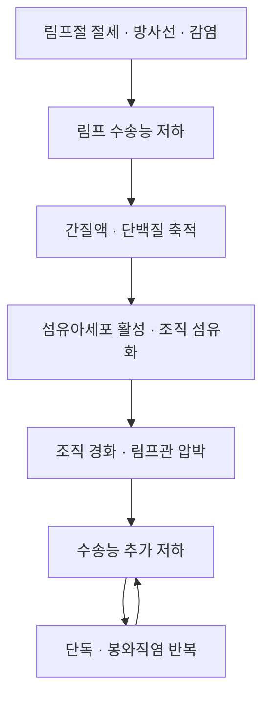

# 🩺 [[림프부종]] (Lymphedema, 淋巴浮腫 / ICD-10 I89.0)

> **핵심 3줄 요약 (Key Summary)**:
> - 📍 **병소 부위 & 병태생리**: [[림프관]] 수송능 < 간질액 생산량일 때 단백질이 풍부한 간질액이 축적된다. 유방암 액와 림프절 절제·방사선치료 후 상지에서 흔하고, 하지에서는 부인과 암 치료·필라리아증이 주원인.
> - 🚩 **전형적 임상 양상**: 단측 사지의 무거움·강직·부종, 손가락·발가락 등 피부주름이 소실되는 Stemmer 징후, 피부 섬유화·색소침착. 초기에는 거상 시 호전, 진행하면 비가역.
> - 🛠️ **핵심 감별 & 치료 전략**: 심부전·신증후군·DVT·정맥부전과 감별(양측성·함요부종이면 전신 원인 우선). 표준은 [[복합 감압요법]] — [[수기 림프드레나지]] + 다층 압박붕대 + 운동 + 피부관리.
> - ⚠️ **응급 의뢰 레드플래그**: 발열·발적·통증의 급성 악화(단독/봉와직염), 호흡곤란(유미흉·종격 침범), 갑작스러운 단측 종창(DVT 감별).

---

## 📌 목차
1. [질환 개요 & 병태생리](#1-질환-개요--병태생리)
2. [병태생리 메커니즘 & 악순환 네트워크](#2-병태생리-메커니즘--악순환-네트워크)
3. [임상 증상 & 환자 소견](#3-임상-증상--환자-소견)
4. [감별 진단 매트릭스](#4-감별-진단-매트릭스)
5. [한의 통합 치료 프로토콜](#5-한의-통합-치료-프로토콜)
6. [양방 치료 & 병용·의뢰 기준](#6-양방-치료--병용의뢰-기준)
7. [식이·생활습관 & 자가관리 티칭](#7-식이생활습관--자가관리-티칭)
8. [💡 진료실 핵심 필기 & 임상 노하우](#8--진료실-핵심-필기--임상-노하우)
9. [출처 및 학술 참고 문헌 (References)](#9-출처-및-학술-참고-문헌-references)

---

## 1. 질환 개요 & 병태생리

![[림프부종_01_상지병기_실사.jpg|440]]
> [그림 1: 상지 림프부종 Stage 1~4를 나란히 비교한 임상 실사 — 부종 범위와 피부 변화의 진행을 보여준다. 출처: Wikimedia Commons File:Upper limb lymphedema.jpg (CC BY-SA 4.0)]

* **정의**: [[림프계]]의 선천적·후천적 장애로 단백질이 풍부한 간질액이 조직에 축적되는 만성 질환. 국제림프학회(ISL)는 0기(무증상)부터 3기까지 임상 병기를 둔다.
* **분류**:
  * **원발성**: 림프관 형성 유전자 이상(밀크로이 병 등), 대개 하지·청소년기 발현.
  * **속발성**: 림프절 절제·방사선·종양 침범·감염(필라리아)·외상. 국내에서는 [[유방암]] 치료 후 상지 림프부종이 가장 흔하다.
* **역학**: [[유방암]] 생존자의 상당수가 치료 후 어느 시점에 림프부종을 경험하며, 액와 림프절 절제 범위·방사선 조사·비만이 주요 위험인자다.
* **관련 구조**: [[림프관]]·[[림프절]]·흉관, 그리고 [[부종]] 형성에 관여하는 정맥·모세혈관 여과 기전.

---

## 2. 병태생리 메커니즘 & 악순환 네트워크

![[림프부종_02_병리단계_도해.png|480]]
> [그림 2: 상단은 림프부종 Stage 0~III의 하지 임상 사진, 하단은 림프관 절제 후 수집 림프관의 병리 변화(정상 / 확장 / 수축 / 경화) 도해. 출처: Wikimedia Commons File:Pathological Steps of Cancer Related Lymphedema (CC BY-SA 4.0)]

### 1) 분자·세포 수준 기전
* 간질에 축적된 단백질이 삼투압을 올려 수분을 붙잡고, 대식세포·섬유아세포가 활성화되어 콜라겐 침착이 진행한다. 림프관 평활근 수축력이 떨어지면 림프 역류(dermal backflow)가 나타난다.
* 지방조직 증식이 동반되면 부종이 지방성으로 경화되어 보존 요법만으로는 줄지 않는다.

### 2) 장기·계통 수준 결과
* 반복되는 단독(erysipelas)이 섬유화를 가속하는 악순환이 핵심이다. 피부 장벽 관리가 곧 질환 조절이다.

### 3) 위험인자와 진행 단계
* 위험인자: 액와 림프절 절제 수, 방사선, 비만, 감염, 활동 저하.
* 진행: 0기(잠복) → 1기(거상 시 소실, 함요성) → 2기(거상에도 남음, 비함요) → 3기(림프정체성 섬유증, 사지 변형).

---

## 3. 임상 증상 & 환자 소견

![[림프부종_03_하지부종_실사.jpg|400]]
> [그림 3: 양측 하지 림프부종 환자의 종아리·발등 부종을 정면에서 촬영한 임상 실사 — 발등 부종과 피부 긴장이 관찰된다. 출처: Wikimedia Commons File:Lymphedema limbs.JPG (CC BY-SA 4.0)]

### 1) 주소증 및 핵심 증상
* 무거움·강직·통증·피로, 옷·시계·반지가 맞지 않음, 사지 둘레 차이.
* 초기에는 저녁에 심하고 아침에 가벼워지는 일중 변동을 보인다.

### 2) 객관적 소견 (Signs & Labs)
* **신체 소견**: Stemmer 징후(제2발가락 또는 손가락 기저부 피부를 집었을 때 주름이 잡히지 않음), Stemmer 징후 양성이면 림프부종 쪽으로 강하게 기운다.
* **측정**: 사지 둘레(5 cm 간격), 수분배제법(water displacement), 생체임피던스.
* **영상**: ICG 형광 림프영상이 초기 진단에서 림프신티그라피보다 우수하다는 보고가 있다(PMID 42332939).

![[림프부종_04_ICG림프영상.jpg|460]]
> [그림 4: 인도시아닌그린(ICG) 형광 림프영상 — DP(dermal backflow)와 SP(splash pattern) 화살표로 림프 역류·유출 양상을 표시. 출처: Wikimedia Commons File:Indocyanine Green (ICG) Lymphography … Upper Limbs1.jpg (CC BY-SA 4.0)]

### 3) 병기·중증도 판정
* ISL 0~3기 + 부피차 %로 판정. 3기 또는 반복 감염은 전문 림프부종 센터 의뢰.

---

## 4. 감별 진단 매트릭스

| 감별 질환 | 특징적 양상 | 감별 포인트 |
| :--- | :--- | :--- |
| [[림프부종]] | 단측, 발등·손등 포함, Stemmer 양성 | 림프영상, 병력(림프절 절제) |
| 심부정맥혈전증 | 갑작스러운 단측 종창·통증 | 도플러 초음파 |
| 만성 정맥부전 | 양측성, 색소침착·궤양 | 정맥 도플러, 병력 |
| 심부전·신증후군 | 양측성 함요부종 | BNP·단백뇨·전신 평가 |
| 지방부종(lipedema) | 양측성, 발등 침범 없음 | 압통, 가족력 |

> 🚩 **레드플래그**: 발열·발적·압통 급증은 단독/봉와직염 — 즉시 항생제. 호흡곤란은 유미흉·종격 병변 감별.

---

## 5. 한의 통합 치료 프로토콜

* **변증 분류**:
  * **기허습체(氣虛濕滯)**: 피로·무거움·함요부종 → 보기이수.
  * **습열(濕熱)**: 발적·발열·삼출 → 청열이습.
  * **어혈(瘀血)**: 경화·색소침착 → 활혈거어.
  * **비신양허(脾腎陽虛)**: 냉감·만성 부종 → 온양이수.
* **침구 치료**: 환측에 직접 자침·부항·사혈은 원칙적으로 피한다(감염 위험). 건측·몸통·하지 중심으로 배혈하고, 부종부는 경피 전기자극이나 가벼운 도수 접촉에 그친다.
* **약침**: 환측 상지 직접 주입은 금한다. 등·복부 배수혈 위주로 시행하되, 피부 소독을 엄격히 한다.
* **한약**: 변증별 이수·활혈 처방. 이뇨제 병용 시 탈수·전해질 이상을 확인한다.
* **뜸·부항**: 환측 직접 시술 금지. 온열요법은 화상 위험이 있어 감각 저하 환자에서 주의.

> ⚠️ **핵심 원칙**: 림프부종에서 침은 "주 치료"가 아니라 보조다. 표준 치료([[복합 감압요법]])를 대체한다고 환자에게 말해서는 안 된다.

---

## 6. 양방 치료 & 병용·의뢰 기준

* **표준 치료**: 1단계 집중기 — [[수기 림프드레나지]] + 다층 압박붕대 + 치료적 운동 + 피부관리를 주 5회 × 2~4주. 2단계 유지기 — 압박 슬리브(CCL 2, 23~32 mmHg) 착용 + 자가 관리.
* **자가 시행 근거**: 유방암 관련 림프부종 50명 비열등성 RCT에서 자가 시행군과 치료사 시행군의 부피 감소 차이가 없었고(각 −567.06 vs −568.24 cm³, p=0.988), 3개월 추적에서는 자가군이 추가 감소(−197.56 cm³)를 보였다(PMID 40329151).
* **수술**: 림프정맥문합술(LVA)·림프절 이식은 보존 치료 불응 시 선택. 비용효과 분석에서 보존 치료와의 비교가 진행 중이다(PMID 42161329).
* **의뢰 기준**: 3기 섬유화, 반복 단독, 보존 치료 2~4주에 반응 없음, 악성 종양 재발 의심.
* **한의 병용 판단**: 집중기에는 표준 치료를 우선하고 한약·침은 보조. 유지기에는 자가 관리 순응도를 높이는 역할이 크다.

---

## 7. 식이·생활습관 & 자가관리 티칭

* **식이**: 저염(나트륨 감량), 단백질 충분히, 체중 관리. "물을 적게 마신다"는 오해 — 수분 제한은 심부전 등 전신 원인이 있을 때만.
* **생활**: 환측 팔 혈압 측정·채혈·주사 최소화, 상처·곤충 물림 예방, 장갑 착용.
* **운동**: 압박붕대·슬리브 착용 상태에서 걷기·관절 가동범위 운동. 주 5회 빠른 걷기 30분부터.
* **자가관리**: 매일 사지 둘레·증상 NRS 기록, 피부 균열 확인.
* **환자 스크립트**: "붓는 것은 물만 고인 게 아니라 단백질이 조직에 남아 생기는 것입니다. 그래서 마사지·압박·운동을 매일 꾸준히 하는 것이 핵심이고, 팔에 상처가 나면 감염이 잘 생기니 특히 조심해야 합니다."

---

## 8. 💡 진료실 핵심 필기 & 임상 노하우

* **실전 문진**: ① 암 수술·방사선 병력(림프절 절제 범위) ② 부종 시작 시점·일중 변동 ③ 단독 병력 ④ 환측 혈압측정·채혈 습관 ⑤ 체중 변화.
* **측정 루틴**: 주 1회 5 cm 간격 둘레 + 증상 NRS(강직·무거움·통증·저림·피로). 3주 뒤 20% 미만 감소면 압박 압력·착용 시간·운동 순응도부터 점검.
* **한의원 운영 팁**: "3주 집중 + 자가 유지" 구조. 내원이 어려운 환자는 첫 1~2주 집중 교육 후 주 1회 점검으로 전환. 교육 없이 "집에서 하세요"는 이 프로토콜이 아니다.
* **주의**: 고령 당뇨 환자에서 말초동맥질환을 놓치면 압박이 허혈을 악화시킨다 — 발목상완지수(ABI) 확인.

---

## 9. 출처 및 학술 참고 문헌 (References)

1. **Gultekin SC, et al. (2025)**. *Self-administered versus lymphedema therapist-administered complex decongestive therapy protocol in breast cancer-related lymphedema: a non-inferiority randomized controlled trial with three-month follow-up*. **Breast Cancer Res Treat**, 212(1):123-138. [PMID 40329151](https://pubmed.ncbi.nlm.nih.gov/40329151/)
   - **[연구 요약]**: 50명 RCT — 3주간 부피 감소는 두 군 간 차이가 없었고(p=0.988), 3개월 추적에서는 자가군이 추가로 −197.56 cm³ 감소해 유지기 자가 관리의 우수성을 시사.
2. **Executive Committee of the International Society of Lymphology (2020)**. *The diagnosis and treatment of peripheral lymphedema: 2020 Consensus Document of the International Society of Lymphology*. **Lymphology**. [PMID 32521126](https://pubmed.ncbi.nlm.nih.gov/32521126/)
   - **[연구 요약]**: 림프부종의 진단·병기·복합 감압요법 표준을 정한 국제 합의문.
3. **Suami H, et al. (2026)**. *Enhancing Diagnostic Precision and Treatment Effectiveness Using Indocyanine Green Lymphography in Lymphedema*. **Ann Rehabil Med**. [PMID 42332939](https://pubmed.ncbi.nlm.nih.gov/42332939/)
   - **[연구 요약]**: ICG 림프영상이 림프부종의 진단 정밀도와 치료 계획 수립을 개선한다는 최신 고찰.
4. **Zhu N, et al. (2026)**. *Comparative effectiveness of non-surgical interventions and their combinations for the prevention of breast cancer-related lymphedema*. **Front Oncol**. [PMID 42835068](https://pubmed.ncbi.nlm.nih.gov/42835068/)
   - **[연구 요약]**: 유방암 관련 림프부종 예방에서 비수술적 중재 조합의 상대적 효과를 비교.
5. **Kleeven A, et al. (2026)**. *Economic evaluation of lymphaticovenous anastomosis versus conservative therapy for breast cancer-related lymphoedema*. **Br J Surg**. [PMID 42161329](https://pubmed.ncbi.nlm.nih.gov/42161329/)
   - **[연구 요약]**: 림프정맥문합술과 보존 치료의 비용효과를 비교한 2차 분석.
