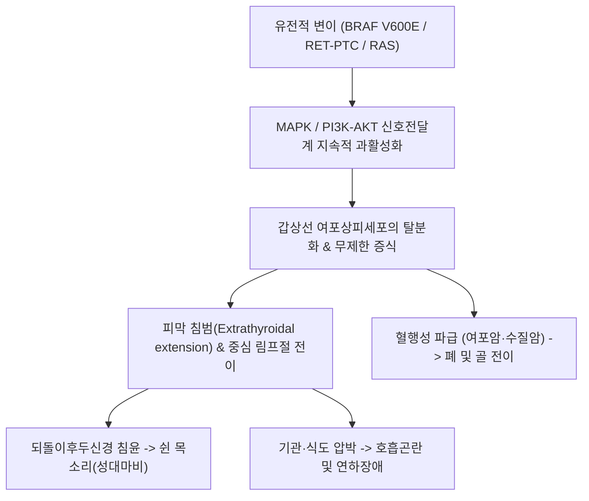

# 🩺 [[갑상샘 암]] (Thyroid Cancer / 甲狀腺癌)

> **핵심 3줄 요약 (Key Summary)**:
> - 📍 병소 부위 & 해부·병태생리: 갑상선 여포세포(Follicular cells) 또는 부여포 C세포(Parafollicular C-cells)에서 유래하는 악성 신생물로, BRAF V600E 변이, RET/PTC 재배열, RAS 돌연변이 등에 의해 MAPK/ERK 신호전달계가 과활성화되어 발생.
> - 🚩 전형적 임상 양상 & 3대 징후: 전경부(갑상선 부위)의 무통성 단단한 고정 결절, 되돌이후두신경(반회후두신경) 침범으로 인한 쉰 목소리(Hoarseness), 연하 곤란 및 경부 림프절 비대.
> - 🛠️ 핵심 감별 검사 & 한·양방 다각적 치료 전략: 경부 고해상도 초음파(K-TIRADS 등급 분류) 및 세침흡인세포검사(FNAC), 병기에 따른 수술(엽절제/전절제) 또는 저위험 미세유두암의 능동적 감시(Active Surveillance), 수술 후 방사성 요오드(RAI) 및 TSH 억제요법, 한의 암재활(기혈쌍보, 연견산결, 수술 후 피로·목소리 회복 침구 및 익기양음 한약).
> - ⚠️ 응급 의뢰 레드플래그: 최근 수주 사이에 결절이 폭발적으로 커지며 호흡 곤란 및 천명(Stridor)이 발생하는 미분화암(Anaplastic carcinoma) 의심 소견, 각혈 또는 척추 전이 의심 시 즉시 3차 암센터 응급 의뢰.

---

## 📌 목차
1. [질환 개요 & 해부학적 병태생리](#1-질환-개요--해부학적-병태생리)
2. [병태생리 메커니즘 & 생체역학적 악순환 네트워크](#2-병태생리-메커니즘--생체역학적-악순환-네트워크)
3. [임상 증상 & 이학적 검사(Physical Exam) 알고리즘](#3-임상-증상--이학적-검사physical-exam-알고리즘)
4. [감별 진단 매트릭스 (Differential Diagnosis)](#4-감별-진단-매트릭스--differential-diagnosis)
5. [한의 통합 치료 프로토콜 (침·약침·추나·한약)](#5-한의-통합-치료-프로토콜--침약침추나한약)
6. [양방 치료 & 병용·의뢰 기준 (Conventional Treatment & Referral)](#6-양방-치료--병용의뢰-기준-conventional-treatment--referral)
7. [재활 운동 & 생활습관 티칭 가이드](#7-재활-운동--생활습관-티칭-가이드)
8. [💡 사용자 진료실 핵심 필기 & 임상 노하우 (Melt-In 잔여 심화 집약)](#8--사용자-진료실-핵심-필기--임상-노하우--melt-in-잔여-심화-집약-)
9. [출처 및 학술 참고 문헌 (References)](#9-출처-및-학술-참고-문헌--references-)

---

## 1. 질환 개요 & 해부학적 병태생리

* **정의 및 조직학적 분류**:
  * 갑상선에서 발생하는 악성 종양으로, 조직 기원과 분화도에 따라 4가지 주요 유형으로 분류된다:
    1. **[[갑상선 유두암]](Papillary Thyroid Carcinoma, PTC)**: 전체 갑상선암의 85~90% 이상을 차지하며, 림프절 전이가 흔하나 성장 속도가 느리고 10년 생존율이 95% 이상으로 예후가 매우 양호함.
    2. **갑상선 여포암(Follicular Thyroid Carcinoma, FTC)**: 약 5~10%를 차지하며, 혈행성 전이(폐, 뼈) 경향을 보임.
    3. **갑상선 수질암(Medullary Thyroid Carcinoma, MTC)**: 약 2~3%로, 칼시토닌을 분비하는 C세포에서 유래하며 RET 원암유전자 돌연변이 및 다발성 내분비선종증(MEN 2)과 밀접함.
    4. **갑상선 미분화암(Anaplastic/Undifferentiated Carcinoma)**: 1~2% 미만이나, 침습성이 극히 강하고 전신 전이가 빨라 진단 후 중앙 생존기간이 수개월에 불과한 치명적 악성종양.
* **관련 해부학적 구조물**:
  * **되돌이후두신경(Recurrent Laryngeal Nerve)**: 기관과 식도 사이의 고랑을 지나 후두로 주행하며, 성대 운동을 담당함. 암세포가 후방으로 침범할 경우 성대 마비와 쉰 목소리를 유발함.
  * **부갑상선(Parathyroid Glands)**: 갑상선 후면에 4개가 위치하여 칼슘 대사를 조절함. 수술 시 손상되거나 절제되면 저칼슘혈증 및 손발 저림(테타니)이 초래됨.
  * **경부 림프절 체계**: 중심경부 림프절(Level VI) 및 외측경부 림프절(Level II~V)로 전이가 호발함.
* **역학 및 위험 인자**:
  * 여성에서 남성보다 약 3~4배 흔하며, 40~50대에 호발.
  * 소아기 두경부 방사선 노출력, 요오드 과다 또는 결핍, 갑상선암 가족력(FAP, Cowden 증후군 등)이 주요 위험 인자임.

---

## 2. 병태생리 메커니즘 & 생체역학적 악순환 네트워크

* **분자유전학적 발암 기전**:
  * **BRAF V600E 돌연변이**: 유두암 환자의 70~80%에서 발견되며, 요오드 섭취 유전자(NIS)의 발현을 억제하고 피막 외 침범 및 림프절 전이 위험도를 증가시킴.
  * **TERT 프로모터 돌연변이**: BRAF 변이와 동반될 경우 종양의 공격성과 재발률을 급격히 상승시키는 불량한 예후 인자임.
* **역학적 침윤 및 압박**:
  * 종양이 갑상선 피막을 뚫고 흉골갑상근, 기관(Trachea), 식도, 후두를 침범하여 구조적 변형과 기계적 폐쇄를 초래함.

---

## 3. 임상 증상 & 이학적 검사(Physical Exam) 알고리즘

* **주요 임상 증상**:
  * 대부분 무증상이며 건강검진 초음파에서 우연히 발견됨.
  * 진행 시: 전경부의 단단하고 불규칙한 종괴, 통증 없이 고정된 결절, 음성 변화(쉰 목소리), 음식물 삼킴 곤란, 호흡 곤란.
* **이학적 촉진 검사 (Physical Examination)**:
  * 환자의 뒤에 서서 양손 손가락으로 갑상선 협부 및 양측 엽을 촉진하며 침을 삼키게 함(침 삼킬 때 결절이 상하로 이동하는지 관찰).
  * 악성 의심 소견: 주변 조직에 고정되어 잘 움직이지 않음, 매우 단단한 석회화 감촉, 4cm 이상의 거대 결절, 동측 경부 림프절 종대.
* **영상 및 세포학적 검사 알고리즘**:
  * **경부 초음파(K-TIRADS 등급 분류)**:
    * **High Suspicion (K-TIRADS 5)**: 현저한 저에코(Marked hypoechoic), 미세석회화(Microcalcification), 침상/불규칙 경계(Spiculated margin), 비평행 방향(Taller-than-wide). 결절 크기 $\ge 1.0\,\mathrm{cm}$ (또는 고위험군 $0.5\,\mathrm{cm}$) 시 세침흡인생검(FNAC) 적응증.
  * **세침흡인세포검사 (FNAC - Bethesda System I~VI)**:
    * Category V(악성 의심), Category VI(악성 확진) 시 수술적 치료 고려.
  * **혈액 검사**: 혈청 TSH, Free T4 확인(기능 이상 동반 배제), 수질암 의심 시 칼시토닌(Calcitonin) 및 CEA 측정.

---

## 4. 감별 진단 매트릭스 (Differential Diagnosis)

| 질환 | 촉진 및 초음파 소견 | 세침흡인(FNAC) 소견 | 혈액학적 지표 및 경과 |
| :--- | :--- | :--- | :--- |
| **[[갑상샘 암]] (유두암 PTC)** | 단단하고 고정된 결절, K-TIRADS 5, 미세석회화 | 핵 봉입체(Nuclear pseudoinclusions), 핵 구(Grooves) | TSH 정상 범위, 서서히 진행 |
| **양성 갑상선 결절 (선종양 결절)** | 부드럽고 가동성 양호, 낭성 변화, 순수 고에코 | 양성 여포세포 군집, 풍부한 콜로이드 | 갑상선 기능 정상, 크기 변화 적음 |
| **하시모토 [[갑상선염]] (만성 림프구성)** | 미만성으로 단단하고 불규칙한 갑상선 종대 | 림프구 침윤, 휘르틀 세포(Hürthle cells) | 항TPO 항체 강양성, 무증상 혹은 [[갑상선 기능 저하증]] |
| **아급성 갑상선염 (드퀘르벵)** | 심한 전경부 압통 및 방사통, 저에코성 침윤 | 거대세포, 염증세포 | ESR/CRP 급상승, 초기 일시적 갑상선 중독증 |
| **갑상선 낭종 (단순 물혹)** | 파동감(Fluctuation) 있는 둥근 종괴, 순수 무에코 | 장액성/콜로이드성 액체 흡인 후 종괴 소실 | 완전 양성 질환 |

---

## 5. 한의 통합 치료 프로토콜 (침·약침·추나·한약)

* **치료 목표**:
  * 암 자체의 직접 치료는 수술 등 표준 치료를 원칙으로 하며, 한의 치료는 **수술 전후 전신 컨디션 회복, 수술 후 목 이물감 및 유착 완화, 방사성 요오드 치료 부작용 경감, 암성 피로 개선**에 집중함.
* **침구 치료**:
  * **수술 후 유착 증후군 및 후두 신경 마비 완화**:
    * [[천돌(CV22)]], [[인영(ST9)]], [[수돌(ST10)]], [[염천(CV23)]], [[예풍(TE17)]].
    * 목 전면 흉터 주변의 피하 천자 및 저주파 전침으로 성대 근육 및 후두 기능 회복 촉진.
  * **전신 면역 증진 및 암성 피로 개선**:
    * [[족삼리(ST36)]], [[음릉천(SP9)]], [[태충(LR3)]], [[합곡(LI4)]], [[백회(GV20)]].
* **약침 치료**:
  * **황련해독탕 약침 / 산삼 약침**:
    * 경부 림프 순환을 돕고 수술 후 만성 염증성 림프부종을 완화하기 위해 대추(GV14), 견정(GB21) 혈위에 주입.
* **추나 및 경부 연조직 근막 이완**:
  * **경부 림프 배액 및 근막 이완 기법**: 흉쇄유돌근(SCM), 설골하근육군(Omohyoid, Sternohyoid), 전사각근의 유착을 부드럽게 이완하여 연하 곤란과 목 조임감 해소.
* **변증 한약 처방**:
  * **담어응결(痰瘀凝結형 — 종양 진단 후 혹은 수술 후 목에 덩어리감, 이물감, 매핵기)**:
    * [[반하후박탕]] 합 해조옥호탕 가감: 연견산결(軟堅散結), 이기화담(理氣化痰).
  * **기음양허(氣陰兩虛형 — 수술 및 방사성 요오드 치료 후 극심한 피로, 구강 건조, 미열, 식은땀)**:
    * [[생맥산]] 합 [[보중익기탕]] 가 사삼, 맥문동, 현삼: 기와 진액을 보충하여 타액선 손상 완화.
  * **비신양허(脾腎陽虛형 — 갑상선 전절제 후 TSH 억제요법 중 대사 저하, 추위, 부종, 무력감)**:
    * 팔미지황탕 또는 향사육군자탕 가감: 신양(腎陽)을 북돋우고 수습(水濕)을 운화.

---

## 6. 양방 치료 & 병용·의뢰 기준 (Conventional Treatment & Referral)

* **수술적 치료 (Surgical Resection)**:
  * **갑상선 엽절제술(Lobectomy)**: 결절 크기 $\le 4\,\mathrm{cm}$이면서 피막 침범이 없고 반대측 엽 및 림프절 전이가 없는 저위험 유두암/여포암.
  * **갑상선 전절제술(Total Thyroidectomy)**: 종양 크기 $> 4\,\mathrm{cm}$, 다발성 병변, 명확한 피막 외 침범, 림프절 전이, 양측성 병변, 수질암 및 고위험 환자.
* **능동적 감시 (Active Surveillance)**:
  * 크기 $\le 1.0\,\mathrm{cm}$의 저위험 미세유두암(PTMC)에서 피막 침범, 림프절 전이, 기관/되돌이후두신경 인접이 없는 경우 즉각 수술 대신 6~12개월 간격의 정기 초음파 추적 관찰 권고.
* **수술 후 보조 요법**:
  * **방사성 요오드 치료(Radioactive Iodine Ablation, RAI, I-131)**: 전절제술 후 고위험/중간위험군 환자에서 잔여 갑상선 조직 및 미세 전이 병소 파괴.
  * **TSH 억제 요법(TSH Suppression Therapy)**: 고용량 레보티록신(Levothyroxine, 신지로이드)을 투여하여 TSH를 $< 0.1\,\mathrm{mU/L}$로 낮춤으로써 종양 재발 자극 차단.
* **한의 병용 시 주의사항**:
  * 방사성 요오드(RAI) 치료를 앞둔 환자는 치료 전 2주간 **저요오드 식이(Low-iodine diet)**를 철저히 지켜야 하므로, 다시마, 미역, 곤포, 해조류 성분이 포함된 한약 처방은 절대 금기.
* **상급 암센터 전원 기준**:
  * 초음파 상 K-TIRADS 4~5 결절 의심, FNAC 상 Bethesda V~VI 판정 시 외과/내분비내과 의뢰.
  * 급격한 크기 증가, 성대 마비 발생 시 지체 없이 3차 의료기관 전원.

---

## 7. 재활 운동 & 생활습관 티칭 가이드

* **갑상선 수술 후 목 스트레칭 (Neck Mobility Exercise)**:
  * 수술 1~2주 후 상처가 안정되면 가벼운 목 전후 굴곡, 좌우 회전, 어깨 으쓱하기 운동 시작.
  * 흉터 조직이 심부 근막과 유착되는 것을 막아 장기적인 목 조임감과 이물감 예방.
* **성대 재활 및 음성 티칭**:
  * 성대 부종이나 경미한 신경 손상 시 복식호흡을 통한 부드러운 발성 훈련, 헛기침 자제, 충분한 수분 섭취.
* **식단 및 영양 관리**:
  * 갑상선 전절제 환자는 평생 갑상선 호르몬제를 복용해야 하므로, 아침 공복에 약 복용 후 최소 30분~1시간 동안 음식물이나 칼슘/철분제 섭취를 금하여 흡수율 유지.

---

## 8. 💡 사용자 진료실 핵심 필기 & 임상 노하우 (Melt-In 잔여 심화 집약)

* **초음파 소견에서 악성을 시사하는 핵심 시각 패턴**:
  * 결절이 가로보다 세로가 더 길쭉한 모양(Taller-than-wide)이거나, 내부에 모래알처럼 뿌려진 점상 고에코(미세석회화)가 보이면 크기가 5mm 전후라도 반드시 상급병원 정밀 진료를 권유함.
* **갑상선 수술 후 '목에 가래가 낀 것 같다'는 호소의 실체**:
  * 수술 후 많은 환자가 기관 주변 유착 및 경부 설골하근육군의 단축으로 인해 기질적 가래가 없음에도 극심한 매핵기 증상을 호소함.
  * 이때 [[반하후박탕]]과 함께 흉골갑상근 부위 자침 및 흉쇄유돌근 근막 이완을 병행하면 환자의 만족도가 매우 뛰어남.
* **미세유두암(PTMC) 능동적 감시 환자의 멘탈 케어**:
  * "암을 떼어내지 않고 지켜본다"는 사실에 극심한 불안과 우울을 겪는 환자가 많음.
  * 유두암의 매우 완만한 자연경과를 의학적으로 설명하고 정기 추적을 독려하면서 안신(安神) 치료를 병행하는 것이 임상적으로 중요함.

---

## 9. 출처 및 학술 참고 문헌 (References)

* Lee MK, et al. (2026 Oct). Radiofrequency Ablation for Low-Risk T1N0M0 Papillary Thyroid Carcinoma: A Systematic Review and Meta-Analysis. *Korean J Radiol*. PMID: 42849890

* Schübel J, et al. (2025 Jun 27). Thyroid Nodules: Diagnosis and Treatment in Primary Care. *Dtsch Arztebl Int*. PMID: 40239048

* Lee JY, et al. (2024 Nov). Standardized Ultrasound Evaluation for Active Surveillance of Low-Risk Thyroid Microcarcinoma in Adults: 2024 Korean Society of Thyroid Radiology Consensus Statement. *Korean J Radiol*. PMID: 39473087

