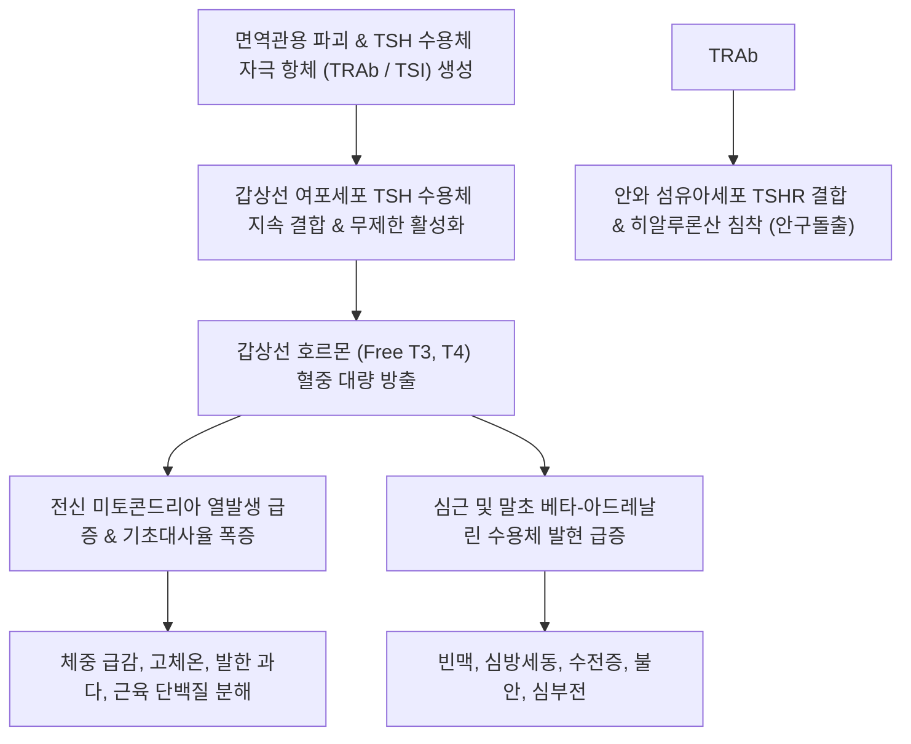

# 🩺 [[갑상선 기능 항진증]] (Hyperthyroidism / 甲狀腺機能亢進症, E05)

> **핵심 3줄 요약 (Key Summary)**:
> - 📍 병소 부위 & 해부·병태생리: 갑상선 여포세포에서 TSH 수용체 자극 항체([[TRAb]])의 지속 결합 또는 독성 선종에 의해 갑상선 호르몬($T_3, T_4$)이 과잉 합성·분비되어 전신 기초대사율 폭증 및 교감신경계 민감도 극대화.
> - 🚩 전형적 임상 양상 & 3대 징후: 식욕 증가에도 불구하고 급격한 체중 감소, 더위 불내성 및 발한 과다, 안정 시 심계항진 및 미세 손떨림([[수전증]]), 그레이브스병 안병증([[안구돌출증]]) 및 미만성 갑상선종.
> - 🛠️ 핵심 감별 검사 & 한·양방 다각적 치료 전략: 혈청 TSH 저하(<0.1 mIU/L) 및 Free $T_4$/$T_3$ 상승, 항갑상선제([[메티마졸]], PTU) 및 $eta$-차단제 투여, 한의 음허화왕·간화상염 변증에 따른 [[시호가용골모려탕]], [[안심택익탕]], [[천왕보심단]] 자음강화 치법.
> - ⚠️ 응급 의뢰 레드플래그 & 악화 요인: 감염·수술·외상 등으로 촉발되는 고열(>38.5℃)·중증 빈맥(>140회/분)·섬망·황달 및 울혈성 심부전을 동반한 갑상선 위기(Thyroid storm, Burch-Wartofsky 점수 고위험) 시 즉시 상급병원 응급실 전원.

---

## 📌 목차
1. [질환 개요 & 해부학적 병태생리](#1-질환-개요--해부학적-병태생리)
2. [병태생리 메커니즘 & 생체역학적 악순환 네트워크](#2-병태생리-메커니즘--생체역학적-악순환-네트워크)
3. [임상 증상 & 이학적 검사(Physical Exam) 알고리즘](#3-임상-증상--이학적-검사physical-exam-알고리즘)
4. [감별 진단 매트릭스 (Differential Diagnosis)](#4-감별-진단-매트릭스-differential-diagnosis)
5. [한의 통합 치료 프로토콜 (침·약침·추나·한약)](#5-한의-통합-치료-프로토콜-침약침추나한약)
6. [양방 치료 & 병용·의뢰 기준 (Conventional Treatment & Referral)](#6-양방-치료--병용의뢰-기준-conventional-treatment--referral)
7. [재활 운동 & 생활습관 티칭 가이드](#7-재활-운동--생활습관-티칭-가이드)
8. [💡 사용자 진료실 핵심 필기 & 임상 노하우 (Melt-In 잔여 심화 집약)](#8--사용자-진료실-핵심-필기--임상-노하우-melt-in-잔여-심화-집약)
9. [출처 및 학술 참고 문헌 (References)](#9-출처-및-학술-참고-문헌-references)

---

## 1. 질환 개요 & 해부학적 병태생리

* **질환 정의 및 개념 구분**:
  * **갑상선 기능 항진증(Hyperthyroidism)**: 갑상선 실질 자체에서 갑상선 호르몬($T_3, T_4$)이 과도하게 합성·분비되어 발생하는 병적 상태.
  * **갑상선중독증(Thyrotoxicosis)**: 갑상선염에 의한 일시적 호르몬 누출이나 외부 호르몬제 과량 복용을 포함하여, 원인에 관계없이 혈액 내 활성 갑상선 호르몬 농도가 상승하여 조직 독성이 유발된 전신 임상 증후군.
* **역학 및 호발군**:
  * 여성 유병률이 남성보다 5~10배 높으며, 30~50대에 호발함.
  * 전체 갑상선 기능 항진증의 60~80%가 자가면역 질환인 [[그레이브스병]](Graves' disease)에 기인함.
* **관련 해부학적 구조물**:
  * **갑상선 실질**: 후두 윤상연골 하부, 기관 전외측을 감싸는 좌우엽 및 협부(Isthmus).
  * **안와 결합조직**: 안와 외안근 및 후방 지방조직 (TSH 수용체 발현으로 안병증의 주 타깃).
  * **심근 및 골격근**: $eta$-아드레날린 수용체 밀도 증가로 인한 심근 수축력 및 심박수 과다 항진.

---

## 2. 병태생리 메커니즘 & 생체역학적 악순환 네트워크

* **자가면역 항체와 수용체 영구 활성화**:
  * 정상 상태에서는 뇌하수체 TSH가 음성 피드백을 통해 분비를 제어하나, 그레이브스병에서는 B림프구에서 생성된 TRAb가 TSH 수용체에 영구적으로 결합하여 피드백 기전을 완전히 무시하고 $T_3, T_4$를 무제한 생산한다.
* **$eta$-아드레날린 수용체 상향 조절(Up-regulation)**:
  * 갑상선 호르몬은 심장 및 신경계의 $eta$-아드레날린 수용체 수를 직접 늘려, 순환하는 카테콜라민 농도가 정상이라도 극심한 교감신경 흥분 상태(빈맥, 진전, 신경과민)를 유발한다.

---

## 3. 임상 증상 & 이학적 검사(Physical Exam) 알고리즘

### 1) 전형적 임상 증상 양상
* **대사항진 증상**: 식사량이 늘었음에도 수주~수개월 내 5~10kg 이상 급격한 체중 감소, 더위를 참지 못함, 땀이 비 오듯 쏟아짐.
* **심혈관계 및 신경계**: 가만히 있어도 심장이 쿵쾅거리는 [[두근거림]](심계항진, 분당 100회 이상), 손끝이 미세하게 떨리는 [[수전증]], 불면, 극도의 신경과민.
* **그레이브스병 특이 징후**:
  - 미만성 갑상선종(Goiter): 목 앞부분이 대칭적으로 커지며 청진 시 혈관 잡음(Bruit) 청취.
  - 안병증(Orbitopathy): [[안구돌출증]], 상안검 퇴축(Lid retraction), 안구 건조 및 복시.
  - 전경골 점액수종(Pretibial myxedema): 정강이 앞 피부의 오렌지 껍질 같은 비후.

### 2) 이학적 및 혈청학적 검사 알고리즘
1. **혈액 호르몬 검사 (1차 표준)**:
   - 혈청 TSH: $<0.01\sim0.1	ext{ mIU/L}$로 현저히 억제됨.
   - 혈청 Free $T_4$ 및 Total $T_3$: 정상치 상한을 초과하여 급증.
2. **자가항체 검사 (감별 확진)**:
   - TSH 수용체 항체([[TRAb]] / TSI): 그레이브스병 환자의 95% 이상에서 양성.
3. **방사성 요오드 섭취율([[RAIU]]) 및 갑상선 스캔**:
   - 미만성 균일 섭취 증가: 그레이브스병.
   - 국소 고섭취 결절(Hot nodule): 독성 선종(Toxic adenoma).
   - 섭취율 현저히 저하: 아급성 갑상선염, 산후 갑상선염(호르몬 누출).

---

## 4. 감별 진단 매트릭스 (Differential Diagnosis)

| 감별 질환 | TSH / Free T4 | TRAb 항체 | 방사성요오드 섭취율 (RAIU) | 경부 통증 및 특징 |
| :--- | :--- | :--- | :--- | :--- |
| **[[그레이브스병]]** | TSH 저하 / Free T4 상승 | **양성 (>95%)** | **미만성 균일 증가** | 통증 없음, 안구돌출 동반 |
| **[[아급성 갑상선염]]** | TSH 저하 / Free T4 상승 | 음성 | **현저히 저하 (<1%)** | **갑상선 부위 극심한 압통, 방사통** |
| **독성 다발 결절성 갑상선종** | TSH 저하 / Free T4 상승 | 음성 | 불균일한 패치상 섭취 | 노인 호발, 다발성 결절 촉지 |
| **인위적 갑상선중독증** | TSH 저하 / Free T4 상승 | 음성 | 0%에 근접, Thyroglobulin 저하 | 다이어트약/갑상선호르몬제 남용 |

---

## 5. 한의 통합 치료 프로토콜 (침·약침·추나·한약)

* **침구 치료 (Acupuncture)**:
  * **주요 혈위**: 인영(ST9, 갑상선 국소), 천돌(CV22), 내관(PC6), 신문(HT7), 태충(LR3), 족삼리(ST36), 삼음교(SP6), 풍지(GB20).
  * **자침 기법**: 인영혈 자침 시 총경동맥 박동부를 외측으로 밀고 갑상선 협부를 향해 얕게 사자(0.3~0.5촌)하여 갑상선 미세혈류 안정화.
* **약침 치료 (Pharmacopuncture)**:
  * **황련해독탕 약침**: 간화상염형의 번조, 상열감, 심계항진 환자의 풍지(GB20), 심유(BL15), 간유(BL18)에 0.2cc씩 분주.
  * **자하거 약침**: 만성 소모성 기음양허 환자의 신유(BL23), 족삼리(ST36)에 시술하여 체중 회복 도모.
* **한약 치료 (Herbal Medicine)**:
  * **간화상염·흉협고만형(가슴 답답함, 분노, 두통, 안구 충혈)**: [[시호가용골모려탕]](柴胡加龍骨牡蠣湯) 또는 [[단치소요산]](丹梔逍遙散) 가감.
  * **음허화왕·심계수전형(두근거림, 식은땀, 손떨림, 체중 감소)**: [[천왕보심단]](天王補心丹) 또는 [[안심택익탕]](安心澤翼湯) 가 하고초, 패모, 모려.
  * **경부 영류(癭瘤) 및 결절 축소**: 하고초, 패모, 모려, 곤포, 해조를 배오하여 연견산결(軟堅散結) 유도.

---

## 6. 양방 치료 & 병용·의뢰 기준 (Conventional Treatment & Referral)

* **3대 현대 표준 치료법**:
  1. **항갑상선제 (Antithyroid Drugs - 1차 선택)**:
     - **메티마졸([[Methimazole]])**: 10~30mg/일 투여하여 갑상선 과산화효소(TPO)를 차단, 호르몬 합성 억제 (국내 표준 1차 약제).
     - **프로필티오우라실(PTU)**: 100~300mg/일 (임신 1삼분기 또는 메티마졸 부작용 시 사용).
     - 증상 조절을 위해 $eta$-차단제(Propranolol 10~40mg 1일 3~4회) 초기 병용.
  2. **방사성 요오드 치료 (Radioactive Iodine, I-131)**:
     - 갑상선 여포세포를 방사선으로 선택 파괴; 수개월 후 대부분 영구적 갑상선기능저하증으로 이행.
  3. **수술 (갑상선 전절제술 / 아전절제술)**:
     - 갑상선종이 너무 크거나 안병증이 극심한 경우, 악성 종양 의심 결절 동반 시 시행.
* **한·양방 병용 안전 지침**:
  * 메티마졸 복용 환자에게 한약 병용 시 1시간 이상 복용 시차를 유지하며, 항갑상선제 임의 중단 금지 지도.
* **갑상선 위기(Thyroid Storm) 응급 전원 기준**:
  * 체온 $\ge 38.5^\circ	ext{C}$, 심박수 $\ge 140	ext{회/분}$, 섬망, 황달 발생 시 Burch-Wartofsky 점수 평가 후 즉시 상급병원 응급실 전원.
  * 항갑상선제 복용 중 고열 및 급성 인후통 발생 시(무과립구증 의심) 즉시 투약 중단 및 응급 혈액검사 의뢰.

---

## 7. 재활 운동 & 생활습관 티칭 가이드

* **고강도 운동 엄격 제한**:
  * 호르몬 수치가 정상화될 때까지 마라톤, 고강도 크로스핏 등 심근 부하 운동 전면 금지; 가벼운 산책과 스트레칭만 허용.
* **교감신경 자극 물질 차단**:
  * 커피, 카페인 음료, 에너지드링크, 알코올 완전 금기.
* **안구 보호 및 안병증 관리**:
  * 선글라스 착용으로 바람과 자외선 차단, 인공눈물 수시 점안, 취침 시 베개를 높여 안와 부종 예방.
  * **절대 금연 필수** (흡연은 안병증 악화 위험을 4배 이상 높임).

---

## 8. 💡 사용자 진료실 핵심 필기 & 임상 노하우 (Melt-In 잔여 심화 집약)

* **무과립구증(Agranulocytosis) 골든타임 경고 (0.2~0.5% 빈도)**:
  * 항갑상선제 복용 초기 3개월 내에 발생하는 가장 위험한 부작용.
  * **환자 필수 티칭 문장**: *"약을 드시다가 갑자기 38도 이상의 고열이 나거나 목구멍이 찢어질 듯이 아픈 인후통이 생기면, 감기약으로 버티지 마시고 즉시 약을 중단하고 가까운 병원에 가셔서 백혈구(CBC) 수치 검사를 받으셔야 합니다."*
* **임산부 항갑상선제 선택 공식**:
  * 임신 1삼분기(12주까지): 메티마졸의 태아 두피결손 기형 위험으로 **PTU 우선**.
  * 임신 2~3삼분기: PTU의 간독성 위험을 피해 **메티마졸로 전환**.
* **안심택익탕(安心澤翼湯)의 자율신경 안정 효과**:
  * 메티마졸로 호르몬 수치는 정상화되었으나 여전히 손떨림, 가슴 두근거림, 불안, 식은땀을 호소하는 환자에게 생지황, 현삼, 맥문동, 산조인, 하고초로 구성된 안심택익탕을 투여하면 잔여 교감신경 과항진을 완벽하게 진정시킬 수 있음.

---

## 9. 출처 및 학술 참고 문헌 (References)

- Ross DS. (2016). 2016 American Thyroid Association Guidelines for Diagnosis and Management of Hyperthyroidism and Other Causes of Thyrotoxicosis. *Thyroid*. 26(10):1343-1421. PMID: 27521067.

- Kahaly GJ. (2018). 2018 European Thyroid Association Guideline for the Management of Graves Hyperthyroidism. *Eur Thyroid J*. 7(4):167-186. PMID: 30283735.

- De Leo S. (2016). Hyperthyroidism. *Lancet*. 388(10047):906-918. PMID: 27038492.
