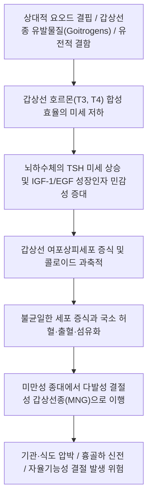

# 🩺 [[단순 비독성 고이터]] (Simple Non-toxic Goiter / 單純性非毒性甲狀腺腫)

> **핵심 3줄 요약 (Key Summary)**:
> - 📍 병소 부위 & 해부·병태생리: 갑상선 기능(TSH, Free T4)이 정상이고 염증이나 종양성 악화 없이 갑상선 실질이 미만성(Diffuse) 또는 다발성 결절성(Multinodular)으로 비대해지는 양성 내분비 질환.
> - 🚩 전형적 임상 양상 & 3대 징후: 통증 없는 전경부의 점진적 팽대 및 돌출, 칼라나 목걸이 착용 시 답답함, 크기 증가 시 앙와위(누운 자세) 호흡 곤란 및 연하 이물감.
> - 🛠️ 핵심 감별 검사 & 한·양방 다각적 치료 전략: 갑상선 기능 검사(TFT, TSH 정상 확인) 및 경부 초음파(악성 결절 감별), 증상이 없는 경우 경과 관찰, 압박 증상 시 엽절제/전절제술 또는 고주파절제술(RFA)·동맥색전술, 한의 이기소담(理氣消痰)·연견산결(軟堅散結) 침구(인영, 기사, 수돌, 천돌) 및 소간해울 한약(해조옥호탕, 소요산, 반하후박탕).
> - ⚠️ 응급 의뢰 레드플래그: 흉골하 갑상선종(Retrosternal goiter)으로 인한 급성 기관 압박 및 상대정맥 증후군(Pemberton 징후 양성: 양팔을 올릴 때 안면 충혈 및 호흡곤란), 성대 마비 발생 시 즉시 내분비외과 응급 의뢰.

---

## 📌 목차
1. [질환 개요 & 해부학적 병태생리](#1-질환-개요--해부학적-병태생리)
2. [병태생리 메커니즘 & 생체역학적 악순환 네트워크](#2-병태생리-메커니즘--생체역학적-악순환-네트워크)
3. [임상 증상 & 이학적 검사(Physical Exam) 알고리즘](#3-임상-증상--이학적-검사physical-exam-알고리즘)
4. [감별 진단 매트릭스 (Differential Diagnosis)](#4-감별-진단-매트릭스--differential-diagnosis)
5. [한의 통합 치료 프로토콜 (침·약침·추나·한약)](#5-한의-통합-치료-프로토콜--침약침추나한약)
6. [양방 치료 & 병용·의뢰 기준 (Conventional Treatment & Referral)](#6-양방-치료--병용의뢰-기준-conventional-treatment--referral)
7. [재활 운동 & 생활습관 티칭 가이드](#7-재활-운동--생활습관-티칭-가이드)
8. [💡 사용자 진료실 핵심 필기 & 임상 노하우 (Melt-In 잔여 심화 집약)](#8--사용자-진료실-핵심-필기--임상-노하우--melt-in-잔여-심화-집약-)
9. [출처 및 학술 참고 문헌 (References)](#9-출처-및-학술-참고-문헌--references-)

---

## 1. 질환 개요 & 해부학적 병태생리

* **정의 및 핵심 병태**:
  * 단순 비독성 고이터(Simple Non-toxic Goiter, 정상기능 갑상선종)는 **혈청 갑상선 호르몬 수치가 정상 범위(Euthyroid)를 유지**하면서, 자가면역 갑상선염이나 악성 종양이 없음에도 불구하고 갑상선 전체가 비정상적으로 비대해지는 질환이다.
  * 초기에는 여포의 균일한 증식으로 인한 **미만성 갑상선종(Diffuse goiter)** 형태를 띠다가, 수년~수십 년에 걸쳐 반복적인 증식과 퇴행 과정을 겪으며 다발성 결절성 갑상선종(Multinodular goiter, MNG)으로 발전한다.
* **관련 해부학적 구조물**:
  * **갑상선 실질(Thyroid Parenchyma)**: 기관 연골의 2~4번째 고리 전외측에 위치하며, 협부와 좌우 양엽으로 구성됨. 성인의 정상 갑상선 용적은 약 15~20mL이나, 고이터 환자에서는 수십~수백 mL까지 거대화됨.
  * **기관 및 식도 (Trachea & Esophagus)**: 갑상선 후면에 접해 있어 종대가 진행되면 기관 내강이 좁아지거나(기관 협착) 식도가 압박됨.
  * **상대정맥(Superior Vena Cava) 및 흉곽 유입구(Thoracic Inlet)**: 거대 갑상선종이 흉골 후방(Retrosternal)으로 자라나 흉곽 유입구를 폐쇄하면 정맥 환류 장애가 초래됨.
* **역학 및 위험 인자**:
  * 여성에서 남성보다 약 3~5배 흔하며, 사춘기, 임신, 폐경 등 호르몬 변동기에 호발.
  * **지방병성 갑상선종(Endemic goiter)**: 토양과 식수에 요오드가 결핍된 산간 지역에서 주민의 10% 이상이 이환.
  * **산발성 갑상선종(Sporadic goiter)**: 요오드가 충분한 지역에서 유전적 소인, 갑상선종 유발물질(Goitrogens, 양배추/카사바의 티오시아네이트), 흡연, 스트레스 등에 의해 발생.

---

## 2. 병태생리 메커니즘 & 생체역학적 악순환 네트워크

* **보상적 증식 메커니즘**:
  * 갑상선 호르몬 합성 과정의 경미한 장애가 발생하면 뇌하수체-갑상선 음성 되먹임 축에 의해 TSH 분비가 미세하게 증가한다.
  * TSH와 국소 갑상선 성장인자(IGF-1, FGF)들이 여포세포를 자극하여 갑상선 질량을 늘림으로써 정상 호르몬 수치를 유지하는 보상성 적응 반응이다.
* **구조적 변형 및 생체역학적 압박**:
  * 시간이 지남에 따라 일부 여포 세포군은 자율적인 증식 능력을 획득하고, 혈관 신생 불균형으로 국소 출혈 및 낭성 변성이 반복되어 비가역적인 결절들이 형성된다.

---

## 3. 임상 증상 & 이학적 검사(Physical Exam) 알고리즘

* **주요 임상 증상**:
  * **미용적 문제 및 목 부위 팽대**: 목이 두꺼워져 옷깃 단추가 잠기지 않음.
  * **국소 압박 증상**:
    * 누웠을 때 목이 졸리는 느낌이나 숨쉬기 답답함(앙와위 호흡곤란).
    * 삼킴 곤란(식도 압박), 잦은 마른기침(기관 자극).
    * 매우 드물게 반회후두신경 견인에 의한 쉰 목소리.
* **이학적 검사 및 진단 징후**:
  * **갑상선 촉진(Palpation)**: 양측 엽의 대칭적 비대(미만성) 또는 다발성 결절 촉지. 압통은 전혀 없는 것이 특징.
  * **펨버턴 징후 (Pemberton's Sign)**:
    * 환자의 양팔을 머리 위로 완전히 들어 올려 귀에 밀착시키고 1분간 유지하게 함.
    * 흉골하 갑상선종이 흉곽 유입구를 기계적으로 막아 상대정맥을 압박하면 안면 홍조, 청색증, 경정맥 노창, 천명이 유발됨(양성 시 즉각적인 수술 적응증).
* **영상 및 혈액학적 진단 알고리즘**:
  * **갑상선 기능 검사 (TFT)**: 혈청 TSH, Free T4 정상 확인(비독성 확진).
  * **자가항체 검사**: 항TPO 항체, 항티로그로불린 항체 음성(하시모토 갑상선염 배제).
  * **경부 초음파(Thyroid US)**: 결절의 낭성/고형 성상 확인, K-TIRADS 등급 분류로 악성 결절 동반 여부 스크리닝.
  * **경부 및 흉부 CT**: 흉골하 신전(Retrosternal extension) 정도 및 기도 압박률 평가.

---

## 4. 감별 진단 매트릭스 (Differential Diagnosis)

| 감별 질환 | 갑상선 기능 (TFT) | 촉진 소견 및 통증 | 자가항체 및 초음파 소견 |
| :--- | :--- | :--- | :--- |
| **[[단순 비독성 고이터]]** | 정상 (Euthyroid) | 무통성 미만성 비대 또는 다발 결절 | 자가항체 음성, 전반적 실질 증식 및 콜로이드 낭종 |
| **[[그레이브스병]] (독성 미만성 갑상선종)** | 기능 항진 (TSH 저하, FT4 상승) | 미만성 종대, 혈관 잡음(Bruit) | TSH 수용체 항체(TRAb) 강양성, 안구돌출증 동반 |
| **독성 다결절성 갑상선종 (Plummer 병)** | 기능 항진 또는 불현성 항진 | 다발성 불규칙 결절 | 방사성 동위원소 스캔 상 열결절(Hot nodules) 확인 |
| **하시모토 [[갑상선염]]** | 초기 정상 -> 점진적 기능 저하 | 단단하고 고무 같은 감촉, 무통 | 항TPO 항체 강양성, 초음파 상 불균일한 저에코성 실질 |
| **아급성 갑상선염** | 초기 일시적 항진 -> 회복 | 심한 자발통 및 방사통, 고열 | ESR/CRP 현저한 상승, 바이러스 감염 후 발병 |
| **[[갑상샘 암]] (악성 종양)** | 대개 정상 | 매우 단단하고 주변에 고정된 단일 결절 | K-TIRADS 5 고위험 소견, FNAC 악성 세포 확인 |

---

## 5. 한의 통합 치료 프로토콜 (침·약침·추나·한약)

* **한의학적 질환명 및 병기**:
  * 한의학에서 갑상선종은 **영류(癭瘤)**, 특히 **기영(氣癭)**이나 **육영(肉癭)**의 범주에 속함. 간기울결(肝氣鬱結)로 인해 기가 뭉치고 담음(痰飮)이 응결하여 경부에 적취를 형성하는 것으로 파악함.
* **침구 치료**:
  * **선혈 원칙**: 소간해울(疏肝解鬱), 화담연견(化痰軟堅), 행기소종(行氣消腫).
  * **국소 혈위**: [[인영(ST9)]], [[수돌(ST10)]], [[기사(ST11)]], [[천돌(CV22)]], [[예풍(TE17)]].
    * 인영·수돌은 총경동맥 박동을 피해 내측으로 완만하게 자침하여 국소 미세혈류 순환 촉진.
  * **원위 원락 배혈**: [[태충(LR3)]], [[합곡(LI4)]], [[족삼리(ST36)]], [[풍륭(ST40)]], [[내관(PC6)]], [[삼음교(SP6)]].
* **약침 요법**:
  * **황련해독탕 약침 / 중성어혈 약침**:
    * 견정(GB21), 대추(GV14), 인영(ST9) 부위에 0.1~0.2cc씩 시술하여 경부 림프 울체를 개선하고 결절 주변의 미세 염증 환경 완화.
* **추나 및 경부 연조직 근막 이완**:
  * **경추 및 설골 근막 이완술**: 갑상선종대로 인해 긴장된 흉쇄유돌근(SCM)과 설골근막을 부드럽게 이완하여 목 이물감 및 삼킴 곤란을 경감시킴.
* **변증 한약 처방**:
  * **간울기체·담습응결(肝鬱氣滯·痰濕凝結형 — 스트레스 시 목이 더 부풀고 답답함, 매핵기, 흉협고만)**:
    * [[해조옥호탕]](海藻玉壺湯) 합 [[반하후박탕]]: 해조, 곤포, 다시마, 패모, 진피, 청피, 반하, 복령, 후박. 기를 통하게 하고 굳은 담을 녹여 영류를 축소시킴(단, 자가항체 양성 여부 사전 확인).
  * **간화울결·기혈어체(肝火鬱結·氣血瘀滯형 — 가슴 답답함, 상열감, 설하정맥 노창, 단단한 결절)**:
    * [[소요산]] 가 하고초(夏枯草), 현삼, 패모: 하고초는 갑상선 종대와 림프절 비대에 탁월한 소종산결(消腫散結) 요약.
  * **비허습담(脾虛濕痰형 — 비만, 전신 부종, 식후 나른함, 소화불량 동반)**:
    * [[육군자탕]] 가 남성, 지실, 향부자.

---

## 6. 양방 치료 & 병용·의뢰 기준 (Conventional Treatment & Referral)

* **비약물적 경과 관찰 (Observation)**:
  * 무증상이며 악성 의심 결절이 없는 소형 비독성 갑상선종은 치료 없이 1~2년 간격의 TFT 및 초음파 추적 관찰이 표준 지침임.
* **약물 치료의 한계 (과거 TSH 억제요법의 퇴출)**:
  * 과거에는 결절 크기를 줄이기 위해 레보티록신(신지로이드)을 투여하는 TSH 억제 요법을 널리 시행했으나, 최근 대규모 연구 결과 크기 감소 효과는 미미한 반면 골다공증 및 심방세동 등 부작용 위험이 높아 **단순 비독성 고이터 치료 목적으로는 권고되지 않음**.
* **수술 및 중재적 시술 적응증**:
  * **갑상선 절제술 (엽절제 또는 아전절제술)**:
    * Pemberton 징후 양성인 흉골하 갑상선종.
    * 기관 직경이 30% 이상 좁아진 심각한 기도 폐쇄 증상.
    * 급속히 자라는 결절로 악성을 배제할 수 없는 경우.
  * **비수술적 최소 침습 시술**:
    * **고주파절제술(RFA)**: 양성 증상성 결절의 크기를 50~80% 이상 비침습적으로 축소.
    * **갑상선동맥 색전술(Thyroid Artery Embolization, TAE)**: 거대 고이터 환자 중 수술 고위험군에서 대안적 혈류 차단 시술.
* **한의 병용 시 주의사항 및 금기**:
  * 요오드가 풍부한 해조, 곤포 등의 본초는 지방병성 고이터(요오드 결핍)에는 유효하나, 요오드가 과잉인 한국의 일상 식단에서는 과다 투여 시 오히려 볼프-차이코프 효과(Wolff-Chaikoff effect)로 인한 일시적 저하증이나 요오드-바세도우 현상(Jod-Basedow effect)으로 갑상선 기능 항진증을 유발할 수 있으므로 3개월 이상 장기 연속 투여는 지양함.
* **내분비내과 및 외과 의뢰 기준**:
  * 초음파 상 악성 의심 결절 발견 시 FNAC 위해 의뢰.
  * 급격한 호흡 곤란, 연하 장애 발생 시 외과적 수술 평가 의뢰.

---

## 7. 재활 운동 & 생활습관 티칭 가이드

* **경부 자세 교정 및 호흡 훈련**:
  * 거북목 자세는 흉곽 유입구의 공간을 좁혀 갑상선종으로 인한 압박 증상을 악화시킴. 턱 당기기(Chin-tuck) 운동 및 흉곽 신전 운동 생활화.
* **식습관 및 식이 관리**:
  * 한국인은 김, 미역, 다시마 등을 통해 이미 충분한 요오드를 섭취하므로, 요오드 보충제를 임의로 과다 섭취하지 말 것.
  * 양배추, 브로콜리, 케일 등 십자화과 채소에 포함된 고이트로겐(Goitrogen) 성분은 열을 가해 조리하면 불활성화되므로 익혀서 섭취할 것을 지도.
* **목 압박 회피**:
  * 목을 조이는 넥타이나 깃이 좁은 옷을 피하고, 수면 시 적절한 높이의 베개를 사용하여 기도를 확보.

---

## 8. 💡 사용자 진료실 핵심 필기 & 임상 노하우 (Melt-In 잔여 심화 집약)

* **갑상선종 환자의 '목 답답함' 3대 감별 포인트**:
  1. 기계적 압박: 누우면 더 심해지고 실제로 숨소리에 쌕쌕거림이 있음 -> 영상 검사 필수.
  2. [[매핵기]](Globus pharyngeus): 침 삼킬 때는 걸리지만 음식물 넘길 때는 잘 넘어가고 감정 상태에 따라 변동함 -> [[반하후박탕]] 주효.
  3. 역류성 식도염: 신물 넘어옴, 식후 심해짐 -> 제산·사역산 계열 고려.
* **하고초(夏枯草)의 다각적 활용 가치**:
  * 비독성 갑상선종이나 양성 결절 환자에게 하고초 12~15g을 차처럼 달여 마시게 하거나 처방에 군약으로 배오할 때, 목의 팽만감과 결절의 단단함이 부드러워지는 임상적 경향을 다수 확인.
* **초음파 추적 관찰 시 결절 크기 변화 기록의 중요성**:
  * 양성 비독성 고이터라 하더라도 결절의 직경이 1년에 20% 이상(또는 2mm 이상) 증가하는지 여부를 정기적으로 체크하여 악성화 변화를 놓치지 않아야 함.

---

## 9. 출처 및 학술 참고 문헌 (References)

* Papini E, et al. (2025 Jan). Thyroid hormones for euthyroid patients with simple goiter growing over time: a survey of European thyroid specialists. *Endocrine*. PMID: 39217207

* Lee W, et al. (2026 Apr 6). Risk of post-contrast thyroid dysfunction in non-toxic goiter: a matched cohort study. *Eur J Endocrinol*. PMID: 42012254

* Kucukay F, et al. (2026 Sep). Thyroid Artery Embolization for Benign Symptomatic Multinodular Euthyroid Goiter: 24-Month Outcomes from a Single-Center Retrospective Study. *J Vasc Interv Radiol*. PMID: 42217823

