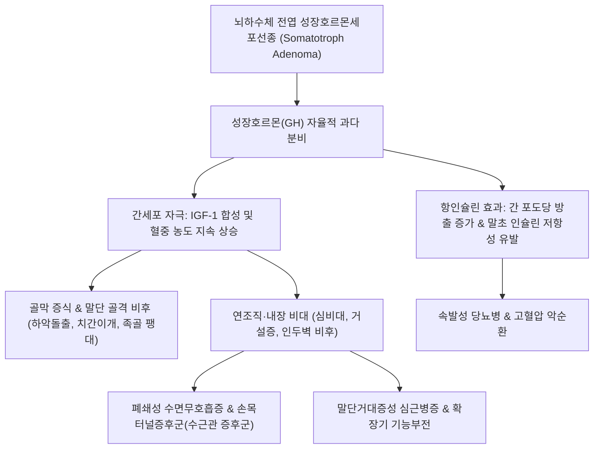

# 🩺 [[거인증 및 말단거대증]] (Acromegaly & Gigantism / 巨人症 및 末端肥大症)

> **핵심 3줄 요약 (Key Summary)**:
> - 📍 병소 부위 & 해부·병태생리: 뇌하수체 전엽 성장호르몬 분비세포선종(Somatotroph Adenoma)에서 성장호르몬(GH) 및 간세포 인슐린유사성장인자-1(IGF-1)이 만성 과다 분비되어 골단선 폐쇄 전에는 거인증(Gigantism), 폐쇄 후에는 말단거대증(Acromegaly)을 유발하는 내분비 대사 질환.
> - 🚩 전형적 임상 양상 & 3대 징후: 손·발 크기 증가(반지·신발 치수 증가), 두개안면부 골격 변화(하악 돌출, 이마 융기, 치간 이개), 연조직 비대(혀 비대, 거설증, 피부 비후, [[수면무호흡증]]).
> - 🛠️ 핵심 감별 검사 & 한·양방 다각적 치료 전략: 혈청 IGF-1 측정 및 경구 포도당 부하 검사(OGTT GH 억제 검사), 터키안 뇌 자기공명영상(Sella MRI), 경접형동 접근 수술(TSS) 및 소마토스타틴 수용체 작용제(Octreotide, Lanreotide)·GH 수용체 길항제(Pegvisomant), 한의 전신 대사조절 침구 및 보음청열(滋陰淸熱)·활혈거담 한약.
> - ⚠️ 응급 의뢰 레드플래그: 거대선종의 안장 상부 신전으로 인한 시신경교차 압박(양이측반맹, Bitemporal hemianopsia), 뇌하수체 졸중(Pituitary Apoplexy: 급성 벼락 두통, 시력 상실, 안구운동마비), 심근병증 및 악성 심실부정맥 발생 시 즉시 신경외과/내분비내과 응급 의뢰.

---

## 📌 목차
1. [질환 개요 & 해부학적 병태생리](#1-질환-개요--해부학적-병태생리)
2. [병태생리 메커니즘 & 생체역학적 악순환 네트워크](#2-병태생리-메커니즘--생체역학적-악순환-네트워크)
3. [임상 증상 & 이학적 검사(Physical Exam) 알고리즘](#3-임상-증상--이학적-검사physical-exam-알고리즘)
4. [감별 진단 매트릭스 (Differential Diagnosis)](#4-감별-진단-매트릭스--differential-diagnosis)
5. [한의 통합 치료 프로토콜 (침·약침·추나·한약)](#5-한의-통합-치료-프로토콜--침약침추나한약)
6. [양방 치료 & 병용·의뢰 기준 (Conventional Treatment & Referral)](#6-양방-치료--병용의뢰-기준-conventional-treatment--referral)
7. [재활 운동 & 생활습관 티칭 가이드](#7-재활-운동--생활습관-티칭-가이드)
8. [💡 사용자 진료실 핵심 필기 & 임상 노하우 (Melt-In 잔여 심화 집약)](#8--사용자-진료실-핵심-필기--임상-노하우--melt-in-잔여-심화-집약-)
9. [출처 및 학술 참고 문헌 (References)](#9-출처-및-학술-참고-문헌--references-)

---

## 1. 질환 개요 & 해부학적 병태생리

* **정의 및 핵심 병태**:
  * 성장호르몬(Growth Hormone, GH)의 자율적이고 조절되지 않는 과다 분비로 인해 전신 조직과 골격이 과도하게 증식하는 희귀 만성 내분비 질환이다.
  * **골단선 폐쇄 전(소아·청소년기)** 발병 시 장골의 길이 성장이 폭발적으로 증가하여 신장이 비정상적으로 커지는 **거인증(Gigantism)**이 유발된다.
  * **골단선 폐쇄 후(성인기)** 발병 시 길이 성장은 멈추었으나 말단골의 막성 골화(Membranous bone formation)와 연조직 비후가 지속되어 얼굴, 손, 발, 내부 장기가 비대해지는 **말단거대증(Acromegaly)**이 발생한다.
* **관련 해부학적 구조물**:
  * **터키안(Sella Turcica) 및 뇌하수체 전엽**: 대부분(98% 이상) 양성 뇌하수체 선종(Pituitary Adenoma)에 의해 발생하며, 이 중 70% 이상이 진단 시 직경 10mm를 초과하는 거대선종(Macroadenoma)이다.
  * **시신경교차(Optic Chiasm)**: 터키안 직상부에 위치하여 선종이 상방으로 자라날 때 압박되어 시야 결손을 유발함.
  * **간(Liver) 및 표적 장기**: GH 자극에 반응하여 인슐린유사성장인자-1(Insulin-like Growth Factor-1, IGF-1)을 대량 합성 및 분비함.
* **역학 및 진단 지연**:
  * 인구 100만 명당 연간 약 3~4명이 발생하며, 발병 연령은 평균 40대 전후이다.
  * 임상 증상이 수년~10년에 걸쳐 극히 서서히 진행되므로 초기 발견이 어렵고 진단까지 평균 5~10년이 지연된다.

---

## 2. 병태생리 메커니즘 & 생체역학적 악순환 네트워크

* **대사 및 분자 기전**:
  * GH는 지방분해를 촉진하고 근육과 지방의 포도당 섭취를 억제하는 강력한 대항호르몬(Counter-regulatory hormone)으로 작용하여 고인슐린혈증 및 2차성 2형 당뇨병을 유발한다.
  * IGF-1은 세포 분열(Mitogenesis)과 항세포사멸(Anti-apoptosis)을 촉진하여 피부 섬유아세포 증식, 장점막 폴립(대장암 위험 증가), 갑상선 결절 비대를 유도한다.
* **심혈관계 및 생체역학적 악순환**:
  * 심근세포 비대와 간질 섬유화로 심실 재형성이 유발되고, 인두 연조직 비후에 의한 수면무호흡증이 심근 저산소증을 가중시켜 심부전 및 조기 사망 위험을 2~3배 상승시킨다.

---

## 3. 임상 증상 & 이학적 검사(Physical Exam) 알고리즘

* **특징적 외모 및 골격 변화**:
  * 안면부: 이마 전두골 융기(Frontal bossing), 눈썹활 돌출, 코와 입술의 비후, 하악 전돌증(Prognathism), 아랫니 벌어짐(치간 이개), 부정교합.
  * 사지: 손가락이 소시지처럼 굵어지고 손발바닥 피부가 두꺼워짐(반지가 맞지 않고 구두 치수가 늘어남).
* **전신 및 대사 증상**:
  * 과도한 발한(Hyperhidrosis, 땀에서 특유의 냄새), 지루성 피부, 다발성 피부 연성 섬유종(Skin tags).
  * 관절통(골관절염) 및 [[수근관 증후군]](정중신경 포착에 의한 양측 손저림).
  * 성욕 감퇴, 발기부전, 월경 불순(고프로락틴혈증 동반 또는 선종에 의한 정상 성선자극세포 압박).
* **진단 및 선별 검사 알고리즘**:
  1. **혈청 IGF-1 측정 (1차 선별 검사)**: 연령 및 성별 대조군 대비 유의미한 상승 확인(GH는 박동성 분비로 단독 측정 부적합).
  2. **경구 포도당 부하 GH 억제 검사 (OGTT 75g, 확진 검사)**: 정상인은 포도당 부하 후 GH가 $1.0\,\mu\mathrm{g/L}$ 미만(정밀 검사 시 $< 0.4\,\mu\mathrm{g/L}$)으로 억제되나, 말단거대증 환자는 억제되지 않음.
  3. **뇌 안장 자기공명영상 (Sella MRI)**: 조영증강 뇌하수체 MRI를 통해 선종의 크기, 해면정맥동(Cavernous sinus) 침범, 시신경교차 압박 유무 평가.
  4. **시야 검사 (Goldmann/Humphrey Perimetry)**: 양이측반맹 여부 확인.

---

## 4. 감별 진단 매트릭스 (Differential Diagnosis)

| 질환 | GH / IGF-1 수치 | OGTT 후 GH 억제 | 터키안 MRI 소견 | 임상 감별점 |
| :--- | :--- | :--- | :--- | :--- |
| **[[거인증 및 말단거대증]]** | GH 상승, IGF-1 현저한 상승 | 억제 실패 ($\ge 1.0\,\mu\mathrm{g/L}$) | 뇌하수체 선종 (미세/거대선종) | 전형적 골격/연조직 비대, 다한증, 당뇨 |
| **비기능성 뇌하수체 선종** | 정상 또는 경미한 저하 | 정상 억제 ($< 1.0\,\mu\mathrm{g/L}$) | 뇌하수체 거대선종 | 말단 비대 소견 없음, 시야 결손 위주 |
| **거짓 말단거대증 (Pseudoacromegaly)** | 정상 범위 | 정상 억제 | 뇌하수체 정상 | 중증 인슐린 저항성 증후군, 미노사이클린 장기 복용 등 |
| **가족성 거인증 (FIPA/AIP 변이)** | GH 및 IGF-1 조기 급상승 | 억제 실패 | 뇌하수체 침습성 거대선종 | 10대 이전 발병, 가족력 동반, 조기 수술 필요 |
| **갑상선 기능 저하증** | 정상 (일부 GH 미세 변동) | 정상 억제 | 뇌하수체 반응성 비대 가능 | 점액부종, 체중 증가, 피로, TSH 현저 상승 |

---

## 5. 한의 통합 치료 프로토콜 (침·약침·추나·한약)

* **치료 원칙**:
  * 뇌하수체 선종 자체는 수술적 절제 및 양방 내분비 표준 치료를 우선으로 하되, 한의 치료는 **수술 전후 전신 대사 회복, 당뇨 및 혈압 조절 보조, 관절통·수근관증후군 완화, 시각 피로 개선**에 집중함.
* **침구 치료**:
  * **수근관증후군 및 관절통 완화**:
    * [[대릉(PC7)]], [[내관(PC6)]], [[양계(LI5)]], [[곡지(LI11)]], [[합곡(LI4)]].
    * 정중신경 주행 부위 저주파 전침으로 수근관 내 활액막 부종 및 감각 이상 개선.
  * **안구 압박감 및 시신경 혈류 순환**:
    * [[풍지(GB20)]], [[태양(EX-HN5)]], [[찬죽(BL2)]], [[백회(GV20)]].
  * **전신 대사 및 인슐린 감수성 개선**:
    * [[족삼리(ST36)]], [[삼음교(SP6)]], [[태충(LR3)]], [[음릉천(SP9)]].
* **약침 요법**:
  * **황련해독탕 약침 / 중성어혈 약침**:
    * 대추(GV14), 견정(GB21), 풍지(GB20)에 0.2cc씩 주입하여 교감신경 흥분을 안정화하고 미세 염증 환경 개선.
* **추나 및 경추 가동술**:
  * 상부 경추(C1-C2) 관절 가동 및 후두하근막 이완을 통해 뇌저 혈류 순환을 촉진하고 두개내압 항진에 의한 두통 경감.
* **변증 한약 처방**:
  * **음허화왕·담어교저(陰虛火旺·痰瘀交阻형 — 다한증, 두통, 관절 비대통, 구갈, 변비)**:
    * [[지백지황탕]] 합 도담탕 가 현삼, 맥문동, 도인, 홍화: 신음(腎陰)을 보하고 허화를 내리며 뭉친 담과 어혈을 풀어줌.
  * **기허어혈(氣虛瘀血형 — 수술 후 피로, 수근관 증후군 저림, 전신 부종)**:
    * [[보양환오탕]] 가 우슬, 모과, 의이인: 기혈 순환을 촉진하고 관절 활막 부종 소퇴.
  * **간양상항(肝陽上亢형 — 두통, 어지럼증, 고혈압, 안구 충혈)**:
    * [[천마구등음]] 가 시호, 황금.

---

## 6. 양방 치료 & 병용·의뢰 기준 (Conventional Treatment & Referral)

* **1차 표준 치료: 수술적 절제 (Surgery)**:
  * **내시경 경접형동 접근 수술(Endoscopic Endonasal Transsphenoidal Surgery, TSS)**:
    * 비강을 통해 접형동을 열고 선종을 제거하는 최소 침습 수술.
    * 미세선종은 80% 이상, 거대선종은 40~60%에서 완전 생화학적 관해(Remission) 달성.
* **2차 약물 치료 (Medical Therapy - 수술 후 잔여 병변 또는 수술 불가 시)**:
  * **소마토스타틴 수용체 작용제(Somatostatin Receptor Ligands, SRLs)**:
    * 옥트레오타이드 LAR(Octreotide LAR), 란레오타이드(Lanreotide): 월 1회 근육/피하 주사. SSTR2에 결합하여 GH 분비 억제 및 종양 크기 감소.
  * **성장호르몬 수용체 길항제(GH Receptor Antagonist)**:
    * 페그비소만트(Pegvisomant, 소마버트): 매일 피하 주사. GH 수용체 차단으로 혈청 IGF-1을 강력히 정상화(단, 종양 크기는 줄이지 못함).
  * **도파민 작용제(Dopamine Agonist)**:
    * 카버골린(Cabergoline): 프로락틴 동반 분비 선종이나 경미한 상승 시 보조 요법.
* **3차 방사선 치료 (Radiotherapy)**:
  * 감마나이프(Gamma Knife) 수술: 수술 및 약물 불응성 종양에 적용.
* **한의 병용 시 주의사항**:
  * 약물 요법(SRLs)을 투여 중인 환자는 담석증 발생률이 증가하므로 복통 호소 시 담낭 초음파 확인 필요.
  * 한약 치료는 당뇨 및 혈압 변동을 면밀히 모니터링하며 보조적으로 병용.
* **상급병원 응급 의뢰 기준 (Red Flags)**:
  * 급격한 시력 저하, 시야 좁아짐(터키안 상부 선종 급성 팽창).
  * 뇌하수체 졸중(Pituitary Apoplexy): 선종 내 출혈이나 경색으로 인한 극심한 두통, 저혈압 쇼크, 의식 저하 발생 시 즉시 응급실 이송.

---

## 7. 재활 운동 & 생활습관 티칭 가이드

* **대사 질환 및 심혈관 관리**:
  * 규칙적인 유산소 운동(빠르게 걷기, 실내 자전거)으로 인슐린 저항성을 개선하고 정상 혈압 유지.
  * 수면다원검사를 통해 수면무호흡증 유무를 확인하고 필요 시 양압기(CPAP) 적극 사용 티칭.
* **합병증 조기 선별 정기 검진**:
  * 대장 내시경 검사: IGF-1 과다 분비로 대장 선종 및 암 발생 위험이 높으므로 3~5년 간격 정기 시행.
  * 갑상선 초음파 및 심장 초음파 정기 검진.
* **관절 보호 티칭**:
  * 연골 비후 후 퇴행성 변화가 조기에 오므로 무릎 및 척추에 과도한 하중이 실리는 고강도 점프 운동 회피.

---

## 8. 💡 사용자 진료실 핵심 필기 & 임상 노하우 (Melt-In 잔여 심화 집약)

* **진료실 문을 열고 들어올 때 관찰하는 3대 외형 단서**:
  1. 손이 비정상적으로 두껍고 악수할 때 스펀지처럼 푹신한 감촉이 느껴짐.
  2. 모자나 신발 치수가 성인이 된 이후에도 계속 커졌다고 진술함.
  3. 목소리가 굵고 울림이 크며(비강 및 부비동 확장) 하악골이 돌출되어 있음 -> 단순 퇴행성 질환으로 보지 말고 뇌하수체 병변 의심.
* **양측 손저림(수근관 증후군) 환자에서의 감별**:
  * 양측성 수근관증후군 환자가 과도한 발한(땀)과 고혈압, 당뇨를 동반하고 있다면 단순 말초신경 포착이 아니라 말단거대증의 조기 신호일 가능성을 반드시 염두에 둘 것.
* **수술 후 한의 회복기 프로토콜**:
  * TSS 수술 후 비강 패킹 제거 이후 후각 저하와 두통, 기력 저하를 호소하는 환자에게 [[생맥산]] 합 [[보양환오탕]]을 투약하여 뇌척수액 비루(CSF leak) 합병증을 방지하고 빠른 일상 복귀를 도모함.

---

## 9. 출처 및 학술 참고 문헌 (References)

* Puig-Domingo M, et al. (2026 Sep 16). Approach to the patient: precision medicine-guided evaluation and treatment of acromegaly. *J Clin Endocrinol Metab*. PMID: 42314069

* Medici M, et al. (2026 Aug 21). Management and safety of somatostatin receptor ligands and pegvisomant in pregnant women with acromegaly: a narrative review of the literature. *Endocrine*. PMID: 42627560

* Mantovani A, et al. (2026 Sep). Metabolic Dysfunction-Associated Steatotic Liver Disease in Adults With Acromegaly: A Meta-Analysis of Observational Studies. *Diabetes Metab Res Rev*. PMID: 42765191
