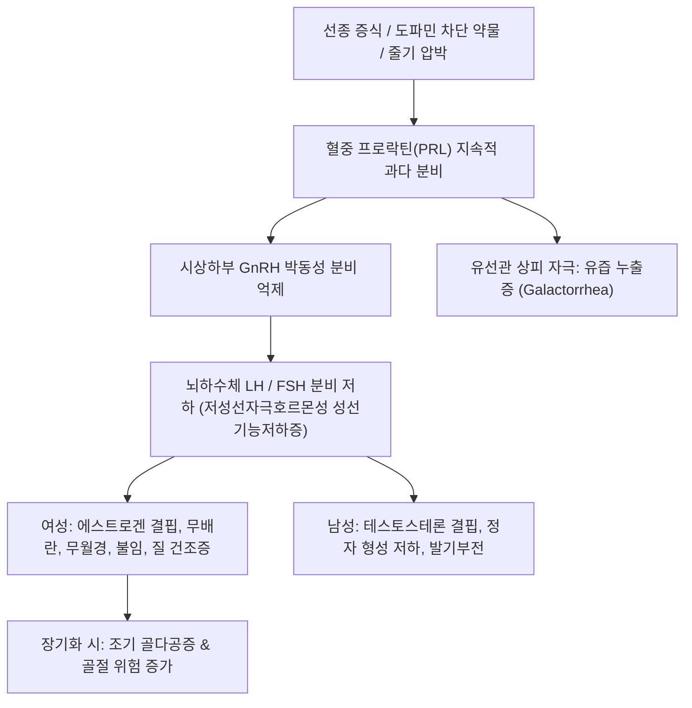

# 🩺 [[고프로락틴 혈증]] (Hyperprolactinemia / 高乳汁分泌素血症)

> **핵심 3줄 요약 (Key Summary)**:
> - 📍 병소 부위 & 해부·병태생리: 뇌하수체 전엽 젖분비세포 선종(Prolactinoma) 또는 시상하부-뇌하수체 줄기 압박으로 인한 도파민 긴장성 억제 소실, 약물 유발성 등으로 인해 혈중 프로락틴(PRL) 농도가 비정상적으로 상승하는 질환.
> - 🚩 전형적 임상 양상 & 3대 징후: 여성의 유즙 누출(Galactorrhea) 및 희발월경/무월경·불임, 남성의 성욕 감퇴·발기부전·여성형 유방증, 거대선종 시 두통 및 시야 결손.
> - 🛠️ 핵심 감별 검사 & 한·양방 다각적 치료 전략: 공복 혈청 프로락틴 수치 측정, 거대프로락틴혈증(Macroprolactinemia) PEG 침전법 감별, 터키안 뇌 MRI, 1차 표준 약물인 도파민 D2 작용제(Cabergoline, Bromocriptine), 한의 간울기체(肝鬱氣滯)·신허간울 변증 침구(태충, 간수, 삼음교) 및 소간청열 한약(소요산, 억간산, 맥아 단방·복합 처방).
> - ⚠️ 응급 의뢰 레드플래그: 임신 중 프로락틴 거대선종의 급격한 팽창으로 인한 급성 시력 상실, 뇌하수체 졸중(극심한 두통 및 뇌하수체 기능 저하), 뇌척수액 비루 소견 시 즉시 신경외과 및 내분비내과 긴급 의뢰.

---

## 📌 목차
1. [질환 개요 & 해부학적 병태생리](#1-질환-개요--해부학적-병태생리)
2. [병태생리 메커니즘 & 생체역학적 악순환 네트워크](#2-병태생리-메커니즘--생체역학적-악순환-네트워크)
3. [임상 증상 & 이학적 검사(Physical Exam) 알고리즘](#3-임상-증상--이학적-검사physical-exam-알고리즘)
4. [감별 진단 매트릭스 (Differential Diagnosis)](#4-감별-진단-매트릭스--differential-diagnosis)
5. [한의 통합 치료 프로토콜 (침·약침·추나·한약)](#5-한의-통합-치료-프로토콜--침약침추나한약)
6. [양방 치료 & 병용·의뢰 기준 (Conventional Treatment & Referral)](#6-양방-치료--병용의뢰-기준-conventional-treatment--referral)
7. [재활 운동 & 생활습관 티칭 가이드](#7-재활-운동--생활습관-티칭-가이드)
8. [💡 사용자 진료실 핵심 필기 & 임상 노하우 (Melt-In 잔여 심화 집약)](#8--사용자-진료실-핵심-필기--임상-노하우--melt-in-잔여-심화-집약-)
9. [출처 및 학술 참고 문헌 (References)](#9-출처-및-학술-참고-문헌--references-)

---

## 1. 질환 개요 & 해부학적 병태생리

* **정의 및 핵심 병태**:
  * 고프로락틴 혈증(Hyperprolactinemia)은 순환 혈액 내 프로락틴 농도가 정상 상한치(일반적으로 여성 $> 25\,\mu\mathrm{g/L}$, 남성 $> 20\,\mu\mathrm{g/L}$)를 지속적으로 초과하는 내분비 장애이다.
  * 시상하부-뇌하수체 축 질환 중 가장 흔하게 발생하며, 가임기 여성의 생리 불순 및 난임, 남성의 성기능 장애의 주요 원인이다.
* **관련 해부학적 구조물 및 조절 기전**:
  * **시상하부 결절누두계(Tuberoinfundibular System)**: 도파민(Dopamine)을 합성하여 뇌하수체 문맥계로 분비함. 도파민은 뇌하수체 젖분비세포의 D2 수용체에 결합하여 프로락틴 분비를 강력하게 지속적으로 억제(Tonic inhibition)함.
  * **뇌하수체 전엽 젖분비세포(Lactotrophs)**: 프로락틴을 분비하며, 도파민 억제가 차단되거나 종양성 증식이 발생하면 과다 분비됨.
  * **뇌하수체 줄기(Pituitary Stalk)**: 비기능성 뇌하수체 종양이나 두개인두종 등이 줄기를 압박하면 도파민 전달이 차단되어 프로락틴이 상승하는 **줄기 효과(Stalk effect)**가 발생함.
* **원인 분류**:
  1. 생리적: 임신, 수유, 수면, 극심한 스트레스, 흉벽 자극, 성교.
  2. 병리적: 프로락틴 분비선종(Prolactinoma, 40~50%), 시상하부 병변, 원발성 [[갑상선 기능 저하증]](TRH 증가로 PRL 자극), 만성 신부전, 간경변.
  3. 약물성: 항정신병제(Haloperidol, Risperidone), 위장관운동조절제(Metoclopramide, Domperidone), 항우울제(SSRI), 항고혈압제(Verapamil).

---

## 2. 병태생리 메커니즘 & 생체역학적 악순환 네트워크

* **생식내분비 병태생리**:
  * 고농도의 프로락틴은 시상하부 키스펩틴(Kisspeptin) 신경세포를 억제하여 성선자극호르몬방출호르몬(GnRH)의 분비 빈도와 진폭을 저하시킨다.
  * 이로 인해 LH와 FSH의 분비가 억제되어 난소와 고환의 기능이 정지하는 **저성선자극호르몬성 성선기능저하증(Hypogonadotropic hypogonadism)**이 발생한다.
* **골대사 영향**:
  * 만성적인 저에스트로겐혈증/저테스토스테론혈증은 파골세포 활성을 증가시키고 골밀도를 급격히 감소시켜 젊은 연령에서도 골감소증 및 골다공증을 초래한다.

---

## 3. 임상 증상 & 이학적 검사(Physical Exam) 알고리즘

* **여성의 주요 임상 양상**:
  * 월경 장애: 희발월경(Oligomenorrhea), 속발성 무월경, 부정출혈.
  * 배란 장애로 인한 원발성/속발성 난임(Infertility).
  * 유즙 누출증(Galactorrhea): 유방을 압박하거나 자발적으로 모유 같은 맑거나 하얀 분비물 분비(약 30~80%).
  * 질 건조증, 성교통, 성욕 감퇴.
* **남성의 주요 임상 양상**:
  * 성욕 감퇴(Libido loss), 발기부전(Erectile dysfunction), 불임(정자수 감소).
  * 여성형 유방증(Gynecomastia), 체모 감소, 고환 위축.
  * 남성은 무월경 같은 조기 신호가 없어 종양이 크게 자란 후(거대선종) 두통, 시야 장애로 내원하는 경우가 많음.
* **이학적 및 진단 검사 알고리즘**:
  1. **혈청 프로락틴 재검**: 아침 공복 안정 상태에서 채혈(수치가 $250\,\mu\mathrm{g/L}$ 이상이면 대개 프로락틴 거대선종).
  2. **거대프로락틴혈증(Macroprolactinemia) 배제**: 프로락틴 분자가 면역글로불린(IgG)과 결합한 중합체로, 활성이 없으나 검사상 수치만 높게 나오는 위양성이므로 폴리에틸렌글리콜(PEG) 침전법으로 활성 단량체 프로락틴 분율 확인.
  3. **갈고리 효과(Hook effect) 주의**: 거대선종에서 극도로 높은 프로락틴이 항체를 포화시켜 수치가 낮게 오인되는 현상 -> 혈청 희석(1:100) 검사 시행.
  4. **터키안 뇌 MRI (Sella MRI)**: 미세선종($< 10\,\mathrm{mm}$) 및 거대선종($\ge 10\,\mathrm{mm}$) 감별.
  5. 갑상선 기능(TSH, Free T4) 및 임신 반응(hCG) 검사 필수 병행.

---

## 4. 감별 진단 매트릭스 (Differential Diagnosis)

| 감별 질환 | 혈청 프로락틴 수치 | 뇌 MRI 소견 | 임상 특징 및 감별점 |
| :--- | :--- | :--- | :--- |
| **프로락틴 미세선종** | 보통 $100 \sim 200\,\mu\mathrm{g/L}$ | 뇌하수체 내 $< 10\,\mathrm{mm}$ 결절 | 가임기 여성 호발, 유즙누출, 무월경 |
| **프로락틴 거대선종** | 대개 $> 250\,\mu\mathrm{g/L}$ (수천 가능) | 뇌하수체 $\ge 10\,\mathrm{mm}$, 상부 신전 | 남성/고령 호발, 두통, 양이측반맹 동반 |
| **약물 유발성 고프로락틴혈증** | 보통 $25 \sim 100\,\mu\mathrm{g/L}$ (드물게 200) | 정상 뇌하수체 | 항정신병제, 메토클로프라미드 등 복용력, 약물 중단 시 정상화 |
| **비기능성 선종 줄기 압박 (Stalk effect)** | 가벼운 상승 ($< 100\,\mu\mathrm{g/L}$) | 대형 뇌하수체 종양이 줄기 압박 | 종양 크기에 비해 프로락틴 수치가 낮음 |
| **원발성 [[갑상선 기능 저하증]]** | 경미~중등도 상승 | 뇌하수체 반응성 비대 가능 | TSH 현저 상승, Free T4 저하, 갑상선 호르몬 투여 시 정상화 |
| **거대프로락틴혈증 (Macroprolactinemia)** | 수치 상승하나 무증상 | 정상 뇌하수체 | PEG 침전 검사 시 생물학적 활성 monomer 비율 낮음 |

---

## 5. 한의 통합 치료 프로토콜 (침·약침·추나·한약)

* **치료 원칙**:
  * 약물 복용 중인 환자의 부작용 경감, 생리 주기 회복, 유방 울혈 및 유즙 분비 억제, 난임 치료 시 자궁 내막 수용성 개선.
* **침구 치료**:
  * **소간이기(疏肝理氣), 조충임(調衝任)**:
    * [[태충(LR3)]], [[간수(BL18)]], [[신수(BL23)]], [[삼음교(SP6)]], [[관원(CV4)]], [[중극(CV3)]], [[합곡(LI4)]].
    * 주 2회 자침 및 하복부 온열 뜸 요법으로 골반강 및 자궁 혈류 순환 촉진.
  * **유방 울혈 및 두통 완화**:
    * [[단중(CV17)]], [[유근(ST18)]], [[풍지(GB20)]], [[태양(EX-HN5)]].
* **약침 요법**:
  * **자하거 약침 / 황련해독탕 약침**:
    * 신수(BL23), 관원(CV4), 간수(BL18)에 각 0.2cc씩 주입하여 난소 호르몬 축의 항상성 회복 유도.
* **추나 및 골반 교정**:
  * 천장관절 교정 및 요천추 연조직 이완을 통해 자궁 및 난소로 주행하는 자율신경계(골반내장신경) 긴장 완화.
* **변증 한약 처방**:
  * **간울기체(肝鬱氣滯형 — 스트레스로 인한 생리 불순, 유방 팽통, 유즙 분비, 정서 불안)**:
    * [[소요산]] 또는 [[억간산]] 가 생맥아(生麥芽 60~120g), 향부자, 울금: **생맥아 대용량 투여**는 프로락틴 분비를 강력하게 억제하는 고전적 한의 비법.
  * **신허간울(腎虛肝鬱형 — 무월경, 불임, 요슬산연, 어지럼증, 성욕 감퇴)**:
    * 귀신환(歸腎丸) 합 단치소요산 가 맥아: 신정(腎精)을 보하고 간기를 소통시킴.
  * **담습조체(痰濕阻滯형 — 비만, 다낭성 난소 양상, 대하 과다, 두중감)**:
    * 창부도담탕 가 맥아, 차전자: 습담을 배출하고 월경 개통 유도.

---

## 6. 양방 치료 & 병용·의뢰 기준 (Conventional Treatment & Referral)

* **1차 표준 치료: 도파민 D2 수용체 작용제 (Dopamine Agonists)**:
  * **카버골린(Cabergoline, 도스티넥스)**:
    * 0.25~0.5mg 주 1~2회 복용.
    * 젖분비세포의 D2 수용체를 자극하여 프로락틴 수치를 90% 이상 정상화하고, 종양 크기를 80% 이상 축소시킴. 브로모크립틴 대비 우수한 효과와 적은 오심 부작용.
  * **브로모크립틴(Bromocriptine, 팔로델)**:
    * 1.25~2.5mg 1일 2~3회 복용. 임신을 희망하여 태아 안전성이 가장 확립된 약제를 원할 때 주로 선택.
* **수술적 치료 적응증 (TSS)**:
  * 도파민 작용제에 저항성(치료 실패)이거나 극심한 부작용으로 약물 복용이 불가능한 경우.
  * 거대선종 내 출혈(뇌하수체 졸중)로 급성 시야 장애 발생 시.
* **한의 병용 시 주의점 및 상호작용**:
  * **생맥아(麥芽)의 프로락틴 억제 기전**: 맥아에 함유된 알칼로이드 성분이 도파민성 작용을 나타내어 혈청 프로락틴을 강하시킴. 양약 카버골린과 병용 시 감량 과정에서 반동 현상 없이 안전하게 테이퍼링 가능.
  * 도파민 작용제 복용 시 흔한 기립성 저혈압, 오심, 두통에 대해 한의 침구 및 위장 진정 한약 병용이 뛰어난 완충 효과를 발휘함.
* **전문과 의뢰 기준**:
  * 약물 복용 중 심장 판막 질환 의심(고용량 카버골린 장기 복용 시 에코 검사 필요).
  * 시야 결손 환자, 임신 확인 즉시 내분비내과 약물 조절 의뢰.

---

## 7. 재활 운동 & 생활습관 티칭 가이드

* **유두 및 흉벽 자극 회피**:
  * 자가 검진 목적으로 젖꼭지를 자주 짜거나 자극하는 행위는 신경 반사를 통해 프로락틴 분비를 촉진하므로 절대 금지.
  * 꽉 끼는 브래지어나 거친 옷감에 의한 흉벽 마찰 회피.
* **스트레스 관리 및 수면 리듬**:
  * 만성 스트레스는 부신피질자극호르몬과 함께 프로락틴을 상승시키므로 이완 요법(복식호흡, 명상) 지도.
* **골다공증 예방 수칙**:
  * 무월경 기간이 길었던 여성은 골밀도 검사를 시행하고, 칼슘 및 비타민 D 섭취와 체중 부하 운동 병행.

---

## 8. 💡 사용자 진료실 핵심 필기 & 임상 노하우 (Melt-In 잔여 심화 집약)

* **맥아(麥芽)의 임상 용량학적 결정타**:
  * 소화제로 쓸 때는 10~15g을 초(炒)하여 쓰지만, **단유(斷乳) 및 고프로락틴혈증 치료 목적으로는 반드시 생맥아(生麥芽)를 60~120g 대용량**으로 끓여 차처럼 복용시켜야 프로락틴 강하 효과가 확실함.
* **원인 불명 생리불순 환자의 문진 팁**:
  * 젊은 미혼 여성이 여드름이나 다모증 없이 생리가 수개월씩 끊겼을 때 "가슴을 누르면 맑은 물이나 젖 같은 분비물이 나오는지"를 반드시 질문해야 함. 환자 스스로 수치스러워 먼저 말하지 않는 경우가 흔함.
* **항우울제 복용력의 역추적**:
  * 신경정신과에서 우울증이나 불면증으로 설피리드(Sulpiride)나 리스페리돈, SSRI를 복용하기 시작한 시점과 무월경 발병 시점이 일치하는지 확인하여 불필요한 뇌 MRI 공포감을 해소해 줄 것.

---

## 9. 출처 및 학술 참고 문헌 (References)

* Sun R, et al. (2026). Prolactinomas in women of reproductive age: a proposed reproductive-intent-based framework for diagnosis and management. *Front Endocrinol (Lausanne)*. PMID: 42840608

* Yadav P, et al. (2026 Sep 16). Macroprolactinemia as a diagnostic pitfall in hyperprolactinemia: a systematic review and quantitative synthesis. *J Clin Endocrinol Metab*. PMID: 42324990

* Bauer MJ, et al. (2026 Mar). Diagnostic delay of prolactinoma: Focus on clinical manifestations. *Best Pract Res Clin Endocrinol Metab*. PMID: 42103527
