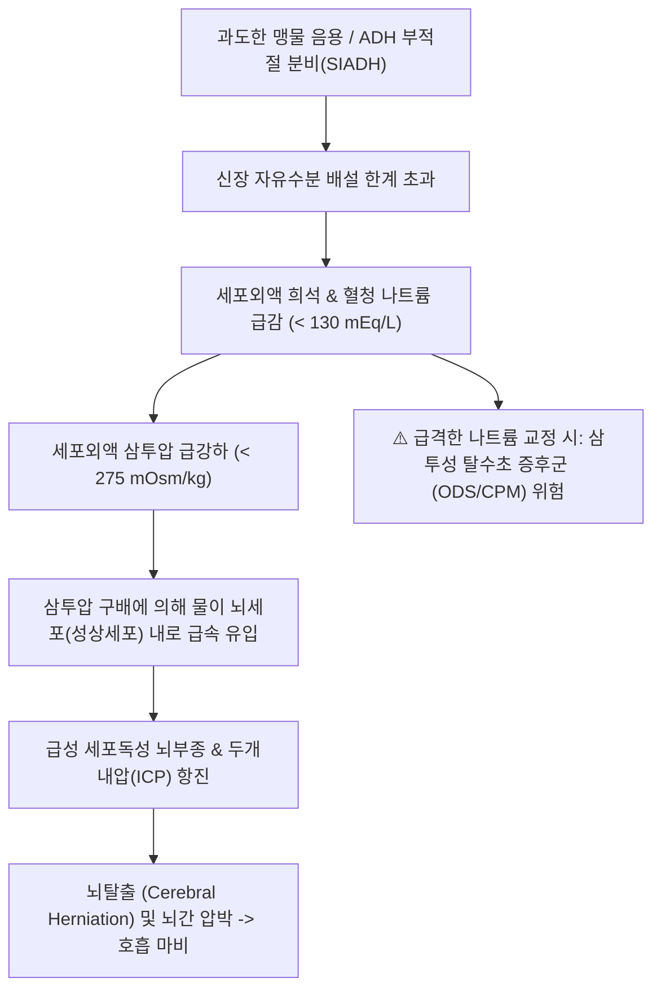

# 🩺 [[과다수분공급]] (Water Intoxication & Overhydration / 水分中毒症 및 過多水分供給)

> **핵심 3줄 요약 (Key Summary)**:
> - 📍 병소 부위 & 해부·병태생리: 신장의 수분 배설 능력을 초과하는 과도한 수분 섭취 또는 바소프레신(항이뇨호르몬, AVP/ADH)의 부적절한 과다 분비로 체액이 희석되어 세포외액 저삼투압 및 세포내 수분 유입(급성 삼투성 뇌부종)이 발생하는 중증 전해질 불균형 질환.
> - 🚩 전형적 임상 양상 & 3대 징후: 두통·오심·구토, 기력 저하 및 근육 연축(Cramps), 급격한 혈중 나트륨 저하($\mathrm{Na}^+ < 125\,\mathrm{mEq/L}$)에 따른 기면·혼돈·경련(Seizure) 및 혼수.
> - 🛠️ 핵심 감별 검사 & 한·양방 다각적 치료 전략: 혈청 전해질 및 혈청/요 삼투압 측정, 원인 질환(SIADH, 심인성 다음증, 울혈성 심부전, 신부전) 감별, 엄격한 수분 제한(1일 $< 800\sim 1,000\,\mathrm{mL}$) 및 급성 중증 시 $3\%$ 고장성 식염수(Hypertonic saline) 투여(삼투성 탈수초 증후군 예방을 위해 24시간 교정 속도 $\le 8\sim 10\,\mathrm{mEq/L}$ 준수), 한의 수습정체(水濕停滯)·비신양허 변증 침구(수분, 음릉천, 족삼리) 및 이수삼습 한약(오령산, 분심기음, 진무탕).
> - ⚠️ 응급 의뢰 레드플래그: 의식 저하, 뇌압 상승 징후(쿠싱 3대 징후: 서맥, 고혈압, 불규칙 호흡), 전신 강직성 간대성 발작, 동공 부동 등 뇌헤르니아 임박 소견 시 즉시 응급의학과/중환자의학과 응급 이송.

---

## 📌 목차
1. [질환 개요 & 해부학적 병태생리](#1-질환-개요--해부학적-병태생리)
2. [병태생리 메커니즘 & 생체역학적 악순환 네트워크](#2-병태생리-메커니즘--생체역학적-악순환-네트워크)
3. [임상 증상 & 이학적 검사(Physical Exam) 알고리즘](#3-임상-증상--이학적-검사physical-exam-알고리즘)
4. [감별 진단 매트릭스 (Differential Diagnosis)](#4-감별-진단-매트릭스--differential-diagnosis)
5. [한의 통합 치료 프로토콜 (침·약침·추나·한약)](#5-한의-통합-치료-프로토콜--침약침추나한약)
6. [양방 치료 & 병용·의뢰 기준 (Conventional Treatment & Referral)](#6-양방-치료--병용의뢰-기준-conventional-treatment--referral)
7. [재활 운동 & 생활습관 티칭 가이드](#7-재활-운동--생활습관-티칭-가이드)
8. [💡 사용자 진료실 핵심 필기 & 임상 노하우 (Melt-In 잔여 심화 집약)](#8--사용자-진료실-핵심-필기---임상-노하우--melt-in-잔여-심화-집약-)
9. [출처 및 학술 참고 문헌 (References)](#9-출처-및-학술-참고-문헌--references-)

---

## 1. 질환 개요 & 해부학적 병태생리

* **정의 및 핵심 병태**:
  * 과다수분공급(Water Intoxication / Overhydration)은 체내 수분 유입량이 신장의 자유 수분 배설량(Free water clearance)을 능가하여 체액 내 용질(주로 나트륨)이 과도하게 희석되는 상태이다.
  * 혈청 나트륨 농도가 $135\,\mathrm{mEq/L}$ 미만으로 떨어지는 **저나트륨혈증(Hyponatremia)**을 초래하며, 세포외액의 삼투압 저하로 인해 뇌세포 내로 수분이 급격히 유입되어 **뇌부종(Cerebral Edema)**과 두개내압 상승을 유발하는 치명적인 급성 대사성 질환이다.
* **관련 해부학적 구조물 및 수분 조절 축**:
  * **시상하부 시상상핵 및 실방핵(Supraoptic & Paraventricular Nuclei)**: 삼투압 수용체(Osmoreceptors)가 위치하여 혈청 삼투압이 $280\,\mathrm{mOsm/kg}$ 이하로 떨어지면 아르기닌 바소프레신(AVP, 항이뇨호르몬) 분비를 완전히 차단함.
  * **신장 집합관(Collecting Duct)**: 바소프레신 V2 수용체와 아쿠아포린-2(AQP2) 수분 통로가 작용하여 수분 재흡수를 조절함.
  * **혈액뇌장벽(Blood-Brain Barrier, BBB)**: 삼투압 변화에 극히 민감하여, 저삼투압 상태에서 물이 성상교세포(Astrocytes)로 이동하여 급성 뇌부종을 일으킴.
* **호발 원인 및 고위험군**:
  * **심인성 다음증(Psychogenic Polydipsia)**: 조현병, 불안장애 환자에서 1일 10~20L 이상의 맹물을 강박적으로 음용.
  * **마라톤 및 극기 훈련**: 과도한 발한 후 전해질이 없는 순수 맹물만 대량 섭취(운동 관련 저나트륨혈증, EAH).
  * **[[항이뇨 호르몬 부적절 분비 증후군 siadh]]**: 뇌병변, 폐암, SSRI/항경련제 복용 등으로 ADH가 부적절하게 지속 분비.
  * **의원성 수분 과다**: 저나트륨혈증 환자에게 전해질이 없는 $5\%$ 포도당 수액(D5W) 과다 점적.

---

## 2. 병태생리 메커니즘 & 생체역학적 악순환 네트워크

* **급성 뇌부종과 뇌의 적응 기전**:
  * **급성 저나트륨혈증 ($< 48$시간)**: 뇌세포가 삼투압에 적응할 시간이 없어 수분이 팽창하며 두개골 내 압력이 급상승하여 뇌탈출(Herniation)로 사망할 위험이 극히 높음.
  * **만성 저나트륨혈증 ($\ge 48$시간)**: 뇌세포가 세포 내 유기 삼투물질(타우린, 글루타메이트, 미오이노시톨)을 세포 밖으로 방출하여 뇌부종을 보상적으로 완화함.
* **삼투성 탈수초 증후군(Osmotic Demyelination Syndrome, ODS) 발생 위험**:
  * 만성적으로 적응된 상태에서 고장액 식염수로 나트륨을 너무 빠르게 올리면, 뇌세포가 유기 삼투물질을 다시 채우지 못해 탈수되어 뇌교 중앙부 탈수초증(Central Pontine Myelinolysis, CPM)이 발생하여 사지마비, 감금증후군(Locked-in syndrome)을 초래함.

---

## 3. 임상 증상 & 이학적 검사(Physical Exam) 알고리즘

* **혈청 나트륨 농도에 따른 단계별 임상 증상**:
  * **경도 ($130 \sim 134\,\mathrm{mEq/L}$)**: 무증상 또는 경미한 주의력 저하, 불안정 보행, 가벼운 두통.
  * **중등도 ($125 \sim 129\,\mathrm{mEq/L}$)**: 오심, 식욕부진, 구토, 전신 무력감, 근육 경련, 안절부절못함.
  * **중증 ($< 125\,\mathrm{mEq/L}$, 특히 급성)**: 극심한 두통, 기면(Lethargy), 지남력 상실, 발작(Seizure), 혼수(Coma), 호흡부전.
* **이학적 검사 및 용적 상태(Volume status) 평가**:
  * **유효 순환 혈장량(Volume Status) 판별**:
    * **정상 체액량(Euvolemia)**: 부종이나 탈수 소견 없음, 경정맥 정상, 피부 탄력 정상 -> SIADH, 심인성 다음증, 갑상선 기능저하증, 부신기능저하증.
    * **체액 과다(Hypervolemia)**: 전신 부종, 복수, 경정맥 확장, 폐포음 -> 심부전, 간경변, 신부전.
    * **체액 저하(Hypovolemia)**: 구강 건조, 피부 긴장도 저하, 기립성 저혈압 -> 이뇨제 사용, 구토, 설사.
* **진단 검사 알고리즘**:
  1. 혈청 삼투압 측정: 진성 저삼투성 저나트륨혈증($< 275\,\mathrm{mOsm/kg}$) 확인(고혈당이나 지질 과다에 의한 가성 저나트륨혈증 배제).
  2. 소변 삼투압 및 소변 나트륨 측정:
     * 소변 삼투압 $< 100\,\mathrm{mOsm/kg}$: 수분 배설이 정상적으로 최대로 일어남 -> **심인성 다음증(Psychogenic Polydipsia), 맥주 다뇨증(Beer potomania)**.
     * 소변 삼투압 $> 100\,\mathrm{mOsm/kg}$ (농축뇨) + 소변 $\mathrm{Na}^+ > 30\,\mathrm{mEq/L}$: ADH가 부적절하게 작동함 -> **[[항이뇨 호르몬 부적절 분비 증후군 siadh]]**.

---

## 4. 감별 진단 매트릭스 (Differential Diagnosis)

| 질환 | 체액 용적 상태 | 소변 삼투압 ($\mathrm{U_{osm}}$) | 소변 나트륨 ($\mathrm{U_{Na}}$) | 주요 병태 및 기전 |
| :--- | :--- | :--- | :--- | :--- |
| **심인성 다음증 (순수 과다수분)** | 정상 체액량 (Euvolemic) | $< 100\,\mathrm{mOsm/kg}$ (희석뇨) | $< 20\,\mathrm{mEq/L}$ | 신장 배설 한계를 초과하는 맹물 대량 음용 |
| **[[항이뇨 호르몬 부적절 분비 증후군 siadh]]** | 정상 체액량 (Euvolemic) | $> 100\,\mathrm{mOsm/kg}$ (농축뇨) | $> 30\,\mathrm{mEq/L}$ | 체액 정상임에도 ADH 과다로 수분 정체 |
| **심부전 / 간경변성 과수분** | 체액 과다 (Hypervolemic) | $> 100\,\mathrm{mOsm/kg}$ | $< 20\,\mathrm{mEq/L}$ | 유효 동맥 혈류량 저하로 인한 2차성 알도스테론/ADH 증가 |
| **티아지드 이뇨제 유발성** | 체액 저하~정상 | $> 100\,\mathrm{mOsm/kg}$ | 다양함 | 원위세뇨관 나트륨 재흡수 차단 및 갈증 유발 |
| **원발성 부신기능저하증** | 체액 저하 (Hypovolemic) | $> 100\,\mathrm{mOsm/kg}$ | $> 30\,\mathrm{mEq/L}$ | 코르티솔 및 알도스테론 결핍으로 신장 염분 소실 |

---

## 5. 한의 통합 치료 프로토콜 (침·약침·추나·한약)

* **치료 원칙**:
  * 급성 뇌부종 및 전해질 붕괴는 즉각적인 응급 처치가 필수이며, 한의 치료는 **만성 경·중등도 수분 정체 환자의 체액 대사 정상화, 비신(脾腎) 수습 운화 기능 강화, 심인성 다음증 환자의 정신적 갈증 완화**에 적용함.
* **침구 치료**:
  * **선혈 원칙**: 온양이수(溫陽利水), 건비화습(健脾化濕), 통조삼초(通調三焦).
  * **수액 대사 특효혈**: [[수분(CV9)]], [[수도(ST28)]], [[음릉천(SP9)]], [[삼음교(SP6)]], [[족삼리(ST36)]], [[신수(BL23)]], [[방광수(BL28)]], [[관원(CV4)]].
  * **자침 기법**: 수분(CV9)과 수도(ST28)에 침치료 후 간접 뜸(온구 요법)을 시행하여 삼초의 기화(氣化) 기능을 촉진하고 저류된 수습 배출 유도.
* **약침 치료**:
  * **황련해독탕 약침 / 자하거 약침**:
    * 신수(BL23), 비수(BL20)에 0.2cc씩 주입하여 신사구체 및 세뇨관 혈류 촉진.
* **추나 요법**:
  * 흉요추 연접부(T10-L2) 관절 가동술을 통해 신장 및 부신 지배 교감신경의 긴장도를 정상화함.
* **변증 한약 처방**:
  * **비허습곤·수음내정(脾虛濕困·水飮內停형 — 전신 부종, 식후 복만, 묽은 변, 구갈이 없으나 몸이 무거움)**:
    * [[오령산]](五苓散): 백출, 복령, 저령, 택사, 계지. 신장 세포의 아쿠아포린 수분 통로 발현을 조절하여 불필요한 세포외액 수분을 배출시키는 대표 이수제.
  * **비신양허·수기능심(脾腎陽虛·水氣凌心형 — 사지 냉증, 심계항진, 소변 불리, 전신 쇠약)**:
    * [[진무탕]](眞武湯): 포부자, 백출, 복령, 백작약, 생강. 온양화수(溫陽化水)하여 신장의 배뇨 및 기화 기능 회복.
  * **기체습조·심인성 갈증(氣滯濕阻형 — 스트레스로 인한 잦은 물 섭취, 가슴 답답함)**:
    * [[분심기음]] 합 소요산 가감.

---

## 6. 양방 치료 & 병용·의뢰 기준 (Conventional Treatment & Referral)

* **중증 급성 저나트륨혈증의 응급 교정 (Severe Symptomatic Hyponatremia)**:
  * **경련, 혼수 등 뇌부종 징후 시**:
    * **$3\%$ 고장성 식염수(Hypertonic Saline)** $100\sim 150\,\mathrm{mL}$를 10~20분에 걸쳐 신속 정맥 점적, 증상 지속 시 2~3회 반복.
    * 초기 목표: 혈청 나트륨을 $4\sim 6\,\mathrm{mEq/L}$ 급속 상승시켜 뇌탈출 위험 즉시 차단.
* **나트륨 교정 속도 상한선 (절대 안전 규칙)**:
  * **24시간 동안 나트륨 상승 폭은 $8\sim 10\,\mathrm{mEq/L}$를 넘지 않아야 함** (고위험군 영양실조, 알코올 중독자는 $\le 6\sim 8\,\mathrm{mEq/L}$).
  * 과교정 시 삼투성 탈수초 증후군(ODS) 발생 위험 -> 포도당 수액 투여 및 데스모프레신(DDAVP)으로 재강하 조치 필요.
* **비응급 만성 과수분증 치료**:
  * **엄격한 수분 제한(Fluid Restriction)**: 1일 $800\sim 1,000\,\mathrm{mL}$ 이하로 수분 섭취 차단.
  * 바소프레신 V2 수용체 길항제(Vaptans, 톨밥탄): 입원 하에 신중히 투여(SIADH 등).
* **한의 병용 시 주의사항**:
  * 급성기 의식 저하 환자에게 경구 한약 투약은 흡인성 폐렴 위험으로 절대 금기.
  * 이수삼습제(오령산 등)를 병용할 때 환자의 혈청 전해질을 정기적으로 추적하여 탈수가 발생하지 않는지 모니터링.
* **응급 전원 기준 (Critical Referral)**:
  * 나트륨 $< 120\,\mathrm{mEq/L}$, 발작, 의식 장애, 두통 악화 시 즉시 응급실로 전원하여 중환자실 모니터링 의뢰.

---

## 7. 재활 운동 & 생활습관 티칭 가이드

* **올바른 수분 섭취 가이드라인**:
  * "물은 무조건 많이 마실수록 좋다"는 잘못된 건강 상식 교정. 갈증을 느낄 때 적정량(1일 1.5~2.0L 이내) 마실 것을 지도.
  * 장시간 지구력 운동(마라톤, 등산) 시 순수 맹물만 대량 마시지 말고, 전해질이 포함된 이온 음료를 섭취하도록 교육.
* **체중 일기 작성**:
  * 심부전이나 신질환 환자는 매일 아침 배뇨 후 체중을 측정하여 하루 1kg 이상 급격히 체중이 늘어나는지 모니터링(수분 저류 조기 발견).
* **식단 및 염분 섭취**:
  * 과도한 무염식을 피하고 적절한 천일염 및 미네랄 섭취 유지.

---

## 8. 💡 사용자 진료실 핵심 필기 & 임상 노하우 (Melt-In 잔여 심화 집약)

* **"물만 마셔도 체하고 어지러워요"를 호소하는 환자들의 비밀**:
  * 다이어트나 해독 요법 목적으로 하루 3~4리터 이상의 맹물을 강박적으로 마신 후 두통, 식욕부진, 만성 피로를 호소하는 환자가 매우 많음.
  * 이 경우 위장약이 아니라 **수분 섭취 제한 티칭과 함께 [[오령산]]을 투약**하면 불과 3일 만에 두통과 어지럼증이 씻은 듯 사라짐.
* **오령산(五苓散)의 아쿠아포린(AQP) 조절 과학**:
  * 현대 약리학적으로 오령산은 단순 이뇨제가 아니라 신장 및 뇌세포의 AQP-4 및 AQP-2 수분 통로를 양방향으로 조절하여, 탈수를 일으키지 않으면서 세포 내 부종을 가라앉히는 스마트한 조절 효과를 나타냄.
* **심인성 다음증 환자의 징후**:
  * 항상 손에 500mL 물병을 들고 10분마다 홀짝이며 화장실을 수시로 드나드는 환자는 반드시 전해질 검사를 권유해야 함.

---

## 9. 출처 및 학술 참고 문헌 (References)

* Kamel KS, et al. (2026 Oct). Managing hyponatremia: fast or slow? Why, when, how, and controversies. *Clin Kidney J*. PMID: 42824684

* Morena D, et al. (2026 Oct 3). Serotonergic Toxicity and Hyponatremia Associated with Antidepressant Therapy: The Pivotal Role of SIADH. *Clin Drug Investig*. PMID: 42829418

* Atila C, et al. (2026 Sep 1). Arginine vasopressin deficiency: towards a better characterization. *Endocr Relat Cancer*. PMID: 42677919
