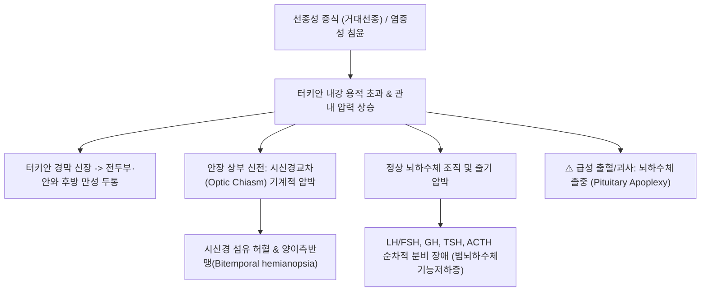

# 🩺 [[뇌하수체 비대]] (Pituitary Enlargement & Pituitary Macroadenoma / 腦下垂體肥大)

> **핵심 3줄 요약 (Key Summary)**:
> - 📍 병소 부위 & 해부·병태생리: 터키안(Sella turcica) 내 뇌하수체 실질이 선종성 증식(Pituitary Macroadenoma, 직경 $\ge 10\,\mathrm{mm}$) 또는 염증·반응성 증식(림프구성 뇌하수체염, 갑상선저하증에 의한 TSH 분비세포 과형성)으로 비대해져 터키안 격막을 뚫고 상부 및 측부 구조물을 압박하는 공간점유병변.
> - 🚩 전형적 임상 양상 & 3대 징후: 시신경교차 압박으로 인한 진행성 양이측반맹(Bitemporal hemianopsia), 터키안 팽창에 따른 만성 난치성 두통, 정상 뇌하수체 압박으로 인한 범뇌하수체기능저하증(피로, 성기능 저하, 갑상선/부신 기능부전).
> - 🛠️ 핵심 감별 검사 & 한·양방 다각적 치료 전략: 안장 뇌 MRI(T1 강조 조영증강 및 관상면/시상면) 및 시야 검사(Humphrey perimetry), 기초 뇌하수체 호르몬 패널 검사, 증상성 거대선종 시 내시경 경접형동 접근 수술(Endoscopic TSS), 한의 뇌혈류 개선 및 시신경 보호 침구(풍지, 태양, 찬죽, 백회) 및 활혈이기·보신양혈 한약.
> - ⚠️ 응급 의뢰 레드플래그: 선종 내 급성 출혈/경색으로 인한 뇌하수체 졸중(Pituitary Apoplexy: 벼락 두통, 급격한 완전 시력 상실, 동안신경 마비로 인한 안검하수/복시, 급성 부신위기 쇼크) 발생 시 즉시 신경외과 응급 수술 의뢰.

---

## 📌 목차
1. [질환 개요 & 해부학적 병태생리](#1-질환-개요--해부학적-병태생리)
2. [병태생리 메커니즘 & 생체역학적 악순환 네트워크](#2-병태생리-메커니즘--생체역학적-악순환-네트워크)
3. [임상 증상 & 이학적 검사(Physical Exam) 알고리즘](#3-임상-증상--이학적-검사physical-exam-알고리즘)
4. [감별 진단 매트릭스 (Differential Diagnosis)](#4-감별-진단-매트릭스--differential-diagnosis)
5. [한의 통합 치료 프로토콜 (침·약침·추나·한약)](#5-한의-통합-치료-프로토콜--침약침추나한약)
6. [양방 치료 & 병용·의뢰 기준 (Conventional Treatment & Referral)](#6-양방-치료--병용의뢰-기준-conventional-treatment--referral)
7. [재활 운동 & 생활습관 티칭 가이드](#7-재활-운동--생활습관-티칭-가이드)
8. [💡 사용자 진료실 핵심 필기 & 임상 노하우 (Melt-In 잔여 심화 집약)](#8--사용자-진료실-핵심-필기--임상-노하우--melt-in-잔여-심화-집약-)
9. [출처 및 학술 참고 문헌 (References)](#9-출처-및-학술-참고-문헌--references-)

---

## 1. 질환 개요 & 해부학적 병태생리

* **정의 및 핵심 병태**:
  * 뇌하수체 비대(Pituitary Enlargement)는 접형골(Sphenoid bone)의 터키안 내에 위치한 뇌하수체의 용적이 정상 범위를 초과하여 확장된 상태를 총칭한다.
  * 크기가 직경 10mm 미만인 미세선종(Microadenoma)과 달리, **10mm 이상으로 증식한 거대선종(Macroadenoma)**이 가장 흔한 원인이며, 이 외에도 생리적 과형성, 자가면역성 뇌하수체염, 종양 전이, 낭종 등에 의해 유발된다.
* **관련 해부학적 인접 구조물과 압박 양상**:
  * **상방 (Suprasellar extension)**: 터키안 격막(Diaphragma sellae)을 뚫고 올라가 **시신경교차(Optic Chiasm)**를 하방에서 압박함 -> 비측 망막 섬유가 교차하는 부위가 손상되어 전형적인 **양이측반맹(Bitemporal hemianopsia)** 발생.
  * **측방 (Parasellar/Cavernous sinus invasion)**: 해면정맥동으로 침범하여 제3(동안), 제4(활차), 제6(외전) 뇌신경 및 삼차신경 V1, V2를 압박함 -> 복시(Diplopia), 안검하수, 안면 감각 이상 유발.
  * **하방 (Infrasellar extension)**: 접형동(Sphenoid sinus) 바닥을 침식하여 드물게 뇌척수액 비루(CSF rhinorrhea)를 일으킴.
* **원인별 분류**:
  1. **신생물성 (Neoplastic)**: 비기능성 뇌하수체 선종(NFPA, 가장 흔함), 프로락틴 거대선종, 성장호르몬 분비선종, 두개인두종, 수막종.
  2. **염증성/침윤성 (Inflammatory/Infiltrative)**: 림프구성 뇌하수체염(임신 후반/산후 호발), 육아종성 질환(사르코이도시스, 결핵), IgG4 관련 질환.
  3. **반응성 과형성 (Hyperplasia)**: 원발성 [[갑상선 기능 저하증]](음성 되먹임 소실로 TRH 과다 -> TSH 세포 과형성), 원발성 부신기능저하증.
  4. **생리적 비대**: 사춘기, 임신 및 수유기 여성의 에스트로겐 자극에 의한 젖분비세포 증식.

---

## 2. 병태생리 메커니즘 & 생체역학적 악순환 네트워크

* **공간 점유에 따른 종괴 효과 (Mass Effect)**:
  * 터키안은 사방이 단단한 골성 벽과 상부의 질긴 경막으로 둘러싸여 있어 미세한 팽창만으로도 내부 압력이 급상승한다.
  * 시신경교차로 주행하는 미세혈관이 압박되어 신경 전도 차단과 축삭 손상이 진행되며, 조기 감압 수술이 지연될 경우 비가역적인 시신경 위축으로 이행한다.
* **뇌하수체 호르몬 분비 결핍 순서**:
  * 종괴 압박 시 호르몬 결손은 일반적으로 **GH -> LH/FSH -> TSH -> ACTH** 순서로 점진적 소실을 보인다(ACTH 결핍은 가장 늦게 오나 부신위기를 초래하므로 가장 치명적임).

---

## 3. 임상 증상 & 이학적 검사(Physical Exam) 알고리즘

* **3대 핵심 임상 징후**:
  1. **시각 장애**: 시야의 바깥쪽이 보이지 않아 문틀에 자주 부딪히거나 운전 중 차선 변경이 어려움(양이측반맹), 시력 저하.
  2. **신경학적 증상**: 전두부, 측두부, 눈 뒤쪽의 묵직하고 쑤시는 두통, 뇌압 상승 시 오심. 해면정맥동 침범 시 사시 및 복시.
  3. **내분비 기능 저하 증상**: 만성 피로, 무기력, 성욕 감퇴, 무월경, 발기부전, 추위 탐, 체중 증가.
* **이학적 및 신경안과적 검사 알고리즘**:
  * **대면 시야 검사(Confrontation Visual Field Test)**: 진료실에서 환자와 마주보고 외측 시야 결손 여부를 간이 스크리닝.
  * **공식 시야 검사 (Humphrey/Goldmann Perimetry)**: 정밀 시야 지도를 작성하여 수술 전후 시신경 감압 평가의 표준 지표로 활용.
  * **안저 검사 (Fundoscopy)**: 시신경유두 창백(시신경 위축) 또는 장기 두개내압 상승에 의한 유두부종 확인.
* **영상 및 내분비 진단 검사**:
  * **터키안 조영증강 뇌 MRI (Sella MRI)**: 관상면(Coronal)과 시상면(Sagittal) T1/T2 영상을 통해 종양 크기, 상부 시신경교차 압박도, 해면정맥동 침범 등급(Knosp 분류 Grade 0~4) 판정.
  * **기초 뇌하수체 기능 검사 패널**: 혈청 프로락틴, IGF-1, TSH/Free T4, 아침 8시 코르티솔/ACTH, LH/FSH, 테스토스테론/에스트라디올 일괄 측정.

---

## 4. 감별 진단 매트릭스 (Differential Diagnosis)

| 질환 | MRI 영상 특징 | 내분비 호르몬 양상 | 임상 특징 및 감별점 |
| :--- | :--- | :--- | :--- |
| **비기능성 뇌하수체 거대선종** | 균일한 조영증강, 눈사람 모양(Snowman) 상부 신전 | 정상 또는 경미한 줄기 압박성 프로락틴 상승($< 100$) | 시야 결손, 두통 호발, 고령 호발 |
| **프로락틴 거대선종** | 거대선종 형태, 해면정맥동 침범 흔함 | 혈청 프로락틴 현저한 상승 ($> 250\,\mu\mathrm{g/L}$) | 수술보다 도파민 작용제(카버골린) 약물 반응 탁월 |
| **림프구성 뇌하수체염 (Hypophysitis)** | 뇌하수체 줄기의 비후(Thickening), 균일 조영 | ACTH, TSH 조기 결핍 흔함 | 임신 후반기/산후 여성, 자가면역 질환 동반, 스테로이드 반응 |
| **두개인두종 (Craniopharyngioma)** | 안장 상부 종괴, 낭성 변성 및 석회화 흔함 | 요붕증(AVP 결핍) 조기 동반 흔함 | 소아 또는 50대 이상, 재발률 높음 |
| **빈안장 증후군 (Empty Sella)** | 터키안 내 뇌척수액 충만, 납작해진 뇌하수체 | 대개 정상 기능 | 비만 다산 여성, 두통, 우연히 발견됨 |

---

## 5. 한의 통합 치료 프로토콜 (침·약침·추나·한약)

* **치료 원칙**:
  * 시신경교차를 압박하는 거대선종은 수술적 감압이 1차 필수이며, 한의 치료는 **수술 전후 시신경 혈류 순환 개선 및 시야 회복 촉진, 수술 후 만성 두통 완화, 기혈쌍보를 통한 호르몬 기능부전 보조**에 집중함.
* **침구 치료**:
  * **시신경 혈류 촉진 및 안와 감압**:
    * [[풍지(GB20)]], [[태양(EX-HN5)]], [[찬죽(BL2)]], [[정명(BL1)]], [[구후(EX-HN7)]], [[광명(GB37)]].
    * 풍지, 태양혈 자침으로 후두동맥 및 내경동맥-안동맥 혈류 저항 감소.
  * **두개강 내압 완화 및 개규(開竅)**:
    * [[백회(GV20)]], [[사신총(EX-HN1)]], [[합곡(LI4)]], [[태충(LR3)]].
* **약침 요법**:
  * **황련해독탕 약침**:
    * 풍지(GB20), 완골(GB12)에 각 0.2cc씩 주입하여 두개저 긴장 및 미세 염증 완화.
  * **자하거 약침 (수술 후 회복기)**:
    * 신수(BL23), 비수(BL20), 족삼리(ST36)에 주입하여 기력 회복 및 뇌신경 영양 공급.
* **추나 및 두개천골 요법 (Cranial Osteopathy)**:
  * 후두골-접형골 연골결합(Sphenobasilar Synchondrosis, SBS) 이완 및 후두하근막 이완을 통해 뇌척수액(CSF) 순환 리듬을 정상화하고 두통 완화.
* **변증 한약 처방**:
  * **담어조락(痰瘀阻絡형 — 만성 두통, 시야 흐림, 어지럼증, 설하정맥 노창)**:
    * [[통규활혈탕]](通竅活血湯) 합 [[도담탕]]: 도인, 홍화, 천궁, 적작약, 반하, 복령, 석창포. 어혈과 담음을 제거하여 뇌 미세혈관 순환 개선.
  * **간신음허·간양상항(肝腎陰虛·肝陽上亢형 — 두통, 목현, 안구 건조, 상열감, 이명)**:
    * [[기국지황탕]] 합 천마구등음 가감.
  * **비신양허(脾腎陽虛형 — 수술 후 극심한 피로, 부종, 오한, 저혈압 경향)**:
    * [[보중익기탕]] 가 포부자, 육계, 음양곽: 양기(陽氣)를 북돋워 전신 활력 회복.

---

## 6. 양방 치료 & 병용·의뢰 기준 (Conventional Treatment & Referral)

* **수술적 치료: 내시경 경접형동 접근 수술 (Endoscopic TSS)**:
  * **절대적 적응증**: 시신경교차 압박으로 인한 시야 결손, 진행성 시력 저하, 뇌하수체 졸중.
  * 신경외과 내시경 수술을 통해 비강을 통해 접형동을 거쳐 안전하게 종양을 적출하며, 수술 후 환자의 80% 이상에서 시야 결손이 극적으로 호전됨.
* **약물 치료**:
  * 프로락틴 거대선종인 경우: 수술 전 도파민 작용제(카버골린) 투여가 1차 표준 치료(종양 크기가 급격히 축소됨).
  * 수술 후 호르몬 결핍 발생 시: 레보티록신(갑상선), 히드로코르티손(부신), 성호르몬 대체요법.
* **방사선 치료**:
  * 감마나이프(Stereotactic Radiosurgery): 해면정맥동 침범 등으로 수술적 완전 절제가 불가능한 잔여 종양에 적용.
* **한의 병용 시 안전 수칙**:
  * 시야 결손이 있는 환자에게 수술을 미루고 한방 치료만 고집하는 것은 영구 실명을 초래할 수 있으므로 절대 금기.
  * 수술 후 호르몬 대체요법(스테로이드 등)을 복용 중인 환자는 임의로 약을 중단하지 않도록 엄격히 티칭.
* **신경외과 즉시 응급 전원 기준 (Pituitary Apoplexy)**:
  * 갑작스러운 '도끼로 맞은 듯한' 격심한 두통, 급성 시력 상실, 동안신경 마비(눈꺼풀 처짐, 눈동자가 바깥으로 돌아감), 혈압 저하 및 의식 혼미 발생 시 즉시 응급실 이송.

---

## 7. 재활 운동 & 생활습관 티칭 가이드

* **시각 보상 훈련 및 안전 수칙**:
  * 시야 결손 환자는 측면 사각지대가 넓으므로 계단을 오르내리거나 보행 시 고개를 좌우로 돌려 확인하는 습관 지도.
  * 시야가 회복될 때까지 운전 및 기계 조작 금지.
* **두개내압 상승 유발 행위 금기**:
  * 무거운 물건 들기, 과도한 발살바(Valsalva) 호흡, 심한 기침, 대변 시 과도한 힘주기 자제.
* **정기적인 영상 및 시야 추적**:
  * 수술 후 6개월, 1년 간격으로 뇌 MRI 및 정밀 시야 검사를 지속하여 잔여 종양 증식 여부 감시.

---

## 8. 💡 사용자 진료실 핵심 필기 & 임상 노하우 (Melt-In 잔여 심화 집약)

* **"운전할 때 양쪽 백미러가 잘 안 보여요" 호소의 진실**:
  * 단순 노안이나 백내장으로 알고 내원한 50~60대 환자가 "시야 바깥쪽이 어둡다"고 호소할 때, 진료실에서 즉시 양손 손가락을 귀 옆에서 흔드는 대면 시야 검사를 시행하여 바깥쪽 손가락을 인식하지 못하면 뇌하수체 거대선종을 1순위로 확신해야 함.
* **비기능성 선종과 프로락틴 선종의 구분**:
  * 거대선종이라도 프로락틴 수치가 $2,000\,\mu\mathrm{g/L}$ 이상으로 높으면 수술 없이 약물만으로 종양이 녹아내리듯 줄어들 수 있으므로 반드시 호르몬 검사 결과를 확인한 후 치료 방침을 결정해야 함.
* **TSS 수술 후 뇌척수액 비루(CSF Leak) 주의점**:
  * 코수술 후 환자가 고개를 숙일 때 맑은 물 같은 액체가 코에서 주르륵 흐르고 짠맛/단맛이 난다면 뇌척수액 누출이므로 절대 코를 세게 풀지 못하게 하고 즉시 수술 집도의에게 보낼 것.

---

## 9. 출처 및 학술 참고 문헌 (References)

* Gupta K, et al. (2026 Jun 24). Improved visual outcomes after endoscopic endonasal transsphenoidal surgery for pituitary macroadenomas: a single-arm meta-analysis. *Acta Neurochir (Wien)*. PMID: 42340522

* Yadav P, et al. (2026 May 29). The hook effect in macroprolactinomas: tumor size thresholds, prolactin patterns, and clinical consequences - a systematic review. *Pituitary*. PMID: 42213208

* Suslu HT, et al. (2026 Sep 22). Intrasellar Cavernous Malformations: Two Case reports with A Systematic Review of Clinical Features, Surgical Management, and Outcomes. *World Neurosurg*. PMID: 42772626
