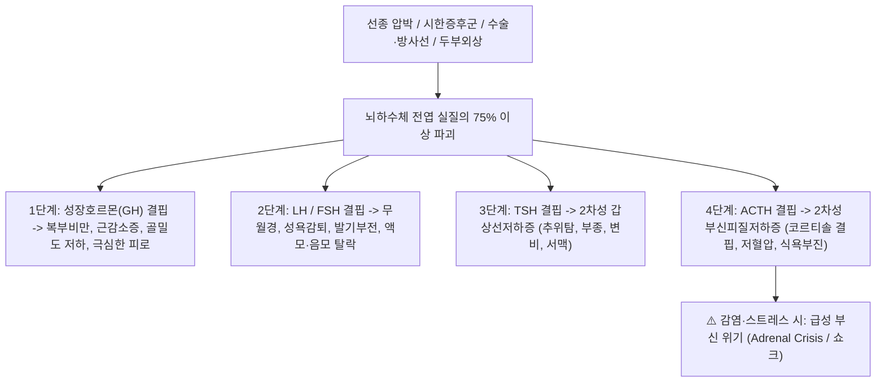

# 🩺 [[뇌하수체기능저하증]] (Hypopituitarism / 腦下垂體機能低下症)

> **핵심 3줄 요약 (Key Summary)**:
> - 📍 병소 부위 & 해부·병태생리: 뇌하수체 전엽 또는 시상하부 병변으로 인해 뇌하수체 호르몬(GH, LH/FSH, TSH, ACTH, PRL) 중 하나 이상이 부분적 또는 전반적으로 결핍되는 복합 내분비 질환(실질의 75% 이상 파괴 시 임상 증상 발현).
> - 🚩 전형적 임상 양상 & 3대 징후: 결핍 순서에 따른 점진적 전신 쇠약 및 만성 무기력증, 2차성 성선기능저하증(무월경, 성욕 감퇴, 음모/액모 탈락), 2차성 갑상선 및 부신기능저하증(추위 탐, 저혈압, 식욕부진, 저나트륨혈증, 피부 창백).
> - 🛠️ 핵심 감별 검사 & 한·양방 다각적 치료 전략: 복합 뇌하수체 자극 검사(Cocktail test) 또는 기초 표적 장기 호르몬 측정, 터키안 뇌 MRI, 표적 장기 호르몬 평생 대체요법(하이드로코르티손 우선 투여 후 레보티록신, 성호르몬, 성장호르몬), 한의 기혈음양 구허(氣血陰陽俱虛)·비신양허 변증 침구(관원, 기해, 신수, 족삼리) 및 대보원기·온보비신 한약(십전대보탕, 팔미지황탕, 보중익기탕).
> - ⚠️ 응급 의뢰 레드플래그: 감염, 수술, 외상 등 스트레스 상황에서 코르티솔 결핍으로 발생하는 급성 부신 위기(Adrenal Crisis: 난치성 저혈압 쇼크, 고열 또는 저체온, 의식 소실, 급성 복통) 발생 시 즉시 고용량 정맥 스테로이드 투여 및 응급실 이송.

---

## 📌 목차
1. [질환 개요 & 해부학적 병태생리](#1-질환-개요--해부학적-병태생리)
2. [병태생리 메커니즘 & 생체역학적 악순환 네트워크](#2-병태생리-메커니즘--생체역학적-악순환-네트워크)
3. [임상 증상 & 이학적 검사(Physical Exam) 알고리즘](#3-임상-증상--이학적-검사physical-exam-알고리즘)
4. [감별 진단 매트릭스 (Differential Diagnosis)](#4-감별-진단-매트릭스--differential-diagnosis)
5. [한의 통합 치료 프로토콜 (침·약침·추나·한약)](#5-한의-통합-치료-프로토콜--침약침추나한약)
6. [양방 치료 & 병용·의뢰 기준 (Conventional Treatment & Referral)](#6-양방-치료--병용의뢰-기준-conventional-treatment--referral)
7. [재활 운동 & 생활습관 티칭 가이드](#7-재활-운동--생활습관-티칭-가이드)
8. [💡 사용자 진료실 핵심 필기 & 임상 노하우 (Melt-In 잔여 심화 집약)](#8--사용자-진료실-핵심-필기--임상-노하우--melt-in-잔여-심화-집약-)
9. [출처 및 학술 참고 문헌 (References)](#9-출처-및-학술-참고-문헌--references-)

---

## 1. 질환 개요 & 해부학적 병태생리

* **정의 및 핵심 병태**:
  * 뇌하수체기능저하증(Hypopituitarism)은 뇌하수체 전엽 호르몬의 분비 부전으로 인해 표적 내분비선(갑상선, 부신피질, 성선 등)의 2차성 기능 저하가 유발되는 임상 증후군이다.
  * 모든 전엽 호르몬이 결핍된 상태를 **범뇌하수체기능저하증(Panhypopituitarism)**이라 부르며, 뇌하수체 조직의 75% 이상이 파괴될 때 증상이 나타나고 90% 이상 소실되면 완전 결핍 증상이 초래된다.
* **관련 해부학적 구조물**:
  * **터키안(Sella Turcica)** 내 뇌하수체 전엽(선하수체): ACTH, TSH, LH, FSH, GH, PRL을 합성 및 분비함.
  * **시상하부(Hypothalamus) 및 뇌하수체 줄기(Pituitary Stalk)**: 방출호르몬(CRH, TRH, GnRH, GHRH)을 문맥계를 통해 전달함. 줄기 절단 시 PRL을 제외한 전엽 호르몬이 모두 결핍됨.
* **주요 병인 분류 (Etiology)**:
  1. **종양 및 종괴 효과 (가장 흔함, 약 50~60%)**: 뇌하수체 거대선종, 두개인두종, 수막종, 전이암.
  2. **허혈 및 혈관성 손상**:
     * **시한 증후군 (Sheehan's Syndrome)**: 분만 시 대량 출혈 및 저혈압 쇼크로 인해 비대해진 뇌하수체 전엽의 허혈성 괴사.
     * **뇌하수체 졸중 (Pituitary Apoplexy)**: 선종 내 급성 출혈/경색.
  3. **의원성 손상**: 뇌하수체 수술 후, 두경부 방사선 치료 후(치료 수년 후 지연성 발생).
  4. **염증 및 침윤**: 림프구성 뇌하수체염, 사르코이도시스, 결핵, 혈색소증(Hemochromatosis).
  5. **두부 외상 (Traumatic Brain Injury, TBI)**: 뇌진탕이나 기저 두개골 골절 후 뇌하수체 줄기 견인 손상.

---

## 2. 병태생리 메커니즘 & 생체역학적 악순환 네트워크

* **호르몬 소실의 전형적 순서와 기전**:
  * 일반적으로 종괴에 의한 압박이나 방사선 손상 시 취약성에 따라 **GH -> LH/FSH -> TSH -> ACTH** 순서로 소실된다.
* **원발성 질환과의 결정적 병태생리 차이**:
  * **2차성 부신기능저하증 (ACTH 결핍)**: 레닌-안지오텐신 축에 의해 알도스테론 분비는 거의 정상 유지되므로 원발성 부신저하증(애디슨병)과 달리 고칼륨혈증이 드물며, ACTH 과다 분비가 없으므로 **피부 색소침착이 없고 오히려 피부가 창백하고 얇아짐(밀랍 인형 피부)**.
  * **2차성 갑상선기능저하증 (TSH 결핍)**: TSH 자극이 없으므로 갑상선종(Goiter)이 형성되지 않고 갑상선이 위축됨.

---

## 3. 임상 증상 & 이학적 검사(Physical Exam) 알고리즘

* **주요 임상 증상**:
  * **전신 증상**: 심한 만성 피로, 에너지 고갈, 무기력, 체중 감소 또는 연조직 부종, 오한.
  * **생식기계 증상**: 여성은 분만 후 젖이 돌지 않음(시한 증후군의 첫 징후), 무월경, 불임, 질 위축. 남성은 성욕 상실, 발기부전, 수염 및 체모 감소, 고환 연화.
  * **대사 및 혈역학 증상**: 저혈압(특히 기립성), 어지럼증, 공복 저혈당, 저나트륨혈증(체액 과다형 희석성).
  * **피부 소견**: 가늘고 건조하며 주름이 많은 창백한 피부, 액모(겨드랑이털) 및 음모의 현저한 탈락.
* **이학적 검사 및 진단 검사 알고리즘**:
  1. **기초 호르몬 수치 동시 측정**:
     * 2차성 저하증의 특징: **표적 장기 호르몬(Free T4, 코르티솔, 테스토스테론)이 낮은데도 자극 호르몬(TSH, ACTH, LH/FSH)이 정상 범위이거나 부적절하게 낮음**.
  2. **복합 뇌하수체 자극 검사 (Cocktail Test)**:
     * 인슐린 유발 저혈당(ITT - GH 및 ACTH 자극), TRH(TSH 및 PRL 자극), LHRH(LH 및 FSH 자극)를 동시 주사 후 뇌하수체 예비능 평가(표준 확진 검사).
  3. **터키안 뇌 MRI**: 선종, 낭종, 허혈 괴사(시한 증후군의 빈안장 변화) 감별.

---

## 4. 감별 진단 매트릭스 (Differential Diagnosis)

| 질환 | 결핍 호르몬 패턴 | 표적 장기 호르몬 / 뇌하수체 호르몬 | 핵심 감별점 |
| :--- | :--- | :--- | :--- |
| **[[뇌하수체기능저하증]] (2차성)** | 다발성 호르몬 결핍 | T4 낮음 / TSH 낮거나 정상, 코르티솔 낮음 / ACTH 낮음 | 색소침착 없음, 피부 창백, 다발선 기능부전, MRI 이상 |
| **원발성 [[갑상선 기능 저하증]]** | 단독 갑상선 축 | Free T4 낮음 / **TSH 현저히 상승 ($> 10\,\mathrm{mU/L}$)** | 갑상선종 동반 가능, 항TPO 항체 양성, 뇌하수체 정상 |
| **원발성 부신기능저하증 (애디슨병)** | 코르티솔 + 알도스테론 | 코르티솔 낮음 / **ACTH 현저히 상승** | **전신 및 잇몸 피부 색소 침착**, 고칼륨혈증 동반 |
| **신경성 식욕부진증 (거식증)** | 기능성 시상하부성 저하 | 성선/갑상선 축 기능 저하 | 극심한 체중 감소, 체형 왜곡, 영양 개선 시 회복 |
| **만성 피로 증후군** | 정상 호르몬 패널 | 모든 호르몬 정상 범위 | 객관적 호르몬 결핍 소견 없음 |

---

## 5. 한의 통합 치료 프로토콜 (침·약침·추나·한약)

* **치료 원칙**:
  * 결핍된 호르몬은 양방 호르몬 대체요법을 기본으로 하되, 한의 치료는 **원기 회복, 전신 소화 흡수력 증진, 만성 피로 및 저체온증 개선, 스테로이드/갑상선호르몬 대체요법의 대사 안정성 증대**에 집중함.
* **침구 치료**:
  * **선혈 원칙**: 익기보혈(益氣補血), 온보비신(溫補脾腎), 회양고탈(回陽固脫).
  * **주요 혈위**: [[관원(CV4)]], [[기해(CV6)]], [[중완(CV12)]], [[신수(BL23)]], [[명문(GV4)]], [[비수(BL20)]], [[족삼리(ST36)]], [[백회(GV20)]].
  * **온구 요법**: 관원, 기해, 명문혈에 쑥뜸(간접구)을 지속 시행하여 하초(下焦)의 원양(元陽)을 북돋우고 대사율 및 체온 상승 유도.
* **약침 요법**:
  * **자하거 약침 / 산삼 약침**:
    * 신수(BL23), 관원(CV4), 족삼리(ST36)에 각 0.2~0.3cc씩 주입하여 골수와 진액을 보충하고 면역 활성 촉진.
* **추나 요법**:
  * 흉요추 및 골반 교정 추나를 통해 교감신경계 축을 활성화하고 전신 기혈 순환 촉진.
* **변증 한약 처방**:
  * **기혈양허·음양구허(氣血兩虛·陰陽俱虛형 — 전신 무력, 극심한 피로, 안면 창백, 현훈, 오한, 저혈압)**:
    * [[십전대보탕]] 합 [[귀비탕]] 가 음양곽, 토사자: 기혈을 쌍보하고 원기를 북돋움.
  * **비신양허(脾腎陽虛형 — 극심한 추위 탐, 소화불량, 사지 부종, 식욕부진, 묽은 변)**:
    * [[팔미지황탕]] 또는 신기환 가 황기, 인삼, 육계: 하초의 신양(腎陽)을 따뜻하게 데워 호르몬 수용체 민감도 증진.
  * **중기하함(中氣下陷형 — 기력 저하, 기립성 저혈압, 식후 극심한 피로)**:
    * [[보중익기탕]] 가 녹용(鹿茸), 육종용: 상초로 맑은 양기를 끌어올리고 대사 촉진.

---

## 6. 양방 치료 & 병용·의뢰 기준 (Conventional Treatment & Referral)

* **표적 장기 호르몬 평생 대체요법 (Hormone Replacement Therapy)**:
  * **1. 코르티솔 대체 (가장 먼저 투여해야 함 - 절대 규칙)**:
    * **히드로코르티손(Hydrocortisone)** $15\sim 20\,\mathrm{mg/day}$ (아침에 2/3, 오후에 1/3 분할 복용하여 일주기 리듬 모방).
    * ⚠️ **치명적 주의사항: 갑상선 호르몬을 스테로이드보다 먼저 투여하면 간의 코르티솔 대사가 급증하여 치명적인 급성 부신 위기(Adrenal Crisis)가 유발됨. 반드시 스테로이드를 먼저 보충한 후 갑상선 호르몬을 시작해야 함.**
  * **2. 갑상선 호르몬 대체**:
    * **레보티록신(Levothyroxine, 신지로이드)** $50\sim 100\,\mu\mathrm{g/day}$. TSH는 뇌하수체 이상으로 신뢰할 수 없으므로 **Free T4 수치를 정상 상위 50%로 유지**하도록 용량 조절.
  * **3. 성호르몬 대체**:
    * 여성: 폐경 전까지 에스트로겐/프로게스틴 병용.
    * 남성: 테스토스테론 주사제 또는 겔 제제.
  * **4. 성장호르몬(GH) 대체**:
    * 성인 GH 결핍증 시 삶의 질, 근육량, 골밀도 유지를 위해 저용량 재조합 GH 주사.
* **한의 병용 시 안전 수칙**:
  * 환자가 호르몬 대체제를 자의로 감량하거나 중단하지 않도록 철저히 감시.
  * 한약 치료는 호르몬 흡수와 대사를 안정화하고 삶의 질을 높이는 보조 요법으로 운영.
* **응급실 즉시 전원 기준 (Adrenal Crisis Red Flags)**:
  * 발열, 구토, 설사, 수축기 혈압 $< 90\,\mathrm{mmHg}$, 의식 혼미 발생 시 즉시 고용량 히드로코르티손 100mg 정맥 주사 및 생리식염수 수액 공급을 위해 응급실 이송.

---

## 7. 재활 운동 & 생활습관 티칭 가이드

* **스트레스 시 스테로이드 증량 규칙 (Sick Day Rules 교육)**:
  * 환자에게 발열 질환(감기, 장염), 치과 발치, 외상 등 스트레스 상황 시 평소 복용하던 **히드로코르티손 용량을 2~3배로 증량(Stress dose)**하여 복용하도록 반드시 교육.
  * 응급 카드(의료 경고 카드: "뇌하수체기능저하증/부신피질기능저하증 환자") 휴대 지도.
* **저체온 및 저혈압 관리**:
  * 보온에 각별히 신경 쓰고, 기립성 저혈압 예방을 위해 앉거나 일어날 때 천천히 동작.
* **영양 및 골절 예방**:
  * 골밀도 저하가 흔하므로 칼슘과 비타민 D를 섭취하고 걷기 등 체중 부하 운동 병행.

---

## 8. 💡 사용자 진료실 핵심 필기 & 임상 노하우 (Melt-In 잔여 심화 집약)

* **출산 후 젖이 안 돌고 생리가 없는 여성(시한 증후군)의 진단 단서**:
  * "아이 낳고 출혈이 심했는데, 이후 젖이 전혀 안 나오고 1년이 지나도 생리를 안 하며 털이 다 빠졌다"고 호소하는 환자는 전형적인 시한 증후군임. 진료실에서 즉시 내분비내과 정밀 호르몬 검사를 의뢰해야 함.
* **스테로이드 우선 투약 원칙의 중요성**:
  * TSH와 Free T4가 낮다고 해서 신지로이드부터 덥석 처방하면 체내 기저 코르티솔이 고갈되어 환자가 쇼크로 쓰러질 수 있음. 호르몬 수치를 볼 때 항상 코르티솔 축의 안전성을 먼저 확인하는 습관이 필수적임.
* **밀랍 인형 피부(Alabaster skin)의 관찰**:
  * 뇌하수체기능저하 환자는 멜라닌세포자극호르몬(MSH) 작용을 하는 ACTH가 결핍되어 햇빛에 타도 검어지지 않고 밀랍 인형처럼 창백하고 매끄러우면서 미세 주름이 자글자글한 특유의 피부를 보임.

---

## 9. 출처 및 학술 참고 문헌 (References)

* Zhang Y, et al. (2025). An overview of hypopituitarism's causes. *Front Endocrinol (Lausanne)*. PMID: 41573202

* Biagetti B, et al. (2026 Sep 16). Infiltrative and inflammatory systemic disorders involving the pituitary gland. *Pituitary*. PMID: 42749874

* Bove I, et al. (2026 Sep). Overcoming Age Barriers: Endoscopic Endonasal Management of Pituitary Apoplexy in Elderly Patients - A Single Center Experience and Literature Review. *World Neurosurg*. PMID: 42476408
