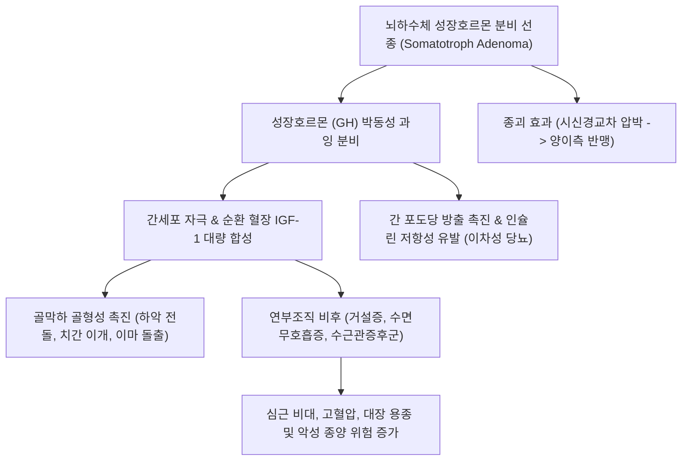

# 🩺 [[말단비대증]] (Acromegaly / 末端肥大症, E22.0)

> **핵심 3줄 요약 (Key Summary)**:
> - 📍 병소 부위 & 해부·병태생리: 접형골 터키안 내 뇌하수체 전엽의 성장호르몬 분비 선종(Somatotroph Adenoma)으로 골단판 폐쇄 후 성장호르몬([[GH]]) 및 간 유래 [[IGF-1]]이 지속 과잉 분비되어 골막하 골형성 및 전신 연부조직·장기가 병적으로 비대해지는 희귀 만성 내분비 질환.
> - 🚩 전형적 임상 양상 & 3대 징후: 손·발 크기의 점진적 증대(반지·신발 맞지 않음), 하악골 전돌(주걱턱) 및 치간 이개, 거설증 및 폐쇄성 수면무호흡증([[수면무호흡증]]), 시신경교차 압박에 의한 양이측 반맹.
> - 🛠️ 핵심 감별 검사 & 한·양방 다각적 치료 전략: 경구 포도당 부하 검사(OGTT) GH 비억제 확인 및 혈청 IGF-1 측정, 접형동 경유 절제술([[TSA]]) 및 소마토스타틴 유사체, 한의 담어호결(痰瘀互結)·비신양허 변증 한약 및 턱관절 추나, 수근관 감압 침구 복합 치료.
> - ⚠️ 응급 의뢰 레드플래그 & 악화 요인: 뇌하수체 선종 내 급성 출혈·경색으로 인한 뇌하수체 졸중(Pituitary Apoplexy: 벼락 두통, 급격한 시력 상실, 동안신경 마비) 또는 심근비대증에 따른 울혈성 심부전 징후 시 즉시 상급병원 신경외과 응급 전원.

---

## 📌 목차
1. [질환 개요 & 해부학적 병태생리](#1-질환-개요--해부학적-병태생리)
2. [병태생리 메커니즘 & 생체역학적 악순환 네트워크](#2-병태생리-메커니즘--생체역학적-악순환-네트워크)
3. [임상 증상 & 이학적 검사(Physical Exam) 알고리즘](#3-임상-증상--이학적-검사physical-exam-알고리즘)
4. [감별 진단 매트릭스 (Differential Diagnosis)](#4-감별-진단-매트릭스-differential-diagnosis)
5. [한의 통합 치료 프로토콜 (침·약침·추나·한약)](#5-한의-통합-치료-프로토콜-침약침추나한약)
6. [양방 치료 & 병용·의뢰 기준 (Conventional Treatment & Referral)](#6-양방-치료--병용의뢰-기준-conventional-treatment--referral)
7. [재활 운동 & 생활습관 티칭 가이드](#7-재활-운동--생활습관-티칭-가이드)
8. [💡 사용자 진료실 핵심 필기 & 임상 노하우 (Melt-In 잔여 심화 집약)](#8--사용자-진료실-핵심-필기--임상-노하우-melt-in-잔여-심화-집약)
9. [출처 및 학술 참고 문헌 (References)](#9-출처-및-학술-참고-문헌-references)

---

## 1. 질환 개요 & 해부학적 병태생리

* **질환 정의 및 발병 특성**:
  * 골단판(Growth plate)이 유합된 성인기에 뇌하수체 전엽의 성장호르몬 분비 선종에 의해 [[GH]]와 [[IGF-1]]이 지속 과잉 분비되어, 뼈의 폭이 두꺼워지는 골막하 증식과 연부조직 및 내부 장기가 비정상적으로 비대해지는 질환이다.
  * 소아기 성장판 폐쇄 전에 발병하면 길이 성장이 과도해지는 [[거인증]](Gigantism)으로 나타난다.
  * 연간 인구 100만 명당 3~4명 발병하는 희귀 질환이며, 증상이 매우 은밀하고 서서히 진행되어 첫 증상 발현부터 최종 진단까지 평균 7~10년이 지연된다.

* **관련 해부학적 구조물**:
  * **터키안(Sella Turcica) 및 뇌하수체**: 접형골 안장 내 위치한 뇌하수체 전엽의 단클론성 선종.
  * **인접 신경 구조**: 뇌하수체 직상부에 위치한 [[시신경교차]](Optic chiasm), 해면정맥동 내의 동안신경(CN III), 활차신경(CN IV), 외전신경(CN VI).
  * **골격 및 관절 계통**: 하악골(Mandible), 턱관절(TMJ), 전두골, 손목 수근골, 척추체 골증식체 및 관절 연골 비후.

---

## 2. 병태생리 메커니즘 & 생체역학적 악순환 네트워크

* **골막하 증식 및 연부조직 비대의 기전**:
  * 골단판이 닫힌 성인은 장골의 길이 성장은 불가능하지만, 골막하 조골세포가 IGF-1에 의해 자극받아 손가락, 발가락, 하악골, 쇄골의 두께가 비정상적으로 증식한다.
  * 글리코사미노글리칸(GAG) 침착과 세포 외 기질 증식으로 피부, 혀, 인두 연조직, 내부 장기(심장, 간, 갑상선)가 거대해진다.

---

## 3. 임상 증상 & 이학적 검사(Physical Exam) 알고리즘

### 1) 전형적 임상 증상 양상
* **골격 및 외모 변화**: 손발이 커져 반지나 신발을 자주 바꿈, 주걱턱(하악골 전돌), 치아 사이가 벌어짐(치간 이개), 눈썹 뼈(전두골) 돌출.
* **연부조직 및 압박 징후**:
  - [[수근관 증후군]](정중신경 압박으로 인한 양손 저림).
  - 거설증(혀가 두꺼워짐) 및 심한 코골이, 폐쇄성 [[수면무호흡증]](OSAS).
  - 피부가 두껍고 기름지며 땀이 과도하게 남(다한증).
* **종괴 압박 징후**: 만성 두통, 시신경교차 압박에 의한 **양이측 반맹(Bitemporal hemianopsia)**.

### 2) 이학적 및 내분비 진단 검사 알고리즘
1. **혈청 IGF-1 측정 (1차 선별 검사)**:
   - GH는 일주 변동이 심하므로, 혈청 내 반감기가 긴 IGF-1을 측정 (성별·연령 기준치 초과 시 확진 단계 진행).
2. **75g 경구 포도당 부하 검사 (75g OGTT - 확진 표준)**:
   - 정상인은 포도당 부하 후 GH가 $1.0	ext{ ng/mL}$ (고감도 검사 시 $<0.4	ext{ ng/mL}$) 이하로 억제되나, 말단비대증 환자는 **GH가 억제되지 않고 높은 수치 유지**.
3. **뇌 뇌하수체 조영증강 MRI**:
   - 뇌하수체 거대선종(Macroadenoma, 직경 >10mm) 또는 미세선종 확인, 시신경 압박 및 해면정맥동 침범 여부 평가.
4. **시야 검사 (Humphrey Visual Field)**: 양이측 반맹 확인.

---

## 4. 감별 진단 매트릭스 (Differential Diagnosis)

| 감별 질환 | 발병 시기 | OGTT GH 억제 여부 | 핵심 임상 특징 |
| :--- | :--- | :--- | :--- |
| **[[말단비대증]]** (본 질환) | 성인기 (성장판 폐쇄 후) | **비억제 (양성)** | 하악 전돌, 손발 비대, 거설증, 수면무호흡 |
| **[[거인증]] (Gigantism)** | 소아·청소년기 (성장판 유합 전) | 비억제 (양성) | 극단적인 신장 과다 성장, 장골 길이 증대 |
| **가성 말단비대증 (Pseudoacromegaly)** | 전 연령 | **완전 정상 억제** | 중증 인슐린 저항성, 외모만 유사함 |
| **원발성 골관절염** | 고령 | 정상 범위 | 관절 연골 마모, 연부조직 비후 없음 |

---

## 5. 한의 통합 치료 프로토콜 (침·약침·추나·한약)

* **침구 치료 (Acupuncture)**:
  * **수근관 감압 혈위**: 대릉(PC7), 내관(PC6), 외관(TE5), 합곡(LI4), 팔사(EX-UE9).
  * **턱관절 및 안면 혈위**: 하관(ST7), 협거(ST6), 예풍(TE17), 청궁(SI19).
  * **전신 기혈 조절**: 백회(GV20), 풍지(GB20), 족삼리(ST36), 태충(LR3), 음릉천(SP9).
* **약침 치료 (Pharmacopuncture)**:
  * 비후된 굴근지대 주변 및 턱관절낭에 신바로약침 또는 중성어혈약침을 0.2cc씩 주입하여 국소 염증과 신경 포착압 완화.
  * 수술 후 뇌하수체 기능 저하 환자의 신유(BL23), 기해(CV6)에 자하거 약침 시술.
* **추나 치료 (Chuna Manipulation)**:
  * **턱관절(TMJ) 교정 추나**: 하악 과돌출로 인한 턱관절 디스크 변위를 완화하기 위해 익돌근 이완 및 하악두 견인-후하방 가동기법 적용.
  * **수근골 감압 추나**: 주상골-월상골 가동술과 수근관 횡수근인대 이완수기 시행.
* **한약 치료 (Herbal Medicine)**:
  * **담어호결·관절통증형(사지 관절통, 손발 저림, 설태 후박)**: [[이진탕]](二陳湯) 합 도홍사물탕, 소활락단 가감.
  * **수술 후 기혈양허·비신부족형(수술 후 무기력, 피로, 부종)**: [[보중익기탕]](補中益氣湯) 또는 [[십전대보탕]](十全大補湯) 가 녹각, 두충.

---

## 6. 양방 치료 & 병용·의뢰 기준 (Conventional Treatment & Referral)

* **1차 표준 치료: 경접형동 접근 뇌하수체 절제술([[TSA]])**:
  * 코 안쪽 접형동을 통해 뇌하수체 선종을 내시경/현미경으로 완전 절제 (미세선종 완치율 80~90%, 거대선종 40~50%).
* **약물 치료 요법 (수술 불응 또는 수술 불가 시)**:
  * **소마토스타틴 유사체(SSA)**: 옥트레오타이드(Octreotide LAR), 란레오타이드(Lanreotide) 월 1회 근육주사로 GH 분비 억제.
  * **GH 수용체 길항제**: 페그비소만트(Pegvisomant) 매일 피하주사.
  * **도파민 작용제**: 카버골린(Cabergoline) 경구 투여.
* **방사선 수술**: 잔여 종양에 대해 감마나이프(Gamma Knife) 수술.
* **신경외과 응급 전원 기준**:
  * **뇌하수체 졸중(Pituitary Apoplexy)**: 선종 내 급성 출혈로 돌발성 벼락 두통, 급격한 시력 저하, 안근 마비 발생 시 즉시 응급 감압술 의뢰.

---

## 7. 재활 운동 & 생활습관 티칭 가이드

* **턱관절 6-6-6 운동법**:
  * 혀끝을 입천장 앞니 뒤에 대고, 혀가 떨어지지 않는 범위 내에서 입을 천천히 벌렸다 닫는 운동을 1회 6초씩, 6회 반복, 하루 6회 시행.
* **정중신경 활주 운동(Nerve Gliding Exercise)**:
  * 손목과 손가락을 신전시키고 엄지를 벌리는 활주 동작을 통해 수근관 내 신경 유착 방지.
* **수면무호흡증 관리**:
  * 거설증으로 인한 기도 폐쇄를 줄이기 위해 옆으로 누워 자기 지도 및 양압기(CPAP) 사용 권장.
* **대장내시경 정기 검진 필수**:
  * IGF-1 과잉은 대장 용종 및 대장암 발생 위험을 높이므로 진단 시점부터 2~3년 주기로 대장내시경 검진 권고.

---

## 8. 💡 사용자 진료실 핵심 필기 & 임상 노하우 (Melt-In 잔여 심화 집약)

* **진료실 말단비대증 조기 의심 4대 질문**:
  1. *"최근 몇 년 사이에 평소 끼던 결혼반지가 작아져서 손가락에서 안 빠지거나 사이즈를 늘리신 적이 있습니까?"*
  2. *"발이 커져서 신던 신발들이 작아져 치수를 올리셨습니까?"*
  3. *"모자가 작아졌거나, 아래턱이 튀어나와 윗니와 아랫니가 맞물리지 않습니까?"*
  4. *"옛날 신분증 사진이나 5~10년 전 사진과 비교했을 때 코와 턱선이 뚜렷하게 두꺼워졌습니까?"*
* **손저림(수근관증후군) 환자에서 놓치지 말아야 할 신체 징후**:
  * 양손 저림으로 내원한 환자에서 손바닥 피부가 유난히 두껍고 땀이 축축하게 차 있으며 손가락 뼈마디가 굵어져 있다면, 단순 건초염이 아니라 뇌하수체 종양을 의심하고 혈청 IGF-1 검사를 위해 내분비내과로 의뢰해야 함.

---

## 9. 출처 및 학술 참고 문헌 (References)

- Melmed S. (2009). Acromegaly pathogenesis and treatment. *J Clin Invest*. 119(11):3189-3202. PMID: 19884662.

- Mazziotti G. (2026). Acromegalic osteoarthropathy: a new paradigm of pathological and clinical complexities. *J Endocrinol Invest*. 49(2):145-158. PMID: 42736608.

- Giustina A. (2026). Consensus on acromegaly complications: an update. *Pituitary*. 29(1):1-18. PMID: 42050227.
