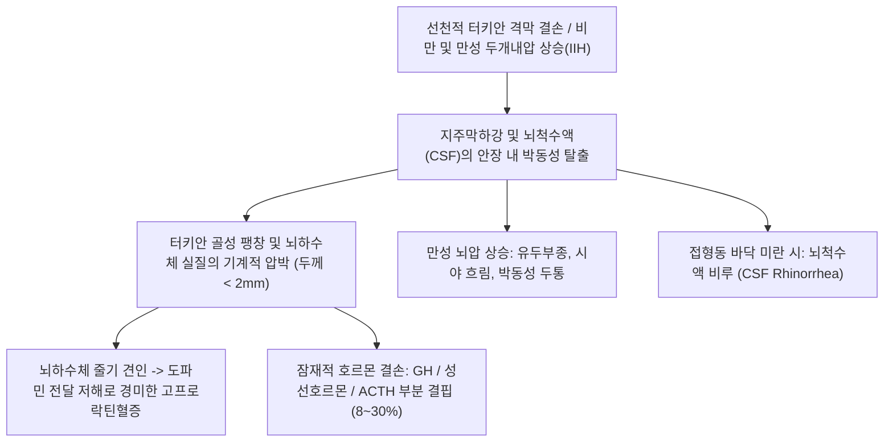

# 🩺 [[빈안장 증후군]] (Empty Sella Syndrome / 空鞍狀症候群)

> **핵심 3줄 요약 (Key Summary)**:
> - 📍 병소 부위 & 해부·병태생리: 터키안 격막(Diaphragma sellae)의 선천적 결손이나 불완전 폐쇄, 또는 만성 두개내압 상승으로 인해 지주막하강(Subarachnoid space)과 뇌척수액(CSF)이 터키안 내로 탈출하여 뇌하수체를 안장 바닥으로 납작하게 압박하는 질환.
> - 🚩 전형적 임상 양상 & 3대 징후: 중년 비만 여성에서의 만성 난치성 두통, 뇌압 상승에 따른 시각 장애(시야 흐림, 일시적 시력 암점), 경미한 내분비 기능 이상(고프로락틴혈증, GH/성선 호르몬 결핍).
> - 🛠️ 핵심 감별 검사 & 한·양방 다각적 치료 전략: 안장 뇌 MRI(T2 강조 영상에서 터키안 내 뇌척수액 충만 및 뇌하수체 실질의 초승달 모양 압박 확인), 기초 뇌하수체 호르몬 검사, 증상 없을 시 경과 관찰, 두개내압 상승 시 아세타졸아마이드(Acetazolamide) 또는 감압술, 한의 풍담두통(風痰頭痛)·간양상항 변증 침구(풍지, 태양, 백회, 합곡) 및 거담개규·온보비신 한약(반하백출천마탕, 조등산).
> - ⚠️ 응급 의뢰 레드플래그: 뇌척수액 비루(CSF Rhinorrhea: 코로 맑은 액체 지속 누출로 세균성 뇌수막염 위험), 안저 검사 상 유두부종(Papilledema) 및 시신경 위축, 급격한 시력 저하 발생 시 즉시 신경외과/신경과 응급 의뢰.

---

## 📌 목차
1. [질환 개요 & 해부학적 병태생리](#1-질환-개요--해부학적-병태생리)
2. [병태생리 메커니즘 & 생체역학적 악순환 네트워크](#2-병태생리-메커니즘--생체역학적-악순환-네트워크)
3. [임상 증상 & 이학적 검사(Physical Exam) 알고리즘](#3-임상-증상--이학적-검사physical-exam-알고리즘)
4. [감별 진단 매트릭스 (Differential Diagnosis)](#4-감별-진단-매트릭스--differential-diagnosis)
5. [한의 통합 치료 프로토콜 (침·약침·추나·한약)](#5-한의-통합-치료-프로토콜--침약침추나한약)
6. [양방 치료 & 병용·의뢰 기준 (Conventional Treatment & Referral)](#6-양방-치료--병용의뢰-기준-conventional-treatment--referral)
7. [재활 운동 & 생활습관 티칭 가이드](#7-재활-운동--생활습관-티칭-가이드)
8. [💡 사용자 진료실 핵심 필기 & 임상 노하우 (Melt-In 잔여 심화 집약)](#8--사용자-진료실-핵심-필기--임상-노하우--melt-in-잔여-심화-집약-)
9. [출처 및 학술 참고 문헌 (References)](#9-출처-및-학술-참고-문헌--references-)

---

## 1. 질환 개요 & 해부학적 병태생리

* **정의 및 핵심 병태**:
  * 빈안장 증후군(Empty Sella Syndrome, ESS)은 뇌 영상 검사(MRI 또는 CT) 상에서 터키안(Sella turcica)의 내부가 정상적인 뇌하수체 조직 대신 뇌척수액(CSF)으로 채워져 있고, 뇌하수체 실질은 안장 바닥이나 후벽으로 납작하게 압축되어 '비어 있는 것처럼 보이는' 해부학적·임상적 상태이다.
  * **원발성(Primary ESS)**과 **속발성(Secondary ESS)**으로 대별된다.
* **관련 해부학적 구조물**:
  * **터키안 격막(Diaphragma Sellae)**: 접형골 터키안 상부를 덮는 단단한 경막 주름으로, 중앙의 작은 구멍(줄기 통과부)을 제외하고는 지주막하강과 터키안을 분리함. 격막이 선천적으로 헐겁거나 결손되면 지주막이 터키안 내로 헤르니아(탈출)됨.
  * **뇌하수체 실질(Pituitary Gland)**: 뇌척수액의 박동성 유체 압력에 의해 두께가 $2\,\mathrm{mm}$ 이하로 납작해지지만, 대부분의 경우 잔여 조직의 내분비 예비능이 유지됨.
  * **시신경교차(Optic Chiasm)**: 터키안 격막의 결손 부위로 시신경교차가 견인되어 안장 내로 함입될 경우 시각 장애가 초래됨.
* **원인 분류**:
  * **원발성 빈안장**: 기저의 두개내압 상승(특발성 두개내 고혈압, IIH), 다산부 여성, 비만, 고혈압 환자에서 터키안 격막 결손과 동반되어 발생.
  * **속발성 빈안장**: 뇌하수체 선종의 수술적 절제 후, 방사선 치료 후, 선종의 자발성 괴사(뇌하수체 졸중), 시한 증후군, 림프구성 뇌하수체염 회복 후 발생.

---

## 2. 병태생리 메커니즘 & 생체역학적 악순환 네트워크

* **수두증 및 두개내압(ICP)과의 연계**:
  * 비만 환자에서 복압 상승 -> 흉강 내압 상승 -> 뇌정맥동 압력 상승 -> 뇌척수액 흡수 장애로 이어지는 만성 경미한 뇌압 상승이 지주막 탈출의 주된 원동력으로 작용한다.
* **내분비 기능 이상의 병태생리**:
  * 실질 압박에도 불구하고 뇌하수체 세포는 여포 형태의 얇은 층을 이루며 기능을 유지하므로 범뇌하수체기능저하증은 드물다. 그러나 뇌하수체 줄기가 늘어나면서 시상하부 도파민의 억제 작용이 약화되어 가벼운 **고프로락틴혈증(10~15%)**이 나타나거나, 성장호르몬(GH) 분비능 저하가 선행될 수 있다.

---

## 3. 임상 증상 & 이학적 검사(Physical Exam) 알고리즘

* **주요 임상 증상**:
  * 대부분 무증상이며 두통이나 어지럼증으로 시행한 뇌 영상 검사에서 우연히 발견됨(Incidentaloma).
  * **두통 (Headache, 60~80%)**: 후두부나 전두부의 만성 둔통, 아침 기상 시 악화, 기침이나 힘주기 시 악화(뇌압 상승 반영).
  * **시각 증상**: 일시적인 시야 흐림(Visual obscurations), 시야 결손(드물게 양이측반맹).
  * **내분비 증상**: 유즙 누출, 생리 불순, 피로감, 성욕 감퇴(호르몬 결핍 동반 시).
* **이학적 및 신경안과적 검사**:
  * **안저 검사 (Fundoscopy)**: 특발성 두개내 고혈압(IIH) 동반 여부를 판별하기 위해 **유두부종(Papilledema)** 유무 확인 필수.
  * **시야 검사 (Humphrey Perimetry)**: 맹점 확대(Blind spot enlargement) 및 시야 결손 평가.
  * 체질량지수(BMI) 및 혈압 측정(대사증후군 동반율 높음).
* **영상 및 내분비 진단 검사 알고리즘**:
  1. **터키안 조영증강 뇌 MRI**:
     * **완전 빈안장(Complete ESS)**: 안장의 50% 이상이 CSF로 채워지고 뇌하수체 두께가 $2\,\mathrm{mm}$ 이하.
     * **부분 빈안장(Partial ESS)**: 안장의 50% 미만이 CSF로 채워지고 뇌하수체 두께가 $3\sim 7\,\mathrm{mm}$.
  2. **기초 호르몬 검사 패널**: 혈청 TSH/Free T4, 아침 코르티솔/ACTH, 프로락틴, IGF-1, LH/FSH 측정(잠재적 호르몬 결핍 선별).

---

## 4. 감별 진단 매트릭스 (Differential Diagnosis)

| 질환 | 터키안 MRI 소견 | 호르몬 이상 소견 | 임상 특징 및 감별점 |
| :--- | :--- | :--- | :--- |
| **[[빈안장 증후군]] (Primary ESS)** | 안장 내 CSF 충만, 납작한 실질, 터키안 골 확장 | 대부분 정상, 경미한 프로락틴 상승(10%) | 중년 비만 여성, 만성 두통, 우연 발견 |
| **뇌하수체 낭종 (Rathke's Cleft Cyst)** | 안장 내 단일 낭성 병변, T1/T2 신호 다양 | 줄기 압박 시 경미한 호르몬 이상 | CSF와 신호 강도가 다름, 조영증강 벽 |
| **두개인두종 (Craniopharyngioma)** | 안장 상부 낭성 종괴, 석회화 및 고형 결절 | 요붕증 및 다발 호르몬 결핍 흔함 | 소아/고령 호발, 시야 장애 뚜렷 |
| **특발성 두개내 고혈압 (IIH)** | 빈안장 소견 동반, 후안구 편평화, 시신경초 확장 | 대개 정상 | 가임기 비만 여성, 박동성 이명, 중증 유두부종 |
| **뇌하수체 거대선종 수술 후** | 안장 내 수술흔 및 이차적 CSF 충만 | 수술 전후 호르몬 결핍 흔함 | 수술 병력 확인 (속발성 빈안장) |

---

## 5. 한의 통합 치료 프로토콜 (침·약침·추나·한약)

* **치료 원칙**:
  * 구조적 빈안장 자체는 교정 대상이 아니며, 한의 치료는 **두개내압 항진 완화, 만성 혈관성/근긴장성 두통 조절, 대사증후군(비만/인슐린 저항성) 개선, 뇌혈류 림프 순환 촉진**에 집중함.
* **침구 치료**:
  * **두통 완화 및 뇌압 분산**:
    * [[풍지(GB20)]], [[태양(EX-HN5)]], [[백회(GV20)]], [[사신총(EX-HN1)]], [[합곡(LI4)]], [[태충(LR3)]].
    * 풍지와 완골혈 침치료는 후두하삼각 근막 긴장을 이완하여 척추동맥 및 추골정맥총의 혈류 환류를 원활히 함.
  * **수액 대사 및 체액 저류 개선**:
    * [[음릉천(SP9)]], [[풍륭(ST40)]], [[족삼리(ST36)]], [[삼음교(SP6)]].
* **약침 요법**:
  * **황련해독탕 약침**:
    * 풍지(GB20), 대추(GV14)에 주입하여 상초(上焦)의 화열을 내리고 두개내 긴장 완화.
* **추나 및 두개천골 요법 (Cranial Technique)**:
  * 경추 교정 및 후두골-천골 간 경막 긴장 완화 기법(CV4 기법, 정맥동 배액 기법)을 적용하여 뇌척수액의 순환 및 재흡수 촉진.
* **변증 한약 처방**:
  * **담탁상몽·풍담두통(痰濁上蒙·風痰頭痛형 — 비만, 묵직하고 띵한 두통, 어지럼증, 오심, 설태 백니)**:
    * [[반하백출천마탕]]: 반하, 백출, 천마, 복령, 진피. 담음을 삭이고 풍을 가라앉혀 뇌압성 두통을 신속히 완화.
  * **간양상항·어혈조락(肝陽上亢·瘀血阻絡형 — 욱신거리는 박동성 두통, 안면 상열, 고혈압 동반)**:
    * [[조등산]] 또는 [[천마구등음]] 가 도인, 홍화, 국화.
  * **기혈양허·신음부족(氣血兩虛·腎陰不足형 — 피로, 어지럼증, 요슬산연, 경미한 호르몬 저하)**:
    * [[보중익기탕]] 합 육미지황탕 가감.

---

## 6. 양방 치료 & 병용·의뢰 기준 (Conventional Treatment & Referral)

* **보존적 경과 관찰 (Observation)**:
  * 임상 증상이 없고 호르몬 검사가 정상인 원발성 빈안장 증후군은 치료가 불필요하며, 정기적인 안저 및 호르몬 추적 관찰로 충분함.
* **약물 치료**:
  * **두개내압 강하제**:
    * **아세타졸아마이드(Acetazolamide, 다이아목스)**: 500~1,000mg/day 경구 투여. 맥락총의 탄산탈수효소를 억제하여 뇌척수액 생성을 감소시킴(IIH 동반 시).
    * 두통 조절을 위한 토피라메이트(Topiramate - 체중 감량 효과 동반).
  * **호르몬 대체요법**: 호르몬 결핍이 확인된 경우 부족한 호르몬(갑상선, 코르티솔, 성호르몬 등)을 보충.
* **수술적 치료 적응증**:
  * **뇌척수액 비루(CSF Rhinorrhea)**: 접형동 파열 부위를 통한 뇌척수액 누출 시 내시경적 경접형동 두개저 재건술 필수.
  * 약물 불응성 두개내 고혈압 및 시력 저하 시 뇌실-복강간 단락술(VP shunt) 또는 요추-복강간 단락술(LP shunt).
* **한의 병용 시 주의사항**:
  * 아세타졸아마이드 복용 중인 환자는 저칼륨혈증 및 대사성 산증 위험이 있으므로 한약 투약 시 전해질 모니터링 주의.
* **신경외과/안과 긴급 전원 기준**:
  * 코에서 투명한 액체가 지속적으로 흐르는 경우(CSF 비루 의심).
  * 유두부종의 급격한 악화나 시야 협착 발생 시.

---

## 7. 재활 운동 & 생활습관 티칭 가이드

* **체중 감량 (Weight Reduction - 핵심 치료)**:
  * 체중의 5~10% 감량만으로도 복압과 뇌정맥압이 감소하여 뇌척수액 압력이 정상화되고 두통이 극적으로 호전됨.
  * 저염식 및 규칙적인 유산소 운동(수영, 걷기) 지도.
* **복압 및 뇌압 상승 행위 차단**:
  * 심한 기침, 대변 시 과도한 힘주기, 꽉 끼는 보정 속옷 착용 자제.
  * 수면 시 베개 높이를 $15\sim 30^\circ$ 약간 높여 뇌정맥 환류 촉진.

---

## 8. 💡 사용자 진료실 핵심 필기 & 임상 노하우 (Melt-In 잔여 심화 집약)

* **MRI 결과지를 들고 공포에 질려 온 환자의 안심 티칭**:
  * "뇌하수체가 비어 있다는데 뇌에 구멍이 난 건가요?"라며 극도로 불안해하는 환자가 많음.
  * "뇌하수체가 없어진 것이 아니라 뇌척수액 물방울에 살짝 눌려 납작해진 것이며, 실제 기능은 대부분 정상이니 걱정하지 마시라"고 의학적으로 안심시키는 멘탈 케어가 증상 호전의 첫걸음임.
* **체중 감량과 반하백출천마탕의 시너지**:
  * 비만한 여성 빈안장 환자에게 습담(濕痰)을 없애는 [[반하백출천마탕]]을 투약하면서 식단 관리를 병행시켰을 때, 3개월 내 두통 빈도가 80% 이상 감소하는 임상례가 매우 빈번함.

---

## 9. 출처 및 학술 참고 문헌 (References)

* Demir MK, et al. (2026 Aug 3). MRI mimics of primary empty sella: a retrospective educational case series highlighting clinical and uncommon magnetic resonance imaging presentations. *Acta Neurol Belg*. PMID: 42545623

* Akcura C, et al. (2025 Sep 2). Endocrinological Differences Between Partial and Complete Primary Empty Sella: A Comparative Analysis. *Neuro Endocrinol Lett*. PMID: 40929707

* Steckel L, et al. (2025). Pituitary function in patients with primary and secondary empty sella. *Front Endocrinol (Lausanne)*. PMID: 40741178

