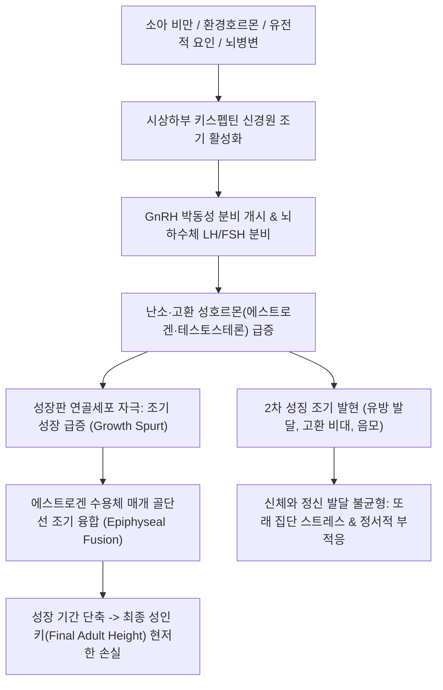

# 🩺 [[성조숙증]] (Precocious Puberty / 性早熟症)

> **핵심 3줄 요약 (Key Summary)**:
> - 📍 병소 부위 & 해부·병태생리: 시상하부-뇌하수체-성선 축(HPG Axis)이 조기 재활성화(진성/중추성, CPP)되거나, 부신·성선 종양 또는 외인성 성호르몬 노출로 HPG 축과 무관하게 2차 성징이 발현(가성/말초성, PPP)되어 여아 8세 미만, 남아 9세 미만에 사춘기 징후가 나타나는 소아 내분비 질환.
> - 🚩 전형적 임상 양상 & 3대 징후: 여아의 조기 유방 멍울(Breast bud) 발달 및 초경, 남아의 고환 용적 증가($\ge 4\,\mathrm{mL}$) 및 음경 증대, 조기 성장 급증(Growth spurt) 후 골단선 조기 폐쇄로 인한 성인 최종 신장 저하.
> - 🛠️ 핵심 감별 검사 & 한·양방 다각적 치료 전략: 좌측 수근부 X선 골연령(Bone age) 판정, GnRH 자극 검사(LH 피크 $\ge 5\,\mathrm{IU/L}$ 시 중추성 확진), 뇌 MRI 및 골반/고환 초음파, 1차 표준 치료인 GnRH 작용제(GnRHa, Leuprolide/Triptorelin) 데포 주사, 한의 간신음허(肝腎陰虛)·간경습열 변증 침구(태충, 삼음교, 행간, 신수) 및 자음강화·청간사화 한약(지백지황탕, 대황자충환 가감, 단치소요산).
> - ⚠️ 응급 의뢰 레드플래그: 남아의 급격한 성조숙(중추신경계 종양 동반율 40~50% 이상으로 높음), 두통·구토 등 뇌압 상승 징후, 복부/고환 종괴 촉지, 남아의 편측성 고환 비대(고환 종양 의심) 시 즉시 소아청소년과/소아신경외과 정밀 의뢰.

---

## 📌 목차
1. [질환 개요 & 해부학적 병태생리](#1-질환-개요--해부학적-병태생리)
2. [병태생리 메커니즘 & 생체역학적 악순환 네트워크](#2-병태생리-메커니즘--생체역학적-악순환-네트워크)
3. [임상 증상 & 이학적 검사(Physical Exam) 알고리즘](#3-임상-증상--이학적-검사physical-exam-알고리즘)
4. [감별 진단 매트릭스 (Differential Diagnosis)](#4-감별-진단-매트릭스--differential-diagnosis)
5. [한의 통합 치료 프로토콜 (침·약침·추나·한약)](#5-한의-통합-치료-프로토콜--침약침추나한약)
6. [양방 치료 & 병용·의뢰 기준 (Conventional Treatment & Referral)](#6-양방-치료--병용의뢰-기준-conventional-treatment--referral)
7. [재활 운동 & 생활습관 티칭 가이드](#7-재활-운동--생활습관-티칭-가이드)
8. [💡 사용자 진료실 핵심 필기 & 임상 노하우 (Melt-In 잔여 심화 집약)](#8--사용자-진료실-핵심-필기--임상-노하우--melt-in-잔여-심화-집약-)
9. [출처 및 학술 참고 문헌 (References)](#9-출처-및-학술-참고-문헌--references-)

---

## 1. 질환 개요 & 해부학적 병태생리

* **정의 및 진단 연령 기준**:
  * 정상적인 사춘기 발달 시기보다 일찍 2차 성징이 출현하는 상태이다.
  * **여아**: 만 8세 미만(8세 생일 전)에 유방 발달(Tanner stage B2 이상)이 나타남.
  * **남아**: 만 9세 미만(9세 생일 전)에 고환 용적이 $4\,\mathrm{mL}$ 이상으로 커짐(Tanner stage G2 이상).
* **관련 해부학적 구조물 및 조절 축**:
  * **시상하부 키스펩틴-GPR54 축**: 사춘기 시작의 핵심 분자 스위치로, 키스펩틴(Kisspeptin) 뉴런이 GnRH 뉴런을 박동성으로 자극함.
  * **시상하부-뇌하수체-성선 축(HPG Axis)**: 박동성 GnRH -> 뇌하수체 전엽 LH/FSH 분비 -> 난소(에스트로겐) 및 고환(테스토스테론) 분비 촉진.
  * **성장판(Epiphyseal Growth Plate)**: 성호르몬은 IGF-1과 협력하여 단기적으로 연골세포 분열을 촉진해 급성장(Spurt)을 유발하지만, 장기적으로는 성장판 연골의 골화를 앞당겨 조기 폐쇄를 일으킴.
* **원인별 분류**:
  * **중추성 성조숙증 (진성, Central Precocious Puberty, CPP)**: HPG 축의 조기 성숙. 여아는 90% 이상이 특발성(Idiopathic)이나, 남아는 40~50% 이상에서 시상하부 과오종, 교종, 지주막 낭종 등 기질적 뇌병변이 발견됨.
  * **말초성 성조숙증 (가성, Peripheral Precocious Puberty, PPP)**: HPG 축과 무관하게 자율적으로 성호르몬 분비. 난소 낭종/종양, 고환 라이디히세포종, 부신피질 종양, 선천성 부신과형성증(CAH), 맥쿤-올브라이트 증후군(McCune-Albright syndrome).
  * **양성 사춘기 변이형**: 단순 조기 유방발육증(Thelarche), 단순 조기 음모발생증(Adrenarche).

---

## 2. 병태생리 메커니즘 & 생체역학적 악순환 네트워크

* **골연령 가속과 최종 신장 손실 기전**:
  * 성호르몬(특히 에스트로겐)은 연골세포의 노화를 촉진하고 세포외 기질 광물화를 가속화하여 골연령(Bone age)을 역연령(Chronological age)보다 2~3년 이상 앞서가게 만든다.
  * 소아기에는 또래보다 키가 훨씬 크지만, 성장판이 조기에 닫혀 결국 성인 최종 신장은 유전적 잠재 신장(Target height)보다 5~10cm 이상 작아지는 역설적 결과를 초래한다.
* **비만과 성조숙증의 상호 악순환**:
  * 소아 비만으로 인한 지방세포 증가 -> 렙틴(Leptin) 분비 증가 -> 시상하부 GnRH 자극 -> 성조숙 촉진. 지방조직 내 아로마타제(Aromatase) 활성으로 안드로겐의 에스트로겐 전환 증가.

---

## 3. 임상 증상 & 이학적 검사(Physical Exam) 알고리즘

* **성별 특징적 임상 양상**:
  * **여아**: 가슴에 멍울이 잡히고 스치면 아픔(유두 착색 및 돌출), 질 분비물(냉) 증가, 체취(머리 냄새, 암내) 발생, 조기 초경.
  * **남아**: 고환이 대추알 크기($\ge 4\,\mathrm{mL}$) 이상으로 커짐, 음경이 길어지고 색소 침착, 변성기, 콧수염, 여드름.
  * **공통**: 급격한 신장 성장(연간 $7\sim 8\,\mathrm{cm}$ 이상 급성장).
* **이학적 성숙도 평가 (Tanner Staging)**:
  * 유방(B1~B5), 외음부/음모(PH1~PH5), 고환(오키도미터, Prader orchidometer 이용 $1\sim 25\,\mathrm{mL}$ 측정).
* **진단 및 감별 검사 알고리즘**:
  1. **좌측 수근부 단순 방사선 검사 (Bone Age X-ray)**: Greulich-Pyle 도해를 이용하여 골연령 측정(골연령이 역연령보다 1년 이상 앞서 있는지 확인).
  2. **GnRH 자극 검사 (표준 확진 검사)**:
     * GnRH $100\,\mu\mathrm{g}$ 투여 후 15~30분 간격으로 LH, FSH 측정.
     * **황체형성호르몬(LH) 최고 농도(Peak LH) $\ge 5.0\,\mathrm{IU/L}$** 및 $\mathrm{LH/FSH}$ 비 $> 0.6$ 시 중추성 성조숙증(CPP) 확진.
  3. **터키안 뇌 MRI**: 남아의 모든 CPP 및 6세 미만 여아의 CPP에서 뇌종양(과오종 등) 감별 필수.
  4. 골반 초음파(여아 난소/자궁 용적), 고환 초음파(남아).

---

## 4. 감별 진단 매트릭스 (Differential Diagnosis)

| 질환 분류 | HPG 축 활성화 | GnRH 자극 후 LH 반응 | 골연령 진행 | 핵심 감별점 |
| :--- | :--- | :--- | :--- | :--- |
| **중추성 성조숙증 (진성 CPP)** | 활성화됨 | **Peak LH $\ge 5.0\,\mathrm{IU/L}$** | 뚜렷하게 가속 | 여아 다수 특발성, 남아 뇌병변 의심, 유방/고환 동시 발달 |
| **말초성 성조숙증 (가성 PPP)** | 억제됨 | Peak LH $< 5.0\,\mathrm{IU/L}$ (무반응) | 가속됨 | 난소 낭종, 고환 종양, 부신 질환, 남아의 경우 고환 크기는 작은데 음경만 커짐 |
| **단순 조기 유방발육증** | 비활성화 | 무반응 (FSH만 경미 상승) | 정상 (가속 없음) | 2세 미만 영아 호발, 유방만 일시적 멍울, 성장 급증 없음 |
| **단순 조기 음모발생증** | 비활성화 | 무반응 | 정상이거나 경미 가속 | DHEA-S 미세 상승, 유방/고환 발달 없음 |
| **선천성 부신과형성증 (CAH)** | 억제됨 | 무반응 | 현저한 가속 | 17-OHP 상승, 음핵 비대, 저나트륨혈증 동반 가능 |

---

## 5. 한의 통합 치료 프로토콜 (침·약침·추나·한약)

* **치료 원칙**:
  * 과항진된 성호르몬 분비를 조절하고, 성장판 조기 폐쇄를 지연시키며, 비만 및 스트레스를 관리하여 정상적인 성장 속도를 회복시킴.
* **침구 치료**:
  * **선혈 원칙**: 자음강화(滋陰降火), 청간사화(淸肝瀉火), 건비소도(健脾消導).
  * **주요 혈위**: [[태충(LR3)]], [[행간(LR2)]], [[삼음교(SP6)]], [[음릉천(SP9)]], [[신수(BL23)]], [[간수(BL18)]], [[족삼리(ST36)]], [[백회(GV20)]].
  * 소아 환자이므로 극세호침(0.16mm)을 사용하여 무통 자침하거나, 이침(신문, 내분비, 피질하) 및 피내침 활용.
* **약침 요법**:
  * **황련해독탕 약침**:
    * 간열(肝熱)과 허화(虛火)가 심한 소아의 간수(BL18), 신수(BL23)에 0.05~0.1cc씩 미량 주입.
* **추나 및 체형 교정**:
  * 소아 척추 가동술 및 하지 성장판 자극 추나(무릎 관절, 발목 관절 견인 기법)를 통해 혈류 순환 증진 및 키 성장 촉진.
* **변증 한약 처방**:
  * **음허화왕·간신음허(陰虛火旺·肝腎陰虛형 — 마르고 손발이 따뜻하며 도한, 도드라진 유방 멍울, 예민함)**:
    * [[지백지황탕]](知栢地黃탕): [[숙지황]], [[산약]], [[산수유]], [[복령]], [[택사]], [[목단피]], [[지모]], [[황백]]. 신음을 자양하고 상초의 허열을 내려 성호르몬 조기 분비 억제(임상 연구에서 골연령 지연 및 GnRH 억제 효과 입증).
  * **간경습열·간울화화(肝經濕熱·肝鬱化火형 — 과체중/비만, 두피 유분, 성격 급함, 흉협고만)**:
    * [[단치소요산]] 합 [[시호청간탕]]: [[시호]], [[황금]], [[치자]], [[백작약]], [[의이인]], [[차전자]].
  * **비허습담(脾虛濕痰형 — 소아 비만 동반 성조숙증)**:
    * 양위진식탕 또는 [[이진탕]] 가 [[산사]], [[신곡]], [[연교]].

---

## 6. 양방 치료 & 병용·의뢰 기준 (Conventional Treatment & Referral)

* **1차 표준 약물 치료: GnRH 작용제 (GnRH Agonist, GnRHa)**:
  * **류프로렐린(Leuprolide), 트립토렐린(Triptorelin)**:
    * 4주 또는 3개월 간격으로 피하/근육 데포 주사.
    * **기전**: 지속적인 수용체 자극으로 뇌하수체 GnRH 수용체의 탈감작(Down-regulation)을 유도하여 LH/FSH 및 성호르몬 분비를 사춘기 전 수준으로 강력히 억제함.
  * **치료 효과**: 유방 멍울 축소, 고환 크기 감소, 생리 억제, 골연령 진행 속도 정상화 -> 최종 성인 키 회복.
* **치료 기간 및 종료 시점**:
  * 대개 여아는 만 11~11.5세(골연령 12~12.5세), 남아는 만 12세(골연령 13세) 전후에 치료 종료. 주사 중단 후 평균 12~18개월 내 정상 초경 시작.
* **한의 병용 시 상호작용 및 역할**:
  * GnRHa 주사 치료 중 성장 속도가 지나치게 둔화(연간 $< 4\,\mathrm{cm}$)되는 소아에게 건비보신(健脾補腎) 한약 병용 시 성장 속도를 정상 범위로 유지하는 데 기여함.
  * 경계선에 있거나 주사 치료 적응증에 미치지 못하는 환아에서 지백지황탕 계열 한약 단독 투약으로 유방 멍울 축소 및 골연령 진행 지연 유도.
* **상급병원 정밀 의뢰 기준 (Red Flags)**:
  * 남아의 모든 성조숙 징후(뇌종양 배제 필수).
  * 급격한 시력 저하, 지속적 두통(두개내 종양 의심).
  * 복부 종괴 촉지, 편측성 고환 종대.

---

## 7. 재활 운동 & 생활습관 티칭 가이드

* **체중 및 식단 관리 (소아 비만 예방)**:
  * 패스트푸드, 탄산음료, 단순당, 트랜스지방 제한.
  * 야식을 금하고 취침 3시간 전 공복 유지.
* **환경호르몬(내분비계 장애물질, EDCs) 노출 차단**:
  * 일회용 플라스틱 용기, 종이컵 전자레인지 가열 금지(비스페놀 A, 프탈레이트 회피).
  * 향이 강한 화장품, 성호르몬 유사물질 함유 건강기능식품(석류, 홍삼, 태반 추출물 등) 무분별한 섭취 주의.
* **수면 및 신체 활동**:
  * 밤 10시 이전 취침하여 8~9시간의 숙면 확보(멜라토닌 분비 정상화는 사춘기 조기 촉발 억제에 기여).
  * 줄넘기, 농구, 스트레칭 등 성장판을 자극하는 운동 하루 30분 이상 매일 권장.

---

## 8. 💡 사용자 진료실 핵심 필기 & 임상 노하우 (Melt-In 잔여 심화 집약)

* **초진 시 부모의 불안 공감과 뼈나이 판정의 중요성**:
  * 부모들은 "성조숙증이면 키가 안 큰다는데 어쩌죠"라며 패닉에 빠져 내원함.
  * 단순히 유방 멍울만 보고 진단하지 말고 수근부 X-ray 뼈나이와 성장 속도를 객관적으로 분석해 "단순 조기 유방발육증"인 경우 불필요한 과잉 주사 치료를 막아주는 것이 훌륭한 1차 진료임.
* **지백지황탕(知栢地黃湯)의 임상적 실증**:
  * 가슴 멍울이 잡히기 시작한 7~8세 여아에게 지모·황백을 군약으로 한 지백지황탕을 3~6개월 투약했을 때, 유방 압통과 멍울이 부드럽게 소퇴되고 뼈나이 가속이 정상화되는 것을 임상에서 다수 관찰.
* **남아 성조숙증의 치명적 함정**:
  * 남아는 여아에 비해 발병률은 낮으나 기질적 원인(뇌종양 등)일 확률이 압도적으로 높으므로, 남아에게 고환 비대가 관찰되면 한방 치료에 머물지 말고 즉시 뇌 MRI를 촬영하도록 강력히 권고해야 함.

---

## 9. 출처 및 학술 참고 문헌 (References)

* Lin JQ, et al. (2026). Risk factors and preventive strategies for precocious puberty: a narrative review. *Front Pediatr*. PMID: 42807185

* Bizerea-Moga TO, et al. (2026 Sep 13). Obesity, Oxidative Stress, and Inflammation in Precocious Puberty: Do All Roads Lead to the Hypothalamus? *Int J Mol Sci*. PMID: 42794587

* Luo Y, et al. (2026). Syndrome differentiation and treatment of pediatric central precocious puberty: role of the spleen-kidney axis. *Front Immunol*. PMID: 42713456
