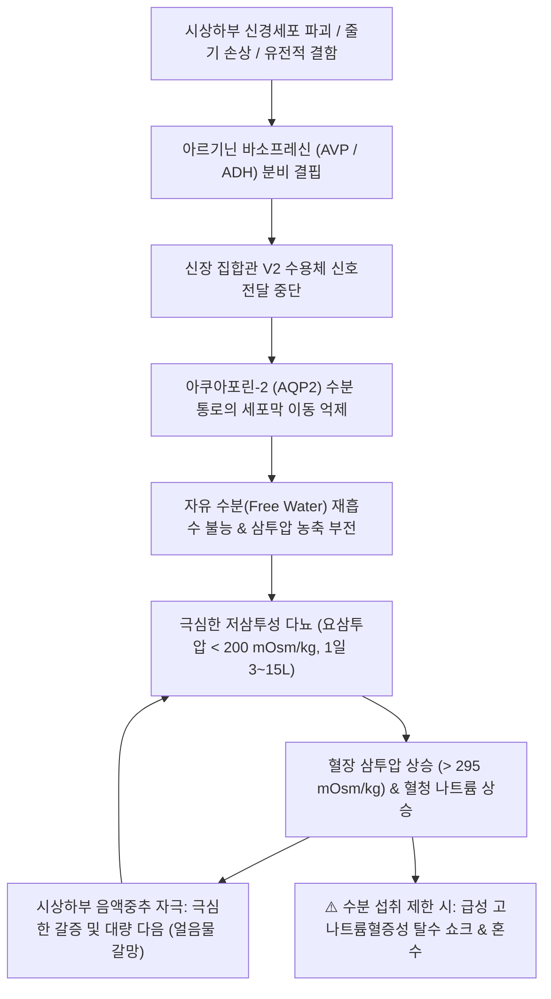

# 🩺 [[아르기닌 바소프레신 결핍증 중추성 요붕증]] (Arginine Vasopressin Deficiency / Central Diabetes Insipidus / 中樞性尿崩症)

> **핵심 3줄 요약 (Key Summary)**:
> - 📍 병소 부위 & 해부·병태생리: 시상하부 시상상핵(Supraoptic Nucleus) 및 실방핵(Paraventricular Nucleus)의 신경세포 손상으로 아르기닌 바소프레신(AVP, 항이뇨호르몬)의 합성 및 분비가 결핍되어 신장 집합관에서 수분 재흡수가 불가능해지는 질환 (2022~2026 국제 내분비학회 표준 명칭: AVP Deficiency, AVP-D).
> - 🚩 전형적 임상 양상 & 3대 징후: 통제할 수 없는 저삼투성 다뇨(하루 $3\sim 15\,\mathrm{L}$ 이상, 맑은 물 같은 소변), 극심한 갈증 및 다음(Polydipsia, 특히 얼음물 갈망), 수면을 방해하는 잦은 야간뇨(Nocturia).
> - 🛠️ 핵심 감별 검사 & 한·양방 다각적 치료 전략: 수분제한 검사(Water Deprivation Test) 및 데스모프레신 반응 검사, 혈청 코펩틴(Copeptin) 고장액 자극 검사, 터키안 뇌 MRI(T1 강조 뇌하수체 후엽 고신호 소실 확인), 1차 치료제 데스모프레신(Desmopressin, dDAVP 경구/비강 분무), 한의 신음부족(腎陰不足)·신양허 변증 침구(관원, 신수, 태계, 삼음교) 및 자음고신·생진지갈 한약(육미지황탕, 축천환, 옥녀전).
> - ⚠️ 응급 의뢰 레드플래그: 의식 저하, 갈증 기전 소실(Adipsia) 환자에서의 중증 고나트륨혈증 쇼크($\mathrm{Na}^+ > 160\,\mathrm{mEq/L}$), 두부 외상 또는 뇌수술 후 3상 반응(Triphasic response)에 따른 급격한 체액 붕괴 시 즉시 상급병원 응급 전원.

---

## 📌 목차
1. [질환 개요 & 해부학적 병태생리](#1-질환-개요--해부학적-병태생리)
2. [병태생리 메커니즘 & 생체역학적 악순환 네트워크](#2-병태생리-메커니즘--생체역학적-악순환-네트워크)
3. [임상 증상 & 이학적 검사(Physical Exam) 알고리즘](#3-임상-증상--이학적-검사physical-exam-알고리즘)
4. [감별 진단 매트릭스 (Differential Diagnosis)](#4-감별-진단-매트릭스--differential-diagnosis)
5. [한의 통합 치료 프로토콜 (침·약침·추나·한약)](#5-한의-통합-치료-프로토콜--침약침추나한약)
6. [양방 치료 & 병용·의뢰 기준 (Conventional Treatment & Referral)](#6-양방-치료--병용의뢰-기준-conventional-treatment--referral)
7. [재활 운동 & 생활습관 티칭 가이드](#7-재활-운동--생활습관-티칭-가이드)
8. [💡 사용자 진료실 핵심 필기 & 임상 노하우 (Melt-In 잔여 심화 집약)](#8--사용자-진료실-핵심-필기---임상-노하우--melt-in-잔여-심화-집약-)
9. [출처 및 학술 참고 문헌 (References)](#9-출처-및-학술-참고-문헌--references-)

---

## 1. 질환 개요 & 해부학적 병태생리

* **질환 명칭의 공식 개정 (2022~2026 글로벌 합의)**:
  * 전통적으로 '중추성 요붕증(Central Diabetes Insipidus)'으로 불렸으나, '당뇨병(Diabetes Mellitus)'과의 혼동으로 인한 인슐린 오투약 등 환자 안전 사고를 막기 위해 **국제 내분비학회 컨센서스에 따라 '아르기닌 바소프레신 결핍증(Arginine Vasopressin Deficiency, AVP-D)'으로 공식 개칭**되었다.
* **정의 및 핵심 병태**:
  * 시상하부 신경내분비 세포에서 아르기닌 바소프레신(AVP, 항이뇨호르몬)이 충분히 생성·분비되지 못하여 신장의 농축 능력이 상실되고 대량의 묽은 소변이 배출되는 수분 대사 질환이다.
* **관련 해부학적 구조물**:
  * **시상하부 시상상핵(SON) 및 실방핵(PVN)**: AVP 전구체 단백질을 합성하는 대세포성 신경핵.
  * **시상하부-뇌하수체 신경분비관(Hypothalamo-neurohypophysial tract)**: 축삭을 통해 뇌하수체 후엽으로 AVP를 수송함.
  * **뇌하수체 후엽(Neurohypophysis)**: AVP를 저장하고 혈액 내로 방출함. 정상 MRI T1 강조 영상에서 인지질 과립에 의해 밝은 고신호(Posterior pituitary bright spot)를 보이나, AVP-D 환자에서는 이 고신호가 소실됨.
* **주요 원인 (Etiology)**:
  1. **특발성 (Idiopathic, 30~50%)**: 자가면역성 림프구성 누두신경하수체염(Infundibulo-neurohypophysitis) 등.
  2. **수술 및 두부 외상 (30~40%)**: 경접형동 수술(TSS), 개두술, 교통사고 등에 의한 뇌하수체 줄기 손상.
  3. **종양성 (15~20%)**: 두개인두종, 뇌하수체 거대선종, 배세포종(Germinoma), 전이암(유방암, 폐암).
  4. **침윤성 질환**: 랑게르한스 세포 조직구증(LCH), 사르코이도시스.
  5. **유전성**: AVP-뉴로피신 II 유전자 돌연변이, 볼프람 증후군(Wolfram syndrome).

---

## 2. 병태생리 메커니즘 & 생체역학적 악순환 네트워크

* **신장 집합관의 수분 농축 장애 기전**:
  * 정상 상태에서는 AVP가 기저측막의 V2 수용체에 결합하여 cAMP를 증가시키고, 세포질 내 아쿠아포린-2(AQP2) 수분 통로를 관강막으로 이동시켜 수분을 재흡수한다. AVP 결핍 시 수분 통로가 형성되지 않아 원뇨가 농축되지 못하고 그대로 배출된다.
* **수술 후 3상 반응 (Triphasic Response)**:
  * 뇌하수체 수술 후 흔히 관찰되는 전형적 수분 대사 변동 패턴:
    1. **1단계 (초기 1~5일)**: AVP 축삭 충격으로 인한 **일시적 AVP-D (다뇨기)**.
    2. **2단계 (5~10일)**: 손상된 후엽 신경세포가 퇴행하며 저장된 AVP가 대량 누출되어 발생하는 **SIADH 유사기 (수분 저류 및 저나트륨혈증기)**.
    3. **3단계 (10일 이후)**: 저장고 고갈 후 회복되지 않을 경우 **영구적 AVP-D (다뇨기)**로 이행.

---

## 3. 임상 증상 & 이학적 검사(Physical Exam) 알고리즘

* **3대 전형적 임상 증상**:
  1. **다뇨 (Polyuria)**: 성인 기준 24시간 소변량 $> 3\,\mathrm{L}$ ($> 40\sim 50\,\mathrm{mL/kg/day}$), 소변이 물처럼 투명함.
  2. **다음 (Polydipsia)**: 깨어 있는 동안 끊임없이 물을 마심. 특히 찬물이나 얼음물을 선호하는 특징.
  3. **야간뇨 (Nocturia)**: 밤중에 $2\sim 5$회 이상 소변을 보기 위해 깨어나며, 심한 수면 장애 초래. 소아에서는 2차성 야뇨증(Enuresis)으로 나타남.
* **이학적 소견**:
  * 갈증 중추가 정상인 환자는 수분을 보충하여 탈수가 겉으로 드러나지 않음.
  * 의식 저하 환자나 노인 등 수분 섭취가 차단된 경우: 안구 함몰, 피부 긴장도 저하, 구강 건조, 빈맥, 기립성 저혈압.
* **진단 검사 알고리즘**:
  1. **24시간 소변량 및 기본 삼투압 측정**:
     * 요 삼투압 $< 300\,\mathrm{mOsm/kg}$ (저삼투뇨)이면서 혈장 삼투압 $> 295\,\mathrm{mOsm/kg}$ 또는 혈청 나트륨 $> 145\,\mathrm{mEq/L}$ 확인.
  2. **수분제한 검사 (Water Deprivation Test - 고전적 표준 검사)**:
     * 금수 상태에서 체중의 $3\sim 5\%$가 감소하거나 요 삼투압이 정체될 때까지 관찰.
     * 외인성 데스모프레신(dDAVP $2\,\mu\mathrm{g}$ 피하주사) 투여:
       * **완전 중추성 (AVP-D)**: dDAVP 투여 후 **요 삼투압이 50% 이상 급격히 상승** (신장은 정상 반응).
       * **신성 요붕증 (AVP-R)**: dDAVP 투여 후에도 요 삼투압 변화 없음($< 9\%$ 상승).
  3. **코펩틴 (Copeptin) 측정 (현대적 골드 스탠다드)**:
     * 고장성 식염수 주입 후 혈청 나트륨 $\ge 150\,\mathrm{mEq/L}$ 도달 시 코펩틴 $< 4.9\,\mathrm{pmol/L}$이면 AVP-D 확진(검사 시간 단축 및 안전성 우수).
  4. **터키안 뇌 MRI**: T1 후엽 밝은 신호 소실 여부 및 줄기 비후 확인.

---

## 4. 감별 진단 매트릭스 (Differential Diagnosis)

| 감별 질환 | 병태 기전 | dDAVP 투여 후 요삼투압 변화 | 코펩틴 자극 수치 | 임상 특징 |
| :--- | :--- | :--- | :--- | :--- |
| **[[아르기닌 바소프레신 결핍증 중추성 요붕증]] (AVP-D)** | 시상하부 AVP 분비 결핍 | **50% 이상 현저히 상승** | $< 4.9\,\mathrm{pmol/L}$ (결핍) | 갑작스러운 발병, 얼음물 선호, MRI 후엽 고신호 소실 |
| **신성 요붕증 (AVP-R / NDI)** | 신장 집합관 V2 수용체 저항성 | 반응 없음 ($< 9\sim 50\%$) | $> 21.4\,\mathrm{pmol/L}$ (매우 높음) | 리튬(Lithium) 복용력, 저칼륨혈증, 고칼슘혈증 |
| **원발성 다음증 (심인성 다음)** | 과도한 수분 섭취로 인한 2차 희석 | 점진적 상승 ($> 300\sim 500$) | 정상 반응 ($> 4.9$) | 정신과 병력, 낮에 물 많이 마심, 야간뇨 상대적 적음 |
| **임신성 요붕증 (Gestational DI)** | 태반 효소(Vasopressinase)의 AVP 분해 | dDAVP에 반응 (dDAVP는 효소에 안 깨짐) | AVP는 낮으나 dDAVP 유효 | 임신 후반기 발병, 분만 후 수주 내 소실 |
| **당뇨병 (Diabetes Mellitus)** | 고혈당에 의한 삼투성 이뇨 | 해당 없음 (고삼투뇨) | 정상 | 소변 당 검출, 요비중 높음 ($> 1.030$) |

---

## 5. 한의 통합 치료 프로토콜 (침·약침·추나·한약)

* **한의학적 질환명**:
  * 한의학의 **소갈(消渴)**, 특히 물을 들이켜도 갈증이 가시지 않는 **상소(上消)** 및 소변이 기름처럼 맑고 잦은 **하소(下消)** 범주에 속함.
* **치료 원칙**:
  * 양방 데스모프레신 치료를 기저로 유지하면서, **신음(腎陰)을 보하고 진액을 생성하며, 신장의 고섭(固攝) 기능을 강화하여 야간뇨 빈도 감소 및 구강 건조증 완화**에 집중함.
* **침구 치료**:
  * **자음강화(滋陰降火), 익신고삽(益腎固澁)**:
    * [[신수(BL23)]], [[태계(KI3)]], [[관원(CV4)]], [[기해(CV6)]], [[삼음교(SP6)]], [[비수(BL20)]], [[폐수(BL13)]], [[염천(CV23)]].
    * 태계와 삼음교는 자음생진(滋陰生津)하여 구갈을 완화하고, 신수·관원은 신양과 신음의 기화 기능을 돕고 방광의 소변 저류능을 보조함.
* **약침 요법**:
  * **자하거 약침 / 산삼 약침**:
    * 신수(BL23), 관원(CV4)에 각 0.2cc씩 주입하여 하초의 원기와 진액 보충.
* **추나 요법**:
  * 흉요추 및 천골 교정을 통해 비뇨생식기계로 주행하는 자율신경 긴장 안정화.
* **변증 한약 처방**:
  * **신음휴손·폐위조열(腎陰虧損·肺胃燥熱형 — 극심한 다음, 구건, 다뇨, 마른 체형, 혀가 붉고 태가 적음)**:
    * [[육미지황탕]] 합 [[옥녀전]](玉女煎): 숙지황, 산약, 산수유, 석고, 지모, 맥문동. 신수를 보하고 위열을 꺼 침과 진액 분비 촉진.
  * **신양허·하원불고(腎陽虛·下元不固형 — 맑고 차가운 소변 과다, 야간뇨 극심, 오한, 요통)**:
    * [[축천환]](縮泉丸) 합 [[신기환]]: 오약, 익지인, 산약, 육계, 부자. 하초를 따뜻하게 덥혀 소변을 굳게 거두어들임(固澁).
  * **기음양허(氣陰兩虛형 — 만성 피로, 기력 쇠약, 식은땀, 갈증)**:
    * [[생맥산]] 가 황기, 복분자, 오미자.

---

## 6. 양방 치료 & 병용·의뢰 기준 (Conventional Treatment & Referral)

* **1차 표준 치료제: 데스모프레신 (Desmopressin, dDAVP)**:
  * **특징**: 천연 AVP의 합성 유사체로, 혈관 수축 작용(V1 수용체)은 거의 없고 항이뇨 작용(V2 수용체)만 2,000배 강력함.
  * **투여 경로 및 제형**:
    * **경구 정제(Minirin tablet)**: $0.1\sim 0.2\,\mathrm{mg}$ 1일 $2\sim 3$회 식전 복용.
    * **구강붕해정(Minirin Melt)**: $60\sim 120\,\mu\mathrm{g}$ 1일 $2\sim 3$회 설하 투여 (생체이용률 우수).
    * **비강 분무제(Nasal spray)**: $10\sim 20\,\mu\mathrm{g}$ 1일 $1\sim 2$회 분무 (흡수 빠름).
* **치료 목표 및 저나트륨혈증 방지 원칙**:
  * 소변량을 정상 수준(1일 $1.5\sim 2.5\,\mathrm{L}$)으로 유지하고 야간뇨를 1회 이하로 조절.
  * ⚠️ **치명적 주의: 약효가 지속되는 동안 물을 습관적으로 과다하게 마시면 급성 희석성 저나트륨혈증과 수분 중독이 발생함. 따라서 주 1~2회는 약효가 풀려 소변이 다시 나오는 것(Breakthrough urination)을 확인한 후 다음 약을 복용하도록 지도함.**
* **한의 병용 시 주의점**:
  * 데스모프레신 투약 중인 환자는 수분 저류 위험이 있으므로, 한약 복용 시 물의 양을 최소화하여 진하게 달인 전탕액을 투여함.
* **응급 전원 기준 (Critical Referral)**:
  * 수분 섭취가 불가능한 상황에서의 급격한 탈수, 고나트륨혈증 쇼크.
  * 두부 외상 또는 수술 후 소변량이 시간당 $300\sim 500\,\mathrm{mL}$ 이상 폭발적으로 쏟아지는 경우.

---

## 7. 재활 운동 & 생활습관 티칭 가이드

* **갈증에 따른 수분 섭취 원칙**:
  * 데스모프레신 복용 환자는 "목이 마를 때만 물을 마신다"는 원칙을 엄격히 준수(습관적 음용 차단).
  * 외출 시 항상 휴대용 물병을 지참하되 과음 금지.
* **소변량 및 체중 기록**:
  * 24시간 소변 횟수와 양, 매일 아침 체중을 기록하여 약물 용량 적정성 평가.
* **응급 의료 팔찌/카드 소지**:
  * 의식 소실 시 의료진이 즉시 AVP-D 환자임을 알 수 있도록 "바소프레신 결핍증 환자" 인식표 상시 착용 지도.

---

## 8. 💡 사용자 진료실 핵심 필기 & 임상 노하우 (Melt-In 잔여 심화 집약)

* **당뇨병(Diabetes Mellitus) 환자와의 결정적 감별 문진**:
  * 환자가 "소변을 너무 자주 보고 물을 하루에 10통씩 마신다"고 할 때, 소변 냄새나 색을 물어봄.
  * 요붕증 환자는 "소변이 냄새도 없고 맹물처럼 투명하다"고 대답하며, 당뇨 환자는 소변에 거품이 많고 끈적거림을 호소함. 혈당 검사로 즉시 감별.
* **얼음물 갈망(Frigid water craving)의 진단적 가치**:
  * 단순 심인성 갈증 환자는 미지근한 물도 마시지만, 진성 AVP-D 환자는 "냉장고에서 갓 꺼낸 차가운 얼음물이 아니면 갈증이 전혀 해소되지 않는다"고 호소하는 병태생리적 특징이 있음.
* **축천환(縮泉丸)의 야간뇨 보조 효과**:
  * 데스모프레신을 복용해도 새벽녘 약효가 떨어져 잠에서 깨는 환자에게 [[축천환]](익지인, 오약, 산약)을 취침 전 배오하면 수면 중 방광 유지 시간을 2시간 이상 늘려주는 효과를 확인.

---

## 9. 출처 및 학술 참고 문헌 (References)

* Atila C, et al. (2026 Sep 1). Arginine vasopressin deficiency: towards a better characterization. *Endocr Relat Cancer*. PMID: 42677919

* Seeley KML, et al. (2026 Apr). Pediatric Central Diabetes Insipidus due to Arginine Vasopressin Deficiency in the Perianesthetic Period. *Paediatr Anaesth*. PMID: 41552892

* Pearlstein H, et al. (2025 Jul 2). Management of Arginine Vasopressin Deficiency (Central Diabetes Insipidus) in Neonates and Infants. *Horm Res Paediatr*. PMID: 40602377
