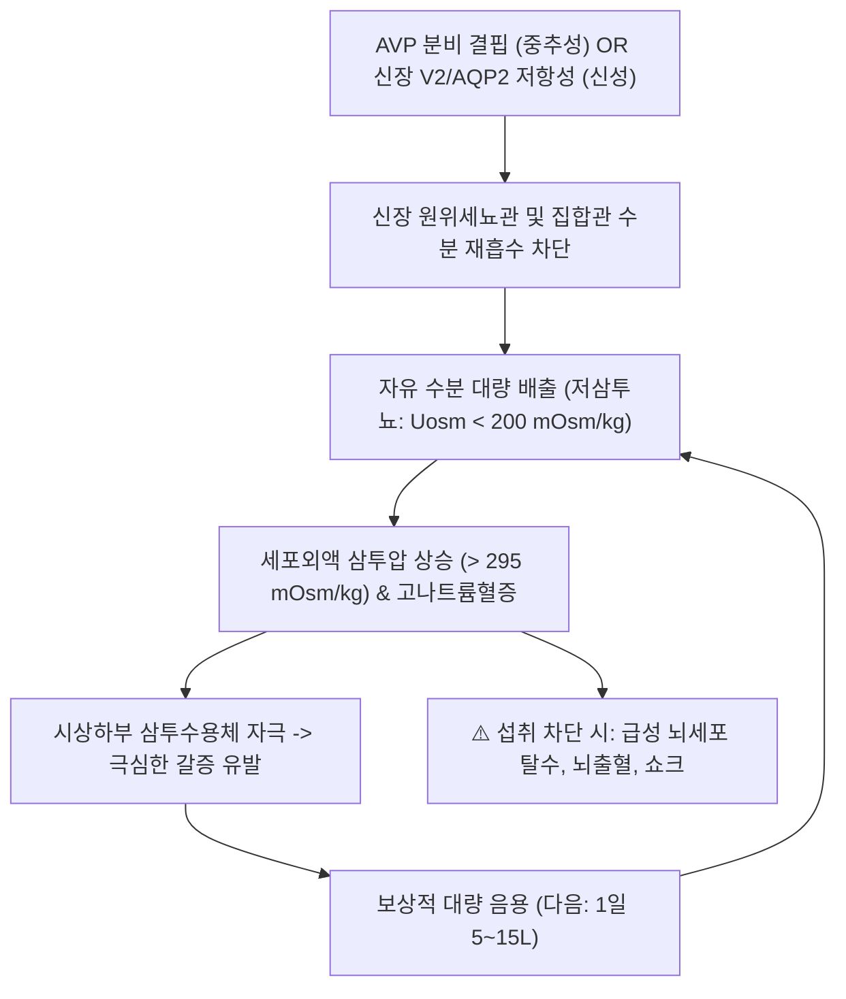

# 🩺 [[요붕증]] (Diabetes Insipidus / 尿崩症)

> **핵심 3줄 요약 (Key Summary)**:
> - 📍 병소 부위 & 해부·병태생리: 시상하부-뇌하수체 후엽의 항이뇨호르몬(AVP/ADH) 분비 결핍(중추성, AVP-D) 또는 신장 집합관의 V2 수용체 및 AQP2 수분 통로 저항성(신성, AVP-R)으로 인해 신장의 소변 농축 기전이 붕괴되어 대량의 저장성 요가 배출되는 질환군.
> - 🚩 전형적 임상 양상 & 3대 징후: 하루 $3\sim 20\,\mathrm{L}$에 달하는 극심한 다뇨(저비중·저삼투뇨), 탈수를 보상하기 위한 맹렬한 다음(Polydipsia, 냉수 갈망), 수면을 파괴하는 빈번한 야간뇨.
> - 🛠️ 핵심 감별 검사 & 한·양방 다각적 치료 전략: 수분제한 검사 및 외인성 dDAVP 반응 평가, 혈청 코펩틴(Copeptin) 측정, 원인에 따른 치료(중추성은 Desmopressin 보충, 신성은 티아지드 이뇨제+아밀로라이드+저염식, 심인성은 수분 제한), 한의 소갈(消渴) 하소(下消) 변증 침구(신수, 관원, 삼음교, 태계) 및 자음익신 한약(육미지황탕, 축천환, 생맥산).
> - ⚠️ 응급 의뢰 레드플래그: 갈증 인지 불능이나 수분 접근 차단으로 인한 급성 중증 고나트륨혈증성 탈수증($\mathrm{Na}^+ > 155\,\mathrm{mEq/L}$), 의식 장애, 혈압 급강하 쇼크, 급격한 뇌탈수 증상 발생 시 즉시 응급실 이송.

---

## 📌 목차
1. [질환 개요 & 해부학적 병태생리](#1-질환-개요--해부학적-병태생리)
2. [병태생리 메커니즘 & 생체역학적 악순환 네트워크](#2-병태생리-메커니즘--생체역학적-악순환-네트워크)
3. [임상 증상 & 이학적 검사(Physical Exam) 알고리즘](#3-임상-증상--이학적-검사physical-exam-알고리즘)
4. [감별 진단 매트릭스 (Differential Diagnosis)](#4-감별-진단-매트릭스--differential-diagnosis)
5. [한의 통합 치료 프로토콜 (침·약침·추나·한약)](#5-한의-통합-치료-프로토콜--침약침추나한약)
6. [양방 치료 & 병용·의뢰 기준 (Conventional Treatment & Referral)](#6-양방-치료--병용의뢰-기준-conventional-treatment--referral)
7. [재활 운동 & 생활습관 티칭 가이드](#7-재활-운동--생활습관-티칭-가이드)
8. [💡 사용자 진료실 핵심 필기 & 임상 노하우 (Melt-In 잔여 심화 집약)](#8--사용자-진료실-핵심-필기---임상-노하우--melt-in-잔여-심화-집약-)
9. [출처 및 학술 참고 문헌 (References)](#9-출처-및-학술-참고-문헌--references-)

---

## 1. 질환 개요 & 해부학적 병태생리

* **정의 및 핵심 병태**:
  * 요붕증(Diabetes Insipidus, DI)은 신장의 수분 재흡수 조절 실패로 인해 다량의 희석된 소변이 배출되고 극심한 갈증이 유발되는 증후군이다.
  * 소변에 당이 섞여 단맛이 나는 당뇨병(Diabetes Mellitus)과 달리, 소변이 맹물처럼 아무 맛도 나지 않아 '맛없는(Insipid) 요'라는 라틴어 어원을 가진다.
* **4대 아형 분류 및 해부학적 병소**:
  1. **중추성 요붕증 (Central DI / AVP Deficiency, AVP-D)**: 시상하부 신경핵 손상으로 AVP 합성·분비 부전 (전체의 약 50%).
  2. **신성 요붕증 (Nephrogenic DI / AVP Resistance, AVP-R)**: AVP는 정상이거나 높으나 신장 집합관 V2 수용체 결함(AVPR2 돌연변이) 또는 아쿠아포린-2(AQP2) 손상, 리튬 약물 독성, 저칼륨혈증 등으로 수분 재흡수 불능.
  3. **임신성 요붕증 (Gestational DI)**: 태반에서 분비되는 바소프레시나제(Vasopressinase) 효소가 모체의 AVP를 과도하게 분해하여 발생(분만 후 자연 소실).
  4. **원발성 다음증 (Primary Polydipsia / Dipsogenic & Psychogenic)**: 갈증 중추 이상 또는 강박적 맹물 과다 섭취로 체액이 희석되어 2차적으로 ADH 분비가 억제됨.

---

## 2. 병태생리 메커니즘 & 생체역학적 악순환 네트워크

* **신장 수질 삼투압 구배의 소실 (Washout effect)**:
  * 장기간 다뇨가 지속되면 신장 수질 간질의 높은 삼투압 구배(NaCl 및 요소 농축)가 씻겨 내려가는 '수질 세척(Medullary Washout)' 현상이 발생한다.
  * 이로 인해 중추성 요붕증 환자에게 dDAVP를 투여하거나 신성 요붕증 원인을 교정하더라도 즉시 소변 농축이 최대로 일어나지 않고 며칠간 회복 지연을 보일 수 있다.

---

## 3. 임상 증상 & 이학적 검사(Physical Exam) 알고리즘

* **주요 임상 양상**:
  * **저삼투성 다뇨**: 1일 $3\sim 15\,\mathrm{L}$ 이상, 시간당 $200\sim 500\,\mathrm{mL}$의 무색무취 맑은 소변.
  * **갈증 및 다음**: 밤낮을 가리지 않고 찬물이나 얼음물을 갈망함.
  * **수면 분절**: 1~2시간마다 요의로 깨어나 만성 불면증 및 주간 피로 호소.
  * **탈수 징후**: 피부 탄력 저하, 안구 건조, 혀 갈라짐, 체중 감소, 기립성 어지럼증.
* **이학적 및 진단 검사 알고리즘**:
  1. **다뇨의 객관적 확인**: 24시간 소변량 $\ge 50\,\mathrm{mL/kg/day}$ 및 요 삼투압 $< 300\,\mathrm{mOsm/kg}$ (요비중 $< 1.005$).
  2. **혈청 전해질 및 삼투압**: 혈장 삼투압 $> 295\,\mathrm{mOsm/kg}$ 또는 $\mathrm{Na}^+ > 145\,\mathrm{mEq/L}$ 확인.
  3. **수분제한 검사 및 dDAVP 반응 검사**:
     * 완전 금수 후 요 삼투압 상승 여부 확인 -> 외인성 데스모프레신(dDAVP $2\sim 4\,\mu\mathrm{g}$) 투여.
     * 요 삼투압 $50\%$ 이상 급증 -> **중추성 요붕증(AVP-D)**.
     * 요 삼투압 반응 없음($< 9\sim 50\%$) -> **신성 요붕증(AVP-R)**.
     * 금수만으로 요 삼투압이 정상 농축($> 600\sim 800\,\mathrm{mOsm/kg}$) -> **원발성 다음증**.
  4. **혈청 코펩틴(Copeptin) 측정**: 고장액 자극 후 $< 4.9\,\mathrm{pmol/L}$이면 중추성, $> 21.4\,\mathrm{pmol/L}$이면 신성 확진.

---

## 4. 감별 진단 매트릭스 (Differential Diagnosis)

| 아형 | 주 원인 | 혈중 AVP / 코펩틴 | dDAVP 반응 | 1차 치료 전략 |
| :--- | :--- | :--- | :--- | :--- |
| **중추성 요붕증 (AVP-D)** | 시상하부-뇌하수체 손상, 종양, 특발성 | 결핍 (낮음) | **요삼투압 50% 이상 상승** | 데스모프레신(dDAVP) 보충 |
| **신성 요붕증 (AVP-R)** | 리튬 약물, 신질환, 고칼슘혈증, 유전 | 현저히 높음 | 반응 없음 ($< 9\%$) | 원인 약물 중단, 티아지드+저염식 |
| **원발성 다음증 (심인성)** | 강박적 음용, 조현병, 불안장애 | 정상이거나 낮음 | 금수 시 정상 농축됨 | 점진적 수분 섭취 제한 및 정신과적 중재 |
| **임신성 요붕증** | 태반 바소프레시나제에 의한 AVP 분해 | AVP 측정 불가(분해됨) | **반응 양호 (dDAVP는 분해 안 됨)** | 데스모프레신(dDAVP) 투여 |
| **용질성 이뇨 (당뇨병)** | 고혈당, 만니톨 등에 의한 삼투성 이뇨 | 정상~상승 | 해당 없음 | 소변 포도당 검출, 고비중뇨 ($> 1.030$) |

---

## 5. 한의 통합 치료 프로토콜 (침·약침·추나·한약)

* **치료 원칙**:
  * 소갈(消渴) 하소(下소)의 병기에 따라 **자음고신(滋陰固腎), 온양화수(溫陽化水), 생진지갈(生津止渴)**을 도모하여 방광의 소변 저류능과 체내 진액 보존력을 강화함.
* **침구 치료**:
  * **수액 대사 조절 및 진액 생성**:
    * [[신수(BL23)]], [[관원(CV4)]], [[기해(CV6)]], [[삼음교(SP6)]], [[태계(KI3)]], [[음릉천(SP9)]], [[폐수(BL13)]], [[족삼리(ST36)]].
    * 신수, 관원, 삼음교는 하초 신장의 기화(氣化) 기능을 도와 소변 농축을 보조하고, 태계혈은 신음을 보하여 구갈을 다스림.
* **약침 요법**:
  * **자하거 약침**:
    * 신수(BL23), 관원(CV4)에 0.2cc씩 시술하여 선천지기(先天之氣)를 보하고 세포내 진액 대사 안정화.
* **추나 요법**:
  * 요추 2-4번 및 골반 천장관절 이완을 통해 신장 및 방광으로 분포하는 교감-부교감 신경의 조절력 회복.
* **변증 한약 처방**:
  * **신음부족·음허조열(腎陰不足·陰虛燥熱형 — 물을 쉼 없이 마심, 마른 체형, 혀가 붉고 건조, 식은땀)**:
    * [[육미지황탕]] 합 [[생맥산]] 가 [[천화분]], [[갈근]], [[황련]]: [[맥문동]], 천화분은 진액을 솟아나게 하고 신장의 음액을 채움.
  * **신양허약·하원불고(腎陽虛弱·下元不固형 — 맑은 소변 과다, 야간뇨 극심, 추위 탐, 하지 무력)**:
    * [[축천환]] 합 [[신기환]] 가 [[산수유]], [[복분자]], [[구기자]]: [[익지인]]과 [[오약]]이 방광 허랭을 치료하고 소변을 굳게 거둠.
  * **심비양허·비기부족(心脾兩虛·脾氣不足형 — 만성 피로, 소화불량, 심인성 갈증 동반)**:
    * [[귀비탕]] 가 [[오미자]], 맥문동.

---

## 6. 양방 치료 & 병용·의뢰 기준 (Conventional Treatment & Referral)

* **아형별 양방 표준 치료**:
  * **1. 중추성 요붕증 (AVP-D)**:
    * **데스모프레신(dDAVP)**: 경구 $0.1\sim 0.2\,\mathrm{mg}$ 1일 $2\sim 3$회 또는 설하 구강붕해정 $60\sim 120\,\mu\mathrm{g}$.
  * **2. 신성 요붕증 (AVP-R)**:
    * dDAVP는 효과 없음.
    * **저염식(나트륨 배설 감소)** 및 **티아지드계 이뇨제(Hydrochlorothiazide $25\sim 50\,\mathrm{mg/day}$)** 투여: 역설적으로 근위세뇨관의 나트륨 및 수분 재흡수를 증가시켜 원위세뇨관으로 도달하는 수분량을 감소시킴.
    * 리튬 유발성 신성 요붕증 시: **아밀로라이드(Amiloride)** 병용(상피 나트륨 통로 차단으로 리튬의 신장 세포 유입 차단).
  * **3. 임신성 요붕증**:
    * 데스모프레신(dDAVP) 투여 (바소프레시나제에 분해되지 않음).
  * **4. 원발성 다음증**:
    * 수분 제한이 핵심. dDAVP 투여는 치명적 수분 중독을 일으키므로 절대 금기.
* **한의 병용 시 주의점**:
  * 신성 요붕증 환자에게 이뇨 효과가 있는 옥수수수염, 저령, 택사 등을 고용량 남용하지 않도록 주의.
* **응급 전원 기준 (Critical Referral)**:
  * 고나트륨혈증성 뇌탈수(기면, 경련, 혼수), 혈청 나트륨 $> 155\,\mathrm{mEq/L}$ 발생 시 즉시 중환자실 응급 전원.

---

## 7. 재활 운동 & 생활습관 티칭 가이드

* **수분 섭취와 약물 복용의 조화**:
  * 데스모프레신 복용자는 소변이 다시 풀리는 주기(Breakthrough)를 확인한 후 다음 약을 복용하여 수분 중독증(저나트륨혈증) 예방.
  * 야간 수면 2시간 전에는 수분 섭취를 제한하여 야간뇨 방지.
* **식이 요법 (신성 요붕증 환자 필수)**:
  * 엄격한 저나트륨 식이(하루 소금 5g 미만) 및 단백질 섭취 제한(신장의 삼투성 용질 부하 경감).
* **안전 및 응급 대비**:
  * 비상용 데스모프레신 및 생수를 상시 휴대하고, 요붕증 환자 의료 경고 카드 소지.

---

## 8. 💡 사용자 진료실 핵심 필기 & 임상 노하우 (Melt-In 잔여 심화 집약)

* **신성 요붕증에서 티아지드 이뇨제의 '역설적 효과' 설명법**:
  * "오줌이 너무 많이 나오는데 왜 이뇨제를 주나요?"라고 묻는 환자에게 "앞쪽 신장 관에서 소금을 미리 빼내어 몸 안쪽으로 물을 끌어당겨 놓음으로써, 뒤쪽 고장 난 관으로 흘러가는 소변량을 줄여주는 원리"라고 설명해 주면 복약 순응도가 매우 높아짐.
* **심인성 다음증과 진성 요붕증의 진료실 감별법**:
  * 진성 요붕증 환자는 밤에 잠을 잘 때도 소변 때문에 반드시 깨어 물을 마시지만, 심인성 다음 환자는 낮에는 물을 수없이 마시더라도 밤에 깊이 잠들면 새벽에 깨어 물을 찾는 횟수가 현저히 적음.
* **축천환(縮泉丸)과 익지인(益智仁)의 임상적 신묘함**:
  * 신양허로 인한 다뇨 및 소변 찔끔거림 환자에게 익지인을 군약으로 한 축천환을 투여하면 신장 기화력이 살아나면서 맑은 소변 빈삭이 극적으로 줄어듦.

---

## 9. 출처 및 학술 참고 문헌 (References)

* Atila C, et al. (2026 Sep 1). Arginine vasopressin deficiency: towards a better characterization. *Endocr Relat Cancer*. PMID: 42677919

* Kamel KS, et al. (2026 Oct). Managing hyponatremia: fast or slow? Why, when, how, and controversies. *Clin Kidney J*. PMID: 42824684

* Morena D, et al. (2026 Oct 3). Serotonergic Toxicity and Hyponatremia Associated with Antidepressant Therapy: The Pivotal Role of SIADH. *Clin Drug Investig*. PMID: 42829418
