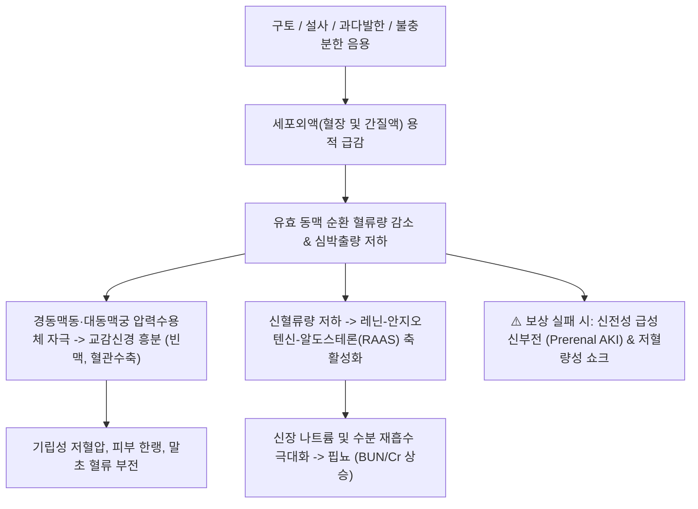

# 🩺 [[탈수]] (Dehydration & Volume Depletion / 脫水症)

> **핵심 3줄 요약 (Key Summary)**:
> - 📍 병소 부위 & 해부·병태생리: 섭취량 부족, 소화기계(구토/설사), 신장(이뇨제/요붕증), 피부(과다 발한/화상)를 통한 비정상적 체액 손실로 인해 세포외액량(ECF) 및 세포내액량(ICF)이 급격히 감소하는 체액 불균형 질환.
> - 🚩 전형적 임상 양상 & 3대 징후: 구강 점막 건조 및 갈증, 피부 긴장도(Turgor) 저하 및 안구 함몰, 기립성 저혈압·빈맥 및 소변량 감소(핍뇨).
> - 🛠️ 핵심 감별 검사 & 한·양방 다각적 치료 전략: 활력징후(기립성 혈압 변화) 및 혈액 검사(BUN/Cr 비 $> 20:1$, 요비중 $> 1.025$, 혈청 전해질), 탈수 유형(등장성·고장성·저장성) 감별, 경구 수액요법(ORS) 또는 저장성/등장성 정맥 수액 투여, 한의 진액휴손(津液虧損)·기음양허 변증 침구(족삼리, 삼음교, 관원, 내관) 및 익기생진 한약(생맥산, 삼령백출산, 옥천산).
> - ⚠️ 응급 의뢰 레드플래그: 수축기 혈압 $< 90\,\mathrm{mmHg}$, 맥박 $> 120\,\mathrm{회/분}$, 무뇨(Anuria), 의식 혼미, 패혈증이나 급성 세뇨관 괴사(ATN) 의심 등 저혈량성 쇼크 징후 시 즉시 대용량 정맥 수액 소생술 및 응급실 이송.

---

## 📌 목차
1. [질환 개요 & 해부학적 병태생리](#1-질환-개요--해부학적-병태생리)
2. [병태생리 메커니즘 & 생체역학적 악순환 네트워크](#2-병태생리-메커니즘--생체역학적-악순환-네트워크)
3. [임상 증상 & 이학적 검사(Physical Exam) 알고리즘](#3-임상-증상--이학적-검사physical-exam-알고리즘)
4. [감별 진단 매트릭스 (Differential Diagnosis)](#4-감별-진단-매트릭스--differential-diagnosis)
5. [한의 통합 치료 프로토콜 (침·약침·추나·한약)](#5-한의-통합-치료-프로토콜--침약침추나한약)
6. [양방 치료 & 병용·의뢰 기준 (Conventional Treatment & Referral)](#6-양방-치료--병용의뢰-기준-conventional-treatment--referral)
7. [재활 운동 & 생활습관 티칭 가이드](#7-재활-운동--생활습관-티칭-가이드)
8. [💡 사용자 진료실 핵심 필기 & 임상 노하우 (Melt-In 잔여 심화 집약)](#8--사용자-진료실-핵심-필기---임상-노하우--melt-in-잔여-심화-집약-)
9. [출처 및 학술 참고 문헌 (References)](#9-출처-및-학술-참고-문헌--references-)

---

## 1. 질환 개요 & 해부학적 병태생리

* **정의 및 핵심 병태**:
  * 탈수(Dehydration)는 체내 총 체액량(Total Body Water, TBW)이 생리적 요구량 이하로 고갈된 상태를 의미한다.
  * 엄밀하게는 순수 수분만 소실되는 **진성 탈수(Dehydration)**와 수분 및 전해질(나트륨)이 함께 소실되는 **세포외액 용적 결손(Volume Depletion)**으로 구분되나, 임상에서는 이를 포괄하여 다룬다.
* **삼투압에 따른 3대 탈수 아형**:
  1. **등장성 탈수 (Isotonic, 약 70~80%)**: 물과 전해질이 동일한 비율로 손실됨(구토, 설사 등 소화기계 손실). 혈청 나트륨 정상($135\sim 145\,\mathrm{mEq/L}$), 세포외액만 선택적으로 감소.
  2. **고장성 탈수 (Hypertonic, 약 10~20%)**: 전해질보다 수분이 더 많이 소실됨(과다 발한, 고열, 요붕증, 불충분한 수분 섭취). 혈청 나트륨 상승($> 145\,\mathrm{mEq/L}$), 삼투압에 의해 세포내 수분이 세포외로 이동하여 심한 갈증 및 뇌세포 탈수 유발.
  3. **저장성 탈수 (Hypotonic, 약 5~10%)**: 수분보다 전해질이 더 많이 손실되거나, 탈수 상태에서 맹물만 과음한 경우. 혈청 나트륨 저하($< 135\,\mathrm{mEq/L}$), 수분이 세포내로 이동하여 세포외액량 급감 및 순환 쇼크 위험 극대화.
* **고위험군 및 취약 요인**:
  * **영유아**: 체표면적이 넓고 신장의 요 농축 능력이 미숙하여 탈수가 수 시간 내 급속 진행됨.
  * **고령자**: 시상하부 갈증 인지 감퇴, 신장의 수분 보존능 저하, 이뇨제 복용으로 만성 잠복성 탈수 호발.

---

## 2. 병태생리 메커니즘 & 생체역학적 악순환 네트워크

* **보상적 신경내분비 반응**:
  * 유효 순환 혈류량 저하 시 시상하부에서 바소프레신(AVP) 분비가 급증하여 신장의 수분 배설을 차단하고, 신장 사구체방치세포에서 레닌이 분비되어 알도스테론이 집합관 나트륨 재흡수를 극대화한다.
* **신장 혈역학적 악순환**:
  * 지속적인 혈류량 저하는 사구체 여과율(GFR)을 떨어뜨리고, 신수질의 허혈성 손상으로 이어져 신전성 질소혈증(Prerenal azotemia)에서 기질적 급성 세뇨관 괴사(ATN)로 악화될 수 있다.

---

## 3. 임상 증상 & 이학적 검사(Physical Exam) 알고리즘

* **탈수 중증도에 따른 단계별 임상 징후**:
  * **경도 탈수 (체중의 $3\sim 5\%$ 결손)**: 경미한 구갈, 구강 점막 약간 건조, 소변 색이 짙어짐.
  * **중등도 탈수 (체중의 $6\sim 9\%$ 결손)**: 극심한 갈증, 구강 점막 완전 건조, 안구 함몰, 피부 텐팅(Tenting, 피부를 집었다 놓을 때 회복 지연), 기립성 저혈압, 빈맥($> 100\,\mathrm{회/분}$), 핍뇨.
  * **중증 탈수 (체중의 $\ge 10\%$ 결손)**: 기면 또는 혼미, 무뇨, 사지 냉감 및 청색증, 모세혈관 재충혈 시간(CRT) $> 3$초, 수축기 혈압 급강하($< 90\,\mathrm{mmHg}$) -> 저혈량성 쇼크.
* **이학적 검사 술기**:
  * **기립성 활력징후 (Orthostatic Vitals)**: 와위에서 기립 시 수축기 혈압 $20\,\mathrm{mmHg}$ 이상 강하 또는 맥박 $20\,\mathrm{회/분}$ 이상 증가 시 양성.
  * **피부 긴장도(Skin Turgor)**: 성인은 쇄골 상부 또는 전완부 피부를 집어 올렸을 때 복원 속도 확인(노인의 경우 피부 탄력 저하로 위양성 주의).
  * **모세혈관 재충혈 시간(Capillary Refill Time, CRT)**: 손톱바닥을 5초간 누른 후 원래 색으로 돌아오는 시간 측정($> 2$초 시 관류 저하).
* **진단 검사 지표**:
  * **혈액 화학 검사**: $\mathrm{BUN/Cr}$ 비 $> 20:1$ (신전성 질소혈증), 헤마토크릿(Hct) 상승(혈액 농축).
  * **요검사**: 요비중 $> 1.025$, 요 삼투압 $> 600\,\mathrm{mOsm/kg}$, 요 나트륨 $< 20\,\mathrm{mEq/L}$ (신장의 강력한 나트륨 보존).

---

## 4. 감별 진단 매트릭스 (Differential Diagnosis)

| 감별 질환 | 혈청 나트륨 농도 | 요 삼투압 및 소변량 | 주요 임상 배경 | 핵심 치료 방향 |
| :--- | :--- | :--- | :--- | :--- |
| **등장성 탈수** | 정상 ($135\sim 145$) | 고삼투뇨, 핍뇨 | 급성 장염, 구토, 설사, 위장관 배액 | 생리식염수 또는 하트만액, ORS |
| **고장성 탈수** | 상승 ($> 145\,\mathrm{mEq/L}$) | 다양함 (요붕증 시 저삼투뇨) | 고열, 과다 발한, 수분 섭취 불가, 요붕증 | $5\%$ 포도당 또는 $0.45\%$ 식염수 서서히 공급 |
| **저장성 탈수** | 저하 ($< 135\,\mathrm{mEq/L}$) | 고삼투뇨, 핍뇨 | 설사 후 맹물만 다량 섭취, 이뇨제 사용 | 생리식염수 투여로 혈장량 우선 회복 |
| **패혈성 쇼크** | 다양함 | 핍뇨 | 고열, 감염 징후, 말초 혈관 확장(초기 온난 쇼크) | 대용량 수액 소생술 및 항생제, 승압제 |
| **심인성 쇼크** | 다양함 | 핍뇨, 중심정맥압 상승 | 급성 심근경색, 울혈성 심부전, 경정맥 확장 | 수액 과다 투여 금기, 강심제 |

---

## 5. 한의 통합 치료 프로토콜 (침·약침·추나·한약)

* **치료 원칙**:
  * 중증 쇼크는 즉시 정맥 수액 치료가 필수이며, 한의 치료는 **경·중등도 탈수 후 소화기 흡수능 회복, 진액(津液) 재생성, 구갈 및 만성 허약 상태 개선**에 집중함.
* **침구 치료**:
  * **생진지갈(生津止渴), 건비익위(健脾益胃)**:
    * [[족삼리(ST36)]], [[삼음교(SP6)]], [[중완(CV12)]], [[내관(PC6)]], [[관원(CV4)]], [[태계(KI3)]], [[염천(CV23)]].
    * 족삼리와 중완은 위장관 평활근 운동을 정상화하여 수분 흡수를 촉진하고, 삼음교·태계혈은 음액(陰液)을 보하여 구갈을 해소함.
* **약침 요법**:
  * **자하거 약침 / 산삼 약침**:
    * 족삼리(ST36), 비수(BL20), 신수(BL23)에 0.1~0.2cc씩 주입하여 탈수 후 탈진된 기력을 신속히 부활시킴.
* **변증 한약 처방**:
  * **기음양허·서열상진(氣陰兩虛·暑熱傷津형 — 고열, 여름철 더위 먹음, 땀 과다 후 갈증, 기운 없음)**:
    * [[생맥산]](生脈散): 맥문동, 인삼, 오미자. 맥문동이 진액을 보하고 인삼이 기운을 돋우며 오미자가 땀과 수분을 거두어들임(탈수 후 피로의 최고 요약).
  * **비위허약·설사상음(脾胃虛弱·泄瀉傷陰형 — 장염이나 구토·설사 후 탈수, 식욕부진, 연변)**:
    * [[삼령백출산]](蔘苓白朮散): 연자육, 육두구, 백출, 복령, 산약. 위장의 흡수능을 재건하고 설사 재발 방지.
  * **열성상진·구갈인다(熱盛傷津형 — 극심한 입마름, 미열, 혀가 붉고 건조)**:
    * [[옥천산]](玉泉散) 또는 백호가인삼탕 가감.

---

## 6. 양방 치료 & 병용·의뢰 기준 (Conventional Treatment & Referral)

* **1차 경구 수액요법 (Oral Rehydration Solution, ORS)**:
  * 경도~중등도 탈수이면서 의식이 명료하고 구토가 조절되는 경우 정맥 주사보다 우선 권고.
  * **WHO 표준 ORS 조성**: 나트륨-포도당 공동수송체(SGLT-1)를 통해 장점막에서 나트륨과 수분 흡수를 극대화함(물 1L에 소금 2.6g, 포도당 13.5g, 염화칼륨 1.5g, 구연산나트륨 2.9g).
* **정맥 수액요법 (Intravenous Hydration)**:
  * **중증 탈수 및 쇼크 시**:
    * 등장성 결정질액(생리식염수 $0.9\%$ 또는 하트만액) $20\sim 30\,\mathrm{mL/kg}$를 30분~1시간 내 급속 부하(Bolus)하여 혈압 회복.
  * **고장성 탈수 수액 교정 주의점**:
    * 세포외액이 고삼투압인 상태에서 저장액을 너무 급격히 주입하면 수분이 뇌세포로 쏠려 **치명적 뇌부종(Cerebral Edema)**이 발생함 -> 48시간 이상 서서히 교정(나트륨 강하 속도 $\le 10\sim 12\,\mathrm{mEq/L/day}$).
* **한의 병용 시 주의사항**:
  * 급성 장염으로 탈수가 진행 중인 환자에게 설사를 악화시킬 수 있는 기름진 보약재나 대황, 망초 등 사하제 처방 절대 엄금.
* **응급실 즉시 전원 기준 (Red Flags)**:
  * 수축기 혈압 $< 90\,\mathrm{mmHg}$, 의식 저하, 무뇨(6시간 이상 배뇨 없음), 호흡 곤란.

---

## 7. 재활 운동 & 생활습관 티칭 가이드

* **노인 및 고령자 탈수 예방 수칙**:
  * 노인은 갈증을 늦게 느끼므로 "목이 마르지 않아도 시간표를 정해놓고 하루 1.5L 이상 미온수 음용" 지도.
* **운동 및 고온 환경 수분 보충법**:
  * 운동 2시간 전 500mL 섭취, 운동 중 15~20분마다 150~200mL씩 전해질 음료 분할 섭취.
  * 커피, 에너지 드링크, 맥주는 카페인과 알코올의 이뇨 작용으로 탈수를 부채질하므로 수분 보충용으로 섭취 금지.

---

## 8. 💡 사용자 진료실 핵심 필기 & 임상 노하우 (Melt-In 잔여 심화 집약)

* **진료실에서 10초 만에 탈수를 잡는 '혀(Tongue) 진찰'**:
  * 피부 탄력도는 노인에서 부정확하지만, 혀와 뺨 안쪽 구강 점막이 바짝 말라 있고 혀 중앙에 침 거품이나 타액선 분비가 전혀 없으며 혓바닥이 갈라져 있다면 확실한 탈수 상태임.
* **생맥산(生脈散)의 경구 수액학적 현대화**:
  * 맥문동 15g, 인삼 8g, 오미자 4g에 천일염 한 꼬집(약 1g)과 꿀 1스푼을 타서 미온수로 마시게 하면, 현대 WHO의 ORS 흡수 원리와 완벽히 부합하여 링거 수액 못지않은 체액 흡수율을 발휘함.
* **여름철 어르신들의 무기력증 감별**:
  * 기운이 없다며 보약을 지으러 온 고령 환자가 저혈압과 빈맥을 보이면 만성 탈수가 원인인 경우가 태반임. 먼저 물과 전해질 보충을 선행시켜야 함.

---

## 9. 출처 및 학술 참고 문헌 (References)

* Mattoo TK, et al. (2026 Jul 1). Chronic dehydration in older adults: An underestimated health hazard. *Saudi J Kidney Dis Transpl*. PMID: 42690112

* Maldonado MJ, et al. (2026 Jun 26). Prevalence and Risk Factors of Hypernatremic Dehydration in Exclusively Breastfed Neonates: A Systematic Review and Meta-Analysis. *J Clin Med*. PMID: 42452437

* Dewez JE, et al. (2026 Sep 18). Intravenous rehydration in children with severe malnutrition and severe dehydration: a systematic review and meta-analysis. *Arch Dis Child*. PMID: 42161576

---

## 관련 노트

- [[_의학/03_이론/질환/내분비 질환/뇌하수체/과다수분공급|과다수분공급]]
- [[_의학/03_이론/질환/내분비 질환/뇌하수체/요붕증|요붕증]]
- [[_의학/03_이론/질환/내분비 질환/부신/부신 부전|부신 부전]]
- [[생맥산]]
- [[저혈압]]
- [[기립성 저혈압]]
- [[신부전]]

