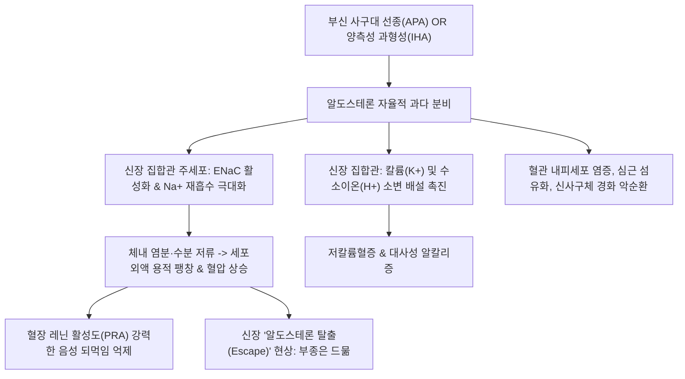

# 🩺 [[고알도스테론증]] (Hyperaldosteronism & Primary Aldosteronism / 高알도스테론症)

> **핵심 3줄 요약 (Key Summary)**:
> - 📍 병소 부위 & 해부·병태생리: 부신 피질 사구대(Zona glomerulosa)의 선종(Aldosterone-producing adenoma, 콘 증후군) 또는 양측성 특발성 과형성(Idiopathic hyperaldosteronism)으로 인해 알도스테론이 레닌-안지오텐신 축과 무관하게 자율적으로 과다 분비되는 내분비 고혈압 질환.
> - 🚩 전형적 임상 양상 & 3대 징후: 표준 항고혈압제 3제 이상에 반응하지 않는 난치성 고혈압, 저칼륨혈증에 의한 근육 쇠약 및 무력감·근육 경련, 대사성 알칼리증에 따른 테타니 및 다뇨·야간뇨.
> - 🛠️ 핵심 감별 검사 & 한·양방 다각적 치료 전략: 아침 안정 시 혈장 알도스테론/레닌 활성도 비(ARR $\ge 20\sim 30$) 선별, 생리식염수 부하 검사 확진, 부신 CT 및 부신정맥채혈(AVS), 편측 선종 시 복강경 부신절제술, 양측성 과형성 시 무기질코르티코이드 수용체 길항제(Spironolactone, Eplerenone), 한의 간양상항(肝陽上亢)·담탁어혈 변증 침구(태충, 곡지, 풍지, 족삼리) 및 평간잠양·건비이수 한약(천마구등음, 영계출감탕, 오령산).
> - ⚠️ 응급 의뢰 레드플래그: 중증 저칼륨혈증($\mathrm{K}^+ < 2.5\,\mathrm{mEq/L}$)으로 인한 치명적 심실성 부정맥(Torsades de pointes), 급성 이완성 마비(Flaccid paralysis), 악성 고혈압성 뇌증 발생 시 즉시 응급실 이송.

---

## 📌 목차
1. [질환 개요 & 해부학적 병태생리](#1-질환-개요--해부학적-병태생리)
2. [병태생리 메커니즘 & 생체역학적 악순환 네트워크](#2-병태생리-메커니즘--생체역학적-악순환-네트워크)
3. [임상 증상 & 이학적 검사(Physical Exam) 알고리즘](#3-임상-증상--이학적-검사physical-exam-알고리즘)
4. [감별 진단 매트릭스 (Differential Diagnosis)](#4-감별-진단-매트릭스--differential-diagnosis)
5. [한의 통합 치료 프로토콜 (침·약침·추나·한약)](#5-한의-통합-치료-프로토콜--침약침추나한약)
6. [양방 치료 & 병용·의뢰 기준 (Conventional Treatment & Referral)](#6-양방-치료--병용의뢰-기준-conventional-treatment--referral)
7. [재활 운동 & 생활습관 티칭 가이드](#7-재활-운동--생활습관-티칭-가이드)
8. [💡 사용자 진료실 핵심 필기 & 임상 노하우 (Melt-In 잔여 심화 집약)](#8--사용자-진료실-핵심-필기---임상-노하우--melt-in-잔여-심화-집약-)
9. [출처 및 학술 참고 문헌 (References)](#9-출처-및-학술-참고-문헌--references-)

---

## 1. 질환 개요 & 해부학적 병태생리

* **정의 및 핵심 병태**:
  * 고알도스테론증(Hyperaldosteronism)은 부신 피질에서 무기질코르티코이드인 알도스테론이 과잉 분비되는 질환이다.
  * **원발성 알도스테론증(Primary Aldosteronism, PA / Conn 증후군)**: 부신 자체의 이상으로 레닌(Renin) 분비가 억제되면서 알도스테론이 자율적으로 과다 분비되는 상태로, 2차성 고혈압의 가장 흔한 원인(전체 고혈압의 약 5~10%, 저항성 고혈압의 20% 차지)이다.
  * **속발성 고알도스테론증(Secondary Aldosteronism)**: 신동맥 협착, 신혈류 저하, 심부전, 간경변 등으로 인해 레닌-안지오텐신 축이 2차적으로 항진되어 발생함.
* **관련 해부학적 구조물**:
  * **부신 피질 사구대(Zona Glomerulosa)**: 부신 피질의 최외층으로, 알도스테론 합성효소(CYP11B2)를 통해 알도스테론을 합성함.
  * **신장 원위세뇨관 및 피질 집합관(Cortical Collecting Tubule)**: 주세포(Principal cells)의 무기질코르티코이드 수용체(MR)에 결합하여 상피 나트륨 통로(ENaC)와 $\mathrm{Na^+/K^+-ATPase}$를 활성화함 -> **나트륨 재흡수 촉진 및 칼륨($\mathrm{K}^+$)·수소이온($\mathrm{H}^+$) 배설 촉진**.
* **주요 병인 분류**:
  1. **알도스테론 분비 부신 선종 (APA / Conn's Adenoma, 약 35~40%)**: KCNJ5, ATP1A1, CACNA1D 유전자 체세포 돌연변이에 의한 편측성 양성 선종.
  2. **양측성 특발성 부신 과형성 (IHA, 약 60%)**: 양측 부신의 사구대 과형성.
  3. 드문 원인: 편측성 부신 과형성, 부신피질암, 당질코르티코이드 반응성 알도스테론증(GRA).

---

## 2. 병태생리 메커니즘 & 생체역학적 악순환 네트워크

* **'알도스테론 탈출 현상 (Aldosterone Escape)'**:
  * 나트륨과 수분이 계속 저류되어 세포외액량이 팽창하면 심방이 신전되어 심방나트륨이뇨펩타이드(ANP) 분비가 증가하고 근위세뇨관의 나트륨 재흡수가 억제된다.
  * 이로 인해 나트륨 배설이 다시 증가하여 고알도스테론 환자에서는 **전신 부종이 발생하지 않는 독특한 혈역학적 특성**을 보인다.
* **심혈관계 표적 장기 손상**:
  * 알도스테론은 단순한 혈압 상승 외에도 무기질코르티코이드 수용체를 통해 심근 세포 비대, 혈관주위 섬유화, 신장 섬유화를 직접 촉진하여 동등한 혈압의 본태성 고혈압 환자 대비 뇌졸중, 심근경색, 심방세동 위험을 3~4배 증가시킨다.

---

## 3. 임상 증상 & 이학적 검사(Physical Exam) 알고리즘

* **주요 임상 양상**:
  * **저항성 고혈압 (Resistant Hypertension)**: 이뇨제를 포함한 3가지 이상의 항고혈압제로도 조절되지 않는 중증 고혈압.
  * **저칼륨혈증 증상 (약 40~50%에서만 발현, 정상 칼륨형도 흔함)**:
    * 근육 쇠약감, 하지 무력증, 쥐가 잘 남(Muscle cramps).
    * 저칼륨혈증성 신병증으로 인한 요 농축 장애 -> 다뇨 및 야간뇨.
    * 대사성 알칼리증에 의한 테타니(손발 저림, 근육 경련).
  * 두통, 피로감, 심계항진(부정맥).
* **선별 검사 알고리즘**:
  1. **ARR (Aldosterone-to-Renin Ratio) 측정 (1차 선별)**:
     * 아침 기상 2시간 후, 앉은 자세에서 채혈.
     * **혈장 알도스테론 농도(PAC, $\mathrm{ng/dL}$) / 혈장 레닌 활성도(PRA, $\mathrm{ng/mL/h}$) 비 $\ge 20\sim 30$** 이면서 PAC $> 15\,\mathrm{ng/dL}$ 시 양성.
  2. **확진 검사 (Confirmatory Test)**:
     * **생리식염수 부하 검사 (Saline Infusion Test)**: 생리식염수 2L를 4시간 동안 정맥 점적 후에도 PAC $> 10\,\mathrm{ng/dL}$이면 자율적 분비 확진.
     * 또는 경구 나트륨 부하 검사, 카프토프릴 억제 검사.
  3. **원인 아형 감별 (Subtype Classification)**:
     * **부신 조영증강 CT**: 편측 선종 vs 양측 과형성 확인.
     * **부신정맥채혈 (Adrenal Vein Sampling, AVS - 골드 스탠다드)**: 양측 부신정맥에서 직접 카테터로 혈액을 채취하여 편측 분비 우세(수술 적응증)인지 양측성 분비(약물 적응증)인지 확진.

---

## 4. 감별 진단 매트릭스 (Differential Diagnosis)

| 질환 | 알도스테론 (PAC) | 레닌 (PRA) | ARR 비 | 저칼륨혈증 및 감별점 |
| :--- | :--- | :--- | :--- | :--- |
| **원발성 알도스테론증 (콘 증후군)** | **상승 ($> 15$)** | **억제됨 ($< 1.0$)** | **현저히 상승 ($\ge 20\sim 30$)** | 저칼륨혈증 흔함, 부신 선종/과형성 |
| **신동맥 협착 (2차성 고알도스테론)** | 상승 | **현저히 상승** | 정상 범위 ($< 10\sim 20$) | 신혈류 저하로 레닌 과다 분비, 복부 혈관 잡음 |
| **본태성 고혈압** | 정상 | 정상 | 정상 ($< 20$) | 대부분의 일반 고혈압 환자 |
| **쿠싱 증후군** | 정상~저하 | 억제됨 | 낮음 | 코르티솔 과다, 중심성 비만, 자색 선조 |
| **[[위알도스테론증]] (감초 과다 복용)** | **억제됨 (낮음)** | **억제됨 (낮음)** | 낮음 | 감초(글리시리진)의 $11\beta$-HSD2 억제로 코르티솔이 MR 자극 |
| **리들 증후군 (Liddle syndrome)** | 낮음 | 낮음 | 낮음 | 유전성 ENaC 돌연변이, 트리암테렌 반응 |

---

## 5. 한의 통합 치료 프로토콜 (침·약침·추나·한약)

* **치료 원칙**:
  * 편측 선종은 수술적 치료가 근본이며, 한의 치료는 **양측성 과형성 환자의 혈압 및 전해질 조절 보조, 항고혈압제 부작용 완화, 간양상항 및 담탁 저류 완화**에 집중함.
* **침구 치료**:
  * **평간잠양(平肝潛陽), 청열지현(淸熱止眩)**:
    * [[태충(LR3)]], [[곡지(LI11)]], [[풍지(GB20)]], [[태양(EX-HN5)]], [[백회(GV20)]], [[인영(ST9)]].
    * 태충-곡지 침치료는 교감신경 긴장을 완화하여 혈관 확장을 유도하고 혈압 강하를 보조함.
  * **수액 대사 및 전해질 조절**:
    * [[족삼리(ST36)]], [[음릉천(SP9)]], [[삼음교(SP6)]], [[신수(BL23)]].
* **약침 요법**:
  * **황련해독탕 약침**:
    * 풍지(GB20), 견정(GB21), 대추(GV14)에 주입하여 상초의 화열과 교감신경 흥분을 안정화함.
* **추나 요법**:
  * 상부 경추(C1-C2) 및 흉추 교정을 통해 혈관 운동성 자율신경계 반사를 조절하여 두통과 혈압 변동성 경감.
* **변증 한약 처방**:
  * **간양상항·음허양항(肝陽上亢·陰虛陽亢형 — 두통, 어지럼증, 안면 홍조, 이명, 성격 급함, 저항성 고혈압)**:
    * [[천마구등음]](天麻鉤藤飮): 천마, 구등, 석결명, 치자, 황금, 우슬. 간양을 가라앉히고 혈압을 안정시킴.
  * **비허습저·담탁저류(脾虛濕阻·痰濁阻留형 — 비만, 부종감, 몸이 무거움, 흉협고만)**:
    * [[영계출감탕]](苓桂朮甘湯) 합 [[오령산]]: 복령, 계지, 백출, 감초. 삼투성 수분 저류를 조절하고 심장 부담 완화.
  * **간신음허·풍양상요(肝腎陰虛·風陽上擾형 — 근육 떨림, 요슬산연, 마른 체형, 하지 무력감)**:
    * [[기국지황탕]] 가 백작약, 모과(저칼륨혈증성 근육 경련에 작약감초 배오 고려).

---

## 6. 양방 치료 & 병용·의뢰 기준 (Conventional Treatment & Referral)

* **1차 아형별 표준 치료**:
  * **1. 편측성 선종 (APA - 수술적 치료)**:
    * **복강경 편측 부신절제술(Laparoscopic Adrenalectomy)**:
      * 선종이 있는 부신을 적출하여 약 50~60%에서 고혈압이 완치되고, 나머지도 혈압 조절이 극적으로 용이해짐. 저칼륨혈증은 100% 교정됨.
  * **2. 양측성 과형성 (IHA - 내과적 약물 치료)**:
    * **무기질코르티코이드 수용체 길항제(Mineralocorticoid Receptor Antagonist, MRA)**:
      * **스피로노락톤(Spironolactone, 알닥톤)**: $25\sim 100\,\mathrm{mg/day}$. 가장 효과적인 1차 약물이나 남성에서 여성형 유방증, 성욕 감퇴 등 항안드로겐 부작용 발생 가능.
      * **에플레레논(Eplerenone)**: 선택적 MRA로 부작용이 적어 스피로노락톤 부작용 환자에게 대체 처방.
* **한의 병용 시 절대 금기 (감초 주의보)**:
  * ⚠️ **한약재 감초(甘草)는 글리시리진(Glycyrrhizin) 성분이 $11\beta$-HSD2 효소를 억제하여 알도스테론 수용체를 자극하므로, 고알도스테론증 환자에게 감초 고용량 또는 장기 투약은 절대 금기(위알도스테론증 유발로 혈압 및 저칼륨혈증 급격 악화).**
* **상급병원 전원 기준**:
  * 저항성 고혈압 환자에서 저칼륨혈증이 발견되거나 ARR 선별 양성 시 AVS(부신정맥채혈) 및 수술 평가 위해 내분비내과 의뢰.

---

## 7. 재활 운동 & 생활습관 티칭 가이드

* **엄격한 저염식 (Sodium Restriction)**:
  * 고알도스테론증 환자에서 나트륨 섭취는 심혈관 섬유화와 칼륨 배설을 직접 악화시키므로 하루 나트륨 섭취를 2g(소금 5g) 이하로 제한.
* **칼륨이 풍부한 식단 권장**:
  * 바나나, 토마토, 시금치, 아보카도 등 칼륨이 풍부한 채소와 과일 섭취(단, 신부전 환자는 제외).
* **유산소 운동 및 스트레스 이완**:
  * 주 4~5회 중강도 유산소 운동으로 교감신경 활성 억제.

---

## 8. 💡 사용자 진료실 핵심 필기 & 임상 노하우 (Melt-In 잔여 심화 집약)

* **"혈압약을 3개나 먹는데도 혈압이 160 밑으로 안 떨어져요"의 의심**:
  * 칼슘차단제, ACEI, 이뇨제를 다 쓰는데도 혈압이 안 잡히는 30~50대 환자는 본태성 고혈압이 아니라 콘 증후군일 확률이 매우 높음. 혈액 검사로 혈청 칼륨 수치를 반드시 확인해야 함.
* **작약감초탕(芍藥甘草湯) 처방 시의 치명적 딜레마**:
  * 저칼륨혈증으로 다리에 쥐가 난다고 해서 무심코 [[작약감초탕]]을 처방하면, 감초의 글리시리진이 칼륨 배설을 폭발적으로 증가시켜 환자가 하지 마비에 빠질 수 있음. 고혈압과 쥐내림이 동반된 환자에게 감초 단독 대량 투약은 엄금.
* **스피로노락톤의 진단적 치료 반응**:
  * 다른 혈압약에 끄떡없던 환자가 알닥톤 25~50mg 추가 후 혈압이 정상으로 뚝 떨어지면 원발성 알도스테론증을 강력히 시사하는 중요한 임상적 단서임.

---

## 9. 출처 및 학술 참고 문헌 (References)

* Borghi C, et al. (2026 Oct 1). Pathophysiology of aldosterone dysregulation in difficult-to-control hypertension. *Am J Hypertens*. PMID: 42847229

* Kline GA, et al. (2026 Oct 1). From low renin to the primary aldosteronism spectrum: aldosterone synthase inhibitors and the endocrine management of hypertension. *Am J Hypertens*. PMID: 42847227

* Zhao X, et al. (2026). Biochemical and renal-metabolic profiles distinguishing primary aldosteronism from essential hypertension: a systematic review and meta-analysis with implications for endocrine hypertension screening. *Front Endocrinol (Lausanne)*. PMID: 42812167
