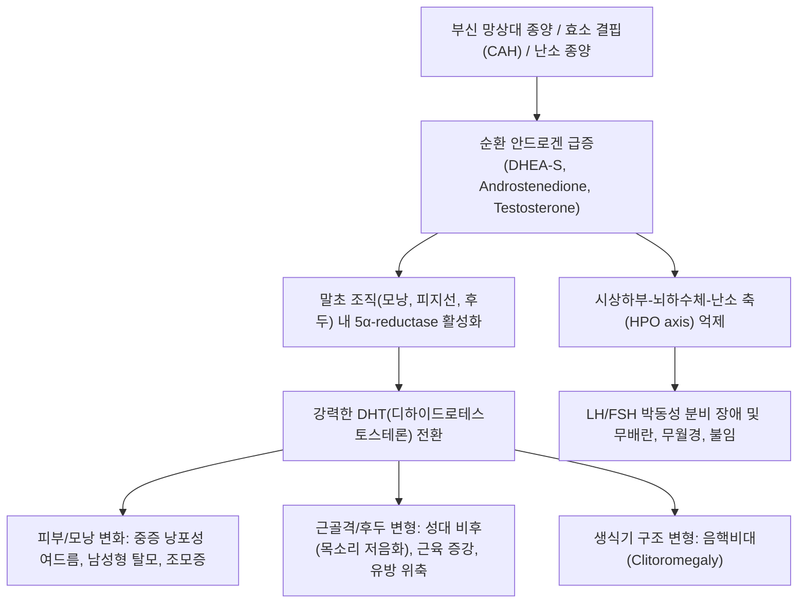
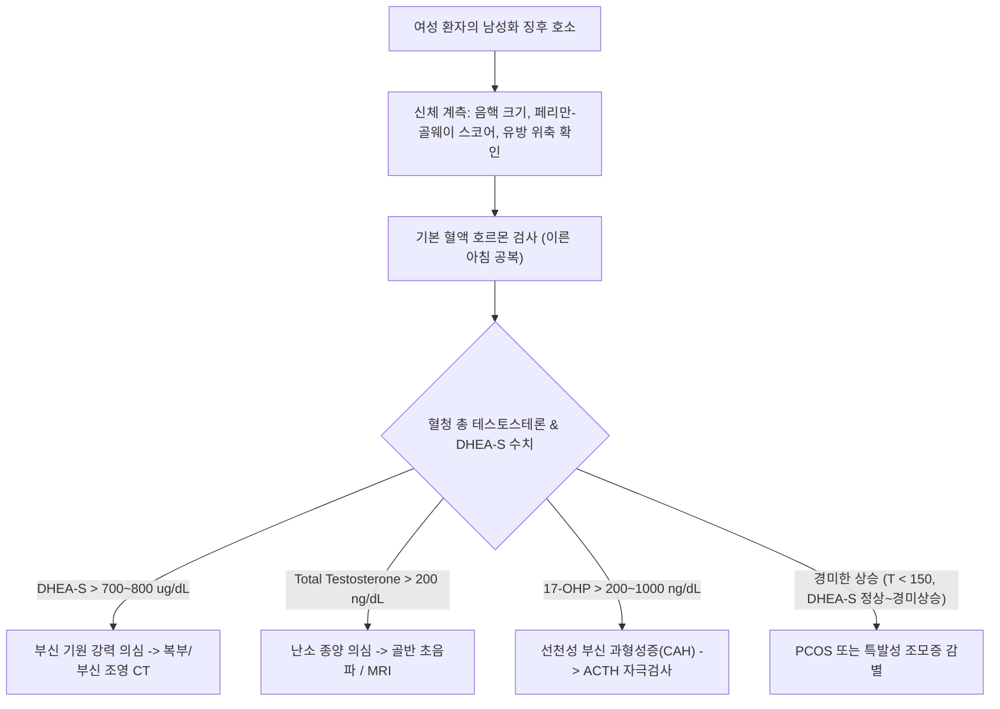

# 🩺 남성화 (Virilization)

> **핵심 3줄 요약 (Key Summary)**:
> - 📍 병소 부위 & 해부·병태생리: [[부신피질]]의 망상대(Zona reticularis) 또는 [[난소]]의 난포막 세포에서 안드로겐(DHEA-S, 안드로스텐디온, 테스토스테론)이 과다 분비되어 여성 환자에서 2차 성징의 역전 및 비가역적 남성형 변화 유발.
> - 🚩 전형적 임상 양상: 단순 조모증(Hirsutism)을 넘어선 음핵비대(Clitoromegaly), 중저음 목소리 변화(Deepening of voice), 측두부 탈모(Male-pattern baldness), 근육량 증가, 유방 위축 및 무월경.
> - 🛠️ 핵심 검사 & 치료 전략: 혈청 총/유리 테스토스테론 및 DHEA-S 측정, 17-OHP 검사, 부신/골반 CT·MRI로 종양 감별; 안드로겐 분비 종양 수술적 절제, CAH는 [[글루코코르티코이드]] 보충.
> - ⚠️ 응급 의뢰 레드플래그: 수개월 내 급격히 진행하는 남성화 징후, 복부/골반 촉지성 종괴, 중증 저칼륨혈증 동반(부신피질암종 또는 악성 난소종양 강력 의심).

---

## 📌 목차
1. [질환 개요 & 해부학적 병태생리](#1-질환-개요--해부학적-병태생리)
2. [병태생리 메커니즘 & 생체역학적 악순환 네트워크](#2-병태생리-메커니즘--생체역학적-악순환-네트워크)
3. [임상 증상 & 이학적 검사(Physical Exam) 알고리즘](#3-임상-증상--이학적-검사physical-exam-알고리즘)
4. [감별 진단 매트릭스 (Differential Diagnosis)](#4-감별-진단-매트릭스-differential-diagnosis)
5. [한의 통합 치료 프로토콜 (침·약침·추나·한약)](#5-한의-통합-치료-프로토콜-침약침추나한약)
6. [양방 치료 & 병용·의뢰 기준 (Conventional Treatment & Referral)](#6-양방-치료--병용의뢰-기준-conventional-treatment--referral)
7. [재활 운동 & 생활습관 티칭 가이드](#7-재활-운동--생활습관-티칭-가이드)
8. [💡 사용자 진료실 핵심 필기 & 임상 노하우 (Melt-In 잔여 심화 집약)](#8--사용자-진료실-핵심-필기--임상-노하우-melt-in-잔여-심화-집약)
9. [출처 및 학술 참고 문헌 (References)](#9-출처-및-학술-참고-문헌-references)

---

## 1. 질환 개요 & 해부학적 병태생리

* **정의**: 남성화(Virilization, Adrenal Virilism)는 여성이나 사춘기 전 소아에서 순환 혈액 내 [[안드로겐]] 농도가 비정상적으로 급격히 상승하여 남성의 2차 성징 특성이 뚜렷하게 발현되는 병리적 상태이다. 단순한 굵은 털의 증가인 조모증(Hirsutism)과 구별되며, 음핵비대, 저음화, 남성형 대머리, 체형 변화 등 해부학적·구조적 변형을 동반한다.
* **해부학적 병소**:
  * **[[부신피질]](Adrenal Cortex)**: 사구대(Zona glomerulosa, 알도스테론), 속상대(Zona fasciculata, [[코르티솔]]), 망상대(Zona reticularis, 안드로겐) 중 가장 안쪽 망상대가 주 병소이다. 망상대 세포 과다증식, 양성 [[선종]], 악성 부신피질암(Adrenocortical carcinoma)에서 디하이드로에피안드로스테론 황산염([[DHEA]]-S) 및 안드로스텐디온이 대량 분비된다.
  * **[[선천성 부신 과형성증]](CAH)**: 21-수산화효소(21-hydroxylase, CYP21A2) 또는 11β-수산화효소(CYP11B1) 결핍으로 인해 [[코르티솔]] 생성이 차단되고, [[부신피질자극호르몬]](ACTH)이 보상적으로 급증하면서 스테로이드 합성 경로가 안드로겐 생성 방향으로 전이된다.
  * **난소(Ovary)**: 난포막 세포(Theca cell) 종양(Sertoli-Leydig 세포종, Hilus 세포종) 또는 중증 [[다낭성 난소 증후군]](PCOS, 과포막세포증 Thecosis)에서 강력한 [[테스토스테론]](Testosterone)이 과다 생성된다.
* **역학 및 위험요인**:
  * 비고전적 선천성 부신 과형성증(Non-classic CAH)은 여성 1,000명당 1~2명꼴로 비교적 흔하며, 청소년기~가임기 여성에서 불임, 여드름, 다모증으로 내원한다.
  * 반면 성인에서 수주~수개월 내에 급격히 발현하는 남성화는 50% 이상이 부신피질암 또는 난소의 안드로겐 분비 종양에 기인하므로 즉각적인 영상 검사가 필수적이다.

---

## 2. 병태생리 메커니즘 & 생체역학적 악순환 네트워크

* **분자생물학적 신호전달체계**:
  * 안드로겐 수용체(Androgen Receptor, AR)는 세포질 내에서 열충격단백질과 결합해 있다가 리간드(DHT 또는 테스토스테론)와 결합하면 핵 내로 이동하여 호르몬 반응 요소(ARE)에 결합한다.
  * 피지선 증식 신호, 모낭 주기 단축(성장기 감소 및 휴지기 연장으로 인한 안드로겐성 탈모), 후두 연골의 비대 및 성대 주름의 비후를 유도한다.
* **코르티솔 및 안드로겐 상호작용 (Crosstalk)**:
  * 부신 효소 결핍 시 코르티솔 결핍으로 시상하부 CRH 및 뇌하수체 ACTH 분비 억제가 해제되어 부신피질이 지속적으로 자극받는다.
  * 과도한 안드로겐은 난소 과립막세포(Granulosa cells)의 아로마타제(Aromatase) 발현을 억제하고 글루코코르티코이드 수용체와의 교차 반응을 유발하여 난포 성숙을 정지시킨다.

---

## 3. 임상 증상 & 이학적 검사(Physical Exam) 알고리즘

### 1) 주요 임상 증상
* **피부 및 모발**:
  * 치료 저항성 낭포성 [[여드름]](Acne vulgaris).
  * 페리만-골웨이(Ferriman-Gallwey) 스코어 8점 이상의 심한 조모증(턱, 흉부, 복부 정중선, 허벅지 내측).
  * 양측 측두부 및 두정부의 M자형 남성형 탈모(Hamilton-Norwood 분류 진행).
* **신체 골격 및 음성 변화**:
  * 후두 융기 돌출 및 비가역적인 영구적 저음화(Deepening of voice).
  * 견갑대 및 상지 근육량의 비정상적 증가, 체지방의 남성형(중심성) 재분포.
  * 유방 실질 조직의 현저한 위축.
* **생식계 변형**:
  * 음핵 지수(Clitoral index = 길이 × 너비) 35 $mm^2$ 초과의 음핵비대.
  * 희발월경(Oligomenorrhea)을 거쳐 지속적인 속발성 [[무월경]](Amenorrhea) 및 불임.

### 2) 이학적 검사 및 진단 알고리즘

---

## 4. 감별 진단 매트릭스 (Differential Diagnosis)

| 감별 질환 | 호르몬 특징 | 주 임상 양상 | 초음파 / CT 소견 | 감별 핵심 포인트 |
| :--- | :--- | :--- | :--- | :--- |
| **남성화 부신종양 (ACC / 선종)** | DHEA-S 극단적 상승 (> 700 $\mu g/dL$), 코르티솔 동반 상승 가능 | 수개월 내 급격한 남성화, 중심성 비만 | 부신 종괴 (> 4cm, 조영증강 지연, 불균질성) | 급격한 진행, 고령 발병, 복부 종괴 |
| **난소 안드로겐 분비 종양** | Testosterone 극단적 상승 (> 200 $ng/dL$), DHEA-S 정상 | 폐경 전후 급격한 남성화, 음핵비대 | 일측성 난소 고형 종괴 | DHEA-S 정상 유지되며 테스토스테론만 단독 폭증 |
| **비고전적 CAH (NCAH)** | 17-OH 프로게스테론 상승 (> 200~1000 $ng/dL$) | 사춘기 이후 완만한 다모증, 여드름, 불임 | 양측 부신 미만성 비대 또는 정상 | ACTH 250 $\mu g$ 부하시 17-OHP 급상승 |
| **[[다낭성 난소 증후군]](PCOS)** | LH/FSH 비율 증가 (> 2~3), T 경미한 상승 (< 150) | 비만, 인슐린 저항성, 불규칙 월경 | 난소 내 다발성 미성숙 난포 (Necklace sign) | 음핵비대나 저음화 같은 진성 남성화는 극히 드묾 |
| **쿠싱 증후군** | 24시간 소변 유리 코르티솔 상승, 저용량 덱사 불억제 | 문페이스, 자색선조, 근위부 근위축, 다모증 | 부신 종종 또는 뇌하수체 미세선종 | 당질코르티코이드 과다 증상이 압도적 주소증 |

---

## 5. 한의 통합 치료 프로토콜 (침·약침·추나·한약)

> ⚠️ **주의**: 악성 종양(부신암, 난소암)이나 중증 활동성 종양 환자는 반드시 외과적 절제 후 보조 요법으로 접근하며, 비종양성(비고전적 CAH 안정기, PCOS 복합성 고안드로겐혈증) 환자를 주 치료 대상으로 한다.

### 1) 변증 분류
* **간경울화·어혈조체(肝經鬱火·瘀血阻滯)**: 감정 스트레스, 흉협고만, 성격 급박, 설홍태황, 맥현삭. 월경폐색, 낭포성 여드름, 조모증.
* **신음부족·상화망동(腎陰不足·相火妄動)**: 음허화왕으로 인한 구갈, 골증조열, 두통, 요슬산연, 설홍소태, 맥세삭. 성욕 이상 항진, 골반통.
* **담습조체·비신양허(痰濕阻滯·脾腎陽虛)**: 체중 증가, 수분 정체, 만성 피로, 부종, 소화불량, 설담반치흔, 맥침완.

### 2) 침구 치료
* **주요 혈위**:
  * 간화 청열 & 혈액 순환: [[행간]](LR2), [[태충]](LR3), [[곡지]](LI11), [[혈해]](SP10), [[삼음교]](SP6).
  * 내분비 축 안정 및 부신 기운 조절: [[신수]](BL23), [[차료]](BL32), [[관원]](CV4), [[기해]](CV6), [[중극]](CV3).
* **자침 기법**: 복부 및 배수혈은 직자 20~30mm 유침(20분), 전침(Low frequency 2~4Hz)을 삼음교-혈해에 통전하여 시상하부-난소-부신 내분비계의 혈류 개선 유도.

### 3) 약침 요법
* **약침 제제**: 자하거(Hominis Placenta) 약침, 황련해독탕 약침.
* **시술 부위**:
  * 간화·염증성 여드름: 곡지, 합곡, 태충에 황련해독탕 약침 주입 (부위당 0.1~0.2cc).
  * 난소-부신 축 안정 및 내분비 허약: 관원, 신수, 차료에 자하거 약침 (부위당 0.2~0.5cc, 주 2회).

### 4) 한약 처방
* **용담사간탕(龍膽瀉肝湯) 가감**: 간경실화(肝經實火)로 인한 급격한 여드름, 안면홍조, 신경질적 증상 개선. (용담초, 황금, 치자, 목통, 차전자, 택사, 생지황, 당귀, 시호, 감초).
* **육미지황탕(六味地黃湯) 합 이선탕(二仙湯)**: 신음허와 상화망동을 다스리고 내분비 호르몬의 기저 항상성을 회복. (숙지황, 산약, 산수유, 복령, 목단피, 택사, 선모, 음양곽, 당귀, 파극천, 황백, 지모).
* **도인승기탕(桃仁承氣湯) 또는 계지복령환(桂枝茯苓丸)**: 하초 어혈을 풀어 자궁·난소 혈류 순환을 촉진하고 월경 배출을 정상화.

---

## 6. 양방 치료 & 병용·의뢰 기준 (Conventional Treatment & Referral)

* **약물 치료 (Medication)**:
  * **[[글루코코르티코이드]](Glucocorticoid)**: 선천성 부신 과형성증(CAH)의 표준 치료. 하이드로코르티손(Hydrocortisone 15~25 mg/day) 또는 덱사메타손(0.25~0.5 mg 취침 전)을 투여하여 뇌하수체 ACTH 분비를 억제, 부신 유래 안드로겐 생산을 차단.
  * **항안드로겐제(Anti-androgens)**:
    * [[스피로노락톤]](Spironolactone 100~200 mg/day): 안드로겐 수용체 차단 및 5α-환원효소 억제.
    * 시프로테론 아세테이트(Cyproterone acetate) 또는 피나스테리드/두타스테리드: 모낭 및 피지선 타겟.
  * **경구 피임약(OCP)**: 난소 에스트로겐/프로게스틴 복합제로 LH 분비를 억제하여 난소 안드로겐 합성을 감소시키고, 성호르몬 결합 글로불린(SHBG)을 증가시켜 유리 테스토스테론을 낮춤.
* **수술적 적응증 (Surgical Indication)**:
  * 부신 선종 또는 악성 부신피질암: 복강경하 또는 개복 부신 절제술(Adrenalectomy).
  * 난소 안드로겐 분비 종양: 일측 난소난관절제술(Salpingo-oophorectomy).
  * 소아 외성기 기형: 음핵축소성형술(Clitoroplasty) 및 질성형술(Vaginoplasty).
* **한의 병용 판단 (Combination Therapy)**:
  * 저용량 스테로이드 복용 중인 NCAH 환자에서 한약(보신익기제) 병용은 스테로이드 유발 부작용(위장장애, 골감소)을 완화하고 피로도를 개선하는 데 유효함.
  * 항안드로겐제 복용 환자에게 이뇨제 성분의 과도한 한약재 복용 시 전해질 불균형 주의 모니터링 필요.
* **양방·전문과 의뢰 기준 (Referral Criteria)**:
  * **즉각 의뢰 (Red Flag)**: 수개월 내 진행된 급격한 음핵비대, 저음화, 혈청 DHEA-S > 700 $\mu g/dL$, Testosterone > 200 $ng/dL$. (종양 배제 필수).
  * 신생아 애매소아외성기(Ambiguous genitalia) 및 염분소실 징후(저나트륨혈증, 고칼륨혈증, 탈수 쇼크) 발견 시 응급 소아내분비과 의뢰.

---

## 7. 재활 운동 & 생활습관 티칭 가이드

* **인슐린 저항성 관리와 식이상**:
  * 고안드로겐혈증은 고인슐린혈증과 밀접한 상호 악순환을 형성하므로, 저GI(Glycemic Index) 식단 유지.
  * 정제 탄수화물 제한, 녹황색 채소 및 항산화 폴리페놀 섭취 강화.
* **체중 감량 및 운동 요법**:
  * 체지방 감소는 인슐린 감수성을 개선하고 SHBG 농도를 높여 유리 활성 안드로겐을 감소시킴.
  * 중등도 강도의 유산소 운동(주 150분 이상) 및 대근육군 저항 운동 병행.
* **피부 및 제모 관리 티칭**:
  * 낭포성 여드름 부위 무리한 압출 금지(이차 세균 감염 및 흉터 방지).
  * 전기분해 제모나 레이저 제모는 호르몬 환경이 안정화된 후 병행할 것을 안내.

---

## 8. 💡 사용자 진료실 핵심 필기 & 임상 노하우 (Melt-In 잔여 심화 집약)

* **조모증(Hirsutism)과 남성화(Virilization)의 진료실 감별선**:
  * 턱밑이나 배꼽 주위에 굵은 털 몇 가닥이 나는 환자는 대부분 특발성이거나 경미한 PCOS이다. 그러나 "환자의 목소리가 갈라지며 굵어졌는가?", "바지 입을 때 음핵 부위 마찰감이나 돌출을 느끼는가?"를 직접 문진해야 한다.
  * 음핵비대나 저음화가 동반된 순간 이는 기능성 질환이 아닌 **기질적 종양(Adrenal or Ovarian Neoplasm)**의 강력한 경고등이다.
* **음성 변화의 비가역성 티칭**:
  * 한번 비후된 성대 연골과 중저음화된 목소리는 종양을 제거하거나 호르몬 수치가 완전히 정상화되어도 이전 상태로 회복되지 않는 경우가 많다. 이 점을 조기에 양방 이비인후과 음성치료와 연계하여 환자에게 명확히 고지해야 의료분쟁을 예방할 수 있다.

---

## 9. 출처 및 학술 참고 문헌 (References)

* Pinna M, et al. (2026). Androgen and glucocorticoid crosstalk in granulosa cells: molecular insights into polyendocrine metabolic ovarian syndrome. *Front Endocrinol (Lausanne)*, 17:1489211. PMID: 42851646.

* Liu S, et al. (2026). Acquired 11β-hydroxylase deficiency adrenal hyperplasia associated with the use of etomidate and/or its analogues through e-cigarettes - a review of 76 cases in Hong Kong. *Clin Toxicol (Phila)*, 64(10):782-791. PMID: 42841424.

* Papadakis JL, et al. (2026). Gender Dysphoria Among 46,XX Patients Diagnosed with Congenital Adrenal Hyperplasia in Childhood: A Case Series. *J Clin Psychol Med Settings*, 33(4):512-524. PMID: 42821173.

---

## 관련 노트

- [[_의학/03_이론/질환/내분비 질환/부신/부신 부전|부신 부전]]
- [[_의학/03_이론/질환/내분비 질환/부신/고알도스테론증|고알도스테론증]]
- [[_의학/03_이론/질환/내분비 질환/뇌하수체/고프로락틴 혈증|고프로락틴 혈증]]
- [[부신피질]]
- [[선천성 부신 과형성증]]
- [[다낭성 난소 증후군]]
