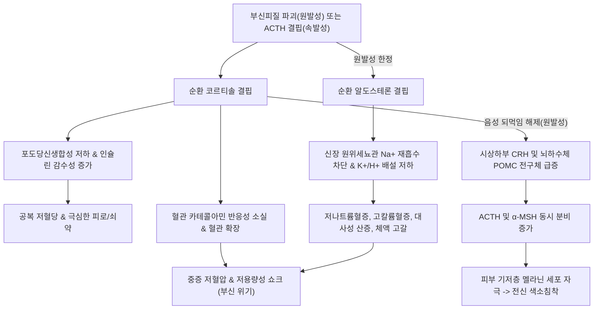
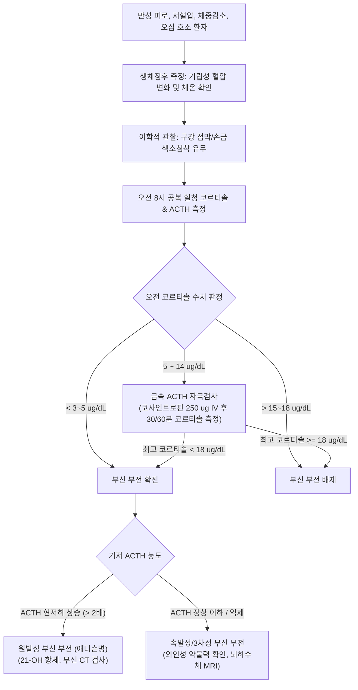

# 🩺 부신 부전 (Adrenal Insufficiency)

> **핵심 3줄 요약 (Key Summary)**:
> - 📍 병소 부위 & 해부·병태생리: [[부신피질]]의 전층 파괴(원발성/[[부신 부전]]) 또는 시상하부-뇌하수체 축 이상(속발성/ACTH 결핍)으로 인해 [[코르티솔]] 및 알도스테론 분비가 결핍되는 생명 위협 내분비 질환.
> - 🚩 전형적 임상 양상: 쇠약감, 만성 피로, 식욕부진 및 체중감소, [[저혈압]](기립성 저혈압), 오심·구토, 원발성의 경우 피부·점막 색소침착(Hyperpigmentation) 및 염분 갈망(Salt craving).
> - 🛠️ 핵심 검사 & 치료 전략: 아침 공복 혈청 코르티솔 및 ACTH 측정, 급속 ACTH 자극검사(코사인트로핀 250 $\mu g$); 평상시 하이드로코르티손(15~25 mg/일) 및 플루드로코르티손 보충, 급성 부신위기 시 고용량 IV 스테로이드 및 수액 소생술.
> - ⚠️ 응급 의뢰 레드플래그: 고열, 극심한 복통/측복통, 불응성 저혈압 쇼크, 혼미, 전해질 붕괴(저나트륨혈증+고칼륨혈증+저혈당) -> 즉각 119 후송 및 급성 부신 위기(Adrenal Crisis) 처치.

---

## 📌 목차
1. [질환 개요 & 해부학적 병태생리](#1-질환-개요--해부학적-병태생리)
2. [병태생리 메커니즘 & 생체역학적 악순환 네트워크](#2-병태생리-메커니즘--생체역학적-악순환-네트워크)
3. [임상 증상 & 이학적 검사(Physical Exam) 알고리즘](#3-임상-증상--이학적-검사physical-exam-알고리즘)
4. [감별 진단 매트릭스 (Differential Diagnosis)](#4-감별-진단-매트릭스-differential-diagnosis)
5. [한의 통합 치료 프로토콜 (침·약침·추나·한약)](#5-한의-통합-치료-프로토콜-침약침추나한약)
6. [양방 치료 & 병용·의뢰 기준 (Conventional Treatment & Referral)](#6-양방-치료--병용의뢰-기준-conventional-treatment--referral)
7. [재활 운동 & 생활습관 티칭 가이드](#7-재활-운동--생활습관-티칭-가이드)
8. [💡 사용자 진료실 핵심 필기 & 임상 노하우 (Melt-In 잔여 심화 집약)](#8--사용자-진료실-핵심-필기--임상-노하우-melt-in-잔여-심화-집약)
9. [출처 및 학술 참고 문헌 (References)](#9-출처-및-학술-참고-문헌-references)

---

## 1. 질환 개요 & 해부학적 병태생리

* **정의**: 부신 부전(Adrenal Insufficiency, AI)은 체내 항상성 유지에 필수적인 부신피질 호르몬(주로 [[글루코코르티코이드]]인 [[코르티솔]], 원발성의 경우 [[미네랄로코르티코이드]]인 [[알도스테론]] 포함)의 분비가 부족하여 대사 부전, 심혈관계 허탈, 전해질 불균형을 초래하는 임상 증후군이다.
* **해부학적 분류 및 병인**:
  * **원발성 부신 부전 (Primary AI, [[부신 부전]] Addison's disease)**:
    * 병소: 양측 [[부신피질]] 자체의 90% 이상 파괴.
    * 원인: 자가면역성 부신염(21-hydroxylase 자가항체 양성, 전체의 70~80%), 결핵성 부신염(감염성), 양측 부신 출혈/경색(Waterhouse-Friderichsen 증후군, 항인지질항체증후군), 부신 전이암, 림프종, 유전성(부신백질이영양증).
    * 특징: 코르티솔 결핍 + 알도스테론 결핍 + 안드로겐 결핍 모두 동반.
  * **속발성/3차성 부신 부전 (Secondary / Tertiary AI)**:
    * 병소: [[뇌하수체]] 전엽(ACTH 결핍) 또는 [[시상하부]](CRH 결핍).
    * 원인: 장기간 외인성 스테로이드 투여 후 급격한 중단(가장 흔함), 뇌하수체 종양, 쉬한 증후군, 두개인두종, 두부 외상.
    * 특징: 레닌-안지오텐신-알도스테론계(RAAS)는 온전하여 **알도스테론 분비는 정상 유지**됨 (순수 코르티솔 결핍). 색소침착 없음.
* **역학**:
  * 원발성 부신 부전은 인구 100만 명당 약 100~140명 수준의 희귀 질환이나, 외인성 스테로이드 중단에 의한 속발성/3차성 부신 부전은 임상에서 매우 빈번하게 조우한다.

---

## 2. 병태생리 메커니즘 & 생체역학적 악순환 네트워크

* **급성 부신 위기(Adrenal Crisis)의 촉발 기전**:
  * 감염, 외상, 수술, 극심한 스트레스, 심한 탈수 발생 시 정상인은 코르티솔 분비가 5~10배 급증해야 하나, 부신 부전 환자는 이를 감당하지 못하여 세포막 투과성 이상, 혈관 수축력 완전 상실, 저혈량성·혈관확장성 혼합 쇼크로 급격히 이행한다.

---

## 3. 임상 증상 & 이학적 검사(Physical Exam) 알고리즘

### 1) 주요 임상 증상
* **전신 대사 증상**:
  * 100%에 가까운 환자에서 호소하는 진행성 피로감, 쇠약감, 권태감.
  * 식욕부진(Anorexia), 오심, 구토, 복통, 설명되지 않는 현저한 체중 감소.
  * 공복 시 어지럼증 및 진전([[저혈당]]).
* **심혈관계 증상**:
  * [[기립성 저혈압]](앉았다 일어설 때 수축기 혈압 20 mmHg 이상 강하), 현훈, 실신.
* **피부 및 부속기 (원발성 애디슨병 특이적)**:
  * 피부 및 점막의 청동색 색소침착(햇빛 노출 부위, 관절 마찰 부위인 팔꿈치/무릎, 손바닥 손금선, 잇몸 구강점막, 유륜, 수술 흉터).
  * 체모(음모, 액와모) 소실 (안드로겐 결핍 반영).
  * 염분 갈망(Salt craving, 알도스테론 결핍으로 인한 소금 섭취 충동).

### 2) 이학적 검사 및 진단 알고리즘

---

## 4. 감별 진단 매트릭스 (Differential Diagnosis)

| 감별 질환 | 혈청 ACTH | 전해질 이상 | 피부 색소침착 | 저혈당 빈도 | 감별 포인트 |
| :--- | :--- | :--- | :--- | :--- | :--- |
| **원발성 부신 부전 (애디슨병)** | 현저히 상승 (> 100 $pg/mL$) | 저Na+, 고K+, 대사산증 | **뚜렷함** (구강, 손금, 흉터) | 흔함 | 알도스테론 결핍 동반, 고칼륨혈증, 염분 갈망 |
| **속발성/3차성 부신 부전** | 정상 이하 또는 저하 (< 10~20) | 저Na+ (희석성), **K+ 정상** | **없음** (창백함) | 흔함 | 알도스테론 정상(RAAS 온전), 스테로이드 중단력 |
| **[[신경성 식욕부진증]]** | 정상~경미상승 | 다양함 | 없음 | 동반 가능 | 왜곡된 신체상, 코르티솔 분비능 자체는 정상 유지 |
| **만성 피로 증후군 (CFS)** | 정상 | 전해질 정상 | 없음 | 없음 | 아침 코르티솔 및 ACTH 자극검사 정상 반응 |
| **혈색소침착증 (Hemochromatosis)** | 정상 | 전해질 정상 | 청동색 색소침착 (유사) | 드묾 | 혈청 페리틴 및 트랜스페린 포화도 극단적 상승 |

---

## 5. 한의 통합 치료 프로토콜 (침·약침·추나·한약)

> ⚠️ **절대 주의**: 부신 부전은 생명 유지 호르몬의 결핍 질환이므로, 양방의 **스테로이드 대체 요법을 절대로 중단하거나 임의 감량해서는 안 된다.** 한의 치료는 양방 호르몬 보충을 유지하는 상태에서 피로감, 소화장애, 기력 저하, 자율신경실조 등의 잔여 증상을 완화하는 **보완 통합치료**로 엄격히 제한한다.

### 1) 변증 분류
* **비신양허(脾腎陽虛)**: 극심한 무기력, 외한지냉(손발 시림), 소화불량, 설사 또는 묽은 변, 설담반치흔, 맥침세무력.
* **기음양허(氣陰兩虛)**: 만성 피로, 구갈, 도한, 미열감, 체중 감소, 설홍소태, 맥세삭.
* **신음부족·수상화왕(腎陰不足·水虧火旺)**: 피부 건조 및 색소침착, 골증조열, 두통, 현훈, 설강소진, 맥세삭.

### 2) 침구 치료
* **주요 혈위**:
  * 비위 기운 보강 & 소화 흡수: [[족삼리]](ST36), [[중완]](CV12), [[비수]](BL20), [[태백]](SP3).
  * 원기 보충 및 부신 기능 간접 지지: [[관원]](CV4), [[기해]](CV6), [[신수]](BL23), [[명문]](GV4), [[태계]](KI3).
* **자침 기법**: 보법(補法) 위주 자침, 온구(灸) 요법 병행. 관원·기해 및 신수에 간접구(뜸) 시술을 통해 양기를 돋우고 전신 혈류 순환 개선.

### 3) 약침 요법
* **약침 제제**: 자하거(Hominis Placenta) 약침, 신수초(황기·인삼 복합) 약침.
* **시술 부위**: 신수, 비수, 관원, 족삼리에 회당 0.2~0.5cc씩 주입 (주 1~2회).
* **목적**: 만성 소모성 상태의 회복 촉진 및 자율신경계 활성도 향상.

### 4) 한약 처방
* **보중익기탕(補中益氣湯) 가감**: 비위기허로 인한 식욕부진, 기력 고갈, 기립성 어지럼증 호소 시 기운을 북돋움. (황기, 인삼, 백출, 당귀, 진피, 승마, 시호, 감초).
* **사역탕(四逆湯) 또는 진무탕(眞武湯)**: 양허음성(陽虛陰盛)으로 손발이 몹시 차고 저혈압 경향, 부종이 동반될 때 양기를 온화시킴. (포부자, 건강, 감초, 백출, 복령).
* **육미지황탕(六味地黃湯) 합 생맥산(生脈散)**: 기음양허로 인한 갈증, 만성 피로, 체중 감소 환자의 진액과 원기 보충. (맥문동, 인삼, 오미자, 숙지황, 산약, 산수유).

---

## 6. 양방 치료 & 병용·의뢰 기준 (Conventional Treatment & Referral)

* **만성기 호르몬 대체 요법 (Maintenance)**:
  * **[[글루코코르티코이드]](Glucocorticoid)**:
    * [[히드로코르티손]](Hydrocortisone) 15~25 mg/day (체내 생체리듬 반영: 기상 직후 10~15 mg, 오후 2~3시경 5~10 mg 분할 복용).
    * 대체제: 프레드니솔론(Prednisolone) 3~5 mg/day (1일 1회 또는 분할).
  * **[[미네랄로코르티코이드]](Mineralocorticoid, 원발성 애디슨병 한정)**:
    * 플루드로코르티손(Fludrocortisone) 0.05~0.2 mg/day 1일 1회 아침 복용.
    * 혈압, 혈청 전해질, 혈장 레닌 활성도(PRA)를 기준으로 용량 적정.
* **급성 부신 위기 응급 처치 (Adrenal Crisis Emergency)**:
  * 즉각적인 하이드로코르티손 100 mg 정맥주사(IV bolus) 후, 24시간 동안 200 mg 지속 정맥 주입 (또는 6시간마다 50 mg IV).
  * 대량 생리식염수(0.9% Normal Saline + 5% Dextrose) 3~4 L 정맥 투여로 쇼크 및 저혈당 교정.
* **스트레스 시 용량 조절 규칙 (Sick-Day Rules)**:
  * 경증 질환(발열 38℃ 이상, 상기도 감염, 발치): 경구 스테로이드 용량을 평소의 **2~3배로 증량**하여 3일간 복용 (Rule of Three).
  * 중증 질환, 수술, 외상, 지속적 구토(경구 약물 흡수 불가): 즉각 입원 후 주사제 전환.
* **한의 병용 및 의뢰 기준 (Referral Criteria)**:
  * **절대 병용 금기**: 환자가 한약을 복용한다고 해서 양방 스테로이드 감량/중단 시도 금지.
  * **즉각 응급 전원 (Red Flag)**:
    * 발열과 동반된 급격한 혈압 강하(수축기 BP < 90 mmHg).
    * 조절되지 않는 구토, 설사, 극심한 복통.
    * 의식 저하, 혼미, 경련.

---

## 7. 재활 운동 & 생활습관 티칭 가이드

* **응급 의료 경보 카드 및 팔찌 착용**:
  * 환자는 항상 "부신 부전 환자 / 스테로이드 의존성"이 기재된 인식표(Medical Alert ID)와 응급 하이드로코르티손 자가 주사 키트를 소지해야 함.
* **염분 및 수분 섭취 관리**:
  * 원발성 부신 부전 환자는 무더운 날씨나 운동으로 땀을 많이 흘렸을 때 식이에 소금을 충분히 추가 섭취하도록 지도.
* **운동 강도 조절**:
  * 탈진을 유발하는 고강도 인터벌 운동이나 과도한 사우나는 저혈압 쇼크를 유발할 수 있으므로 피하고, 가벼운 유산소 걷기 및 점진적 스트레칭 위주로 진행.

---

## 8. 💡 사용자 진료실 핵심 필기 & 임상 노하우 (Melt-In 잔여 심화 집약)

* **피부 색소침착의 임상적 단서**:
  * 만성 피로와 무기력을 호소하며 내원한 환자 중 "얼굴이 탄 것 같다"고 할 때, 손바닥 손금선(Palmar creases)과 잇몸을 반드시 확인하라. 정상인은 손바닥 손금선이 주변 피부보다 짙지 않다. 손금선이 짙은 갈색/검은색으로 침착되어 있다면 이는 부신피질 파괴에 따른 POMC/ACTH 보상성 과다 분비의 명확한 신체 징후이다.
* **한의원 외래 스테로이드 중단 증후군 감별**:
  * 피부과, 정형외과, 류마티스과에서 관절강 주사나 경구 스테로이드를 수개월 이상 복용하다가 한의 치료를 위해 갑자기 양약을 끊고 내원하는 환자가 있다.
  * 이 경우 나타나는 피로감과 몸살 기운은 '명현 반응'이 아니라 **HPA 축 억제에 따른 의원성 속발성 부신 부전(Secondary AI)**일 위험이 매우 높다. 이전 스테로이드 처방 이력을 정밀 문진하고 점진적 감량(Tapering) 일정을 양방 담당의와 상의하도록 안내해야 안전하다.

---

## 9. 출처 및 학술 참고 문헌 (References)

* Haunton S, et al. (2026). Cortisol Cutoffs for Adrenal Insufficiency Using Elecsys II: A Systematic Review. *Clin Endocrinol (Oxf)*, 105(4):389-398. PMID: 42860641.

* Wannachalee T, et al. (2026). Adrenal Infections: An Underrecognized Cause of Primary Adrenal Insufficiency. *Clin Endocrinol (Oxf)*, 105(4):412-425. PMID: 42852841.

* Silvestro O, et al. (2026). Health-related quality of life and patterns of psychological vulnerability in autoimmune Addison's disease: a systematic review. *Front Endocrinol (Lausanne)*, 17:1512408. PMID: 42851403.

---

## 관련 노트

- [[_의학/03_이론/질환/내분비 질환/부신/고알도스테론증|고알도스테론증]]
- [[_의학/03_이론/질환/내분비 질환/부신/남성화|남성화]]
- [[_의학/03_이론/질환/내분비 질환/뇌하수체/뇌하수체기능저하증|뇌하수체기능저하증]]
- [[부신피질]]
- [[코르티솔]]
- [[알도스테론]]
- [[저혈압]]
