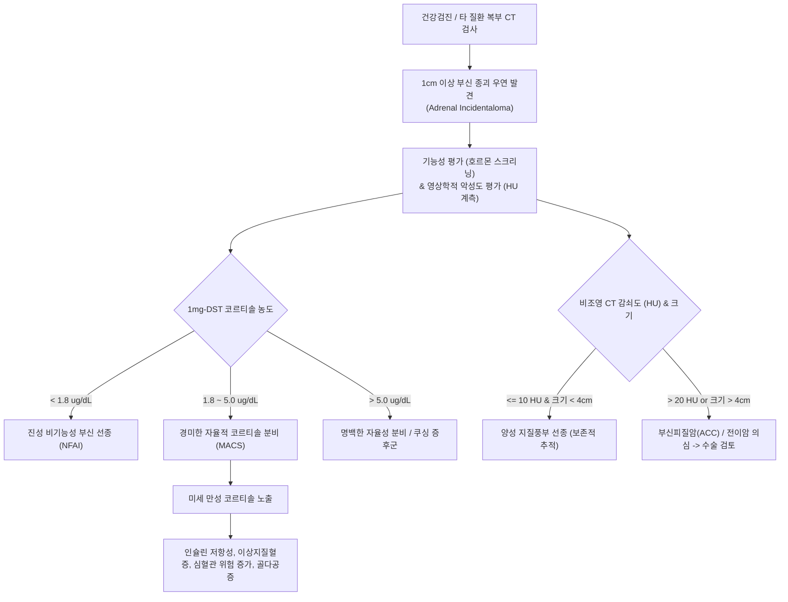
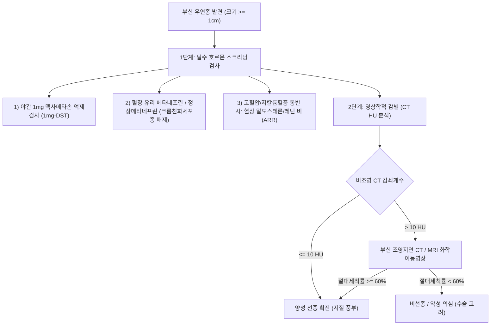

# 🩺 비기능성 부신 종괴 (Non-functioning Adrenal Incidentaloma)

> **핵심 3줄 요약 (Key Summary)**:
> - 📍 병소 부위 & 해부·병태생리: 복부 영상검사(CT, MRI) 중 우연히 발견된 [[부신]]의 종괴(우연종, Incidentaloma) 중 명백한 호르몬 과다 분비(알도스테론, 코르티솔, 카테콜아민)를 보이지 않는 대부분 양성의 [[선종]](Adenoma).
> - 🚩 전형적 임상 양상: 대부분 무증상이나, 종괴 크기가 거대할 경우(> 4~6cm) 측복부/복부 둔통, 포만감 유발 가능; 경미한 자율적 코르티솔 분비(MACS) 동반 시 대사증후군, 당뇨, 골다공증 위험 증가.
> - 🛠️ 핵심 검사 & 치료 전략: 1mg 야간 덱사메타손 억제검사(1mg-DST), 혈장 유리 메타네프린, 혈장 알도스테론/레닌 비(ARR)로 기능성 배제; 비조영 CT 감쇠계수 $\le$ 10 HU 확인; 비기능성 양성 종괴는 보존적 추적관찰, 악성 의심(> 4cm, 불균질, 고감쇠) 시 복강경 부신절제술.
> - ⚠️ 응급 의뢰 레드플래그: 4cm 초과의 빠른 성장 종괴, 비조영 CT > 20 HU 및 조영제 세척 지연, 체중감소 동반(부신피질암종 ACC 또는 전이암 강력 의심).

---

## 📌 목차
1. [질환 개요 & 해부학적 병태생리](#1-질환-개요--해부학적-병태생리)
2. [병태생리 메커니즘 & 생체역학적 악순환 네트워크](#2-병태생리-메커니즘--생체역학적-악순환-네트워크)
3. [임상 증상 & 이학적 검사(Physical Exam) 알고리즘](#3-임상-증상--이학적-검사physical-exam-알고리즘)
4. [감별 진단 매트릭스 (Differential Diagnosis)](#4-감별-진단-매트릭스-differential-diagnosis)
5. [한의 통합 치료 프로토콜 (침·약침·추나·한약)](#5-한의-통합-치료-프로토콜-침약침추나한약)
6. [양방 치료 & 병용·의뢰 기준 (Conventional Treatment & Referral)](#6-양방-치료--병용의뢰-기준-conventional-treatment--referral)
7. [재활 운동 & 생활습관 티칭 가이드](#7-재활-운동--생활습관-티칭-가이드)
8. [💡 사용자 진료실 핵심 필기 & 임상 노하우 (Melt-In 잔여 심화 집약)](#8--사용자-진료실-핵심-필기--임상-노하우-melt-in-잔여-심화-집약)
9. [출처 및 학술 참고 문헌 (References)](#9-출처-및-학술-참고-문헌--references)

---

## 1. 질환 개요 & 해부학적 병태생리

* **정의**: 비기능성 부신 종괴(Non-functioning Adrenal Incidentaloma, NFAI)는 부신 질환이 의심되지 않는 환자에서 다른 복부 질환이나 건강검진 목적의 영상 검사(CT, MRI, 초음파) 중 우연히 발견된 1cm 이상의 부신 종괴 중 호르몬 과다 분비가 확인되지 않는 병변을 의미한다.
* **해부학적 특성 및 병리**:
  * **[[부신피질]](Adrenal Cortex)** 유래의 양성 피질선종(Adrenocortical adenoma)이 약 70~80%로 가장 흔하다. 풍부한 세포내 지질(Lipid-rich)을 함유하고 있어 비조영 CT에서 낮은 방사선 감쇠(Attenuation $\le$ 10 Hounsfield Unit, HU)를 보인다.
  * 기타 병리: 부신 골수지방종(Myelolipoma, 지방 성분 함유 양성 종양), 부신 낭종(Adrenal cyst), 혈종(Hematoma), 신경절신경종(Ganglioneuroma).
  * 악성 병변: 원발성 부신피질암(Adrenocortical carcinoma, ACC), 타 장기(폐암, 유방암, 신세포암, 대장암, 악성 흑색종)로부터의 부신 전이(Adrenal metastasis).
* **역학**:
  * 복부 CT 보급 확대로 전체 복부 CT 검사의 4~5%, 70세 이상 고령 인구에서는 7~10%까지 발견율이 증가한다.
  * 부신 우연종 중 약 80%는 비기능성 피질선종이며, 약 10~15%는 경미한 자율적 코르티솔 분비(MACS), 2~3%는 [[크롬친화세포종]], 1~2%는 원발성 [[고알도스테론증]], 2~5%는 악성 종양(ACC 또는 전이)으로 분류된다.

---

## 2. 병태생리 메커니즘 & 생체역학적 악순환 네트워크

* **경미한 자율적 코르티솔 분비 (Mild Autonomous Cortisol Secretion, MACS)**:
  * 전통적으로 '비기능성'으로 분류되었던 종괴 중 상당수가 1mg 덱사메타손 억제검사에서 완전 억제($< 1.8 \mu g/dL$)되지 않는 MACS 상태임이 밝혀졌다.
  * 외형적인 쿠싱 증후군 징후(문페이스, 자색선조)는 없으나, 장기적으로 무증상 고혈압, 제2형 [[당뇨병]], 골밀도 감소, 척추 압박골절, 심근경색 등 대사·심혈관계 질환 이환율을 유의미하게 높인다.

---

## 3. 임상 증상 & 이학적 검사(Physical Exam) 알고리즘

### 1) 주요 임상 증상
* **무증상 (Asymptomatic)**: 90% 이상의 환자가 어떠한 자각 증상도 느끼지 못하며, 국가 검진이나 소화기 정밀검사 중 통보받음.
* **국소 압박 증상**: 종괴 크기가 5~6cm 이상으로 거대할 경우 동측 측복부 둔통, 상복부 팽만감, 소화불량, 요통.
* **잠재적 대사 징후 (MACS 동반 시)**: 설명되지 않는 체중 증가, 약물로 잘 조절되지 않는 [[고혈압]], 경계성 고혈당, 골절 병력.

### 2) 필수 진단 평가 알고리즘

---

## 4. 감별 진단 매트릭스 (Differential Diagnosis)

| 질환군 | 비조영 CT 감쇠도 (HU) | 크기 및 모양 특징 | 호르몬 분비 양상 | 치료 원칙 |
| :--- | :--- | :--- | :--- | :--- |
| **비기능성 양성 선종 (NFAI)** | **$\le$ 10 HU** (지질 풍부) | 균질성, 경계 명확, 대개 < 4cm | 모든 호르몬 음성 (1mg-DST < 1.8) | 정기적 영상/호르몬 추적 |
| **경미한 자율분비 (MACS)** | $\le$ 10 HU (유사) | 균질성 양성 선종 양상 | **1mg-DST 1.8~5.0 $\mu g/dL$** | 대사 합병증 치료, 선택적 수술 |
| **[[크롬친화세포종]]** | > 20~30 HU (고감쇠) | 혈관 풍부, 낭성 괴사, 조영증강 강함 | **혈장/소변 메타네프린 상승** | $\alpha$-차단제 전처치 후 수술 |
| **원발성 [[고알도스테론증]]** | $\le$ 10 HU | 소형 (< 2cm), 일측성 결절 | **ARR $\ge$ 20~30**, 알도스테론 상승 | 복강경 부신절제술 또는 약물 |
| **부신피질암 (ACC)** | **> 20~40 HU** | 불균질, 경계 불명확, **거대 (> 4~6cm)** | 안드로겐(DHEA-S), 코르티솔 복합 분비 | 즉각적 광범위 외과 절제술 |
| **부신 전이암** | > 10~20 HU | 양측성 빈번, 불균질, 불완전 세척 | 대개 비기능성, 악성 종양 기저력 | 원발암 병기 설정 및 항암/방사선 |

---

## 5. 한의 통합 치료 프로토콜 (침·약침·추나·한약)

> ⚠️ **주의**: 호르몬 분비 종양(갈색세포종, 알도스테론종) 및 악성 종양이 양방 검사로 **완전히 배제된 양성 비기능성 선종 환자**에 한하여 체질 개선, 대사증후군 관리, 암 불안증 완화를 목표로 치료한다.

### 1) 변증 분류
* **간기울결·담어호결(肝氣鬱結·痰瘀互結)**: 부신 혹 발견 후 극심한 암 공포, 스트레스, 협륵부 팽만감 및 자통, 설암태박백, 맥현완.
* **비허습담(脾虛濕痰)**: 복부 비만, 대사증후군, 식후 피로, 부종, 소화기능 저하, 설담태백니, 맥활.
* **간신음허(肝腎陰虛)**: MACS 경향으로 인한 경미한 불면, 구갈, 요슬산연, 골다공증 경향, 설홍소태, 맥세삭.

### 2) 침구 치료
* **주요 혈위**:
  * 스트레스 완화 및 자율신경 안정: [[내관]](PC6), [[태충]](LR3), [[신문]](HT7), [[백회]](GV20).
  * 복부 순환 및 담음 배출: [[중완]](CV12), [[천추]](ST25), [[기해]](CV6), [[풍륭]](ST40).
  * 부신 영역 배수혈 혈류 조절: [[간수]](BL18), [[담수]](BL19), [[신수]](BL23), [[비수]](BL20).
* **자침 기법**: 배수혈 사법 자침 및 전침 요법(2Hz)으로 교감신경 흥분성 완화.

### 3) 한약 처방
* **시호소간산(柴胡疎肝散) 합 이진탕(二陳湯)**: 간기울결과 담음 정체를 풀어 불안증을 해소하고 복부 팽만감을 완화. (시호, 작약, 지각, 향부자, 천궁, 반하, 진피, 복령, 감초).
* **소적백출산(消積白朮散) 가감**: 양성 복부 종괴에 대한 담어결합(痰瘀結合) 병태를 다스리고 비위 소화 기능을 도모. (백출, 삼릉, 봉출, 반하, 신곡, 산사).
* **육미지황탕(六味地黃탕)**: MACS 위험 환자의 음허화동 및 골밀도 저하, 인슐린 감수성 개선 보조.

---

## 6. 양방 치료 & 병용·의뢰 기준 (Conventional Treatment & Referral)

* **추적 관찰 프로토콜 (Conservative Follow-up)**:
  * 유럽내분비학회(ESE) 최신 가이드라인:
    * 비조영 CT $\le$ 10 HU이고 크기 < 4cm이며 호르몬 검사 음성인 전형적 양성 선종은 **추가 영상 추적검사를 생략**하거나 12개월 후 1회 확인 권고.
    * 크기 4cm 미만이나 감쇠도 > 10 HU인 불명확 선종은 6~12개월 후 비조영 CT 재평가.
* **수술적 치료 적응증 (Adrenalectomy)**:
  * **절대적 적응증**:
    * 종괴 직경 > 4~6cm (부신피질암 발생 위험 25% 이상 급증).
    * 추적 관찰 중 크기가 연간 5mm 또는 20% 이상 급격히 증대.
    * 악성 영상 소견 (불균질성, 조영제 지연 세척, 주변 장기 침윤).
  * **상대적 적응증 (MACS 환자)**:
    * 1mg-DST 코르티솔 > 5.0 $\mu g/dL$이거나, 젊은 환자에서 조절되지 않는 고혈압, 당뇨병, 척추골절 등 동반 합병증이 지속 악화될 때 복강경 부신절제술 고려.
* **의뢰 기준 (Referral Criteria)**:
  * 크기 4cm 이상 종괴 발견 시 즉각 비뇨의학과/내분비외과 및 내분비내과 의뢰.
  * 혈압 변동성이 극심하거나 두통, 발한 동반 시 크롬친화세포종 배제 전까지 생검(Biopsy) 절대 금기 (생검 바늘 천자 시 고혈압 위기 사망 위험).

---

## 7. 재활 운동 & 생활습관 티칭 가이드

* **환자 안심 티칭 (Reassurance)**:
  * "부신에 혹이 있다"는 말을 듣고 암 공포증에 빠진 환자에게 "대부분 얼굴에 점이 생기듯 나이 들며 생기는 양성 지방선종"임을 명확히 설명하여 불필요한 심리적 공황 차단.
* **대사 합병증 선제적 예방**:
  * 잠재적 코르티솔 분비 가능성을 염두에 두고 체중 감량, 혈압 및 혈당 주기적 모니터링 지도.
  * 근력 운동과 유산소 운동(주 3~4회)을 통해 인슐린 감수성 극대화.

---

## 8. 💡 사용자 진료실 핵심 필기 & 임상 노하우 (Melt-In 잔여 심화 집약)

* **부신 우연종 환자의 생검(Biopsy) 절대 금기 원칙**:
  * 환자가 타 병원에서 "조직검사를 해야 하는 것 아니냐"고 물어볼 때 단호히 제지해야 한다.
  * 갈색세포종(크롬친화세포종)이 생화학적으로 배제되지 않은 상태에서 부신 바늘 생검을 하면 치명적인 카테콜아민 폭풍으로 뇌출혈/심장마비가 올 수 있으며, 부신피질암종인 경우 바늘 경로를 따라 종양이 파종(Seeding)된다.
* **MACS(경미한 자율분비) 환자의 한약 치료 주의점**:
  * 종괴가 비기능성으로 판정받았더라도 환자가 심한 복부비만과 골다공증, 불면을 보인다면 MACS 상태일 가능성이 높다. 이 환자들에게 감초를 다량 장복시키면 11β-HSD2 억제로 인해 미세 코르티솔의 미네랄로코르티코이드 수용체 활성화가 배가되어 부종과 혈압 급상승이 유발될 수 있다. 감초 용량을 4g 이하로 제한하는 처방 설계가 안전하다.

---

## 9. 출처 및 학술 참고 문헌 (References)

* Prete A, et al. (2026 Oct 10). Post-dexamethasone cortisol levels in non-functioning adrenal incidentalomas: a pooled individual participant data analysis. *Endocrine*, 88(2):412-421. PMID: 42859344.

* Bancos I, et al. (2026 Oct 9). Diagnostic Performance of Common Biochemical Screening Tests for Mild Autonomous Cortisol Secretion in Adrenal Incidentalomas: A Systematic Review and Hierarchical SROC Meta-analysis. *Endocr Pract*, 32(10):1102-1115. PMID: 42855136.

* Elhassan YS, et al. (2026 Oct 1). Association of Post-Dexamethasone Cortisol With Cardiovascular and Metabolic Comorbidities in Patients With Nonfunctioning Adrenal Adenomas. *Endocr Pract*, 32(10):1122-1131. PMID: 42822597.

---

## 관련 노트

- [[_의학/03_이론/질환/내분비 질환/부신/고알도스테론증|고알도스테론증]]
- [[_의학/03_이론/질환/내분비 질환/부신/부신 부전|부신 부전]]
- [[_의학/03_이론/질환/내분비 질환/부신/크롬친화세포종|크롬친화세포종]]
- [[부신피질]]
- [[코르티솔]]
- [[선종]]
- [[고혈압]]
- [[당뇨병]]
