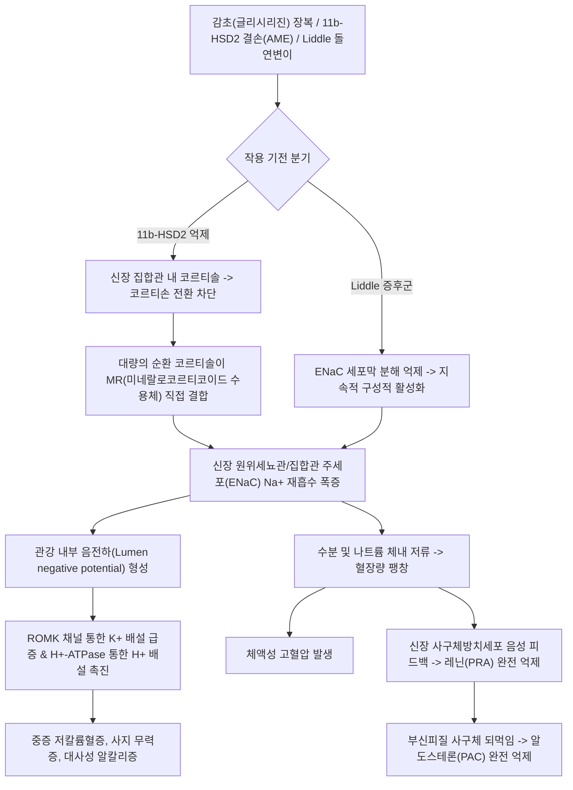
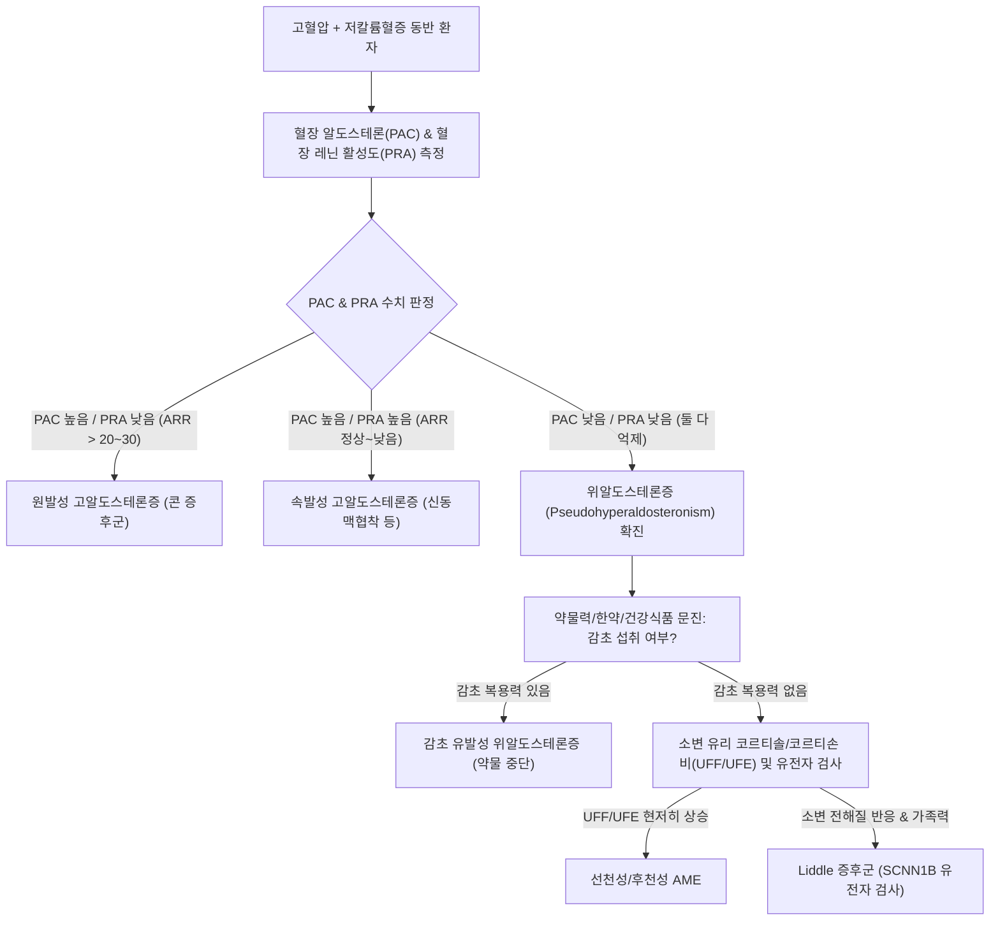

# 🩺 위알도스테론증 (Pseudohyperaldosteronism)

> **핵심 3줄 요약 (Key Summary)**:
> - 📍 병소 부위 & 해부·병태생리: 혈장 [[알도스테론]] 농도는 정상이거나 억제되어 있음에도 불구하고, 신장 집합관의 미네랄로코르티코이드 수용체(MR)가 부적절하게 활성화되거나 상피성 나트륨 통로(ENaC)가 과활성화되어 고알도스테론혈증과 동일한 병태(나트륨 저류, 칼륨 배설)를 나타내는 증후군.
> - 🚩 전형적 임상 양상: 약제 불응성 [[고혈압]], 저칼륨혈증에 기인한 근력 쇠약 및 하지 마비, 다뇨 및 다음, 부종, 두통.
> - 🛠️ 핵심 검사 & 치료 전략: 혈장 알도스테론(PAC) 및 혈장 레닌 활성도(PRA) 동시 측정(둘 다 현저히 저하/억제 확인); 원인별 감별(감초/글리시리진 복용력 문진, AME 선별, Liddle 증후군 유전자 검사); 감초 즉각 중단, [[아밀로라이드]]/트리암테렌 등 ENaC 차단제 투여.
> - ⚠️ 응급 의뢰 레드플래그: 혈청 K+ < 2.5 mEq/L로 인한 치명적 부정맥(Torsades de pointes, 심실세동), 전신 이완성 마비, 고혈압성 뇌증.

---

## 📌 목차
1. [질환 개요 & 해부학적 병태생리](#1-질환-개요--해부학적-병태생리)
2. [병태생리 메커니즘 & 생체역학적 악순환 네트워크](#2-병태생리-메커니즘--생체역학적-악순환-네트워크)
3. [임상 증상 & 이학적 검사(Physical Exam) 알고리즘](#3-임상-증상--이학적-검사physical-exam-알고리즘)
4. [감별 진단 매트릭스 (Differential Diagnosis)](#4-감별-진단-매트릭스-differential-diagnosis)
5. [한의 통합 치료 프로토콜 (침·약침·추나·한약)](#5-한의-통합-치료-프로토콜-침약침추나한약)
6. [양방 치료 & 병용·의뢰 기준 (Conventional Treatment & Referral)](#6-양방-치료--병용의뢰-기준-conventional-treatment--referral)
7. [재활 운동 & 생활습관 티칭 가이드](#7-재활-운동--생활습관-티칭-가이드)
8. [💡 사용자 진료실 핵심 필기 & 임상 노하우 (Melt-In 잔여 심화 집약)](#8--사용자-진료실-핵심-필기--임상-노하우-melt-in-잔여-심화-집약)
9. [출처 및 학술 참고 문헌 (References)](#9-출처-및-학술-참고-문헌--references)

---

## 1. 질환 개요 & 해부학적 병태생리

* **정의**: 위알도스테론증(Pseudohyperaldosteronism)은 임상적으로 고혈압, 저칼륨혈증, 대사성 알칼리증 등 원발성 [[고알도스테론증]](콘 증후군)과 완전히 동일한 전해질 및 혈역학적 이상을 보이지만, 체내 혈장 알도스테론(PAC)과 혈장 레닌 활성도(PRA)는 모두 억제(Low-Renin, Low-Aldosterone)되어 있는 질환군이다.
* **해부학적 병소 및 발병 기전별 분류**:
  * **외인성 글리시리진(Glycyrrhizin, 감초 추출물) 섭취 (가장 흔함)**:
    * 병소: 신장 피질집합관(Cortical Collecting Duct) 주세포(Principal cells).
    * 기전: 감초의 주성분인 글리시리진 및 글리시레트산(Glycyrrhetinic acid)이 $11\beta$-수산화스테로이드 탈수소효소 2형($11\beta$-HSD2)을 가역적으로 억제한다. 정상 상태에서는 $11\beta$-HSD2가 미네랄로코르티코이드 수용체(MR)에 작용하려는 [[코르티솔]]을 비활성형인 코르티손으로 전환시켜 보호하지만, 효소가 차단되면 혈중에 알도스테론보다 100~1,000배 높은 농도로 존재하는 코르티솔이 MR에 무차별 결합하여 강력한 알도스테론 유사 작용을 발휘한다.
  * **선천성 가성 미네랄로코르티코이드 과다증 (Apparent Mineralocorticoid Excess, AME)**:
    * $11\beta$-HSD2 유전자(HSD11B2)의 상염색체 열성 기능상실 돌연변이. 소아기부터 중증 악성 고혈압, 신석회화증 발생.
  * **리들 증후군 (Liddle Syndrome)**:
    * 신장 집합관 상피성 나트륨 통로(ENaC) $\beta$ 또는 $\gamma$ 소단위체 유전자(SCNN1B, SCNN1G)의 기능획득 돌연변이. ENaC이 Nedd4-2 단백질에 의해 세포내이입(Endocytosis) 분해되지 못하고 세포막에 지속 잔류하여 알도스테론과 무관하게 나트륨을 무제한 재흡수함.
  * **데옥시코르티코스테론(DOC) 과다 분비**:
    * 11$\beta$-수산화효소 결핍증, 17$\alpha$-수산화효소 결핍증(선천성 부신 과형성증) 또는 부신 종양에서 비알도스테론성 미네랄로코르티코이드 전구물질인 DOC 과다 생성.

---

## 2. 병태생리 메커니즘 & 생체역학적 악순환 네트워크

---

## 3. 임상 증상 & 이학적 검사(Physical Exam) 알고리즘

### 1) 주요 임상 증상
* **심혈관계**:
  * 3제 이상의 항고혈압제에도 조절되지 않는 저항성 [[고혈압]], 두통, 심계항진.
  * 안면 부종 및 하지 함요부종.
* **신경근육계 (저칼륨혈증 관련)**:
  * 전신 무력감, 사지 말단 저림, 계단을 오르기 힘든 근위부 근력 약화.
  * 혈청 칼륨 2.5 mEq/L 미만 시 급성 이완성 마비(Hypokalemic periodic paralysis), 횡문근융해증(Rhabdomyolysis).
* **비뇨기계 및 대사계**:
  * 신성 요붕증 유사 상태(칼륨 결핍으로 인한 신장 집합관 요농축능 장애)로 인한 다뇨(Polyuria), 야간뇨, 다음(Polydipsia).
  * 대사성 알칼리증으로 인한 저칼슘혈증 유사 손발 경련(Tetany).

### 2) 진단 알고리즘

---

## 4. 감별 진단 매트릭스 (Differential Diagnosis)

| 감별 질환 | 혈장 레닌(PRA) | 혈장 알도스테론(PAC) | 혈청 코르티솔 | 특징적 원인/소견 | 스피로노락톤 반응 |
| :--- | :--- | :--- | :--- | :--- | :--- |
| **감초 유발 위알도스테론증** | **억제 (Low)** | **억제 (Low)** | 정상 (단, 신장내 활성↑) | 감초 추출물/쌍화탕/진해거담제 장복 | 효과 있음 (MR 길항) |
| **리들 증후군 (Liddle)** | **억제 (Low)** | **억제 (Low)** | 정상 | SCNN1B 돌연변이, 조기 발병 가족력 | **효과 없음** (아밀로라이드만 유효) |
| **원발성 [[고알도스테론증]]** | **억제 (Low)** | **현저히 상승 (High)** | 정상 | 부신 선종(Conn) 또는 양측 과형성 | 뛰어남 (표준 치료) |
| **쿠싱 증후군 (이소성 ACTH)** | 억제 (Low) | 억제 (Low) | **극단적 상승 (High)** | 문페이스, 자색선조, 근위부 근위축 | 케토코나졸, 메티라폰 등 |
| **선천성 부신 과형성증 (11$\beta$-OHD)** | 억제 (Low) | 억제 (Low) | 저하 | DOC 상승, 남성화(안드로겐 상승) | 스테로이드 억제요법 |

---

## 5. 한의 통합 치료 프로토콜 (침·약침·추나·한약)

> 🚨 **핵심 임상 주의 (한의 진료실 필독)**: 위알도스테론증 환자 대다수는 한약재 **[[감초]](甘草, Glycyrrhiza uralensis)** 또는 감초가 포함된 엑스제, 쌍화탕, 십전대보탕, 일반의약품 목캔디/진해제를 장기 복용하여 발생한다. 한의학적 치료의 제1원칙은 **일체의 감초 함유 한약재 즉각 전면 중단**이다.

### 1) 치료 원칙 및 감초 배제 원칙
* 환자가 복용 중인 모든 탕약, 환약, 엑스제 성분을 확인하고 **감초(甘草) 성분을 100% 제거(감초 거/탈 감초)**한다.
* 체내에 저류된 나트륨과 수분을 삼습이뇨(滲濕利尿)시키고, 손상된 진액과 음혈을 보충하여 전해질 항상성을 회복시킨다.

### 2) 변증 분류
* **수습정체·간양상항(水濕停滯·肝陽上亢)**: 체액 저류로 인한 부종, 저항성 고혈압, 안면홍조, 어지럼증, 두통, 설홍태백니, 맥현활.
* **기음양허·비신허약(氣陰兩虛·脾腎虛弱)**: 만성 저칼륨혈증으로 인한 사지 무력, 하지 마비감, 심한 피로, 구갈, 다뇨, 설담반치흔, 맥세약.

### 3) 침구 치료
* **주요 혈위**:
  * 이뇨 및 체액 균형 조절: [[수분]](CV9), [[음릉천]](SP9), [[삼음교]](SP6), [[방광수]](BL28).
  * 혈압 안정 및 간양 억제: [[태충]](LR3), [[곡지]](LI11), [[풍지]](GB20), [[족삼리]](ST36).
  * 근육 무력증 및 마비 개선: [[양릉천]](GB34), [[현종]](GB39), [[위중]](BL40).
* **자침 기법**: 수분·음릉천에는 사법(瀉法) 자침으로 수습 배출 촉진, 사지 근위부 혈위에는 평보평사.

### 4) 한약 처방 (무감초 처방 설계 필수)
* **오령산(五苓散) 무감초 처방 (去감초)**:
  * 수분 정체와 부종, 혈압 상승을 개선하는 대표적 이뇨 방제. (택사, 복령, 백출, 저령, 육계).
* **저령탕(猪苓湯)**:
  * 체액 저류와 요량 이상을 다스리며 신장 삼투 조절을 보조. (저령, 복령, 택사, 활석, 아교).
* **사물탕(四物湯) 합 생맥산(生脈散) 무감초 가감**:
  * 저칼륨혈증으로 고갈된 진액과 음혈을 보충하고 근육 무력 회복. (숙지황, 당귀, 백작약, 천궁, 맥문동, 인삼, 오미자 - 감초 제외).

---

## 6. 양방 치료 & 병용·의뢰 기준 (Conventional Treatment & Referral)

* **약물 치료 (Medication)**:
  * **원인 약제 즉각 중단**:
    * 감초, 감초산, 카르베녹솔론(Carbenoxolone), 씹는 담배 등 일체 중단. (중단 후 신장 11$\beta$-HSD2 효소 활성이 회복되는 데 통상 2~6주, 길게는 수개월 소요).
  * **칼륨 보충 요법**:
    * 경구 염화칼륨(KCl 20~40 mEq/day) 또는 중증 시 정맥 K+ 수액 투여.
  * **표적 이뇨제 선택 (원인별 차별화)**:
    * **감초 유발성 / AME**: 미네랄로코르티코이드 수용체 길항제인 **[[스피로노락톤]](Spironolactone 50~200 mg/day)** 또는 에플레레논(Eplerenone)이 매우 효과적.
    * **리들 증후군 (Liddle Syndrome)**: 알도스테론 수용체 차단제는 효과가 없으며, ENaC 직접 억제제인 **[[아밀로라이드]](Amiloride 5~20 mg/day)** 또는 트리암테렌(Triamterene)을 투여해야만 나트륨 재흡수가 차단됨.
* **한의 병용 및 주의사항**:
  * 감초 유발 환자에게 한약 치료 병용 시 조제 내역서에 '감초 무함유'를 명시하여 양방 신장내과와의 소통 신뢰 확보.
  * 칼륨 보충제 복용 중 칼륨이 지나치게 급상승하지 않도록 주 1회 혈청 전해질 추적.
* **양방·전문과 의뢰 기준 (Referral Criteria)**:
  * **응급 전원 (Red Flag)**:
    * 혈청 K+ < 2.5 mEq/L (심전도상 U파 출현, QT 연장, 심실 부정맥 위험).
    * 사지 완전 마비로 기립/보행 불능 상태.
    * 수축기 혈압 > 180 mmHg 또는 확장기 > 110 mmHg의 악성 고혈압.
  * 감초 복용력이 전혀 없는 젊은 연령의 저레닌-저알도스테론 환자는 희귀 유전성 질환(Liddle 증후군, AME) 감별을 위해 대학병원 신장내과/내분비내과 정밀 의뢰.

---

## 7. 재활 운동 & 생활습관 티칭 가이드

* **식품 및 영양제 라벨 전수 검사 티칭**:
  * 환자가 마시는 한방차(생맥산차, 쌍화차, 감초차), 목캔디, 한방 소화제, 숙취해소제, 일부 젤리/캔디에 '감초 추출물'이나 '글리시리진'이 포함되어 있는지 전수 확인하여 섭취 금지 지도.
* **저염 식이 및 고칼륨 식이**:
  * 나트륨 섭취 제한(하루 소금 5g 미만)은 ENaC을 통한 칼륨 배설을 줄이는 데 결정적 역할을 함.
  * 바나나, 토마토, 시금치 등 칼륨 풍부 식품 섭취 권장 (단, 신기능 정상 확인 후).
* **근력 회복 운동**:
  * 전해질 수치가 정상화된 후 저강도 밴드 운동 및 걷기부터 점진적 시행 (저칼륨 상태에서 무리한 근력 운동은 횡문근융해증 유발 위험).

---

## 8. 💡 사용자 진료실 핵심 필기 & 임상 노하우 (Melt-In 잔여 심화 집약)

* **한의원 외래에서 감초 유발 위알도스테론증을 놓치는 이유**:
  * 감초는 거의 모든 탕약에 '조화제약(調和諸藥)'으로 2~4g씩 관행적으로 들어간다. 처방 1~2제 복용으로는 대개 문제 되지 않으나, 관절염이나 만성 질환으로 탕약을 수개월~수년간 연속 복용하거나, 시판 쌍화탕 병음료를 매일 2~3병씩 음용하는 고령자, 만성 신부전 경계 환자에서 11$\beta$-HSD2 효소가 포화되어 급격히 발병한다.
  * 고혈압 환자가 갑자기 "다리에 힘이 빠져 주저앉았다"거나 "혈압약을 먹어도 혈압이 170 이상으로 치솟는다"고 하면 가장 먼저 감초 섭취력부터 추적해야 한다.
* **감초 중단 후 회복 지연 현상 (Lag Period)**:
  * 감초 복용을 중단해도 체내 축적된 지질친화성 글리시레트산의 반감기와 $11\beta$-HSD2 효소 활성 복구에 최소 2주에서 최대 2~3개월이 소요된다. 환자에게 "감초를 끊었으니 내일 당장 혈압이 떨어지는 것이 아니라 1달 이상 서서히 회복된다"는 점을 명확히 티칭해야 조급증으로 인한 약물 오남용을 막을 수 있다.

---

## 9. 출처 및 학술 참고 문헌 (References)

* Ruan M, et al. (2026). Clinical risk factors of licorice-induced pseudohyperaldosteronism: a 2026-updated narrative review. *Front Pharmacol*, 17:1492102. PMID: 42292819.

* Almutairi M, et al. (2026 May 15). Pseudo-Hyperaldosteronism After the Ingestion of Licorice Tea: A Case Report. *Cureus*, 18(5):e60312. PMID: 42367449.

* Zhang X, et al. (2026 Jul 9). Liddle syndrome caused by SCNN1B mutation presenting with severe early-onset hypertension and hypokalemia in an adolescent: a case report. *BMC Endocr Disord*, 26(1):145. PMID: 42426704.

---

## 관련 노트

- [[_의학/03_이론/질환/내분비 질환/부신/고알도스테론증|고알도스테론증]]
- [[_의학/03_이론/질환/내분비 질환/부신/부신 부전|부신 부전]]
- [[알도스테론]]
- [[코르티솔]]
- [[감초]]
- [[고혈압]]
- [[오령산]]
