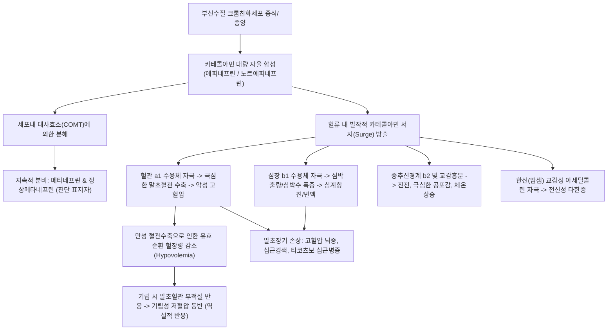
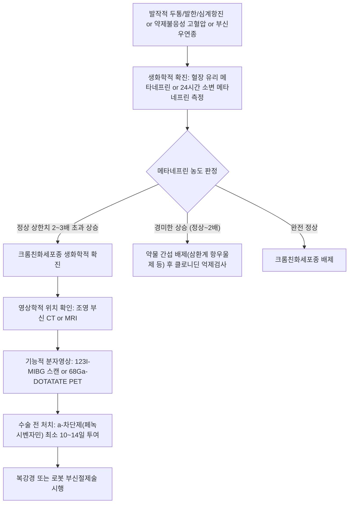

# 🩺 크롬친화세포종 (Pheochromocytoma)

> **핵심 3줄 요약 (Key Summary)**:
> - 📍 병소 부위 & 해부·병태생리: [[부신수질]]의 크롬친화세포(Chromaffin cell)에서 기원하여 카테콜아민(에피네프린, 노르에피네프린, 도파민)을 자율적·발작적으로 대량 분비하는 신경내분비 종양.
> - 🚩 전형적 임상 양상: '발작적 전형 3징(Classic Triad)'인 두통(Headache), 발한(Sweating), 심계항진(Palpitations)과 함께 동반되는 악성 발작성/지속성 [[고혈압]].
> - 🛠️ 핵심 검사 & 치료 전략: 혈장 또는 24시간 소변 유리 분획 메타네프린(Metanephrines) 측정, 복부/부신 CT·MRI 및 123I-MIBG/68Ga-DOTATATE PET; 수술 전 최소 10~14일간 $\alpha$-차단제(페녹시벤자민) 선행 투여 후 필요시 $\beta$-차단제 병용 및 복강경 부신절제술.
> - ⚠️ 응급 의뢰 레드플래그: 수축기 혈압 > 200~250 mmHg의 고혈압 위기, 급성 폐부종, 치명적 부정맥, 심근경색, 뇌출혈 의심 소견 -> 즉각 응급실 후송.

---

## 📌 목차
1. [질환 개요 & 해부학적 병태생리](#1-질환-개요--해부학적-병태생리)
2. [병태생리 메커니즘 & 생체역학적 악순환 네트워크](#2-병태생리-메커니즘--생체역학적-악순환-네트워크)
3. [임상 증상 & 이학적 검사(Physical Exam) 알고리즘](#3-임상-증상--이학적-검사physical-exam-알고리즘)
4. [감별 진단 매트릭스 (Differential Diagnosis)](#4-감별-진단-매트릭스-differential-diagnosis)
5. [한의 통합 치료 프로토콜 (침·약침·추나·한약)](#5-한의-통합-치료-프로토콜-침약침추나한약)
6. [양방 치료 & 병용·의뢰 기준 (Conventional Treatment & Referral)](#6-양방-치료--병용의뢰-기준-conventional-treatment--referral)
7. [재활 운동 & 생활습관 티칭 가이드](#7-재활-운동--생활습관-티칭-가이드)
8. [💡 사용자 진료실 핵심 필기 & 임상 노하우 (Melt-In 잔여 심화 집약)](#8--사용자-진료실-핵심-필기--임상-노하우-melt-in-잔여-심화-집약)
9. [출처 및 학술 참고 문헌 (References)](#9-출처-및-학술-참고-문헌--references)

---

## 1. 질환 개요 & 해부학적 병태생리

* **정의**: 크롬친화세포종(갈색세포종, Pheochromocytoma)은 신경능(Neural crest)에서 기원한 [[부신수질]](Adrenal Medulla)의 크롬친화세포(Chromaffin cell)에 발생하는 종양으로, 카테콜아민(에피네프린, 노르에피네프린, 도파민)을 과잉 생산하여 혈관 수축과 심장 박동 급증을 유도하는 희귀 신경내분비 종양이다. (부신 외 교감신경절/부교감신경절에서 발생한 경우 부신외 갈색세포종 또는 부신경절종 Paraganglioma이라 부른다.)
* **해부학적 위치 및 '10% 법칙(Rule of 10s)'의 현대적 재해석**:
  * 전통적 10% 법칙: 10% 부신 외(Extra-adrenal), 10% 양측성(Bilateral), 10% 악성(Malignant), 10% 소아 발병, 10% 유전성(Familial).
  * 현대 유전체학적 재해석: 현재는 환자의 **35~40% 이상에서 생식세포 유전자 돌연변이(Germline mutation)**가 확인된다.
    * 다발성 내분비선종증 2형(MEN2, RET 유전자).
    * 폰 히펠-린다우 증후군(VHL 유전자).
    * 신경섬유종증 1형(NF1 유전자).
    * 숙신산 탈수소효소 복합체 결손(SDHA, SDHB, SDHC, SDHD 돌연변이, 특히 SDHB는 악성 전이 위험 높음).
* **역학**:
  * 고혈압 환자의 약 0.1~0.6%에서 발견되는 2차성 고혈압의 주요 원인이며, 진단이 늦어지거나 치료받지 못할 경우 치명적인 뇌출혈, 심부전, 악성 고혈압 위기로 사망에 이를 수 있다.

---

## 2. 병태생리 메커니즘 & 생체역학적 악순환 네트워크

* **수용체 반응의 약리학적 함정**:
  * $\alpha$-아드레날린 수용체 차단 없이 $\beta$-차단제를 단독 투여하면, 혈관 확장 작용을 하던 $\beta_2$ 수용체마저 차단되어 $\alpha_1$ 매개 혈관 수축만이 무제한 증폭되어 **치명적인 혈압 급상승(Paradoxical Hypertensive Crisis)**이 발생한다.
  * 따라서 반드시 $\alpha$-차단제를 최소 1~2주간 먼저 투여한 후, 빈맥 조절을 위해 $\beta$-차단제를 순차적으로 추가해야 한다.

---

## 3. 임상 증상 & 이학적 검사(Physical Exam) 알고리즘

### 1) 주요 임상 증상
* **발작적 전형 3징 (Classic Triad)**:
  * **두통(Headache)**: 80% 이상에서 호소하며, 망치로 두드리는 듯한 극심한 박동성 양측성/전두부 두통.
  * **다한증(Sweating)**: 60~70%에서 상체와 얼굴을 흠뻑 적시는 발한 발작.
  * **심계항진(Palpitations)**: 60% 이상에서 심장이 목구멍으로 튀어나올 듯한 빠른 박동.
  * *이 3징이 고혈압 발작과 함께 나타나면 크롬친화세포종에 대한 특이도는 94%에 달한다.*
* **기타 동반 증상**:
  * 창백(Pallor, 혈관수축 반영) 및 발작 종료 후 안면 홍조.
  * 극심한 불안감, 공황발작(Panic attack) 유사 증상, 진전.
  * 만성 체중 감소, 고혈당(카테콜아민의 인슐린 분비 억제 및 당신생 촉진).
  * **역설적 기립성 저혈압**: 지속적인 혈관 수축에 따른 혈장량 고갈로 인해 누웠을 때는 혈압이 200 이상이나 일어서면 어지럼증과 혈압 강하 발생.

### 2) 생화학적 진단 및 영상 알고리즘

---

## 4. 감별 진단 매트릭스 (Differential Diagnosis)

| 감별 질환 | 혈압 양상 | 카테콜아민/메타네프린 | 두통/발한/빈맥 | 감별 핵심 포인트 |
| :--- | :--- | :--- | :--- | :--- |
| **크롬친화세포종** | 발작성 또는 지속성 악성 고혈압 | **2~3배 이상 지속 상승** | **전형 3징 뚜렷** | 부신/부신외 종괴 확인, 고혈당 동반 |
| **[[공황 장애]](Panic Disorder)** | 발작 시 혈압 경미 상승 | 정상 또는 발작 시 일시적 미세상승 | 심계항진, 과호흡 위주 | 발작 사이 메타네프린 정상, 죽을 것 같은 공포감 |
| **본태성 고혈압** | 지속적 고혈압 | 완전 정상 | 드묾 (비특이적) | 표준 항고혈압제(CCB, ARB)에 반응 양호 |
| **원발성 [[고알도스테론증]]** | 지속적 저항성 고혈압 | 완전 정상 | 없음 (무력감, 저칼륨) | ARR 비 상승, 저칼륨혈증, 알도스테론 상승 |
| **[[갑상샘기능항진증]]** | 수축기 고혈압, 맥압 증가 | 정상 | 발한, 빈맥, 체중감소 | Free T4/T3 상승, TSH 억제 |

---

## 5. 한의 통합 치료 프로토콜 (침·약침·추나·한약)

> 🚨 **절대 경고 (Red Flag Alert)**: 크롬친화세포종은 **외과적 절제만이 완치 가능한 내분비 종양**이다. 종양이 존재하는 상태에서 복부를 강하게 누르는 추나, 침, 복진을 시행하면 종양이 물리적으로 압박되어 치명적인 카테콜아민 방출과 고혈압성 뇌출혈 쇼크가 유발될 수 있다. 한의 치료는 양방 수술적 절제가 완료된 후 잔여 자율신경실조증 및 기력 회복을 위한 **수술 후 재활 요법으로 엄격히 한정**한다.

### 1) 수술 후 자율신경 안정 변증 분류
* **심담허겁(心膽虛怯)**: 수술 후에도 지속되는 가슴 두근거림, 불안, 수면장애, 잘 놀람, 설담태박, 맥현세.
* **기음양허(氣陰兩虛)**: 종양 절제 후 만성 교감 항진 상태가 해제되면서 찾아오는 탈진감, 식은땀, 어지럼증, 설홍소태, 맥세약.
* **간신음허·허화상염(肝腎陰虛·虛火上炎)**: 상열감, 안면홍조, 두통 잔여감, 구갈, 설홍소진, 맥세삭.

### 2) 침구 치료 (수술 후 안정기 한정)
* **주요 혈위**:
  * 교감신경 긴장 완화 및 심계 안정: [[내관]](PC6), [[신문]](HT7), [[백회]](GV20), [[안면]](Anmian).
  * 수화기제(水火旣濟) 유도: [[태충]](LR3), [[용천]](KI1), [[삼음교]](SP6), [[곡지]](LI11).
* **자침 기법**: 유침 시간 15~20분, 과도한 강자극을 피하고 평보평사(平補平瀉)로 심신 안정 유도. 복부 배수혈 직접 압박 자침은 피함.

### 3) 한약 처방 (수술 후 회복기)
* **귀비탕(歸脾湯) 가감**: 심비양허(心脾兩虛)로 인한 불면, 건망, 두근거림, 만성 피로 회복. (당귀, 용안육, 산조인, 원지, 인삼, 황기, 백출, 복신, 목향, 감초).
* **천왕보심단(天王補心丹)**: 심음 부족과 허화로 인한 가슴 답답함, 번조, 수면 불량을 다스림. (생지황, 현삼, 맥문동, 천문동, 백자인, 산조인, 당귀, 오미자).
* **자음강화탕(滋陰降火湯)**: 허열이 오르고 식은땀이 나는 잔여 교감신경 흥분 상태 완화.

---

## 6. 양방 치료 & 병용·의뢰 기준 (Conventional Treatment & Referral)

* **수술 전 약물 준비 (Preoperative Blockade, 필수 지침)**:
  * **1단계: $\alpha$-아드레날린 수용체 차단 (최소 10~14일간 선행)**:
    * 비선택적 비가역적 $\alpha$-차단제인 **페녹시벤자민(Phenoxybenzamine)** 10mg bid로 시작하여 기립성 저혈압이 발생하지 않는 한도 내에서 20~100mg/day까지 점진적 증량.
    * 대체제: 선택적 $\alpha_1$-차단제인 독사조신(Doxazosin 2~16mg/day), 프라조신.
  * **2단계: 고염식이 및 체액 팽창 (Volume Expansion)**:
    * $\alpha$-차단 후 확장된 혈관에 충분한 순환 혈류량을 채우기 위해 수술 3~4일 전부터 식염수 수액 주입 및 고염식 섭취 지도.
  * **3단계: $\beta$-아드레날린 수용체 차단 (선택적 추가)**:
    * $\alpha$-차단제 투여 후에도 빈맥(HR > 90~100회/분)이 지속될 때에만 프로프라놀롤(Propranolol) 또는 아테놀롤 추가. **(절대 선행 단독 투여 금기!)**
* **외과적 치료 (Definitive Surgery)**:
  * 복강경 또는 로봇 보조하 부신절제술(Adrenalectomy)이 표준 술식.
  * 종양 크기 > 6cm이거나 악성 침윤 의심 시 개복 수술 시행.
* **의뢰 기준 (Referral Criteria)**:
  * 발작적 두통, 다한증, 심계항진과 함께 고혈압이 조절되지 않는 환자는 즉각 상급종합병원 내분비내과로 의뢰하여 메타네프린 선별검사 시행.
  * 수축기 혈압 220 mmHg 초과의 고혈압 위기 시 니트로프루시드(Nitroprusside) 또는 펜톨라민(Phentolamine) IV 처치를 위해 119 응급 후송.

---

## 7. 재활 운동 & 생활습관 티칭 가이드

* **발작 유발 요인(Triggers) 철저 회피**:
  * 진단 및 수술 전 환자는 교감신경을 자극하는 행동을 엄격히 피해야 함.
  * 유발 음식/약물: 티라민 풍부 식품(숙성 치즈, 적포도주, 훈제육), 카페인, 슈도에페드린(감기약), 에페드린, 삼환계 항우울제.
  * 유발 신체 행동: 과도한 복압 상승(무거운 물건 들기, 심한 변비 시 힘주기, 윗몸일으키기), 꽉 끼는 복대 착용.
* **수술 후 장기 추적관찰**:
  * 수술 후 10년 이상 지나도 재발하거나 악성 전이가 발생할 수 있으므로, 최소 10년간 매년 혈압 및 소변 메타네프린 추적검사 필수.
  * 유전성 돌연변이 확인 시 직계 가족에 대한 유전 상담 권고.

---

## 8. 💡 사용자 진료실 핵심 필기 & 임상 노하우 (Melt-In 잔여 심화 집약)

* **공황장애(Panic Disorder)로 오진되어 내원하는 사례 경계**:
  * "가슴이 쿵쾅거리고 식은땀이 나며 죽을 것 같은 공포감이 든다"며 한의원에 화병이나 공황장애로 내원하는 환자 중, 발작 시 혈압이 180~200 이상으로 솟구친다면 반드시 크롬친화세포종을 의심해야 한다.
  * 진정한 공황발작은 과호흡과 공포감이 주도하지만, 크롬친화세포종은 **두통과 식은땀, 안면 창백, 극심한 혈압 상승**이 신체 증상으로 선행한다는 결정적 차이가 있다.
* **복진(腹診) 및 마사지 금기 원칙**:
  * 진료실에서 원인 불명의 발작성 고혈압 환자에게 늑골하부나 명치, 측복부를 깊숙이 압진하는 행위는 종양에 마사지를 가하는 것과 같아 그 자리에서 고혈압 위기를 유발할 수 있다. 의심 환자는 복부 촉진을 최소화하고 혈액/소변 검사로 직행시켜야 한다.

---

## 9. 출처 및 학술 참고 문헌 (References)

* Al-Zuhairy S, et al. (2026 Oct 10). Crossing the Threshold to Emergency Surgery: Robot-Assisted Adrenalectomy for Refractory Pheochromocytoma Crisis. *Am Surg*, 92(10):1456-1463. PMID: 42858242.

* Timmers HJLM, et al. (2026 Oct 1). 'Paraganglioma and pheochromocytoma: a review of current guidelines, new diagnostic and therapeutic approaches'. *Endocr Relat Cancer*, 33(10):R211-R228. PMID: 42820462.

* Sarafidis P, et al. (2026 Jan 1). Clinical course and management of adrenal endocrine hypertension: A single-center experience. *Endocr Regul*, 60(1):15-24. PMID: 42762504.

---

## 관련 노트

- [[_의학/03_이론/질환/내분비 질환/부신/비기능성 부신 종괴|비기능성 부신 종괴]]
- [[_의학/03_이론/질환/내분비 질환/부신/고알도스테론증|고알도스테론증]]
- [[_의학/03_이론/질환/내분비 질환/부신/부신 부전|부신 부전]]
- [[부신수질]]
- [[고혈압]]
- [[공황 장애]]
- [[갑상샘기능항진증]]
