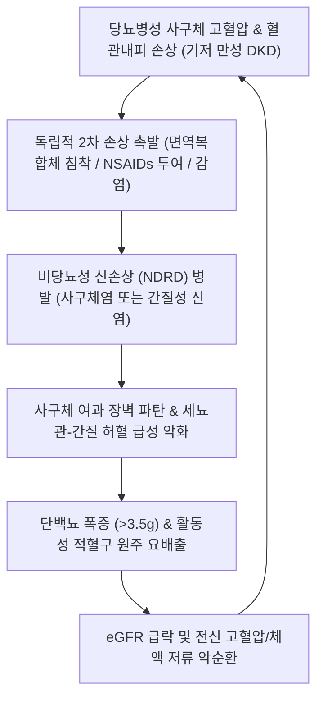

# 🩺 당뇨병성 + 비당뇨성 중복 손상 (Superimposed Diabetic & Non-Diabetic Renal Disease / 糖尿病兼發水腫·消渴淋證)

> **핵심 3줄 요약 (Key Summary)**:
> - 📍 병소 부위 & 해부·병태생리: 당뇨병 환자의 신장에서 기저의 당뇨병성 사구체 경화증(Kimmelstiel-Wilson 결절, 기저막 비후) 위에 IgA 신증, 막성 신병증, 미세변화 신질환, 루푸스 신염, 급성 간질성 신염(AIN) 등 독립적인 비당뇨성 신장 질환(Non-Diabetic Renal Disease, NDRD)이 동시에 병발하여 가속화된 사구체 여과율 저하를 초래하는 복합 병소이다.
> - 🚩 전형적 임상 양상: 당뇨병 유병 기간이 짧거나(5년 미만) 당뇨망막병증이 동반되지 않음에도 불구하고 갑작스러운 신증후군 수준의 대량 단백뇨(>3.5g/day), 활동성 요침사 소견(현미경적 혈뇨, 적혈구 원주), 사구체여과율(eGFR)의 급격한 악화, 불명확한 전신 발진 및 호산구 증가증이 나타난다.
> - 🛠️ 핵심 검사 & 치료 전략: 경피적 신장 생검(Renal Biopsy)으로 조기 확진(Pieczaba et al., 2026)하며, 당뇨병 단독 치료(SGLT2 억제제, ARB) 외에 NDRD 병인에 따른 면역억제 요법(스테로이드, 면역글로불린)을 신속히 병용하고, 한의학적으로는 온신건비(溫腎健脾)·활혈화어(活血化瘀) 원리에 따라 침치료([[신수]], [[비수]], [[음릉천]], [[삼음교]])와 방기황기탕·오령산·온담탕 투여를 통합 적용한다.
> - ⚠️ 응급 의뢰 레드플래그: 급속 진행성 사구체신염(RPGN) 의심 징후(수일~수주 내 혈청 크레아티닌 2배 이상 급상승, 무뇨증/핍뇨), 폐출혈을 동반한 호흡곤란(Goodpasture 또는 ANCA 연관 혈관염 의심), 약물 유발성 급성 간질성 신염에 따른 급성 신부전 발생 시 즉시 상급병원 신장내과 응급실로 전원한다.

---

## 📌 목차
1. [질환 개요 & 해부학적 병태생리](#1--질환-개요---해부학적-병태생리)
2. [병태생리 메커니즘 & 생체역학적 악순환 네트워크](#2--병태생리-메커니즘---생체역학적-악순환-네트워크)
3. [임상 증상 & 이학적 검사(Physical Exam) 알고리즘](#3--임상-증상---이학적-검사-physical-exam--알고리즘)
4. [감별 진단 매트릭스 (Differential Diagnosis)](#4--감별-진단-매트릭스--differential-diagnosis-)
5. [한의 통합 치료 프로토콜 (침·약침·추나·한약)](#5--한의-통합-치료-프로토콜--침-약침-추나-한약-)
6. [양방 치료 & 병용·의뢰 기준 (Conventional Treatment & Referral)](#6-양방-치료--병용의뢰-기준-conventional-treatment--referral)
7. [재활 운동 & 생활습관 티칭 가이드](#7--재활-운동---생활습관-티칭-가이드)
8. [💡 사용자 진료실 핵심 필기 & 임상 노하우 (Melt-In 잔여 심화 집약)](#8----사용자-진료실-핵심-필기---임상-노하우--melt-in-잔여-심화-집약-)
9. [출처 및 학술 참고 문헌 (References)](#9--출처-및-학술-참고-문헌--references-)

---

## 1. 질환 개요 & 해부학적 병태생리

### 1) 질환 정의 및 임상적 중요성
* **정의**: 당뇨병성 + 비당뇨성 중복 손상(Superimposed NDRD on Diabetic Kidney Disease, DKD)은 제2형 또는 제1형 당뇨병 환자에서 신기능 저하의 원인이 고혈당에 의한 전형적 당뇨병성 신증(Diabetic Nephropathy)뿐만 아니라, 독립적인 사구체·세뇨관·간질성 비당뇨성 신장 질환(NDRD)이 중첩되어 나타나는 병태를 말한다.
* **임상적 역학**:
  * 제2형 당뇨병 환자에서 비전형적 신질환 징후로 신장 생검을 시행했을 때, 생검 환자의 약 20~50%에서 NDRD 단독 또는 DKD+NDRD 복합 손상이 확인된다(Pieczaba et al., 2026).
  * 당뇨병성 신증은 점진적으로 비가역적 섬유화로 진행하지만, **NDRD(특히 미세변화 신질환, 막성 신병증, 급성 간질성 신염)는 면역억제 치료 및 유발 약물 중단 시 가역적으로 극적 호전이 가능**하므로 감별 진단이 환자의 투석 지연에 결정적이다.

### 2) 신장 해부학 및 병리조직학적 특징
* **당뇨병성 신증(DKD)의 고전적 소견**:
  * 사구체 기저막(GBM)의 미만성 비후, 메산지움 기질(Mesangial matrix) 확장.
  * 결절성 사구체 경화증(Kimmelstiel-Wilson nodules), 수입/수출 세동맥의 초자양 세동맥경화증(Hyaline arteriolosclerosis).
* **중첩되는 주요 비당뇨성 신질환(NDRD) 유형**:
  * **IgA 신증 (IgA Nephropathy)**: 아시아계에서 가장 흔하며 메산지움 영역의 IgA 면역복합체 침착.
  * **막성 신병증 (Membranous Nephropathy, MN)**: 사구체 상피하(Subepithelial) 면역 침착 및 항-PLA2R 항체.
  * **급성 간질성 신염 (AIN)**: NSAIDs, 항생제, PPI 복용 후 신간질의 림프구·호산구 침윤.
  * **미세변화 신질환 (MCD)**: 족세포 족돌기 융합(Foot process effacement) 및 갑작스러운 대량 단백뇨.

---

## 2. 병태생리 메커니즘 & 생체역학적 악순환 네트워크

### 1) 이중 타격(Two-Hit) 메커니즘
* 당뇨병으로 인해 만성적으로 혈관 투과성이 증가하고 미세혈관 내피세포가 취약해진 신사구체는 순환 혈액 내 면역복합체 침착(IgA, IgG)이나 외인성 약물 독성에 대해 정상 신장보다 훨씬 민감하게 반응하여 급격한 염증성 괴사를 일으킨다.

---

## 3. 임상 증상 & 이학적 검사(Physical Exam) 알고리즘

### 1) NDRD 중복을 강력히 의심해야 하는 비전형적 임상 징후 (Clinical Clues)
* **당뇨망막병증(Diabetic Retinopathy)의 부재**: 당뇨병성 신증 환자의 90% 이상은 당뇨망막병증을 동반한다. 망막병증 없이 단백뇨가 급증하면 NDRD 가능성이 매우 높다(Soliman et al., 2026).
* **짧은 당뇨병 유병 기간**: 당뇨 진단 후 5년 이내에 중증 단백뇨나 신부전 발생.
* **활동성 요침사(Active Urine Sediment)**: 당뇨 단독에서는 드문 현미경적/육안적 혈뇨, 적혈구 원주(RBC casts).
* **사구체여과율(eGFR)의 급격한 악화**: 수개월 내 eGFR >30% 급감.
* **기타 전신 징후**: 원인 불명의 발열, 피부 발진, 관절통(자가면역/혈관염 의심).

### 2) 진단 검사 프로토콜
* **요검사 및 단백뇨 정량**: 단백뇨/크레아티닌 비(UPCR), 소변 침사 현미경 검사.
* **혈청 면역학적 검사**: ANCA, 항-GBM 항체, ANA, 보체(C3/C4), 항-PLA2R 항체, 혈청 단백전기영동(SPEP/UPEP - 다발골수종 배제).
* **신장 초음파 (Renal Sonography)**: 신장 크기 측정(당뇨 단독은 신장이 정상이거나 커져 있음).
* **신장 생검 (Renal Biopsy)**: 확진을 위한 표준 필수 검사.

---

## 4. 감별 진단 매트릭스 (Differential Diagnosis)

| 감별 질환 | 핵심 감별점 및 특징 | 구체적 차이점 |
| :--- | :--- | :--- |
| **전형적 당뇨병성 신증 ([[당뇨병]])** | 10년 이상의 유병 기간, 미세알부민뇨 $\rightarrow$ 현성 단백뇨로 서서히 진행 | 당뇨망막병증 거의 항상 동반, 혈뇨나 적혈구 원주 없음 |
| **IgA 신증 중복** | 상기도 감염 후 수일 내 육안적 혈뇨, 높은 혈뇨 빈도 | 조직 생검 상 메산지움 IgA 침착 확인 |
| **막성 신병증 중복** | 망막병증 없이 급작스러운 성인형 신증후군 | 혈청 항-PLA2R 항체 양성률 높음 |
| **약물성 급성 간질성 신염** | NSAIDs, 항생제 복용 후 혈청 크레아티닌 급등 | 무균성 농뇨, 요중 호산구 증가, 약물 중단 시 회복 |
| **고혈압성 신경화증** | 오랜 본태성 고혈압 병력, 경미한 단백뇨(<1g) | 대량 단백뇨나 급격한 eGFR 감소 드묾 |

---

## 5. 한의 통합 치료 프로토콜 (침·약침·추나·한약)

### 1) 임상 원칙
* 신장 생검을 통한 양방적 정밀 진단과 면역억제 치료가 우선시되어야 하며, 한의 치료는 **사구체 염증 완화, 단백뇨 감소 보조, 신혈류 개선, 스테로이드 부작용 완충**에 집중한다.

### 2) 변증 분류
* **비신양허(脾腎陽虛)**: 전신 부종이 심하고 허리와 무릎이 시리고 시리며 소변량이 줄고 대변이 묽음. (설담태백, 맥침세무력)
* **기음양허(氣陰兩虛)**: 피로하고 목이 마르며 손발바닥에 미열이 있고 소변에 거품이 많음. (설홍소태, 맥세삭)
* **어혈저체(瘀血阻滯)**: 얼굴빛이 검고 입술이 자색이며 혀에 어반이 있고 하지 부종이 단단함. (설자암, 맥삽)
* **습열하주(濕熱下注)**: 소변이 붉고 찌릿하며 거품뇨와 함께 미열과 갈증이 있음. (설홍태황니, 맥활삭)

### 3) 침구 치료
* **주요 혈위**: [[신수]](BL23), [[비수]](BL20), [[삼초수]](BL22), [[음릉천]](SP9), [[삼음교]](SP6), [[족삼리]](ST36), [[태계]](KI3), [[수분]](CV9), [[기해]](CV6).
* **자침 기법**:
  * 이수소종 및 수분 대사 개선: 음릉천-수분, 비수 자침으로 수습(水濕) 정체 배출.
  * 사구체 미세순환 촉진: 신수-태계 자침으로 신기(腎氣) 자양.
  * 사관혈(합곡-태충): 전신 기혈 순환 촉진.

### 4) 약침 치료
* **자하거 약침**: 비신양허형 환자에게 신수(BL23), 관원(CV4)에 각 0.5cc 주입하여 신사구체 재생 및 기혈 보양.
* **황련해독탕 약침**: 습열 및 활동성 사구체 염증 단계에서 풍지(GB20), 곡지(LI11)에 소량 시술.

### 5) 한약 처방 프로토콜
* **방기황기탕(防己黃耆湯) 합 오령산(五苓散)**: 비허습곤형 전신 부종, 단백뇨, 핍뇨 개선의 1차 기본방.
* **온담탕(溫膽湯) 합 대황가감방**: 신부전으로 인한 요독성 담음(Uremic toxins) 정체 배출 및 신사구체 경화 억제.
* **육미지황탕(六味地黃湯) 합 수질·삼칠**: 기음양허 및 어혈형 만성 사구체 경화 억제.

---

## 6. 양방 치료 & 병용·의뢰 기준 (Conventional Treatment & Referral)

### 1) 질환 특이적 면역억제 요법
* **미세변화 신질환/막성 신병증**: 경구 스테로이드(Prednisolone) 또는 칼시뉴린 억제제(Cyclosporine/Tacrolimus), Rituximab 투여.
* **급성 간질성 신염 (AIN)**: 원인 약물(NSAIDs 등) 즉각 중단 및 단기간 스테로이드 투여.
* **IgA 신증**: 스테로이드 및 면역글로불린, SGLT2 억제제 병용.

### 2) 기저 당뇨병성 신손상 보호 약제
* **SGLT2 억제제 (Dapagliflozin, Empagliflozin)** 및 **GLP-1 RA (Semaglutide, Pedagogos et al., 2026)**: 사구체 내압 감소 및 심신보호(Cardiorenal protection).
* **비스테로이드성 무기질코르티코이드 수용체 길항제 (Finerenone)**: 신간질 섬유화 및 염증 억제.

### 3) 응급 전원 기준
* 당뇨 환자에서 갑자기 소변에 피가 섞여 나오거나 거품뇨가 폭발적으로 증가할 때.
* 1~2주 만에 혈청 크레아티닌 수치가 급격히 치솟는 급성 신부전 상태.
* 호흡곤란 및 요독성 뇌병증(의식 저하, 근간대경련) 동반 시 즉시 신장내과 응급 의뢰.

---

## 7. 재활 운동 & 생활습관 티칭 가이드

* **철저한 저염 식이 (단 하루 소금 5g 미만)**: 사구체 고혈압 완화 및 부종 억제.
* **적정 단백질 섭취 제한**: 진행성 신부전 시 0.6~0.8g/kg/day 유지.
* **신독성 약물 철저 차단**: 감기약, 진통소염제(NSAIDs), 성분 불명의 민간요법제 절대 복용 금지.

---

## 8. 💡 사용자 진료실 핵심 필기 & 임상 노하우 (Melt-In 잔여 심화 집약)

* **당뇨 환자 신장 질환의 '비망막병증 단백뇨' 함정**:
  * "당뇨 환자가 단백뇨가 나오면 다 당뇨 합병증이겠거니" 하고 혈당만 조절하면 투석 시기를 앞당긴다.
  * 안과 검진에서 안저에 출혈이나 삼출물이 전혀 없는데(망막병증 음성), 소변에 거품이 쏟아져 나온다면 이것은 당뇨병성 신증이 아니라 치료 가능한 다른 신장병(NDRD)이 겹친 것이다. 반드시 신장내과로 보내 신장 조직검사를 받게 해야 환자의 콩팥을 살릴 수 있다.

---

## 9. 출처 및 학술 참고 문헌 (References)

1. Pieczaba M. (2026). Reappraising Kidney Biopsy in Diabetic Kidney Disease: Histopathology, Clinical Course, and the Future of Precision Nephrology. *J Clin Med*. PMID: 42513273

2. Soliman AR. (2026). From fundus to filtration: AI-driven retinal phenotyping as a framework for non-invasive prediction of kidney pathological categories (the virtual renal biopsy concept)- a narrative review. *Int Urol Nephrol*. PMID: 42736511

3. Pedagogos E. (2026). Semaglutide in type 2 diabetes and chronic kidney disease in Australia: practical clinical considerations from a multidisciplinary panel. *Intern Med J*. PMID: 42813318

---

## 관련 노트

- [[_의학/03_이론/질환/대사 질환/전해질·대사증후군/당뇨병|당뇨병]]
- [[_의학/03_이론/질환/신장·비뇨기 질환/당뇨병성 신증|당뇨병성 신증]]
- [[_의학/02_약리/의약품/00_양방약_MOC|양방약 MOC]]
- [[_의학/00_기본의학/01. 레드플래그·응급 감별/척수증·마미증후군_선별_2026-10-12|레드플래그 선별]]
