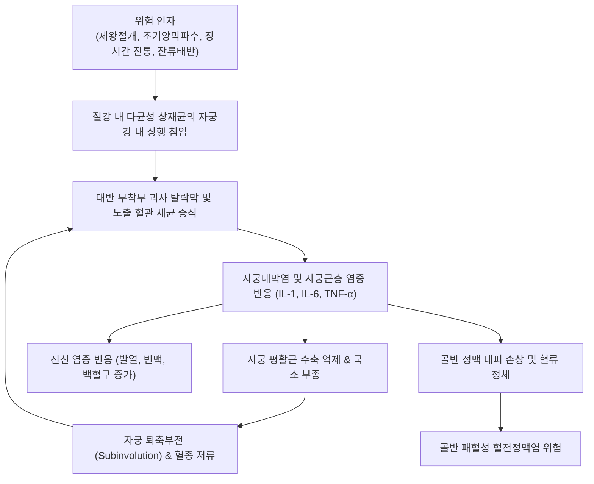
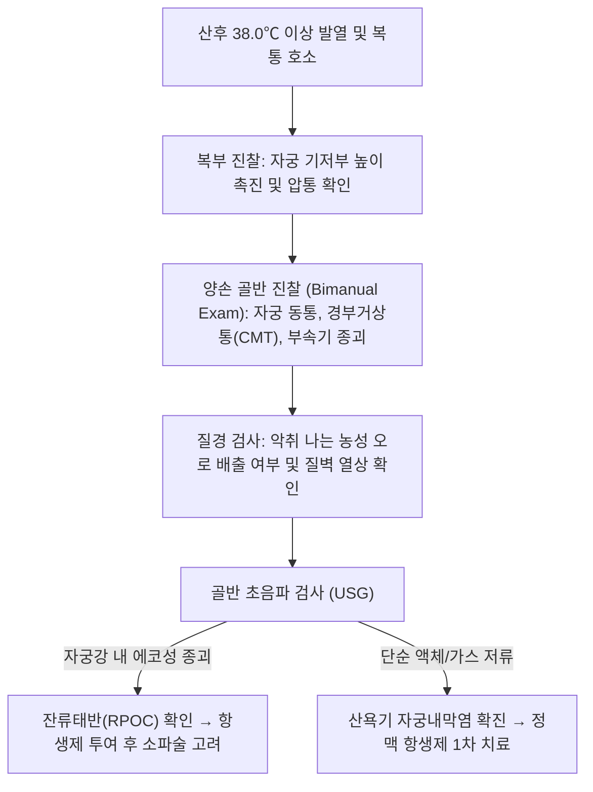

# 🩺 출산 후 자궁 감염 (Postpartum Endometritis / 産褥期 子宮內膜炎)

> **핵심 3줄 요약 (Key Summary)**:
> - 📍 **병소 부위 & 해부·병태생리**: 분만 직후 박리된 자궁태반 부착 부위 및 탈락막(Decidua), 근육층으로 질 내 상재균 및 혐기성균이 상행 침입하여 발생하는 다균성 급성 자궁내막근염(Endomyometritis).
> - 🚩 **전형적 임상 양상**: 분만 후 2~10일 사이 발생하는 38.0℃ 이상의 고열, 하복부 압통 및 자궁 동통, 악취를 동반한 화농성 산후 오로(Lochia), 빈맥, 자궁 퇴축부전.
> - 🛠️ **핵심 검사 & 치료 전략**: 양손진찰을 통한 자궁 압통 확인 및 초음파상 태반잔류물(RPOC) 배제, 비경구 광범위 복합 항생요법(클린다마이신 + 겐타마이신) 즉각 투여, 한의학적 활혈거어·온경산한(생화탕 가감방) 병행.
> - ⚠️ **응급 의뢰 레드플래그**: 지속되는 39℃ 이상 고열과 전신 오한, 패혈성 쇼크 징후(혈압 저하, 빈맥 > 110회/분), 반발통을 동반한 복막자극징후, 적절한 항생제 투여 48~72시간 후에도 지속되는 발열(골반 패혈성 혈전정맥염 또는 골반 농양 의심 시 상급병원 응급 전원).

---

## 📌 목차
1. [질환 개요 & 해부학적 병태생리](#1--질환-개요---해부학적-병태생리)
2. [병태생리 메커니즘 & 생체역학적 악순환 네트워크](#2--병태생리-메커니즘---생체역학적-악순환-네트워크)
3. [임상 증상 & 이학적 검사 알고리즘](#3--임상-증상---이학적-검사-알고리즘)
4. [감별 진단 매트릭스](#4--감별-진단-매트릭스)
5. [한의 통합 치료 프로토콜](#5--한의-통합-치료-프로토콜)
6. [양방 치료 & 병용·의뢰 기준](#6-양방-치료--병용의뢰-기준)
7. [재활 운동 & 생활습관 티칭 가이드](#7--재활-운동---생활습관-티칭-가이드)
8. [💡 사용자 진료실 핵심 필기 & 임상 노하우](#8--사용자-진료실-핵심-필기---임상-노하우)
9. [📚 출처 및 현대 학술 연구 요약 (References)](#9--출처-및-현대-학술-연구-요약-references)

---

## 1. 질환 개요 & 해부학적 병태생리

### 1) 질환 정의 및 임상적 중요성
- **출산 후 자궁 감염(산욕기 자궁내막염, Postpartum Endometritis)**은 분만 후 산욕기(Puerperium) 동안 자궁내막, 탈락막 및 하부 평활근층에 발생하는 급성 감염증이다.
- 산욕열(Puerperal fever)의 가장 흔한 원인 질환으로, 분만 24시간 이후부터 10일 이내에 적어도 하루 4회 이상 측정한 구강 체온 중 38.0℃ 이상의 발열이 2회 이상 나타날 때 진단한다.
- 자연 질식 분만(Vaginal delivery) 후에는 발생률이 1~3%에 불과하나, [[제왕절개]](Cesarean section) 분만 후에는 예방적 항생제를 사용하지 않을 경우 최대 15~35%, 예방적 항생제 투여 시에도 3~8%에 달할 정도로 빈도가 급증한다.

### 2) 해부학적 병소 및 침범 경로
- **태반 부착 부위(Placental site)**: 태반이 만출된 직후 자궁벽은 광범위한 노출 혈관, 혈전, 탈락막 괴사 조직으로 덮여 있어 세균 증식의 최적 배지가 된다.
- **상행성 침범(Ascending infection)**: 분만 중 양막 파수, 빈번한 내진, 태아 감시장치 삽입, 수술적 절개 등을 통해 정상 질 및 자궁경부의 상재균이 자궁강 내로 유입된다.
- **파급 경로**:
  - 점막 및 근층 파급: 자궁내막염(Endometritis) → 자궁근염(Myometritis)
  - 혈관 및 림프관 파급: 자궁방조직염(Parametritis) → 골반 복막염(Pelvic peritonitis)
  - 정맥 혈전성 파급: 난소정맥 및 골반정맥 침범 → 패혈성 골반 혈전정맥염(Septic pelvic thrombophlebitis).

### 3) 주요 병인균
- 단일 균주 감염이 아닌 질 내 호기성 및 혐기성 균의 **혼합 다균성 감염(Polymicrobial infection)**:
  - **호기성 그람양성균**: B군 연쇄상구균([[Group B Streptococcus]], GBS), Enterococcus faecalis, Staphylococcus aureus.
  - **호기성 그람음성균**: Escherichia coli, Klebsiella pneumoniae, Proteus mirabilis.
  - **혐기성균**: Bacteroides fragilis 그룹, Prevotella spp., Peptostreptococcus spp., Clostridium spp.
  - **기타 병원체**: Ureaplasma urealyticum, Mycoplasma hominis, 드물게 Chlamydia trachomatis(후기 발현형).

---

## 2. 병태생리 메커니즘 & 생체역학적 악순환 네트워크

### 1) 분자·면역학적 병태 메커니즘
- 세균 내독소(LPS)와 세포벽 성분이 자궁벽 대식세포 및 자궁내막 세포의 TLR(Toll-like receptor)을 자극한다.
- 염증성 사이토카인([[IL-1]], [[IL-6]], [[TNF-alpha]]) 및 케모카인이 폭발적으로 분비되어 호중구를 대량 침윤시킨다.
- 혈관 투과성 증가로 인해 자궁벽의 광범위한 부종과 미세혈전이 형성되며, 평활근의 협조적 수축 기전이 마비된다.

### 2) 자궁 퇴축부전과의 악순환
- 정상적인 산후 자궁은 옥시토신 분비와 근육 수축을 통해 혈관을 지혈하고 자궁강 내 혈액과 탈락막 조각을 오로 형태로 배출한다.
- 염증 반응과 부종으로 인해 근수축이 저해되면 **자궁 퇴축부전(Subinvolution)**이 초래된다.
- 자궁강 내 혈종과 괴사 조직이 정체되면서 혐기성 세균이 폭발적으로 증식하는 치명적 악순환 네트워크가 형성된다.

---

## 3. 임상 증상 & 이학적 검사 알고리즘

### 1) 주요 임상 양상
- **발열 (Fever)**: 분만 후 24~72시간 내에 38.0~39.0℃ 이상의 고열 발생. 제왕절개 후 조기(24~48시간 이내) 발열은 GBS 또는 복합 혐기성균 감염 시 흔함.
- **하복부 동통 및 자궁 압통 (Uterine tenderness)**: 하복부 자궁 부위를 촉진하거나 질식 내진 시 자궁 경부 및 체부에 심한 압통 호소.
- **오로 이상 (Abnormal lochia)**: 악취가 나는 농성 또는 혈농성 오로 배출. (단, Group A Streptococcus 감염 시 악취가 없고 무취의 소량 장액성 오로를 보이며 급격한 패혈증으로 진행할 수 있어 주의).
- **자궁 퇴축부전**: 출산 일수에 비해 자궁 기저부 높이가 높고 자궁이 부드럽고 무르게 만져짐.
- **전신 증상**: 오한, 식욕 부진, 전신 무력감, 두통, 빈맥.

### 2) 이학적 검사 단계별 알고리즘

---

## 4. 감별 진단 매트릭스

| 질환명 | 주 증상 및 징후 | 핵심 감별점 | 초음파 / 영상 소견 | 1차 조치 |
| :--- | :--- | :--- | :--- | :--- |
| **산욕기 자궁내막염** | 산후 38℃ 이상 발열, 하복통, 자궁 압통, 악취 오로 | 양손진찰상 뚜렷한 자궁 압통, 자궁 퇴축부전 | 자궁벽 비후, 강 내 액체/가스 저류 | 클린다마이신 + 겐타마이신 IV |
| **유방염 / 유방울혈** | 유방의 국소적 발적, 열감, 쐐기형 경결, 통증 | 복통 및 자궁 압통 없음, 수유 장애 동반 | 유방 초음파상 농양 여부 확인 | 수유 지속 + 아목시실린/클라불라네이트 |
| **요로감염 / 급성 신우신염** | 발열, 늑골척추각 압통(CVAT), 배뇨통, 빈뇨 | 자궁 압통 경미, 심한 늑골척추각 타진통 | 신장 초음파, 뇨검사상 농뇨·세균뇨 | 3세대 세파계 항생제 IV |
| **골반 패혈성 혈전정맥염** | 항생제 치료 48-72시간 후에도 지속되는 스파이크형 발열 | 자궁 압통 호전에도 발열 지속, 빈맥 | 조영증강 CT/MRI상 난소정맥 내 혈전 | 헤파린 항응고요법 병용 |
| **제왕절개 창상 감염** | 복부 수술 부위 발적, 부종, 열감, 농성 분비물 | 자궁 자체 압통보다 복벽 절개창 국소 통증 | 복벽 초음파상 피하 액체 저류 | 배농, 창상 드레싱, 항생제 |

---

## 5. 한의 통합 치료 프로토콜

### 1) 한의 변증 분류
- **산후 어혈조체형 (産後 瘀血阻滯型)**:
  - 주증: 오로 배출이 원활하지 못하고 암자색 혈괴가 섞여 나옴, 하복부 거안(拒按) 통증, 설암자, 어반, 맥현삽.
  - 치법: 활혈화어(活血化瘀), 온경지통(溫經止痛).
  - 처방: [[생화탕]](生化湯) 가감 (당귀 20g, 천궁 10g, 도인 8g, 건강(포) 6g, 감초(자) 4g, 익모초 15g, 포황 10g).
- **산후 열독치성형 (産後 熱毒熾盛型)**:
  - 주증: 39℃에 달하는 고열, 한출, 악취가 심한 농혈성 오로, 구갈, 변비, 설홍태황조, 맥활삭.
  - 치법: 청열해독(淸熱解毒), 량혈거어(凉血祛瘀).
  - 처방: [[청포탕]](淸胞湯) 또는 해독활혈탕 가감 (금은화 15g, 연교 12g, 포공영 15g, 단삼 12g, 적작약 10g, 목단피 10g, 황련 6g).
- **산후 기혈양허형 (産後 氣血兩虛型)**:
  - 주증: 급성 염증 호전 후 미열 지속, 자궁 퇴축부전, 안면 창백, 자한, 무력감, 설담태백, 맥세약.
  - 치법: 익기보혈(益氣補血), 화어생신(化瘀生新).
  - 처방: [[팔진탕]](八珍湯) 합 생화탕 가감 (황기 15g, 당귀 12g, 백출 10g, 숙지황 10g, 복령 10g, 익모초 12g).

### 2) 침구 치료 프로토콜
- **주요 혈위**:
  - 하복부 국소: [[관원]](CV4), [[기해]](CV6), [[중극]](CV3) — 자궁 기혈 순환 촉진 및 자궁 평활근 정상 퇴축 유도.
  - 경락 원격: [[삼음교]](SP6), [[혈해]](SP10), [[지음]](BL67), [[합곡]](LI4), [[태충]](LR3) — 활혈거어, 청열지통.
- **자침 기법**:
  - 발열 급성기에는 약자침 및 사법 위주로 시술하여 염증 열독을 배출한다.
  - 아급성기 및 퇴축부전기에는 중극·관원 혈에 완만한 온침 또는 간접구를 병행하여 어혈 흡수와 자궁 수축을 촉진한다.

### 3) 약침 요법
- **약침 제제**: 황련해독탕 약침 또는 중성어혈 약침.
- **시술 부위**: [[기해]](CV6), [[관원]](CV4), [[삼음교]](SP6) 각 0.3~0.5cc 주입.
- **효능**: 국소 염증성 사이토카인 억제 및 골반강 미세혈류 순환 개선.

---

## 6. 양방 치료 & 병용·의뢰 기준

### 1) 표준 비경구 항생요법 (Gold Standard)
- 산욕기 자궁내막염으로 진단되면 입원 후 즉각적인 **정맥 항생제(IV Antibiotics)** 투여가 필수적이다.
- **1차 표준 복합 요법**:
  - **[[클린다마이신]] (Clindamycin)** 900 mg IV 매 8시간마다 (혐기성균 및 그람양성균 커버)
  - **+ [[겐타마이신]] (Gentamicin)** 1.5 mg/kg IV 매 8시간마다 (또는 일일 1회 단일 용량 5 mg/kg IV) (장내 그람음성 간균 커버)
  - 치료 성공률 90~95%에 달하는 가장 검증된 1차 조합.
- **신기능 저하 또는 대체 요법**:
  - [[암피실린-설박탐]] (Ampicillin-sulbactam) 1.5~3.0 g IV 매 6시간마다
  - 또는 세포테탄(Cefotetan), 세폭시틴(Cefoxitin) 2 g IV 매 8시간마다.
- **치료 종료 기준**:
  - 발열이 소실되고(무열 상태 37.5℃ 이하), 자궁 압통이 완전히 사라진 후 **최소 24~48시간 동안 유지**되면 정맥 항생제를 중단하고 퇴원할 수 있다. 경구 항생제의 추가 복용은 통상적으로 불필요하다.

### 2) 산과적 처치 및 응급 의뢰 레드플래그
- **초음파상 잔류태반(RPOC) 확인 시**:
  - 항생제 정맥 투여를 시작하여 혈중 농도를 확보한 후, 자궁 천공 위험을 최소화하며 초음파 유도하 흡입소파술(Suction curettage) 시행.
- **치료 불응성 (48~72시간 발열 지속 시)**:
  - Enterococcus 의심 시 **[[암피실린]] (Ampicillin)** 2 g IV 매 6시간 추가.
  - 패혈성 골반 혈전정맥염(Septic pelvic thrombophlebitis) 의심 시 조영 CT 시행 및 헤파린 항응고 요법 즉각 의뢰.

---

## 7. 재활 운동 & 생활습관 티칭 가이드

### 1) 산후 체위 및 오로 배출 관리
- **파울러 체위 (Fowler's position)**:
  - 침상 머리를 30~45도 올린 반좌위를 취하게 하여 자궁강 내에 고인 농성 오로가 중력에 의해 질강 밖으로 원활히 배출되도록 유도한다.
- **보행 격려 (Early ambulation)**:
  - 절대 안정만을 강요하기보다 전신 상태가 허락하는 한 조기 보행을 권장하여 골반 울혈을 예방하고 자궁 수축을 돕는다.

### 2) 위생 및 수유 관리
- **회음부 청결**:
  - 배뇨 및 배변 후 앞에서 뒤쪽으로 세정하고 완전히 건조시켜 대장균의 상행 재감염을 차단한다.
- **수유 유지**:
  - 수유 시 방출되는 내인성 [[옥시토신]]은 자연적인 자궁 수축을 유도하여 오로 배출과 자궁 퇴축에 결정적 도움을 준다. (단, 사용 중인 항생제의 모유 이행성 및 안전성 확인 필요).

---

## 8. 💡 사용자 진료실 핵심 필기 & 임상 노하우

### 1) 진료실 핵심 감별 포인트
- 산후 3~4일차에 산모가 "오한이 나고 아랫배가 쥐어짜듯 아프며 냄새가 난다"고 호소하면 단순 훗배앓이(산후통)로 치부해서는 안 된다.
- 훗배앓이는 자궁을 손으로 지그시 눌렀을 때 산모가 오히려 시원함을 느끼거나 통증이 완화되는 경우가 많지만(희안 喜按), 자궁내막염은 손을 대기만 해도 극심한 통증을 호소하는 거안(拒按) 상태이다.

### 2) 한의-양방 병용 협진 전략
- 38.5℃ 이상의 급성 고열기에는 즉각 상급 산부인과에 정맥 항생제 치료를 의뢰해야 한다.
- 급성 염증이 제어된 직후 자궁 퇴축부전, 만성 골반통, 잔여 오로 부전이 남았을 때 한약 처방([[생화탕]], [[보허탕]])을 투여하면 자궁 평활근의 긴장도를 회복시키고 골반 내 유착 형성을 차단하는 탁월한 협진 시너지를 발휘한다.

---

## 9. 📚 출처 및 현대 학술 연구 요약 (References)

- Rottenstreich M, et al. (2025). Endometritis Following Pregnancy: A Comparative Cohort Study of Cases With and Without RPOC. *J Clin Med*. PMID: 41138849.

- Mackeen AD, et al. (2014). Timing of intravenous prophylactic antibiotics for preventing postpartum infectious morbidity in women undergoing cesarean delivery. *Cochrane Database Syst Rev*. PMID: 25479008.

- Kankuri E, et al. (2003). Development of a prognostic scoring system for predicting hospitalization duration in postpartum endometritis. *Hum Reprod*. PMID: 39732639.
